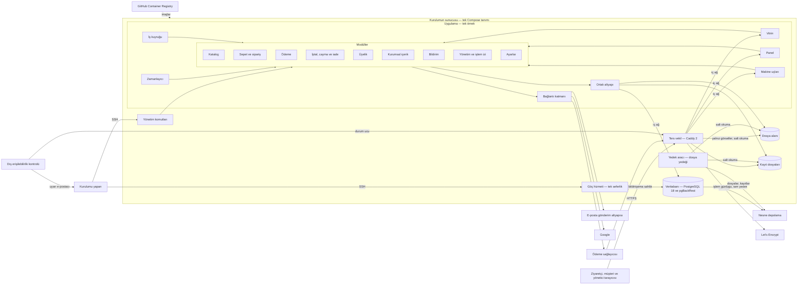

# Shopfolio — Technical Architecture

**Versiyon: v0.48** | **Bağımlılıklar:** `01_PROJECT_VISION.md`, `02_PRODUCT_REQUIREMENTS.md`, `03_USER_FLOWS.md`, `04_UI_SPECS.md`, `10_MVP_SCOPE.md` | **Son güncelleme:** 2026-11-01

> **Aşama:** 4 — Teknik Mimari · **Rol:** Senior Software Architect / System Designer
> **Traceability zorunlu:** Hayır
> **İlke:** Teknik kararlar ürün ihtiyaçlarından **türetilir**. "Şu teknolojiyi kullanmak istiyorum" değil, "şu gereksinimi en iyi karşılayan ne?"

> **Aşama 1'den park edilen girdiler** — kaynak: [`PRODUCT_DISCOVERY_STATUS.md`](PRODUCT_DISCOVERY_STATUS.md) §2, mekanizma: K-36.
> Bu satırlar **talimattır, karar değildir** — bağlayıcı olan kaynak karardır; bu aşamada karara bağlanacak olan, talimatın nasıl uygulanacağıdır.
>
> - **K-10 · Çok kiracılık:** MVP'de çok kiracılık için **hazırlık yapılmaz** — kurulum başına tek firma. Pazaryeri / çok satıcı **kalıcı ürün sınırıdır**; çok kiracılı SaaS post-MVP yol haritası adayıdır ancak mimaride bugün karşılığı yoktur. *Workshop'ta karara bağlandı (2026-10-16): K-929 (büyüme yolu) ve plan konusu TM11-02; yazımı §0.6'da ve §11.3'tedir.*

> **Aşama 2'den park edilen girdiler** — kaynak: [`PRODUCT_DISCOVERY_STATUS.md`](PRODUCT_DISCOVERY_STATUS.md) §2, mekanizma: K-36 (yeri: §8.3 AK0-04).
> Bu satırlar **talimattır, karar değildir** — bağlayıcı olan kaynak karardır; bu aşamada karara bağlanacak olan, talimatın nasıl uygulanacağıdır.
>
> - **K-666 · K-667 · Sitenin kesintisinde süreler:** kesinti sırasında zamanı gelen kendiliğinden işler — kendiliğinden iptal (kart hattında iptal öncesi son sorguyla, `02 §6.1.2`), havale hatırlatması (yalnız havale süresi dönüşte hâlâ işliyorsa; ertelenen iptalde yeni hatırlatma gitmez — K-685), IBAN'ın silinmesi, periyodik imha, e-postanın yeniden denenmesi — site döndüğünde **kaçırdıkları sırayla** çalışır. Havale ödeme süresi kesinti sırasında dolarsa kendiliğinden iptal, sitenin dönüşünden sonraki ilk iş gününün sonuna ertelenir; bu, kesintinin — panelin ve kendiliğinden işlerin çalışmadığı aralığın — tespit edilmesini gerektirir. Tespitin yöntemi bu aşamanın kararıdır (`02 §4.3`, Z-8). *Workshop'ta karara bağlandı (2026-10-16): K-898; yazımı §5.4'tedir.*
> - **K-687 · Giriş kaydının okunduğu yer:** giriş kaydı (`02 §3.13.20`, Z-40) panelde görünmez; ihlal ya da hesap ele geçirme incelemesinde firma onu sistem kayıtlarıyla birlikte kurulumun barındırma tarafında okur (`02 §8.5.1`, §12.2.9). Kaydın ve sistem kayıtlarının nasıl ve kim tarafından okunacağı — erişim yolu, süzme, dışarı alma — bu aşamanın kararıdır. *Workshop'ta karara bağlandı (2026-10-16): K-915, K-917; yazımı §9.1 ve §9.3'tedir.*
> - **Dizin — Aşama 2 kararlarının bu dokümana devirleri:** karar kaydında K-647…K-718'in etki sütunlarında bu dokümanı gösteren yedi atıf (yedi karar) ve Kullanıcı Akışları'nın (`03`) gövdesinde bu dokümana iş bırakan cümleler [`CHECKPOINT_REPORTS/PHASE2_CONFLICT_SCAN.md`](CHECKPOINT_REPORTS/PHASE2_CONFLICT_SCAN.md) §6'dadır; etki sütununda yalnız doküman numarası taşıyan üç atfın işinin adını dizin verir. Devir taraması (`checklists/document-stage.md` §4) buradan başlar; devrin evi karar satırıdır, dizin onu ikinci kez kaydetmez. Aşama 1'in dizini: `PHASE1_CONFLICT_SCAN.md` §6. *Yazım turunun devir taraması dizinin `05` satırlarını her oturumda okur; sonucu karar kaydının §12.2'sindedir.*

> **Aşama 3'ten park edilen girdiler** — kaynak: [`PRODUCT_DISCOVERY_STATUS.md`](PRODUCT_DISCOVERY_STATUS.md) §2 ve §3, mekanizma: K-36 (yeri: §10.3 UI0-04).
> Bu satırlar **talimattır, karar değildir** — bağlayıcı olan kaynak karardır; bu aşamada karara bağlanacak olan, talimatın nasıl uygulanacağıdır.
>
> - **K-745 · Beklenmeyen hatanın üç hâli:** ekran beklenmeyen hatayı üç hâlde karşılar — işlem düzeyi (form korunur, kullanıcı yeniden dener), sayfa düzeyi (çerçevenin içinde hata sayfası) ve sonucu belirsiz işlem (kullanıcı sonucu görmeye götürülür: sipariş onayı, müşterinin geri alınamaz dört işlemi, yöneticinin onay isteyen işlemleri). Bir hatanın hangi hâle düştüğünün ayrımı ve hatanın kaydı bu aşamanın kararıdır; ekran teknik ayrıntı göstermez (Arayüz Tanımları `04 §2`). *Workshop'ta karara bağlandı (2026-10-16): K-914; yazımı §10.3'tedir.*
> - **K-758 · Ödeme adımında yazılanlar:** misafir alıcının ödeme adımında yazdığı e-posta, adres ve kupon, girişe gidip dönerken ve oturumu kapanan üye yeniden girerken korunur; yalnız o tarayıcıda ve o ziyaret boyunca yaşar ve sipariş onaylanmadan bir kayıt oluşturmaz (`04 §5`; veri asgariliği `02 §8.4`). Nerede ve nasıl tutulduğu bu aşamanın kararıdır. *Workshop'ta karara bağlandı (2026-10-16): K-907; yazımı §6.7'dedir.*
> - **K-760 · Firma bildirimlerinin ulaşmaması:** firmaya giden bildirim (F-1…F-4) üç denemeden sonra da ulaşmazsa panelin ana sayfasında "firma bildirimleri ulaşmıyor" uyarısı çıkar; uyarı firmaya giden bir sonraki bildirim ulaştığında ya da iletişim e-postası değiştiğinde kalkar (`02 §9.1.6`). Uyarının çıktığı ve kalktığı anın nasıl tespit edildiği bu aşamanın kararıdır ve kanal uyarısının eşiğiyle (`02 §6.1.1`; K-522) birlikte tasarlanır. *Workshop'ta karara bağlandı (2026-10-16): K-913; yazımı §10.2'dedir.*
> - **K-800 · Eşzamanlı düzenleme:** panelin düzenleme ekranlarında — ürün, kupon, kurumsal içerik, ayarlar — başka bir yöneticinin araya giren kaydı kaydetme anında yakalanır ve kullanıcıya iki yol sunulur: güncel hâli açmak ya da yine de kaydetmek; sipariş işlemlerinde üzerine yazma yoktur (`02 §3.31.1`, §3.31.2; Arayüz Tanımları `04 §2.10`). Araya giren kaydın nasıl tespit edildiği bu aşamanın kararıdır ve Veri Modeli'nin (`06`) kaydın karşılaştırılan hâliyle birlikte tasarlanır. *Workshop'ta karara bağlandı (2026-10-16): K-873; yazımı §7.3.1'dedir.*
> - **K-801 · Önerilen stok kodu:** yeni varyantın stok kodu alanı sistemin önerdiği tekil bir kodla gelir; yönetici kodu değiştirebilir, kod zorunlu ve tekildir (`04 §9.5`). Önerilen kodun biçimi ve üretimi bu aşamanın kararıdır. *Workshop'ta karara bağlandı (2026-10-16): K-885; yazımı §7.8'dedir.*
> - **K-834 · K-850 · İlk kurulumda çerez:** çerez politikası ilk kez yayına alınana kadar vitrin ziyaretçinin tarayıcısına çerez yazmaz — bu sürede satış da veri toplayan girişler de kapalıdır: iki kapı da çerez politikasının yayınını bekler, aydınlatma metni önce yayına alınsa bile (`02 §3.1.5`, §12.2.5; `04 §5.11`; K-850 — Aşama 3'ün çakışma taramasında hizalandı). Bu pencerede hiçbir çerezin doğmadığının nasıl güvenceye alındığı bu aşamanın kararıdır. *Workshop'ta karara bağlandı (2026-10-16): K-908; yazımı §6.7'dedir.*
> - **K-839 · Geri alma bağlantısının açılması:** e-posta değişikliğinin geri alma bağlantısı açıldığında değişiklik geri alınmaz; geri alma açılan ekrandaki tek düğmeyle olur — e-posta güvenlik tarayıcıları ve bağlantı önizlemeleri bağlantıyı kullanıcıdan önce açabilir (`02 §3.13.14`; `04 §5.28`, §9.25). Bağlantının açılması (GET isteği) durum değiştirmez; aynı ilkenin öteki tek kullanımlık bağlantılara uygulanıp uygulanmadığı bu aşamanın kararıdır. *Workshop'ta karara bağlandı (2026-10-16): K-904; yazımı §6.4'tedir.*
> - **Dizin — Aşama 3 kararlarının bu dokümana devirleri:** karar kaydında K-723…K-850'nin etki sütunlarında bu dokümanı gösteren dokuz atıf (dokuz karar) ve Arayüz Tanımları'nın (`04`) gövdesinde bu dokümana iş bırakan cümleler [`CHECKPOINT_REPORTS/PHASE3_CONFLICT_SCAN.md`](CHECKPOINT_REPORTS/PHASE3_CONFLICT_SCAN.md) §6'dadır; Aşama 3'ün atıflarının hepsi işin adını taşır. Bir iş yalnız `04`'ün gövdesinde yaşar, karar satırı yoktur: üç genişlik sınıfının sınırlarının nasıl uygulandığı (`04 §2.1.1`). Devir taraması (`checklists/document-stage.md` §4) buradan başlar; devrin evi karar satırıdır, dizin onu ikinci kez kaydetmez. Önceki aşamaların dizinleri: `PHASE1_CONFLICT_SCAN.md` §6, `PHASE2_CONFLICT_SCAN.md` §6. *Yazım turunun devir taraması dizinin `05` satırlarını her oturumda okur; sonucu karar kaydının §12.2'sindedir.*

> **Yazım durumu (K-28, K-30, K-432; karar kaydı §12.2):** doküman Teknik mimari aşamasının **tek yazım turunda**, iki oturumda yazılır (K-856'nın sırası). Girdi karar kaydıdır — workshop'un sohbet geçmişi değil (K-30); yazım kaydın yeterlilik testidir ve kayıtta olmayan bir şey gerekiyorsa karara bağlanır.
> - **1. oturum (2026-10-16, v0.2):** başlık notu — yazım konvansiyonları (K-930), alt bölüm haritası (K-931) ve üst dokümanlara geri besleme tablosu (K-857; karar kaydının §12.4'ünden taşındı) · §0 karar prensipleri ve kısıtlar · §2 teknoloji kararları (MK-01…MK-12) · §3 servis yapısı ve sınırlar (MK-13…MK-18) · §7 veri katmanı (MK-19…MK-34) · §4 durum yönetimi ve olaylar (MK-35…MK-40) · §5 arka plan işleri (MK-41…MK-44). Yazımın bulduğu üç boşluk karara bağlandı — modüller ve aralarındaki iletişim (K-932), arama motoru verilerinin ve dizine kapatmanın biçimi (K-933), kuruşa yuvarlamanın yönü (K-934); sonuncusu Ürün Gereksinimleri'ne geri beslendi (v0.69).
> - **2. oturum (2026-10-16, v0.3):** §6 güvenlik mimarisi, §6.x dahil (MK-45…MK-60) · §10 hata toleransı (MK-61…MK-63) · §9 gözlemlenebilirlik (MK-64…MK-67) · §8 ortamlar ve deployment (MK-68…MK-76) · §11 ölçeklenebilirlik notları (MK-77, MK-78) · §1 sistem genel görünümü · §12 kararların özeti (MK-01…MK-78) — haritanın alt bölümleriyle ve bu sırayla. Yazımın bulduğu iki boşluk karara bağlandı — form ve site güvenliği (K-935), dış çağrıların zaman aşımı ve yeniden denemenin yeri (K-936); bir yansıma kaçağı Ürün Gereksinimleri'ne geri beslendi — imha kaydı altı ay saklanan sistem kayıtlarından ayrıdır (v0.70; K-916, K-875). Önceki bölümlerin 2. oturuma bağlanan geçici atıfları çözüldü (konvansiyon 9).
> - **Yazım turu tamamlandı (2026-10-16).** Kalite döngüsü — audit, deep review, cross-review ve etki yansıtma — bu turdan sonra başlar (K-432; `checklists/document-stage.md` §6).
> - **Kalite döngüsü — audit ve deep review (2026-10-16, v0.4):** on üç mercek ve on dört şüpheci; 147 ham bulgunun 144'ü doğrulandı (raporlar `AUDIT_REPORTS/05_AUDIT.md`, `05_DEEP_REVIEW.md`). On dört karar — K-937…K-950: yedeğin yerleşimi (pgBackRest veritabanı konteynerinde, dosya yedeği ayrı araçla) ve silmeye karşı korunması, güncellemede verinin geri dönüşü, sıfır kaybın tek istisnasının koşulu, sonucu bilinmeyen kart iadesinin panelde görünmesi, dış servisten gelen isteklerin kabulü, Google ile girişin biçimi ve akış çerezi, imajların özetle sabitlenmesi, sunucunun kayıtlarının süresi ve imhası, bağlantı kaydının ömrü, iş kuyruğunun hata davranışı ve iki uyarı koşulu, parçalı yüklemenin hız sınırı, görsellerin silinmesi, ETBİS'teki bilginin değişikliği, misafir sepeti çerezinin dayanağı. Ürün Gereksinimleri v0.71, Kullanıcı Akışları v0.25, Arayüz Tanımları v0.23 ve MVP Kapsamı v0.47'ye geri beslendi (aşağıdaki tablo). Yeni MK açılmadı; yeni maddeler alt bölümlerinin sonuna sıradaki numarayla eklendi.
> - **Kalite döngüsünün çok kritik sorusu — elektronik ticaret kayıtlarının on yıllık saklaması (2026-10-17, v0.5):** audit'in A7-1 bulgusu (6563 sayılı Kanun m.11/3) proje sahibine soruldu ve cevabı K-951 olarak kayda girdi — ödemesi alınmış siparişe bağlı gönderim kaydı ve "Sipariş hakkında" talebi on yıl, kişisel verisiyle; ödemesi hiç alınmamış siparişte kişisel veri üç yılda silinir, kayıt on yıl kalır. §4.4.4 ve §7.4.3'ün (4). maddesi imhanın biçimini yazar; Ürün Gereksinimleri v0.72, Kullanıcı Akışları v0.26 ve Arayüz Tanımları v0.24'e geri beslendi (aşağıdaki tablo). Yeni MK açılmadı.
> - **Kalite döngüsü — cross-review 1. tur (2026-10-17, v0.6):** Codex CLI (`gpt-5.6-terra`), ciddiyet ölçüsüyle 1. turdan (K-952); tek parça çağrı ve beş parçalı kontrol koşumu (K-953); rapor `CROSS_REVIEW_REPORTS/05_CROSS_REVIEW.md`. Yedi ayrı bulgu — üçü KABUL, dördü KISMİ; hepsi uygulandı: işlem günlüğünün bir dakikalık aktarımının mekanizması — arşiv zaman aşımı (§7.6.1, §7.6.9) · siparişe bağlanmayan sağlayıcı bildirimi on yıl (§4.5.5, §7.4.4; K-954) · firmanın işaretinden sonra gelen başarılı kart iadesi sonucunun kalan riski (§4.6.2, MK-40) · görsel türevlerinin birer birer üretilmesi (§5.1.3) · PKCE doğrulayıcısı akış çerezinde (§6.1.4, 6.7.12) · eski bir ana dönüşte geri gelen anlık silmelerin uygulama kaydından yeniden uygulanması (§7.4.5, §8.5.10, §9.1.3; K-955) · kayıt yedeğinin anlık görüntüsü P-45 penceresinin tamamını taşır (§9.2.3). Üst dokümana geri besleme yok; Veri Modeli'nin ve `DEPLOY_RUNBOOK`'un park satırları güncellendi. Yeni MK açılmadı.
> - **Kalite döngüsü — cross-review 2. tur (2026-10-17, v0.7):** aynı istem, şablon ve iki koşum (K-952, K-953); rapor `CROSS_REVIEW_REPORTS/05_CROSS_REVIEW_R2.md`. Beş ayrı bulgu — biri KABUL, ikisi KISMİ, ikisi RET; uygulananlar: nabzın ölçtüğü aralık — dış ağın kopması ölçülmez (§5.4.1) · ödemesi alınmamış siparişte kişisel verinin üç yılda silinmesinin gerekçesi (§7.4.3 (4); K-951 değişmedi) · diskin kalıcı kaybında silmelerin yeniden uygulanmasına gerek olmaması ve yedeğe ulaşmamış penceredeki silmeler (§7.4.5; K-955 değişmedi). Yeni karar ve geri besleme yok; `DEPLOY_RUNBOOK`'un park satırı güncellendi. Yeni MK açılmadı.
> - **Kalite döngüsü — cross-review 3. tur (2026-10-17, v0.8):** aynı istem, şablon ve iki koşum (K-952, K-953); rapor `CROSS_REVIEW_REPORTS/05_CROSS_REVIEW_R3.md`. Altı ayrı bulgu — üçü KISMİ, üçü RET; uygulananlar: güncellemede yedekten dönüşün denetimi sipariş tarafının bütün kayıtlarına bakar, öteki yazımların dönüşle geri gittiği yazılır (§8.7.4, MK-74; K-956) · misafir sepetinin kalıcı çerezinin dayanağı (§6.7.8; K-950 değişmedi) · canlılık ve durum uçları imzalı makine uçlarının ilkesinin dışındadır (§3.6.1). Üst dokümana geri besleme yok; `DEPLOY_RUNBOOK`'un park satırı güncellendi. Yeni MK açılmadı.
> - **Kalite döngüsü — cross-review 5. tur (2026-10-17, v0.10):** aynı istem, şablon ve iki koşum (K-952, K-953); rapor `CROSS_REVIEW_REPORTS/05_CROSS_REVIEW_R5.md`. Beş ayrı bulgu — üçü KABUL, biri KISMİ, biri tekrar eden RET; uygulananlar: sağlayıcıdan beklenen yeteneklere kart iadesinin sonucunun sorgulanması girer (§2.2.2, §4.6.3; K-959 — Ürün Gereksinimleri v0.73 ve MVP Kapsamı v0.48'e geri beslendi) · geride kalmış kurulum güncellemede aradaki her sürümden sırayla geçer — genişlet–daralt kuralı ardışık iki sürüm arasında tutar (§8.6.3, §8.7.1, §8.7.3, §8.7.6, MK-73, MK-74; K-960) · hata vermeden geride kalan günlük aktarımı durmuş sayılır ve aynı uyarıyı alır (§7.6.2, §7.6.9, §9.4.4, §9.4.10; K-918 ve K-939 değişmedi) · yedeklerin zamanlaması uygulamanın zamanlayıcısının dışındadır (§5'in girişi, 5.1.1). Entegrasyon Spesifikasyonu'nun ve `DEPLOY_RUNBOOK`'un park satırları güncellendi. Yeni MK açılmadı.
> - **Kalite döngüsü — cross-review 4. tur (2026-10-17, v0.9):** aynı istem, şablon ve iki koşum (K-952, K-953); rapor `CROSS_REVIEW_REPORTS/05_CROSS_REVIEW_R4.md`. Altı ayrı bulgu — ikisi KABUL, biri KISMİ, biri RET, ikisi tekrar eden RET; uygulananlar: sipariş onayında aynı sepetin ödenmemiş önceki siparişi yeni ayırmadan önce iptal edilir ve ayırması serbest kalır (§4.2.2, §4.2.3, MK-36; K-957) · güncellemede yedekten dönüşün denetimi uygulama durdurulduktan sonra yapılır (§8.7.4, MK-74; K-958) · iş satırı yeniden geldiğinde "istek gönderiliyor" hâlindeki kart iadesi yeniden gönderilmez, sonucu sorulur (§4.3.3, §4.6.2; K-894 değişmedi). Üst dokümana geri besleme yok; Doğrulama Protokolü'nün ve `DEPLOY_RUNBOOK`'un park satırları güncellendi. Yeni MK açılmadı.
> - **Kalite döngüsü — cross-review 6. tur (2026-10-17, v0.11):** aynı istem, şablon ve iki koşum (K-952, K-953); rapor `CROSS_REVIEW_REPORTS/05_CROSS_REVIEW_R6.md`. Beş ayrı bulgu — biri KABUL, ikisi KISMİ, ikisi RET; uygulananlar: yedeğin silmeye karşı koruması otuz günle sınırlıdır — sunucudaki anahtarın silmesi ve üzerine yazması eski sürüm bırakır, eski sürüm otuz günde düşer; sunucudan silinen ya da üzerine yazılan yedek otuz gün eski sürümlerden geri getirilir, fark edilmeyen silme kalıcı olur — kalan risk (§7.6.6, §7.6.10, 1.2.30, §9.2.3, MK-26; K-961) · sağlayıcının bildirimi iş satırıyla aynı işlemde yazılır, "alındı" işlem diske yazıldıktan sonra denir (§4.5.2) · P-45'i dolan kaydın yedekteki kopyaları 7.4.5'in penceresiyle kaybolur (§9.2.3). `DEPLOY_RUNBOOK`'un park satırı güncellendi. Yeni MK açılmadı.
> - **Kalite döngüsü — güvence merceği (2026-10-17, v0.12):** yedek, kurtarma, güncelleme ve göç bölgelerinin güvence cümleleri betikle envantere çıkarıldı ve mekanizmaya karşı okundu — üç mercek, iki şüpheci; rapor `AUDIT_REPORTS/05_GUARANTEE_LENS.md`. Uygulananlar: eski bir ana dönüşün koşulu her sebepte aynıdır — dönüş noktasından sonra sipariş tarafında yazım yoksa —, denetim bir yönetim komutudur ve işlemin kesinleşme anına bakar; silme satırı işlem kesinleştikten sonra yazılır (§7.4.5, §7.6.10, §8.5.11, §8.7.4, MK-72, MK-74; K-962) · kurtarma provası sunucunun dışındaki yedekten döner ve dosya yedeğini de dener; gecelik yedeğin uyarısı sunucu dışı tam yedeğe bakar; kurtarmada eski sunucu durdurulur (§7.6.1, §7.6.7, §7.6.8, §8.6.3, §9.4.5, §9.4.10, MK-27; K-963) · dosya yedeği düşen anlık görüntülerin verisini bırakmaz, yaşam döngüsü kuralı yarıda kalan yüklemeleri de durdurur, nesne kilidi yolunda koruma sürümün yazıldığı andan otuz gündür (§2.2.9, §7.6.6, 1.2.30, §9.2.3, MK-26; K-964) · genişlet–daralt değerleri de kapsar ve geri alma CI'da sınanır, tur çalışan sürümü sunucudan okur, dönüşten sonraki ileri yol, veritabanının ana sürüm geçişi, iz tablosunda göç yalnız ekler, yayımlanan imajlar silinmez (§2.3.5, §7.5.2, §8.2.5, §8.3.9, §8.6.3, §8.6.7, §8.7.1–§8.7.4, §8.7.6, §8.8.5, MK-73, MK-74; K-965) · uyarının kurulumu yapana ulaşması dış kontrolün yoklamasıyladır, bakım aboneliği biten kurulumda uyarı gitmez, ele geçirmede aktarım susturulabilir (§0.13, §7.6.2), on bekleyen dosyanın çıkarımı (§7.6.9), saat kayması aktarımı da durdurur (§10.1.14), kurtarma hedefi taahhüt değildir (§11.2.2). Ürün Gereksinimleri v0.74 ve MVP Kapsamı v0.49'a geri beslendi — aktarımın durmasının uyarısının süresi `05`'in işidir (K-939'un yansıması). Kodlama Kılavuzu'nun ve `DEPLOY_RUNBOOK`'un park satırları güncellendi. Yeni MK açılmadı.
> - **Kalite döngüsü — cross-review 7. tur (2026-10-17, v0.12):** güvence merceğinin düzeltmelerinden sonra; aynı istem, şablon ve iki koşum (K-952, K-953); rapor `CROSS_REVIEW_REPORTS/05_CROSS_REVIEW_R7.md`. Dört ayrı bulgu — biri KISMİ, biri RET, ikisi tekrar eden RET; uygulanan: bir dakikalık pencerenin mekanizması — arşiv zaman aşımı elli saniye, dakikanın kalan on saniyesi kapanan dosyanın taşınmasının; daha uzun taşınma geride kalan aktarımdır (§7.6.1, §7.6.9, §10.1.10, MK-25; K-966). `DEPLOY_RUNBOOK`'un park satırı güncellendi. Yeni MK açılmadı.
> - **Kalite döngüsü — cross-review 8. tur (2026-10-17, v0.13):** aynı istem, şablon ve iki koşum (K-952, K-953); rapor `CROSS_REVIEW_REPORTS/05_CROSS_REVIEW_R8.md`. Altı ayrı bulgu — beşi KISMİ, biri tekrar eden RET; uygulananlar: Google ile yeniden doğrulamada girişin tazeliği kimlik belirtecindeki doğrulama anıyla denetlenir — açık Google oturumuyla sessiz dönüş yeniden doğrulama sayılmaz (§6.1.5, §6.1.6, MK-46; K-968 — Arayüz Tanımları v0.25'e geri beslendi) · aynı sepetin onayları sepetin kilidiyle sıraya girer (§4.2.2, §7.3.5, MK-36; K-967) · anlık silmenin kesinleşmesi ile satırının diske inmesi arasındaki çökme eski bir ana dönüşte o silmeyi geri getirir — kalan risk (§7.4.5; K-969) · iki dakikadan kısa nabız boşluğu kesinti değildir — havale iptalini ertelemez (§5.4.1, §5.4.6, MK-44) · oturum ve bağlantı kaydı hesabın verisidir, süresi Z-31 (§6.1.1, §6.4.4, §6.4.9; §4.3.4'ün kalıbı). Entegrasyon Spesifikasyonu'nun, Doğrulama Protokolü'nün ve `DEPLOY_RUNBOOK`'un park satırları güncellendi. Yeni MK açılmadı.
> - **Kalite döngüsü — güvence merceği, 2. koşum (2026-10-17, v0.14):** 8. turun beş kısmi kabulü güvence cümlesi ile mekanizmanın farkı sınıfındaydı ve dördü merceğin ilk koşumunun taramadığı bölgelerdeydi; §4, §5, §6, §6.x ve §7.4–§7.5'in ve özet yüzlerinin güvence cümleleri betikle envantere çıkarıldı ve mekanizmaya karşı okundu — üç mercek, iki şüpheci rolü; rapor `AUDIT_REPORTS/05_GUARANTEE_LENS.md` (2. koşum). Uygulananlar: onay anahtarı onayın ilk adımında aranır; ödeme ödeme kaydına sağlayıcının ödeme işlem kimliğiyle tekil yazılır — iptal edilmiş siparişe aynı ödeme iki yoldan gelse de tek kart iadesi doğar; tekil olan bildirimin kendisidir; geri ödeme kaydı istekten önce kendi işleminde kesinleşir; sonucu bilinmeyen kart iadesinin sorgusu yinelenir (§4.2.2, §4.3.3, §4.3.4, §4.5.2, §4.5.3, §4.6.1, §4.6.2; K-970) · şifreyi geçersiz kılma oturumları da siler; giriş şifre değişikliğiyle sıraya girer; yeniden doğrulama izni dönülen tek forma bağlıdır; bağlantı koşullu güncellemeyle tüketilir; yöneticinin kaldırılması kilit altındadır ve gönderdiği davetleri geçersiz kılar; bağlantının açılmasının değiştirmediği kayıtlar adlandırıldı; komutlar kişisel veriyi girişten okur; veri yazan komutların sırrı (§1.2.8, §6.1.2, §6.1.5, §6.1.6, §6.4.6, §6.4.7, §6.9, §6.x, §8.5; K-971) · deneme satırı sayımdan önce kesinleşir — aynı anda gelen denemeler eşiği aşmaz; L-7 ve L-8'in eşzamanlı aşımı; uygulamanın gördüğü istemci adresi kurulumda denetlenir (§6.3.1, §6.3.3, §6.3.4, MK-48; K-972) · ödeme dönüşü POST'sa durum yazmayan uç korumanın ikinci istisnasıdır; süzgeç isteği keser; dönüş adresinin denetimi; akış değerlerinin yeri; hareketli görselde ilk kare; kalıcı çerezin yenilenmesi; veritabanı parolasının döndürülmesi (§6.1.4, §6.5.1, §6.5.6, §6.6, §6.7, §6.x, MK-52; K-973) · üç kalan risk — iptal edilmiş siparişe gelen geç ödemenin kaybolan bildirimi, silme satırının yazım hatası, açık bir koşulun yeni uyarıyı örtmesi (§7.4.5, §7.6.2, §8.7.4, §9.4.14, §10.1.3, §10.3.5; K-974) · iz satırı değer taşır ve basamaklanmaz; imha kaydı parçanın işleminde; dönüşün nabzı, kesinti kaydı ve taşıması tek işlemde, kesintinin ilk iki dakikası, dönüşteki sıra; kayıt kategorileri, döndürme aracı, okuma komutunun bağlamaları, okunamayan koşul açıktır; yeni kayıt formunun yeniden gönderimi; ters vekilin kesintisi; eski bir ana dönüşte veri koruma anahtarı (§5.4, §7.4.2, §7.5.1, §7.6.3, §8.7.4, §9.1.6, §9.2.2, §9.3.1, §9.4.10, §10.1.7, §10.3, MK-44; K-975). Üst dokümana geri besleme yok. Veri Modeli'nin, Entegrasyon Spesifikasyonu'nun, Kodlama Kılavuzu'nun ve `DEPLOY_RUNBOOK`'un park satırları güncellendi. Yeni MK açılmadı.
> - **Kalite döngüsü — cross-review 9. tur ve kapanış (2026-10-17, v0.14):** güvence merceğinin 2. koşumunun düzeltmelerinden sonra; aynı istem, şablon ve iki koşum (K-952, K-953); rapor `CROSS_REVIEW_REPORTS/05_CROSS_REVIEW_R9.md`. Altı çağrının ikisi (parça 1 ve 2) TEMİZ; dört ayrı bulgu — ikisi KABUL, ikisi tekrar eden RET (ödemesi alınmamış siparişin üç yılı — iki koşumda; Google hesabının kalıcı kimliği). Uygulananlar — ikisi de düşük, iki yerin metin farkı ve ikisi de 2. koşumun kendi düzeltmesinden: sürüm dipnotu başlıktaki sürümün gerisindeydi · §6.x.8 ve §6.x.16'nın andığı 6.x.19 satırı dağıtım yarıçapı tablosunda yoktu. Kalıp dokümanın tamamında betikle tarandı — iç atıfların hedefi ve sürüm damgaları; başka kaçak çıkmadı. **TEMİZ — çıkış kuralıyla, 9 tur** (K-976); sınıfın kalan riski Teknik mimari aşamasının checkpoint'ine devredildi. Etki yansıtma bu turda koştu (raporun §7'si): downstream park satırları iki yönde eşleşir; Arayüz Tanımları'nın üç Kaynak satırına eksik Aşama 4 atfı eklendi (`04` v0.26 — kural değişmedi). Yeni MK açılmadı.
> - **Kapanış — çakışma taraması (2026-10-17, v0.15; K-437'nin 3. adımı):** açık kalem yok; park satırları kaynak kararlarına ve bu dokümanın bugünkü metnine karşı okundu — rapor `CHECKPOINT_REPORTS/PHASE4_CONFLICT_SCAN.md`. Bu dokümanda: firmanın "gerçekleşmedi" işaretinden sonra iadenin geç sonucunun uyarısı sağlayıcının bildirimine bağlıdır — kalan risk (§4.6.2, MK-40; K-978) · gecelik temizlik kişisel veri taşıyan geçici kayıtların silinmesini imha kaydına yazar (§5.2.9, §7.4.2, §7.4.4; K-979) · imha kaydının "günün satırına ekleme" yolu çıkarıldı — her parça kendi satırını yazar (§7.4.2) · iletişim talebinin elle silinmesi yoktur — anlık silmelerin sayımı ve yeni kayıt açan formun kalan durumu hizalandı (§7.4.5, §10.3.7). Üst dokümanlara geri besleme aşağıdaki tablonun son üç satırındadır (Ürün Gereksinimleri v0.75, Kullanıcı Akışları v0.27, Arayüz Tanımları v0.27, MVP Kapsamı v0.50). Yeni MK açılmadı.
> - **Kapanış — checkpoint (2026-10-17, v0.16; K-437'nin 4. adımı):** çakışma taramasının devrettiği sınıf — iki yerin metin farkı ve güvence cümlesi ile mekanizmanın farkı (K-976) — dokümanın tamamında sekiz salt okuma merceğiyle arandı; rapor `CHECKPOINT_REPORTS/CP04_PHASE4_CHECKPOINT.md`. Bu dokümanda: özet yüzler ayrıntıya hizalandı — iş kuyruğunun işleri (1.2.20, 3.4.3, 4.3.1, 5.1.4, §5.2 — yeni satır 5.2.15, 10.1.1), imzalı makine uçlarının ilkesi ve robots.txt (MK-04, 1.2.7, 3.7.4, §12), durum komutunun sırrı (§6.x), §12'nin girişi ve gerekçe hücrelerinin K numaraları, güncelleme turunun adımları (8.6.3) ve kapalı listelerin eksik kalemleri; güvencelerin mekanizması yazıldı — stok alanı, indirme hakkı, dosyanın süpürülmesi, yüklemenin diski ve önbellek (K-980), paketin görünürlüğü ve geri alma sınaması (K-981), e-posta karşılaştırması (K-982 ⚠), gönderim kaydı sıfır kayıp listesinde (K-983 ⚠), imha kaydının kapsamı (K-984 ⚠), imha ve gecenin mekanizması (K-985), sistem kayıtları ve izleme (K-986), sunucu, ağ ve bakım erişimi (K-987), K-977'nin tanımı ve geri ödeme hâllerinin panel etiketleri (K-988); D-01'de doğrulanacaklar 2.3.8'e, iki tasarım değeri §11.1'e (11.1.31, 11.1.32) girdi. Üst dokümanlara geri besleme aşağıdaki tablonun son altı satırındadır (Ürün Gereksinimleri v0.76, Kullanıcı Akışları v0.28, Arayüz Tanımları v0.28, MVP Kapsamı v0.51). Yeni MK açılmadı.
> - **Kapanış — arşiv işareti (2026-10-17, v0.17; K-437'nin 6. adımı):** doküman **✓ Tamamlandı**; kapanış sürümü budur. Bu sürümde yalnız başlık notu ve dosya sonu dipnotu değişti — bölümler, MK satırları ve tablolar v0.16 ile aynıdır. Öğrenim terfisi (K-989) ve önerilerinin sonucu (K-991 — `00` v1.0.6) bu dokümana dokunmadı; sorulmadan kaydedilen kırk dört ⚠ karar proje sahibine gösterildi, itiraz yok (K-990). Karar kaydında Aşama 4'ün kayıtları salt okunurdur; bu dokümanın dayandığı Aşama 4 kararlarının otoriter kaynağı artık bu doküman ve geri beslendiği Ürün Gereksinimleri, Kullanıcı Akışları, Arayüz Tanımları ve MVP Kapsamı'dır (`PRODUCT_DISCOVERY_STATUS.md` başlık notu; K-647, K-652). Sonraki aşamalara devir: `PRODUCT_DISCOVERY_STATUS.md` §13 ve hedef dokümanların Aşama 4 park blokları.
> - **Aşama 5 — Veri modeli aşamasının izlenebilirlik matrisinin geri beslemesi (2026-10-17, v0.18 — matrisin 2b oturumu; K-652, K-994):** bir kararın yansıması; ✓ durumu korunur, kalite döngüsü yeniden açılmaz. **K-1008 (GAP-13, (2) — ⚠ öneriyle kaydedildi):** siparişin adres düzeltmesinde eski ve yeni adres siparişin adres geçmişinde durur (`02 §10.4.2`); geçmiş siparişin kişisel verisidir ve siparişin imha parçasında boşaltılan bağlı kayıtlar listesine girdi (7.4.3 (2)) — yeni bir süre, silme tetiği ya da bileşen doğmaz. K-1006'nın teknik kayıt listesi (siparişin ödeme kaydı, giriş kaydı) bu dokümanın adlarını değiştirmez; adlar Veri Modeli'nin VM3-03'ünde `05`'teki adından verilir. Geri besleme tablosu Veri Modeli'nin `06 §1.3`'ündedir (K-994).
> - **Aşama 5 — Veri modeli aşamasının yazım turunun 2b2 oturumunun geri beslemesi (2026-10-17, v0.19 — yazım 2b2; K-652, K-994):** bir kararın yansıması; ✓ durumu korunur, kalite döngüsü yeniden açılmaz. **K-1053 (öneriyle kaydedildi):** geçiş biriminin adı olan geçişleri sipariş durumunun geçişleri ve kalem kayıtlarıdır — tek yazıcı ve beyaz liste ikisini de kapsar, 4.1.1 değişmez; **geçiş kaydına yalnız siparişin durumunu yazan geçiş satır yazar**, kalem kaydının geçişi kendi satırını yapanı, anı ve adediyle yazar ve o satır kendi izidir (4.1.2, 4.1.4). Veri Modeli 2b1'de bu okumayı kaydetmişti (K-1050 (5)); "her geçiş … S1…S11, Ö1…Ö5 ve kalem kayıtları" ile "her geçiş … geçiş kaydına satır yazar" cümleleri birlikte okununca kalem kaydı iki tabloya yazılırdı. Sıfır kayıp güvencesi (§0.13, 4.1.4) `02 §3.34.8`'in iki kalemiyle karşılanır: durum geçişleri geçiş kaydında, kalem düzeyindeki kayıtlar kendi satırlarında; yerinde değişen alanların izi — ayıp talebinin durumu talebin geçmişinde (K-1054) — Veri Modeli'nin `06 §4.22`…§4.30'undadır. Mimari karar (MK-35) değişmez. Geri besleme tablosu Veri Modeli'nin `06 §1.3`'ündedir (K-994).
> - **Aşama 5 — Veri modeli aşamasının yazım turunun 3a oturumunun geri beslemesi (2026-10-17, v0.20 — yazım 3a; K-652, K-994):** üç kararın yansıması; ✓ durumu korunur, kalite döngüsü yeniden açılmaz. **K-1064 (⚠ öneriyle kaydedildi):** (1) yöneticinin kaldırılması kişisel veriyi hemen silen işlemlerin listesine girdi — imha kaydına silmeyle aynı işlemde (7.4.2) ve uygulama kaydına (7.4.5) yazar; eski bir ana dönüşte silmelerin yeniden uygulanması onu da uygular, ele geçirilmiş hesap geri gelmez (MK-72); (3) yönetici davetinin geçici kayıt oluşu (K-1030 (8)) gecelik temizliğin envanterine işlendi — kabul edilen, geri çekilen, geçersizleşen ve ömrü dolan davet bağlantı kaydıyla silinir ve imha kaydına yazılır (5.2.9, 6.4.4, MK-42). **K-1065 (⚠ öneriyle kaydedildi):** geri alma bağlantısının kaydı değişiklikten önceki adresi taşır — geri alma hesabın e-postasını bu adrese döndürür; kullanılmadan ömrü dolarsa adres gecelik temizlikte boşaltılır ve imha kaydına yazılır (5.2.9, 6.4.4, 6.4.9, MK-42). Google ile girişin bağı için Veri Modeli bu dokümanın 6.1.4'üne hizalandı — Google hesabının kalıcı kimliği saklanmaz (K-1061; bu dokümanda değişiklik yok). Geri besleme tablosu Veri Modeli'nin `06 §1.3`'ündedir (K-994).
> - **Aşama 5 — Veri modeli aşamasının kalite döngüsünün audit'inin geri beslemesi (2026-10-18, v0.21 — audit; K-652, K-994):** on dört kararın yansıması; ✓ durumu korunur, kalite döngüsü yeniden açılmaz. **K-1078 (öneriyle kaydedildi):** kart iadesinin geri ödeme kaydı siparişin kilidi altında ve koşula karşı yazılır — geri ödeme gönderilmemiş, geçersizleşmemiş ve kart yolunda, açık ya da başarılı isteği ve iş satırından sonra yazılmış kaydı yok; yeniden gelen iş satırı sonradan yazılmış "gerçekleşmedi" sonucunu bulursa yeni istek göndermez (4.6.1, 4.3.3) — geçersizleşmiş ya da havaleye dönmüş geri ödemeye kart iadesi gitmez ve sistem kendiliğinden yeniden denemez (`02 §7.2.8`); tanınmayan bildirimin tutarı kart iadesinin sonucunda geri ödemenin tutarıyla karşılaştırılır, siparişin ödenen toplamıyla değil; bildirim siparişten önce gelmez — bekleyen bildirimi sonradan siparişe bağlayan adım yoktur (4.5.5). Mimari karar (MK-39, MK-40) değişmez. **K-1080 (⚠ öneriyle kaydedildi):** yeni adresin doğrulaması ve geri alma adresi tutan doğrulanmamış bekleyen kaydı aynı işlemde siler (6.4.6, 5.2.7). **K-1081 (⚠ öneriyle kaydedildi):** hesap bağlantısının ham anahtarı hiçbir yerde saklanmaz — gövde üretilirken bağlantı kaydının kimliğinden sunucudaki türetme sırrıyla türetilir; gönderim kaydı yalnız kimliği taşır (4.4.2, 6.4.1, 6.4.4, 6.4.9); yeni sır uygulamaya geçer ve olay üzerine döner (6.x.3, 6.x.19, 6.x.20, 6.x.16); MK-50'nin özü — tahmin edilemez anahtar, özetle saklama — değişmez. **K-1082 (⚠ öneriyle kaydedildi):** anahtar halkası veritabanında şifresiz durur, salt okuma kullanıcısı tabloyu okuyamaz; veritabanı okumasıyla indirme bağlantısının sahtelenmesi kalan risktir (7.6.3, 7.1.3). **K-1083 (öneriyle kaydedildi):** silmelerin yeniden uygulanması kullanıcı işleminin kapılarını uygulamaz, bütün oturumları siler ve kullanılmamış hesap bağlantılarının ömrünü dönüş anına çeker; dönüş noktasından sonraki şifre değişiklikleri, geri almalar ve kurulum komutları kalan risk olarak adlandırıldı (8.5.10, 8.7.4, 7.4.5). **K-1084 (öneriyle kaydedildi):** yeniden doğrulama izninin tüketimi koşullu güncellemedir (6.1.5); hesabı silen, e-postasını değiştiren ve değişikliği doğrulayan işlem hesabın satırını önce kilitler, yöneticinin kaldırılması kaldırılanın satırını önce kilitler (6.1.2). **K-1085 (öneriyle kaydedildi):** aynı adrese yeni davet ve kabuldeki adres çakışması da davetin bağlantısının ömrünü o ana çeker (6.4.6). **K-1087 (öneriyle kaydedildi):** veritabanı imajı, ana sürüm ya da yedekten dönüşün imajı değiştiğinde sıralama sürümü denetlenir; uyuşmazlıkta dizinler yeniden kurulur ve sürüm yenilenir (8.8.2, 8.8.5). **K-1088 (öneriyle kaydedildi):** üretilen yasal metnin yeni sürümünü yazan işlem firma ayarlarının tek satırını kilitler ve metni kilit altında üretir (7.3.5). **K-1089 (öneriyle kaydedildi):** kategori ağacının taşıması ve alt kategorinin oluşturulması ağacın tamamına bağlı tek bir danışma kilidi alır — K-1022 (4)'ün "satır kilidi"nin biçimi; iki kilit de sıraya halka eklemez (7.3.5). **K-1092 (⚠ öneriyle kaydedildi):** ayıp talebi siparişin imha parçasında silinmez — durumunun son değiştiği andan on yıl sonra ve siparişin imha parçasından önce olmamak üzere imha işinin ayrı parçasında silinir; ödemesi alınmış siparişe bağlanan gelen bildirim satırı da oluşturulma anından on yıl sonra (7.4.3, 7.4.4, 4.5.5, 5.2.8). **K-1096 (öneriyle kaydedildi):** dönüş denetimi kaydedilmiş ama işlenmemiş gelen bildirimi de sayar; imhanın boşaltması, IBAN ve yönetici bağlarının boşaltılması ve hesap silmenin siparişe yazımı güncelleme sayılır — dönüş noktasından sonra biri varsa dönülmez (8.5.11, 8.7.4). **K-1098 (öneriyle kaydedildi):** kaydedilmeden bırakılan görsel yüklemesi geçici kayıtların temizliğinde değil imha işinin görsel parçasında silinir (5.2.8, 5.2.9, 7.7.2); kısa ömürlü indirme bağlantısı kayıtsız, anahtar halkasıyla imzalı bir değerdir — rastgele üretilen anahtarlar arasında sayılmaz (6.4.5, 7.6.3, 7.7.4); siparişin sürümünü artırmayan sistem yazımları `06 §2.6.4`'te sayılır (7.3.2); yedeğin durum kaydını yazan zamanlayıcı yalnız o satırı güncelleyebilen ayrı bir yerel soket kullanıcısıyla bağlanır (3.2.5, 6.x.8, 7.1.3). **K-1100 (öneriyle kaydedildi):** aynı içerikli yükleme var olan dosyayı yeniden yazar; süpürme ile aynı görselin yeniden yüklenmesinin dar yarışı kalan risk olarak adlandırıldı (7.7.1). Geri besleme tablosu Veri Modeli'nin `06 §1.3`'ündedir (K-994).
> - **Aşama 5 — Veri modeli aşamasının kalite döngüsünün deep review'ının geri beslemesi (2026-10-18, v0.22 — deep review; K-652, K-994):** kararların yansıması; ✓ durumu korunur, kalite döngüsü yeniden açılmaz. **K-1111 (öneriyle kaydedildi):** kart iadesinin "kendiliğinden yeniden denenmez" kuralı gönderilmiş isteğe aittir; geri ödeme kaydı yazılmadan düşen deneme — veritabanı hatası dahil — isteği göndermemiştir ve varsayılan kuralla yeniden denenir, kaydın koşulu ikinci isteği önler; varsayılan kural işleyicinin hatasında işler (4.3.4). **K-1113 (öneriyle kaydedildi):** eski bir ana dönüşte kullanılmamış hesap bağlantılarının ömrü dönüş anına çekilirken e-posta değişikliğini geri alma bağlantısı hariç tutulur — yeniden istenemez, ömrü içinde açık kalır ve eski adresin sahibi dönüşle geri giden geri almayı yeniden yapabilir (8.5.10, 8.7.4). **K-1114 (öneriyle kaydedildi — ⚠):** sipariş erişim anahtarının açık saklanması değişmez; sayfa numara ve e-postayla da açıldığı için özetin ek koruma vermemesinin gerekçesi tamamlandı ve veritabanını okuyanın sipariş sayfasının işlemlerini yapabilmesi kalan risk olarak adıyla yazıldı (6.4.9). **K-1121 (öneriyle kaydedildi):** büyük veri dönüşümünün bitmesi daraltma göçünün kapısıdır — eski yapıyı kaldıran göç dönüşecek satır kalmışsa hata verir, geride kalmış kurulumun turu dönüşüm bitmeden sonraki adıma geçmez (8.7.5). **K-1124 (öneriyle kaydedildi):** trigram dizininin dayandığı `pg_trgm` eklentisini ilk kurulumda veritabanının kurucu kullanıcısı kurar — şema sahibi kullanıcısı veritabanında yeni yetki almaz (7.1.3). Geri besleme tablosu Veri Modeli'nin `06 §1.3`'ündedir (K-994).
> - **Aşama 5 — Veri modeli aşamasının etki yansıtmasının geri beslemesi (2026-10-18, v0.23 — etki yansıtma; K-652, K-994):** kararların atlanmış yüzleri, Kaynak satırları ve kararların özeti; ✓ durumu korunur, kalite döngüsü yeniden açılmaz. **K-1130 (öneriyle kaydedildi):** 4.5.2 ve 11.1.20 — siparişe bağlanan gelen bildirim siparişle silinmez; ödemesi alınmış siparişinki oluşturulma anından on yıl sonra, siparişin imha parçasından önce olmamak üzere silinir (K-1092) · 7.3.2 — kalemin dosya bağının yazımı sürümü artırmayan yazımlar arasındadır (K-1119) · §6.4, §6.x, §7.1, §7.3, §7.6, §7.7, §8.1 ve §11.1'in Kaynak satırları gövdede anılan kararları taşır · §12 — MK-21, MK-35, MK-40, MK-50, MK-72 ve MK-74'ün gerekçesi maddeyi değiştiren Veri modeli aşaması kararlarını taşır (MK-50'nin "Karar" hücresi de: hesap bağlantılarının anahtarı türetme sırrından türetilir). Geri besleme tablosu Veri Modeli'nin `06 §1.3`'ündedir (K-994).
> - **Aşama 5 — Veri modeli aşamasının çakışma taramasının geri beslemesi (2026-10-18, v0.24 — çakışma taraması; K-652, K-994):** hükmü verilmiş düzeltmeler ve iki karar; ✓ durumu korunur, kalite döngüsü yeniden açılmaz. **K-1133 (öneriyle kaydedildi — ⚠):** §6.x.20 ve §6.x.15 — türetme sırrının döndürülmesinde ve kurtarmada yeniden üretilmesinde kullanılmamış hesap bağlantılarının ömrü çekilirken e-posta değişikliğini geri alma bağlantısı hariç tutulur; kuyruktaki gönderilmemiş geri alma e-postasının bağlantı kaydında özet yeni sırla yeniden yazılır; kalan risk adıyla yazıldı (K-1081, K-1113) · **K-1135 (öneriyle kaydedildi — ⚠):** §7.4.5, §5.2.7 ve §8.7.4 — bekleyen kaydın istek içindeki iki silmesi onları doğuran işlemin parçasıdır, eski bir ana dönüşte geri gider ve uygulama kaydına satır yazmaz; "her anlık silme" cümlesi yeniden uygulanan anlık silmelere daraldı · §7.4.3 (3) — belgenin siparişe kişisel verisiz kopya olarak donduğu yazıldı (K-1027 (4)–(6)) · §7.7.3, §7.4.4 ve §5.2.8 — dosya ürüne ya da varyanta bağlanır, "o anki dosya" ve bağsız dosyanın silinmesi bu düzlemle yazıldı (K-1029, K-1069, K-1118) · §7.4.4 — gecelik temizliğin imha kaydı listesine yönetici daveti ve geri alma bağlantısının eski adresi girdi (K-1064 (3), K-1065 (3)) · §4.2.2 (3) — girişte birleşen misafir sepetinin ödemesi beklenen siparişi iptal edilmez (K-1086). §4.2, §5.2, §6, §7.4, §7.7 ve §8.7'nin Kaynak satırlarına atıflar eklendi; §12 — MK-23 ve MK-30'un gerekçesi maddeyi değiştiren kararları taşır. Geri besleme tablosu Veri Modeli'nin `06 §1.3`'ündedir (K-994).
> - **Aşama 5 — Veri modeli aşamasının checkpoint'inin geri beslemesi (2026-10-18, v0.25 — checkpoint; K-652, K-994):** hükmü verilmiş düzeltmeler uygulandı; ✓ korunur, kalite döngüsü yeniden açılmaz. **K-1137 (⚠ öneriyle kaydedildi):** 6.x.20, 6.x.15, 8.5.10 — kuyruktaki geri alma e-postasının özeti uygulamanın her açılışında o anki sırla yeniden yazılır. **K-1138 (⚠ öneriyle kaydedildi):** 4.4.3 — e-posta düzeltmesinde gönderilmemiş müşteri bildirimlerinin alıcısı yeni adres olur. **K-1084:** 4.4.3 (yeniden gönderimin satır kilidi), 6.1.2 (kalan risk; K-1139). **K-1029 (2), K-1098 (1), K-1100 (1), K-1069:** 7.7.2, 7.4.4, 5.2.8, MK-29 — görselin bütün bağları (varyant, marka kimliği dahil) ve bir günlük yaş koşulu. **K-1029 (4):** 7.7.3 — dijital dosyanın silinme ölçütü. **K-1111:** 10.1.1 — kart iadesinin kaydı yazılmadan düşen denemesi. **K-1121:** 8.7.1 — büyük veri dönüşümünün beklemesi. **K-1135, K-1086:** MK-72, MK-36 — kararların özet tablosunun gerekçe hücreleri. Kaynak satırları (§4.4, §6.x, §8.5, §10); v0.24 ve v0.21 notlarına ve dipnota atlanmış bölümler eklendi (8.7.4, §8.7 — K-1135; 5.2.8 — K-1098). Rapor `CHECKPOINT_REPORTS/CP05_PHASE5_CHECKPOINT.md`.
> - **Aşama 6 — API tasarımı aşamasının izlenebilirlik matrisinin geri beslemesi (2026-10-18, v0.26 — matrisin 2. oturumu; K-652, K-1147):** matrisin bir boşluğu (GAP-14) karara bağlandı; ✓ korunur, kalite döngüsü yeniden açılmaz. **K-1161 (⚠ öneriyle kaydedildi):** 6.7.9 — ödeme adımının sadeleşmiş çerçevesindeki "Sepete dön" de formu gönderen ve bağlantı gibi görünen düğmedir: gönderim alanları doğrulamadan çereze yazar ve sepete yönlendirir — JavaScript kapalıyken de; Arayüz Tanımları'nın 5.13.19'undaki "yazılanlar o tarayıcıda ve o ziyaret boyunca durur" sözü böylece betiksiz yolda da tutar. §6.7'nin Kaynak satırı. Geri besleme tablosu API Tasarımı'nın §1.3'ündedir.
> - **Aşama 6 — API tasarımı aşamasının kalite döngüsünün audit'inin geri beslemesi (2026-10-19, v0.27; K-652):** dört kararın yansıması; ✓ korunur, kalite döngüsü yeniden açılmaz. **K-1199 (⚠ öneriyle kaydedildi):** 4.5.1 — aynı onay anahtarıyla ikinci gönderim var olan siparişin teyit ekranına gider (`{kök}/teyit`); kart siparişi ödeme beklemiyorsa teyit ekranı onu sipariş sayfasına yönlendirir — ikinci yanıtın ödemeyi başlatan işlemi olmayan sipariş sayfasını açıp kart siparişini ödemesiz bırakması bu yolla kapanır. **K-1202 (⚠ öneriyle kaydedildi):** 7.3.2 — müşterinin kalem iptali ve cayma beyanı kalem başına gösterilen açık adedi taşır, o anki açık adet gösterilenden farklıysa istek bütünüyle uygulanmaz. **K-1203:** 7.7.3 — parçalı yüklemede parçanın eklenmesi dosya kaydının satır kilidi altındadır; son parçadan sonra çöken yükleme sonraki parça isteğinde tamamlanır. **K-1204:** 6.1.4 — hesap bulunmasa da sahte özetle şifre doğrulaması. §4.5, §6.1, §7.3 ve §7.7'nin Kaynak satırları gövdede anılan kararları taşır. Geri besleme tablosu API Tasarımı'nın §1.3'ündedir.
> - **Aşama 6 — API tasarımı aşamasının kalite döngüsünün deep review'unun geri beslemesi (2026-10-19, v0.28; K-652):** dört kararın yansıması; ✓ korunur, kalite döngüsü yeniden açılmaz. **K-1210 (⚠ öneriyle kaydedildi):** 6.4.6 — e-posta değişikliğini geri almada eski adres başka hesaba geçtiyse 422. **K-1211 (⚠ öneriyle kaydedildi):** 3.6.3 ve 4.5.3 — sipariş başına tek açık ödeme oturumu; Ödendi siparişe gelen ikinci başarılı ödemenin iadesi. **K-1216:** 4.5.5 — tanınmayan ödeme bildirimi kaydedilir ve 200 döner. **K-1217:** 6.5.4 ve 6.5.5 — kişisel veri taşıyan oturumlu sayfalarda `no-store`; misafir e-postasına sipariş e-postası; CSV formül nötrleme. İlgili bölümlerin Kaynak satırları anılan kararları taşır. Geri besleme tablosu API Tasarımı'nın §1.3'ündedir.
> - **Aşama 6 — API tasarımı aşamasının etki yansıtmasının geri beslemesi (2026-10-28, v0.29; K-652, K-1226):** bir karar, kararların özeti ve Kaynak satırı; ✓ korunur, kalite döngüsü yeniden açılmaz. **K-1225 (öneriyle kaydedildi):** 7.7.4 — hakkın düştüğü an: düğmeye basış ile gönderimin başlaması tek adımdır ve tek hak yer; bağlantıyla gelen gönderim ikinci bir hak düşürmez (karar K-884'ün ifadesini açar, kuralı değiştirmez). **Kararların özeti:** MK-21 (K-1202), MK-30 (K-1203), MK-39 (K-1199, K-1211, K-1216), MK-46 (K-1204), MK-53 (K-1217) — maddeyi ya da gerekçesini değiştiren beş karar özet satırlarında yoktu. **Kaynak satırları:** 6. bölümün sonuna K-1210; 7.7'nin sonuna K-1225; kararların özetinin Kaynak satırına K-1199, K-1202, K-1203, K-1204, K-1211, K-1216, K-1217. Geri besleme tablosu API Tasarımı'nın §1.3'ündedir.
> - **Aşama 6 — API tasarımı aşamasının checkpoint'inin geri beslemesi (2026-10-28, v0.30; K-652, K-1229):** bir karar ve bir bulgunun yansıması; ✓ korunur, kalite döngüsü yeniden açılmaz. **K-1229 (⚠ öneriyle kaydedildi):** §4.2.2 (2) — onay anında fiziksel kalemli sepetin toplamı asgari tutarın altındaysa sipariş oluşmaz ve müşteri sepete döner. **K-1211:** §3.6.3 — açık oturum varken aynı oturumun yeniden verilmesi ve sağlayıcıya sipariş başına tekil referans verilmesi birlikte uygulanır ("ya da" değil). Geri besleme tablosu API Tasarımı'nın §1.3'ündedir.

**Yazım konvansiyonları (K-857, K-930).** Bu on iki madde §0–§12'nin bütün yazım oturumlarını bağlar; "konvansiyon n" diye anılır.

1. **Bu doküman kural koymaz; sistemin biçimini kararlaştırır.** Ürün Gereksinimleri'nin (`02`) kurallarını, Kullanıcı Akışları'nın (`03`) adımlarını ve Arayüz Tanımları'nın (`04`) ekranlarını taşıyacak yapıyı yazar: kısıtlar, teknoloji, servis yapısı, durumun ve olayların yeri, arka plan işleri, güvenlik, veri katmanının stratejisi, ortamlar, gözlemlenebilirlik, hata toleransı ve büyüme yolu. Mimari bir ürün kuralını değiştirmek ya da tamamlamak zorunda kalırsa bu bir **boşluktur:** uydurulmaz, karar kaydında bir K satırıyla karara bağlanır, aynı PR'da üst dokümana yazılır ve aşağıdaki geri besleme tablosuna satır girer (K-652, K-857). Şema Veri Modeli'nin (`06`), uçlar ve sözleşmeler API Tasarımı'nın (`07`), dış servislerin biçimi Entegrasyon Spesifikasyonu'nun (`08`), kod standartları Kodlama Kılavuzu'nun (`09`), kurulumun adımları ve sır envanteri `DEPLOY_RUNBOOK`'un işidir. Kapsam dışı satırlar (`10 §3`) ve yol haritası adayları (`10 §5`) mimaride yer tutmaz; büyüme yolu (§11) onları kapatmaz.
2. **Mimari karar kimliği `MK-nn`'dir** (K-858): iki hanelidir, yeniden numaralanmaz ve düşen kimlik yeniden verilmez. §2'nin tablosu teknoloji seçimlerine MK-01'den başlayarak kimlik verir; öteki bölümler kararlarına yazım sırasıyla (K-856) devam eder — 1. oturumda §3, §7, §4, §5; 2. oturumda §6, §10, §9, §8, §11. §1 ve §12 yeni kimlik vermez; §12 bütün kimlikleri numara sırasıyla özetler. Her MK'nın tek evi bir alt bölümdür: orada kalın kimliğiyle (**MK-15**) yazılır, öteki bölümler ona kimlikle işaret eder ve kararı yeniden anlatmaz. Bir MK birden çok K satırına dayanabilir; K numaraları alt bölümün Kaynak satırında ve §12'nin gerekçe hücresinde durur. Kimlik aralıkları alt bölüm haritasındadır. §2.1'in teknoloji seçimleri (MK-01…MK-12) tablodaki satırında evlidir; ayrıntısını taşıyan alt bölüm kimliği kalın cümlenin dışında, işaret olarak anar (§2.1'in giriş cümlesi). **Kısıtlar** (§0) MK taşımaz — kararların girdisidir.
3. **Satır ve madde kimliği bölüm numaralıdır** (Kullanıcı Akışları'nın kalıbı — K-669): alt bölümün maddesi kalın bir numarayla başlar ve dışarıdan `05 §n.m.k` diye anılır — §7.4'ün ikinci maddesi `05 §7.4.2`. Tablo satırları da aynı numarayı taşır. §0'ın alt bölümü yoktur; kısıtlar tablosunun satırları `0.n` diye numaralanır ve `05 §0.n` diye anılır. Harf önekli yeni bir kimlik ailesi açılmaz; MK tek istisnadır.
4. **Adlar ve kimlikler kaynaktan birebir alınır** (K-17; `03 §0.3.3`): durum adları `02 §5`'ten, terimler `02 §1.2`'den; kimlikler olduğu gibi — S1…S11, Ö1…Ö5, B-1…B-16, F-1…F-6, Z-, L-, P-, H- (`02`) · KP-, KD-, ÖK-, SK-, YH- (`10`) · E-, OB- (`04`). Bu doküman kod adı — sınıf, tablo, sütun, uç adı — yazmaz; onlar `06`, `07` ve `09`'un işidir. Ürün ve araç adları (PostgreSQL, Caddy, pgBackRest) özgün yazımıyla yazılır.
5. **Değer yerine kimlik; tasarım değeri ayrıdır.** Ürünün süre, limit ve parametre değerleri `02 §4`, §8.2 ve §11'de yaşar; bu doküman Z-, L-, P-, H- kimliğini yazar (`03 §0.5.3`). İstisna bu dokümanın kendi **tasarım değerleridir** — sunucunun ölçüsü, zamanlayıcının ve nabzın aralıkları, işlerin saatleri, hız sınırı, uyarı eşikleri, yedeğin aralıkları —; evleri burasıdır ve değerleriyle yazılır. Değeri başka evde duran tasarım değerleri bunun istisnasıdır: gecelik tam yedeğin ve dosya yedeğinin saati kurulumun ayarıdır ve `DEPLOY_RUNBOOK`'tadır, bu doküman 03:00'ten önce bitme kısıtını koyar (K-897, K-985; §5.3.2) · sonucu bilinmeyen kart iadesinin sorgusunun aralığı `08`'dedir (§4.6.3) · parçalı yüklemenin parça boyu ve uç başına gövde tavanı `07`'dedir (§6.3.6, §7.7.3). Tasarım değeri `02 §11`'in parametresi değildir — panelden değişmez; kurulum ayar dosyasında değiştirilebilenler `DEPLOY_RUNBOOK §C`'de varsayılanlarıyla da durur (K-922). Bir tasarım değerinin ürünün davranışını değiştirmesi gerekirse bu bir boşluktur (konvansiyon 1).
6. **Atıf.** Önsüz `§` bu dokümanı gösterir; başka dokümana atıf numarasıyla yazılır (`02 §3.31.2`, `04` 2.10.1, `10 §4.1` ÖK-2). Atıf dizisinde devralma Kullanıcı Akışları'nın kuralıdır (K-701; `03 §0.3.4`): `0X §` ile başlayan dizideki sonraki önsüz `§`'ler o dokümanı gösterir; dizi ` · `, `;`, parantezin kapanışı ya da cümle sonuyla biter. Kullanıcı Akışları'nın ve Arayüz Tanımları'nın madde numaraları `§`'siz de yazılır (`03` 10.2.4, `04` 2.10.1). Metodoloji, ajan katmanı ve işletim dosyaları adıyla anılır (`INSTRUCTIONS §3.2`, `DEPLOY_RUNBOOK §B`).
7. **Kaynak satırı.** Her alt bölüm bir *Kaynak* satırıyla kapanır. Kaynak önce **Aşama 4'ün K numaralarıdır** — bu dokümanın kararlarının gerekçesi ve elenen seçenekleri karar kaydındadır; kayıt dönem sonunda arşivlenince gerekçenin evi §12'dir. Üst dokümanın kuralı `02 §…`, `03 …`, `04 …`, `10 …` diye gösterilir; Aşama 1–3'ün kararları kuralın evi doküman olduğu için önce doküman atfıyla, gerekiyorsa K numarasıyla birlikte yazılır. Park satırlarının ve devir dizinlerinin bu dokümana bıraktığı işi kapatan alt bölüm devreden kararı ya da cümleyi Kaynak satırında "devir:" önekiyle anar.
8. **Kural ayrıntısı evinde kalır** (`checklists/document-stage.md` §4). Mimari bir ürün kuralına dayanıyorsa kuralın koşullarını kopyalamaz; mekanizmayı yazar ve kurala bölüm numarasıyla işaret eder. İki işaret sabittir: dal stratejisi `INSTRUCTIONS §3.2`'dedir ve §8 ona işaret eder (K-859); sır envanteri `DEPLOY_RUNBOOK §B`'dedir — §6.x stratejiyi, runbook envanteri taşır.
9. **Geçici hedef.** Henüz yazılmamış bir alt bölüme bağlanan atıf hedef alt bölümü ve oturumunu taşır — "§9.4 (n. oturum)", parantez içinde "(§9.4 — n. oturum)"; o bölümü yazan oturum eki aynı PR'da kaldırır (K-682'nin kalıbı). Yazım turunun 2. oturumu son ekleri kaldırdı; dokümanda geçici hedef kalmadı. Alt bölüm haritasını değiştirmek zorunda kalan oturum tabloyu ve ona atıf yapan satırları aynı PR'da günceller (K-670'in kalıbı).
10. **"Yoktur", belirsiz ifade ve tarihli bilgi.** Mimarinin bilinçli olarak taşımadığı bileşen ilgili alt bölümde tek cümleyle "yoktur" diye anılır (ayrı önbellek sunucusu yoktur) — boş bırakılmaz. "Muhtemelen", "belki", "gerekirse karar verilir" yazılmaz (`GUARDRAILS §5`). Dış dünyaya ait olgular — sürüm ve destek tarihleri, ücretsiz katmanın sınırları, bir aracın resmî imajının varlığı — karar kaydında "bilgim tarihli" notunu taşıyorsa burada da taşır ve kurulumda ya da implementation'da doğrulanır; bu doküman onlara yeni kesinlik eklemez.
11. **Açık kalem ve devir** (TM0-04). Bu dokümanın şablonunda açık kararlar bölümü yoktur: karara bağlanmış bir varlığın yalnız **detayı** açık kalabilir ve karar kaydının §4'ünde A-19'dan, gözlemlenebilir bir kapıyla sürer (K-37; `00 §N.1`). Sonraki dokümana talimat bırakan karar o dokümanın başındaki **"Aşama 4'ten park edilen girdiler"** bloğuna satır olarak girer — blok yoksa bu dokümandaki park bloklarının biçimiyle açılır (`06`, `07`, `08`, `09`, `11`, `12`, `DEPLOY_RUNBOOK`; K-36). Park satırının etiketi ile kararın etki sütunu iki yönde eşleşir (`checklists/document-stage.md` §3). Aşama içi ileri referans etki sütununda `(downstream)` olarak kalır. Bu dokümanda "açık" işaretli madde bırakılmaz.
12. **Bileşen diyagramının biçimi.** §1'in diyagramı metin tabanlıdır — Mermaid akış şeması: GitHub onu çizer ve repoda satır satır karşılaştırılır. Diyagramdaki her kutu §1.2'nin tablosunda tek cümlelik sorumluluğuyla bir satırdır; diyagram §3.2'nin bileşenlerini ve §3.3'ün modüllerini adlarıyla taşır, yeni ad icat etmez. Çerçeveler — kurulumun sunucusu ve modüller — satır taşımaz; "Uygulama — tek örnek" çerçevesi bir bileşen olduğu için satırdır (§1.2.4).

**Alt bölüm haritası (K-931).** Şablonun §0…§12 numaraları değişmez (GUARDRAILS §3); alt düzey aşağıdaki tabloyla sabittir. "Plan konuları" karar kaydının §12.3'üdür; "MK" sütunu bölümün verdiği kimliklerin aralığıdır (konvansiyon 2).

| Bölüm | Alt bölümler | Plan konuları | MK | Oturum |
|---|---|---|---|---|
| Başlık notu | Park blokları (Aşama 1, 2, 3) · Yazım durumu · Yazım konvansiyonları (1–12) · Alt bölüm haritası · Üst dokümanlara geri besleme | TM0-01…TM0-05 | — | 1 ✓ |
| §0 Karar prensipleri | Dört ilke (şablon) · Bu projenin kısıtları (0.1–0.13) | TM0-06…TM0-09 | — | 1 ✓ |
| §1 Sistem genel görünümü | 1.1 Bileşen diyagramı · 1.2 Bileşenler ve sorumlulukları | TM1-01 | — | 2 ✓ |
| §2 Teknoloji kararları | 2.1 Teknoloji tablosu · 2.2 Seçimi başka dokümana ya da kuruluma bırakılanlar · 2.3 Yığının kuruluma yansıması (D-01) | TM2-01…TM2-04 | MK-01…MK-12 | 1 ✓ |
| §3 Servis yapısı ve sınırlar | 3.1 Uygulamanın biçimi · 3.2 Sunucudaki bileşenler ve ağ · 3.3 Modüller · 3.4 Modüller arası iletişim kuralı · 3.5 Vitrin ve panel · 3.6 Dış servislerin sınırı — bağlantı katmanı · 3.7 Sayfa adresleri ve arama motoru verileri · 3.8 Ön yüz ve tasarım tabanının uygulanması | TM3-01…TM3-06 | MK-13…MK-18 | 1 ✓ |
| §4 Durum yönetimi ve olaylar | 4.1 Durum makinesinin yeri — geçiş birimi · 4.2 Sipariş onayı · 4.3 Yan etkiler ve iş kuyruğu — olay kaybı · 4.4 E-postanın gönderimi ve gönderim kaydı · 4.5 Tek işlenme — sipariş onayı, sağlayıcı bildirimi ve son sorgu · 4.6 Karta para gönderen isteğin tek işlenmesi · 4.7 İşlem izi | TM4-01…TM4-04 | MK-35…MK-40 | 1 ✓ |
| §5 Arka plan işleri ve zamanlanmış görevler | 5.1 Çalıştırıcılar — zamanlayıcı ve iş kuyruğu · 5.2 İşlerin envanteri · 5.3 İşlerin saatleri ve gecenin sırası · 5.4 Kesintinin tespiti ve dönüşteki sıra | TM5-01, TM5-02 | MK-41…MK-44 | 1 ✓ |
| §6 Güvenlik mimarisi | 6.1 Kimlik doğrulama ve oturum · 6.2 Yetkilendirme · 6.3 Deneme limitleri ve istek hızı · 6.4 Anahtarlar ve tek kullanımlık bağlantılar · 6.5 Form ve site güvenliği · 6.6 Yüklenen dosya · 6.7 Çerezler ve tarayıcıda tutulan veri · 6.8 Hassas verinin taşınması ve saklanması · 6.9 Kurulum tarafının işlemleri ve bakım erişimi — yönetim komutlarına §8.5, sunucuya erişime §8.9 işaret eder · 6.x Secret yönetimi (şablonun zorunlu alt bölümü; başlığı şablondaki gibi kalır) | TM6-01…TM6-10 | MK-45…MK-60 | 2 ✓ |
| §7 Veri katmanı kararları | 7.1 Veritabanı ve işlem bütünlüğü · 7.2 Zamanın ve paranın temsili · 7.3 Eşzamanlılık kontrolü · 7.4 Saklama ve imha · 7.5 İşlem izinin korunması · 7.6 Yedekleme ve kurtarma · 7.7 Dosya depolama ve dijital teslim · 7.8 Önerilen stok kodu · 7.9 Site içi arama · 7.10 Önbellek | TM7-01…TM7-06 | MK-19…MK-34 | 1 ✓ |
| §8 Ortamlar ve deployment | 8.1 Ortamlar · 8.2 Paketleme ve kayıt defteri · 8.3 Dal stratejisi ve CI/CD hattı — dal stratejisi `INSTRUCTIONS §3.2`'ye işaret eder · 8.4 Konfigürasyon yönetimi · 8.5 Yönetim komutları ve ilk kayıtlar · 8.6 Güncellemenin kurulumlara ulaşması · 8.7 Göçler ve geri alma · 8.8 Güvenlik güncellemeleri · 8.9 Sunucuya bakım erişimi | TM8-01…TM8-04 | MK-68…MK-76 | 2 ✓ |
| §9 Gözlemlenebilirlik | 9.1 Sistem kayıtları — kaynaklar, içerik ve maskeleme · 9.2 Kayıtların saklanması ve korunması · 9.3 Kayıtların okuma yolu · 9.4 İzleme ve uyarı | TM9-01, TM9-02 | MK-64…MK-67 | 2 ✓ |
| §10 Hata toleransı | 10.1 Dış bağımlılıklar — "çökerse ne olur" · 10.2 E-posta kanalının ve firma bildirimlerinin uyarısı · 10.3 Beklenmeyen hata | TM10-01…TM10-03 | MK-61…MK-63 | 2 ✓ |
| §11 Ölçeklenebilirlik notları | 11.1 Tasarım değerleri · 11.2 Bilinçli tekil bırakılanlar · 11.3 Büyüme yolu | TM11-01, TM11-02 | MK-77, MK-78 | 2 ✓ |
| §12 Kararların özeti | Tek tablo — MK-01'den numara sırasıyla | TM12-01 | — | 2 ✓ |

Yazım sırası K-856'dır: 1. oturumda başlık notu ve §0 → §2 → §3 → §7 → §4 → §5; 2. oturumda §6 → §10 → §9 → §8 → §11 → §1 → §12.

**Üst dokümanlara geri besleme (K-652, K-857).** Teknik Mimari'nin workshop'unda, yazımında ya da kalite döngüsünde alınıp üst dokümana dönen her karar bu tabloda bir satırla durur. Tablo karar kaydının §12.4'ünden yazım turunun 1. oturumunda taşındı — satırlar değişmedi, yalnız karar kaydının bir bölümüne giden atıf "karar kaydı" önekini aldı (konvansiyon 6); geri beslemelerin betik kayıtları orada kalır. Kalite döngüsünde üç hücre düzeltildi: iki hücrenin atfı konvansiyon 6'ya göre önek aldı, K-934 satırına eksik bölüm (`02 §3.19.2`) eklendi. Üst dokümanın ✓ durumu korunur, kalite döngüsü yeniden açılmaz; bu dokümanın etki yansıtması (cross-review Faz 5) üst dokümanları yeniden tarar.

| Bulgu | Karar | Değişen bölümler | Sürüm |
|---|---|---|---|
| Barındırmanın biçimi ve yedeğin yeri ÖK-2'de yazılı değildi; yedeğin "firmanın barındırmasında" durabilmesi sunucuyla birlikte kaybolan bir yedeğe izin veriyordu (workshop 1, TM0-08 ve TM7-04) | K-863 (proje sahibi), K-864, K-878, K-879 (K-629'u daraltır), K-880 | MVP Kapsamı `10 §4.1` ÖK-2 — ön koşul, "Kim sağlar" ve Kaynak hücreleri; `10 §4`'ün Kaynak satırı; başlık notu ve dipnot | `10` v0.44 → v0.45 |
| Sipariş tarafındaki sıfır kayıp kuralı sunucunun diskinin kalıcı kaybındaki bir dakikalık pencereyi yazmıyordu (karar kaydı §12.1'in çok kritik sorusu; workshop 2, TM7-04) | K-888 (proje sahibi) | Ürün Gereksinimleri `02 §3.34.8`, §12.3.3, §3'ün ve §12'nin Kaynak satırları · MVP Kapsamı `10 §1` ve Kaynak satırı, §2 KP-75 · Kullanıcı Akışları `03` 10.2.4 · Arayüz Tanımları `04 §1.1`'in KP-75 ve `02 §3.34.8` satırlarının özeti · dördünün başlık notu, sürümü ve dipnotu | `02` v0.66 → v0.67 · `10` v0.45 → v0.46 · `03` v0.22 → v0.23 · `04` v0.20 → v0.21 |
| Doğrulama bağlantısı açıldığı anda doğruluyordu; e-posta güvenlik tarayıcısı bağlantıyı adresin sahibinden önce açarsa başkasının açtığı kayıt doğrulanır ve adresin misafir siparişleri o hesaba düşerdi (workshop 2, TM6-05; K-839'un park satırı) | K-904 | Ürün Gereksinimleri `02 §8.1.3`, §3.13.5, §3.13.14, §3'ün ve §8'in Kaynak satırları · Kullanıcı Akışları `03` 9.1.4, 9.3.5 · Arayüz Tanımları `04 §1.1`'in `03 §9.1.4` ve §9.3.5 satırlarının özeti · `04 §1.1.2` — E-21, E-54 —, 3.5.4, §4.1 E-21, §4.2 E-54, 5.21.2, 5.21.3, 5.21.7, 5.21.9, 6.2.21'in giriş cümlesi, 6.2.21.1, 6.2.21.5, 9.25.2, 9.25.4, 9.25.8, 6.3.25.3, 5.21'in, 9.25'in ve §6.2'nin Kaynak satırları | aynı sürümler (`02` v0.67 · `03` v0.23 · `04` v0.21) |
| Ödeme adımında yazılanların korunması zorunlu çerezlerin listesinde değildi (workshop 2, TM6-07; K-758'in park satırı) | K-907 | Ürün Gereksinimleri `02 §12.2.5`, §12'nin Kaynak satırı | `02` v0.67 (aynı sürüm) |
| Sistem kayıtları ihlal incelemesinin üç kaydından biriydi (`02 §8.5.1`), ama IP taşıyan bu kayıtların süresi süre envanterinde yoktu — K-515 süreyi ürün düzeyinde tanımsız bırakmıştı (workshop 3, TM9-01) | K-916 | Ürün Gereksinimleri `02 §4.2` Z-40, §11.2 P-45, §8.5.1, §12.2.3, §12.2.7, §4'ün, §8'in, §11'in ve §12'nin Kaynak satırları · Kullanıcı Akışları `03` 4.1.42 · Arayüz Tanımları `04 §1.1`'in `03 §4.1.42` satırının özeti · üçünün başlık notu, sürümü ve dipnotu | `02` v0.67 → v0.68 · `03` v0.23 → v0.24 · `04` v0.21 → v0.22 |
| Ürün Gereksinimleri kuruşa yuvarlamanın yönünü yazmıyordu — .NET'in varsayılan yuvarlaması tam yarımı çift sayıya götürür; kargo ücretinin oranlara bölüşümünde bölünmeden kalan kuruşun yeri de yazılı değildi (yazım turu 1. oturum, TM7-02) | K-934 | Ürün Gereksinimleri `02 §3.8.3`, §3.19.2, §3'ün Kaynak satırı · başlık notu, sürümü ve dipnotu | `02` v0.68 → v0.69 |
| Ürün Gereksinimleri imha kaydı için "sistem kaydında durur" diyordu; K-916'dan sonra "sistem kayıtları" altı ay saklanan kayıt dosyalarıdır, imha kaydı ise veritabanında ayrı bir tablodadır ve en az üç yıl saklanır (§7.4.2) — K-916'nın geri beslemesinin kaçırdığı yan yüz (yazım turu 2. oturum, §9.2) | K-916, K-875 — yansıma; yeni karar yok | Ürün Gereksinimleri `02 §10.3.3`, §12.2.7, §10'un ve §12'nin Kaynak satırları · başlık notu, sürümü ve dipnotu | `02` v0.69 → v0.70 |
| Sıfır kaybın tek istisnasındaki bir dakikalık pencere işlem günlüğünün aktarımı çalışırken geçerlidir; aktarım durmuşken disk de kalıcı kaybolursa pencere aktarımın durduğu ana kadar uzar — K-888'in öncülü bunu yazmıyordu (kalite döngüsü, audit/deep review — A10-1, A6-9) | K-939 | Ürün Gereksinimleri `02 §3.34.8`, §12.3.3, §3'ün Kaynak satırı · MVP Kapsamı `10 §1` ve Kaynak satırı, §2 KP-75 · Kullanıcı Akışları `03` 10.2.4 · Arayüz Tanımları `04 §1.1`'in KP-75 ve `02 §3.34.8` satırlarının özeti · dördünün başlık notu, sürümü ve dipnotu | `02` v0.70 → v0.71 · `10` v0.46 → v0.47 · `03` v0.24 → v0.25 · `04` v0.22 → v0.23 |
| Ürün Gereksinimleri sağlayıcının iade reddini ve sağlayıcıya ulaşılamamasını aynı yola koyuyordu — işaret, yeniden deneme ya da havale; K-894 sonucu bilinmeyen iadede bu yolları kapatmış, panelde görünmesini yazmamıştı ve firma yasal süre işlerken bir şey görmeyecekti (kalite döngüsü, audit/deep review — A6-4) | K-940 | Ürün Gereksinimleri `02 §1.2` ("Geri ödeme gerçekleşmedi" işareti; yeni "Geri ödeme sonucu bekleniyor" işareti), `02 §5.5`, §6.4.24, §7.2.8, §9.2'nin bildirim üretmeyen olayları, §10.1'in Siparişler satırı, §10.3.1, §10.5.2, §10.6.1, §12.5'in ters ibraz satırı ve bölümlerin Kaynak satırları · MVP Kapsamı `10 §2` KP-47 · Kullanıcı Akışları `03` §1.3'ün ekseni değiştirmeyen olayları, §1.4.1'in (h) notu, 1.6.2.2, 1.7.3.3, 1.7.3.7 (yeni satır), 1.11.32, 2.7.6, 2.8.4.3, 3.3.24, 4.2.7, 5.2.1.3, 7.2.8, 7.3.16, 8.3.3.4, 8.3.3.5, 8.5.7, 8.9.1, 10.1.1.5 · Arayüz Tanımları `04` 2.5.3.7 (yeni satır), 2.5.5, 3.4.3, 6.3.3.5, 6.3.9.8, 6.3.9.10, 6.3.9.19, 6.3.9.30 (yeni satır), 9.3.3, 9.3.5, 9.8.5, 9.9.4, 9.9.8, 9.9.24, 9.9.31, 9.9.35, §1.1'in `03 §1.7.3.7` satırı (yeni) ve dokuz satırın özeti, `04 §1.1.1`'in ve §1.2'nin sayımları, bölümlerin Kaynak satırları · dördünün başlık notu, sürümü ve dipnotu | aynı sürümler (`02` v0.71 · `10` v0.47 · `03` v0.25 · `04` v0.23) |
| Google ile girişin akış çerezi — dönüşü eşleyen tek kullanımlık değerler — zorunlu çerezlerin listesinde yoktu (kalite döngüsü, audit/deep review — D4-6, A8-8) | K-942 | Ürün Gereksinimleri `02 §12.2.5`, §12'nin Kaynak satırı | `02` v0.71 (aynı sürüm) |
| Ürün Gereksinimleri ETBİS'e yalnız ilk bildirimi yazıyordu; kurtarmada ya da sunucu değişikliğinde veri tabanının ülkesi ve adresi değişir ve bildirilen bilgi otuz gün içinde güncellenir (kalite döngüsü, audit/deep review — A7-6) | K-949 | Ürün Gereksinimleri `02 §12.5`'in ETBİS satırı, §12.2.8, §4'ün giriş paragrafı, §4'ün ve §12'nin Kaynak satırları | `02` v0.71 (aynı sürüm) |
| Misafir sepetinin kalıcı çerezi zorunlu çerez sayılıyordu ama dayanağı yazılı değildi — KVKK'nın çerez rehberi alışveriş sepetini oturumla biten çerez olarak örnekler (kalite döngüsü, audit/deep review — A7-7) | K-950 | Ürün Gereksinimleri `02 §12.2.5`, §12'nin Kaynak satırı | `02` v0.71 (aynı sürüm) |
| Arayüz Tanımları yeni ürünün boş formunda stok kodunun sistemin önerisiyle geldiğini yazıyordu; öneri addan üretilir ve ad boşken gelmez — K-885'in Edge'i (kalite döngüsü, audit/deep review — A2-3, A6-5) | K-885 — yansıma; yeni karar yok | Arayüz Tanımları `04` 9.5.23, 6.3.5.1, 7.2.4.7, §6.3'ün, §7.2'nin ve §9.5'in Kaynak satırları · başlık notu, sürümü ve dipnotu | `04` v0.23 (aynı sürüm) |
| Elektronik ticaret kayıtlarının on yıllık saklaması (6563 sayılı Kanun m.11/3 — 7416 sayılı Kanunla eklenen son cümle) hiç tartılmamıştı: siparişe bağlı bildirimlerin gönderim kaydı ve "Sipariş hakkında" talebi üç yılda bütünüyle siliniyordu (kalite döngüsü, audit/deep review — A7-1; karar kaydı §12.1'in çok kritik sorusu, yöneticinin Soru 9'u) | K-951 (proje sahibi) | Ürün Gereksinimleri `02 §4.2` Z-41, Z-43, Z-33, §11.2 P-40, P-41, §3.17.8, §3.32.4, §3.33.2, §9.1.6, §12.2.3, §12.2.7, §12.5 (yeni satır), §3'ün, §4'ün, §9'un, §11'in ve §12'nin Kaynak satırları · Kullanıcı Akışları `03` 4.1.32, 4.1.37, 4.1.39, 8.6.4.4 · Arayüz Tanımları `04` 9.9.12, §9.9'un Kaynak satırı · üçünün başlık notu, sürümü ve dipnotu | `02` v0.72 · `03` v0.26 · `04` v0.24 |
| Sağlayıcıdan beklenen yetenekler ödeme sonucunun sorgulanmasını sayıyordu, kart iadesinin sonucunun sorgulanmasını saymıyordu — sonucu bilinmeyen kart iadesi (`02 §7.2.8`) sorguyla çözülür; yeteneği olmayan sağlayıcıda gerçekleşmiş iade "sonucu bekleniyor"da kalırdı (kalite döngüsü, cross-review 5. tur — Tek · BULGU-2) | K-959 | Ürün Gereksinimleri `02 §3.21.1`, §3'ün Kaynak satırı · MVP Kapsamı `10 §4.1` ÖK-4 — ön koşul, Edge ve Kaynak hücreleri, §4'ün Kaynak satırı · ikisinin başlık notu, sürümü ve dipnotu | `02` v0.72 → v0.73 · `10` v0.47 → v0.48 |
| Ürün Gereksinimleri ve MVP Kapsamı aktarımın durmasının "on dakikada kurulumu yapana uyarı olarak gittiğini" yazıyordu; on dakika durum ucunda uyarı koşulunun doğduğu andır, uyarı kurulumu yapana dış kontrolün beş dakikalık yoklamasıyla ve iki ardışık başarısızlıkla ulaşır (§9.4.11) — süre bu dokümanın işidir (kalite döngüsü, güvence merceği — L1-6, L3-1) | K-939 — yansıma; yeni karar yok | Ürün Gereksinimleri `02 §3.34.8` · MVP Kapsamı `10 §1`, §2 KP-75 · ikisinin başlık notu, sürümü ve dipnotu | `02` v0.73 → v0.74 · `10` v0.48 → v0.49 |
| Google ile yeniden doğrulama girişle aynı akıştı; Google'da açık oturum varsa akış şifre sormadan döner ve açık tarayıcıya erişen biri yeniden doğrulamadan geçerdi — Arayüz Tanımları'nın yeniden doğrulama ekranında Google ile doğrulamanın tutmadığı hâl yoktu (kalite döngüsü, cross-review 8. tur — P3 · BULGU-2) | K-968 | Arayüz Tanımları `04` 5.24.7, matrisin 6.2.24.5 satırı, §5.24'ün ve §6.2'nin Kaynak satırları · başlık notu, sürümü ve dipnotu | `04` v0.24 → v0.25 |
| Yanlış iptalin düzeltilmesinin koşulu kuralın evinde (`02 §10.4.6`) K-940'ın engelini taşımıyordu — Kullanıcı Akışları 1.6.2.2 ve Arayüz Tanımları engeli bu maddeye dayandırıyordu; MVP Kapsamı KP-50 "iade ve geri ödeme bekleyen" sayacına sonucu sağlayıcıdan beklenen kart iadesini saymıyordu (Aşama 4'ün çakışma taraması — Md-1, Md-2) | K-940 — yansıma; yeni karar yok | Ürün Gereksinimleri `02 §10.4.6` ve özetleri §5.4, §6.7, §5.4'ün Kaynak satırı · MVP Kapsamı `10 §2` KP-50 · ikisinin başlık notu, sürümü ve dipnotu | `02` v0.74 → v0.75 · `10` v0.49 → v0.50 |
| Kullanıcı Akışları 9.1.5 ve Arayüz Tanımları'nın matris özeti kaydın silinmesinin koşulunu "bağlantıyı açmaz" diye yazıyordu; K-904'ten sonra hesap bağlantının açılmasıyla değil açılan ekrandaki düğmeyle doğrulanır (Aşama 4'ün çakışma taraması — Md-3) | K-904 — yansıma; yeni karar yok | Kullanıcı Akışları `03` 9.1.5 · Arayüz Tanımları `04 §1.1`'in `03 §9.1.5` satırının özeti · ikisinin başlık notu, sürümü ve dipnotu | `03` v0.26 → v0.27 · `04` v0.26 → v0.27 |
| Sözlük kuralı Veri Modeli'nin, API Tasarımı'nın ve Kodlama Kılavuzu'nun isim icat etmesini yasaklıyordu ve tek istisnası `02`'nin kapalı liste değerleriydi; bu dokümanın doğurduğu teknik kavramların — iş kuyruğu, gönderim kaydı, gelen bildirim kaydı gibi — ve onların kapalı listelerinin kod adının evi yazılı değildi (Aşama 4'ün çakışma taraması — M1-2) | K-977 | Ürün Gereksinimleri `02 §1.1`, §1'in Kaynak satırı · başlık notu ve dipnot | `02` v0.75 (aynı sürüm) |
| `02 §3.34.8`'in kaybolamaz listesi kendi ölçütüyle ("yasal kayıt") kurulur, ama K-951'den sonra on yıl saklanan siparişe bağlı bildirimlerin gönderim kaydını saymıyordu; §8.7.4'ün dönüş denetimi listeye bağlı olduğu için o kayıt dönüşle geri gidebilirdi. Aynı maddenin "aktarım durmuşken" tanımı hata vermeden geride kalan aktarımı (K-966) saymıyordu (Aşama 4'ün checkpoint'i — C-69, C-70) | K-983 · K-939, K-966 — yansıma | Ürün Gereksinimleri `02 §3.34.8` · Kullanıcı Akışları `03` 10.2.4 · MVP Kapsamı `10 §2` KP-75 · üçünün başlık notu, sürümü ve dipnotu | `02` v0.75 → v0.76 · `03` v0.27 → v0.28 · `10` v0.50 → v0.51 |
| Bekleyen e-posta değişikliğinin ömrüyle silinmesi — doğrulanmamış adres kişisel veridir — imha kaydına giden anlık silmelerin listesinde yoktu (K-979'un ilkesi) (Aşama 4'ün checkpoint'i — C-66) | K-984 | Ürün Gereksinimleri `02 §4.2` Z-44, §12.2.7 · Kullanıcı Akışları `03` 4.2.9 · MVP Kapsamı `10 §2` KP-74 · Kaynak satırları | aynı sürümler (`02` v0.76 · `03` v0.28 · `10` v0.51) |
| E-posta adresinin tekilliği büyük-küçük harf karşılaştırmasını yazmıyordu — `Ali@x.com` ile `ali@x.com` iki hesap açardı (Aşama 4'ün checkpoint'i — C-58) | K-982 | Ürün Gereksinimleri `02 §10.2.5` ve Kaynak satırı | `02` v0.76 (aynı sürüm) |
| Sözlük kuralının teknik kavram tanımı kendi listesindeki üç kaydı dışarıda bırakıyordu ve ürüne görünen kavramı kararın metninden dar sayıyordu (Aşama 4'ün checkpoint'i — C-76, C-77) | K-988 | Ürün Gereksinimleri `02 §1.1`, §1'in Kaynak satırı | `02` v0.76 (aynı sürüm) |
| Ters ibraz kuralının evi (`02 §3.21.11`) geri ödeme adımlarını üç sayıyordu; Kullanıcı Akışları `03` 5.2.1.3 ve `02 §12.5` sonucu beklenen kart iadesinin "gerçekleşmedi" işaretini dördüncü sayar. Arayüz Tanımları'nın matrisinde `03 §2.8.4.3` ve §8.3.3.5'in özetleri K-940'ın koşulunu taşımıyordu (Aşama 4'ün checkpoint'i — C-73, C-74) | K-940 — yansıma; yeni karar yok | Ürün Gereksinimleri `02 §3.21.11`, §3'ün Kaynak satırı · Arayüz Tanımları `04 §1.1`'in iki satırının özeti | `02` v0.76 · `04` v0.27 → v0.28 |
| Doğrulama ekranının düğmesi (K-904) ekranın yükleniyor ve hata hâline, sonucu belirsiz işlemin kalıbına (`04` 2.7.3.3) ve yöneticinin doğrulama ekranına yansımamıştı; aday listesinin E-28 satırı K-839 öncesi hâldeydi; §4'ün Kaynak satırı K-904'ü anmıyordu. Google ile yeniden doğrulamanın tutmadığı hâllerin sayımı doğrulama anı hiç gelmeyen dönüşü saymıyordu (K-968) (Aşama 4'ün checkpoint'i — C-71, C-72, C-75, C-79) | K-904, K-968 — yansıma; yeni karar yok | Arayüz Tanımları `04` 2.7.3.3, 5.21.12, 5.24.7, 9.25.11, §1.1.2'nin E-28 satırı, §2.7'nin ve §4'ün Kaynak satırları · başlık notu, sürümü ve dipnotu | `04` v0.28 (aynı sürüm) |
| Veritabanı konteynerinin aldığı sırlar kurucu betiğin ilk kurulumda kurduğu üç kullanıcının parolasını saymıyordu; `09 §17` madde 1 betiğin parolaları sır dosyasından okuduğunu söyler (`11` audit doğrulamasının (2d) üst doküman notu, #112) | K-1467 (öneriyle kaydedildi) | Teknik Mimari `05 §6.x.6` ("Aldığı sırlar", "Almadıkları") · `DEPLOY_RUNBOOK` başlık notundaki sır envanteri cümlesi (veritabanı satırı) · başlık notu, sürümü ve dipnotu | `05` v0.40 → v0.41 |

---

## 0. Karar prensipleri

- **Basitlikten başla.** MVP için en basit çalışan mimariyi seç; ölçekleme ihtiyacı gerçekten doğduğunda ölçekle.
- **Ama sonrasını da düşün.** Sonradan düzeltilmesi çok pahalı olan konular (olay kaybı, denetim izi eksikliği, eşzamanlılık) baştan doğru kurulur. "MVP olarak düşünme, sonrası için de düşün" bu iki maddenin dengesidir.
- **Kısıtları erken söyle.** Maliyet, ekip yetkinliği ve review edilebilirlik mimariyi doğrudan belirler. Geç açıklanan bir kısıt alınmış kararları geri aldırır.
- **Her kararın gerekçesi yazılır.** Gerekçesiz karar, altı ay sonra tartışılamaz.

**Bu projenin kısıtları (K-857).** Aşağıdaki satırlar kararların girdisidir; mimari onları seçmez, onlara uyar. Satırlardan biri değişirse ona dayanan kararlar — "Mimariye düşen yüzü" sütununun gösterdikleri — yeniden açılır. İlk üç satır Teknik mimari aşamasının açılışında proje sahibine sorulan dört çok kritik sorunun cevaplarıdır — 0.1 iki soruyu taşır (karar kaydı §12.1); 0.4 ve 0.5 bu aşamanın kararlarıdır; 0.13 üst dokümanların kabulüne workshop'ta sorulan çok kritik sorunun cevabını (K-888) ekler; geri kalanı üst dokümanların kabulleridir.

| # | Kısıt | Mimariye düşen yüzü | Kaynak |
|---|---|---|---|
| 0.1 | **Ürünü firmaların sunucusuna proje sahibi kurar ve bir şey bozulduğunda o bakar; iş yerinde C# / .NET kullanır.** Her task'ın kodu ayrı bir doğrulama oturumunda kabul kriterlerine, dokümanlara, CI'a ve mini güvenlik kontrolüne karşı denetlenir; bir insanın her task'ta kodu okuması bir kural değildir (`00 §D.2`, §D.6; `INSTRUCTIONS §3.3`). | Yığın, kurulumu ve arızayı üstlenen kişinin en hızlı okuyacağı yığındır (MK-01); bileşen ve araç sayısı az tutulur — her kurulumu aynı kişi kurar ve bakar (§3.2). | K-860, K-866 |
| 0.2 | **Aylık altyapı gideri tavanı yaklaşık 10–20 ABD dolarıdır — olabildiğince düşük.** Tavan ödeme sağlayıcısının komisyonunu ve alan adını kapsamaz; sunucuyu, sunucunun dışındaki yedek alanını, e-posta gönderimini ve izlemeyi kapsar. Referans kurulum dahil her kurulumda aynıdır; geliştirme ve CI giderleri firmanın gideri değildir ve tavana girmez. | Tavan dört kalem taşır: tek bir kiralık sanal sunucu · kullanım kadar ödenen nesne depolama (yedek — §7.6) · e-posta gönderimi (seçimi `08`'in) · ücretsiz katmanlı dış erişilebilirlik kontrolü (§9.4). Üç tür seçimi dışlar: ücretli lisanslı yazılım · ücretli yönetilen servis — yönetilen veritabanı, kuyruk, önbellek, kayıt ve izleme servisi; ücretsiz katmanı yeten araç bu yasağa girmez · ikinci bir sürekli sunucu — gerekirse proje sahibine soru olarak döner. Kayıtlı ürün kararları — sıfır veri kaybı (0.13) ve yedeğin kurulum ön koşulu olması (ÖK-2) — geçerliliğini korur. | K-861 (proje sahibi), K-862 · K-407, K-629 |
| 0.3 | **Kurulum firmanın adına kiralanan bir sanal sunucuda (VPS) çalışır; ürün orada konteyner olarak kurulur. Tek desteklenen hedef budur** — paylaşımlı hosting, yönetilen bulut platformu ve firmaya göre değişen hedefler desteklenmez. Sunucu ve yedek alanı firmanın hesabındadır; veritabanı ve yedekler firmanın elindedir. | MK-07; sunucudaki bileşenler §3.2; yedeğin yeri §7.6; ortamlar §8.1. | K-863 (proje sahibi) · K-410, K-629 · `10 §4.1` ÖK-2 |
| 0.4 | **Sunucunun ve yedek alanının konumu bir ürün kuralı değil, kurulum önerisidir:** kurulumu yapan Türkiye'yi önerir; referans kurulum (ÖK-12) Türkiye'dedir. Yurt dışında bir sunucu ya da yedek alanı seçilirse aktarımın şartları firmanın yükümlülüğüdür ve konum aydınlatma metnine yazılır (`02 §12.2.8`; ÖK-2, ÖK-10). Aktarım konumdan değil erişimden doğar: Türkiye'deki veri merkezini yurt dışından işleten ya da veriye yurt dışından erişen sağlayıcı da aktarım doğurur (`02 §12.2.8`) — öneri sağlayıcının da Türkiye'de yerleşik olması ve veriye yurt dışından erişmemesidir. | Ürün çalıştığı sunucunun konumunu denetlemez ve konuma göre davranış değiştirmez; öneri ve seçim ölçütleri `DEPLOY_RUNBOOK`'tadır. | K-864 |
| 0.5 | **Bir kurulumun sunucusu:** Linux ve konteyner çalıştırıcısı kurulabilen bir sanal sunucu; en az 2 sanal işlemci, 4 GB bellek ve 60 GB SSD disk — dijital ürün satan firmada disk, dosyaların toplamı ve yedeğin yerel kopyası kadar büyür, güncelleme turu eski imajları temizler ve kurtarma provası veritabanının boyu kadar, veritabanının ana sürüm geçişi boyunun iki katı kadar geçici yer ister (§8.6.3, §8.8.5); sabit bir genel IP adresi. Seçim ölçütleri — sağlayıcı diski kendi tarafında yedekli tutar, Türkiye'de veri merkezi ve Türkiye'de yerleşik, veriye yurt dışından erişmeyen sağlayıcı (§0.4), aylık bedel tavanda yedek alanına ve e-posta gönderimine yer bırakır, sağlayıcı anlık görüntüye izin verir — `DEPLOY_RUNBOOK`'tadır. | Tasarım değerleri bu ölçüde geçerlidir (§11.1); sunucu bilinçli olarak tekildir (§11.2). Anlık görüntü sunucunun bütününe — işletim sistemi, yapılandırma, imajlar — hızlı geri dönüş içindir; verinin dönüş noktası değildir, güncelleme adımlarında zorunlu değildir ve yedeğin yerine geçmez (§7.6.10, §8.7.4). | K-865, K-938 |
| 0.6 | **Kurulum başına tek firma; MVP'de çok kiracılık için hazırlık yapılmaz.** Pazaryeri kalıcı ürün sınırıdır; çok kiracılı SaaS yol haritası adayıdır ve bugünkü mimaride karşılığı yoktur. | Firma seçimi, firmalar arası ayırıcı ve kiracı yalıtımı yoktur; ikinci firma ikinci kurulumdur. SaaS'a geçiş büyüme yolunun bir adımı değil, yeni bir mimari karardır (§11.3). | devir: K-10 (park) · K-929 · `10 §4.2` SK-1 |
| 0.7 | **Tek dil Türkçe;** dil bir ayar değildir. | Arayüz, yasal metinler ve e-postalar tek dildedir; dil seçimi ve çeviri altyapısı yoktur, adreslerde dil öneki yoktur (`02 §3.30.2`). | `10 §4.2` SK-2 |
| 0.8 | **Hacim kabulleri** H-1…H-4 (`02 §11.3`) — sipariş hacmi tabanı, katalog, sepetin büyüklüğü ve eşzamanlı ziyaretçi. Bunlar taban, tavan değildir: sistem hiçbirini uygulamaz, aşıldığında çalışmayı sürdürür, performans garanti edilmez. | Tek uygulama örneği ve tek veritabanı bu hacmi taşır (MK-13, MK-06); H-3 ve H-4'ün değerleri ve okunuşları §11.1'dedir. Aşıldığında tetikleyici SK-5'tedir. | `10 §4.2` SK-5 · K-403, K-409, K-928 |
| 0.9 | **Tek pazar Türkiye ve tek para birimi TRY** — kalıcı sınır. | Para tek birimde tutulur (§7.2). | `10 §4.2` SK-8 · `01 §7` S-10 |
| 0.10 | **Tek depo** — kalıcı sınır. | Stok ve kontenjan varyant başına tek sayıdır; depo ayrımı yoktur. | `10 §4.2` SK-10 · `01 §7` S-5 |
| 0.11 | **Ürün çalışma süresi taahhüdü vermez; ilan edilen planlı bakım penceresi yoktur.** Kesinti olağan kabul edilir; güncellemedeki kısa kesinti bu kabulün içindedir. | Tek örnek ve tek sunucu kabul edilir (MK-13); güncellemede eski örnek durur, yenisi başlar (§8.6). Süreler kesintide de işler ve kesinti ölçülür (§5.4); izleme kurulumu yapana gider (§9.4). | K-406, K-408 · `02 §3.34.7` |
| 0.12 | **Tek saat dilimi Türkiye saatidir;** yaz saati geçişi yoktur. | Zamanın tutuluşu ve sayımı §7.2. | K-335 · `02 §4.1.1` |
| 0.13 | **Sipariş tarafında veri kaybı toleransı sıfırdır; tek istisna sunucunun diskinin kalıcı kaybıdır — kayıtların sunucunun dışına aktarımı çalışırken en çok son bir dakika; aktarım durmuşken disk de kalıcı kaybolursa pencere aktarımın durduğu ana kadar uzar (kalan risk).** Sepet ve oturum kaybı kabul edilir. Firmanın kurtarmadan sonraki adımları pencerenin uzunluğundan bağımsızdır. Neyin kaybolamayacağı ve firmanın adımları `02 §3.34.8`'dedir. | Onaylanan işlem diske yazılmadan başarı dönmez (§7.1); sunucu dışı yedek işlem günlüğünü en geç bir dakikada bir taşır (§7.6). Bir dakikalık pencere aktarım çalışırken geçerlidir: aktarım durmuşken disk de kalıcı kaybolursa pencere aktarımın durduğu ana kadar uzar — kalan risktir; aktarımın durması on dakikada durum ucunda uyarı olur (§7.6.2, §9.4.4). Sunucunun ele geçirilmesinde aktarım ve uyarısı susturulabilir ve yedeğin silmeye karşı koruması otuz günle sınırlıdır — kalan risk (§7.6.2, §7.6.6). Veritabanının eski bir ana döndürülmesi de sıfır kaybın koşuluna bağlıdır (§8.7.4). | K-407, K-557, K-888 (proje sahibi), K-939 · `02 §3.34.8` · `10 §1` |

*Kaynak: K-857 (tablonun yeri) · K-860, K-861, K-862, K-863, K-864, K-865, K-866, K-938, K-939, K-961, K-962, K-965 · K-10, K-335, K-403, K-406, K-407, K-408, K-409, K-410, K-557, K-629, K-888, K-928, K-929 · `10 §1`, §4.1 ÖK-2, ÖK-10, ÖK-12, §4.2 SK-1, SK-2, SK-5, SK-8, SK-10 · `02 §3.34.7`, §3.34.8, §4.1.1, §11.3, §12.2.8 · `00 §D.2`, §D.6.*

---

## 1. Sistem genel görünümü

> **Ne yazılır:** Bileşen diyagramı ve her bileşenin tek cümlelik sorumluluğu.

Bu bölüm yeni karar vermez ve kimlik açmaz; §3'ün bileşenlerinden ve modüllerinden, §5'in çalıştırıcılarından ve öteki bölümlerin dış bağlantılarından türer (konvansiyon 2, 12). Diyagramda olmayanlar: ağ zaman servisi (§10.1.14) ile alan adı ve DNS (§10.1.16) — işletim sisteminin ve kurulumun dış bağımlılıklarıdır — ve zamanlayıcının nabız isteği — uygulamanın kendi genel adresine ters vekil üzerinden yaptığı istektir (§5.4.1). Bir kutunun sorumluluğu değişirse önce kararın evi — "Evi" sütununun gösterdiği alt bölüm — değişir; bu bölüm aynı PR'da onu izler.

### 1.1 Bileşen diyagramı

### 1.2 Bileşenler ve sorumlulukları

| # | Kutu | Sorumluluğu | Evi |
|---|---|---|---|
| 1.2.1 | Ziyaretçi, müşteri ve yönetici tarayıcısı | Vitrini ve paneli HTTPS üzerinden, sunucuda üretilmiş sayfalar olarak açar; JavaScript yalnız iyileştirir. | MK-04, MK-05 |
| 1.2.2 | Kurulumu yapan | Kurulumu kurar, günceller ve bakar; sunucuya SSH ile girer, yönetim komutlarını ve göçü çalıştırır, uyarıları alır. | §0.1, §8.6, §8.9 |
| 1.2.3 | Ters vekil — Caddy 2 | Dışarıya açık tek bileşendir: HTTPS'i sonlandırır, sertifikayı alır, isteği uygulamaya geçirir, görselleri sunar ve erişim kaydını yazar. | MK-08, §3.2.3 |
| 1.2.4 | Uygulama — tek örnek | Vitrinin, panelin, makine uçlarının, modüllerin ve arka plan işlerinin tek süreçte çalıştığı dağıtılabilir birimdir. | MK-13, §3.2.1 |
| 1.2.5 | Vitrin | Ziyaretçinin ve müşterinin sayfa alanıdır; modüllerin arayüzünü çağırır, veriye doğrudan dokunmaz. | MK-16, §3.5 |
| 1.2.6 | Panel | Yöneticinin, varsayılan olarak kapalı sayfa alanıdır; vitrinle aynı alan adında ayrı bir yol alanıdır. | MK-16, §6.2 |
| 1.2.7 | Makine uçları | Ödeme sağlayıcısının imzalı bildirimini, parçalı dosya yüklemeyi ve indirmeyi, site haritasını, robots.txt dosyasını ve canlılık ve durum uçlarını karşılar. | MK-04, §3.6.1, §3.7.4 |
| 1.2.8 | Yönetim komutları | Kurulum tarafının işlemlerini — yönetici açma, oturumları sonlandırma, şifreyi geçersiz kılma, okuma, durum, başarısız iş satırının yeniden kuyruğa alınması ya da kapatılması, eski bir ana dönüşte dönüş denetimi ve silmelerin yeniden uygulanması — yalnız sunucuda, uygulama imajından tek seferlik bir konteynerde yapar; sürekli çalışan uygulamanın parçası değildir. | MK-72, §8.5, §3.2.6 |
| 1.2.9 | Katalog | Ürün, varyant, kategori, stok, fiyat, indirim, kupon, görsel, dijital ürün dosyası ve site içi aramanın sahibidir. | §3.3.2 |
| 1.2.10 | Sepet ve sipariş | Sepetin, sipariş onayının ve ayırmanın, siparişin ve durum makinesinin geçiş biriminin sahibidir. | §3.3.3, MK-35 |
| 1.2.11 | Ödeme | Ödemenin başlatılmasının, sağlayıcı bildiriminin gelen kaydının, son sorgunun ve karta para gönderen isteğin sahibidir. | §3.3.4, MK-39, MK-40 |
| 1.2.12 | İptal, cayma ve iade | İptalin, gecikme feshinin, caymanın, iadenin, iade reddinin, ayıp talebinin ve geri ödeme IBAN'ının sahibidir. | §3.3.5 |
| 1.2.13 | Üyelik | Müşteri hesabının, e-posta doğrulamasının ve değişikliğinin, adres defterinin ve Google ile girişin sahibidir. | §3.3.6 |
| 1.2.14 | Kurumsal içerik | İçerik kayıtlarının, ana sayfanın ve menünün, markanın, duyurunun ve iletişim talebinin sahibidir. | §3.3.7 |
| 1.2.15 | Bildirim | Gönderim kaydının — e-postanın kuyruğunun —, gövdenin gönderim anında üretilmesinin ve kanal hâlinin sahibidir. | §3.3.8, MK-38 |
| 1.2.16 | Yönetim ve işlem izi | Yönetici hesaplarının, işlem izinin, bekleyen işlerin, satış özetinin ve dışa aktarmanın sahibidir. | §3.3.9, §4.7 |
| 1.2.17 | Ayarlar | Firma kimliğinin, satış kapısının, ödeme yöntemlerinin, kargo ve sürelerin ve yasal metinlerin sahibidir. | §3.3.10 |
| 1.2.18 | Ortak altyapı | Oturum, bağlantı, deneme ve tanınan tarayıcı kayıtlarını, giriş kaydını, zamanı, iş günü takvimini ve yuvarlama işlevini, adresin addan üretilmesini, imha düzenleyicisini, dosya deposu arayüzünü, önbelleği, hata katmanını ve kaydı iş kuralı taşımadan sağlar. | §3.3.11 |
| 1.2.19 | Zamanlayıcı | Zamanı kendi kaydında duran işleri dakikada bir, gecelik işi her gece çalıştırır ve kesintiyi ayrı bir döngüde otuz saniyede bir yazdığı nabızla ölçer. | MK-41, MK-44 |
| 1.2.20 | İş kuyruğu | Geçişlerin dış yan etkilerini — kart iadesi ve sonucu bilinmeyen kart iadesinin sorgusu, son sorgu, görsel türevleri ve gönderim kaydı üzerinden e-posta — ve gelen sağlayıcı bildiriminin işlenmesini işlemden sonra en az bir kez işler; bir satırın hatasıyla durmaz. | MK-37 |
| 1.2.21 | Bağlantı katmanı | Ödeme sağlayıcısının, e-posta altyapısının ve Google'ın biçimini çekirdekten ayırır; her dış çağrı sürelidir. | MK-17, MK-61 |
| 1.2.22 | Veritabanı — PostgreSQL 18 ve pgBackRest | Ürünün dosyalar (§7.7.1) ve kayıt dosyaları (§9.1) dışındaki bütün kalıcı durumunu, şifreleme anahtar halkası dahil, yalnız iç ağda tutar; aynı konteynerdeki pgBackRest işlem günlüğünü en geç dakikada bir, tam yedeği her gece nesne depolamaya şifreli taşır. | MK-06, MK-09, §7.1, §7.6.1 |
| 1.2.23 | Yedek aracı — dosya yedeği | Görselleri, dijital ürün dosyalarını, kayıt dosyalarını ve sunucunun kayıtlarını (§9.1.4) her gece bir dosya yedeği aracıyla nesne depolamaya şifreli taşır; veritabanına bağlanmaz. | MK-09, MK-25 |
| 1.2.24 | Göç hizmeti — tek seferlik | Yalnız ilk kurulumda ve güncellemede, uygulama imajındaki göç demetini şema sahibi kullanıcısıyla uygular — ilk kurulumda boş veritabanına. | MK-69, MK-74 |
| 1.2.25 | Dosya alanı | Görselleri ve dijital ürün dosyalarını sunucunun diskinde, ayrı bölümlerde ve tahmin edilemez adlarla tutar; ters vekil yalnız görsellerin bölümünü görür. | MK-28, §7.7.1 |
| 1.2.26 | Kayıt dosyaları | Erişim kaydını ve uygulama kaydını P-45 süreyle günlük dosyalarda tutar; onları yalnız imha işi siler. Sunucunun kayıtları (§9.1.4) bu kutuda değildir — kendi döngüleriyle tutulur. | MK-64, MK-65 |
| 1.2.27 | Ödeme sağlayıcısı | Firmanın sözleşmesidir; kart ödemesini 3D Secure ile alır, sonucu bildirir ve sorguya ve kart iadesine yanıt verir. | §3.6, §2.2.2 |
| 1.2.28 | E-posta gönderim altyapısı | Ürünün e-postalarını gönderir; seçimi Entegrasyon Spesifikasyonu'nundur. | §3.6, §2.2.1 |
| 1.2.29 | Google | Müşterinin Google ile girişinde ve yeniden doğrulamasında kimliği doğrular; ürün ondan yalnız adı ve doğrulanmış e-postayı saklar, yeniden doğrulamada girişin anını da okur. | §3.6, §6.1.4, §6.1.5 |
| 1.2.30 | Nesne depolama | Yedeği sunucunun dışında, firmanın hesabında ve her kopyasını otuz gün tutar; sunucudaki anahtarlar eski sürümü silemez — sunucudan silinen ya da üzerine yazılan yedek otuz gün eski sürümlerden geri getirilir; nesne kilidi yolunun sınırı ve imha edilen verinin yedekteki penceresi §7.6.6 ve §7.4.5'tedir. | MK-26, §7.6.4, §7.6.6 |
| 1.2.31 | Dış erişilebilirlik kontrolü | Durum ucunu beş dakikada bir yoklar ve iki ardışık başarısızlıkta kurulumu yapana e-posta gönderir. | MK-67, §9.4.11 |
| 1.2.32 | Let's Encrypt | Ters vekilin sertifikasını verir ve yeniler. | MK-08 |
| 1.2.33 | GitHub Container Registry | Yayımlanan imajları tutar; kurulumlar güncellemede imajı buradan çeker. | MK-11, §8.2.5 |

*Kaynak: plan konusu TM1-01 · K-930 (konvansiyon 12 — diyagramın biçimi) · §2–§11'in kararları; kimlikleri "Evi" sütunundadır · K-871, K-872, K-932 (bileşenler ve modüller) · K-937, K-964 (yedeğin yerleşimi ve korunmasının sınırı) · K-944 (kayıt dosyaları ile sunucunun kayıtlarının ayrımı) · K-941 (imzalı makine uçları) · K-946 (zamanlayıcının gecelik işi ve nabız döngüsü, kuyruğun hata davranışı).*

---

## 2. Teknoloji kararları

### 2.1 Teknoloji tablosu

Tablo teknoloji seçimlerini taşır; her satırın ayrıntısı "Gerekçe"nin gösterdiği bölümdedir. Mimari kararların geri kalanı kendi bölümlerinde kimlik alır (konvansiyon 2).

| # | Alan | Seçim | Alternatifler | Gerekçe |
|---|---|---|---|---|
| MK-01 | Dil ve uygulamanın biçimi | **C# / .NET; tek uygulama, sayfalar sunucuda üretilir.** Vitrin ve panel aynı uygulamanın sayfalarıdır; ayrı bir JavaScript ön yüz uygulaması yoktur. | TypeScript (Node.js) · PHP · .NET arka uç ve ayrı JavaScript ön yüz | Arızada koda bakacak kişinin rahat okuduğu dil kararı belirler (§0.1); arama motorlarının istediği sunucuda üretilen sayfa (KP-37) tek pakette karşılanır. TypeScript ve PHP o kişinin dili değildir ve PHP'nin avantajı — paylaşımlı hostinge uygunluk — barındırma kararıyla düştü (§0.3); ayrı ön yüz iki dağıtım birimi ve iki dil demektir. Karar neredeyse geri alınamaz: dili değiştirmek ürünü yeniden yazmaktır. Proje sahibinin kararı (K-866). |
| MK-02 | Uygulama çatısı ve sürüm politikası | **ASP.NET Core; .NET 10 (uzun süreli destekli — LTS).** Ürün yalnız LTS sürümlerinde yürür; bir sonraki LTS'e kullanılan sürümün desteği bitmeden geçilir — geçiş bir bakım güncellemesidir ve kurulumlara güncelleme yoluyla ulaşır (§8.6). | Kısa destekli (STS) sürümleri izlemek | .NET 10 Kasım 2025'te çıktı ve Kasım 2028'e kadar desteklenir; .NET 8'in desteği Kasım 2026'da biter — yeni ürün desteği bitmek üzere olan sürümle başlamaz. STS her ara sürümde bütün kurulumlara zorunlu bir geçiş doğurur ve bakım aboneliği sona eren kurulumu desteksiz sürümde daha erken bırakır (K-481). Kütüphane eklemenin ölçütü — lisansın ücretsiz ve ticari kullanıma açık olması (§0.2), bakımı süren bir proje olması — Kodlama Kılavuzu'ndadır (`09` park satırı) (K-867). |
| MK-03 | Veri erişimi ve şema göçleri | **Entity Framework Core; şema değişiklikleri onun göçleriyle (migration) taşınır.** | Dapper ya da elle yazılmış SQL | Eşzamanlılık denetimi (§7.3) ve göçler EF Core'da hazırdır; elle SQL her sorguda iş ve hata yüzeyi açar — gereken özel sorgu EF Core'un içinden yazılır. Göçün kuruluma uygulanması ve geri alınması §8.7'dedir (K-867). |
| MK-04 | Sayfaların üretimi | **ASP.NET Core Razor Pages; vitrinin ve panelin bütün sayfaları sunucuda tam HTML olarak üretilir.** Form gönderimi gönder–yönlendir–göster (POST–redirect–GET) düzenindedir — yenilenen sayfa işlemi yinelemez; uyarılar ve alan mesajları sunucunun yanıtıdır, tarayıcıda tutulan uygulama durumu yoktur. **Ayrı bir JSON API katmanı yoktur;** makine uçları yalnız gerektiği yerde doğar — ödeme sağlayıcısının bildirimi (§4.5), parçalı dosya yükleme ve indirme (§7.7), site haritası ve robots.txt (§3.7), canlılık ve durum uçları (§9.4). Dış servisten gelen ve ürüne veri getiren isteği alan uç imzalıdır ve bu listeye karar kaydıyla girer; canlılık ve durum uçları imzasız açık GET uçlarıdır (§3.6.1). | Blazor (etkileşimli sunucu) · Blazor WebAssembly ya da tarayıcıda çalışan uygulama · MVC denetleyicileri | Arama motorlarının okuduğu veri ilk yanıtın içindedir (KP-37; `02 §3.30.5`) ve kapalı sayfalar (`02 §3.30.6`) ek bir ön yüz katmanı olmadan karşılanır. Etkileşimli sunucu her açık sekme için süren bir bağlantı ve bellek tutar — tek küçük sunucuda (§0.5) ziyaretçi sayısıyla büyür ve bağlantı koptuğunda sayfa çalışmaz; tarayıcıda çalışan uygulamanın ilk yanıtında içerik yoktur ve mobil öncelikli vitrinde (`02 §3.34.2`) sayfa ağırlaşır; MVC eşdeğer bir yoldur, ama Razor Pages sayfa başına bir dosyayla ekran envanterine (`04 §4`) bire bir oturur (K-868). |
| MK-05 | Ön yüz araçları | **Düz JavaScript modülleri ve düz CSS; ön yüz çatısı ve npm tabanlı derleme hattı yoktur.** JavaScript yalnız iyileştirir: gezinme, sepet, ödeme adımı, hesap ekranları ve panelin formları JavaScript kapalıyken de tamamlanır; parçalı dosya yükleme panelde JavaScript ister. Üçüncü taraf betik ve yazı tipi sunucusu kullanılmaz. Uygulanışı §3.8. | React, Vue gibi bir çatı ve npm hattı · kısmi sayfa güncellemesi için bir kütüphane (htmx vb.) · CSS çatısı (Bootstrap, Tailwind) | Klavyeyle tam gezinme ve fare olmadan tamamlanan ödeme (`02 §3.34.5`) sunucuda üretilen standart formla en az kodla sağlanır. Çatı ve npm hattı ikinci bir dil ekosistemi ve derleme zinciri getirir (§0.1); bugünkü ekranların hiçbiri kısmi sayfa güncellemesi gerektirmez — ihtiyaç doğarsa kütüphane ekleme ölçütüyle (MK-02) karara bağlanır; Tailwind derleme hattı ister, Bootstrap'in hazır görünümü tasarım tabanının (`04 §2.1`) üstüne ikinci bir görsel dil koyar (K-869; `02 §8.3.3`). |
| MK-06 | Veritabanı | **PostgreSQL 18** — ilişkisel, tek örnek; uygulamanın yanında aynı sunucuda kendi konteynerinde çalışır. Veri katmanının stratejisi §7'dedir. | SQL Server Express · MySQL / MariaDB · SQLite | Ücretsiz ve açık kaynaktır (§0.2), az bellekle çalışır, satır kilidini ve koşullu güncellemeyi (§7.3) ve sürekli günlük aktarımıyla noktasal geri dönüşü (§7.6) yerleşik taşır; EF Core sağlayıcısı (Npgsql) olgundur. SQL Server Express'in veritabanı ve bellek tavanları — veritabanı başına sürüme göre 10–50 GB, tampon belleği yaklaşık 1,4 GB (bilgim tarihli) — on yıllık saklama (Z-28, Z-30) boyunca dolma riski taşır ve küçük sunucuda belleği uygulamayla paylaşır; tavanları kaldıran sürümler ücretli lisanstır; MySQL ve MariaDB'nin EF Core sağlayıcıları Npgsql kadar yaygın ve olgun değildir ve noktasal geri dönüşün araçları daha az yerleşiktir; SQLite'ın tek yazıcı kilidi arka plan işleri ve panel işlemleri biriktiğinde bekletir ve ayrı bir veritabanı sunucusuna büyümeyi kapatır (K-870). |
| MK-07 | Barındırma ve paketleme biçimi | **Firmanın adına kiralanan sanal sunucu; ürün orada Linux konteynerleri olarak kurulur — tek desteklenen hedef.** Sunucunun asgari tanımı §0.5'tedir. | Paylaşımlı hosting · yönetilen bulut platformu · firmaya göre birkaç hedef | Kendiliğinden işler (`02 §4.3`), büyük dijital dosya (P-26) ve sunucu dışı sürekli yedek paylaşımlı hostingte güvenilir çalışmaz; yönetilen platformun gideri tavanı aşar (§0.2), çoğu yurt dışındadır — kişisel verinin yurt dışına aktarımı yükümlülüğü doğar (`02 §12.2.8`) — ve ürünü platforma bağlar; birden çok hedef kurulum, test ve destek yükünü hedef sayısıyla katlar (§0.1). Konteyner aynı paketi ileride başka bir ortama taşımayı kapatmaz. Proje sahibinin kararı (K-863; K-865). |
| MK-08 | Ters vekil ve sertifika | **Caddy 2** — HTTPS'i sonlandırır, sertifikayı Let's Encrypt'ten kendiliğinden alır ve yeniler, HTTP'yi HTTPS'e yönlendirir, isteği uygulamaya geçirir ve görselleri sunar. Yeri §3.2'dedir. | Sertifikayı uygulamanın kendisinin alması · nginx ve ayrı sertifika aracı (certbot) | Sertifika yenilemesi ve yönlendirme uygulamanın sorumluluğuna girmez; uygulama yeniden başlarken sertifika işi durmaz. nginx ile certbot iki araç ve bir yenileme zamanlayıcısı ister; Caddy aynı işi tek yapılandırma dosyasıyla yapar (K-872). |
| MK-09 | Yedek araçları ve yedeğin yeri | **Veritabanının yedeği pgBackRest'le, veritabanı konteynerinde; dosyaların ve sistem kayıtlarının yedeği bir dosya yedeği aracıyla, yedek aracı konteynerinde (§3.2). Yedek S3 uyumlu bir nesne depolamada, sunucunun dışında ve firmanın hesabında.** Strateji §7.6'dadır; dosya yedeği aracının ölçütü §2.2.9'dadır. | Yalnız gecelik yedek · sağlayıcının anlık görüntüsünü yedek saymak · yedeğin kurulumu yapanın hesabında durması · pgBackRest'in ayrı bir konteynerde depo sunucusu olarak çalışması | Sürekli günlük aktarımı tavanın içinde kalan en dar penceredir. Yalnız gecelik yedekte sunucunun diski kaybolursa bir günün siparişleri gider (§0.13); anlık görüntü aynı sağlayıcıda durur, noktasal dönüş vermez ve firmanın elinde ayrı bir kopya değildir; kurulumu yapanın hesabındaki yedeğe abonelik bitince firma ulaşamaz (ÖK-2; K-410). pgBackRest'in günlük aktarımı PostgreSQL'in arşiv komutuyla veritabanının kendi konteynerinde çalışır ve araç yalnız PostgreSQL kümesini yedekler — dosyalar ikinci bir araçla gider; ayrı depo konteyneri veritabanı konteynerinde yine pgBackRest ve ikinci bir süreç çalıştırır, bileşen ve sır sayısını artırır (§0.1) (K-878, K-879, K-937). |
| MK-10 | Konteyner tanımı | **Tek bir Compose tanımı; her imaj etiket ve özetle sabitlenir.** Tanım ürünün parçasıdır ve repoda sürümle gelir; kuruluma özgü ayar ve sır dosyaları tanımın dışında, sunucudadır. Ayrıntısı §8.2'dedir. | Ürünü konteynersiz, doğrudan sunucuya kurmak · imajları "latest" etiketiyle çekmek · imajları yalnız sürüm etiketiyle çekmek | Proje sahibinin kararı ürünü konteyner olarak kurmaktır (§0.3); veritabanının sürümü de paketle birlikte sabitlenir. Tek tanım her kurulumu aynı yapar ve kurulum ile kurtarma adımlarını kısaltır (§7.6); "latest" aynı sürümü iki kurulumda iki farklı imajla çalıştırır ve geri dönüşü belirsizleştirir — sürüm etiketi de yeniden yayımlanabilir; özet her kuruluma referans kurulumda denetlenen imajı indirir (K-872, K-920, K-943). |
| MK-11 | İmaj kayıt defteri | **GitHub Container Registry.** İmajlar açık paketlerdir ve sunucu kimlik bilgisi olmadan çeker. Paketin görünürlüğü repodan geçmez (bilgim tarihli): her imaj paketi ilk yayından sonra bir kez açık yapılır (D-01'in adımı — §2.3.8). Açık paket yeniden özel yapılamaz; repo özel yapılırsa imajlar yeni, özel paket adlarıyla yayımlanır, Compose tanımı onları gösterir ve sunucuların salt okuma çekme belirteci o zaman doğar (§8.2.5; K-981). | Docker Hub | Repo GitHub'dadır ve yayın aynı kimlikle yapılır; Docker Hub'ın ücretsiz katmanında çekme sınırı vardır (bilgim tarihli — karar kaydının notu) (K-920, K-981). |
| MK-12 | CI ve yayın | **GitHub Actions; iskeletin adımlarının adları, sırası ve kapıları değişmez, her adımın işi yığına bağlanır; `publish.yml` kalır.** Ana dala her merge'de imajlar commit kimliğiyle, sürüm etiketinde (`vANA.ARA.YAMA`) sürüm numarasıyla yayımlanır; **kurulumlara otomatik dağıtım yoktur** — yayımlanan sürüm kurulumlara güncelleme turuyla ulaşır (§8.6). Adımların işi §8.3'tedir; komutların kendisi D-01'in işidir (§2.3). | `publish.yml`'in silinmesi · contract adımında uç şeması testleri · ana daldan kurulumlara otomatik dağıtım | Kurulumlar imajı kayıt defterinden çeker; yayın olmadan her kurulumda kaynaktan derleme gerekirdi. Ayrı bir JSON API katmanı olmadığı için (MK-04) servisler arası sözleşme yoktur ve contract adımı NOT_APPLICABLE'dır. Otomatik dağıtım firmaların sitesine insan bakmadan değişiklik indirirdi (K-919, K-921). |

*Kaynak: K-858 (MK kimliği) · K-863, K-866 (proje sahibinin kararları) · K-865, K-867, K-868, K-869, K-870, K-872, K-878, K-879, K-919, K-920, K-921, K-937, K-941, K-943, K-981 · K-263, K-410, K-481 · `02 §3.30`, §3.34, §4.3, §8.3.3, §12.2.8 · `10 §2` KP-37 · `04 §2.1`, §4.*

### 2.2 Seçimi başka dokümana ya da kuruluma bırakılanlar

Aşağıdaki seçimler bu dokümanın değildir; burada yalnız ölçütü ve evi yazılır.

| # | Seçim | Ölçüt | Evi |
|---|---|---|---|
| 2.2.1 | E-posta gönderim altyapısı | Kullanım kadar ödenen ya da ücretsiz katmanlı; tavanın içinde (§0.2); yanıtları firmanın iletişim e-postasına düşecek biçimde kurulur (ÖK-3) | Entegrasyon Spesifikasyonu (`08` park satırı) |
| 2.2.2 | Ödeme sağlayıcısı | Firmanın sözleşmesidir; 3D Secure'lu barındırılan ödeme sayfası, ödeme sonucunu ve kart iadesinin sonucunu sorgulama ve kısmi geri ödeme dahil karta geri ödeme (ÖK-4; K-959) — sonucu bilinmeyen kart iadesi sorguyla çözülür (§4.6.2). Desteklenen sağlayıcı sayısı kapandı: tek sağlayıcı, PayTR (§3.6.4; K-1235, K-1254) | Firma · biçimi `08` |
| 2.2.3 | Görüntü işleme kütüphanesi | Lisansı ücretsiz ve ticari kullanıma açık (§0.2); görevleri §6.6.1, §6.6.2 ve §7.7.2'dedir | Kodlama Kılavuzu (`09` park satırı) |
| 2.2.4 | Kayıt kütüphanesi | Yapılandırılmış satır yazar; maskeleme kodda uygulanır (§9.1); yazımın diske inmesini bekleyebilir ve hatasını çağırana döndürür, kendi silme sınırı kapatılabilir (§7.4.5, §9.2.2) | Kodlama Kılavuzu (`09` park satırı) |
| 2.2.5 | Dış erişilebilirlik kontrolü | Ücretsiz katmanında kurulum sayısı kadar kontrol taşır, HTTP yanıt koduna bakar ve kendi e-postasıyla uyarır; örnek UptimeRobot'un ücretsiz katmanı — bilgim tarihli, kurulumda doğrulanır (§9.4) | Kurulumu yapan · `DEPLOY_RUNBOOK` |
| 2.2.6 | Sanal sunucu ve nesne depolama sağlayıcısı | §0.5'in seçim ölçütleri; nesne depolama S3 uyumludur, sürüm tutmayı ve eski sürümleri süreyle silen, tamamlanmamış çok parçalı yüklemeleri de durduran yaşam döngüsü kuralını destekler ve kendi önekine kısıtlı nesne depolama anahtarı verir — eski sürümü silemeyen, sürüm tutmayı, nesne kilidini ve yaşam döngüsü kuralını değiştiremeyen, bu ayarları okuyabilen (§7.6.8); bu yetki ayrımını vermeyen sağlayıcı nesne kilidini uyum kipinde destekler (§7.6.6) | Firma seçer, kurulumu yapan kurar · `DEPLOY_RUNBOOK` |
| 2.2.7 | Bağımlılık güncelleme önerileri | GitHub Dependabot — ücretsiz; CI'ın derleme adımı bilinen açıkları ayrıca tarar (§8.8) | `SETUP.md` §4 ve `CI_CD_SETUP.md` — D-01'in kapanışında |
| 2.2.8 | Geliştirme ortamının yerel araçları | E-postaları yakalayan yerel bir araç — hiçbir e-posta dışarı çıkmaz; ödeme sağlayıcısının test ortamı (§8.1) | Kodlama Kılavuzu (`09` park satırı) |
| 2.2.9 | Dosya yedeği aracı | Ücretsiz ve açık lisanslı (§0.2), S3 uyumlu hedefe yazar, sunucudan çıkmadan şifreler, anlık görüntüleri süreyle saklar ve düşen anlık görüntülerin verisini aynı çalışmada depodan siler — kullanılmayan veri bırakmaz —, depo bütünlüğünü verinin bir alt kümesini okuyarak denetler (§7.6.1, §7.6.6, §7.6.8); aday restic — bilgim tarihli, implementation'da doğrulanır | Kodlama Kılavuzu (`09` park satırı) ve implementation |

*Kaynak: K-862, K-882, K-915, K-918, K-919, K-926, K-959, K-963, K-964 · K-865, K-879, K-937 · `10 §4.1` ÖK-3, ÖK-4, K-1235, K-1254.*

### 2.3 Yığının kuruluma yansıması (D-01)

`DEFERRED_BACKLOG.md`'nin D-01 kalemi — `SETUP.md` §2 ve §4'ün yığına bağlı parçaları — Teknik mimari aşamasının kapanışından sonra, ilk implementation task'ından önce kapanır; `SETUP.md`'nin değişikliği proje sahibinin onayıyla yapılır (GUARDRAILS §2). Bu alt bölüm D-01'in her parçasına bu dokümanın verdiğini yazar; komutların ve dosya desenlerinin kendisi D-01'in işidir.

| # | D-01'in parçası | Bu dokümanın verdiği |
|---|---|---|
| 2.3.1 | `CONTEXT.md` §1 — teknoloji yığını | MK-01…MK-12: C# / .NET 10, ASP.NET Core Razor Pages, EF Core, PostgreSQL 18, düz JavaScript ve CSS; Linux konteynerleri, Compose, Caddy 2, pgBackRest ve dosya yedeği aracı (§2.2.9); GitHub Actions ve GitHub Container Registry |
| 2.3.2 | `CONTEXT.md` §3 — kod klasörleri | Modüller §3.3'tedir; klasör düzeni Kodlama Kılavuzu'nun (`09`) işidir ve D-01'in kapanışında, `09` ile birlikte, `CONTEXT.md` §3'e klasör düzeyinde yazılır |
| 2.3.3 | `.gitignore` ve `.gitattributes`'ın yığına uyarlanması | .NET derleme çıktısı, test sonuçları ve IDE dosyaları; kuruluma özgü ayar ve sır dosyaları repoya girmez — yerleri sunucudadır (§6.x) · `.gitattributes`: sitenin kendi yazı tipi dosyaları (§3.8.1) ve WebP görseller ikilidir; desenler D-01'in işidir |
| 2.3.4 | `.env.example` | Kurulumun sır olmayan ayar dosyasının şablonudur; sır değerleri ne bu dosyada ne repoda durur (§6.x) |
| 2.3.5 | `ci-commands.env`'in komutları | Lint — .NET biçim ve çözümleyici denetimi · Build — yayın yapılandırmasıyla derleme, uyarılar hata sayılır, bilinen açık taraması · Unit — birim testleri ve modül sınırlarının mimari testleri (§3.4.5) · Integration — gerçek PostgreSQL 18'e karşı · Contract — `NOT_APPLICABLE` · Migration dry-run — göç demeti boş veritabanına ve son yayımlanan sürümün şemasına; son yayımlanan sürümün imajı yeni şemaya karşı açılır ve o sürümün entegrasyon testleri yeni şemaya karşı koşar — geri alma yolunun sınaması (K-981) · Package build — uygulama, veritabanı ve yedek aracı imajları (§8.2.2) · E2E — uçtan uca doğrulama fazında bağlanır. Adımların ayrıntısı §8.3'tedir |
| 2.3.6 | `ci.yml`'in runtime adımları | .NET 10 SDK; entegrasyon ve göç adımları için PostgreSQL 18 hizmeti; paketleme adımı için konteyner derlemesi |
| 2.3.7 | `publish.yml` kararı | Kalır (MK-12); imajlar GitHub Container Registry'ye yayımlanır ve yazma izni D-01'de açılır |
| 2.3.8 | D-01'de doğrulanacaklar (bilgim tarihli) | Yedek araçlarının saklamayı uygulamak için güncel nesneyi silme yetkisine ihtiyacı (§7.6.10; K-961) · pgBackRest'in resmî konteyner imajının olmadığı (§8.2.2; K-937) · veritabanının işlemlerin kesinleşme anını tutması (§8.5.11; K-962) · kayıt defterindeki paketin görünürlüğünün repodan geçmemesi — imaj paketleri ilk yayından sonra açık yapılır (MK-11, §8.2.5; K-981) · konteyner trafiğinin ana makinenin giriş ve çıkış kurallarına değil `DOCKER-USER` zincirine uğraması (§3.2.5; K-987) · pgBackRest'in ve veritabanı konteynerindeki zamanlayıcının yerel soketle kurucu kullanıcının yetkisiyle bağlanması (§3.2.5, §7.1.3; K-987) |

*Kaynak: K-866, K-867, K-910, K-920, K-921, K-932, K-937, K-961, K-962, K-965, K-981, K-987 · `DEFERRED_BACKLOG.md` D-01 · `SETUP.md` §2, §4 · `CONTEXT.md` §1, §3 · `CI_CD_SETUP.md` §1, §2.*

---

## 3. Servis yapısı ve sınırlar

> **Ne yazılır:** Monolit mi, modüler monolit mi, servisler mi; modül sınırları; modüller arası iletişim kuralı.

### 3.1 Uygulamanın biçimi

**3.1.1 Ürün tek dağıtılabilir uygulamadır — modüler monolit (MK-13).** Vitrin, panel ve arka plan işleri — zamanlanmış işler, iş kuyruğu, imha, görsel türevleri — aynı süreçte, aynı konteynerde çalışır ve tek bir veritabanını kullanır. Modüller kod içinde sınırlıdır (§3.3, §3.4). Arka plan işleri uygulamanın içinde barındırılan hizmetlerdir; kalıcı durumları veritabanındadır ve süreç yeniden başladığında kaldıkları yerden sürerler (§5.1).

**3.1.2 Tek örnek çalışır.** Aynı anda iki uygulama örneği yoktur; güncellemede eski örnek durur, yeni örnek başlar — kısa kesinti §0.11'in kabulündedir (§8.6). Tek örnek bellek içi önbelleğin (§7.10) ve hız sınırının sayaçlarının (§6.3.5) dayanağıdır; zamanlayıcının tek çalışması veritabanındaki kilitle korunur (§5.1.3); ikinci örneğin koşulları büyüme yolundadır (§11.3.5).

**3.1.3 Elenenler.** **Ayrık servisler** (vitrin, panel, ödeme, bildirim) her servis için ayrı dağıtım, ayrı sır ve servisler arası kimlik ister ve tek küçük sunucuda (§0.5) belleğe sığmaz; hacim tabanı (§0.8) ve kurulum başına tek firma (§0.6) bu ölçekte onlara iş bırakmaz. **Ayrı bir arka plan işçisi süreci** ikinci bir dağıtım birimi ve sır yüzeyi açar; kazancı — web isteklerinin işlerden etkilenmemesi — bu hacimde ölçülemez. Uzun işler sınırlı eşzamanlılıkla koşar (§5.1); modül sınırı korunduğu için işler ileride ayrı sürece alınabilir (§11.3).

*Kaynak: K-871 · K-10, K-865, K-866 · `10 §4.2` SK-1, SK-5.*

### 3.2 Sunucudaki bileşenler ve ağ

**Bir kurulumun sunucusunda dört bileşen vardır; dördü de konteynerdir ve tek bir Compose tanımıyla birlikte kurulur (MK-14; MK-10).**

| # | Bileşen | Sorumluluğu | Ağ |
|---|---|---|---|
| 3.2.1 | **Uygulama** (MK-13) | Vitrinin ve panelin sayfaları, makine uçları, zamanlayıcı ve iş kuyruğu; kök olmayan bir kullanıcıyla çalışır | İsteği ters vekilden alır; veritabanına bağlanır; ödeme sağlayıcısına, e-posta altyapısına ve Google'a giden bağlantıları şifrelidir |
| 3.2.2 | **Veritabanı** — PostgreSQL 18 ve pgBackRest (MK-06, MK-09) | Ürünün dosyalar (§7.7.1) ve kayıt dosyaları (§9.1) dışındaki bütün kalıcı durumu; çatının şifreleme anahtar halkası dahil (§7.6.3). Aynı konteynerdeki pgBackRest işlem günlüğünü PostgreSQL'in arşiv komutuyla en geç dakikada bir, tam yedeği her gece nesne depolamaya taşır (§7.6.1); imajı projede derlenir (§8.2.2) | Gelen bağlantıya yalnız sunucunun iç ağında açık, dışarıya kapalı; dışarıya giden tek bağlantısı nesne depolamaya giden şifreli bağlantıdır (3.2.5) |
| 3.2.3 | **Ters vekil** — Caddy 2 (MK-08) | HTTPS'i sonlandırır, sertifikayı alır ve yeniler, HTTP'yi HTTPS'e yönlendirir, isteği uygulamaya geçirir, görselleri önbellek başlıklarıyla sunar — dosya alanından yalnız görsellerin bölümünü salt okuma bağlar (§7.7.1); erişim kaydını yazar (§9.1) | Dışarıya açık tek bileşen — 80 ve 443 |
| 3.2.4 | **Yedek aracı** — dosya yedeği aracı (MK-09) | Görselleri, dijital ürün dosyalarını, kayıt dosyalarını ve sunucunun kayıtlarını her gece sunucudan çıkmadan şifreleyip nesne depolamaya taşır (§7.6.1); dosya bölümlerini, işletim sisteminin günlük dizinini ve veritabanının kayıtlarını salt okuma bağlar; kendi kayıt dizinine ve uygulamanın salt okuma bağladığı durum dosyasının bölümüne yazar (§9.1.4, §9.4.10) | Veritabanına bağlanmaz; dışarıya giden tek bağlantısı nesne depolamaya giden şifreli bağlantıdır (3.2.5) |

**3.2.5 İç ağlar ayrıdır:** ters vekil uygulamaya, uygulama veritabanına ayrı iç ağlardan ulaşır; ters vekil ve yedek aracı veritabanına ulaşamaz. Uygulama veritabanına kendi kullanıcısıyla bağlanır (§7.1.3); kurucu kullanıcıyla ağ üzerinden hiçbir bileşen bağlanmaz. pgBackRest ve veritabanı konteynerindeki zamanlayıcı veritabanına konteynerin içinden, yerel soketle ve kurucu kullanıcının yetkisiyle bağlanır (bilgim tarihli — §2.3.8); yedeğin durum kaydını yazan zamanlayıcı ise yalnız o satırı güncelleyebilen ayrı bir yerel soket kullanıcısıyla bağlanır (§7.1.3; K-1098 (4)); yerel sokete konteynerin dışından ulaşılamaz ve ağ üzerinden bağlanan bir yedek kullanıcısı yoktur (K-987). Kullanıcıların sırları ve dağıtım yarıçapı §6.x'tedir. **Dışarıya çıkış ağ tanımıyla süzülmez:** Compose'un ağı ya dışarıya bütünüyle kapalıdır ya da her adrese açıktır; veritabanının ve yedek aracının dışarıya yalnız nesne depolamaya çıkması sunucunun güvenlik duvarında, hedef adresli bir kuralla sağlanır. Kural konteyner trafiğinin geçtiği zincire (`DOCKER-USER`) yazılır — ana makinenin giriş ve çıkış kuralları konteyner trafiğine uygulanmaz (bilgim tarihli); kurulumda konteynerin içinden başka bir adrese çıkışın reddedildiği denenir (`DEPLOY_RUNBOOK`; K-987).

**3.2.6 İki tek seferlik çalışma sürekli bir bileşen değildir:** **göç hizmeti** yalnız ilk kurulumda ve güncellemede, uygulama imajındaki göç demetini şema sahibi kullanıcısıyla uygular — ilk kurulumda boş veritabanına (§8.7); **yönetim komutları** kurulum tarafının işlemlerinde uygulama imajından tek seferlik bir konteynerde çalışır (§8.5); okuma komutunun ve dönüş denetiminin aldığı sır §6.x.18'de, durum komutunun ve veri yazan komutların aldığı sır — uygulama kullanıcısının parolası — §6.x.19'dadır (K-986). Sunucuya bakım erişiminin sınırı §8.9'dadır.

**3.2.7 İkinci bileşen doğduğu için şablonun §6.x'indeki üç soru — sırrın nerede durduğu, dağıtım yarıçapı, döndürülmesi — gün 0'da cevaplanmıştır;** cevap bu bileşen listesine göre yazılır (§6.x).

**3.2.8 Sunucuda başka sürekli bileşen yoktur:** ayrı bir kuyruk sunucusu (§4.3), önbellek sunucusu (§7.10), arama motoru (§7.9), izleme yığını (§9.4) ve işçi süreci (§3.1.3) yoktur — her biri tavanın dışladığı bellek, sır ve bakım yüzeyidir (§0.2).

**3.2.9 Elenenler.** **Uygulamanın sertifikayı kendisinin alması:** sertifika yenilemesi ve yönlendirme uygulamanın sorumluluğuna girer, uygulama yeniden başlarken sertifika işi de durur (MK-08). **Veritabanının sunucuya doğrudan kurulması:** proje sahibinin kararı ürünü konteyner olarak kurmaktır (§0.3) ve veritabanının sürümü paketle birlikte sabitlenir. **pgBackRest'in ayrı bir konteynerde depo sunucusu olarak çalışması:** veritabanı konteynerinde yine pgBackRest ve ikinci bir süreç çalışır, iki tarafa yeni sertifika sırları girer — bileşen ve sır sayısı artar (§0.1). **İşlem günlüğünün yerel bir depoya, oradan yedek aracıyla nesne depolamaya gitmesi:** dakikalık pencere iki taşıma adımına bağlanır ve pgBackRest'in kendi doğrulamasının dışına çıkar.

*Kaynak: K-872, K-937, K-986, K-987 · K-870, K-878, K-879, K-910 (iç ağlar), K-920 (göç hizmeti, kök olmayan kullanıcı), K-923 (yönetim komutları), K-927 · K-862, K-886, K-887, K-891, K-918 (olmayan bileşenler) · `10 §4.1` ÖK-1 · K-1098.*

### 3.3 Modüller

**3.3.1 Uygulama dokuz modüldür (MK-15).** Modüller Ürün Gereksinimleri'nin kural gruplarından ve sekiz akışından türer (`02 §2.1`, §3); her modül kendi verisinin tek sahibidir.

| # | Modül | Sahip olduğu | Türediği yer |
|---|---|---|---|
| 3.3.2 | **Katalog** | Ürün, varyant ve seçenek, kategori, stok ve hizmet kontenjanı, fiyat ve KDV oranı, indirim, kupon, görseller, dijital ürün dosyası, site içi arama | `02 §3.3`–§3.12; akış 5 |
| 3.3.3 | **Sepet ve sipariş** | Sepet, sipariş onayı ve ayırma (§4.2), sipariş ve kalemleri, durum makinesinin geçiş birimi (§4.1), sipariş numarası ve erişim anahtarı, sipariş anında donan değerler, onay adımı ve sözleşme belgeleri, kargo ve teslim | `02 §3.16`–§3.20, §3.22–§3.25, §5; akış 1, 2, 6 |
| 3.3.4 | **Ödeme** | Ödemenin başlatılması, sağlayıcı bildiriminin gelen kaydı, son sorgu, geri ödeme kaydı ve karta para gönderen istek (§4.5, §4.6) | `02 §3.21`, §7.4; akış 1, 6 |
| 3.3.5 | **İptal, cayma ve iade** | İptal, gecikme feshi, cayma beyanı, iade ve iade malının teslim alınması, iade reddi, ayıp talebi, müşterinin geri ödeme IBAN'ı | `02 §3.26`, §7; akış 3 |
| 3.3.6 | **Üyelik** | Müşteri hesabı, e-posta doğrulaması ve e-posta değişikliği, profil ve adres defteri, hesabın silinmesi, Google ile giriş | `02 §3.13`–§3.15; akış 4 |
| 3.3.7 | **Kurumsal içerik** | İçerik kayıtları, ana sayfa ve menü, marka, duyuru, iletişim talebi | `02 §3.27`–§3.29, §3.32; akış 7 |
| 3.3.8 | **Bildirim** | Gönderim kaydı — e-postanın kuyruğu —, gövdenin gönderim anında üretilmesi, gönderici, kanal hâli (§4.4) | `02 §9` |
| 3.3.9 | **Yönetim ve işlem izi** | Yönetici hesapları ve davet, işlem izi (§4.7), bekleyen işler, satış özeti, dışa aktarma, kurulum kontrol listesi | `02 §10`; akış 6, 8 |
| 3.3.10 | **Ayarlar** | Firma kimliği ve satış kapısı, ödeme yöntemleri ve firmanın IBAN'ı, kargo ücreti ve süreler, iade adresi, teslimat illeri, yasal metinler ve sürümleri | `02 §3.1`, §3.33, §11.1; akış 8 |

**3.3.11 Modüllerin altında ortak bir altyapı vardır; o bir modül değildir ve iş kuralı taşımaz:** oturum, bağlantı, deneme ve tanınan tarayıcı kayıtları (§6.1, §6.3, §6.4, §6.7.6) · giriş kaydı — iki hesap türünün girişi; veritabanındadır ve okuma komutuyla okunur (§9.3.1; `02 §3.13.20`) · zaman kaynağı, iş günü takvimi ve yuvarlama işlevi (§7.2) · zamanlayıcı ve iş kuyruğunun çalıştırıcısı (§5.1) · imha işinin düzenleyicisi — her modül kendi verisinin imhasını kendi arayüzünden yapar (§7.4) · adresin addan üretilmesi (§3.7.1) · dosya deposu arayüzü (§7.7.1) · bellek içi önbellek (§7.10) · hata yakalama katmanı ve kayıt (§10.3, §9.1) · dış servislerin bağlantı katmanı (§3.6).

**3.3.12 Vitrin ve panel modül değildir;** aynı uygulamanın iki sayfa alanıdır (§3.5). Bir sayfa bir ya da birkaç modülün arayüzünü çağırır; veriye doğrudan dokunmaz. Yönetim komutları (§8.5) da modüllerin arayüzünü çağıran bir giriş noktasıdır.

**3.3.13 Elenen — modülleri teknik katmanlara (sunum, iş, veri) göre ayırmak:** bir kuralın değişikliği her katmanı dolaşır, `02`'nin kural grupları kodda görünmez olur ve mimari testler (§3.4.5) korunacak bir sınır bulamaz. **Elenen — sipariş, ödeme ve iptalin tek modülde toplanması:** en büyük kural kümesi tek modülde birikir; geçiş biriminin tek yazıcı ilkesi (§3.4.4) zaten bu üç modülün geçişlerini tek yerde toplar.

*Kaynak: K-932 · K-871 · `02 §2.1`, §3 · `03 §0.2`.*

### 3.4 Modüller arası iletişim kuralı

**3.4.1 Bir modül öteki modülün verisine yalnız onun açık arayüzünden erişir** — yazma da okuma da; başka bir modülün tablosuna doğrudan yazılmaz ve doğrudan okunmaz. Bu, MK-15'in iletişim kuralıdır (§3.3.1).

**3.4.2 Çağrı eşzamanlıdır ve çağıranın veritabanı işleminin içindedir.** Bir geçişin iç yan etkisi başka bir modüldeyse — iptalde stoğun, kontenjanın ve kupon hakkının dönmesi katalogda, işlem izinin satırı yönetimde — geçiş birimi o modülün arayüzünü aynı veritabanı işlemi içinde çağırır; geçiş ya bütün iç yan etkileriyle olur ya hiç olmaz (§4.3). Uygulama içinde olay yayını (olay veriyolu) yoktur.

**3.4.3 Dış yan etki iş kuyruğundan gider:** kart iadesinin başlatılması, ödeme sonucunun sorulması ve görsel türevleri geçişle aynı işlemde iş kuyruğuna bir satır olarak yazılır; e-posta ayrı satır yazmaz — gönderim kaydının satırı onun kuyruğudur (§4.4.1). Kuyruk iki işi daha taşır: sonucu bilinmeyen kart iadesinin sorgusu kendi satırıyla yinelenir (§4.3.4) ve gelen sağlayıcı bildiriminin işlenmesinin satırı bildirimin kaydıyla aynı işlemde yazılır (§4.5.2). Satırın işleyicisi işin sahibi modüldedir (§4.3).

**3.4.4 Tek yazıcılar.** Siparişin ve kalem kayıtlarının durum alanlarına (kalemin kendisi durum taşımaz — `06 §1` (`03 §1.7.1` satırı), K-179; K-1390) yalnız sepet ve sipariş modülünün geçiş birimi yazar; öteki modüller, sayfalar ve arka plan işleri geçişi adıyla ister (§4.1). İşlem izine yalnız yönetim modülünün iz arayüzü (§4.7), gönderim kaydına yalnız bildirim modülü (§4.4) yazar.

**3.4.5 Sınır kodda sınanır:** bir modül öteki modülün iç türlerine başvurmaz; CI'ın birim adımındaki mimari testler bunu denetler (§8.3). Sınırların kodda nasıl korunduğu Kodlama Kılavuzu'nun işidir (`09` park satırı).

**3.4.6 Elenen — uygulama içi olay yayını:** iç yan etkinin geçişle aynı işlemde yazıldığını görünmez kılar ve bir işleyici başarısız olduğunda geçişin geri alınıp alınmadığı belirsizleşir; dış yan etkiler için kalıcı kuyruk zaten vardır (§4.3). **Elenen — modüllerin birbirinin tablosunu okumasının serbest olması:** sınır yalnız yazmada korunursa okuyan modül ötekinin iç yapısına bağlanır ve bir şema değişikliği (§8.7) iki modülü birden kırar.

*Kaynak: K-1390, K-179 · K-932 · K-871, K-889, K-891, K-892, K-921.*

### 3.5 Vitrin ve panel

**3.5.1 Vitrin ve panel aynı uygulamanın iki sayfa alanıdır ve aynı alan adındadır (MK-16; ÖK-1):** panel ayrı bir yol alanıdır, alt alan adı değildir; yolun adı API Tasarımı'nın (`07`) işidir. Tek sertifika, tek ters vekil yapılandırması ve kendi alan adına kilitli çerezler (§6.7) bu düzenle çalışır.

**3.5.2 İki hesap türü iki kapıdan girer** (`02 §10.2.5`, §8.1.7): vitrinin girişi yalnız müşteri hesaplarını, panelin girişi yalnız yönetici hesaplarını arar. İki tür ayrı tablolarda, ayrı adlı çerezlerle ve iki ayrı kimlik şemasıyla tutulur; e-posta adresi kendi türü içinde tekildir — tekillikte, girişte, deneme limitlerinin ve L-7/L-8'in e-posta ekseninde ve misafir siparişlerinin hesaba bağlanmasında büyük-küçük harf ayrımı olmadan karşılaştırılır; gösterimde ve gönderimde girildiği gibi kalır. Tekillik veritabanında korunur — biçimi Veri Modeli'nin (`06`) işidir (K-982). Panelde Google ile giriş yoktur. Oturumun ve şemaların ayrıntısı §6.1'dedir.

**3.5.3 Panel varsayılan olarak kapalıdır:** panelin her sayfası yönetici oturumu ister; açık kalan sayfalar panel girişi, şifre sıfırlama, davet kabulü ve doğrulama ekranlarıdır (§6.2). Panelin bütün sayfaları arama motorlarına kapalıdır (§3.7.4).

**3.5.4 Vitrin panelin oturumunu yalnız iki iş için tanır:** yönetici şeridi (`04` 2.9, §3.7) ve taslak kaydın önizlemesi (`02 §3.27.25`; `04` 3.7.2). Yönetici oturumu vitrinde müşteri sayılmaz — hesap alanını, sepeti ve siparişi değiştirmez (`04` 2.9.4); vitrinin kimlik şeması yalnız müşteri hesabını tanır.

**3.5.5 Çerez süzgeci yalnız vitrinin yanıtlarına uygulanır;** panel ziyaretçinin değil yöneticinin tarayıcısıdır (§6.7).

**3.5.6 Elenen — panel için alt alan adı:** ikinci bir DNS kaydı ve sertifika ister ve kurulumun sırasına (ÖK-1) bir adım ekler; vitrindeki yönetici şeridi ve taslak önizlemesi oturumun iki alan adı arasında taşınmasını gerektirir.

*Kaynak: K-932, K-982 · K-588, K-868, K-899, K-906, K-908, K-912 · `02 §3.27.25`, §8.1.7, §10.2.5 · `04` 2.9, §3.2, §3.7 · `10 §4.1` ÖK-1.*

### 3.6 Dış servislerin sınırı — bağlantı katmanı

**3.6.1 Uygulamanın çağırdığı üç dış servis vardır ve her biri bir bağlantı katmanının arkasındadır (MK-17):** ödeme sağlayıcısı (ÖK-4), e-posta gönderim altyapısı (ÖK-3) ve Google (ÖK-6); altyapının dış bağımlılıkları — nesne depolama, sertifika, kayıt defteri, dış erişilebilirlik kontrolü, zaman ve ad çözümleme — §10.1'dedir. Modül servisin ürün düzeyindeki işini çağırır — ödemeyi başlat, sonucu sor, kart iadesi iste, gelen bildirimi doğrula · e-postayı gönder · kimliği doğrula —; sağlayıcıya özgü biçim — istek, imza, yanıt kodları ve onların sınıfları — bağlantı katmanındadır. Biçimin kendisi Entegrasyon Spesifikasyonu'nun (`08`) işidir. **İmzalı makine uçlarının ilkesi:** dış servisten gelen ve ürüne veri getiren istek — bugün yalnız ödeme sağlayıcısının bildirimi (§4.5.2) — bağlantı katmanında imzasıyla doğrulanır; doğrulanamayan istek kayda yazılmaz ve işlenmez. Canlılık ve durum uçları ilkenin dışındadır: imza istemeyen, durum yazmayan ve gövdesinde ayrıntı taşımayan açık GET uçlarıdır; dış erişilebilirlik kontrolü durum ucunu böyle yoklar (§9.4.1, §9.4.11). Bugünkü liste tek uçtur — ödeme sağlayıcısının bildirimi (UC-80); e-posta servisinin geri dönmesi web kancasıyla değil sorguyla alınır (`08 §2.2.3`; K-1241) ve PayTR iade bildirimi göndermez (`08 §2.1.5`), bu yüzden yeni uç çıkmadı (`08 §3.2`). Yeni bir imzalı uç — ör. ileride bir geri dönme web kancası — MK-04'ün listesine, sahteciliğe karşı korumanın istisnasına (§6.5.1) ve IP sınırının muafiyetine (§6.3.5) karar kaydıyla girer.

**3.6.2 Ürün kuralı çekirdekte kalır, bağlantı katmanına inmez:** son sorgu yanıtsız kalırsa sipariş iptal edilmez (`02 §6.1.2`; §5.2.2, §5.3.3) · sağlayıcıya bağlanılamadığı için ödeme sayfası açılmamış siparişin iptali ödeme denemesi sayılmaz (L-7; `02 §8.2`) — bağlantı hatasının ayırt edilmesi `08`'dedir · karta para gönderen istek bir kez işlenir (§4.6) · e-posta denemesinin sonucu üç sınıftır — gönderildi, alıcı hatası, kanal hatası (§10.2) — ve yanıt kodlarının sınıflara eşlenmesi `08`'dedir.

**3.6.3 Dış çağrı veritabanı kilidinin içinde beklenmez:** siparişin kilidini tutan işlem dış servisi çağırmaz; dış iş kuyruktan yürür ve sonucu kilit alınarak yazılır (§4.3, §7.3.2). Kart hattında sağlayıcıya yönlendirme sipariş onayının işleminden sonradır (§4.2). Sağlayıcının bildirimi önce kaydedilir, sonra işlenir (§4.5). **Ödemenin başlatılması sipariş başına tek açık sağlayıcı oturumudur:** açık oturum varken yeni gönderim aynı oturumu yeniden verir ve her başlatmada sağlayıcıya sipariş başına tekil bir referans da verilir — sağlayıcı aynı referansla ikinci oturumu reddeder; PayTR'nin bu davranışı belgede yazılı değildir ve doğrulanacaktır (`08 §2.1.7`, DV-11) — reddederse "açık oturum varken aynı oturumu yeniden verme" PayTR'den gelmez: ürün jetonu saklamaz (`Order`'ın alanı yoktur), müşteri çerçeveyi kapatıp yeniden ödemek isterse ikinci jeton isteği reddedilir ve bu ret bağlantı hatası sayılmaz (sipariş teyit ekranında kalır; `08 §2.1.7`, §2.1.8). **PayTR aynı referansla ikinci ödemeyi kabul ediyorsa** ikinci tahsilatın tespiti ve iadesi kurulana kadar kart hattı canlıya alınmaz: kart anahtarları tanımlanmaz ve satış havaleyle sürer (ÖK-4; `08 §2.1.7` (1), (2), DV-11; K-1284). Bu tek başına yetmez — geri tuşu ve 3D Secure'de iki ödeme açık kalabilir; ikinci başarılı ödemenin sonucu §4.5.3'tedir (K-1211).

**3.6.4 Desteklenen ödeme sağlayıcısının sayısı Entegrasyon Spesifikasyonu'nun (`08`) kararıydı ve kapandı:** ürün tek ödeme sağlayıcısıyla çalışır (K-1235) ve sağlayıcı PayTR'dir (K-1254; `08 §2.1`); bağlantı katmanı ödeme işlerini sağlayıcıdan bağımsız adlarla taşır, ikinci bir sağlayıcı sonradan eklenebilir.

**3.6.5 Altyapı da aynı kalıptadır:** dosyalara dosya deposu arayüzüyle erişilir — bugün sunucunun diski; nesne depolamaya geçişte uygulamanın dosya kodu değişmez (§7.7.1) — taşımanın adımları §11.3.3'tedir. Yol haritası adaylarının getirdiği dış servisler — e-Arşiv/e-Fatura, kargo şirketi, banka bağlantısı, SMS, Facebook ile giriş (YH-1, YH-2, YH-3, YH-16, YH-11; §11.3.10) — aynı kalıpla eklenir ve büyüme yolunu kapatmaz (§11.3).

**3.6.6 Bir dış servis çökerse** — yeniden deneme, geri düşme, kullanıcının gördüğü — §10.1'dedir; ürün davranışı `03 §10.1`'dedir.

*Kaynak: K-932, K-941 · K-556, K-614, K-881, K-890, K-893, K-894, K-913, K-929 · `10 §4.1` ÖK-3, ÖK-4, ÖK-6 · `02 §3.21`, §6.1.2, §8.2 · `03 §10.1` · plan konusu TM3-04 (sağlayıcı sayısının çok kritik soru adaylığı), K-1211, K-1235, K-1241, K-1254, K-1284.*

### 3.7 Sayfa adresleri ve arama motoru verileri

**3.7.1 Adres kaydın adından sunucuda üretilir (MK-18).** Kuralın kendisi `02 §3.30.1`–§3.30.2'dedir: Türkçe harfler sadeleşir, aynı adres doluysa sonuna sayı eklenir, kayıt ilk kez yayına alındığında adres sabitlenir ve bir daha değişmez; yönlendirme sistemi yoktur (`02 §3.30.3`). Sadeleştirme tek bir ortak işlevdir — site içi aramanın (§7.9) ve önerilen stok kodunun (§7.8) kullandığı işlevle aynıdır. Adresin tekilliği veritabanında korunur; adresin veride tutuluşu Veri Modeli'nin (`06`), adreslerin önekleri API Tasarımı'nın (`07`) işidir.

**3.7.2 Arama motoru verileri ilk yanıttadır** (MK-04): sayfa başlığı ve açıklama sayfanın başlık bölümünde; **yapılandırılmış veri** schema.org sözlüğüyle JSON-LD biçiminde — ürün (fiyat, stok durumu), firma, kırıntı yolu, SSS —; **paylaşım önizlemesi** Open Graph etiketleriyle — başlık, açıklama, sayfanın ana görseli, görsel yoksa logo. Değerler `02 §3.30.5`'in kuralıyla kayıttan üretilir; firmanın elle doldurduğu bir alan yoktur.

**3.7.3 Site haritası** bir makine ucundan, XML site haritası biçiminde, yayındaki ürünlerden, kategorilerden, içerik sayfalarından ve sabit liste sayfalarından istek anında üretilir; bellek içi önbellekte tutulur ve bu kayıtlardan biri kaydedildiğinde geçersiz kılınır (§7.10). Arşivlenmiş ürün ve taslak site haritasına girmez.

**3.7.4 Arama motorlarına kapalı sayfalar** (`02 §3.30.6`) ve panelin bütün sayfaları her yanıtta `noindex` taşır — HTML'de robots meta etiketi, HTML olmayan yanıtta `X-Robots-Tag` başlığı. **robots.txt kapalı sayfaları engellemez;** site haritasıyla aynı yoldan — bir makine ucundan, kurulumun alan adıyla — üretilir (MK-04) ve yalnız site haritasının adresini gösterir — engellenen sayfayı arama motoru okuyamaz, `noindex`'i göremez ve başka sitelerdeki bağlantılardan bildiği adresi dizinde tutar. Arşivlenmiş ürün sayfası doğrudan bağlantıyla açılmaya devam eder (`02 §3.30.6`).

**3.7.5 Elenen — yapılandırılmış veri için sayfa içi işaretleme (microdata):** veri şablonların HTML'ine dağılır ve sayfa düzeni her değiştiğinde yeniden sınanmak zorundadır; JSON-LD sayfada tek bir bloktur. **Elenen — kapalı sayfaları robots.txt ile engellemek:** 3.7.4'ün gerekçesi.

*Kaynak: K-933 · K-868, K-885, K-886, K-887 · devir: K-283 (dizine kapatmanın biçimi), `03` 0.1.4 ve `04` 4.4.5 (arama motoru verileri, site haritası, paylaşım önizlemesi) · `02 §3.30` · `10 §2` KP-37 · `04 §1.1` (matrisin "mimari" satırları — KP-37, `02 §3.30.1`, §3.30.2, §3.30.5, §3.30.6, `03 §0.1.4`).*

### 3.8 Ön yüz ve tasarım tabanının uygulanması

**3.8.1 Ön yüz düz JavaScript ve düz CSS'tir** — MK-05'in uygulanışı: sayfalar sunucuda üretilir ve temel akışlar JavaScript kapalıyken de tamamlanır. Statik dosyalar çatının kendi hattıyla sıkıştırılır ve sürüm izi taşır — değişen dosya yeni adres alır. Üçüncü taraf betik ve yazı tipi sunucusu yoktur; yazı tipleri sitenin kendisinden gelir (`02 §8.3.3`).

**3.8.2 Üç genişlik sınıfı CSS medya sorgularıyla uygulanır** (`04 §2.1.1`): sınır değerlerinin tek bir tanımı vardır — tek bir stil dosyasında özel özellik olarak durur — ve `04 §2.1.1`'in değerleriyle birebirdir; değerlerin evi orasıdır. Özel özellik medya koşulunda kullanılamadığı için öteki stil dosyalarının medya koşulları değeri yazar, ama yalnız o tanımdaki değerleri yazar (K-1326). Sayfa cihazın genişliğini görüntü alanı olarak alır. Geniş sınıfta içeriğin sınırlı bir genişlikte ortalanması ve hiçbir içeriğin bir sınıfta gizlenmemesi (`04` 2.1.2) stil kuralıdır; ayrı bir mobil site ve sunucuda cihaz ayrımı yoktur (`02 §3.34.1`). En dar desteklenen genişlik P-42'dir; altında düzenin bozulması kabuldür (`02 §3.34.4`).

**3.8.3 Marka rengi** (`02 §3.29`) sayfaya CSS değişkeniyle girer — değer ayardan sunucuda, sayfanın başındaki satır içi bir stil bloğuna yazılır (öğenin stil niteliğine değil — §6.5.4), stil dosyası yeniden üretilmez.

**3.8.4 Tarayıcı ve erişilebilirlik tabanı.** Tarayıcı tabanı son iki büyük sürümdür (`02 §3.34.3`; KP-70); derleme hattı olmadığı için JavaScript ve CSS'te bu tabanın desteklediği özellikler kullanılır — JavaScript'in ve CSS'in dosya düzeni Kodlama Kılavuzu'ndadır (`09` park satırı). Erişilebilirlik tabanı (`02 §3.34.5`; KP-71) sunucuda üretilen standart form ve bağlantıyla karşılanır; doğrulaması Doğrulama Protokolü'ndedir (`12`).

*Kaynak: K-1326 · K-869, K-868 · devir: `04` 2.1.1 (genişlik sınıflarının sınırlarının uygulanması — karar satırı yok; `PHASE3_CONFLICT_SCAN.md` §6.2) · K-263, K-462 (P-42) · `02 §3.29`, §3.34.1, §3.34.3, §3.34.4, §3.34.5, §8.3.3 · `10 §2` KP-69, KP-70, KP-71 · `03` 0.1.4.*

---

## 4. Durum yönetimi ve olaylar

> **Ne yazılır:** Durum makinesi nerede yaşar, geçişler nasıl korunur, yan etkiler nerede tetiklenir, olaylar nasıl güvenilir taşınır.

Durumların adları, geçişler ve koşulları `02 §5`'te, akışa bağlanışları `03 §1`'dedir; bu bölüm onları taşıyan mekanizmayı yazar. Checklist'in Teknik mimari hatırlatmasının iki "baştan doğru kur" maddesi buradadır: **olay kaybı** (§4.3, §4.4) ve **denetim izi** (§4.7).

### 4.1 Durum makinesinin yeri — geçiş birimi

**4.1.1 Sipariş durum makinesi sepet ve sipariş modülünün içinde, tek bir geçiş biriminde yaşar (MK-35).** Her geçiş adı olan bir işlemdir — S1…S11, Ö1…Ö5 ve kalem kayıtları (`02 §5.4`, §5.5, §5.8) — ve izinli geçişler kodda tek bir tabloda durur (beyaz liste). Siparişin ve kalem kayıtlarının durum alanlarına (kalemin kendisi durum taşımaz — `06 §1` (`03 §1.7.1` satırı), K-179; K-1390) yalnız bu birim yazar; panel, vitrin ve arka plan işleri geçişi adıyla ister (§3.4.4). Yöneticinin düzeltme geçişleri (`02 §5.4`'ün düzeltme maddesi, §5.5, §10.4.6) de bu birimin adı olan işlemleridir; müşteri akışının beyaz listesine girmez — yalnız panelden ve kendi koşullarıyla çağrılır.

**4.1.2 Her geçiş aynı sırayla işler:** siparişin satır kilidini alır (§7.3.2) → koşulunu siparişin o anki hâline karşı denetler — gecikme feshine uğramış kalemin hattı, açık kalemi kalmayan siparişin kapanışı ve hizmet kaleminin penceresi dahil (`02 §5.7`, §5.8; K-590, K-592, K-593) → durumu ya da kalem kaydını yazar → siparişin durumunu değiştiren geçiş (S1…S11, Ö1…Ö5, düzeltme) **geçiş kaydına** yalnız eklenen bir satır yazar: kim (müşteri, yönetici ya da sistem), ne zaman, hangi geçiş, sebep; **kalem kaydının geçişi geçiş kaydına satır yazmaz** — kalem kaydının kendi satırı yapanını, anını ve adedini taşır ve kendi izidir; kalem kaydı siparişi kapatırsa kapanış geçişi geçiş kaydına yazılır (4.1.3) → iç yan etkilerini aynı veritabanı işleminde yazar (§4.3). Koşul tutmazsa geçiş uygulanmaz ve sebebi söylenir (`02 §3.31.2`).

**4.1.3 Açık kalemi kalmayan siparişin kapanışı** (`02 §5.4`) aynı işlemin sonunda değerlendirilir; ayrı bir iş beklemez.

**4.1.4 Geri alınamaz geçişin "geri al" yolu yoktur** (`02 §5.9`): düzeltme yeni bir geçiştir ve geçiş kaydı temizlenmez. Geçiş kaydı sipariş tarafındaki sıfır kaybın (§0.13) — `02 §3.34.8`'in kaybolamaz listesindeki "durum geçişleri"nin — karşılığıdır; listenin kalem düzeyindeki kayıtlarının karşılığı kalem kayıtlarının kendi satırlarıdır — yerinde değişen alanlarının izi kaydın kendisinde (ayıp talebinin durum geçmişi, "mal dönmedi" kapanışının yeniden açıldığı an) ya da işlem izindedir (ulaşma tarihinin düzeltmesi, teslim sırası cevabı — `02 §10.3.1`). İşlem izi (§4.7) yalnız yönetici işlemlerini taşır ve geçiş kaydının yerine geçmez. Geçiş kaydının "yalnız eklenen" oluşu uygulama düzeyindedir — geçiş birimi satırı güncellemez ve silmez; veritabanı yetkisiyle korunan yalnız işlem izidir (§7.5).

**4.1.5 Satış kapısı** (`02 §3.1.5`) saklanmaz: her istekte `02 §3.1.5`'in koşullarından hesaplanır ve sipariş onayının işleminde yeniden denetlenir; onayın işlemi kapının ve tutarı etkileyen ayarların değerlerini önbellekten değil veritabanından okur (§7.10.1; K-980); koşulların kaynağı veritabanındaki ayarlar ve kart hattının açılışta okunan hâlidir (§8.4.6, §4.2). Kapının koşulları `10 §4.1` ÖK-8…ÖK-11'dir; ETBİS alanı (ÖK-5) kapıyı tutmaz.

**4.1.6 Elenenler.** **Durum alanlarının serbest güncellenip kaydetmeden önce denetlenmesi:** her ekran ve iş kendi denetimini yazar ve bir yol atlandığında beyaz liste sessizce delinir. **Durum makinesi kütüphanesi:** iki eksen ve kalem kayıtlarıyla kurulan bağ (`02 §5.6`) bir kütüphanenin tek eksenli modeline sığmaz. **Veritabanı tetikleyicileriyle denetim:** kural iki yerde yazılır ve hatanın sebebi kullanıcıya taşınamaz.

*Kaynak: K-1390, K-179 · K-889, K-980 · K-1053 (Aşama 5 — Veri modeli aşamasının yazım turunun 2b2 oturumu — kalem kayıtlarının geçiş kaydıyla bağı; karar kaydı §14.3) · devir: K-590, K-591, K-592, K-593, K-594 (geçiş koşulları, onay anı, kapanış kaydı) · K-874, K-887 · `02 §3.1.5`, §3.31.2, §3.34.8, §5 · `03 §1` · `10 §4.1`.*

### 4.2 Sipariş onayı

**4.2.1 Onay isteği müşterinin gördüğünü taşır (MK-36):** özetin parmak izi — kalemler, adetler, birim fiyatlar, kalemlerin KDV oranları, indirim, kuponun payı, kargo ve toplam — kargonun KDV bölüşümü kalem oranlarından türer, ayrıca değil — ile Ön Bilgilendirme Formu'nun ve Mesafeli Satış Sözleşmesi'nin sürüm kimlikleri; ayrıca tek kullanımlık onay anahtarı (§4.5.1).

**4.2.2 Sunucu onayı tek bir veritabanı işleminde, bu sırayla işler:** önce **sepetin kilidini alır** — veritabanının sepete bağlı danışma kilidi (advisory lock); işlem bitince düşer. Aynı sepetin iki onayı — iki sekmeden, ayrı onay anahtarlarıyla aynı anda gönderilse de — sıraya girer ve sonraki, öncekinin oluşturduğu siparişi (3)'te ödenmemiş önceki sipariş olarak görür; aynı sepette iki ödenmemiş sipariş kalmaz (`02 §3.17.7`; K-967) → (0) **onay anahtarını siparişlerde arar** — anahtarla bir sipariş zaten oluşmuşsa işlem hiçbir şey yazmadan biter ve müşteri o siparişin teyit ekranına gider (§4.5.1; K-970, K-1199) → (1) satış kapısını ve limitleri (L-7, L-8) denetler → (2) sepeti yeniden değerlendirir, parmak izini ve sürümleri karşılaştırır — fark varsa sipariş oluşmaz ve güncel özet farkı söyler (`02 §3.17.2`, §3.24.3); girecek kalem yoksa ya da fiziksel kalemli sepetin toplamı asgari tutarın altındaysa sipariş oluşmaz ve müşteri sepete döner (`02 §3.16.7`, §3.18.1; K-1229) → (3) **aynı sepete bağlı ödenmemiş önceki siparişi iptal eder ve ayırmasını serbest bırakır** — yeni siparişin ayırması bundan sonradır; müşteri kendi ayırdığı stoğa takılmaz — girişte birleşen misafir sepetinin ödemesi beklenen siparişi bu sepete bağlı değildir ve iptal edilmez; kalan risk `02 §3.17.7`'dedir (`02 §3.17.7`, §4.3; K-957, K-1086) → (4) **stoğu, hizmet kontenjanını ve kupon hakkını koşullu güncellemeyle ayırır:** ayırma yalnız kalan adet yetiyorsa yazılır → (5) sipariş numarasını ve erişim anahtarını üretir (§6.4), değerleri dondurur (`02 §3.23`) ve bildirimleri — önceki siparişin iptal bildirimi dahil — gönderim kaydına yazar (§4.4.1). **Kilitler sabit bir sırayla alınır:** önce sepetin kilidi, sonra önceki siparişin satır kilidi (§7.3.5), sonra (3)'ün serbest bıraktığı ve (4)'ün ayırdığı varyantların satırları birlikte, varyant kimliğine göre, kupon en sonda.

**4.2.3 Ayırma tutmazsa işlem bütünüyle geri alınır** — önceki siparişin iptali de; önceki sipariş ödeme süresini sürdürür — ve müşteri kalemin ayrılamadığını görür (`02 §6.2`). Aynı son adedi aynı anda onaylayan iki müşteriden birinin ayırması tutar, ötekininki koşullu güncellemede düşer; sabit kilit sırası iki onayın birbirini beklemede kilitlemesini önler; sıra onay ile öteki işlemler arasında da aynıdır (§7.3.5).

**4.2.4 Kart hattında sağlayıcıya yönlendirme işlemden sonra yapılır;** dış çağrı kilidin içinde beklenmez (§3.6.3).

*Kaynak: K-1229 · K-890, K-957, K-967, K-970 · devir: K-129, K-591, K-594 (onay anında sürüm karşılaştırması ve boş sepet) · K-150, K-182 · `02 §3.16.7`, §3.17, §3.23, §3.24.3, §4.3, §6.2 · K-1086 (Aşama 5 — Veri modeli aşamasının çakışma taraması — girişte birleşen misafir sepetinin siparişi iptal edilmez; `02 §3.17.7`).*

### 4.3 Yan etkiler ve iş kuyruğu — olay kaybı

**4.3.1 İki tür yan etki vardır (MK-37).** (1) **İç yan etkiler** — stok, kontenjan ve kupon hakkının dönmesi, geçiş kaydı, işlem izinin satırı, panel işaretleri — geçişle **aynı veritabanı işleminde** yazılır: geçiş ya hepsiyle olur ya hiç olmaz. (2) **Dış yan etkiler** — kart iadesinin başlatılması, ödeme sonucunun sorulması, görsel türevlerinin üretilmesi — geçişle aynı işlemde veritabanındaki **iş kuyruğuna** bir satır olarak yazılır (outbox) ve işlem bittikten sonra çalıştırılır. Geçişten doğmayan iki iş de kuyruktadır: gelen sağlayıcı bildiriminin işlenmesi — satırı bildirimin kaydıyla aynı işlemde yazılır (§4.5.2) — ve sonucu bilinmeyen kart iadesinin sorgusu (§4.3.4, §4.6.2). **E-posta** da dış yan etkidir, ama iş kuyruğuna ayrı satır yazmaz: gönderim kaydının geçişle aynı işlemde doğan satırı onun kuyruğudur ve aynı çalıştırıcı onu işler (§4.4.1). Uygulama çökerse satır kaybolmaz; uygulama yeniden başlayınca işlenir.

**4.3.2 Kuyruğun çalıştırıcısı** uygulamanın içinde tek bir arka plan döngüsüdür (§5.1): işlem bitince uyandırılır, ayrıca beş saniyede bir kuyruğa bakar, zamanı gelmiş satırı kilitleyerek alır — aynı satırı iki çalışma almaz — ve sonucu satıra yazar; sonraki deneme anı gelmemiş satırı almaz (§5.1.4). Döngü satırları sırayla, birer birer işler — görsel türevleri dahil; kanal arızasında e-postanın zaman aşımları (§10.1.1) sıradaki son sorgu ve kart iadesi satırlarını geciktirir, sonucu değiştirmez — son sorgu yanıtsızken sipariş iptal edilmez (§5.2.2, §5.3.3). **Çalıştırıcı bir satırın hatasıyla durmaz;** döngünün kendisi düşerse süreç durur ve konteyner yeniden başlar (§9.4.13) — arka plan hizmetinin hatasını yok sayan ayar kullanılmaz (`09` park satırı). Kuyruğun takılması — zamanı gelmiş en eski işlenmemiş satırın eskimesi — ve "başarısız" hâlde satır durum ucunun uyarı koşuludur (§9.4.16).

**4.3.3 Teslim en az bir kezdir.** Her işleyici aynı satırı ikinci kez gördüğünde sonucu değiştirmeyecek biçimde yazılır; yalnız veritabanına yazan işleyicide — gelen bildirimin işlenmesi — etki ile iş satırının tamamlanması aynı veritabanı işlemindedir. Kart iadesinde dış isteğe anahtar olarak giden kimlik geri ödeme kaydının kimliğidir (§4.6.1). Gönderimden sonra ama sonucu yazmadan çöken süreçte e-posta ikinci kez gider; kayıp yerine bu kabul edilir. Kart iadesi ikinci kez gitmez: işleyici geri ödeme kaydını "istek gönderiliyor" hâlinde bulursa isteği yeniden göndermez, sonucu bilinmeyen istek gibi sonucu sorar (§4.6.2) — sağlayıcının tekrar anahtarını destekleyip desteklemediğinden bağımsız olarak; iş satırından sonra yazılmış sonucu bulursa — "gerçekleşmedi" dahil — yeni istek göndermez ve satırı tamamlar (§4.6.1).

**4.3.4 Yeniden deneme iş türünün kuralıdır:** e-posta P-38'in aralıklarıyla (§4.4) · kart iadesinin **gönderilmiş isteği** kendiliğinden yeniden denenmez (§4.6; `02 §7.4`) — geri ödeme kaydı yazılmadan düşen deneme isteği göndermemiştir ve varsayılan kuralla yeniden denenir; kaydın koşulu ikinci isteği önler (§4.6.1; K-1111) · yanıtsız son sorgu beş dakikada bir (§5.3.3) · sonucu bilinmeyen kart iadesinin sorgusu ayrı bir iş satırıdır ve sonuç gelene ya da firma "gerçekleşmedi" işaretleyene kadar yinelenir — aralığı `08`'in (§4.6.3) · e-posta servisinin geri dönen adres sorgusu kendi iş satırıyla on beş dakikada bir yinelenir; başarısız tur yeniden denenmez ve satırı "başarısız" yapmaz — boş geçer, sonraki an yazılır; sorgunun süresiz başarısızlığı uyarı açmaz, kalan risktir (`08 §2.2.3`; K-1241). **Kuralı yazılmamış iş türünde** — görsel türevinin üretilmesi, gelen bildirimin işlenmesi — **ve işleyicinin hatasında — kod hatası ya da geri alınan veritabanı işlemi — varsayılan kural işler:** satır artan aralıkla en çok beş kez yeniden denenir — 1, 5, 15, 60 ve 240 dakika sonra —, sonra "başarısız" hâline düşer; sıradaki satırları bekletmez. Tamamlanan iş satırı — dış sonucu olumsuz olsa da, ör. sağlayıcının reddettiği kart iadesi (§4.6.2) — gecelik temizlikte silinir (§5.2.9); "başarısız" satır temizlikte silinmez — durum ucunun koşuludur (§9.4.16). Kurulumu yapan "başarısız" satırları durum komutuyla görür (§8.5.6) ve iş satırı komutuyla yeniden kuyruğa alır ya da kapatır (§8.5.9) — kapatılan satır tamamlanmış sayılır ve gecelik temizlikte silinir (§5.2.9; K-985); kapatma uygulama kaydına düşer (§8.5.7). Uyarı ancak böyle kalkar. Satır kişisel alan taşımaz, kayda kimlikle işaret eder.

**4.3.5 Elenenler.** **Ayrı bir kuyruk sunucusu (RabbitMQ gibi):** sunucuda ayrı bileşen, bellek ve sır (§0.2) ve veritabanıyla aynı işleme giremez — kayıp penceresi yine doğar. **Hazır iş kütüphanesi (Hangfire, Quartz.NET):** ihtiyaç tek bir tablo ve tek bir döngüdür; kütüphane kendi şemasını ve panosunu getirir ve iş kaydını geçişle aynı işleme bağlamak ek yapılandırma ister (bilgim tarihli — karar kaydının notu; implementation'da doğrulanır). **E-postayı geçişin içinde göndermek:** dış servisi beklerken siparişin kilidi uzar ve geri alınan işlemin e-postası gitmiş olur. **Sınırsız yeniden deneme:** sürekli hata veren satır sonsuza kadar döner ve kaynak tüketir. **Ayrı bir izleme servisi:** kuyruğun ilerlemesi durum ucunun koşuludur (§9.4.16); ayrı servis tavanın dışındadır (§0.2, MK-67).

*Kaynak: K-891, K-946, K-970, K-985 · K-1078 (Aşama 5 — Veri modeli aşamasının kalite döngüsünün audit'i — kart iadesinin yeniden gelen satırı; karar kaydı §14.3) · K-1111 (Aşama 5 — Veri modeli aşamasının kalite döngüsünün deep review'ı — kart iadesinin kaydı yazılmadan düşen denemesi; karar kaydı §14.3) · K-683, K-871, K-874, K-1241 · `02 §4.3`, §9 · `03 §7` · checklist'in Teknik mimari hatırlatması (olay kaybı).*

### 4.4 E-postanın gönderimi ve gönderim kaydı

**4.4.1 Her e-posta gönderim kaydında bir satır olarak doğar (MK-38)** — doğduğu geçişle aynı veritabanı işleminde, "gönderilecek" hâlinde; gönderim kaydı aynı zamanda e-postanın kuyruğudur (§4.3). Satır türü (B-1…B-16, F-1…F-6, hesap ve yönetim e-postaları), alıcıyı, ilgili kaydı (sipariş, talep, hesap) ve olayın değerlerini (takip bilgisi gibi) taşır.

**4.4.2 Gövde gönderim anında** olayın değerlerinden ve siparişin donmuş verisinden üretilir ve kalıcı olarak saklanmaz; B-1'in donmuş sürümü siparişte durur (`02 §9.1`). Hesap bağlantısı e-postasında satır bağlantı kaydının kimliğini taşır, ham anahtarı taşımaz — anahtar gövde üretilirken o kimlikten türetilir, P-38'in her denemesi aynı anahtarı yeniden türetir (§6.4.4; K-1081). Gövdenin ve şablonların biçimi Entegrasyon Spesifikasyonu'nun (`08`) işidir.

**4.4.3 Başarısız gönderim** P-38'in aralıklarıyla aynı satırda yeniden denenir (Z-26); P-38'in yeniden denemeleri de başarısızsa satır "ulaşmadı" olur ve `02 §9.1.6`'nın işareti ya da uyarısı bu hâlden okunur. Gönderim anında bağlantısı geçersizleşmiş (kullanılmış, yerine yenisi geçmiş, ömrü dolmuş) hesap bağlantısı satırı gönderilmez; "gönderilmedi — bağlantı geçersiz" kapanır, kanal hâlini etkilemez ve "ulaşmadı" işareti doğurmaz (§6.4.6). Panelden yeniden gönderim yeni bir satırdır — koşulu (işaretli müşteri bildirimi, grubun en son satırı — grup ilk satır ve onun yeniden gönderimleridir, aynı türden yeni bir olay değil: `06 §4.58`) siparişin satır kilidi alınarak okunur, eşzamanlı ikinci istek ikinci satır yazmaz (§7.3.5; K-1084); başarılı olursa işaret kalkar (`02 §6.1.1`). **Siparişin e-postası düzeltilince** (`02 §10.4.11`) aynı işlemde siparişin "gönderilecek" hâlindeki müşteri bildirimi satırlarının — B-15 dışında — alıcısı yeni adres olur; deneme sayısı ve sonraki deneme anı korunur — gövde gönderim anında siparişin o anki erişim anahtarıyla üretildiği için (§4.4.2) yeni anahtarlı bağlantı eski adrese gitmez (K-1138).

**4.4.4 Satır Z-34 ya da Z-43'ün süresi kadar saklanır** ve imha işinde silinir (§7.4); Z-43'ün iki kolu vardır — ödemesi alınmış siparişin satırı on yıl alıcısıyla durur, ödemesi hiç alınmamış siparişin satırında üç yıl dolunca alıcı ve olayın değerleri boşaltılır ve satır on yılda silinir (§7.4.3; K-951); tür, alıcı, zaman, deneme sayısı ve sonuç sipariş ayrıntısının e-posta geçmişini besler (`04` E-37). Denemenin sonucunun sınıfları, kanal uyarısının eşiği ve firma bildirimleri uyarısının çıkış ve kalkış anı §10.2'dedir.

*Kaynak: K-892, K-951 · K-1081 (Aşama 5 — Veri modeli aşamasının kalite döngüsünün audit'i — hesap bağlantısının anahtarı gönderim kaydında durmaz; karar kaydı §14.3) · K-1084 (Aşama 5 — Veri modeli aşamasının checkpoint'i — panelden yeniden gönderimin kilidi; `06 §1.3`) · K-1138 (Aşama 5 — Veri modeli aşamasının checkpoint'i — düzeltmede gönderilmemiş müşteri bildiriminin alıcısı; `06 §1.3`) · K-321, K-462 (P-38), K-522, K-759, K-761, K-804, K-913 · `02 §4.2` Z-26, Z-34, Z-43, §6.1.1, §9.1.6 · `03 §7`.*

### 4.5 Tek işlenme — sipariş onayı, sağlayıcı bildirimi ve son sorgu

**4.5.1 Sipariş bir kez oluşur (MK-39):** ödeme adımı her gösterildiğinde forma tek kullanımlık bir onay anahtarı konur; anahtar sipariş kaydında tekildir. Aynı anahtarla ikinci gönderim — çift tıklama, geri tuşu, yeniden gönderilen form — yeni sipariş açmaz, var olan siparişin teyit ekranına götürür (ödeme beklemeyen siparişte teyit ekranı sipariş sayfasına yönlendirir; K-1199).

**4.5.2 Sağlayıcının bildirimi önce kaydedilir, sonra işlenir:** bildirim bağlantı katmanında doğrulanır (imza ve tutar — `08`; §3.6.1); imzası doğru bildirim gerekli alanlarıyla gelen bildirim kaydına, onu işleyecek iş satırıyla aynı veritabanı işleminde yazılır (§4.3.1) ve sağlayıcıya "alındı" işlem diske yazıldıktan hemen sonra denir (§7.1.2); işleme kuyruktan yapılır (§4.3). Tekil olan bildirimin kendisidir — sağlayıcının bildirime verdiği kimlik, yoksa işlem kimliği olay türü ve sonuçla birlikte (biçimi `08`); aynı işlemin farklı olayları — başarısız denemeden sonra başarılı deneme, iadenin sonucu — ayrı bildirimlerdir. Aynı bildirim ikinci kez gelirse kaydedilmez, işlenmez ve "alındı" yanıtı alır (K-970). **İmzası tutmayan istek bildirim değildir:** kayda yazılmaz, işlenmez ve 4xx alır; IP hız sınırına sayılır (§6.3.5) ve uygulama kaydına güvenlik olayı olarak seyreltilerek — ilk olay ve sayısı — yazılır (§9.1.3). İmzası doğru istek IP hız sınırına girmez. **Gelen bildirim kaydı kişisel alan taşımaz:** sağlayıcının referansı, siparişin referansı, tutar, sonuç ve anlar; siparişe bağlanan satırın silinme anı §4.5.5'tedir — ödemesi alınmış siparişinki oluşturulma anından on yıl sonra, siparişin imha parçasından önce olmamak üzere; ödemesi hiç alınmamış siparişinki Z-41'in on yılında (§7.4.4; K-1092).

**4.5.3 Ödeme sonucu tek bir yoldan uygulanır:** bildirim de son sorgu da aynı işleve gider; işlev siparişin kilidini alır (§7.3.2) ve sonucu o anki hâle göre uygular — Bekliyor'da Ö1 ya da başarısızlık; zaten Ödendi'yse — yeni bir ödeme işlem kimliğiyle gelen ikinci başarılı ödeme dışında — hiçbir şey yapmaz; o ödeme ödeme kaydına yazılır ve İptal edildi dalının kalıbıyla, kaydıyla aynı veritabanı işleminde kart iadesi kuyruğa yazılır, firmaya panelde bildirilir (F-4) ve müşteriye geri ödeme bildirimi gider (B-8) (`02 §6.2.16`; K-1211). **Bu kol PayTR'de doğmaz:** PayTR'nin bildiriminde `merchant_oid`'den başka işlem kimliği yoktur, aynı `merchant_oid`'li ikinci başarılı bildirim tekrar sayılır; PayTR ikinci ödemeyi kabul ediyorsa tespit ve iade kurulana kadar kart anahtarları tanımlanmaz (kapı: DV-11; `08 §2.1.7` (2); ÖK-4; K-1284). İptal edildi'yse kart iadesini kuyruğa yazar (`02 §6.2.16`; §4.6). **Ödeme siparişin ödeme kaydına sağlayıcının ödeme işlem kimliğiyle yazılır ve kimlik orada tekildir:** aynı ödeme ikinci kez gelirse — bildirimle, son sorguyla ya da iş satırının yeniden gelmesiyle — işlev hiçbir şey yapmaz; İptal edildi dalında kart iadesi yalnız ödeme ilk kez kaydedildiğinde, kaydıyla aynı veritabanı işleminde kuyruğa yazılır (K-970). İşlev yalnız ödeme sonucunu uygular; kart iadesinin sonucunu taşıyan bildirim §4.6.2'nin yoluna gider. Ödemenin başarısı siparişe giren kalemleri sepetten de çıkarır: `Order.CartId` hâlâ bir sepeti gösteriyorsa siparişin varyantlarına ait sepet kalemleri aynı işlemde silinir, sepetin danışma kilidi alınmaz (§7.3.5; `02 §3.16.12`); sepet silinmişse ya da K-1086 istisnasıysa yazılmaz. Son sorgunun yinelenmesi §5'tedir.

**4.5.4 Müşterinin ve yöneticinin tekrarlanan işlemi** güncel hâle göre ele alınır: yapılmış işlem ikinci kez işlenmez, kullanıcı güncel hâli görür (§7.3.2).

**4.5.5 Tanınmayan bildirim** — imzası doğru ama tutarı tutmayan, siparişi kayıtta olmayan ya da olay türü ya da gövdesi tanınmayan (çözümlenemeyen) — işlenmez, işaretli kaydedilir ve 200 alır (K-1216); tutar ödeme sonucunda siparişin ödenen toplamıyla, kart iadesinin sonucunda geri ödeme kaydının bağlı olduğu geri ödemenin tutarıyla karşılaştırılır; gelen bildirim kaydında işaretli olarak kalır, uygulama kaydına yazılır ve diskin kalıcı kaybından sonraki kurtarmada firmanın karşılaştırmasında okunur (§7.6.2). İmzası tutmayan istek bu kayda hiç girmez (4.5.2). **Bildirim siparişten önce gelmez:** sağlayıcıya yönlendirme siparişin onay işleminden sonra yapılır (§4.2.4); siparişi bulunamayan bildirim yukarıdaki gibi işaretli kalır — bekleyen bildirimi sonradan siparişe bağlayan bir adım yoktur. **Hiçbir siparişe bağlanmayan satır on yıl sonra imha işinde silinir** (§7.4.4); siparişe bağlanan satır da oluşturulma anından on yıl sonra silinir ve siparişin imha parçasından önce silinmez (K-1092) — on yıl bu dokümanın tasarım değeridir: imzası doğru bildirim sağlayıcıdaki bir ödeme işleminin kaydıdır ve siparişe bağlanmasa da elektronik ticaret kayıtlarının on yıllık saklamasını izler (6563 m.11/3; K-951'in kalıbı — K-954) — `02 §12.2.7`'nin saydığı beş kaydın dışındadır; kişisel alan taşımadığı için süre kişisel verinin saklanmasını uzatmaz. Kurtarmadan sonraki karşılaştırma bu sürenin içindedir. Ekranın "sonucu belirsiz" hâline hangi hatanın düştüğü §10.3'tedir.

*Kaynak: K-893, K-941, K-954, K-970 · K-1078 (Aşama 5 — Veri modeli aşamasının kalite döngüsünün audit'i — bildirimin tutarının ölçüsü, siparişten önce gelen bildirim; karar kaydı §14.3) · devir: K-556, K-589 (son sorgu ve geç gelen ödeme — tek işlenme) · K-874, K-888, K-745, K-951 · `02 §3.31.2`, §4.2 Z-28, Z-41, §6.1.2, §6.2.16, §12.2.7 · `08` park satırı (bildirimin doğrulanması) · K-1092 (Aşama 5 — Veri modeli aşamasının kalite döngüsünün audit'i — siparişe bağlanan gelen bildirimin saklaması; karar kaydı §14.3) · K-1199 (Aşama 6 — API tasarımı aşamasının audit'i — ikinci gönderimin hedefi teyit ekranıdır; karar kaydı §2), K-1211, K-1216, K-1284.*

### 4.6 Karta para gönderen isteğin tek işlenmesi

**4.6.1 Karta para gönderen her istekten önce geri ödeme kaydı yazılır (MK-40)** — tutar, kalem ve adetler, "istek gönderiliyor" hâli —; istek bu kaydın kimliğini sağlayıcıya tekrar anahtarı ya da referans olarak taşır. Kaydı iş kuyruğunun işleyicisi kendi veritabanı işleminde, siparişin kilidini alarak (§7.3.2) ve koşula karşı yazar — geri ödeme gönderilmemiş, geçersizleşmemiş ve kart yolunda; açık ya da başarılı isteği yok; iş satırından sonra yazılmış kaydı yok (firmanın yeniden denemesi yeni iş satırı yazar) — ve işlem kesinleşir; koşul tutmazsa istek gitmez ve iş satırı tamamlanır. İstek ancak ondan sonra gider ve sonuç ayrı bir işlemde, siparişin kilidi alınarak yazılır (§3.6.3) — çöken süreçten sonra yeniden gelen satır kaydı bulur ve isteği yeniden göndermez (4.6.2; K-970).

**4.6.2 Üç sonuç vardır:** **başarılı** → Ö3–Ö5 işler · **başarısız** — sağlayıcı reddetti ya da sağlayıcının anahtarları kaldırıldığı için istek gönderilmedi (`08 §2.1.2`; anahtarlar geri ödemesi doğabilecek kart siparişi varken kaldırılmaz — kaldırmadan sonra bu dala yalnız süre dolduktan sonra doğan geri ödeme düşer: ayıp, bir yıldan eski işlem; bu dışarıdan gelen imkânsızlıktır, K-1287) → "geri ödeme gerçekleşmedi" işareti düşer ve sistem kendiliğinden yeniden denemez (`02 §7.2.8`) · **sonucu bilinmiyor** — zaman aşımı, bağlantının kopması ya da isteği gönderdikten sonra sonucu yazmadan çöken süreç: zaman aşımında işleyici, çökmeden sonra yeniden gelen iş satırı (§4.3.3) geri ödeme kaydını "istek gönderiliyor" hâlinde bulur → istek yeniden gönderilmez, ödeme ekseni değişmez ve sonuç sağlayıcıya sorulur — sorgu kendi iş satırıyla yinelenir (§4.3.4); siparişin panel satırına **"geri ödeme sonucu bekleniyor"** işareti düşer, kalem bekleyen işler sayacına girer ve panelde firmaya uyarı çıkar — kart iadesinin sağlayıcıda gerçekleşip gerçekleşmediği bilinmez, firma önce sağlayıcının panelinde bakar (`02 §7.2.8`). Sorgunun sonucu gelince işaret kalkar — başarılıysa Ö3–Ö5 işler — ya da "geri ödeme gerçekleşmedi"ye döner. Firmanın yeniden denemesi ve havale yolu yalnız "gerçekleşmedi" hâlinde açılır; firma sağlayıcının panelinde kart iadesinin gerçekleşmediğini görürse onu panelden "gerçekleşmedi" diye işaretleyip aynı yolu açabilir — bu işaret yönetici işlemidir ve işlem izine düşer (§4.7). **Firmanın işareti sorguyu durdurur:** işaret firmanın sağlayıcının panelinde gördüğüne dayanan beyanıdır; sonradan gelen başarılı sonuç — geç bildirim ya da işaret anında yanıtı beklenen sorgu — siparişe işlenmez, gelen bildirim kaydında ya da geri ödeme kaydında işaretli kalır (§4.5.5) ve panelde firmaya uyarı olarak görünür. **Kalan risk:** firma işaretten sonra ikinci ödemeyi — yeniden deneme ya da havale — yapmışsa ve ilk istek sonradan sağlayıcıda gerçekleşmişse aynı para ikinci kez gitmiş olur; çakışma, sağlayıcının panelinde gerçekleşmemiş görünen bir isteğin sonradan gerçekleşmesini ister. Ürünün payı geri ödemenin satırındaki kalıcı uyarıdır; iki ödemeyi ürün kendisi çözmez (`02 §7.2.8`; `04` 9.9.8). **Uyarı sağlayıcının bildirimine bağlıdır** (K-978): işaret sorguyu durdurduğu için — işaret anında yanıtı beklenen sorgunun dışında — geç sonuç ürüne yalnız sağlayıcının kart iadesinin sonucunu taşıyan bildirimiyle ulaşır — bildirim kaydedilemez ve yeniden gönderilmezse (§10.3.5) ya da sağlayıcı kart iadesinin sonucunu bildirimle göndermiyorsa ürün çakışmayı görmez ve çift ödeme yalnız sağlayıcının panelinde görünür — kalan risktir; sağlayıcının bu bildirimi gönderip göndermediği ve kaydedilemeyen bildirimi yeniden gönderip göndermediği Entegrasyon Spesifikasyonu'nda (`08` park satırı) doğrulanır. İşaretler geri ödeme kaydının hâliyle aynı veritabanı işleminde yazılır (§4.3.1).

**4.6.3 Bu dokümanda ilke, Entegrasyon Spesifikasyonu'nda biçim:** kart iadesinin sonucunu sorgulamak sağlayıcıdan beklenen yeteneklerdendir — sağlayıcı onu sunmuyorsa kart hattı o sağlayıcıyla kurulmaz (ÖK-4; §2.2.2; K-959); sorgunun biçimi ve sıklığı ve sağlayıcının tekrar anahtarını destekleyip desteklemediği `08`'in kararıdır (K-705'in park satırı). Geri ödeme kaydının hâlleri — istek gönderiliyor, sonucu bekleniyor, başarılı, gerçekleşmedi — teknik kalır ve biçimi Veri Modeli'nin (`06` park satırı) işidir; panelde `04` 9.9.8'in etiketleriyle görünür — istek gönderiliyor → başlatıldı · sonucu bekleniyor → sonucu bekleniyor · başarılı → gerçekleşti · gerçekleşmedi → gerçekleşmedi (K-988).

**4.6.4 Elenenler.** **Zaman aşımında kart iadesinin kendiliğinden yeniden denenmesi:** ilk istek sağlayıcıda işlenmişse para iki kez gider. **Belirsiz sonucun "gerçekleşmedi" sayılması:** firmanın kör yeniden denemesi ve havale yolu parayı iki kez gönderebilir (K-705). **Yolların yalnız sorgunun sonucuyla açılması, firmanın işaretleyememesi:** sağlayıcının uzun kesintisinde yasal süre (Z-17) işlerken firmanın elinde yol kalmaz.

*Kaynak: K-894, K-940, K-959, K-970, K-978, K-988 · K-1078 (Aşama 5 — Veri modeli aşamasının kalite döngüsünün audit'i — kart iadesinin isteğinin koşulu; karar kaydı §14.3) · devir: K-705 (kart iadesi isteğinin tek işlenmesi — ilkesi burada, biçimi `08`'de; sonucu bilinmeyen kart iadesinin işareti — K-940) · K-683, K-624 · `02 §7.2.8`, §4.2 Z-17 · `10 §4.1` ÖK-4, K-1287.*

### 4.7 İşlem izi

**4.7.1 İşlem izi yönetici işlemlerinin kaydıdır;** kuralı `02 §10.3`'tedir — sekiz alan, her satırda kim, ne zaman, ne değişti; ize girmeyen işlemler ve sistem olayları orada sayılır. İz on yıllık saklama süresi boyunca değiştirilemez ve silinemez (`02 §8.5.2`).

**4.7.2 Satır işlemle aynı veritabanı işleminde yazılır:** iz satırı iç yan etkidir (§4.3.1) — yönetici işlemi ya iz satırıyla olur ya hiç olmaz. Satırı yalnız yönetim modülünün iz arayüzü yazar (§3.4.4); öteki modüller işlemlerinin satırını o arayüzle, kendi işlemlerinin içinde yazar.

**4.7.3 Değiştirilemezlik veritabanında korunur:** iz tablosunda uygulamanın veritabanı kullanıcısı yalnız ekler ve okur; süresi dolan satırı (Z-30) yalnız veritabanındaki imha fonksiyonu siler (§7.5). Uygulamanın kod hatası da izi değiştiremez; göç hizmeti bu korumanın dışındadır (§7.5.2).

**4.7.4 Kurulum tarafının işlemleri ize yazılmaz** ve bildirim üretmez (`02 §10.2.7`); kaydı uygulama kaydıdır — komutun adı ve hedef hesabın iç kimliği (§8.5, §9.1).

**4.7.5 İz ihlal incelemesinin üç kaydından biridir** (`02 §8.5.1`) ve panelde okunur (`02 §10.3.4`); kayıtların okuma komutunun kapsamı değildir (§9.3). Geçiş kaydı (§4.1.2) izden ayrıdır: müşterinin, yöneticinin ve sistemin bütün geçişlerini taşır.

*Kaynak: plan konusu TM4-04 · K-877, K-889, K-891, K-917, K-923, K-932 · devir: K-380 (ihlal incelemesinin üç kaydı) · K-310, K-702 · `02 §8.5`, §10.2.7, §10.3 · checklist'in Teknik mimari hatırlatması (denetim izi).*

---

## 5. Arka plan işleri ve zamanlanmış görevler

Kendiliğinden işleyen anlar ve süreler `02 §4.2`, §4.3 ve `03 §4`'tedir; bu bölüm onları çalıştıran mekanizmayı ve işlerin envanterini yazar. Uygulamanın bütün işleri uygulamanın içindedir (§3.1.1). Gecelik tam yedek ve dosya yedeği uygulamanın işi değildir — kendi konteynerlerinin zamanlamasıyla başlar (§7.6.1) ve burada yalnız gecenin sırasında anılır (5.3.4).

### 5.1 Çalıştırıcılar — zamanlayıcı ve iş kuyruğu

**5.1.1 Uygulamanın zamanlanmış işlerini uygulamanın içinde tek bir zamanlayıcı çalıştırır; zamanı gelen işleri dakikada bir uyanarak tarar (MK-41).** Nabız aynı zamanlayıcının içinde ayrı, otuz saniyelik bir döngüdür (§5.4.1). İşin zamanı kendi kaydındadır — siparişin ödeme süresinin bittiği an, hatırlatmanın anı, IBAN'ın silineceği gün, e-postanın sonraki denemesi — ve sipariş onaylandığında ya da süre yeniden başladığında hesaplanıp yazılır. Zamanlayıcı her uyanışta zamanı gelmiş kayıtları sorar; ayrı bir "iş takvimi" tutulmaz. Böylece kaçırılan bir çalışma sonrakinde kendiliğinden yakalanır ve aynı işi iki kez görmek sonucu değiştirmez. **Gecelik iş de zamanlayıcının işidir** — imha ve geçici kayıtların temizliği (§5.2.8, §5.2.9): son başarılı çalışmasının anı veritabanında tutulur ve zamanlayıcı uyanışta son başarılı çalışma son 03:00'ten eskiyse onu başlatır — olağan gecede 03:00'te (§5.3.2), kesintiden dönüşte ilk uyanışta, kaçırılmış kayıt anlı işlerden sonra (§5.4.3; `02 §4.3`). **Başarısız biten gecelik iş en erken bir saat sonra yeniden denenir** — her uyanışta yeniden başlamaz; son denemenin anı da veritabanındadır. Son başarılı çalışmanın anı durum ucunun koşulunun da kaynağıdır (§9.4.17).

**5.1.2 Zamanı gelen her kayıt kendi geçişiyle işlenir** — siparişin kilidi altında, o anki hâle karşı (§4.1).

**5.1.3 Tek çalışma:** her iş türü çalışırken veritabanında bir kilit tutar — aynı iş aynı anda iki kez çalışmaz; güncellemede eski ve yeni örnek bir an üst üste binse bile. Uzun işler web isteklerini bekletmez: imha küçük parçalar hâlinde, her parça kendi veritabanı işleminde koşar (§7.4.1); görsel türevleri iş kuyruğunda öteki satırlar gibi birer birer üretilir (§4.3.2).

**5.1.4 İş kuyruğu** ikinci çalıştırıcıdır: geçişlerin dış yan etkilerini, gelen sağlayıcı bildiriminin işlenmesini, sonucu bilinmeyen kart iadesinin sorgusunu ve e-posta servisinin geri dönen adres sorgusunu işler (§4.3.1, §4.3.2; `08 §2.2.3`). **İki çalıştırıcının sınırı — an zamanlayıcının, çalışma kuyruğundur:** sonraki deneme anı gelmemiş satırı kuyruk almaz; anı gelen satırı zamanlayıcı kuyruğa hazır yapar ve kuyruğu uyandırır. E-postanın yeniden gönderimi ve son sorgunun kendisi kuyruktadır (§4.4.3, §5.3.3); kendiliğinden iptal gibi geçişleri zamanlayıcı kendisi uygular (§5.1.2).

**5.1.5 Elenenler.** **Her iş için ayrı zamanlanmış görev** ("şu siparişi şu saatte iptal et"): süre değiştiğinde ya da sipariş başka yoldan kapandığında görevlerin güncellenmesi ayrı bir doğruluk yükü açar; zaman kayıttaysa tek gerçek kayıttır. **İşletim sisteminin zamanlayıcısı (cron) ya da ayrı bir işçi konteyneri:** ikinci bir dağıtım birimi ve sır yüzeyi (§3.1.3). **Hazır zamanlama kütüphanesi:** dakikalık bir döngü ve kayıttaki zaman ihtiyacı karşılar; kütüphane kendi tablolarını getirir (§4.3.5).

*Kaynak: K-895, K-946 · K-336, K-354, K-449, K-556, K-871, K-875, K-891 · `02 §4.3` · `03 §4` · K-1241 (`08 §2.2.3`).*

### 5.2 İşlerin envanteri

**5.2.1 İşler iki çalıştırıcının üç grubuna — zamanlayıcının kayıttaki zamanla çalışan işleri, zamanlayıcının gecelik işi ve iş kuyruğu — ve bir "iş yok" grubuna dağılır (MK-42)** — büyük veri dönüşümleri de sürüme bağlı bir iş kuyruğu işidir (§8.7.5):

| # | İş | Çalıştırıcı ve an | Kaynak |
|---|---|---|---|
| 5.2.2 | Kart ödeme süresinin dolması — önce son sorgu; yanıtsızsa sorgu yinelenir (5.3.3), ödeme alınmamışsa kendiliğinden iptal | Zamanlayıcı — kayıttaki an; sorguyu iş kuyruğu yapar (§5.1.4) | Z-7 · `02 §6.1.2` |
| 5.2.3 | Havale ödeme süresinin dolması — kendiliğinden iptal; kesintide erteleme 5.4.3'tedir | Zamanlayıcı — kayıttaki an | Z-8 · K-667 |
| 5.2.4 | Havale hatırlatması (B-3) — düzeltmeyle yeniden başlayan sürede bir kez daha | Zamanlayıcı — son iş gününün 08:00'i (5.3.1) | Z-9 · `02 §3.21.6` |
| 5.2.5 | Malı dönmeyen caymada IBAN'ın silinmesi | Zamanlayıcı — kayıttaki gün | Z-38 · `02 §4.3` |
| 5.2.6 | E-postanın yeniden denenmesi | Zamanlayıcı — gönderim kaydındaki sonraki deneme anı (§4.4.3); gönderimi iş kuyruğu yapar (§5.1.4) | Z-26 |
| 5.2.7 | Doğrulanmamış kaydın ve bekleyen e-posta değişikliğinin ömrü dolunca silinmesi; kayıt sırasında süresi dolmuş bekleyen kayda rastlanırsa o da o anda silinir, yeni adresin doğrulamasında ve geri almada adresi tutan bekleyen kayıt — zamanlayıcının değil isteğin işi olarak — o işlemde silinir (§6.4.6, §7.4.5; K-1080, K-1135). Her silme imha kaydına silmeyle aynı işlemde, kayıt türü ve sayıyla yazılır (§7.4.2; K-984); kullanıcının yeni değişiklik yazmasıyla öncekinin düşmesi hesabın alanının değişmesidir, imha değildir | Zamanlayıcı — kayıttaki an | Z-1 · `02 §3.13`, §12.2.7 |
| 5.2.8 | Periyodik imha (§7.4) — kayıt dosyaları, sunucunun kayıtlarının "döngüyle silindi" satırı (§9.2.2), iz satırları, imha kaydının kendisi, ürüne, varyanta ve sipariş sayfası açılabilen kaleme bağı olmayan dosya kayıtları (§7.7.3), hiçbir kayda bağlı olmayan ve bir günden eski görseller — kaydedilmeden bırakılan yükleme dahil (§7.7.2; K-1098), kaydı olmayan dosyalar (§7.7.1), gelen bildirimler (§4.5.5 — siparişe bağlananı siparişin imha parçasından önce silinmez) ve ayıp talebi (Z-29; §7.4.4; K-1092) dahil | Zamanlayıcı — gecelik iş, 03:00 (5.3.2); kaçırılan gece dönüşte ilk uyanışta (§5.1.1) | Z-36 · `02 §12.2.7` |
| 5.2.9 | Geçici kayıtların temizliği — tamamlanmayan parçalı yükleme (§7.7.3), süresi dolan oturum kayıtları, süresi dolan ya da geçersizleşen tanınan tarayıcı kayıtları (§6.7.6), penceresi geçen deneme kayıtları, tamamlanmış ve kurulumu yapanın komutla kapattığı iş kuyruğu satırları (§4.3.4, §8.5.9; K-985), 400 gün açılmayan misafir sepeti (§6.7.8), kabul edilen, geri çekilen, geçersizleşen ve ömrü dolan yönetici daveti — bağlantı kaydıyla birlikte (§6.4.6; K-1064) — ve ömrü dolan e-posta değişikliğini geri alma bağlantısının taşıdığı eski adres — satır kalır, adres boşaltılır (§6.4.4; K-1065). Kişisel veri taşıyanların — deneme, oturum ve tanınan tarayıcı kayıtları, misafir sepeti (K-984), yönetici daveti ve geri alma bağlantısının eski adresi (K-1064, K-1065) — silinmesi ve boşaltılması imha kaydına kayıt türü ve sayıyla, parçanın işleminde yazılır (§7.4.2; K-979); istek içinde silinen kayıtlar — işlemden önce yazılıp aynı istekte silinen deneme satırı (§6.3.1), sepet birleşmesinde sayılmayan sepetin deneme satırları (§6.3.2) ve çıkışta, şifre değişikliğinde ve sıfırlamada, e-posta değişikliğinin geri alınmasında, yöneticinin kaldırılmasında ve oturumları sonlandırma ve şifreyi geçersiz kılma komutlarında silinen oturum kayıtları (§6.1.2, §6.9.2) — imha değildir: sayacın ve oturumun işleyişidir (K-984). Hesabın bağlantı kayıtları temizlenmez — hesapla yaşar ve hesapla silinir (§6.4.4); davetin bağlantı kaydı davetle silinir | Zamanlayıcı — gecelik iş, imhayla birlikte | `02 §4.2` Z-6, Z-45, Z-46 |
| 5.2.10 | Görsel türevlerinin üretilmesi (§7.7.2) | İş kuyruğu — yüklemeden sonra | `02 §3.11` |
| 5.2.11 | İptal edilmiş siparişe geç gelen kart ödemesinin geri ödenmesi ve kart hattındaki kendiliğinden geri ödemeler — kart iadesi (§4.6) — ve sonucu bilinmeyen kart iadesinin sorgusu (§4.6.2) | İş kuyruğu — geçişten sonra; sorgu kendi iş satırıyla, sonuç gelene ya da firma "gerçekleşmedi" işaretleyene kadar yinelenir — aralığı `08`'in (§4.3.4) | `02 §6.2.16`, §7.2.8, §7.4 |
| 5.2.12 | Bildirimlerin gönderimi (§4.4) | İş kuyruğu — gönderim kaydının satırı | `02 §9` |
| 5.2.15 | Gelen sağlayıcı bildiriminin işlenmesi (§4.5.2) | İş kuyruğu — bildirimin kaydıyla aynı işlemde yazılan satır | `02 §6.1.2`, §6.2.16 |
| 5.2.16 | E-posta servisinin kalıcı geri dönen adreslerinin sorgusu — eşleşen gönderim kaydı satırları "ulaşmadı" olur (`08 §2.2.3`) | İş kuyruğu — kendi iş satırıyla on beş dakikada bir yinelenir; anı gelen satırı zamanlayıcı kuyruğa hazır yapar (§5.1.4); başarısız tur boş geçer (§4.3.4) | K-1241 · `02 §9.1.6` |

**5.2.13 İş gerektirmeyen süreler okuma anında denetlenir:** indirimin ve kuponun tarih aralığı (Z-20, Z-22) — fiyat ve geçerlilik her okumada tarihe bakılarak hesaplanır, fiyat geçmişi indirimin aralığını kendi kaydı olarak taşır —, duyurunun aralığı (Z-23), bağlantı ve oturum ömürleri (Z-1…Z-5, Z-45) ve tanınan tarayıcı işareti (Z-46). Aynı kalıpla `03 §4.1`'in "kendiliğinden işlem yok" dediği süreler de — kargoya verme ve ifa süresi, yasal teslim sınırı, cayma pencereleri, iade malının gönderme süresi, ayıp talebinin süresi (Z-10, Z-39, Z-11, Z-13, Z-14, Z-42, Z-18) — iş doğurmaz: düğmenin açık olup olmadığı her okumada süreye bakılarak hesaplanır. Panelin gösterdiği geri ödeme süreleri (Z-16, Z-17), referans fiyatın penceresi (Z-21) ve deneme limitlerinin penceresi (Z-27; §6.3.1) de okumada hesaplanır.

**5.2.14 Saat:** sunucunun saati ağ zaman servisiyle (NTP) eşitlenir; uygulama zamanı tek bir kaynaktan okur (§7.2.4). Saatin eşitlenmesinin kurulumu `DEPLOY_RUNBOOK`'tadır.

*Kaynak: K-896, K-941, K-944, K-945, K-946, K-948, K-979, K-984, K-985 · K-1064, K-1065 · K-1080 (Aşama 5 — Veri modeli aşamasının kalite döngüsünün audit'i — bekleyen kaydın doğrulamada ve geri almada silinmesi; karar kaydı §14.3) · K-66, K-75, K-102, K-129, K-556, K-667, K-685, K-882, K-883, K-891, K-892, K-901, K-906 · `02 §4.2`, §4.3, §5.11 · `03 §4.1`, §4.2 · K-1092, K-1098 (Aşama 5 — Veri modeli aşamasının kalite döngüsünün audit'i — ayıp talebinin ve gelen bildirimin imha işinde silinmesi, kaydedilmeden bırakılan görsel yüklemesinin parçası; karar kaydı §14.3) · K-1135 (Aşama 5 — Veri modeli aşamasının çakışma taraması — §5.2.7'nin silmesi isteğin işidir; `06 §1.3`) · K-1029 (3), (4) (Aşama 5 — Veri modeli aşamasının çakışma taraması — §5.2.8'de bağsız dosya; `06 §1.3`) · K-1241 (Aşama 7 — Entegrasyon spesifikasyonları aşaması — geri dönen adres sorgusu, §5.2.16; `08 §2.2.3`).*

### 5.3 İşlerin saatleri ve gecenin sırası

**5.3.1 Havale hatırlatması son iş gününün 08:00'inde (Türkiye saati) gider (MK-43)** — o günün ilk gönderim çalışması budur; kural "son iş gününün başı"dır (`02 §3.21.6`), saat onun uygulanışıdır.

**5.3.2 Gecelik imha her gece 03:00'te başlar;** gecelik tam yedek ve dosya yedeği ondan önce biter — iki yedeğin saati kurulumun ayarıdır ve `DEPLOY_RUNBOOK`'tadır (§7.6.1; K-985). Sıra yük dağıtımı içindir: yedek 03:00'e taşarsa ikisi birlikte çalışır — tam yedek işlem günlüğüyle tutarlıdır ve taşma verinin tutarlılığını bozmaz.

**5.3.3 Son sorgu yanıtsız kalırsa beş dakikada bir yinelenir,** sağlayıcı yanıt verene kadar; her yineleme sistem kaydına yazılmaz, yalnız ilk yanıtsızlık ve sonuç yazılır. Aralığın sağlayıcının kotasıyla uyumu Entegrasyon Spesifikasyonu'nun (`08`) işidir.

**5.3.4 Gecenin sırası:** gecelik tam yedek — veritabanı konteynerinin zamanlayıcısıyla — ve dosya yedeği — yedek aracının zamanlamasıyla (§7.6.1); ikisi de 03:00'ten önce biter (5.3.2) → 03:00 imha ve geçici kayıtların temizliği → 04:30 işletim sisteminin yeniden başlatma gerektiren güvenlik güncellemesi — yalnız gerektiğinde (§8.8).

**5.3.5 Saatler tasarım değeridir;** panelden ve ayar dosyasından değişmez ve `02 §11`'e girmez (konvansiyon 5) — gecelik tam yedeğin ve dosya yedeğinin saati dışında: onlar kurulumun ayarıdır ve bu doküman yalnız 03:00'ten önce bitme kısıtını koyar (§5.3.2).

*Kaynak: K-897, K-985 · K-556, K-875, K-878, K-926, K-937 · `02 §3.21.6`.*

### 5.4 Kesintinin tespiti ve dönüşteki sıra

**5.4.1 Kesinti nabızla ölçülür (MK-44).** Zamanlayıcının nabız döngüsü otuz saniyede bir — işlerin yürütülmesinden ayrı bir döngüde; bir işin süresi nabzı geciktirmez —, önce sitenin genel adresindeki canlılık ucuna (§9.4.1) kendi sunucusundan ters vekil üzerinden bir istek yapar; istek başarılıysa veritabanına bir **nabız** yazar. İki nabız arasındaki boşluk **iki dakikayı** aşarsa aralık — son nabızdan yeni nabza — bir **kesinti kaydı** olur. **İki dakikadan kısa boşluk kesinti değildir:** güncellemenin ve yeniden başlamanın saniyelik kesintisi (§8.6.3) ve tek tük gecikmiş bir nabız süreleri ertelemez; `02 §4.3`'ün havale ertelemesindeki kesinti bu ölçümün kesintisidir (kalan risk, 5.4.6). Böylece uygulamanın, veritabanının ya da ters vekilin durduğu aralık — sitenin ve panelin açılmadığı, havale iptalinin işlemediği aralık; yalnız ters vekil durduğunda öteki işler sürer (5.4.3) — ölçülür; sunucunun yalnız dış ağının koptuğu aralık ölçülmez (kalan risk, 5.4.6). Canlılık ucunun ters vekilden açık olması kurulumun parçasıdır (`DEPLOY_RUNBOOK`).

**5.4.2 Süreler kesintide dondurulmaz** (`02 §3.34.7`, §4.3): kesintide zamanı gelen işler site döndüğünde kaçırdıkları sırayla çalışır.

**5.4.3 Dönüşte sıra:** önce kesinti kaydı yazılır — dönüşün ilk nabzı, kesinti kaydı ve son anların taşınması tek bir veritabanı işlemindedir (K-975); sonra ödeme süresi kesinti aralığında dolmuş her havale siparişinin son anı dönüşten sonraki ilk iş gününün 23:59'una taşınır — sipariş sayfası yeni son günü gösterir, yeni hatırlatma gitmez ve bu siparişin kesintide kaçırılmış hatırlatması da düşer: ödeme süresi kesintide dolmuştur, yalnız iptal ertelenir (Z-9; `02 §4.3`); sonra zamanı geçmiş bütün işler zamanlarına göre ele alınır — kuyruğa giden işler (son sorgu, e-postanın yeniden denemesi) kuyruğun sırasıyla yürür, bir siparişin işleri kendi kilidi altında sıralıdır (5.1.2) ve kart hattında iptal son sorgunun sonucunu bekler; ödeme süresi dönüşte hâlâ işleyen siparişin kaçırılmış hatırlatması bu sırayla gider. Kesinti 03:00'ı kapsadıysa gecelik iş bunlardan sonra bir kez çalışır (§5.1.1). Son nabız iki dakikadan eskiyken havale iptali işlenmez; başka işler sürer.

**5.4.4 Öz denetimin uzun başarısızlığı** — son nabzın eskimesi — durum ucunun uyarı koşuludur ve kurulumu yapana gider (§9.4) — bakım aboneliği biten kurulumda ya da başka bir koşul zaten açıkken yeni uyarı gitmez (§9.4.14).

**5.4.5 Sitenin kesintisinde ürünün içinden bilgilendirme yoktur** (`03 §10.3.1`); kesintinin ürün davranışı `03 §10.3`'tedir, dış bağımlılıkların tablosu §10.1'dedir.

**5.4.6 Elenenler.** **Uygulamanın son kapanış anına bakmak:** çöken süreç kapanış anı yazamaz; ters vekilin ya da ağın kesintisinde uygulama çalışmayı sürdürür. **Dış izleme aracının sonucuna bağlamak:** iptal kuralı ücretsiz katmanlı bir dış servisin sürekliliğine bağlanırdı; dış kontrol uyarı içindir (§9.4.11). **Öz denetimsiz, yalnız zamanlayıcıdan nabız:** ters vekil durduğunda panel açılmaz ama iptal işlerdi — firma parası gelmiş siparişi işaretleyemezdi. **Nabız aralığını (otuz saniye) aşan her boşluğun kesinti sayılması:** tek bir gecikmiş nabız ya da saniyelik yeniden başlama kesinti kaydı açar ve süresi o gün dolan havale siparişlerinin iptalini ilk iş gününe erteler — ayrılan stok o kadar kilitli kalır. **Kalan risk:** sunucunun dış ağı koparken kendine erişimi sürerse kesinti görünmez ve havale iptali zamanında işler — firmanın yolu `02 §3.21.8`'dedir; havale ödeme süresinin son anı bir kesintinin ilk iki dakikasına — kesinti kısa ya da uzun olsun — denk gelirse iptal ertelenmez — firmanın kaybı ödeme süresinin sonundaki en çok iki dakikadır ve yolu yine `02 §3.21.8`'dedir; öz denetim uzun süre başarısız kalırsa havale iptalleri ve onlarla ayrılan stok bekler — uyarısı §9.4.6'dır.

*Kaynak: K-898, K-946, K-975 · devir: K-666, K-667 (park — kesintinin tespiti ve kaçan işlerin dönüşte sırayla çalışması), `02 §4.3`, `03` 4.2.12 ve §10 girişi · K-685, K-183, K-918 · `02 §3.34.7`, §4.2 Z-8 · `03` 4.2.11, §10.3.*

---

## 6. Güvenlik mimarisi

> **Ne yazılır:** Kimlik doğrulama, yetkilendirme, secret yönetimi, servisler arası kimlik, hız sınırlama, hassas veri saklama.

Bu bölüm Ürün Gereksinimleri'nin ürün düzeyindeki güvenlik kurallarını (`02 §8`) ve kişisel veri kurallarını (`02 §12.2`) taşıyan mekanizmayı yazar; kuralların kendisi oradadır (konvansiyon 8). `GUARDRAILS §8`'in güvenlik yasakları burada mekanizmaya bağlanır: sır koda gömülmez (§6.x), hassas veri sistem kayıtlarına yazılmaz (§6.8.3, §9.1.5), yetki yalnız istemcide denetlenmez (§6.2), ödeme sağlayıcısının bildiriminin imzası atlanmaz (§4.5.2). Servisler arası kimlik yoktur — ürün tek uygulamadır (MK-13); bileşenlerin veritabanına kendi kullanıcılarıyla bağlanması §6.x'tedir.

### 6.1 Kimlik doğrulama ve oturum

**6.1.1 Oturum sunucuda tutulur (MK-45).** Çerez yalnız rastgele bir oturum anahtarı taşır; oturum kaydı anahtarın özetini, hesabı, hesap türünü, oturumun kısa ya da uzun olduğunu ve son işlem anını tutar ve her istekte denetlenir. Anahtar yalnız başarılı girişte üretilir — her giriş yeni bir anahtar üretir ve tarayıcının getirdiği bir değer oturuma dönüşmez (oturum sabitlemesine karşı); yeniden doğrulama anahtarı değiştirmez, oturum kaydına izin yazar (6.1.5). Kısa oturum (P-15) tarayıcı oturumluk çerezdir, "beni hatırla" işaretli uzun oturum (P-16) kalıcı çerezdir; ikisinde de süre son işlemden sunucuda sayılır ve son işlem anı en çok dakikada bir yazılır. Oturum kaydı kişisel alan taşımaz, ama hesaba bağlı olduğu için hesabın verisidir: açık oturum hesap verisinin süresiyle (Z-31) yaşar ve hesapla silinir; süresi dolan oturumun kaydı gecelik temizlikte silinir ve silinmesi imha kaydına yazılır (§5.2.9; K-979).

**6.1.2 Oturumu kapatmak kaydı silmektir.** Şifre sıfırlama, e-posta değişikliğinin geri alınması, hesabın silinmesi ve yöneticinin kaldırılması hesabın bütün oturumlarını; şifrenin hesaptan değiştirilmesi değiştiren oturum dışındakileri siler (`02 §3.13.10`) — etki bir sonraki istekte, anındadır (`02 §10.2.2`). Kurulum tarafının oturumları sonlandırma ve şifreyi geçersiz kılma komutları aynı silmeyi yapar (§6.9.2). **Giriş silmeyle sıraya girer:** giriş oturum kaydını hesabın satırını paylaşımlı kilitle okuyan bir işlemde yazar ve şifre özetinin doğruladığı özetle hâlâ aynı olduğunu o kilidin altında denetler; şifreyi değiştiren ve oturumları silen işlemler hesabın satırını güncellediği ya da sildiği için ikisi sıraya girer — silmeyle aynı anda süren bir giriş eski şifreyle oturum açamaz, silmeden önce kesinleşen girişin oturumu silinir. **Başka tabloya bakan kapı hesabın satır kilidinin altındadır:** hesabı silen, e-postasını değiştiren ve e-posta değişikliğini doğrulayan işlemler önce hesabın satırını güncelleme kilidiyle okur; açık geri alma bağlantısının denetimi ve siparişlerin "hesabı silinmiş" işareti o kilidin altındadır — doğrulamayla aynı anda gönderilen silme yeni geri alma bağlantısını görür, eşzamanlı onaylanan sipariş işaretin dışında kalmaz (`02 §3.15.3`, §3.15.6; K-1084). **Kalan risk:** doğrulamayla aynı anda onaylanan misafir siparişi hesaba bağlanmayabilir — doğrulamanın bağlaması kesinleşmemiş onayın satırını, onay da kesinleşmemiş doğrulamayı görmez; sipariş misafir yolundan açılır (`06 §4.36`; K-1084). **Yöneticinin kaldırılması** yönetici kümesinin tek bir danışma kilidini alır; son yönetici denetimi ve işlemi yapanın hâlâ yönetici olduğu denetimi bu kilidin altındadır — iki yöneticinin aynı anda birbirini kaldırması paneli yöneticisiz bırakamaz (`02 §10.2.2`); kaldırma ayrıca önce kaldırılan yöneticinin satırını kilitler — süren bir davet gönderimi onunla sıraya girer ve davetlerin geçersiz kılınmasını kaçırmaz (K-1084). Kaldırma anında sürmekte olan istek tamamlanır; kaldırılan yöneticinin ondan sonraki ilk isteği oturumsuzdur (K-971).

**6.1.3 İki hesap türü iki ayrı kimlik şemasıdır:** müşteri ve yönetici ayrı tablolarda, ayrı adlı çerezlerle girer; vitrinin şeması yalnız müşteri, panelin şeması yalnız yönetici hesabını tanır (`02 §8.1.7`, §10.2.5; §3.5.2). Yönetici aynı doğrulama, oturum, yeniden doğrulama ve şifre rejimindedir (`02 §8.1.7`).

**6.1.4 Şifre ve Google ile giriş (MK-46).** Şifre çatının şifre özetleyicisiyle — PBKDF2, tuzlu, yüksek yinelemeli — saklanır; **giriş hesabı bulunmasa da** sabit bir sahte özete karşı aynı doğrulamayı yapar — yanıt süresi adresin bir hesaba ait olup olmadığını ele vermez; iki şemada — vitrinde ve panelde — aynı rejimdir; panelde ayrıca yönetici adresinin sınanmasına karşıdır (K-1204); parametreler yükseldiğinde eski özet girişte yeniden özetlenir. Varsayılan yineleme sayısı sürümden sürüme değişir (bilgim tarihli — karar kaydının notu; implementation'da doğrulanır). Çok yaygın şifreler listesi ürünle gelir (`02 §3.13.15`). Google ile giriş ve yeniden doğrulama OpenID Connect'in **yetki kodu akışıdır:** `state`, `nonce` ve PKCE kullanılır; dönüş Google'dan sorgu dizgesiyle (GET) gelir; dönüş adresi Google'da tam adresle kayıtlıdır. Dönüşü eşleyen ve dönüşte kullanılan tek kullanımlık değerler — `state`, `nonce` ve PKCE doğrulayıcısı — akışın geçici çerezinde ya da çatının veri koruma anahtarıyla koruduğu `state` değerinin içinde durur; ikisi de o tarayıcıya bağlıdır ve dönüşte bir kez kullanılır (§6.7.12; bilgim tarihli — implementation'da doğrulanır); akışın biçimi Entegrasyon Spesifikasyonu'nundur (`08` park satırı). Yalnız Google'ın doğrulanmış verdiği e-posta kabul edilir ve ürün Google'dan yalnız adı ve e-postayı alıp saklar — Google hesabının kalıcı kimliği saklanmaz (`02 §8.1.2`, §12.2.8). **Google adres için yetkili değilse bağ girişte kurulmaz (K-1281, K-1282):** kimlik belirteci `hd` taşımıyorsa ve e-posta `@gmail.com` değilse — `hd` okunur, saklanmaz —, eşleşen hesap Google'a henüz bağlı değilken oturum açılmaz ve hesabın e-postasına bir teyit bağlantısı gider (`GoogleLinkConfirmation`, §6.4.4; `02 §3.13.7`); bağ bağlantının onayında yazılır ve onay da oturum açmaz. Geçerli bir teyit bağlantısı varken yenisi üretilmez. Hesap Google'a zaten bağlıysa, yeni hesap açılışında ve yeniden doğrulamada `hd` aranmaz.

**6.1.5 Yeniden doğrulama** (`02 §8.1.5`) şifreyle ya da Google'dan taze bir girişle — girişle aynı akış (6.1.4) — yapılır; Google'da dönen doğrulanmış e-posta hesabın e-postasıyla karşılaştırılır; yeniden doğrulama yalnız Google bağı dolu hesapta sunulur, bağ kurmaz ve teyit bağlantısı üretmez (6.1.4). **Girişin tazeliği Google'ın kimlik belirtecindeki doğrulama anıyla (`auth_time`) denetlenir (K-968):** yeniden doğrulama isteği bu anı ister ve yalnız yeniden doğrulamanın başlatıldığı andan sonraki bir Google girişini kabul eder. Aynı akış Google'da açık bir oturum varsa şifre sormadan döner — Google'ın belgelediği `prompt` değerleri yeniden girişi zorlamaz —; doğrulama anı denetlenmeseydi açık tarayıcıya erişen biri yeniden doğrulamadan geçerdi. Doğrulama anı eskiyse ya da hiç gelmezse yeniden doğrulama tutmaz: ekran sebebini söyler ve Google'da yeniden giriş yapıp tekrar denemenin ve şifre belirlemenin yolunu gösterir (`04` 5.24.7). Google'ın doğrulama anını vermesi istekle ve uygulamanın Google'daki ayarıyla açılır; Google yeniden girişi zorlayan bir parametre (OpenID Connect'in `max_age`'i) destekliyorsa istek onu da taşır — ikisinin biçimi Entegrasyon Spesifikasyonu'nundur (`08` park satırı; bilgim tarihli — karar kaydının notu; implementation'da doğrulanır). Başarılı yeniden doğrulama oturum kaydına **yalnız başlatılan işlem için** bir izin yazar ve izni yeniden doğrulamanın döndüğü işlem formuna konan tek kullanımlık bir değere bağlar; işlemin gönderimi değeri aynı veritabanı işleminde tek bir koşullu güncellemeyle tüketir — yalnız oturum hâlâ duruyor ve değer aynıysa; güncellenen satır yoksa işlem yapılmaz: oturumları silen işlemle — geri alma, sıfırlama, kurulumun komutu — aynı anda gönderilen işlem silinmiş oturumun izniyle tamamlanmaz (K-1084). Hesap ekranının yeniden açılması değeri yeniden vermez — işlem yeniden doğrulama ister; izin işlem tamamlanınca, oturumun formun gösterimi dışındaki ilk sayfa isteğinde ya da oturum kapanınca düşer — ayrı bir süre yoktur (K-971). **Kalan risk:** başka hiçbir sayfa isteği gelmeden form açık bir sekmede bırakılır ya da tarayıcının geçmişinden geri getirilirse izin kullanılabilir. Yeniden doğrulamadaki başarısız şifre denemesi L-1'e sayılır (§6.3.2). Google hesabının e-postası değişirse Google ile yeniden doğrulama tutmaz; kullanıcı "şifremi unuttum" ile şifre koyar (`02 §3.13.8`).

**6.1.6 Elenenler.** **İmzalı, sunucuda kaydı olmayan çerez kimliği:** kaldırılan yöneticinin oturumunun anında sonlanması ve "değiştiren dışındaki oturumlar" ayrımı her istekte veritabanı denetimi ister — bu zaten oturum kaydıdır. **Çatının hazır kimlik paketinin tamamı (ASP.NET Core Identity):** güvenlik damgası değiştiren oturum dahil bütün oturumları birlikte düşürür ve varsayılan olarak aralıklı denetlenir; hesap kilidi, bağlantı ömürleri ve iki hesap türü ürünün kurallarıyla çatışır (bilgim tarihli — karar kaydının notu). **Ayrı kimlik sunucusu (Keycloak gibi):** ayrı bileşen, bellek ve sır (§3.2.8). **Argon2id ya da bcrypt:** ek bağımlılıktır; çatının özetleyicisi bakımı süren, parametresi yükseltilebilen yerleşik yoldur (MK-02'nin kütüphane ölçütü). **Yeniden doğrulamaya ayrı bir süre:** `02 §4`'e yeni bir süre ekler; izin yeniden doğrulamanın döndüğü tek forma bağlı olduğu ve oturumun başka bir sayfa isteğinde düştüğü için yarıda bırakılan işlemde de süreye gerek kalmaz. **Google'ın açık oturumla dönüşünün yeniden doğrulama sayılması:** açık tarayıcıya erişen biri şifre sormadan e-postayı değiştirir ya da hesabı silerdi — `02 §8.1.5`'in yeniden doğrulaması Google girişli hesapta sağlanmazdı (K-968). **Doğrulama anında geriye dönük bir pencere (ör. son beş dakika):** pencerenin içinde Google'a girmiş kullanıcının tarayıcısında yeniden doğrulama yine sessiz geçerdi. **Google'dan dönüşün form gönderimiyle (form_post) gelmesi:** akış çerezinin başka siteden gelen POST'ta gönderilmesi için SameSite=None olmasını gerektirir (§6.7.1). **Google ile girişin bir GET bağlantısıyla başlatılması:** başka bir site kullanıcının tarayıcısında girişi başlatabilirdi — oturum açma sahteciliğine karşı koruma (§6.5.1) girişi başlatan isteğin form gönderimi olmasını ister.

*Kaynak: K-899, K-900, K-942, K-968, K-971, K-973, K-979 · K-1084 (Aşama 5 — Veri modeli aşamasının kalite döngüsünün audit'i — hesap işlemlerinin eşzamanlılığı; karar kaydı §14.3) · K-103, K-104, K-108, K-109, K-120, K-121, K-695 · devir: K-313 (yöneticinin kimlik doğrulama rejimi), K-459 (oturum sabitleri), K-588 (iki hesap türü) · `02 §3.13`, §8.1, §10.2, §12.2.8 · K-1204, K-1281, K-1282 (Aşama 6 — API tasarımı aşamasının audit'i — girişte sahte özetle doğrulama; karar kaydı §2).*

### 6.2 Yetkilendirme

**6.2.1 Yetki sunucuda, sayfanın ve kaydın düzeyinde denetlenir (MK-47).** Sunucunun karar verdiği "yapılabilir işlemler" ekrana gelir ve her işlem sunucuda yeniden denetlenir; düğmenin gizlenmesi denetimin yerine geçmez (`GUARDRAILS §8`).

**6.2.2 Panel varsayılan olarak kapalıdır:** panelin her sayfası, ayrı bir işaret gerekmeden yönetici oturumu ister; açık kalan tek sayfalar panel girişi, şifre sıfırlama, davet kabulü ve doğrulama ekranlarıdır (§3.5.3). Bütün yöneticiler aynı yetkidedir — rol ve izin modeli yoktur (`02 §10.2.3`).

**6.2.3 Vitrinin hesap sayfaları müşteri oturumu ister;** yönetici oturumu vitrinde müşteri sayılmaz (§3.5.4).

**6.2.4 Kayıt düzeyinde denetim:** müşteriye gösterilen her sipariş, adres ve talep sorgusu sahibine göre süzülür — üye için hesabı, misafir alıcı için sipariş numarası + e-posta ya da erişim anahtarı (`02 §3.22.3`); adreste duran kimliği değiştirmek başkasının kaydını açmaz.

**6.2.5 Elenenler.** **Her sayfaya yetki işaretinin tek tek konması:** unutulan sayfa açık kalır; varsayılan kapalı olunca unutulan sayfa kapalı kalır. **Rol ve izin modelinin şimdiden kurulması:** MVP'de tek rol vardır; yönetici rolleri yol haritası adayıdır (YH-18) ve varsayılan politikaya rol eklemek sonradan mümkündür (§11.3.13).

*Kaynak: K-912 · K-06, K-562 · `02 §3.22.3`, §10.2.3 · `GUARDRAILS §8` · `10 §5` YH-18.*

### 6.3 Deneme limitleri ve istek hızı

**6.3.1 Deneme limitleri (L-1…L-9) veritabanında, deneme kaydı olarak sayılır (MK-48).** Sayılan her deneme bir satırdır — limit, eksen, eksenin değeri (IP, e-posta, sepet, hesap ve tarayıcı), an; kayan pencere "son N dakikadaki satır sayısı"dır (Z-27). Pencere işlemden önce sayılır. Başarısızlıkta sayılan limitlerde — başarısız giriş, başarısız takip sorgusu ve geçersiz kupon denemesi — satır işlemden önce kendi kısa veritabanı işleminde yazılıp kesinleşir ve pencere bu satır dahil sayılır; işlem başarılı olursa ya da eşik aşıldığı için yapılmazsa satır aynı istekte silinir — aynı anda gelen denemeler böylece birbirinin satırını görür (K-972). Şifre sıfırlama talebinde, hesap kaydında, iletişim formu gönderiminde ve doğrulama bağlantısının yeniden istenmesinde satır her istekte, işlemden önce kendi işleminde yazılıp kesinleşir ve pencere onu dahil sayar (`02 §8.2`; K-972'nin kalıbı). Eşikler ve pencereler `02 §11.2`'dedir; aşımda kullanıcı `02 §6.1.5`'in nötr mesajını görür ve hesap kilitlenmez (`02 §8.2.1`).

**6.3.2 Eksenlere özgü mekanizmalar:** **L-7 ve L-8 ayrı sayaç tutmaz** — siparişlerin kendisinden (IP, hesap, ödeme durumu, iptal sebebi ve anı) sayılır; sağlayıcıya bağlanılamadığı için ödeme sayfası hiç açılmamış siparişin iptali sayılmaz (`02 §8.2.3`) ve e-posta ekseni yalnız giriş yapmış üyenin siparişlerini sayar (`02 §8.2.2`). **L-6'nın sepet ekseni** sepetin kimliğiyle sayılır; girişte birleşen sepet iki sayacın büyüğünü taşır (`02 §8.2.2`): birleşme anında penceresinde satırı çok olan sepetin deneme satırları anlarıyla birlikte hesabın sepetinin kimliğine yazılır, ötekinin satırları silinir — sayaçlar toplanmaz ve sıfırlanmaz. **Tanınan tarayıcının sayacı** hesap ve işaret çifti başınadır; işaretin kendisi bir çerezdir (§6.7.6) ve sunucuda hesap başına kaydı vardır (`02 §8.2.6`). **L-5'in e-posta ekseni** sorguya yazılan adresi sayar; siparişin var olup olmadığına bakmaz. **L-1** yeniden doğrulamadaki başarısız şifre denemesini de sayar (§6.1.5). **L-9** müşteri ve yönetici hesabının doğrulama bağlantısının yeniden istenmesini sayar.

**6.3.3 IP yalnız ters vekilin ilettiği başlıktan okunur ve yalnız ters vekile güvenilir;** IPv6'da eksen adresin /64 önekidir — bir bağlantının elindeki öneki değiştirerek sayaçtan kaçmasını önler. Aynı /64'ü paylaşan kullanıcılar IP ekseninde birlikte sayılır; bu `02 §8.2.2`'nin paylaşılan IP riskinin IPv6'daki karşılığıdır. IP değiştiren saldırganın kalan riski ve firmanın yolu `02 §8.2.3`'tedir. **Önkoşul — ters vekil istemcinin gerçek adresini görür:** Compose'un varsayılan ağı yalnız IPv4'tür ve IPv6 ile gelen bağlantıyı konteyner çalıştırıcısının kullanıcı alanı vekili yeniden açar — ters vekil bütün IPv6 ziyaretçileri ağ geçidinin tek adresi olarak görür, limitler onları birlikte sayar ve erişim kaydı yanlış adres yazar (bilgim tarihli — kurulumda doğrulanır). Bu yüzden ters vekilin ağında IPv6 açıktır ya da kullanıcı alanı vekili kapalıdır; Kurulumda bir IPv4 ve bir IPv6 isteğinin istemci adresi iki yerde denetlenir: ters vekilin erişim kaydında ve uygulamanın gördüğü adreste — ikisi aynı değilse uygulama ters vekile güvenmiyordur ve bütün istemciler tek adres sayılır; çatı tanımadığı ters vekili yalnız ayrıntı düzeyinde kaydeder. Ters vekilin konteyner adresi değişebildiği için güven ters vekilin iç ağıyla tanımlanır (biçimi `09`; adım `DEPLOY_RUNBOOK`; bilgim tarihli — implementation'da doğrulanır).

**6.3.4 Deneme kaydı kısa yaşar:** penceresi geçen satır gecelik temizlikte silinir (§5.2.9); sayaçlar ihlal incelemesinin kaynağı değildir (`02 §8.5.1`). Satır sayımdan önce kesinleştiği için aynı anda gelen denemeler eşiği aşamaz; eşik anında aynı anda gelen birkaç deneme birlikte reddedilebilir ve isteğin satırı yazdıktan sonra çökmesi bir başarısız deneme bırakır — sayaç kaba bir frendir, kesin bir kota değildir. Siparişlerden sayılan L-7 ve L-8 ayrı satır yazmaz: aynı IP ya da e-postadan aynı anda gönderilen onaylar tavanı eşzamanlı onay sayısı kadar aşabilir — sonucu `02 §8.2.3`'ün kalan riskinin içindedir.

**6.3.5 Genel istek hızı sınırı uygulamanın içinde, çatının hız sınırlama ara katmanıyla uygulanır (MK-49);** eksen istemci IP'sidir (6.3.3). Değerler bu dokümanın tasarım değeridir: sayfa ve form istekleri IP başına dakikada **300**, form gönderimleri (POST) IP başına dakikada **30**; kurulum ayar dosyasında değiştirilebilir (§8.4.5). Statik dosyalar ve görseller sınırın dışındadır. İmzalı makine uçları (§3.6.1) — bugün ödeme sağlayıcısının bildirim ucu — imzası doğru istekte IP sınırına girmez; imzası tutmayan istek sınıra sayılır (§4.5.2). Panelin parçalı dosya yükleme ucu form gönderimleri sınırına girmez — yönetici oturumu ve sahteciliğe karşı koruma ister (§6.2.2, §6.5.1) — ve sayfa isteği sınırına (dakikada 300) girer; parçanın boyu API Tasarımı'nın (`07`) uç envanterindedir. Aşımda kullanıcı `02 §6.1.5`'in nötr mesajını görür. Sınırın sayaçları uygulamanın belleğindedir — tek örnek çalışır (MK-13); ikinci örnekte paylaşılmaları gerekir (§11.3.5). Büyük bir ofis ya da mobil operatörün ortak IP'si dakikada 300'ü ancak çok yoğun gezinmede aşar; değer kurulumdan sonra erişim kaydına bakılarak ayarlanabilir (§8.4.5, §9.1.2). Pencerenin türü API Tasarımı'nın (`07` park satırı) işidir.

**6.3.6 İstek gövdesinin tavanı uç başınadır:** ucun taşıdığı en büyük meşru içerik kadardır — genel formlarda küçük, görsel yüklemede P-23'e göre, parçalı yüklemede bir parçanın boyu kadar (§7.7.3; boyu `07`'dedir — 6.3.5); ters vekil aynı tavanı uygular. Uç başına değerler API Tasarımı'nın (`07`) uç envanteriyle yazılır. Sepette ve stok tarafında ürün düzeyinde limit yoktur — sepetteki kalem sayısı ve stok yoklama serbesttir (`02 §8.2.5`).

**6.3.7 Elenenler.** **Deneme sayaçlarının uygulamanın belleğinde tutulması:** her yeniden başlatma ve güncelleme pencereleri sıfırlar; ikinci bir örnekte paylaşılmaz. **L-7 ve L-8 için ayrı sayaç:** siparişte duran bilgiyi ikinci kez tutar ve iki kayıt ayrışabilir. **IPv6'da tam adres:** bir ev ya da sunucu /64 içinde sınırsız adres kullanabilir; eksen hiç dolmazdı. **Ters vekilde hız sınırı:** Caddy'nin standart sürümünde yoktur, eklentili derleme ister ve bakım yükü getirir (bilgim tarihli — karar kaydının notu). **Önde bir içerik dağıtım ağı ya da güvenlik duvarı (Cloudflare gibi):** ziyaretçinin bütün trafiği ve kişisel verisi yurt dışındaki bir aracıdan geçer (`02 §12.2.8`) ve sertifika ile alan adının yönetimi aracının eline geçer. **Hiç sınır olmaması:** tek küçük sunucuda (§0.5) tek bir istemci bütün siteyi yavaşlatabilir. **Kalan risk:** dağıtık bir saldırıya karşı koruma barındırma sağlayıcısının ağındadır; ürün onu karşılamaz (§0.11).

*Kaynak: K-901, K-902, K-941, K-947, K-972 · K-406, K-515, K-893, K-896 · devir: K-328, K-329, K-330, K-333, K-334, K-460, K-524, K-555, K-579, K-602, K-603, K-613, K-614, K-658, K-711 (limitlerin mekanizması), K-154, K-331, `02 §8.2`, `03` 6.1.2.4 (genel istek hızı sınırı) · `02 §6.1.5`, §11.2 · `04 §1.1` (matrisin "mimari" satırı — `03 §6.1.2.4`).*

### 6.4 Anahtarlar ve tek kullanımlık bağlantılar

**6.4.1 Bütün anahtarlar işletim sisteminin kriptografik rastgele üreteciyle üretilir (MK-50)** — hesap bağlantılarının anahtarı o üreteçle üretilmiş türetme sırrından türetilir (6.4.4; K-1081).

| # | Anahtar | Biçim | Saklanışı |
|---|---|---|---|
| 6.4.2 | Sipariş numarası (`02 §3.22.1`) | Yıl + P-19 kadar rastgele karakter; alfabe karışabilen karakterleri taşımaz — 2–9 ve I ile O dışındaki büyük harfler, 32 karakter: P-19 altı karakterken 32⁶ — yılda yaklaşık bir milyar olasılık | Açık; tekilliği veritabanında korunur, çakışmada yeniden üretilir (`02 §3.22.2`) |
| 6.4.3 | Sipariş erişim anahtarı (`02 §3.22.5`, §8.3.5) | En az 128 bitlik rastgele değer | Siparişte — yeniden gönderilen sipariş e-postası aynı bağlantıyı taşır (`02 §6.1.1`); firmanın siparişin e-postasını düzeltmesi yeni anahtar üretir ve eskisini geçersiz kılar (`02 §8.3.6`) |
| 6.4.4 | Hesap bağlantılarının anahtarları — kayıt doğrulaması, yeni e-posta adresinin doğrulaması, şifre sıfırlama, Google girişinin teyidi, yönetici daveti, e-posta değişikliğinin geri alınması | En az 128 bit — bağlantı kaydının kimliğinden sunucudaki türetme sırrıyla (HMAC) türetilir (K-1081) | **Ham anahtar hiçbir yerde saklanmaz:** e-postanın gövdesi üretilirken türetilir — gönderim kaydı yalnız bağlantı kaydının kimliğini taşır (§4.4.2); veritabanını okuyan sırrı bilmediği için anahtarı türetemez. Veritabanında yalnız özetiyle, bir **bağlantı kaydında** — tür, hesap ya da davet, oluşma anı, ömrün sonu, kullanıldığı an, yerine yenisi geçtiyse o an; e-posta değişikliğinin geri alınmasında değişiklikten önceki adres de — geri almada hesabın e-postasına döner, kullanılmadan ömrü dolarsa gecelik temizlikte boşaltılır (§5.2.9; K-1065); kayıt hesabın verisidir — hesap verisinin süresiyle (Z-31) yaşar ve hesapla silinir; gecelik temizlik onu silmez (§5.2.9); doğrulanmadan ömrü dolan kaydın bağlantıları bekleyen kaydın silinmesiyle gider (Z-1; §5.2.7); yönetici davetinin kaydı davetle, gecelik temizlikte silinir (§5.2.9; K-1064) |
| 6.4.5 | Oturum anahtarı (§6.1.1), tanınan tarayıcı işareti (§6.7.6), onay anahtarı (§4.5.1) | Aynı üreteçle | Kendi alt bölümlerinde |

**6.4.6 Bağlantının hâli bağlantı kaydından okunur:** kayıt yok · ömrü dolmuş · kullanılmış · yerine yenisi geçmiş · geçerli — `04` 5.21'in ve 9.25'in hâlleri bunlardır. Ömürler Z-1, Z-2, Z-3 ve Z-45'tir (Google girişinin teyit bağlantısı Z-2'yi taşır); yeniden istenen bağlantı öncekileri geçersiz kılar (`02 §3.13.5`) — Google girişinin teyit bağlantısı bunun dışındadır: geçerli bir bağlantı varken yenisi üretilmez ve e-posta yeniden gönderilmez, e-posta değişikliğinin doğrulanması ve geri alınması hesabın açık teyit bağlantısının ömrünü o ana çeker (K-1281, K-1282). Hesap bağlantıları hiç yeniden gönderilmez — yeniden istek yeni anahtar üretir. Bağlantı, işlemin kendi veritabanı işleminde tek bir koşullu güncellemeyle tüketilir — yalnız kullanılmamış, yerine yenisi geçmemiş ve ömrü dolmamışsa (§7.3.1'in kalıbı); güncellenen satır yoksa işlem yapılmaz ve ekran o anki hâli gösterir. Yeniden istenen bağlantının öncekileri geçersiz kılması da aynı koşullu güncellemedir. Yönetici davetinin kaydı daveti gönderen yöneticiyi de taşır: davetin geri çekilmesi, aynı adrese yeni davet, kabulde adresin o arada bir yönetici hesabının adresi olduğunun görülmesi ve gönderenin kaldırılması — kaldırmayla aynı veritabanı işleminde — kaydın ömrünü o ana çeker ve bağlantı "ömrü dolmuş" hâlini gösterir (`02 §10.2.2`, §10.2.6; K-971; K-1085). **Doğrulanmamış bekleyen kayıt adresi tutmaz:** yeni adresin doğrulaması ve geri alma, adresi tutan doğrulanmamış bekleyen kaydı aynı işlemde siler ve silmeyi imha kaydına yazar; adres doğrulanmış bir hesabınsa tekil dizin doğrulamayı durdurur ve işlem bağlantının tüketimiyle birlikte geri döner; geri almada da öyle — geri alınacak eski adres o arada doğrulanmış başka bir hesabın adresi olmuşsa geri alma uygulanmaz, bağlantının tüketimi geri döner ve ekran adresin başka bir hesaba ait olduğunu söyler (`02 §3.13.14`; §5.2.7; K-1080; K-1210).

**6.4.7 E-postayla gelen bağlantının açılması işlem yapmaz (MK-51).** Bağlantı (GET isteği) yalnız ekranı açar; bağlantının, hesabın ve siparişin hiçbir kaydını değiştirmez — oturumun son işlem anı, form güvenliği çerezi, hız sınırının sayacı ve erişim kaydı bunun dışındadır; işlem ekrandaki tek düğmeyle (POST) olur. Kapsam: kayıt doğrulaması ve yeni e-posta adresinin doğrulaması — müşteri ve yönetici —, e-posta değişikliğinin geri alınması, şifre sıfırlama ve yönetici daveti (son ikisinin ekranlarında zaten form vardır). Doğrulama ekranında ek soru, onay penceresi ve şifre alanı yoktur; bağlantının kaç kez açıldığına bakılmaz. Kuralın evi `02 §8.1.3`'tür; mimarinin payı bağlantının açılmasının bu kayıtlardan hiçbirini değiştirmemesidir. Sipariş e-postasındaki bağlantılar — dijital ürünün bağlantısı dahil (`04` 3.5.2) — yalnız sipariş sayfasını açar; dosyayı veren bir saatlik indirme bağlantısı e-postayla gitmez, sipariş sayfasındaki düğmeyle üretilir (§7.7.4).

**6.4.8 Anahtar sistem kayıtlarına yazılmaz (§9.1):** ters vekilin ve uygulamanın kayıtları bağlantı anahtarı taşıyan adresi maskeleyerek yazar — ters vekilde kayıt yapılandırmasıyla, uygulamada kodda (§9.1.5; K-986); bağlantı sayfaları başka siteye giden istekte adresi taşımaz (§6.5.4).

**6.4.9 Elenenler.** **Sipariş erişim anahtarının da yalnız özetiyle saklanması:** yeniden gönderimde aynı bağlantı gerekir; anahtarın koruduğu sipariş zaten aynı veritabanındadır ve sayfa sipariş numarası ile iletişim e-postasıyla da açılır (`02 §3.22.3`) — özet bir veritabanı sızıntısında ek koruma sağlamaz. **Kalan risk:** veritabanını okuyabilen biri (döküm, kurtarma provasının kopyası, SQL enjeksiyonu) herhangi bir siparişin sayfasını açar ve müşteri işlemlerini yapabilir — geri ödemenin IBAN'ını girer ya da düzeltir (bildirim üretmez — `02 §7.4.5`), iptal ve cayma beyanı verir; K-903 ve K-1048'in sonucu değişmez, gerekçeleri bu kalan riskle tamamlanır (K-1114). Hesap bağlantıları ise yeniden gönderilmez ve özet bir sızıntıda geçerli bağlantı vermez. **Hesap bağlantısının ham anahtarının gönderim kaydında tutulup sonucu kesinleşince boşaltılması:** gönderime kadarki pencerede veritabanını okuyan geçerli bağlantıyı okur — okuma yetkisi olan saldırgan isteği kendisi tetikler ve satırı gönderimden önce okur, özetin vaadi düşerdi; **ham anahtarın veri koruma anahtarıyla korunması:** halka aynı veritabanındadır (§7.6.3) (K-1081). **Zamana ya da sıraya dayalı numara:** tahmin edilebilir (`02 §3.22.1`). **İmzalı, kaydı olmayan bağlantı:** "kullanılmış" ve "yerine yenisi geçmiş" hâlleri kayıt olmadan ayırt edilemez ve bağlantı tek kullanımlık olamaz. **Doğrulamanın bağlantının açılmasıyla olması:** e-posta güvenlik tarayıcıları ve bağlantı önizlemeleri bağlantıyı adresin sahibinden önce açabilir; başkasının adresiyle açılmış kayıt doğrulanır ve o adrese ait geçmiş misafir siparişleri o hesaba düşerdi (`02 §8.1.3`). **Sayfa açılınca JavaScript'in doğrulamayı kendiliğinden göndermesi:** betik çalıştıran tarayıcıları durdurmaz ve JavaScript'siz akışı kırar (MK-05). **Ömrü dolan bağlantı kaydının gecelik temizlikte silinmesi:** "kullanılmış" ve "yerine yenisi geçmiş" hâlleri bir gece sonra "kayıt yok"a düşerdi ve var olan hesabın eski bağlantısı `04` 5.21.4'ün "yeniden kayıt olun" hâlini gösterirdi (`04` 5.21.12); kayıt hesabın verisidir — kişisel alanı hesap bağı ve geri alma bağlantısının ömrü boyunca eski adrestir (6.4.4), gerisi anahtarın özeti ve anlardır —, süresi hesap verisininkidir (Z-31) ve hesap başına küçüktür.

*Kaynak: K-903, K-904, K-945, K-971, K-986 · K-1064, K-1065 · K-1080, K-1081, K-1085 (Aşama 5 — Veri modeli aşamasının kalite döngüsünün audit'i — bekleyen kaydın doğrulamada ve geri almada silinmesi, türetilen bağlantı anahtarı, davetin ömrünü çeken olaylar; karar kaydı §14.3) · K-185, K-696, K-761, K-869, K-884 · devir: K-462 (P-19), K-562 (erişim anahtarının üretimi), K-780 (bağlantının hâlinin tespiti), K-839 (park — bağlantının açılmasının durum değiştirmemesi ve ilkenin öteki bağlantılara uygulanması), `04` 5.21.9, 9.25.8 · K-1210 · `02 §3.13.5`, §3.22, §4.2 Z-31, §8.1.3, §8.3.5, §8.3.6 · `04` 5.21, 9.25 · K-1098 · K-1114 (Aşama 5 — Veri modeli aşamasının kalite döngüsünün deep review'ı — sipariş erişim anahtarının kalan riski; karar kaydı §14.3) · K-1048, K-1281, K-1282 (Aşama 5 — Veri modeli aşamasının yazım turu — sipariş erişim anahtarı açık durur; `06 §4.17`).*

### 6.5 Form ve site güvenliği

**6.5.1 Her form gönderimi çatının sahteciliğe karşı korumasından geçer (MK-52).** Sayfa formla birlikte bir doğrulama değeri üretir; değerin eşi form güvenliği çerezindedir (§6.7.4). Koruma vitrinin ve panelin bütün POST isteklerine — parçalı dosya yüklemesi dahil — varsayılan olarak uygulanır; varsayılan, tarayıcıdan POST alan her ucun sayfa işleyicisi olarak ya da doğrulama başarısızken isteği kesen genel bir doğrulama süzgecinin altında yazılmasıyla sağlanır — yalnız işaretleyen ara katman tek başına yetmez; parçalı yüklemede doğrulama değeri istek başlığındadır — biçimi `07` ve `09`'dadır. İstisna imzalı makine uçlarıdır (§3.6.1) — bugün ödeme sağlayıcısının bildirimi (§4.5.2); yeni bir imzalı uç istisnaya karar kaydıyla girer. Ödeme sağlayıcısının müşterinin tarayıcısını siteye döndürdüğü istek imzalı makine ucu değildir ve durum yazmaz — yalnız geçiş sayfasıyla sipariş sayfasına indirir (§6.5.4; K-1259 (1)); ödeme sonucu bildirimden ve son sorgudan gelir (§4.5.3). Dönüş GET'tir: PayTR `merchant_ok_url`'ye veri POST etmez, bu yüzden korumanın ikinci istisnası doğmaz (6.7.1; `08 §2.1.4`; K-973, K-1255 (1)); `merchant_fail_url`'nin yöntemi test modunda gözlenir — POST çıkarsa bu uç ikinci istisna olur ve karar yeniden açılır (`08` DV-4; `07 §4.29.1`).

**6.5.2 İletişim formunun görünmez tuzak alanı** sunucuda denetlenir: alan doluysa gönderim kaydedilmez ve kullanıcıya hata gösterilmez — gönderim sessizce düşer (`02 §8.3.1`). IP başına gönderim limiti L-4'tür (§6.3); üçüncü taraf captcha yoktur (`02 §8.3.3`).

**6.5.3 Siteye kod girmez** (`02 §8.3.2`). Panelde betik, analitik kodu ya da piksel giren bir alan yoktur. Sayfadaki her değer sayfa üretilirken HTML'e kodlanarak yazılır (çatının kendiliğinden kodlaması). Firmanın düzenlediği uzun metinler `02 §3.11.6`'nın kapalı biçim setini kullanır — kalın, italik, madde listesi, bağlantı ve tek seviyeli ara başlık —; set sunucuda bir **izinli etiket listesiyle** uygulanır: setin dışındaki her etiket ve nitelik kayıtta ve gösterimde atılır — metnin taşıyıcıları olan paragraf ve satır sonu etiketleri set dışı sayılmaz ve atılmaz (`02 §3.11.6`; K-1318) —, bağlantı yalnız `https`, `http` ve `mailto` şemasını taşır. Süzgecin kütüphanesi Kodlama Kılavuzu'nun (`09` park satırı) işidir.

**6.5.4 Her yanıt tarayıcıya güvenlik başlıklarını verir (MK-53):**

- **İçerik güvenlik politikası** — betik, stil, yazı tipi ve görsel yalnız sitenin kendisinden yüklenir (MK-05); sayfaya sunucunun yazdığı satır içi stil bloğu — marka renginin değişkeni (§3.8.3) — her yanıtta üretilen tek kullanımlık bir değerle (nonce) izinlidir; değer yalnız bloğu kapsar, bir öğenin stil niteliğini kapsamaz — renk nitelikle yazılmaz; yapılandırılmış veri (§3.7.2) tarayıcının yürütmediği bir veri bloğudur ve politikanın iznini gerektirmez; form gönderimi ve onu izleyen yönlendirme yalnız sitenin kendisine, ödeme sağlayıcısının adresine (akışı gerektiriyorsa — PayTR'de gerekmez, `08 §2.1.4`) ve Google'ın yetkilendirme adresine (Google ile giriş ve yeniden doğrulama — §6.1.4, §6.1.5) gider; site başka bir sitenin çerçevesinde açılmaz. Ödeme sağlayıcısının çerçevesi kullanılıyorsa (`02 §8.3.4`) çerçeveye yalnız o sayfada ve yalnız sağlayıcının adresinden izin verilir: PayTR'nin ödeme formu ürünün ödeme sayfasında çerçevede açıldığı için çerçeve izni (`frame-src`) **yalnız ödeme sayfasında ve yalnız sitenin kendisi (`'self'`) ile `https://www.paytr.com` için** açılır, öteki sayfalarda kapalı kalır; `'self'` çerçevede yüklenen geçiş sayfası içindir; sağlayıcının belgesinin önerdiği `iframeResizer.min.js` betiği yüklenmez (`script-src` genişlemez). **Dönüş çerçevede yüklenir ama sipariş sayfasını çerçevede açmaz:** PayTR çerçeveyi dönüş adresine yönlendirir ve dönüş ucu çerçevesiz, tek cümlelik bir geçiş sayfası verir; sitenin kendi betiği (satır içi betik yok) üst pencereyi sipariş sayfasına götürür. Bu yüzden `frame-ancestors 'self'` yalnız **geçiş sayfasının** yanıtındadır (K-1274: `frame-src`'ye `'self'` eklenir); sipariş sayfası çerçevelenemez kalır ve "site başka bir sitenin çerçevesinde açılmaz" kuralı sipariş sayfasında olduğu gibi durur — geçiş sayfasını çerçeveleyen sayfa sitenin kendisidir (`08 §2.1.4` madde 3; K-1255 (1), K-1258, K-1259). Ödeme sayfasının çerçevesi `sandbox` taşımaz (üst pencereye geçişi engellerdi); çerçevedeki sağlayıcı içeriğinin üst pencereyi başka adrese götürebilmesi kalan risktir ve sağlayıcının barındırdığı forma duyulan güvenin parçasıdır (`08 §2.1.4` madde 3). Çerçevenin içindeki form PayTR'nin kendi belgesidir ve sitenin politikasına tabi değildir; PayTR'nin istediği başka bir izin test modunda ortaya çıkarsa karar kaydıyla girer (`08` DV-5).
- **HSTS** — bir yıl; alt alan adlarını kapsamaz, ön yükleme listesine girmez (§6.8.1).
- **Türün tahmin edilmemesi** — tarayıcı yanıtın türünü içerikten tahmin etmez; dijital ürün dosyasının sunuluşu §6.6.3'tedir.
- **Yönlendiren adresin sınırı** — başka siteye giden istekte yalnız sitenin kökü gider; bağlantı anahtarı taşıyan sayfalar hiçbir şey göndermez (§6.4.8).
- **Tarayıcı izinleri** — kamera, mikrofon ve konum kapalıdır; site onları kullanmaz.
- **Önbellek** — kişisel veri, oturum, sepet ya da erişim anahtarı taşıyan her yanıt `Cache-Control: no-store` taşır: panelin bütün sayfaları, vitrinde hesap, sepet, ödeme adımı ve erişim anahtarlı sipariş sayfaları; statik dosyalar, görseller ve herkese açık içerik sayfaları önbelleklenebilir (K-1217).

**6.5.5 Elenenler.** **Korumanın uç uç eklenmesi:** unutulan uç sahteciliğe açık kalır; varsayılan korumada unutulan uç korunur (MK-47'nin kalıbı); aynı gerekçe `Cache-Control: no-store` için de geçerlidir — kural uç uç değil, kişisel veri taşıyan her yanıta tek yerde konur (K-1217). **Firmanın metninde ham HTML'in olduğu gibi gösterilmesi:** `02 §3.11.6` serbest editörü ve ham HTML'i eler; yapıştırılan bir betik ödeme ve üyelik sayfalarında da çalışırdı (`02 §8.3.2`). **İçerik güvenlik politikasının yalnız raporlama kipinde açılması:** ihlali gösterir, durdurmaz. **Satır içi betiğe ve stile genel izin (`unsafe-inline`):** politikanın betik enjeksiyonuna karşı korumasını boşa çıkarır; sunucunun yazdığı marka rengi bloğu tek kullanımlık değerle karşılanır.

**6.5.6 Girişten ve yeniden doğrulamadan sonraki dönüş adresi ve panelin liste dönüşü yalnız sitenin kendi yoludur:** değer tek bir "/" ile başlayan ve ardından "/" ya da ters eğik çizgi gelmeyen bir yol değilse — dış adres, şema ya da ağ yolu taşıyorsa — yok sayılır; denetim çatının yerel adres denetimidir (`09` park satırı) ve vitrinde ana sayfaya, panelde panelin ana sayfasına dönülür — açık yönlendirme sahte giriş bağlantılarının aracıdır; içerik güvenlik politikası (6.5.4) sunucunun yönlendirmesini her tarayıcıda sınırlamaz.

*Kaynak: K-1318 · K-935, K-941, K-942, K-973 · K-263, K-304, K-518, K-869, K-893, K-903, K-905, K-906, K-909, K-912, K-1217, K-1255, K-1258, K-1259, K-1274 · devir: `02 §8.3` (form ve site güvenliği — matrisin "mimari" satırı, `PHASE3_CONFLICT_SCAN.md` §6.3) · `02 §3.11.6`, §8.3.*

### 6.6 Yüklenen dosya

**6.6.1 Görselin türü içeriğinden okunur (MK-54)** — uzantısından ve tarayıcının bildirdiğinden değil; yalnız P-22'nin biçimleri kabul edilir. Görüntü kütüphanesi dosyanın ilk karesini bütünüyle çözer ve yeniden kodlar (§7.7.2); çözülemeyen dosya reddedilir. Boyut tavanı P-23'tür.

**6.6.2 Piksel tavanı:** çözülmeden önce boyutu okunan görsel en uzun kenarı 10.000 pikseli ya da toplam 40 megapikseli aşıyorsa reddedilir — küçük bir dosyanın bellekte devleşmesini önler. Hareketli görselde çözme ilk kareyle sınırlanır — kare sayısı belleği çoğaltmaz; sınırın kütüphanede uygulanışı Kodlama Kılavuzu'nun (`09` park satırı) işidir. Tavan bu dokümanın tasarım değeridir.

**6.6.3 Dijital ürün dosyasında tür sınırı yoktur** — firma e-kitap, yazılım, tasarım dosyası ya da arşiv satabilir; boyut tavanı P-26'dır. Dosya **her zaman indirilecek ek olarak**, genel ikili türle ve türün tahmin edilmesini yasaklayan başlıkla sunulur — tarayıcıda açılmaz, sitede çalışmaz; içeriği taranmaz. Dosyanın içeriği satıcı olan firmanındır (`02 §3.21.1`).

**6.6.4 Her iki türde dosyanın diskteki adı rastgeledir;** yükleyenin verdiği ad yalnız görünen ad olarak saklanır ve yol olarak kullanılmaz (§7.7.1). **Kalan risk:** ele geçirilmiş bir yönetici hesabı zararlı dosya yükleyebilir — dosya yalnız satın alana gider; yükleme işlem izinin sekiz alanında yoktur (`02 §10.3.1`).

**6.6.5 Elenenler.** **Dijital dosyada izinli türler listesi (PDF, ZIP, EPUB …):** satılabilecek dijital ürünün türünü sınırlar; zararlı içerik izinli bir arşivin içinde de gelir — liste güvenlik sağlamaz. **Virüs taraması (ClamAV):** imza veritabanı bir gigabayta yakın bellek ister — küçük sunucuyu zorlar (§0.5) — ve taramanın geçmesi içeriğin güvenli olduğunu kanıtlamaz. **Görselde yalnız uzantı denetimi:** görsel adlı bir betik ya da HTML dosyası sitenin adresinden sunulurdu.

*Kaynak: K-905, K-973 · K-881, K-882 · devir: K-143, `02 §3.12.3` (kabul edilen dosya türleri ve yüklenen dosyanın güvenliği), K-461 (tavanlar), `03 §6` girişi (dosya güvenliği) · `02 §3.11.3`, §3.21.1, §8 girişi.*

### 6.7 Çerezler ve tarayıcıda tutulan veri

**6.7.1 Bütün çerezler birinci taraf ve zorunludur (MK-55):** yalnız HTTPS'te gönderilir (Secure), betiğe kapalıdır (HttpOnly), başka sitelerden gelen alt isteklere eklenmez (SameSite=Lax) ve kendi alan adına kilitlidir (`__Host-` öneki). Google ile girişin akış çerezi (6.7.12) de bu niteliklerle yazılır — çatının dış giriş akışının varsayılanı (SameSite=None) kullanılmaz; dönüş Google'dan GET ile geldiği için (§6.1.4) Lax çerez dönüşte gönderilir; biçimi `09`'dadır. Çerezler e-postayı, adı ya da şifreyi açık taşımaz. Envanterin ürün kuralı `02 §12.2.5`'tedir; tek istisna ödeme sağlayıcısının çerçevesinin kendi çerezleridir (`02 §8.3.3`). Ödeme sağlayıcısından dönüş başka bir siteden gelen istektir; dönüşün sipariş sayfasına — misafir alıcı dahil — oturum çerezine dayanmadan inmesi API Tasarımı ile Entegrasyon Spesifikasyonu'nun işidir (`08` park satırı).

| # | Çerez | Taşıdığı | Ömrü |
|---|---|---|---|
| 6.7.2 | Vitrinin oturum çerezi | Rastgele oturum anahtarı (§6.1.1) | "Beni hatırla" işaretsizse tarayıcı oturumu, işaretliyse kalıcı — kalıcı çerez son işlem anı yazılırken (§6.1.1) aynı ömürle yeniden yazılır; süre sunucuda sayılır (P-15, P-16) |
| 6.7.3 | Panelin oturum çerezi | Ayrı adla, aynı biçim | Aynı |
| 6.7.4 | Form güvenliği çerezi | Çatının sahteciliğe karşı korumasının değeri (§6.5.1) | Tarayıcı oturumu |
| 6.7.5 | Misafir sepeti çerezi | Rastgele sepet kimliği | Tarayıcıların izin verdiği en uzun ömür — 400 gün — ve her ziyarette yenilenir |
| 6.7.6 | Tanınan tarayıcı işareti | Rastgele değer; sunucuda hesap başına kaydıyla (§6.3.2) — süresi dolan ya da geçersizleşen kayıt gecelik temizlikte silinir (§5.2.9) | P-48 |
| 6.7.7 | Ödeme adımında yazılanlar | Şifreli ve imzalı form değerleri (6.7.9) | Tarayıcı oturumu; sipariş onaylanınca ya da sepet boşalınca silinir |
| 6.7.12 | Google ile girişin akış çerezi | Dönüşü eşleyen ve dönüşte kullanılan tek kullanımlık değerler — `state`, `nonce` ve PKCE doğrulayıcısı ya da onları taşıyan korumalı `state` (§6.1.4); yolu köktür — `__Host-` öneki onu ister (biçimi `09`) | Giriş ya da yeniden doğrulama akışı kadar — dakikalar |

**6.7.8 Misafir sepeti** çerezi 400 gün açılmazsa sunucudaki sepet gecelik temizlikte silinir (§5.2.9) — sepete artık hiçbir tarayıcı ulaşamaz; `02 §4.2` Z-6'nın "tarayıcının verileri silinene kadar" kuralı tarayıcının sınırıyla karşılanır. **Kalıcılığın dayanağı bilinçli karardır** (K-950; `02 §12.2.5`): çerez KVKK'nın Çerez Uygulamaları Hakkında Rehberi'nin (Temmuz 2025) oturumla biten "kullanıcı girdili çerez" örneğinden ayrılır ve dayanağı satış sözleşmesinin kurulmasıdır (KVKK m.5/2-c) — açık rıza gerektirmez. "Sepet çerezi oturum çerezine çevrilsin" seçeneği Z-6'nın kalıcı sepetini değiştireceği, "sepet için rıza istensin" seçeneği çerez bandını sepete bağlayıp satışın akışını keseceği için elendi.

**6.7.9 Ödeme adımında yazılanlar — e-posta, adresler, kupon kodu — tarayıcıda, oturumluk ve şifreli bir çerezde durur (MK-56).** Müşteri girişe gitmek, oturumunu yenilemek ya da sepete dönmek için ödeme adımından ayrılırken form bu çereze yazılır; dönüşte ödeme adımı onu okuyup alanları doldurur. Çereze yalnız iletişim e-postası, teslimat ve fatura adresi alanları, "aynı" kutusu, telefon, kupon kodu ve ödeme yöntemi yazılır; onay kutuları, onay anahtarı, özetin parmak izi ve sürüm kimlikleri yazılmaz, her gösterimde yeniden üretilir (`04` 5.13.20). Girişe giden iki öğe — bölümün başındaki "Giriş yapın" ve e-posta alanının altındaki hatırlatma (`04` 5.13.5, 3.3.16) — ve sadeleşmiş çerçevenin "Sepete dön"ü (`04` 5.13.19, 3.1.10; K-1161) ödeme adımının formunu gönderen ve bağlantı gibi görünen düğmelerdir: gönderim alanları doğrulamadan çereze yazar ve girişe ya da sepete yönlendirir — JavaScript kapalıyken de (MK-05); girişten dönüş §6.5.6'nın kuralındadır. Çerez çatının veri koruma anahtarıyla şifrelenir ve imzalanır. **Sunucuda kayıt oluşmaz** — sipariş onaylanmadan veri sunucuya yazılmaz (`04 §3.6.2`; `02 §8.4`). Alanlar uzunsa çatının parçalı çerez yöneticisi çerezi böler; oturum geri yükleyen bir tarayıcı çerezi bir sonraki açılışa taşıyabilir — veri yine yalnız o tarayıcıdadır.

**6.7.10 Çerez politikası ilk kez yayına alınana kadar vitrin çerez yazmaz; güvence tek bir yerdedir (MK-57).** Vitrinin bütün yanıtları, o ana kadar, yanıttan çerez yazan bütün başlıkları çıkaran bir ara katmandan geçer (§3.5.5). Kapalı kapılar — satış ve veri toplayan girişler (`02 §3.1.5`) — çerez gerektiren işlevleri zaten kapatır; ara katman bir işlevin unutulmasına karşı ikinci kattır. Panelin yanıtları kapsam dışıdır — panel ziyaretçinin değil yöneticinin tarayıcısıdır. Kapı yayın anından sonraki ilk istekte açılır ve geri kapanmaz — yayındaki metin yayından çekilmez, değişiklik yeni sürümdür (`02 §3.1.6`). Bu sürede ödeme sağlayıcısının çerçevesi açılmaz — satış kapalıdır.

**6.7.11 Elenenler.** **SameSite=Strict:** e-postadaki bağlantıyla gelen üye oturumu kapalı görürdü — e-posta istemcisinden gelen gezinme başka bir sitedendir. **Misafir sepetinin çerezsiz, adreste kimlikle tutulması:** paylaşılan bağlantı sepeti de paylaşır. **Sunucudaki misafir sepetinin hiç silinmemesi:** çerezi düşen sepete ulaşan bir yol kalmaz. **Ödeme adımında yazılanlar için tarayıcının oturum deposu ve JavaScript:** ödeme adımı JavaScript kapalıyken de tamamlanır (MK-05). **Sunucuda geçici kayıt:** onaylanmamış kişisel veri sunucuya yazılır — `04 §3.6.2`'nin "kayıt oluşturmaz"ı ve veri asgariliği (`02 §8.4`) ile çelişir; ziyaretin bittiğini sunucu bilemez. **Verinin adreste taşınması:** e-posta ve adres sunucunun ve tarayıcının kayıtlarına düşer. **Çerez yazılmamasının yalnız işlevlerin kapanmasına bırakılması ya da her işlevin kendi çerezinden önce politikayı sorması:** yeni bir işlev öncülü yeniden bozabilir ya da denetim bir yerde unutulur — kapıların bir sırada tutmadığı Aşama 3'te görüldü (`02 §12.2.5`).

*Kaynak: K-906, K-907, K-908, K-942, K-950, K-973, K-1161 · K-869, K-896, K-899, K-900 · devir: K-348, K-351 (çerez envanteri ve misafir sepetinin çerezi), K-603 (tanınan tarayıcı işareti), K-758 (park — ödeme adımında yazılanların yeri), K-834 · K-850 (park — ilk kurulumda çerez) · `02 §3.1.5`, §3.1.6, §4.2 Z-6, §8.3.3, §8.4, §12.2.5 · `04 §3.6.2`, 5.11.9.*

### 6.8 Hassas verinin taşınması ve saklanması

**6.8.1 Site yalnız HTTPS'tir (MK-58):** ters vekil HTTP'yi HTTPS'e yönlendirir ve sertifikayı kendiliğinden yeniler (MK-08); tarayıcıya bir yıllık HSTS verilir — alt alan adlarını kapsamaz ve ön yükleme listesine girmez. Uygulama ile veritabanı sunucunun iç ağında konuşur (§3.2.5); ödeme sağlayıcısına, e-posta altyapısına, Google'a ve nesne depolamaya giden bağlantılar şifrelidir. Alan adının sunucuya yönlendirilmesi kurulumun ön koşuludur (ÖK-1).

**6.8.2 Saklama:** şifre özetle (§6.1.4), hesap bağlantılarının anahtarları özetle (§6.4.4) saklanır. **Kart verisi ürüne hiç gelmez** — sağlayıcının bildirimi ve sorgusu gelen kayda yalnız gerekli alanlarıyla yazılır; gelen bildirim kaydı kişisel alan taşımaz (`02 §8.3.4`; §4.5.2). **IBAN ve öteki kişisel veriler alan düzeyinde ayrıca şifrelenmez:** korumaları ömürleri — IBAN geri ödemeyle silinir (`02 §8.4.2`) —, veritabanının dışarıya kapalı olması (§3.2.2) ve yedeğin şifrelenmesidir (§7.6.5).

**6.8.3 Kayıtlar:** şifre, anahtar, sır, kart verisi, IBAN, e-posta, adres ve telefon hiçbir sistem kaydına yazılmaz (§9.1); IP erişim kaydında durur. Maskelemenin tamamı §9.1.5'tedir.

**6.8.4 Dışa aktarma dosyası sunucuda saklanmaz** — istek anında üretilip indirilir (`02 §10.7`); kayıtların dışarı alınmasında da sunucuda dosya bırakılmaz — CSV dosyası kayıtların ve dosya yedeğinin dışındaki, yedeğe girmeyen geçici bir dizine yazılır ve iletimden sonra silinir (§9.3.3; K-986).

**6.8.5 Kalan risk:** sunucunun kendisi ele geçirilirse veri açıktır; bunu karşılayan, sunucuya erişimin sınırıdır (§6.9.4, §8.9).

**6.8.6 Elenenler.** **IBAN ve kişisel alanlar için alan şifrelemesi:** anahtar aynı sunucuda durur — uygulamayı ele geçiren veriyi de anahtarı da okur; kazancı yalnız veritabanı dosyasının tek başına sızmasıdır ve onu yedeğin şifresi karşılar; bedeli arama ve sıralamanın bozulması ve anahtar kaybında verinin okunamamasıdır. **Disk şifrelemesi:** sunucu yeniden başlarken anahtar ister — kendiliğinden açılma kırılır (§8.8.1) ve anahtar yine sunucuda durur. **HSTS'nin alt alan adlarıyla ve ön yükleme listesiyle verilmesi:** firmanın alan adında HTTPS'siz başka bir hizmet varsa tarayıcı ona erişemez; ön yükleme listesinden çıkmak aylar süren bir karardır.

*Kaynak: K-909, K-941, K-986 · K-12, K-872, K-879, K-893, K-900, K-903 · devir: K-515 (hassas verinin saklanması — giriş kaydı), `02 §8` girişi, `03 §6` girişi (depolama) · `02 §8.3.4`, §8.4, §10.7, §12.2 · `10 §4.1` ÖK-1.*

### 6.9 Kurulum tarafının işlemleri ve bakım erişimi

Bu alt bölüm kurulum tarafının işlemlerinin güvenlik yüzüdür; komutların kendisi §8.5'te, sunucuya erişimin sınırı §8.9'dadır (K-931).

**6.9.1 Kurulum tarafının işlemleri panelin dışındadır ve yalnız sunucudan yapılır** (`02 §10.2.7`): yönetici açma, oturumları sonlandırma, şifreyi geçersiz kılma, kayıtları okuma, durum, başarısız iş satırının ele alınması (§8.5.9) ve eski bir ana dönüşte dönüş denetimi ile silmelerin yeniden uygulanması (§8.5.10, §8.5.11) ve anahtar yenilemesinden sonra sorgulanamayan kart siparişinin ödeme sonucunu uygulama (§8.5.12), uygulama imajındaki yönetim komutlarıdır (MK-72). Komutlar panelden ve web'den çağrılamaz; sunucuya girmeyen biri onları çalıştıramaz.

**6.9.2 Kurtarma** (`02 §10.2.7`; `03 §10.4`): hiçbir yönetici panele giremediğinde kurulumu yapan yönetici açma komutuyla yeni bir yönetici hesabı açar; hesap ele geçirilmişse oturumları sonlandırma komutu hesabın bütün oturum kayıtlarını siler (§6.1.2) ve şifreyi geçersiz kılma komutu şifreyi kullanılamaz kılar ve hesabın oturumlarını aynı işlemde yeniden siler — iki komutun arasında aynı şifreyle açılmış oturum da düşer; hesap yalnız şifre sıfırlamayla yeniden açılır (K-971). Yeni hesap ele geçirilmiş hesapla aynı e-postayı taşıyamaz — e-posta kendi türünde, büyük-küçük harf ayrımı olmadan tekildir (`02 §10.2.5`; K-982); kurulumu yapan yeni yöneticiyi başka bir adresle açar ve ele geçirilmiş hesabı yeni yönetici panelden kaldırır. Kurtarmayı kimin isteyebileceği ve isteğin nasıl doğrulanacağı `DEPLOY_RUNBOOK`'tadır (park satırı).

**6.9.3 İz ve kayıt:** komutlar işlem izine yazılmaz ve bildirim üretmez (`02 §10.2.7`; §4.7.4); her çalışma uygulama kaydına komutun adı ve hedef hesabın iç kimliğiyle yazılır — kurulum tarafının işleminin kaydı budur ve barındırma tarafındadır (§9.1.3). Şifre komut geçmişine düşmez; gizli girişle istenir (§8.5.2).

**6.9.4 Bakım erişimi:** sunucuya yalnız SSH ile, kurulum başına ayrı ve parolayla korunan bir anahtarla girilir; açık kapılar 80, 443 ve SSH'tır (MK-76). Bakımda kurulumu yapan veriye salt okuma kullanıcısıyla bakar; veri yazan işler yalnız göç, yönetim komutları, yedekten dönüş — kurtarma ve eski bir ana dönüş — ve veritabanının ana sürüm geçişidir (§8.9.5, §7.6.7, §8.7.4, §8.8.5). Kurulumu yapan bakımda veri işleyendir (`02 §12.2.1`): erişimin bakım ve destekle sınırlı kalması veri işleme sözleşmesiyle güvencededir — sunucuda kök yetkisi olan biri her veriyi okuyabilir; sınır teknik değil, sözleşmeseldir.

*Kaynak: plan konusu TM6-10 · K-923, K-927, K-931 (alt bölümün sınırı), K-946, K-971, K-982 · K-482 (bakım erişimi — işin evi `DEPLOY_RUNBOOK`), K-588, K-702, K-899, K-909, K-912 · devir: K-699 (kurulum tarafının kurtarmasının teknik yolu — yöntemi `DEPLOY_RUNBOOK` park satırında) · `02 §10.2.5`, §10.2.7, §12.2.1 · `03 §10.4` · `10 §4.1` ÖK-7.*

### 6.x Secret yönetimi (bu alt bölüm zorunludur)

> **Şablonun kuralı:** üç soru gün 0'da cevaplanır — ikinci bileşen (servis, worker, yardımcı süreç) doğduğu anda karar verilmiş olur ve sonradan geri almak bütün dağıtım yüzeyini yeniden yazmak demektir. Nerede durur: değerler asla repoda; repo yalnız şablonu izler ve `.gitignore` bunu mekanik olarak zorlar. Dağıtım yarıçapı: her sır yalnız onu kullanan bileşene geçilir; paylaşılan sır bileşen başına varyant olur. Rotation: her sır için kim üretir, ne sıklıkla döner, dönerken sistem ayakta kalır mı, eski değer ne kadar geçerli kalır. Ek kurallar: sır ve belirteç değerleri kayda hiçbir seviyede yazılmaz; envanter `DEPLOY_RUNBOOK.md §B`'de tutulur — bu bölüm stratejiyi, runbook envanteri taşır. Sırrın nereye dağıtıldığı ayrı bir karardır ve yalnız burada sorulur.

Sunucuda dört bileşen, tek seferlik göç hizmeti ve yönetim komutlarının tek seferlik çalışması vardır (§3.2, §3.2.6); üç sorunun cevabı bu listeye göredir (§3.2.7).

**6.x.1 Nerede durur (MK-59).** Sırlar sunucuda, yalnız köke açık bir dizinde, **bileşen başına ayrı dosyalarda** durur ve Compose'un sır tanımıyla yalnız o bileşenin konteynerine dosya olarak bağlanır; uygulama onları dosyadan okur — ortam değişkenine konmaz. Compose dosya kaynaklı sırrı sunucudaki dosyanın sahipliği ve izniyle bağlar ve onları değiştirmez (bilgim tarihli — kurulumda doğrulanır): her sır dosyasının sahibi onu okuyan konteyner kullanıcısıdır ve dosyayı yalnız o okur — uygulama kök olmayan kullanıcıyla çalışır (§3.2.1); ayrıntısı `DEPLOY_RUNBOOK §B`'dedir. Sır olmayan kurulum ayarları — alan adı, gönderen adresi, Google uygulamasının istemci kimliği — ayrı, düz bir ayar dosyasındadır (§8.4.3). Repo yalnız şablonu (`.env.example`) izler; değerler repoya girmez — `.gitignore` ve sır koruma kancası bunu mekanik olarak zorlar (§2.3.3, §2.3.4).

**6.x.2 Dağıtım yarıçapı — her sır yalnız onu kullanan bileşene geçilir:**

| # | Bileşen | Aldığı sırlar | Almadıkları |
|---|---|---|---|
| 6.x.3 | Uygulama | Veritabanındaki uygulama kullanıcısının parolası · ödeme sağlayıcısının anahtarları (bildirim doğrulaması da bunlarla yapılır — `08 §2.1.2`) · e-posta gönderim kimliği · Google uygulamasının sırrı · hesap bağlantılarının türetme sırrı (§6.4.4; K-1081) | Şema sahibinin parolası — çalışan uygulamada bulunmaz · iki yedeğin nesne depolama anahtarları ve şifreleme anahtarları — uygulamayı ele geçiren yedekleri açamaz |
| 6.x.4 | Göç hizmeti — yalnız ilk kurulumda ve güncellemede (§8.7) | Şema sahibi kullanıcısının parolası | Uygulamanın dış servis sırları ve yedek sırları |
| 6.x.5 | Yedek aracı | Dosya yedeğinin nesne depolama anahtarı · dosya yedeğinin şifreleme anahtarı | Veritabanı yedeğinin sırları, uygulamanın ve göçün sırları — veritabanına bağlanmaz |
| 6.x.6 | Veritabanı | Veritabanının kurucu (süper) kullanıcısının parolası — yalnız ilk kurulumda · veritabanı yedeğinin nesne depolama anahtarı · veritabanı yedeğinin şifreleme anahtarı · göç, uygulama ve salt okuma kullanıcılarının parolaları — yalnız ilk kurulumda, kurucu betik için (`09 §17` madde 1) — pgBackRest ve gecelik tam yedeğin zamanlayıcısı bu konteynerde çalışır ve veritabanına konteynerin içinden yerel soketle, kurucu kullanıcının yetkisiyle bağlanır — yerel sokete konteynerin dışından ulaşılamaz (§3.2.2, §3.2.5; K-987) | Uygulamanın dış servis sırları, dosya yedeğinin sırları; ilk kurulumdan sonra öteki kullanıcıların parolaları |
| 6.x.7 | Ters vekil | Sır almaz — sertifikayı kendisi alır (MK-08) | Hepsi |
| 6.x.18 | Okuma komutu ve dönüş denetimi — uygulama imajından tek seferlik konteyner (§8.5.1) — ve bakımdaki inceleme (§8.9.5) | Salt okuma kullanıcısının parolası | Sürekli çalışan uygulama bu parolayı almaz; komut uygulamanın dış servis sırlarını, şema sahibinin parolasını ve yedek sırlarını almaz |
| 6.x.19 | Veri yazan yönetim komutları ve durum komutu — uygulama imajından tek seferlik konteyner (§8.5.1): yönetici açma, oturumları sonlandırma, şifreyi geçersiz kılma, iş satırı, silmelerin yeniden uygulanması, ödeme sonucunu uygulama (§8.5.12); durum komutu (§8.5.6) veri yazmaz — uygulama kullanıcısıyla çalışır, çünkü bekleyen günlük dosyaları listesinin yetkisi o kullanıcıdadır (§9.4.10; K-986) | Veritabanındaki uygulama kullanıcısının parolası — uygulamayla aynı imajın sırrıdır, başka bileşene geçmez | Uygulamanın dış servis sırları ve bağlantıların türetme sırrı — komutlar bildirim üretmez ve iş kuyruğunu çalıştırmaz (§8.5.1, §8.5.7) —, şema sahibinin ve salt okuma kullanıcısının parolaları, yedek sırları |

**6.x.8 Paylaşılan sır yoktur.** Uygulama ve göç hizmeti veritabanına kendi kullanıcısıyla bağlanır (§7.1.3) — veri yazan yönetim komutları ve durum komutu uygulamanın koduyla ve uygulama kullanıcısıyla, ama uygulamanın dış servis sırları olmadan (6.x.19): uygulama kullanıcısı şema değiştiremez ve işlem izinde yalnız ekler ve okur (§7.5); bakımda, kayıtların okunmasında ve dönüş denetiminde kullanılan salt okuma kullanıcısı ayrıdır (§9.3.1) ve parolası sürekli çalışan uygulamaya değil, yalnız okuma komutunun ve dönüş denetiminin tek seferlik çalışmasına ve bakıma geçer (6.x.18). pgBackRest ve veritabanı konteynerindeki zamanlayıcı veritabanına konteynerin içinden yerel soketle, kurucu kullanıcının yetkisiyle bağlanır; yedeğin durum kaydını yazan zamanlayıcı ise yalnız o satırı güncelleyebilen ayrı bir yerel soket kullanıcısıyla bağlanır (`06 §4.67`; K-1068 (5); K-1098 (4)) — parolalı bir yedek kullanıcısı yoktur ve yerel sokete konteynerin dışından ulaşılamaz (§3.2.5; K-987). İki yedek ayrı nesne depolama anahtarı ve ayrı şifreleme anahtarı kullanır; her nesne depolama anahtarı yalnız kendi önekine yazar (§7.6.6). Ağ da aynı yarıçapı izler — ters vekil ve yedek aracı veritabanına ulaşamaz (§3.2.5). Repo özel yapılırsa imajlar yeni, özel paket adlarıyla yayımlanır ve her sunucunun konteyner çalıştırıcısı salt okuma bir imaj çekme belirteci alır — envantere bir satır (§8.2.5; K-981). Çatının veri koruma anahtar halkası bir kurulum ayarı değildir; veritabanında durur ve yedekle korunur (§7.6.3).

**6.x.9 Döndürme (MK-60)** — kim üretir, ne sıklıkla döner, dönerken sistem ayakta kalır mı, eski değer ne kadar geçerli:

| # | Sır | Kim üretir | Ne sıklıkla | Dönerken | Eski değer |
|---|---|---|---|---|---|
| 6.x.10 | Veritabanı parolaları ve iki yedeğin nesne depolama anahtarları | Kurulumu yapan — nesne depolama anahtarlarını firmanın hesabının yönetim girişinde (§7.6.6) | Yılda bir ve olay üzerine — sızıntı şüphesi, kurulumu yapanın değişmesi | Bileşen yeniden başlar — kısa kesinti (§0.11); veritabanı yedeğinin anahtarı dönerken işlem günlüğü yerel diskte bekler (§7.6.9) | Yeni bağlantılar için anında geçersiz; açık bağlantılar bileşenin yeniden başlamasıyla kapanır — sızıntı şüphesinde o kullanıcının öteki açık bağlantıları da sonlandırılır |
| 6.x.11 | Ödeme sağlayıcısının anahtarları, e-posta gönderim kimliği, Google uygulamasının sırrı | Sağlayıcının panelinden firma ya da kurulumu yapan | Olay üzerine | Uygulama yeniden başlar; kuyruktaki e-postalar bekler, kaybolmaz (§4.3.1) | Uygulama yeni değerle açılır; eskinin sağlayıcıda ne kadar geçerli kaldığı sağlayıcının kuralıdır — eski anahtarın geçerliliği ve açık siparişlere etkisi Entegrasyon Spesifikasyonu'nun ve `DEPLOY_RUNBOOK`'un işidir (`03` 10.1.1.7) |
| 6.x.12 | İki yedeğin şifreleme anahtarları — veritabanı yedeğininki ve dosya yedeğininki | Kurulumu yapan, kurulumda | **Döndürülmez** — döndürmek eski yedekleri açılamaz kılar; sızıntıda o yedek için yeni bir depo ve yeni anahtar kurulur | — | Eski yedekler otuz günde düşer (§7.6.6) |
| 6.x.13 | Çatının veri koruma anahtarları | Çatı | Kendiliğinden — varsayılan doksan gün (bilgim tarihli — karar kaydının notu; implementation'da doğrulanır) | Kesinti yok | Çözmek için halkada kalır |
| 6.x.14 | TLS sertifikası | Ters vekil — Let's Encrypt'ten | Kendiliğinden yenilenir | Kesinti yok | Süresi bitene kadar |
| 6.x.20 | Hesap bağlantılarının türetme sırrı (§6.4.4) | Kurulumu yapan, kurulumda — kriptografik üreteçle (MK-50) | Olay üzerine — sızıntı şüphesi, kurulumu yapanın değişmesi | Uygulama yeniden başlar; kuyrukta bekleyen, henüz gönderilmemiş e-posta değişikliğini geri alma e-postasının bağlantı kaydında özet yeni sırla yeniden yazılır — giden bağlantı kayıtla eşleşir: uygulama her açılışta, iş kuyruğunu ve e-posta gönderimini başlatmadan, "gönderilecek" hâlindeki eski adres bildirimlerinin (`EmailChangeNotice`) bağlantı kaydında özeti o anki sırla tek bir veritabanı işleminde yeniden yazar; sır değişmemişse değer aynıdır — adım bir tetik ya da sırrın izini istemez, kurtarmada ve eski bir ana dönüşten sonra da işler; veri yazan yönetim komutu sırrı almadığı için adım uygulamanındır (§6.x.15, §6.x.19, §8.5.10; K-1137); kuyruktaki öteki hesap e-postalarının bağlantısı yeni sırla türer ve kayıtla eşleşmez — kullanıcı bağlantıyı yeniden ister (K-1133) | Gönderilmiş bağlantı ömrü boyunca açılır — doğrulama yalnız özeti okur; sızıntı şüphesinde kullanılmamış hesap bağlantılarının ömrü döndürmeyle o ana çekilir — e-posta değişikliğini geri alma bağlantısı hariç: yeniden istenemez, ömrü içinde açık kalır (`02 §3.13.14`; K-1113). **Kalan risk:** eski sırrı bilen biri, döndürmeden önce gönderilmiş ve kullanılmamış geri alma bağlantısının değerini ömrü boyunca türetebilir — bağlantı yalnız o değişikliği geri alır (`DEPLOY_RUNBOOK`; K-1081, K-1133) |

**6.x.15 Kurtarmada sırlar:** sırların ayrı bir yedeği tutulmaz — her biri vereninden yeniden alınır ya da yeniden üretilir — hesap bağlantılarının türetme sırrı da yeniden üretilir ve döndürmenin kuralıyla işler: kullanılmamış hesap bağlantılarının ömrü o ana çekilir, e-posta değişikliğini geri alma bağlantısı hariç, ve kuyrukta bekleyen, henüz gönderilmemiş geri alma e-postasının bağlantı kaydında özet uygulamanın açılışında yeni sırla yeniden yazılır (§6.x.20; K-1133, K-1137); yalnız iki yedeğin şifreleme anahtarları iki yerde durur — firmada ve kurulumu yapanda (§7.6.5). Sırlar yedeğe girmez (§7.6.3); sır olmayan ayar dosyası da girmez ve kurtarmada yeniden yazılır — yolu `DEPLOY_RUNBOOK`'tadır. Bir şifreleme anahtarı iki yerde de kaybolursa o yedek açılamaz — kalan risktir.

**6.x.16 Ek kurallar:** sır ve anahtar hiçbir seviyede hiçbir sistem kaydına yazılmaz (§6.8.3, §9.1.5); veritabanı parolası açık metinle bir veritabanı deyimine yazılmaz — hata veren deyim veritabanının kaydına düşer — ve istemcinin parola değiştirme komutuyla döndürülür (yolu `DEPLOY_RUNBOOK §B`'dedir; bilgim tarihli). Sır envanteri `DEPLOY_RUNBOOK §B`'dedir; envanterin "Hangi bileşen alır" ve "Hangisi ALMAMALI" sütunları 6.x.3–6.x.7'ye, 6.x.18'e ve 6.x.19'a, döndürme sütunu 6.x.10–6.x.14'e ve 6.x.20'ye göre doldurulur (park satırı).

**6.x.17 Elenenler.** **Ortam değişkenleri:** konteynerin tanımında ve süreç ortamında görünür, alt süreçlere geçer ve hata dökümlerine karışabilir. **Sır kasası (Vault, bulut anahtar servisi):** ayrı bileşen ya da ücretli servis (§0.2) ve kasayı açan sır yine sunucuda durur. **Uygulamanın göçleri açılışta kendisinin uygulaması:** uygulama kullanıcısına şema yetkisi verir — işlem izinin korunması (§7.5) ve dağıtım yarıçapı bozulur. **Bütün sırların düzenli aralıkla, üç ayda bir döndürülmesi:** her döndürme kısa bir kesinti ve elle bir adımdır; tek kişinin kurduğu ve baktığı kurulumlarda (§0.1) düzenli döndürme ya ertelenir ya hata üretir — olay üzerine ve yılda bir dönüş riskle orantılıdır. **Sırların şifreli bir yedeği:** onu açan anahtar yine bir yerde durmak zorundadır; sırların hepsi vereninden yeniden alınabilir. **İki yedeğin tek nesne depolama anahtarı ve tek şifreleme anahtarı kullanması:** iki konteyner arasında paylaşılan sır doğar — şablon bileşen başına varyant ister.

*Kaynak: K-910, K-911, K-937, K-971, K-973, K-981, K-986, K-987 · K-1081 (Aşama 5 — Veri modeli aşamasının kalite döngüsünün audit'i — bağlantıların türetme sırrı; karar kaydı §14.3) · K-408, K-412, K-478, K-860, K-870, K-872, K-877, K-878, K-879, K-880, K-891, K-909, K-920 · `03` 10.1.1.7 · `SETUP.md` §2 · `DEPLOY_RUNBOOK §B` · `05` şablonu §6.x · K-1098 · K-1068 (Aşama 5 — Veri modeli aşamasının yazım turu — yedeğin durum kaydını yazan kullanıcı; `06 §4.67`) · K-1133 (Aşama 5 — Veri modeli aşamasının çakışma taraması — döndürmede ve kurtarmada e-posta değişikliğini geri alma bağlantısı; `06 §1.3`) · K-1113 (ilkesi döndürmeye ve kurtarmaya genişler; §6.x.20) · K-1137 (Aşama 5 — Veri modeli aşamasının checkpoint'i — kuyruktaki geri alma e-postasının açılıştaki yeniden yazımı; `06 §1.3`).*

---

## 7. Veri katmanı kararları

> **Ne yazılır:** Veritabanı seçimi, eşzamanlılık kontrolü, saklama/silme stratejisi, yedekleme. Şema `06`'da.

Bu bölüm verinin stratejisini yazar; tabloların, alanların ve türlerin kendisi Veri Modeli'nin (`06`) işidir ve bu dokümanın kararlarının veriye düşen yüzleri `06`'nın "Aşama 4'ten park edilen girdiler" bloğundadır.

### 7.1 Veritabanı ve işlem bütünlüğü

**7.1.1 Veritabanı PostgreSQL 18'dir** — MK-06'nın uygulanışı: ilişkisel, tek örnek; uygulamanın yanında aynı sunucuda kendi konteynerinde, yalnız iç ağda çalışır (§3.2.2).

**7.1.2 Siparişin bütün yazımları işlem (transaction) içindedir ve onaylanan işlem diske yazılmadan başarı dönmez.** Bu, sipariş tarafındaki sıfır kaybın (§0.13) sunucu içindeki yarısıdır: uygulama, veritabanı ya da sunucu çökerse onaylanmış işlem kaybolmaz. Sunucunun dışındaki yarısı yedeklemedir (§7.6).

**7.1.3 Veritabanı kullanıcıları bileşen başınadır:** uygulama kullanıcısı şema değiştiremez ve işlem izinde yalnız ekler ve okur (§7.5) — veri yazan yönetim komutları ve durum komutu da onunla çalışır (§6.x.19; K-986); şema sahibi kullanıcısı yalnız göç hizmetinde çalışır (§8.7); bakımda, kayıtların okunmasında ve dönüş denetiminde (§8.5.11) salt okuma kullanıcısı kullanılır (§9.3) — veri koruma anahtar halkasının tablosunu okuma yetkisi yoktur, tabloyu yalnız uygulama kullanıcısı okur (§7.6.3; K-1082). pgBackRest ve veritabanı konteynerindeki zamanlayıcı veritabanına konteynerin içinden yerel soketle, kurucu kullanıcının yetkisiyle bağlanır; yedeğin durum kaydını yazan zamanlayıcı ise yalnız o satırı güncelleyebilen ayrı bir yerel soket kullanıcısıyla bağlanır (`06 §4.67`; K-1068 (5); K-1098 (4)); yerel sokete konteynerin dışından ulaşılamaz ve ağ üzerinden bağlanan, parolalı bir yedek kullanıcısı yoktur (§3.2.5). Veritabanının kurucu kullanıcısı yalnız ilk kurulumda öteki kullanıcıları açar ve trigram dizininin dayandığı `pg_trgm` eklentisini kurar (§7.9.1; K-1124); hiçbir bileşen ağ üzerinden onunla bağlanmaz (§6.x.6; K-987). Kullanıcıların sırları ve dağıtım yarıçapı §6.x'tedir.

*Kaynak: K-870, K-986, K-987 · K-1082 (Aşama 5 — Veri modeli aşamasının kalite döngüsünün audit'i — anahtar halkasının tablosu salt okuma kullanıcısına kapalı; karar kaydı §14.3) · K-872, K-877, K-910, K-917, K-927, K-937 · `02 §3.34.8` · K-1098 · K-1124 (Aşama 5 — Veri modeli aşamasının kalite döngüsünün deep review'ı — `pg_trgm` eklentisinin kurulumu; karar kaydı §14.3) · K-1068 (Aşama 5 — Veri modeli aşamasının yazım turu — yedeğin durum kaydını yazan kullanıcı; `06 §4.67`).*

### 7.2 Zamanın ve paranın temsili

**7.2.1 Zaman saat dilimli damga olarak, UTC'de tutulur; Türkiye saatiyle sayılır ve gösterilir (MK-19).** Tarih olarak anlam taşıyan değer — bir sürenin son günü, iş günü — tarih olarak tutulur. Ürün ikinci bir saat dilimi desteklemez (§0.12).

**7.2.2 Süre sayımı `02 §4.1`'in kuralıdır:** gün olarak belirlenen süre başlangıç gününün ertesi günü başlar ve son günün 23:59'unda — Türkiye saatiyle — dolar; dakika ve saatle ölçülen süreler başladıkları andan işler. Bir sürenin bittiği an kaydına UTC damgası olarak yazılır ve zamanlayıcı oradan okur (§5.1.1).

**7.2.3 İş günü takvimi ürünle gelen bir veri dosyasıdır:** resmî tatiller dosyadadır ve firma panelden düzenlemez; liste bakım sürümleriyle yenilenir (§8.8), kapsamadığı yılda iş günü hesabı yalnız hafta sonunu dışlar (`02 §4.1.2`). İş günüyle sayılan anlar Türkiye saatiyle hesaplanır ve UTC olarak saklanır.

**7.2.4 Uygulama zamanı tek bir kaynaktan okur;** sunucunun saati ağ zaman servisiyle eşitlenir (§5.2.14). Tek kaynak sürelerin sınanabilmesinin de dayanağıdır (`09` park satırı).

**7.2.5 Para ondalıklı sayıyla tutulur; kayan noktalı sayı kullanılmaz.** Hassasiyet kuruştur (`02 §3.8.4`); tek para birimi TRY'dir ve kalıcıdır (§0.9). Alanların türleri Veri Modeli'nin (`06`) işidir.

**7.2.6 Kuruşa yuvarlamanın yönü tek kuraldır ve evi `02 §3.8.3`'tür:** tek bir tutar kuruşa yuvarlanırken en yakın kuruşa gidilir ve tam yarım kuruş yukarı yuvarlanır; bir tutar parçalara orantılı bölünürken parçalar aşağı yuvarlanır ve bölünmeden kalan kuruş en büyük parçaya yazılır; işleme giren adetlerin payı `02 §7.1.7`'nin kuralıyla ayrılır. **Hesap kodda tek bir yuvarlama işlevinden yapılır ve yön açıkça yazılır** — .NET'in varsayılan yuvarlaması tam yarımı çift sayıya götürür ve bu kurala uymaz (`09` park satırı).

*Kaynak: K-870, K-934 · devir: K-335 (zamanın depolanma biçimi), K-336, K-338 · K-558, K-895, K-896 · `02 §3.8`, §4.1, §7.1.7 · `10 §4.2` SK-8.*

### 7.3 Eşzamanlılık kontrolü

**7.3.1 Kayıt varyantı — iyimser eşzamanlılık (MK-20).** Her düzenlenebilir kayıt bir sürüm değeri taşır. Düzenleme formu kaydı açtığı andaki sürümü taşır; kaydetmede veritabanı yalnız sürüm hâlâ aynıysa yazar ve sürümü artırır — tek bir koşullu güncelleme, arada ayrı bir okuma yoktur. Sürüm değişmişse yazma olmaz ve `04` 2.10.1'in mesajı çıkar: "Güncel hâli aç" kaydın güncel hâlini açar ve kullanıcının yazdıkları ekranda kalır; "Yine de kaydet" formu güncel sürümle yeniden gönderir — üzerine yazma bilinçli ikinci bir gönderimdir ve o arada bir değişiklik daha olduysa uyarı yeniden çıkar. Kilit yoktur. Kapsam ürün ve varyantları, kupon, kurumsal içerik ve ayarlardır (`02 §3.31.1`); **ürünün sürümü varyant tablosunun değişikliğini de kapsar** — stok ve kontenjan alanı dışında: panel o alanı ürünün sürümüyle değil kendi koşullu güncellemesiyle yazar; yeni değer yalnız alanın değeri formun gösterdiği değerle hâlâ aynıysa ve yeni değer ayrılmış adetten az değilse yazılır — `02 §3.6.7`'nin "ayrılmış adedin altına indirilemez" kuralının mekanizması budur; değer değişmişse `04` 2.10.1'in mesajı, ayrılmış adedin altındaysa `02 §3.6.7`'nin reddi çıkar. Sistemin stok ve kontenjan hareketleri — ayırma, kesin düşme, dönüş — ürünün sürümünü artırmaz; ürünün sürümü formun öteki alanlarını korur (K-980). Bölümleri ayrı kaydedilen ekranda her bölüm kendi sürümünü taşır. Sürümün veride tutuluşu Veri Modeli'nin (`06`) işidir.

**7.3.2 Sipariş varyantı — sürüm ve kısa satır kilidi (MK-21).** Sipariş bir sürüm değeri taşır; sürüm siparişin, kalemlerinin, kalem kayıtlarının ve siparişe bağlı müşteri girdilerinin — geri ödeme IBAN'ı dahil — her değişikliğinde artar; artırmayan sistem yazımları — müşterinin indirmesi, ürün ve varyant silinmesinin kalemlere yazımı, kalemin dosya bağının — dosya yerine yenisi konmadan kaldırılırken ve düzleme yeni dosya bağlanırken — yazımı, hesabın silinmesinin ve hesaba bağlanmanın siparişe yazımı — `06 §2.6.4`'tedir (K-1014 (3), K-1029 (4), K-1047; K-1098 (3); K-1119). Her işlem siparişin satırını kısa bir veritabanı kilidiyle tutarak uygulanır:
- **Yöneticinin işlemi** ekranda gördüğü sürümü taşır; işlem siparişin satırını veritabanı işlemi boyunca kilitler ve sürümü karşılaştırır — sürüm değişmişse uygulanmaz ve panel güncel hâli gösterir (`04` 2.10.2).
- **Müşterinin işlemi** — iptal, cayma, IBAN girişi — ve **sistemin kendiliğinden geçişi** — ödeme süresinin dolması, sağlayıcı bildirimi, son sorgu — aynı kilidi alır ve geçişin koşulunu siparişin **o anki** hâline karşı denetler: beyaz listede izinliyse uygulanır, değilse reddedilir ve sebebi söylenir (§4.1.2). Kalem iptali ve cayma beyanı ayrıca kalem başına ekranda gösterilen açık adedi taşır; o anki açık adet gösterilenden farklıysa istek bütünüyle uygulanmaz — kısmi seçimin tekrar gönderimi ikinci bir işlem olarak işlenmez (K-1202).
- Geçiş yan etkileriyle aynı veritabanı işleminde yazılır (§4.3). Kilit yalnız işlemin süresi kadardır ve dış çağrıyı beklemez (§3.6.3); kullanıcıya görünen bir kilit yoktur (`02 §3.31.2`).

**7.3.3 Ayırma** — stok, hizmet kontenjanı, kupon hakkı — koşullu güncellemeyle korunur: ayırma yalnız kalan adet yetiyorsa yazılır (§4.2.2). Panelin stok ve kontenjan alanının yazımı da koşullu güncellemedir — ayırmanın tuttuğu adedin altına inmez (7.3.1; K-980).

**7.3.4 Elenenler.** **Kayıt açıldığında kilit** ve **sessiz üzerine yazma** `02 §3.31.1`'in eledikleridir. **Kaydetme anında alanların tek tek karşılaştırılması:** her kayıt türü için ayrı karşılaştırma kodu ister ve alan alan birleştirme zaten elendi. **Son değişiklik zamanıyla karşılaştırma:** aynı anda düşen iki kayıt ayırt edilmez; sürüm sayısı kesindir. **Siparişte yalnız sürüm karşılaştırması, kilitsiz:** yan etkilerini ayrı tablolara yazan işlem — geri ödeme kaydı, stok dönüşü — koşul denetiminden önce yazma riski taşır; kilit bütün işlemi tek sıraya sokar. **Sistem geçişlerinin de sürüm taşıması:** sistemin gördüğü bir ekran yoktur; geçişin koşulu o anki hâldir.

**7.3.5 Kilit sırası bütün işlemlerde aynıdır:** önce sipariş satırları — birden çoksa sipariş kimliğine göre —, sonra varyantlar kimliğine göre, kupon en sonda. Geçişlerin iç yan etkileri — stok, kontenjan ve kupon hakkının dönmesi (§4.3.1) — da bu sırayla kilitler; sipariş onayı aynı sepete bağlı ödenmemiş önceki siparişin satır kilidini ayırmadan önce alır (§4.2.2). **Sipariş onayı bunların hepsinden önce sepetin danışma kilidini alır** (§4.2.2; K-967); o kilidi yalnız onay alır — ödeme sonucunun siparişe giren kalemleri sepetten çıkarması dahil öteki işlemler onu beklemez —, bu yüzden sıraya bir halka eklemez ve sırayı bozmaz. **Sipariş tarafının dışındaki iki kilit de sıraya halka eklemez** — onları alan işlem sipariş, varyant ya da kupon kilidi almaz: kategori ağacını yazan işlem — taşıma ve alt kategorinin oluşturulması — işlemin başında ağacın tamamına bağlı tek bir danışma kilidi alır; ağacın tek bir satırı olmadığı için "kategori ağacının satır kilidi" (K-1022 (4)) bu kilittir ve eşzamanlı iki taşıma döngü ya da üç seviyeyi aşan dal kuramaz (`06 §4.9`; K-1089). Üretilen yasal metnin yeni sürümünü yazan işlem — firma kimliğinin ve metni besleyen ayar bölümünün kaydı, şablonun değişmesiyle açılıştaki yazım — işlemin başında firma ayarlarının tek satırını kilitler ve metni kilit altında, güncel değerlerden üretir; iki ayrı ekranın eşzamanlı kaydı birbirinin değişikliğini metinden düşüremez (`06 §4.56`; K-1088). Böylece onay ile zamanlayıcının aynı önceki siparişteki geçişi birbirini ters sırada beklemez. Sırayı bozan bir yol kalırsa veritabanı ölü kilidi bulur ve işlemlerden birini geri alır — kayıp doğmaz; geri alınan onay §10.3.4'ün yoluna düşer ve aynı onay anahtarıyla ikinci gönderim yeni sipariş açmaz (§4.5.1).

*Kaynak: K-873, K-874, K-890, K-967, K-980 · K-1088, K-1089 (Aşama 5 — Veri modeli aşamasının kalite döngüsünün audit'i — üretilen yasal metnin kilidi, kategori ağacının kilidi; karar kaydı §14.3) · devir: K-270, K-587 (eşzamanlılık mekanizması), K-800 (park — araya giren kaydın tespiti) · K-752 · `02 §3.6.7`, §3.31 · `03 §3.5` · `04` 2.10 · K-1098 · K-1014, K-1029, K-1047 (Aşama 5 — Veri modeli aşamasının workshop'u ve yazım turu — siparişin sürümünü artırmayan sistem yazımları; `06 §2.6.4`) · K-1022 (Aşama 5 — Veri modeli aşamasının workshop'u — kategori ağacının kilidi; `06 §4.9`) · K-1119 (Aşama 5 — Veri modeli aşamasının etki yansıtması — kalemin dosya bağının yazımı sürümü artırmaz; `06 §2.6.4`) · K-1202 (Aşama 6 — API tasarımı aşamasının audit'i — gösterilen açık adet; karar kaydı §2).*

### 7.4 Saklama ve imha

**7.4.1 Tek bir imha işi her gece Türkiye saatiyle 03:00'te çalışır (MK-22; §5.3.2)** ve süre envanterinin (Z-28…Z-44) bütün satırlarını sırayla işler. **Süre veriden hesaplanır:** iş "son çalışmadan beri" değil, her kaydın başlangıç değerinden — oluştuğu yılın sonu, kapatılış, gönderim anı (`02 §12.2.7`) — bugüne bakar; kaçırılan gece, site döndüğünde zamanlayıcının ilk uyanışında — kaçırılmış kayıt anlı işlerden sonra — telafi edilir (§5.1.1, §5.4.3; `02 §4.3`) ve aynı gün iki kez çalışmak sonucu değiştirmez. Son başarılı çalışmanın anı veritabanında tutulur; yirmi altı saatten eskiyse durum ucu uyarır (§9.4.17). Her kayıt türü küçük parçalar hâlinde, her parça kendi veritabanı işleminde imha edilir; yarıda kesilen çalışma sonrakinde kaldığı yerden sürer. İmha ile aynı siparişe dokunan bir yönetici işlemi çakışırsa sıra siparişin satır kilidiyle belirlenir (§7.3.2).

**7.4.2 İmha kaydı veritabanında ayrı, yalnız eklenen bir tablodadır** — tarih, kayıt türü, sayı — sunucunun kayıtlarının "döngüyle silindi" satırında sayı yerine tarih aralığı (§9.2.2); kişisel veri yoktur (Z-44). Panelde görünmez, yedekle birlikte korunur ve üç yılı dolan satırını aynı iş siler; okunma yolu §9.3'tedir. "Yalnız eklenen" oluşu uygulama düzeyindedir — imha işi satırı güncellemez ve süresi dolmamış satıra dokunmaz; iz gibi veritabanı yetkisiyle korunmaz (§7.5). İmha kaydı §9.1'in sistem kayıtlarından — P-45 süreyle saklanan kayıt dosyalarından ve sunucunun kayıtlarından (Z-40) — ayrıdır; ayrıntısı §9.2.4'tedir ve Ürün Gereksinimleri bu ayrımı `02 §10.3.3` ve §12.2.7'de yazar. Kişisel veriyi hemen silen işlemler — hesabın silinmesi, yöneticinin kaldırılması (K-1064), bekleyen kaydın silinmesi, bekleyen e-posta değişikliğinin ömrü dolunca silinmesi (§5.2.7; K-984), IBAN'ın silinmesi — imha kaydını silmeyle aynı veritabanı işleminde yazar; periyodik imhanın her parçası da kendi satırını parçanın işleminde yazar — var olan bir satırın sayısını güncellemez: yarıda kesilen çalışmanın silinmiş parçaları kayıtta kalır (K-975). Dosya silen parça — kayıt dosyaları, kaydı olmayan dosyalar, görseller — satırını dosyayı silmeden önce kendi işleminde yazar; arada çökerse sonraki gece kalan dosyayı yeniden siler ve satırı yeniden yazar — fazla sayım eksik kayda yeğlenir (`02 §12.2.7`; K-985). Gecelik temizlik de kişisel veri taşıyan geçici kayıtların silinmesini aynı biçimle yazar (§5.2.9; K-979).

**7.4.3 İmhanın biçimi (MK-23):** (1) **Silme fiziksel silmedir:** hesap, iletişim talebi, giriş kaydı, gönderim kaydı (§4.4) ve IBAN veritabanından silinir; "silindi" işaretli satır bırakılmaz. (2) **Siparişte** kişisel veri — ad, adres, e-posta, telefon, IP — siparişin satırında ve ona bağlı kayıtlarda — iç not, e-posta adresinin düzeltme geçmişi, teslimat ve fatura adresinin düzeltme geçmişi (adres geçmişi) dahil (`02 §10.4.7`, §10.3.1, §10.4.2, §10.4.11) — aynı imha parçasında boşaltılır ya da silinir ve hesap bağı kaldırılır; ayıp talebi bu parçada silinmez — talep kendi on yılı dolunca ve siparişin imha parçasından önce olmamak üzere imha işinin ayrı parçasında silinir (Z-29; §7.4.4; K-1092); kalan ticari kayıt yalnız `02 §12.2.7`'nin saydığı alanlardır. Bağlı kayıtların alan listesi Veri Modeli'nin (`06`) işidir. (3) **Siparişe ait üretilen belgeler** — Ön Bilgilendirme Formu ve Mesafeli Satış Sözleşmesi — siparişe kişisel verisiz bir kopya olarak donar: müşterinin kişisel alanları kopyada yer tutucudur ve gösterimde siparişin onay anındaki değerleriyle doldurulur; imha kopyaya dokunmaz — siparişin alanları ve iki geçmiş boşalınca belge kişisel verisiz okunur (Veri Modeli `06 §4.17`; K-1027 (4)–(6)). (4) **Elektronik ticaret kayıtlarının on yıllık saklaması (K-951; `02 §12.2.7`):** siparişe bağlı müşteri bildiriminin (Z-43) satırında imha işi bağlı siparişin ödeme kaydına bakar — ödemesi alınmış siparişin (Z-28) satırı on yıl dolunca silinir; ödemesi hiç alınmamış siparişin (Z-41) satırında üç yıl dolunca alıcı ve olayın değerleri boşaltılır, satır tür, sipariş, gönderim anı, deneme sayısı ve sonuçla kalır ve on yıl dolunca silinir. Ödemesi hiç alınmamış siparişin kendisi üç yılda (2)'nin biçimiyle kişisel verisiz kalır ve on yıl dolmadan silinmez. **İki kolun ayrımı bilinçli karardır** (K-951, proje sahibinin kararı; `02 §12.2.7`): on yıllık saklama işlemin kaydını tutar; tamamlanmamış işlemin kişisel verisi gerektiğinden uzun tutulmaz (KVKK m.4/2-ç, m.4/2-d) — "ödemesi alınmamış siparişte de kişisel veri on yıl" seçeneği bu yüzden elendi. İletişim talebinin süresi konu tipinden okunur — "Sipariş hakkında" tipinde P-40'ın on yılı, öteki tiplerde iki yıl — ve süre dolunca talep (1)'in biçimiyle silinir.

**7.4.4 İmha işinin kapsamına ayrıca girenler:** süresi dolan kayıt dosyaları (§9.1.2, §9.1.3) — imha kaydına kayıt türü ve dosya sayısıyla yazılır (§9.2.2) · sunucunun kayıtlarının (§9.1.4) P-45'i dolan günü — onları kendi döngüleri siler, imha işi imha kaydına "döngüyle silindi" satırını tarih aralığıyla yazar (§9.2.2) · süresi dolan işlem izi satırları — veritabanındaki imha fonksiyonuyla (§7.5) · hiçbir ürüne, varyanta ve sipariş sayfası açılabilen hiçbir kaleme bağlı olmayan dijital ürün dosyası kayıtları (§7.7.3) · hiçbir kayda — ürüne, varyanta, içerik kaydına, marka kimliğine ya da sipariş kalemine — bağlı olmayan ve bir günden eski görseller — kaydedilmeden bırakılan yükleme dahil; kaynak kopya ve türevler (§7.7.2) · kaydı silinmiş, diskte kalmış dosyalar (§7.7.1) · gelen bildirim kaydının on yılı dolan satırları (§4.5.5) — hiçbir siparişe bağlanmayan satır oluşturulma anından, ödemesi alınmış siparişe bağlanan satır da oluşturulma anından ama siparişin imha parçasından önce olmamak üzere, ödemesi hiç alınmamış siparişinki Z-41'in on yılında · ayıp talebi — durumunun son değiştiği andan — hiç değişmemişse açıldığı andan — on yıl sonra, siparişin imha parçasından önce olmamak üzere (Z-29; K-1092). Aynı gece geçici kayıtlar da temizlenir (§5.2.9) — kişisel veri taşıyanların — deneme, oturum ve tanınan tarayıcı kayıtları, sunucudaki misafir sepeti (K-984), yönetici daveti ve geri alma bağlantısının eski adresi (K-1064 (3), K-1065 (3)) — silinmesi ve boşaltılması imha kaydına kayıt türü ve sayıyla girer (K-979); bu satırlar Z-44'ün "periyodik imha çalışması" satırlarıdır (`02 §4.2`).

**7.4.5 Yedeklerdeki kopyalar:** imha edilen veri yedekteki her kopyada — tam yedek, işlem günlüğü, dosya yedeğinin anlık görüntüleri ve nesne depolamanın eski sürümleri — saklama süresi dolunca kendiliğinden kaybolur (§7.6.6); en uzun pencere otuz gün artı bir tam yedek aralığı artı yaşam döngüsü kuralının süresidir. Yedekten geri dönüş en son ana yapılır; o zaman imhalar işlem günlüğüyle birlikte yeniden uygulanmış olur. Daha eski bir ana dönüş — yalnız veri bozulmasından kurtarmak için ve yalnız §8.7.4'ün koşuluyla: dönüş noktasından sonra sipariş tarafında yazım yoksa (K-962) — o andan sonraki silmeleri geri getirir: dönüşten hemen sonra imha işi çalıştırılır; süreye bağlı silmeler — imha işininkiler ve zamanlayıcının kayıttaki anla çalışan silmeleri (IBAN'ın ve bekleyen kaydın silinmesi — §5.2.5, §5.2.7) — süreyi veriden okudukları için yeniden uygulanır (7.4.1, §5.1.1). Bekleyen kaydın istek içindeki iki silmesi — Google ile ilk girişte devralınmadan (`02 §3.13.7`; K-696) ve adresini e-posta değişikliğinin doğrulamasında ya da geri almada tutarken (§6.4.6; K-1080) — onları doğuran işlemin parçasıdır: o işlemle birlikte dönüşle geri gider, uygulama kaydına satır yazmaz ve yeniden uygulanmaz — işlem yeniden yapılınca kayıt yeniden silinir (§8.7.4'ün kalan riski; K-1083, K-1135). Süreye bağlı olmayan anlık silmeler — müşterinin hesabını silmesi, firmanın üye hesabını talep üzerine silmesi ve yöneticinin kaldırılması (K-1064); iletişim talebinin elle silinmesi yoktur (`04` 9.11.7) — da geri gelir ve imha kaydı onları adlandırmaz (Z-44); bu yüzden **bu anlık silmelerin her biri uygulama kaydına da bir satır yazar** — silmenin türü ve silinen kaydın iç kimliği, kişisel veri olmadan (§9.1.3). Satır silme işlemi diske yazıldıktan sonra yazılır ve diske inmesi beklenir: geri alınan silme satır bırakmaz, kesinleşen silmenin satırı tamponda kalmaz (K-962). **"Diske inmesi beklenir" satırın uygulama sürecinin tamponundan işletim sistemine teslimini — yazım çağrısının dönmesini — bekler;** işletim sisteminin diske yazma önbelleğinin boşaltılmasını (fsync) beklemez: süreç çökmesinde kesinleşmiş silmenin satırı kaybolmaz, sunucu çökmesinde ya da elektrik kesilmesinde kaybolabilir (K-1317). Uygulama kaydı veritabanının dışında, sunucunun diskinde durur ve veritabanının dönüşüyle geri gitmez; P-45 yedeğin otuz gününden uzundur (§9.2.1). Dönüşten sonra, uygulama başlamadan önce kurulumu yapan silmelerin yeniden uygulanması komutunu çalıştırır (§8.5.10): komut dönüş anından sonraki silme satırlarını okur ve her birini aynı silme yoluyla — kullanıcı işleminin kapıları olmadan (§8.5.10; K-1083) — yeniden uygular. Kurulumu yapan firmayı dönüşün anıyla bilgilendirir (`DEPLOY_RUNBOOK`). Eski bir ana dönüşte silmelerin geri gelmesi böylece kalan risk değildir (K-955; K-876'yı daraltır) — **tek istisna** (K-969, K-974): silme işlemi kesinleştikten sonra satırı diske inmeden süreç ya da sunucu çökerse ya da satırın yazımı hata verirse silme kalıcıdır ama satırı yoktur; sonradan eski bir ana dönülürse komut o silmeyi göremez ve silinen kayıt geri gelir. Pencere işlemin kesinleşmesi ile satırın işletim sistemine teslimi arasındaki andır (süreç çökmesi); sunucunun ya da elektriğin kesilmesinde işletim sisteminin yazma önbelleğini diske boşaltmasına kadar uzar — saniyeler mertebesinde (bilgim tarihli; ölçülmedi) —; yalnız o anda bir çökmeyle ya da yazım hatasıyla ve ardından veri bozulmasından eski bir ana dönüşle birlikte açılır — kalan risktir. Yazım hatası çağırana döner, beklenmeyen hata olarak kaydedilir ve durum ucunun hata eşiğine sayılır (§9.4.8); kayıt kütüphanesinin hatayı yutmaması Kodlama Kılavuzu'nun (`09` park satırı) işidir. Satırın silmeden önce yazılması elendi: geri alınan silme de satır bırakırdı ve komut kullanıcının tamamlanmamış silmesini uygulardı — K-962'nin sırası bunun için seçildi. **Diskin kalıcı kaybında komut gerekmez:** dönüş en son ana yapılır (7.6.7) ve o ana kadarki silmeler işlem günlüğündedir. Yalnız yedeğe henüz ulaşmamış pencerede (7.6.2) yapılan silme, penceredeki öteki kayıtlar gibi kaybolur — uygulama kaydındaki satırı da diskle gider — ve silinen kayıt geri gelir; bu, 7.6.2'nin kabul edilmiş penceresinin parçasıdır (K-888, K-939). Pencereyi kapatacak sunucu dışına eşzamanlı yazım, 7.6.2'nin eklemediği ikinci eşzamanlı kopyadır (§0.13).

**7.4.6 Elenenler.** **İmha kaydının uygulamanın kayıt dosyasına yazılması:** dosya döndürülürken ya da sunucu kaybolduğunda üç yıl dolmadan gider. **Son çalışma zamanına göre artımlı imha:** kaçırılan ya da yarıda kesilen çalışma kayıt atlatır. **Her kayıt türü için ayrı iş:** sıra ve saat yönetimi çoğalır.

*Kaynak: K-1317 · K-875, K-876, K-937, K-941, K-944, K-946, K-948, K-951, K-954, K-955, K-962, K-969, K-974, K-975, K-979, K-984, K-985 · K-1064 · K-1083 (Aşama 5 — Veri modeli aşamasının kalite döngüsünün audit'i — yeniden uygulamanın kapıları; karar kaydı §14.3) · K-888, K-939 · devir: K-353, K-354, K-357, K-449, K-552, K-582 (saklama süreleri, imhanın işletimi ve biçimi), K-102 · K-708, K-879, K-883, K-916 · `02 §4.2`, §10.3.3, §12.2.7 · `03 §4.1` · K-1092 (Aşama 5 — Veri modeli aşamasının kalite döngüsünün audit'i — ayıp talebinin kendi süresi; karar kaydı §14.3) · K-1027 (4)–(6) (Aşama 5 — Veri modeli aşamasının çakışma taraması — belge siparişe kişisel verisiz kopya olarak donar; `06 §4.17`) · K-1029 (4), K-1069, K-1118 (Aşama 5 — Veri modeli aşamasının çakışma taraması — §7.4.4'te bağsız dosya; `06 §1.3`) · K-1064 (3), K-1065 (3) (Aşama 5 — Veri modeli aşamasının çakışma taraması — §7.4.4'ün geçici kayıtlar listesi; `06 §1.3`) · K-1135, K-696, K-1080 (Aşama 5 — Veri modeli aşamasının çakışma taraması — istek içi silmelerin dönüşteki sınıfı; `06 §9.4.1`).*

### 7.5 İşlem izinin korunması

**7.5.1 İz tablosunda uygulamanın veritabanı kullanıcısı yalnız ekler ve okur; güncelleme ve silme yetkisi yoktur (MK-24).** Süresi dolan iz satırını (Z-30) yalnız veritabanında tanımlı bir imha fonksiyonu siler; fonksiyon süreyi kendisi hesaplar — verilen an veritabanı saatiyle üstten sınırlanır, gelecekteki bir an süresi dolmamış satıra dokunduramaz — ve süresi dolmamış satıra dokunmaz — imha işi (§7.4) onu çağırır. İz satırı yöneticinin adını ve e-posta adresini ve işlemin konusu olan kaydın kimliğini değer olarak taşır (`02 §10.2.2`); izden başka tablolara silmeyle basamaklanan ya da boşaltan bağ yoktur — kaldırılan yöneticinin, silinen hesabın ve imha edilen kaydın satırları izde aynen kalır. İmha fonksiyonu sahibinin yetkisiyle çalışır, arama yolu sabittir ve çağırma yetkisi yalnız uygulamanın veritabanı kullanıcısınındır (biçimi `06`; K-975). Böylece iz `02 §8.5.2`'nin istediği gibi saklama süresi boyunca değiştirilemez ve silinemez — uygulamanın bir kod hatası da onu değiştiremez.

**7.5.2 Kurulum tarafının veritabanına doğrudan erişimi bu korumanın dışındadır;** erişimin sınırı §8.9'dadır. **Göç hizmeti de dışındadır:** şema sahibi kullanıcısıyla çalışır (§8.7); iz tablosunda yalnız ekler — sütun ve dizin ekleyebilir, var olan satırların değerini değiştirmez, sütun kaldırmaz ve ad değiştirmez; izin biçimi değişirse yeni alan yalnız yeni satırlarda dolar — genişlet–daralt kuralının (§8.7.1) iz için istisnasıdır (K-965). İzin yazılışı §4.7'dedir.

*Kaynak: K-877, K-965, K-975 · K-310, K-482, K-927 · `02 §8.5.2`, §10.3.*

### 7.6 Yedekleme ve kurtarma

**7.6.1 Veritabanının sunucu dışı yedeği iki parçadır (MK-25):** (1) **sürekli günlük aktarımı** — PostgreSQL'in işlem günlüğü (WAL) en geç **bir dakikada** bir sunucunun dışındaki nesne depolamaya taşınır: PostgreSQL'in arşiv zaman aşımı (`archive_timeout`) elli saniyeye kurulur — açık günlük dosyası en geç elli saniyede kapatılır ve arşiv komutu onu hemen taşır; dakikanın kalan on saniyesi kapanan dosyanın taşınmasınındır — olağan bağlantıda saniyelerdir; taşınması daha uzun süren dosya aktarımı geride bırakır ve geride kalan aktarım durmuş sayılır (7.6.9; K-966); ayar olmadan dosya ancak 16 MB dolunca kapanır ve az trafikte aktarım saatlerce geride kalırdı; (2) **gecelik tam yedek** — her gece, imha işinden (03:00) önce biter ve sunucunun dışındaki depoya alınır: pgBackRest'te depo açıkça seçilir — depo verilmeyen yedek ilk depoya gider (K-963); saati `DEPLOY_RUNBOOK`'tadır. Geri dönüş saklama süresi içindeki herhangi bir ana yapılabilir (noktasal geri dönüş). Araç pgBackRest'tir (MK-09) ve **veritabanı konteynerinde** çalışır: işlem günlüğünü PostgreSQL'in arşiv komutu nesne depolamaya doğrudan yazar; gecelik tam yedek imajla gelen hafif bir zamanlayıcıyla başlar (biçimi `09`). **Dosyalar** — görseller ve dijital ürün dosyaları — ve **sistem kayıtları** — kayıt dosyaları (§9.1.2, §9.1.3) ve sunucunun kayıtları (§9.1.4; yedek aracı işletim sisteminin günlük dizinini ve veritabanının kayıtlarını salt okuma bağlar, kendi kayıt dizinine ve durum dosyasının bölümüne yazar — §9.4.10) — her gece **yedek aracı konteynerinde** bir dosya yedeği aracıyla (§2.2.9) sunucudan çıkmadan şifrelenir ve aynı nesne depolamaya anlık görüntü olarak taşınır — pgBackRest yalnız PostgreSQL kümesini yedekler. Dosya yedeği de imha işinden (03:00) önce biter; saati kurulumun ayarıdır (`DEPLOY_RUNBOOK`; K-985). Sunucunun içinde **yerel bir kopya** son tam yedeği ve günlükleri tutar; sunucu ayaktayken hızlı geri dönüş içindir, sunucu dışı yedeğin yerine geçmez. Güncelleme turu her kurulumda göçten önce pgBackRest'le elle bir **artımlı yedek** alır (§8.6.3); göç veriyi bozarsa geri dönüşü kısaltır — dönüş noktası göçün başladığı andır (§8.7.4).

**7.6.2 Sıfır kaybın karşılığı ve tek pencere.** Onaylanan her işlem diske yazılmadan başarı dönmez (§7.1.2) — uygulama, veritabanı ya da sunucu çökerse kayıp yoktur. **Sunucunun diski kalıcı olarak kaybolursa** kayıp penceresi en çok son bir dakikadır — yedeğe henüz ulaşmamış kayıtlar; bu pencere proje sahibinin kararıyla kabul edildi ve ikinci bir sunucuya eşzamanlı kopya eklenmez (§0.13). Bir dakika, işlem günlüğünün aktarımı çalışırken geçerlidir. **Aktarım durmuşken** — nesne depolamaya ulaşılamıyor ya da nesne depolama anahtarı geçersiz; hata vermeden geride kalan aktarım da durmuş sayılır (§7.6.9) — disk de kalıcı kaybolursa pencere aktarımın durduğu ana kadar uzar; aktarımın durması on dakikada durum ucunun uyarı koşulu olur (§9.4.4) ve dış kontrolün yoklamasıyla kurulumu yapana gider (§9.4.11) — bakım aboneliği biten kurulumda ya da başka bir koşul zaten açıkken yeni uyarı gitmez (§9.4.14) —; pencere kurulumu yapan aktarımı düzeltene kadar sürer. Bu **kalan risktir:** iki bağımsız arızanın çakışmasını ister — sağlayıcı diski kendi tarafında yedekli tutar (§0.5). Sunucu ele geçirilirse aktarım ve uyarısı susturulabilir — kayıp susturulduğu ana kadar uzar; bu, yedeğin silinmesiyle aynı kalan risktir (7.6.6). O pencerede verilmiş bir siparişte firmanın adımları kuralın evindedir (`02 §3.34.8`) ve pencerenin uzunluğundan bağımsız işler; kurtarmadan sonra kurtarılan son anın firmaya bildirilmesi `DEPLOY_RUNBOOK`'tadır. Kurtarmadan sonra imzası doğru ama eşleşmeyen sağlayıcı bildirimi gelen bildirim kaydında okunur (§4.5.5). **Dosyalarda ve sistem kayıtlarında pencere son gecelik yedektir:** ondan sonra yüklenen dosyalar ve yazılan kayıtlar diskle birlikte gider. Kurtarmadan sonra kurulumu yapan veritabanında kaydı olup diskte bulunmayan dosyaları listeler ve firmaya bildirir; firma onları yeniden yükler (`02 §3.12.7`; `DEPLOY_RUNBOOK`). `02 §3.34.8`'in kaybolamaz listesi dosyaları saymaz.

**7.6.3 Kapsam (MK-26):** veritabanı, yüklenen dosyalar, kayıt dosyaları ve sunucunun kayıtları (§9.2.3) ve çatının şifreleme anahtar halkası — form güvenliği değeri, ödeme adımında yazılanların çerezi (§6.7.9), oturum çerezinin taşıdığı değer ve kısa ömürlü indirme bağlantısının imzası (§7.7.4) bu anahtarlarla korunur; anahtar halkası veritabanında tutulur ve onunla birlikte yedeklenir. Bekleyen kayıt değeri (`pendingRegistration`, `04` 4.20) ve dış girişin `state` değeri de bu anahtarlarla korunur; her kullanımın amaç dizgesi ayrıdır ve bir amacın değeri öteki amaçta çözülmez (test: çapraz amaç çözmenin reddi — `09` park satırı). **Halka veritabanında şifresiz durur:** aynı sunucuda anahtar tutan şifreleme §6.8.6'nın alan şifrelemesini eleyen gerekçesiyle elenir — uygulamayı ele geçiren anahtarı da okur —, sunucu dışı yedek şifreli gider (7.6.5) ve salt okuma kullanıcısı tabloyu okuyamaz (§7.1.3). **Kalan risk:** veritabanını okuyabilen biri — dışarı alınan bir döküm, kurtarma provasının kopyası, bir SQL enjeksiyonu — çatının veri koruma anahtarıyla imzalı indirme bağlantısını (§7.7.4; K-1029 (5)) sahteleyebilir ve kalemin indirme sayacını ve bağlantının ömrünü aşar; dosyaya erişim yolu sipariş erişim anahtarının açık durmasıyla zaten açıktır (§6.4.9), eklenen yalnız sayaçla ömrün aşılmasıdır (K-1082). Kurulum ayarları — ayar dosyası ve sır dosyaları (§8.4.3, §6.x.1) — yedeğe girmez; yerleri ve kurtarmada yeniden kurulmaları §6.x'tedir (§6.x.15).

**7.6.4 Yer:** S3 uyumlu bir nesne depolama, **sunucunun dışında ve firmanın hesabında** (ÖK-2); Türkiye'de olması önerilir (§0.4). İki yedek aynı kovada, ayrı öneklerde durur.

**7.6.5 Şifreleme:** yedek sunucudan çıkmadan şifrelenir; iki yedeğin ayrı şifreleme anahtarı vardır — veritabanı yedeğininki ve dosya yedeğininki. İki anahtar da kurulumda firmaya teslim edilir ve kurulumu yapanda da durur — anahtarsız yedek açılamaz; anahtarların teslimi `DEPLOY_RUNBOOK`'tadır, döndürülmemelerinin sebebi §6.x'tedir.

**7.6.6 Saklama ve silmeye karşı koruma — otuz gün her kopyada otuzdur.** pgBackRest'in saklaması zamanla ayarlanır: otuz günden eski tam yedekler ve günlükleri silinir; otuz günün başına dönülebilmesi için o sınırdan eski en yeni tam yedek de tutulur. Dosya yedeğinin anlık görüntüleri otuz günde düşer ve düşen anlık görüntülerin verisi aynı çalışmada depodan silinir — araç kullanılmayan veri bırakmaz; restic'in varsayılan budaması kullanılmayan verinin bir payını süresiz bırakır (bilgim tarihli; ayarı `09`) (K-964). Kovada sürüm tutma açıktır ve eski (güncel olmayan) sürümleri otuz günde silen bir **yaşam döngüsü kuralı** kurulur — kural olmadan araçların sildiği her nesne eski sürüm olarak süresiz kalırdı (§7.4.5); aynı kural tamamlanmamış çok parçalı yüklemeleri de yedi günde durdurur (tasarım değeri — §11.1; K-985) — yarıda kalan yüklemenin parçaları nesne değildir, eski sürüm kuralına girmez (K-964). **Silmeye karşı koruma sunucudaki nesne depolama anahtarlarının yetkisine ve eski sürümlerin otuz gününe bağlıdır:** her anahtar yalnız kendi önekine yazar, okur ve güncel nesneyi siler; eski sürümü silemez, sürüm tutmayı, nesne kilidini ve yaşam döngüsü kuralını değiştiremez — bu yetkiler yalnız firmanın hesabının yönetim girişindedir; kovanın bu ayarlarını okuyabilir (7.6.8). Sürüm tutan kovada anahtarın silmesi bir silme işareti, üzerine yazması yeni bir sürüm bırakır; önceki sürüm eski sürüm olarak kalır ve yaşam döngüsü kuralıyla otuz günde düşer. Böylece sunucu ele geçirilse de yedek oradan hemen silinemez: ele geçirenin sildiği ya da üzerine yazdığı yedek **otuz gün** boyunca eski sürümlerden geri getirilir — silme işaretleri ve sonraki sürümler firmanın hesabının yönetim girişinden kaldırılır; adımlar `DEPLOY_RUNBOOK`'tadır. **Koruma otuz günle sınırlıdır — kalan risk:** fark edilmeyen silme otuz günün sonunda kalıcı olur. Yedeğin kaybolması aktarımın ve gecelik yedeklerin uyarısına (§9.4.4, §9.4.5) ve güncelleme turunun provasına (§8.6.3) düşer; ikisi de sunucunun üzerinde çalışır ve sunucuyu ele geçiren onları susturabilir — silmeyi gizleyip otuz gün bekleyen bir saldırıyı yalnız sunucunun dışından bir belirti gösterir. Sağlayıcı bu yetki ayrımını vermiyorsa nesne kilidi uyum kipinde ve otuz günlük sürüyle açılır (§2.2.6); kilit eski sürümün silinmesini engeller, silme işaretini engellemez ve süresi sürümün yazıldığı andan sayılır, silindiği andan değil. O kipte anahtar eski sürümü de silebildiği için kilidi dolmuş, otuz günden eski nesneler — dosya yedeğinin anlık görüntülerinin hâlâ başvurduğu eski parçaları ve otuz günün başındaki tam yedek — ele geçirmede hemen silinebilir: dosya ve kayıt yedeği bütünüyle kaybolabilir, veritabanında en son ana dönüş korunur — kalan risk (K-964). Kuralın varlığı kurtarma provasında denetlenir (7.6.8).

**7.6.7 Kurtarma süresi — tasarım hedefi (MK-27):** sunucu kaybolursa kurulum yeni bir sunucuda aynı gün, birkaç saat içinde çalışır — yeni sunucu kiralanır, Compose tanımı kurulur, veritabanı yedekten en son ana döndürülür, dosyalar indirilir ve alan adı yeni sunucuya yönlendirilir. Kurtarma, eski sunucu sağlayıcıdan durdurulduktan ve sunucudaki nesne depolama anahtarları firmanın hesabının yönetim girişinden geçersiz kılındıktan sonra başlar — geri gelen eski sunucu aynı depoya yazmaz ve ziyaretçi almaz; yeni sunucu yeni anahtar alır (§6.x.15; adımlar `DEPLOY_RUNBOOK`; K-963). Hedef bir taahhüt değildir; ürün çalışma süresi taahhüdü vermez (§0.11).

**7.6.8 Kurtarma provası:** kurulumda bir kez — ÖK-2'nin "firmanın yedeğe erişimini doğrular" adımıyla birlikte — ve sonra her güncellemede (§8.6) veritabanı yedeği ayrı bir konteynerde geri döndürülür ve sonuç `DEPLOY_RUNBOOK`'a yazılır — denenmemiş yedek yedek sayılmaz (`00 §L.1`). **Prova sunucunun dışındaki yedekten döner:** depo açıkça seçilir — pgBackRest depo verilmezse ilk depodan döner ve yerel kopya (7.6.1) provayı karşılamaz; böylece nesne depolamanın anahtarı, şifreleme anahtarı ve oradaki tam yedek ile günlükler denenir (K-963). **Dosya yedeği de denenir:** son anlık görüntüden kayıt dizini ve birkaç dosya geçici bir dizine geri alınır ve aracın depo bütünlük denetimi verinin bir alt kümesini okuyarak çalışır. Prova kaydı dönülen depoyu, geri dönüşün süresini — indirme dahil — ve dönülen son anı taşır — kurtarmanın en uzun parçası böylece her güncellemede ölçülür (7.6.7); nesne depolamanın yaşam döngüsü kuralının varlığı da provada denetlenir (7.6.6).

**7.6.9 Aktarımın hatası uyarı olur:** işlem günlüğü nesne depolamaya ulaşamazsa günlükler veritabanı konteynerinin yerel diskinde birikir ve bağlantı dönünce aktarım sürer — **disk dolana kadar:** arşiv zaman aşımı (7.6.1) açık günlük dosyasını her elli saniyede kapatır ve nabız (§5.4.1) veritabanını hiç boşta bırakmadığı için kapanan her dosya tam boy (16 MB) yer tutar ve kesintide günde yaklaşık 28 GB birikir; disk dolarsa veritabanı yazamaz ve §10.1.6 işler. pgBackRest'in kuyruk tavanı — sınıra varınca günlüğü aktarılmış sayıp düşürmek — kullanılmaz: noktasal dönüşü koparır ve sıfır kayıp (§0.13) sitenin durmasını yeğler. Süren aktarım hatası, eskiyen gecelik yedek ve disk doluluğu durum ucunun uyarı koşuludur (§9.4). **Hata vermeden geride kalan aktarım** — nesne depolamaya bağlantı yavaşlar, kapanan dosyanın taşınması dakikanın kalan on saniyesini aşar ve kapanan günlük dosyaları taşınandan hızlı birikir — durmuş sayılır ve aynı uyarıyı alır: koşul (§9.4.4) yalnız hataya değil aktarılmayı bekleyen günlük dosyalarının sayısına da bakar; dosyalar en geç elli saniyede bir kapandığı için on dakikayı aşan gerilik ondan fazla bekleyen dosya demektir — koşul yoğun yazımda daha erken, en geç gerilik on dakikayı aştığında doğar. Aktarım durduğu sürece diskin kalıcı kaybındaki pencere aktarımın durduğu ana kadar uzar (7.6.2).

**7.6.10 Elenenler.** **Yalnız gecelik yedek:** sunucunun diski kaybolursa bir günün siparişleri gider. **Provanın yerel kopyadan yapılması:** sunucunun kaybında kullanılacak yolu — nesne depolamanın anahtarını, şifreleme anahtarını ve oradaki tam yedeği — sınamaz (K-963). **Nesne kilidi yolunun kaldırılması — sağlayıcının yetki ayrımını vermesinin zorunlu olması:** sağlayıcı seçimini daraltır ve Türkiye'de sağlayıcı önerisiyle (§0.4) çatışabilir; o yolun sınırı kalan risk olarak yazıldı (K-964). **Sağlayıcının anlık görüntüsünü yedek saymak:** aynı sağlayıcıda, çoğu kez aynı hesapta durur, noktasal dönüş vermez ve firmanın elinde ayrı bir kopya değildir — sunucunun bütününe hızlı geri dönüş içindir, verinin dönüş noktası değildir (§0.5, §8.7.4). **Yedeğin kurulumu yapanın hesabında durması:** abonelik bitince firma yedeğine ulaşamaz. **Şifresiz yedek:** nesne depolama hesabının ele geçirilmesi bütün kişisel veriyi açar. **Doksan gün ya da daha uzun saklama:** imha edilen verinin yedekte yaşadığı süreyi uzatır (§7.4.5); otuz gün fark edilmeyen bir veri bozulmasının sağlam hâlini okumaya yeter — çalışan veritabanının eski bir ana dönüşünün koşulu §8.7.4'tedir. **Dosyaların da pgBackRest'le yedeklenmesi:** araç keyfi bir dizini yedeklemez. **Silmeye karşı korumanın yalnız sürüm tutmaya bağlanması:** eski sürümü silebilen bir anahtar sunucuyu ele geçirene bütün yedeği sildirir. **Sunucudaki anahtardan güncel nesneyi silme yetkisinin de alınması:** pgBackRest ve dosya yedeği aracı saklamayı eski yedekleri kendileri silerek uygular — yetki olmadan saklama işlemez (bilgim tarihli — karar kaydının notu; D-01'de doğrulanır) —, üzerine yazma da önceki sürümü eski sürüm yapar; otuz günlük sınır kalkmaz. **Eski sürümlerin daha uzun tutulması:** imha edilen verinin yedekte yaşadığı süreyi uzatır (§7.4.5). **Kovanın sunucunun dışından, ayrı bir listeleme anahtarıyla düzenli denetlenmesi:** her kurulum için yeni bir sır ve kurulumu yapana kurulum başına düzenli elle iş getirir; kalan risk sunucunun ele geçirilmesinin otuz gün gizli kalmasını ister. **Aktarım belirli bir süre geride kalınca satışın kendiliğinden kapanması:** yeni bir ürün davranışıdır, yanlış alarmda satışı keser; ikinci arızanın düşük olasılığı bunu taşımaz. **Aktarım uyarısının eşiğinin daraltılması:** pencereyi sınırlamaz — kurulumu yapanın tepki süresi taahhütsüzdür (§9.4.14).

*Kaynak: K-878, K-879, K-880, K-888 (proje sahibi), K-937, K-938, K-939, K-941, K-944, K-961, K-962, K-963, K-964, K-966, K-974, K-975, K-985 · K-1082 (Aşama 5 — Veri modeli aşamasının kalite döngüsünün audit'i — anahtar halkasının şifresiz durması ve kalan riski; karar kaydı §14.3) · devir: K-407, K-557, K-629 (yedekleme ve kurtarma), `10 §1`, §4.1, `02 §3.34.8`, `03` 10.2.4 · K-410, K-864, K-876, K-893, K-915, K-918 · `10 §4.1` ÖK-2 · `00 §L.1` · `04 §1.1` (matrisin "mimari" satırları — KP-75, `02 §3.34.8`, `03 §10.2.4`) · K-1098 · K-1029 (Aşama 5 — Veri modeli aşamasının workshop'u — veri koruma anahtarıyla imzalı indirme bağlantısı; `06 §4.68`).*

### 7.7 Dosya depolama ve dijital teslim

**7.7.1 Dosyalar sunucunun diskinde, uygulamanın dosya alanında durur (MK-28)** — görseller ve dijital ürün dosyaları; yedekleri nesne depolamadadır (§7.6.3). Uygulama dosyalara bir **dosya deposu arayüzü** üzerinden erişir: ileride nesne depolamaya taşımada uygulamanın dosya kodu değişmez — taşımanın adımları §11.3.3'tedir. **Görseller** herkese açıktır ve ters vekilden önbellek başlıklarıyla sunulur; adresleri içerikten türeyen bir parmak izi taşır — değişen görsel yeni adres alır. **Dijital ürün dosyası hiçbir zaman genel bir adresle sunulmaz:** indirme yalnız sipariş sayfasının erişimi denetlenerek uygulamadan geçer (7.7.4); dosyanın diskteki adı tahmin edilemez ve dosya alanı dışarıdan listelenemez. **Görseller ve dijital ürün dosyaları ayrı bölümlerdedir:** ters vekile yalnız görsellerin bölümü salt okuma bağlanır; dijital ürün dosyalarının bölümü yalnız uygulamaya ve yedek aracına (salt okuma) bağlıdır — ters vekil onlara hiçbir yapılandırmada ulaşamaz. **Dosya ve kaydı aynı işlemde silinmez:** önce kayıt silinir, kaydı olmayan dosyayı imha işi süpürür (§7.4.4) — kırık bağlantı doğmaz, yarıda kalan silme yalnız artık bir dosya bırakır. Süpürme yalnız bir günden eski dosyayı siler — yeni yazılmış, kaydı henüz kesinleşmemiş dosya süpürülmez (K-980); aynı içerikli yükleme var olan dosyayı yeniden yazar, böylece paylaşılan dosya da payın içine girer — süpürmenin okuması ile silmesi arasına düşen aynı içerikli yüklemenin dar penceresi kalan risktir, görsel yeniden yüklenir (K-1100). **Disk dolmadan yükleme reddedilir:** yüklemenin bildirilen boyu eklendiğinde disk doluluğu durum ucunun disk eşiğini (§9.4.3) aşacaksa ya da eşiğe tam ulaşacaksa yükleme kabulde reddedilir ve sebebi söylenir (§10.1.8 ile aynı ölçüt) — disk veritabanına bırakılır (K-980); disk doluluğu durum ucunun uyarı koşuludur (§9.4).

**7.7.2 Yüklenen her görsel sunucuda yeniden kodlanır (MK-29):** en uzun kenarı 2560 pikseli aşmayacak biçimde küçültülmüş bir kaynak kopya saklanır ve vitrinin kullandığı genişliklerde WebP türevleri üretilir; yüklenen özgün dosya saklanmaz. Yeniden kodlamada önce yön bilgisi piksellere uygulanır — telefon fotoğrafı yan dönmez —, ardından meta veri — EXIF (çekim yeri ve cihaz bilgisi dahil), XMP, IPTC — açıkça atılır; çözülen görselden kendiliğinden düşmez. Hareketli görsel (hareketli WebP ya da PNG) ilk karesiyle kodlanır; türevler hareketsizdir. Türevler yüklemeden sonra, isteği bekletmeden iş kuyruğunda üretilir (§5.2.10); türevi henüz olmayan görselin yerine kaynak kopya sunulur. Görüntü işleme kütüphanesinin seçimi Kodlama Kılavuzu'nun (`09`) işidir (§2.2.3); dosyanın içeriğinin doğrulanması §6.6'dadır. **Görselin silinmesi:** hiçbir kayda — ürüne, varyanta, içerik kaydına, marka kimliğine (logo, site simgesi) ya da sipariş kalemine — bağlı olmayan ve bir günden eski görselin kaynak kopyası ve türevleri imha işinde silinir (§7.4.4; `06 §4.69`). Kaleme donan görsel kalemin bağıyla korunur — kalem görselin kendisini değil ona bağını dondurur ve ürünün silinmesinden etkilenmez (`02 §3.23.1`); kaydedilmeden bırakılan yükleme bağsız görseldir ve bir günden eskiyse aynı parçada silinir (§7.4.4; K-1069 (3); K-1098) — bir günden uzun açık tutulan formun kaydı silinmiş yüklemeye takılır (`04` 2.12.8.7; K-1100). Bağların biçimi Veri Modeli'nin (`06`) işidir.

**7.7.3 Dijital ürün dosyası (MK-30):** **yükleme parçalıdır** — panel dosyayı küçük parçalar hâlinde gönderir (parçanın boyu `07`'dedir; ucun hız sınırı §6.3.5), kesilen yükleme kaldığı yerden sürer; parça isteği dosya kaydının satırını kilitleyerek işlenir — alınan bayt kilidin altında depodaki dosyanın boyundan okunur ve ekleme aynı kilidin içindedir, eşzamanlı iki parça baytı iki kez ekleyemez; baytları yazılmış ama tamamlanması yazılmamış yükleme sonraki parça isteğinde bayt eklenmeden tamamlanır (K-1203); parçalar tamamlanmadan dosya ürüne ya da varyanta bağlanmaz ve tamamlanmayan yükleme bir gün sonra gecelik temizlikte silinir (§5.2.9). **Her yükleme yeni bir dosya kaydıdır;** dosya ürüne ya da varyanta bağlanır — her düzlemde tek dosya (`02 §3.12.2`); varyantın "o anki dosyası" ona bağlı ve kaldırılmamış kayıttır, yoksa ürününki, ve kalem indirmede varyantın o anki dosyasını verir (`02 §3.12.7`; Veri Modeli `06 §4.70`; K-1029 (3), K-1069 (4)). Ürün kalıcı silinirse ya da dosya kaldırılıp yerine yenisi konmazsa varyantın son dosya kaydı, sipariş sayfası açılabilen bir kalem ona bağlı kaldıkça silinmez (`02 §3.12.7`). **Dosyanın silinmesi:** hiçbir ürüne ya da varyanta bağlı olmayan — kaldırılmış, ürünü ve varyantı silinmiş ya da hiç bağlanmamış ve yüklemesi bir günden eski — ve sipariş sayfası açılabilen — kişisel verisi imha edilmemiş — hiçbir kalemin bağı olmayan dosya kaydı imha işinde silinir — indirme hakkı dolmuş kalemin bağı da dosyayı korur, firma hakkı yenileyebilir (§7.4.4; `02 §3.12.6`; K-1029 (4), K-1069, K-1118).

**7.7.4 İndirmenin sayıldığı an (MK-31):** hak, müşteri sipariş sayfasındaki indirme düğmesine bastığında — bağlantının üretildiği anda — ve sunucu dosyayı göndermeye başladığında bir kez düşer: bastığı an ile gönderimin başlaması tek adımdır ve tek hak yer; bağlantıyla gelen gönderim ikinci bir hak düşürmez (`02 §3.12.5`; K-1225). Hak tek bir koşullu güncellemeyle düşer — kalan hak yoksa bağlantı üretilmez ya da dosya gönderilmez (7.3.3'ün kalıbı; K-980). Düğme o kaleme bağlı, kısa ömürlü — bir saat — bir indirme bağlantısı üretir — bağlantı kayıtsızdır: kalemin kimliğini ve ömrünü taşıyan, anahtar halkasıyla imzalı bir değerdir, rastgele üretilip saklanan bir anahtar değildir (§6.4.5, §7.6.3; `06 §4.68`; K-1029 (5); K-1098 (2)); bu bağlantıyla yapılan devam istekleri — kesilen indirmenin kaldığı yerden sürdürülmesi (HTTP aralık istekleri) — yeni hak düşürmez — hak düğmeye bağlıdır; bağlantıyla ömrü içinde yapılan aralıksız bir istek de yeni hak düşürmez. Ömür yalnız isteğin kabulünde denetlenir; ömür dolarken süren aktarım kesilmez. Bağlantının ömrü dolduktan sonra yeni bir indirme yeni bir haktır. Hakkı dolmuş kalemde düğme bağlantı üretmez. Bu bağlantı e-postayla gitmez; e-postadaki dijital ürün bağlantısı yalnız sipariş sayfasını açar (§6.4.7; `04` 3.5.2). **Kalan risk:** indirme ucu bayt değil istek sayar; paralel aktarım tavanı ve bant sınırı ters vekilin işidir (`DEPLOY_RUNBOOK` park satırı). Bağlantı o bir saat içinde paylaşılırsa sayaçsız indirilir; ömür bu pencereyi sınırlar ve bağlantı yalnız sipariş sayfasının düğmesiyle doğar — site sınırsız bir dağıtım kanalına dönüşmez (`02 §3.12.5`'in amacı).

**7.7.5 Elenenler.** **Dosyaların baştan nesne depolamada durması:** indirme başına çıkış trafiği ücreti tavanı zorlar (§0.2) ve her istek ikinci bir servise bağımlı olur; sanal sunucunun trafiği kiraya dahildir. **Dosyaların veritabanında durması:** veritabanını ve sürekli yedeğini yüzlerce MB'lık nesnelerle şişirir, geri dönüş süresi uzar. **Dijital dosyaya süreli imzalı genel adres:** genel adres uygulamaya uğramadan sunulur — sipariş sayfasının erişimi ve kalemin hakkı denetlenemez, hak sayılamaz; adres paylaşılırsa süre içinde sayaçsız indirilir ve P-8'in adet sınırı delinir. Seçilen bağlantı uygulamadan geçer; paylaşılmasının kalan riski bir saatle sınırlıdır (7.7.4). **Kalemin görselin kopyasını tutması:** depolamayı çoğaltır; bağ aynı güvenceyi verir (7.7.2). **Görsellerin hiç silinmemesi:** galeriden kaldırılan, değiştirilen ve kalıcı silinen ürünün görselleri diski süresiz büyütürdü (§0.5).

*Kaynak: K-881, K-882, K-883, K-884, K-947, K-948, K-980, K-1556 · devir: K-146 (indirmenin sayıldığı an) · K-92, K-143, K-148, K-461, K-872, K-875, K-905 · K-1225 · `02 §3.11`, §3.12, §3.23.1 · K-1098, K-1100 (Aşama 5 — Veri modeli aşamasının kalite döngüsünün audit'i — kaydedilmeden bırakılan yükleme, paylaşılan dosyanın yarışı; karar kaydı §14.3) · K-1098 · K-1029 (Aşama 5 — Veri modeli aşamasının workshop'u — görselin ve dosyanın kaydı, imzalı indirme bağlantısı; `06 §4.69`, §4.70) · K-1069 (Aşama 5 — Veri modeli aşamasının yazım turu — bağsız görselle tek koşul; `06 §4.69`) · K-1118 · K-1029 (3), (4) (Aşama 5 — Veri modeli aşamasının çakışma taraması — dosyanın ürün düzlemi, o anki dosya, bağsız dosyanın silinmesi; `06 §4.70`) · K-1203 (Aşama 6 — API tasarımı aşamasının audit'i — parçanın eklenmesi kilit altındadır; karar kaydı §2).*

### 7.8 Önerilen stok kodu

**7.8.1 Önerilen kod ürünün adresinden ve varyantın sırasından üretilir (MK-32):** ürün adresinin (§3.7.1 — Türkçe harfler sadeleşmiş) büyük harfli ilk yirmi karakteri, tire ve iki haneli sıra — `AHSAP-MASA-01`, `AHSAP-MASA-02`. Seçeneği olmayan ürünün tek varyantı `-01` alır. Önerilen kod başka bir varyantınkiyle çakışırsa sıra bir artırılır. Öneri yalnız yeni varyantın formunda gelir; ürünün adı sonradan değişse de var olan kodlar değişmez. **Ürün henüz kaydedilmemişse** adres o anki addan üretilir; ad boşsa öneri gelmez ve alan zorunlu kalır — yeni ürünün boş formunda kod alanı boştur. JavaScript yalnız iyileştirir (MK-05): kapalıyken öneri formun ilk gönderiminde doğar — kod alanı boş gönderilirse sunucu kodu önerip formu yeniden gösterir ve kayıt yapılmaz. Yöneticinin yazdığı kod yazıldığı gibi saklanır ve tekilliği `02 §3.3.4`'ün kuralıdır.

*Kaynak: K-885 · devir: K-801 (park — önerilen kodun biçimi ve üretimi) · `02 §3.3.4`, §3.30.2 · `04` 6.3.5.1, 9.5.5, 9.5.23.*

### 7.9 Site içi arama

**7.9.1 Arama veritabanında yapılır; ayrı bir arama motoru yoktur (MK-33).** Ürün adının arama biçimi — küçük harfe çevrilmiş ve Türkçe harfleri sadeleşmiş hâli (`ı` ile `i`, `ş` ile `s`, `ğ` ile `g`, `ç` ile `c`, `ö` ile `o`, `ü` ile `u` aynı) — ürünle birlikte ayrı bir alanda tutulur ve ad değiştikçe yenilenir; aranan ifade aynı biçime çevrilir ve alanda **içerir** eşleşmesiyle aranır (trigram dizini). Sadeleştirme sayfa adresinin üretimindeki işlevdir (§3.7.1). Kuralın kendisi `02 §3.5.1`'dedir; sonuçlar `02 §3.5.3`'ün düzeninde sayfalanır.

**7.9.2 Elenenler.** **Ayrı arama motoru (Elasticsearch, Meilisearch):** sunucuda ayrı bir bileşen ve bellek (§3.2.8). **Veritabanının Türkçe tam metin araması:** kök bulma Türkçede beklenmeyen eşleşmeler üretir ve yarım yazılan sözcüğü bulmaz; `02` adın içinde arama ister, dil çözümlemesi istemez.

*Kaynak: K-886 · K-47 · `02 §3.5`, §3.30.2 · `02 §11.3` H-1.*

### 7.10 Önbellek

**7.10.1 Ayrı bir önbellek sunucusu yoktur; önbellek uygulamanın belleğindedir (MK-34).** Vitrinin sık okunan parçaları — menü, kategori ağacı, ayarlar, ana sayfa blokları — ve site haritası (§3.7.3) bellekte tutulur ve ilgili kayıt panelden kaydedildiğinde, işlem kesinleştikten sonra hemen geçersiz kılınır — araya giren eski okumanın önbelleğe yazılmasını bir kuşak sayacı önler (kalıbı `09`); zamana bağlı görünürlük — duyurunun aralığı gibi (Z-23) — önbellekteki kayda karşı her istekte hesaplanır (K-980); fiyat, stok ve sepet her istekte veritabanından okunur, satış kapısının hâli her istekte hesaplanır (§4.1.5). Sayfanın tamamı önbelleğe alınmaz. Tek örnek çalıştığı için (§3.1.2) geçersiz kılma tek süreçtedir; ikinci örnekte paylaşılması gerekir (§11.3). Geçersiz kılmanın kodda kalıbı Kodlama Kılavuzu'nun işidir (`09` park satırı).

**7.10.2 Elenenler.** **Ayrı önbellek sunucusu (Redis gibi):** ayrı bileşen, bellek ve sır yüzeyi; tek örnekte kazancı yoktur. **Sayfaların tamamının önbellekte tutulması:** fiyat, stok, "Tükendi" ve satışın kapalı hâli sayfada değişir; bayat sayfa ziyaretçiye yanlış bilgi gösterir. **Önbelleğin hiç olmaması:** menü ve ayarlar her sayfada okunur; küçük sunucuda (§0.5) gereksiz yük.

*Kaynak: K-887, K-980 · K-871, K-933 · `02 §3.16`.*

---

## 8. Ortamlar ve deployment

> **Ne yazılır:** Ortam yapısı, konteynerleştirme, dal stratejisi, CI/CD hattı, konfigürasyon yönetimi.
> **Not:** Dal stratejisi burada `.claude/INSTRUCTIONS.md §3.2` ile **birebir aynı** yazılmalıdır; iki farklı yerde iki farklı strateji en sık görülen çelişkidir.

Şablon notunun amacı iki yerde iki strateji olmamasıdır; bu doküman dal stratejisini kopyalamaz, `INSTRUCTIONS §3.2`'ye işaret eder (§8.3.1; K-859, konvansiyon 8). Kurulumun adımları, sır envanteri ve ayarların listesi `DEPLOY_RUNBOOK`'un işidir; bu bölüm ortamları, paketlemeyi, hattı, konfigürasyonu, yönetim komutlarını, güncellemenin ve güvenlik güncellemelerinin yolunu ve sunucuya bakım erişimini kararlaştırır.

### 8.1 Ortamlar

**8.1.1 Dört ortam vardır; ayrı bir hazırlık (staging) sunucusu yoktur (MK-68).**

| # | Ortam | Nerede | Ne için |
|---|---|---|---|
| 8.1.2 | Geliştirme | Geliştiricinin makinesi | Kurulumun Compose tanımının geliştirme varyantı: aynı veritabanı sürümü, ödeme sağlayıcısının test ortamı ve e-postaları yakalayan yerel bir araç — hiçbir e-posta dışarı çıkmaz (§2.2.8). PayTR'de ayrı test anahtarı yoktur: test ortamı ya ayrı bir test mağazasıdır ya da referans kurulumun mağazasıdır (`test_mode`). Firmaların ödeme anahtarları ve gerçek e-posta sağlayıcısının kimliği geliştirme ortamına ve CI'a geçmez; geliştirme varyantı e-postayı yakalayıcının SMTP kapısına yazan ayrı bir e-posta ağ geçidi uygulamasıyla çalışır (Entegrasyon Spesifikasyonu §2.1.10; DV-41; `09 §4.3` madde 2; K-1363, K-1376, K-1389) |
| 8.1.3 | CI | GitHub Actions | Her PR'da derleme, testler, gerçek PostgreSQL 18'e karşı entegrasyon testleri ve göç provası (§8.3) |
| 8.1.4 | Referans kurulum (ÖK-12) | Geliştiricinin kendi sanal sunucusu; gerçek yapılandırma ve gerçek para | Her sürüm **önce buraya iner** ve en az bir gün sorunsuz çalıştıktan sonra — acil güvenlik yaması denetimlerden geçince beklemeden (§8.8.3) — firmaların kurulumlarına geçer (§8.6.2); `00 §L.1`'in gerçek dağıtım yapılandırmasıyla ayağa kaldırma provası her sürümde burada yapılır; demo sitesi her zaman son sürümü gösterir |
| 8.1.5 | Firmaların kurulumları | Her biri firmanın adına kiralanan kendi sanal sunucusunda (§0.3, §0.5) | Aynı Compose tanımı, kuruluma özgü ayar ve sır dosyalarıyla (§8.4, §6.x) |

**8.1.6 Referans kurulum ile firmaların kurulumları arasında yalnız kurulum ayarları ve sırlar değişir; kod ve imaj aynıdır** — geliştirme varyantı bunlara ödeme sağlayıcısının test ortamını ve yerel e-posta yakalayıcıyı ekler (8.1.2). Geliştirme ve CI giderleri firmanın gideri değildir ve tavana girmez (§0.2); sunucunun ve yedek alanının Türkiye'de seçilmesi kurulum önerisidir (§0.4).

**8.1.7 Elenenler.** **Ayrı, sürekli bir hazırlık sunucusu:** geliştiriciye ikinci bir aylık gider ve bakım yüzeyi; gerçek dağıtım yapılandırmasını referans kurulum kadar iyi sınamaz. **Sürümün doğrudan bütün kurulumlara gitmesi:** bir hata aynı anda bütün firmaların sitesini bozar. **Her kurulumun kendi hazırlık ortamı:** her kurulumda ikinci bir sunucu — tavanın dışladığı tür (§0.2). **Kalan risk:** yalnız bir firmanın verisinde ortaya çıkan göç hatası referans kurulumda görülmez — göç her kurulumda eski sürüm çalışırken uygulanır; her göç kendi işlemindedir — yarıda kalan göç geri alınır, öncekiler kalır ve eski sürüm ara şemayla çalışır (§8.7.2); tur ilk başarısızlıkta durur (§8.6.2).

*Kaynak: K-1363, K-1376, K-1389 · K-919 · K-23, K-861, K-862, K-863, K-864, K-865, K-910, K-922, K-924, K-925 · `10 §4.1` ÖK-12 · `00 §L.1` · K-859.*

### 8.2 Paketleme ve kayıt defteri

**8.2.1 Bir sürüm tek bir eserdir: uygulama imajı ve onun taşıdığı göç demeti (MK-69).** Uygulama imajı çok aşamalı derlenir — derleme .NET SDK imajında, çalıştırma ASP.NET Core çalışma zamanı imajında; uygulama kök olmayan bir kullanıcıyla çalışır (§3.2.1). Aynı imaj **göç demetini** taşır — EF Core göçlerinden üretilen tek çalıştırılabilir dosya (MK-03); göç ayrı bir komutla, göç hizmetinde çalışır (§8.7.2).

**8.2.2 Veritabanı imajı ve yedek aracı imajı projede derlenir.** **Veritabanı imajı** resmî PostgreSQL 18 imajının üstüne pgBackRest'i ve gecelik tam yedeğin hafif zamanlayıcısını ekler — pgBackRest'in arşiv komutu PostgreSQL'in kendi konteynerinde çalışmak zorundadır ve aracın resmî bir konteyner imajı yoktur (bilgim tarihli — karar kaydının notu; D-01'de doğrulanır). **Yedek aracı imajı** dosya yedeği aracını ve gecelik zamanlamasını taşır (§2.2.9). **Ters vekil** resmî Caddy 2 imajıdır.

**8.2.3 Sürüm etiket ve özetle sabitlenir** (MK-10): Compose tanımı her imajı etiketi ve özetiyle (`imaj:sürüm@sha256:…`) gösterir, "latest" kullanılmaz. Güncelleme turu referans kurulumda denetlenen imajların özetini kaydeder ve kurulumlara o özeti çeker (§8.6.3) — etiket yeniden yayımlansa da her kuruluma aynı imaj iner. Taban imajların (PostgreSQL, Caddy, .NET) özeti aylık bakım sürümünde yenilenir (§8.8.2).

**8.2.4 Compose tanımı ürünün parçasıdır** — repoda, sürümle gelir: dört hizmet (§3.2) ve yalnız ilk kurulumda ve güncellemede çalışan tek seferlik göç hizmeti. Kuruluma özgü değerler — ayar dosyası ve sır dosyaları — tanımın dışında, sunucudadır (§8.4.3, §6.x.1). Veritabanının, dosyaların, kayıtların, sertifikaların ve dosya yedeğinin durum dosyasının verisi adlandırılmış bölümlerdedir (volume); konteyner değişince veri kalır. Görsellerin ve dijital ürün dosyalarının bölümleri ayrıdır — ters vekile yalnız görsellerinki bağlanır (§7.7.1).

**8.2.5 Kayıt defteri GitHub Container Registry'dir** (MK-11); imajlar `publish.yml` ile yayımlanır (§8.3.12). Paketin görünürlüğü repodan geçmez (bilgim tarihli): her imaj paketi ilk yayından sonra bir kez açık yapılır — D-01'in adımı — ve sunucu kimlik bilgisi olmadan çeker. Açık paket yeniden özel yapılamaz: repo özel yapılırsa imajlar yeni, özel paket adlarıyla yayımlanır, Compose tanımı onları gösterir ve her sunucu o zaman salt okuma bir çekme belirteci alır — sır envanterine bir satır (§6.x.8) — ve kayıt defterinin ücretsiz aktarım kotası güncelleme turunda izlenir (K-981). Yayımlanan sürüm imajları kayıt defterinden silinmez — geride kalmış kurulumun sıralı geçişi (§8.7.1) ve kurtarma (§7.6.7) o sürümün imajını ister (K-965).

**8.2.6 Elenenler.** **Ayrı bir göç imajı:** iki imajın sürümünün her kurulumda eşleşmesi gerekir. **Uygulamanın göçleri açılışta kendisinin uygulaması:** uygulama kullanıcısına şema yetkisi verir (§6.x.17). **Docker Hub:** ücretsiz katmanda çekme sınırı vardır ve repo GitHub'dadır — yayın aynı kimlikle yapılır (bilgim tarihli — karar kaydının notu). **Taban imajların "latest" ile çekilmesi:** aynı sürüm iki kurulumda iki farklı imajla çalışır ve geri dönüş belirsizleşir. **İmajların yalnız sürüm etiketiyle çekilmesi:** etiket değiştirilebilir bir göstergedir — aynı gerekçe. **İmajın imzalanması ve turda imzanın doğrulanması** bu aşamada eklenmez: özet bütünlüğü sağlar; imza her kurulumda ek bir araç ve anahtar ister (§0.1) ve ücretsiz olup olmadığı ayrıca doğrulanmalıdır (bilgim tarihli — karar kaydının notu).

*Kaynak: K-920, K-937, K-943, K-965, K-981 · K-863, K-866, K-867, K-872, K-878, K-880, K-910, K-921, K-925, K-926 · `SETUP.md` §4.*

### 8.3 Dal stratejisi ve CI/CD hattı

**8.3.1 Dal stratejisi `INSTRUCTIONS §3.2`'dedir** — dal adı, PR base'i, merge biçimi, faz tag'i, doğrudan push yasağı ve merge ön koşulu orada, tek evinde durur; bu doküman onları kopyalamaz (K-859). Dal koruma rejimi ve kanıtı `CI_CD_SETUP.md` §3.3'tedir.

**8.3.2 CI hattının iskeleti değişmez; her adımın işi yığına bağlanır (MK-70; MK-12).** Adımların adları, sırası ve kapıları playbook'undur (`CI_CD_SETUP.md` §1); aşağıdaki tablo her adımın neyi sınadığını yazar, komutların kendisi D-01'in işidir (§2.3.5).

| # | Adım | İşi |
|---|---|---|
| 8.3.3 | 0. Guard | Değişmez |
| 8.3.4 | 1. Lint | .NET biçim ve çözümleyici denetimi; düz JavaScript ve CSS için ayrı bir araç yoktur (MK-05) |
| 8.3.5 | 2. Build | Yayın yapılandırmasıyla derleme, uyarılar hata sayılır; bağımlılıkların bilinen açık taraması bu adımdadır ve bulgu derlemeyi düşürür (§8.8.4) |
| 8.3.6 | 3. Unit | Birim testleri ve modül sınırlarının mimari testleri (§3.4.5) |
| 8.3.7 | 4. Integration | Gerçek PostgreSQL 18'e karşı: geçiş birimi, eşzamanlılık ve ayırma (§4.1, §4.2, §7.3), tek işlenme (§4.5), iş kuyruğu (§4.3), zamanlayıcı (§5.1); sağlayıcı bildiriminin biçimi de bu adımda sınanır |
| 8.3.8 | 5. Contract | `NOT_APPLICABLE` — tek uygulamadır, servisler arası sözleşme yoktur (MK-12) |
| 8.3.9 | 6. Migration dry-run | Göç demeti boş bir veritabanına ve son yayımlanan sürümün şemasına uygulanır — ilk yayından önce yayımlanmış sürüm yoktur, adım yalnız boş veritabanına uygulanır (K-1369, K-1389); ardından son yayımlanan sürümün imajı göçlerin uygulandığı şemaya karşı açılır ve o sürümün entegrasyon testleri aynı şemaya karşı koşar — önceki imaja geri almanın yolu böyle sınanır; canlılık ucu yalnız açılışı sınar (§8.7.3; K-965, K-981); modelde göçe dönüşmemiş değişiklik kalmaz |
| 8.3.10 | 7. Paketleme | Uygulama, veritabanı ve yedek aracı imajları derlenir (§8.2.2), yayımlanmaz; uygulama konteyneri canlılık ucuna yanıt verene kadar ayağa kaldırılır (§9.4.1) |
| 8.3.11 | 8. E2E (advisory) | Uçtan uca doğrulama fazında bağlanır |

**8.3.12 Yayın:** `publish.yml` kalır — ana dala her merge'de imajlar commit kimliğiyle, sürüm etiketinde sürüm numarasıyla yayımlanır (§8.2.5); yazma izni D-01'de açılır. **Sürüm etiketi** `vANA.ARA.YAMA` biçimindedir; yama sürümü veritabanı göçü taşımaz (§8.7.3) — tek istisnası veri bozan bir göçün düzeltmesidir (§8.7.4).

**8.3.13 Kurulumlara otomatik dağıtım (CD) yoktur:** yayımlanan sürüm kurulumlara güncelleme turuyla ulaşır (§8.6).

**8.3.14 Bağımlılık güncelleme önerileri** GitHub Dependabot ile açıktır (§2.2.7, §8.8.4).

**8.3.15 Elenenler.** **Contract adımına uç şeması testleri:** ayrı bir JSON API katmanı yoktur (MK-04); sayfa uçlarının sınanması entegrasyon testidir. **`publish.yml`'in silinmesi:** kurulumlar imajı bir kayıt defterinden çeker; yayın olmadan her kurulumda kaynaktan derleme gerekirdi. **Ana daldan kurulumlara otomatik dağıtım:** firmaların sitesine insan bakmadan değişiklik iner (§8.6). **Dal stratejisinin §8'e birebir kopyalanması:** kural tek evinde değişince kopya sessizce ayrışır (K-859).

*Kaynak: K-1369, K-1389 · K-921, K-965, K-981 · K-859 (dal stratejisinin yazım biçimi) · K-867, K-868, K-869, K-871, K-874, K-889, K-890, K-891, K-893, K-895, K-918, K-920, K-924, K-925, K-926, K-932, K-937 · `DEFERRED_BACKLOG.md` D-01 · `INSTRUCTIONS §3.2` · `CI_CD_SETUP.md` §1, §2, §3.1, §3.3.*

### 8.4 Konfigürasyon yönetimi

**8.4.1 Her değerin tek evi vardır; ürün parametrelerinin üç katmanı değişmez (MK-71; `02 §11`).** Gecelik yedeğin saati ve dış kontrolün aralığı bu tablonun dışındadır: kurulumda, imajların zamanlamasında ve dış aracın hesabında kurulur — evi `DEPLOY_RUNBOOK`'tur (konvansiyon 5; §7.6.1, §9.4.11).

| # | Katman | Nerede | Değişiklik |
|---|---|---|---|
| 8.4.2 | Firma ayarı | Panelden, veritabanında (`02 §11.1`) | Hemen geçerlidir — önbellek işlem kesinleştikten sonra geçersiz kılınır (§7.10.1) |
| 8.4.3 | Kurulum ayarı — alan adı, gönderen adresi ve e-posta gönderim kimliği, ödeme sağlayıcısının anahtarları, Google uygulamasının kimlik bilgileri | Sır olmayanlar sunucudaki düz ayar dosyasında, sırlar bileşen başına sır dosyalarında (§6.x.1) | Uygulamanın yeniden başlatılmasıyla geçerli olur |
| 8.4.4 | Ürün sabiti — `02 §11.2`'nin P değerleri | Kodda, tek bir yerde; ayar dosyası onları değiştiremez | Yeni sürümle |
| 8.4.5 | Bu dokümanın tasarım değerlerinden hız sınırı (§6.3.5), durum ucunun eşikleri (§9.4.2) ve kayıt düzeyi — §9.1.6'nın sınırıyla | Varsayılanları kodda; kurulum ayar dosyasında değiştirilebilir ve her biri `DEPLOY_RUNBOOK §C`'de varsayılanıyla yazılır | Uygulamanın yeniden başlatılmasıyla |

**8.4.6 Açılış denetimi:** uygulama açılırken bütün ayarları doğrular. **Zorunlu ayar** — alan adı, gönderen adresi, e-posta gönderim kimliği, veritabanı bağlantısı, hesap bağlantılarının türetme sırrı — eksik ya da biçimsizse uygulama **açılmaz** ve eksik ayarı adıyla kaydeder (`DEPLOY_RUNBOOK §A`). **Koşullu ayar** — ödeme sağlayıcısının anahtarları, Google uygulaması — eksikse uygulama açılır, ilgili hat kapalıdır (`03` 10.1.3.3) ve bu hâl açılışta kayda ve durum komutuna yazılır — kural sessiz kalmaz (`DEPLOY_RUNBOOK §C`).

**8.4.7 Elenenler.** **Bütün ayarların ortam değişkeninde olması:** sırlar için §6.x eledi; sır olmayanlar için tek dosya sunucuda okunur ve kurulumlar arasında karşılaştırılır. **Ürün sabitlerinin ayar dosyasından değiştirilebilmesi:** güvenlik ve yasal uyum değerleri kurulumdan kuruluma sessizce ayrışırdı. **Eksik zorunlu ayarda varsayılanla açılış:** yanlış alan adı ya da gönderen adresiyle çalışan site açılmamasından tehlikelidir (`DEPLOY_RUNBOOK §A`).

*Kaynak: K-922 · K-162, K-902, K-910, K-918 · devir: K-412, K-478 (ayar katmanlarının yeri ve kurulum ayarları) · `02 §11` · `03` 10.1.3.3 · `DEPLOY_RUNBOOK` §A, §C–§E.*

### 8.5 Yönetim komutları ve ilk kayıtlar

**8.5.1 Kurulum tarafının işlemleri uygulama imajındaki yönetim komutlarıyla yapılır (MK-72);** komutlar sunucuda, uygulama imajından tek seferlik bir konteynerde çalışır (§3.2.6) — göç hizmetinin kalıbı; sürekli çalışan uygulamanın konteynerinde değil —, modüllerin arayüzünü çağırır (§3.3.12) ve repoda izlenir. Komut süreci arka plan çalıştırıcılarını — zamanlayıcıyı, nabzı ve iş kuyruğunu — başlatmaz; kalıbı `09`'dadır. Komutlar kişisel veriyi — ad, e-posta — komut satırından değil etkileşimli girişten okur: komut satırı kabuk geçmişine ve işletim sisteminin günlüğüne düşer (8.5.8, §9.1.5; K-971).

| # | Komut | İşi |
|---|---|---|
| 8.5.2 | Yönetici açma | Adı ve e-postayı girişten, şifreyi gizli girişle ister — komut geçmişine düşmez — ve şifre politikasını uygular (`02 §3.13.15`); ilk yönetici (ÖK-7) ve kurtarmada açılan yönetici (§6.9.2) bu yoldandır |
| 8.5.3 | Oturumları sonlandırma | E-postayla gösterilen yönetici hesabının bütün oturum kayıtlarını siler (§6.1.2) |
| 8.5.4 | Şifreyi geçersiz kılma | Hesabın şifresini kullanılamaz kılar ve aynı veritabanı işleminde hesabın bütün oturum kayıtlarını siler (§6.1.2); hesap yalnız şifre sıfırlamayla yeniden açılır |
| 8.5.5 | Okuma | Giriş kaydını, sistem kayıtlarını ve imha kaydını süzerek okur ve dışarı alır (§9.3) |
| 8.5.6 | Durum | Durum ucunun koşullarını, çalışan sürümü, açık ve kapalı hatları ayrıntısıyla yazar (§9.4) — "başarısız" iş satırları dahil. Sağlayıcının anahtarlarını kaldırmanın ve değiştirmenin şartlarını da sayar: **açık kart işi** sayısı ve **geri ödemesi doğabilecek kart siparişi** sayısı — kartla ödenmiş, açık kalemi bulunan ya da teslimden sonraki cayma süresi (14 gün) dolmamış sipariş (`08 §2.1.2`; K-1287). İkinci sayı panelin bekleyen işler sayaçlarına girmez: panel altı sayaçta kalır (`02 §10.6.1`) ve bu şart yalnız kurulumu yapanın işidir |
| 8.5.9 | İş satırı | "Başarısız" iş satırını yeniden kuyruğa alır ya da kapatır; durum ucunun iş kuyruğu koşulu ancak böyle kalkar (§4.3.4, §9.4.16) |
| 8.5.10 | Silmelerin yeniden uygulanması | Veritabanı en son andan eski bir ana döndürüldükten sonra, uygulama başlamadan önce çalışır: uygulama kaydındaki anlık silme satırlarını dönüş anından bugüne okur ve her birini aynı silme yoluyla yeniden uygular — kaydın verisi aynı silmeyle silinir, kullanıcı işleminin kapıları (açık geri alma bağlantısı, son yönetici, işlemi yapanın yöneticiliği) uygulanmaz; kaydı dönüşte zaten yoksa satır atlanır (§7.4.5). Komut ayrıca bütün oturum kayıtlarını siler ve kullanılmamış hesap bağlantılarının — e-posta değişikliğini geri alma bağlantısı dışında — ömrünü dönüş anına çeker; dönüşle geri gelen oturum ve tüketilmiş bağlantı kalmaz, kayıp yeniden giriş ve yeniden istektir. Geri alma bağlantısı yeniden istenemediği için ömrü içinde açık kalır: dönüş noktasından önceki değişikliğin geri alma yolu kapanmaz (`02 §3.13.14`, §3.15.6) ve dönüşle geri giden geri almayı eski adresin sahibi yeniden yapabilir (§8.7.4; K-1083, K-1113); dönüşle "gönderilecek" hâline dönen geri alma e-postasının özeti uygulamanın açılışında o anki sırla yeniden yazılır — dönüş noktasından sonra sır döndürülmüş olsa da giden bağlantı kayıtla eşleşir (§6.x.20; K-1137) |
| 8.5.11 | Dönüş denetimi | Veritabanını en son andan eski bir ana döndürmeden önce, uygulama dururken çalışır ve salt okumadır: `02 §3.34.8`'in kayıtlarının her tablosunda ve gelen bildirim kaydında (K-1096) dönüş noktasından sonra kesinleşen işlemlerin eklediği ya da güncellediği satırları sayar — ölçüt işlemin kesinleşme anıdır, satırın oluşturma zamanı değil; veritabanı işlemlerin kesinleşme anını tutar (`track_commit_timestamp`, veritabanı imajının ayarı — bilgim tarihli, D-01'de doğrulanır). Sipariş tarafında silme yalnız süreye bağlı silme — imha ve IBAN'ın silinmesi (§5.2.5) — ve anlık silmedir; ikisi dönüşten sonra yeniden uygulanır (§7.4.5); silmenin sipariş tarafına yazdığı boşaltma ve bağ güncellemeleri — imha parçasının boşaltması, IBAN'ın silinmesinin ve yöneticinin kaldırılmasının boşalttığı bağlar, siparişi olan üyenin hesap silmesinin siparişe yazımı — güncellemedir ve sayılır: dönüş noktasından sonra bunlardan biri varsa dönülmez (K-1096). Sayı sıfır değilse dönülmez (§8.7.4; K-962) |
| 8.5.12 | Ödeme sonucunu uygulama | Yalnız **"ödeme sonucu alınamadı" işaretli kart siparişinde** (`02 §1.2`; anahtar yenilemesinden sonra eski işlemin son sorgusu yanıtsız kaldığı hâl — `08 §2.1.2` mutabakat) çalışır; başka sipariş türünü ve işaretsiz siparişi reddeder. Kurulumu yapan sonucu PayTR'nin mağaza panelinden okur ve komuta sipariş numarasını ve panelde okunan sonucu (başarılı tutar ya da ödeme yok / başarısız) verir. Panelde başarılı ödeme varsa ve tutar (panelin sipariş tutarı, taksit farkı hariç — `08 §2.1.5`'in `payment_amount`'u) `Order.Total`'a eşitse sonuç **başarı** olarak, ödeme yoksa ya da başarısızsa **başarısızlık** olarak §4.5.3'ün tek yolundan uygulanır — başarıda Ödendi, B-4, teslimat; başarısızlıkta olağan iptal yolu, B-7 (`02 §5.5` Ö1; K-1283). Tutar eşit değilse komut uygulamaz. Komut sağlayıcıyı çağırmaz ve sağlayıcı sırlarına ihtiyaç duymaz; dayanağı panelin kaydıdır ve uygulama kaydına yazılır (§8.5.7) |

**8.5.7 Komutlar işlem izine yazılmaz ve bildirim üretmez** (`02 §10.2.7`; tek istisna 8.5.12: ödeme sonucunu olağan yoldan uyguladığı için o yolun siparişe ait geçiş kaydı ve müşteri bildirimleri — B-4 ya da B-7 — olağan biçimde yazılır ve çalışan uygulamanın kuyruğundan gider; komutun kendisi e-posta göndermez ve iş kuyruğunu çalıştırmaz); her çalışma uygulama kaydına komutun adı ve hedef hesabın iç kimliğiyle yazılır (§9.1.3) — komut satırını uygulama kaydının dizininde kendi dosyasına yazar, uygulamanın dosyasına ikinci bir süreç yazmaz; imha işi, okuma komutu ve silmelerin yeniden uygulanması bu dosyaları da uygulama kaydı sayar (K-986). Komutlar panelden ve web'den çağrılamaz (§6.9.1). İlk yöneticinin ve kurtarmanın adımları, kurtarmayı kimin isteyebileceği ve isteğin nasıl doğrulanacağı `DEPLOY_RUNBOOK §H`'dedir.

**8.5.8 Elenenler.** **İlk yönetici için web'de bir kurulum sihirbazı:** kurulum anında herkese açık bir sayfa, ilk gelen ziyaretçiye yönetici olma yolu verir. **Şifrenin ve kişisel verinin parametre olarak verilmesi:** komut geçmişine, süreç listesine ve yetki yükseltme aracıyla çalıştırılırsa işletim sisteminin günlüğüne düşer (bilgim tarihli). **İlk yöneticinin davetle açılması:** ÖK-7'nin "adı, e-postası ve şifresiyle açılır" kuralından ayrılır ve e-posta yapılandırması bitmeden ilk girişi imkânsız kılar. **Elle veritabanı komutu:** izlenmez, tekrarlanamaz ve sır içeren bir komut geçmişi bırakır (`DEPLOY_RUNBOOK §H`).

*Kaynak: K-923, K-946, K-955, K-962, K-971, K-986 · K-1083 (Aşama 5 — Veri modeli aşamasının kalite döngüsünün audit'i — eski bir ana dönüşte hesap güvenliği; karar kaydı §14.3) · K-588, K-702, K-736, K-899, K-915, K-917, K-918 · devir: K-699 (kurulum tarafının yeni yönetici açmasının ve ele geçirilmiş hesabın oturumlarını sonlandırmasının teknik yolu) · `02 §3.13.15`, §10.2.7 · `10 §4.1` ÖK-7 · `DEPLOY_RUNBOOK §H` · K-1096 (Aşama 5 — Veri modeli aşamasının kalite döngüsünün audit'i — dönüş denetiminin sayma ölçüsü; karar kaydı §14.3) · K-1113 (Aşama 5 — Veri modeli aşamasının kalite döngüsünün deep review'ı — eski ana dönüşte geri alma bağlantısı açık kalır; karar kaydı §14.3) · K-1137, K-1283, K-1287 (Aşama 5 — Veri modeli aşamasının checkpoint'i — kuyruktaki geri alma e-postasının açılıştaki yeniden yazımı; `06 §1.3`).*

### 8.6 Güncellemenin kurulumlara ulaşması

**8.6.1 Güncellemeyi kurulumu yapan, bakım aboneliği kapsamında, kendi makinesinden tek bir komutla başlatır; kurulumlar kendiliğinden güncellenmez (MK-73).** Bakım ve güncelleme kurulumu yapanın işidir; güncelleme panelin işi değildir (`03` 10.2.3).

**8.6.2 Sıra:** sürüm önce referans kuruluma iner (§8.1.4); en az bir gün sorunsuz çalıştıktan sonra güncelleme turu firmaların kurulumlarını **teker teker** günceller; bir kurulumda başarısızlık turu durdurur, sonraki kurulumlara geçilmez. Acil güvenlik yaması referans kurulumda denetimlerden geçince beklemeden yayılır (§8.8.3).

**8.6.3 Bir kurulumun adımları:** (1) durum ucu yeşil, saat eşitlenmiş (§10.1.14) ve boş disk yeni imajları ve provanın geri dönüşünü — veritabanının boyu kadar — karşılıyor mu; imajlar özel paketteyse kayıt defterinin aktarım kotası da okunur (§8.2.5) → (2) güncelleme öncesi artımlı yedek — pgBackRest'le, veritabanı konteynerinde (§7.6.1); veri bozan göçte geri dönüşü kısaltır (§8.7.4) → (3) yeni imajları referans kurulumda denetlenen özetle çek (§8.2.3) → (4) göçten hemen önce adlandırılmış dönüş noktasını aç ve ofsetiyle (UTC `Z` ya da `+03:00`; ofsetsiz an yönetim komutunda kullanım hatasıdır) prova kaydına yaz (§8.7.4); göçü uygula (§8.7) → (5) uygulamayı yeni imajla yeniden başlat — eski durur, yeni başlar; kesinti saniyelerdir (§0.11; MK-13) → (6) canlılık ve durum uçları iki dakika içinde yeşil mi → (7) **kurtarma provası:** son yedek sunucunun dışındaki depodan geçici bir konteynerde geri döndürülür, denetlenir ve silinir; dosya yedeğinden de bir örnek geri alınır (§7.6.8); kullanılmayan eski imajlar da silinir — bir önceki sürümün imajı geri alma için kalır (§8.7.3) → (8) kapasite okunur — son ayın tepe dakikasındaki ziyaretçi sayısı, bellek ve işlemci kullanımı (§11.1.4, §11.3.2) —; sonuç ve çalışan sürüm kurulum listesine ve `DEPLOY_RUNBOOK`'un prova kaydına yazılır. Uçlar yeşile dönmezse kurulum önceki imaja geri alınır (§8.7.3). **Geride kalmış kurulumda** (3)–(6) aradaki her sürüm için sırayla işler; sürüm atlanmaz (§8.7.1; K-960). **Tur çalışan sürümü sunucudan okur** — durum komutunun yazdığı sürümden (§8.5.6); kurulum listesi kayıttır, sunucuyla ayrışırsa tur durur. Yarıda kalan tur yeniden çalıştırılabilir: göç demeti uygulanmış göçü yeniden uygulamaz (K-965).

**8.6.4 Kurulum listesi** — her kurulumun adresi, bakım anahtarı (§8.9.2) ve çalışan sürümü — kurulumu yapanın makinesindedir, repoya girmez.

**8.6.5 Zaman:** tur kurulumu yapanın başında olduğu, trafiğin düşük olduğu bir saatte yürür; gece kendiliğinden çalışan bir tur yoktur.

**8.6.6 Bakım aboneliği biten kurulum** tura alınmaz; site çalışmayı sürdürür, uyumu firmadadır (`02 §12.3.1`).

**8.6.7 Ana sürüm geçişleri** — .NET'in bir sonraki LTS'i (MK-02) ve veritabanının ana sürümü (§8.8.5) — aynı yoldan, ayrı bir sürüm olarak gider; veritabanının ana sürüm geçişi iki kuralda ayrılır ve iki adım ekler — uygulama durdurulur ve geri dönüşü önceki imaj değil eski veri dizinidir; yedek deposu yükseltilir ve yeni kümenin ilk tam yedeği uygulama açılmadan alınır, ön denetimin boş disk ölçüsü veritabanının boyunun iki katıdır (§8.8.5).

**8.6.8 Elenenler.** **Kurulumların yeni sürümü gece kendiliğinden çekmesi:** göç insan bakmadan çalışır; başarısız bir göçü ya da bozulan bir sayfayı firma sabah müşteriden öğrenir; aboneliği biten kurulumun çekme yetkisinin ayrıca kesilmesi gerekir. **Her kurulumun elle, ayrı ayrı güncellenmesi:** aynı adımlar her kurulumda elle tekrarlanır ve biri atlanır — prova en kolay atlanan adımdır. **Firmanın panelden güncellemesi:** güncelleme panelin işi değildir ve firmanın teknik personeli yoktur. **Kalan risk:** kurulumu yapan turu ertelerse kurulumlar eski sürümde kalır — güvenlik güncellemesinin takvimi §8.8'dedir. Tur kurulum sayısıyla doğrusal uzar; yolun yeniden karara bağlanma eşiği §11.3.7'dedir.

*Kaynak: K-924, K-938, K-943, K-960, K-963, K-965 · K-02, K-05, K-03, K-18, K-408, K-410, K-481, K-860 · K-867, K-871, K-878, K-880, K-919, K-925, K-926, K-927, K-929 · devir: K-482 (güncellemenin kuruluma hangi yolla ve kimin yetkisiyle ulaştığı), `02 §12.2.1`, `01 §3.2` (kurulum bir deploy işidir) · `03` 10.2.3 · `02 §3.34.7`, §12.3.1.*

### 8.7 Göçler ve geri alma

**8.7.1 Göçler genişlet–daralt kuralıyla yazılır (MK-74):** bir sürümün göçü önceki sürümün kodunun çalışmasını bozmaz — sütun ve tablo önce eklenir, eski yapı ancak bir sonraki sürümde kaldırılır; ad değiştirme iki sürüme bölünür. **Kural değerleri de kapsar:** yeni bir durum, tür, iş türü ya da yük biçimi önce onu okuyabilen sürümle, sonra onu yazan sürümle gelir — geri alınan önceki imaj yeni sürümün yazdığı değeri tanır (K-965). Kuralın kodda uygulanışı Kodlama Kılavuzu'ndadır (`09` park satırı). **Kural ardışık iki sürüm arasında tutar; geride kalmış kurulum aradaki her sürümden sırayla geçirilir (K-960):** kurulumun çalışan sürümü (sunucudan okunur — §8.6.3) yeni sürümden önceki göç taşıyan sürüm değilse — turu durduran bir başarısızlıktan sonra, ertelenen turda ya da bakım aboneliği yeniden başlayan kurulumda (§8.6.2, §8.6.6, §8.6.8) — güncelleme turu onu aradaki her ara sürümün (`vANA.ARA`) son yamasından sırayla geçirir: her adımda o sürümün denetlenmiş özetle çekilmesi, göçü, yeniden başlatma ve uçların denetimi (§8.6.3 (3)–(6)) işler — büyük veri dönüşümünü kuyruğa bırakan adımdan sonra tur dönüşüm bitmeden sonraki adıma geçmez (§8.7.5; K-1121); artımlı yedek başta, kurtarma provası sonda bir kez yapılır. Yama sürümü göç taşımadığı için (§8.3.12) aradaki yamalar ayrı adım değildir. Bir adım başarısız olursa kurulum o adımın önceki imajına geri alınır (8.7.3) ve tur durur. Sürüm atlanırsa atlanan sürümün daraltması çalışan eski kodun kullandığı yapıyı kaldırır ve önceki imaja geri alma da çalışmaz.

**8.7.2 Göç eski sürüm çalışırken uygulanır** — tek seferlik göç hizmetiyle ve şema sahibi kullanıcısıyla (§6.x.4); her göç kendi veritabanı işlemindedir — yarıda kalan göç geri alınır ve eski sürüm çalışmayı sürdürür; bir sürüm birden çok göç taşıyorsa öncekiler kalır, şema iki sürüm arasında bir ara hâldedir ve eski sürüm onunla da çalışır (8.7.1) — tur yeniden çalıştırıldığında göç demeti kalanı uygular. Bu yüzden göç işlem dışında çalışmak zorunda olan bir adım — kilitlemeden dizin kurma gibi — içermez; hacim tabanında (H-1) olağan dizin kurma işlemin içinde kısa bir kilitle biter (`09` park satırı). İlk kurulumda şemayı da göç hizmeti kurar: göç demetini boş veritabanına uygular; adımlar `DEPLOY_RUNBOOK`'tadır.

**8.7.3 Geri alma önceki imaja dönmektir; şema geri alınmaz** — 8.7.1 sayesinde önceki sürüm yeni şemayla çalışır; sürüm atlanmadığı için önceki imaj yeni şemanın en çok bir sürüm gerisindedir. Bu yol CI'ın göç adımında sınanır: son yayımlanan sürümün entegrasyon testleri yeni göçlerin uygulandığı şemaya karşı koşar — canlılık ucu yalnız açılışı sınar (§8.3.9; K-981). Veritabanının ana sürüm geçişi bu kuralın dışındadır — geri dönüşü §8.8.5'tedir. Yama sürümü göç taşımaz (§8.3.12): güvenlik yamasının geri alınması yalnız imajdır. Geri almanın adımları `DEPLOY_RUNBOOK §G`'dedir.

**8.7.4 Yedekten dönüş** — veritabanının en son andan eski bir ana döndürülmesi — yalnız bir göç ya da başka bir sebep veriyi bozduğunda ve **dönüş noktasından sonra sipariş tarafında hiçbir kayıt yazılmamışsa** yapılır; koşul her sebepte aynıdır (§7.4.5; K-962). Göçün bozduğu veride dönüş noktası **göçün başladığı andır** — sürümün birden çok göçü varsa ilkinin; tur göçten hemen önce veritabanında adlandırılmış bir dönüş noktası açar ve onu ofsetiyle (UTC `Z` ya da `+03:00`) prova kaydına yazar — noktasal geri dönüş (§7.6.1); güncelleme öncesi artımlı yedek (§8.6.3) geri dönüşü kısaltır. Eski sürüm göç sırasında da sipariş alır (8.7.2): kurulumu yapan **önce uygulamayı durdurur** — vitrin, panel ve iş kuyruğu yazmaz; denetim ile dönüş arasında yeni yazım doğmaz (K-958) —, sonra dönüş denetimi komutuyla (§8.5.11) sipariş tarafının `02 §3.34.8`'in saydığı bütün kayıtlarında — siparişler, ödemeleri ve geçiş kaydı, kalem düzeyindeki kayıtlar (cayma beyanı, iade malının ulaşma tarihi, ayıp talebi), iletişim talepleri (KVKK talebi dahil), donmuş yasal metin sürümleri, onay kutularının kaydı, siparişe bağlı bildirimlerin gönderim kaydı (Z-43; K-983), kaydedilmiş ama henüz işlenmemiş bildirim dahil gelen bildirim kaydı (K-1096) ve işlem izi — dönüş noktasından sonra yazılmış satırlara bakar; geçiş kaydı ile işlem izi tek başına yetmez — müşterinin iletişim talebi ikisine de yazılmaz (K-956). Ölçüt satırı yazan işlemin kesinleşme anıdır: eklenen ve güncellenen satır birlikte sayılır, dönüş noktasından önce başlayıp sonra kesinleşen işlem de görünür — noktasal geri dönüş de işlemleri kesinleşme anına göre ayırır (K-962). Yazım varsa uygulama yeniden başlatılır ve bozulma ileriye doğru — yeni bir göçle ya da düzeltmeyi taşıyan sürümle gelen bir yönetim komutuyla (§8.5) — düzeltilir; bozulmadan önceki hâl gerekiyorsa yedek kurtarma provasının yoluyla geçici bir konteynerde o ana döndürülür ve bozulan kayıtlar oradan okunur (§7.6.8). Çalışan veritabanı yedekten döndürülmez — dönüş o arada yazılan siparişleri, ödemeleri ve geçişleri kaybettirirdi (§0.13). **Dönüş noktasından sonraki öteki yazımlar dönüşle geri gider** — katalog, içerik ve ayar değişiklikleri, hesap bilgisinin değişiklikleri (o arada yapılan şifre sıfırlaması ve değişikliği, e-posta değişikliğinin geri alınması (eski adresin sahibi açık kalan geri alma bağlantısıyla yeniden yapabilir) ve kurulumun şifreyi geçersiz kılma komutu dahil — yeniden uygulanmaz, kalan risktir; K-1083, K-1113), o arada açılan oturumlar ve o arada üretilen veri koruma anahtarı — onunla korunan çerezler geçersizleşir: sıfır kayıp sipariş tarafınındır (§0.13). Geri gelen oturum ve tüketilmiş bağlantı kalmaz: silmelerin yeniden uygulanması komutu bütün oturumları siler ve kullanılmamış hesap bağlantılarının — e-posta değişikliğini geri alma bağlantısı dışında; o ömrü içinde açık kalır — ömrünü dönüş anına çeker (§8.5.10; K-1113). Bu dönüş eski bir ana dönüştür: uygulama kaydına satır yazan anlık silmeler — hesabın silinmesi ve yöneticinin kaldırılması — silmelerin yeniden uygulanması komutuyla (§8.5.10; bekleyen kaydın istek içindeki silmeleri doğuran işlemle birlikte geri gider — §7.4.5; K-1135), süreye bağlı silmeler — imha işi ve zamanlayıcının kayıttaki anla çalışan silmeleri (§5.2.5, §5.2.7) — süreyi veriden okudukları için yeniden uygulanır; kurulumu yapan firmayı dönüşün anıyla ve dönüş noktasından sonraki şifre değişikliklerinin ve geri almaların yeniden yapılması gerektiğiyle bilgilendirir ve dönüş noktasından sonra çalıştırdığı kurulum komutlarını yeniden çalıştırır (§7.4.5; `DEPLOY_RUNBOOK`; K-956; K-1083). **Göçün bozduğu veriden dönüldükten sonra** uygulama ve komutlar dönüş noktasındaki sürümün imajıyla çalışır — çok adımlı turda o adımın önceki imajı —, kurulum listesindeki çalışan sürüm ona geri yazılır ve kurulum bozan göçü düzelten sürüm yayımlanana kadar turdan çıkar. Düzeltme, bozan göçü taşıyan ara sürümün yeni bir yamasıdır ve göçün gövdesini sonuç şeması aynı kalacak biçimde değiştirir: göçü uygulamış kurulumlar onu yeniden çalıştırmaz, dönen kurulum düzeltilmiş hâliyle geçer — yama sürümünün göç taşımaması kuralının tek istisnasıdır (§8.3.12; K-965). Uygulama dururken gelen sağlayıcı bildirimi kaydedilmez ve başarı yanıtı almaz; sonucu sağlayıcının yeniden gönderimi, Bekliyor siparişte ayrıca son sorgu bulur — kalan riski §10.1.3'tedir (§4.5.3). Sağlayıcının anlık görüntüsü verinin dönüş noktası değildir (§0.5).

**8.7.5 Büyük veri dönüşümleri** göçte değil, iş kuyruğundaki bir arka plan işiyle parça parça yapılır (§4.3) — veri dönüştüren uzun bir göç tabloyu kilitleyebilir. **Dönüşüm bitmeden eski yapı kaldırılmaz:** dönüşümün dokunduğu eski yapıyı kaldıran sonraki sürümün göçü önce dönüşecek satır kalmadığını denetler — kalmışsa göç hata verir ve tur durur (§8.7.1); geride kalmış kurulumun turu dönüşümü kuyruğa bırakan adımdan sonra dönüşüm bitmeden sonraki adıma geçmez (K-1121).

**8.7.6 Elenenler.** **Geride kalmış kurulumun son sürüme tek adımda geçirilmesi:** atlanan sürümlerin daraltması çalışan eski kodun yapısını kaldırır; geri alma imajı yeni şemayla çalışmaz (K-960). **Daraltmanın en geride kalan kurulum güncellenene kadar ertelenmesi:** aboneliği biten bir kurulum yıllarca geride kalabilir — ölü yapı şemada süresiz kalır ve her göç en eski kurulumu bilmek zorunda kalır (K-960). **Her göçün geri alma betiği, geri almada şemanın da dönmesi:** veri silen geri alma betiği o arada yazılan kaydı kaybettirir — sipariş tarafında sıfır kayıpla bağdaşmaz; sınanmamış geri alma betiği arızada ilk kez çalışır. **Uygulamayı durdurup göçü öyle uygulamak:** göç süresince site kapalı kalır — veritabanının ana sürüm geçişi tek istisnadır (§8.8.5). **Dönüşten sonra kurulumun yalnız turdan çıkarılması:** düzeltilmiş yama olmadan kurulum bozan göçü yeniden uygulamadan ilerleyemez ve eski sürümde süresiz kalır (K-965). **Sorunlu sürümde yedekten dönmek:** dönüş noktasından sonraki siparişler kaybolur. **Dönüş noktasının güncelleme öncesi yedek olması:** eski sürüm göçe kadar sipariş alır — pencereyi genişletir. **Güncelleme turunda satışın kapatılması:** satışın anahtarı firmanındır (`02 §3.1.5`) ve her güncellemede kesinti doğurur; veri bozan göç nadirdir, ileri göç sıfır kaybı korur.

*Kaynak: K-925, K-938, K-956, K-958, K-960, K-962, K-965, K-974, K-975, K-981, K-983 · K-1083 (Aşama 5 — Veri modeli aşamasının kalite döngüsünün audit'i — eski bir ana dönüşte hesap güvenliği; karar kaydı §14.3) · K-407, K-867, K-871, K-888, K-891, K-910, K-921, K-924 · `DEPLOY_RUNBOOK §G` · K-1096 (Aşama 5 — Veri modeli aşamasının kalite döngüsünün audit'i — dönüş denetiminin tabloları; karar kaydı §14.3) · K-1113 (Aşama 5 — Veri modeli aşamasının kalite döngüsünün deep review'ı — eski ana dönüşte geri alma bağlantısı açık kalır; karar kaydı §14.3) · K-1121 (Aşama 5 — Veri modeli aşamasının kalite döngüsünün deep review'ı — büyük veri dönüşümünün bitmesi daraltma göçünün kapısıdır; karar kaydı §14.3) · K-1135 (Aşama 5 — Veri modeli aşamasının çakışma taraması — istek içi silmelerin dönüşteki sınıfı; `06 §9.4.1`).*

### 8.8 Güvenlik güncellemeleri

**8.8.1 Sunucunun işletim sistemi güvenlik güncellemelerini kendiliğinden alır (MK-75);** yeniden başlatma gerektiren güncellemede sunucu gece **04:30**'da (Türkiye saati) kendiliğinden yeniden başlar — gecelik yedekten ve imhadan sonra (§5.3.4). Kısa kesinti §0.11'in kabulündedir; konteynerler kendiliğinden kalkar (§9.4.13) ve nabız kesintiyi ölçer (§5.4).

**8.8.2 Her ay bir bakım sürümü yayımlanır** — .NET'in aylık yaması, taban imajlar (ASP.NET Core çalışma zamanı, PostgreSQL'in küçük sürümü, Caddy) ve güncellenen kütüphaneler; sürüm güncelleme turuyla (§8.6) kurulumlara ulaşır. İş günü takviminin resmî tatil listesi de bakım sürümleriyle yenilenir (§7.2.3). **Veritabanı imajı değiştiğinde sıralama sürümü denetlenir:** taban imajla ICU'nun sürümü değişebilir ve tekil dizinler de Türkçe sıralamanın düzeniyle kurulur — eski düzenle kurulmuş dizin var olan değeri bulamayabilir; uyuşmazlıkta etkilenen dizinler yeniden kurulur ve sıralama sürümü yenilenir (`REINDEX`, `ALTER DATABASE … REFRESH COLLATION VERSION`; bilgim tarihli). Aynı denetim ana sürüm geçişinden (8.8.5) ve yedekten yeni bir imajla dönüşten sonra da yapılır (`06 §2.8.3`; K-1087); adımı `DEPLOY_RUNBOOK`'tadır.

**8.8.3 Acil yama:** bağımlılıklardan birinde kurulumları etkileyen bilinen bir açık yayımlanırsa bakım sürümü beklenmez; yama sürümü — göç taşımaz (§8.7.3) — referans kurulumda denetimlerden geçince beklemeden yayılır.

**8.8.4 Tarama:** repoda bağımlılık güncelleme önerileri (GitHub Dependabot — ücretsiz) açıktır; CI her derlemede bilinen açıkları tarar ve bulgu derlemeyi düşürür (§8.3.5).

**8.8.5 Ana sürümler:** .NET'in bir sonraki LTS'ine geçiş (MK-02) ve PostgreSQL'in ana sürüm geçişi, kullanılan sürümün desteği bitmeden ayrı bir sürümle yapılır. **Veritabanının ana sürüm geçişi turun iki kuralından ayrılır** (K-965): (1) veri dizininin biçimi değiştiği için geçiş uygulama durdurularak yapılır — kesinti dakikalardır, §0.11'in kabulündedir; (2) geri dönüşü önceki imaj değildir: geçiş eski veri dizinini değiştirmeyen kopya kipinde yapılır, eski dizin yeni küme denetlenene kadar diskte kalır ve geri dönüş, uygulama yeniden açılmadan önce eski dizine ve eski veritabanı imajına dönmektir. Yedek deposu yeni sürüme yükseltilir ve yeni kümenin ilk tam yedeği uygulama açılmadan sunucunun dışındaki depoya alınır — eski sürümün yedeğinden yeni sürüme noktasal dönülmez ve bir dakikalık pencere (§0.13) ancak böyle korunur. Ön denetimin boş disk ölçüsü veritabanının boyunun iki katıdır. Kopya kipi dizinleri yeniden kurmaz — yeni kümede sıralama sürümü 8.8.2'nin adımıyla denetlenir (K-1087). Adımlar `DEPLOY_RUNBOOK`'tadır.

**8.8.6 Elenenler.** **İmajların da gece kendiliğinden güncellenmesi:** §8.6.8'in gerekçesi. **Yalnız sürüm çıktıkça, takvimsiz güncelleme:** yeni özellik olmayan aylarda kurulumlar yamasız kalır. **İşletim sistemi yamalarının da elle alınması:** her ay her kurulumda ayrı bir oturum demektir; kurulum sayısıyla büyür ve en kolay atlanan iştir. **Kalan risk:** kendiliğinden yeniden başlatmadan sonra bir bileşen kalkmazsa site düşer — dış kontrol kurulumu yapanı uyarır (§9.4.11).

*Kaynak: K-926, K-965 · K-1087 (Aşama 5 — Veri modeli aşamasının kalite döngüsünün audit'i — sıralama sürümünün denetimi; karar kaydı §14.3) · K-18, K-408, K-481, K-867, K-878, K-897, K-898, K-918, K-921, K-924, K-925 · K-912'nin devri (kütüphanelerin güvenlik güncellemelerinin kuruluma ulaşması) · K-336, K-558 (resmî tatil listesi).*

### 8.9 Sunucuya bakım erişimi

**8.9.1 Sunucuya yalnız SSH ile, yalnız anahtarla girilir (MK-76);** parolayla giriş ve kök kullanıcıyla doğrudan giriş kapalıdır.

**8.9.2 Anahtar kurulum başınadır:** kurulumu yapan her kurulum için ayrı, parolayla korunan bir anahtar kullanır — bir anahtarın sızması tek kurulumu açar. **Kalan risk:** kurulumu yapanın makinesi ve yayın hesabı bütün kurulumların ortak noktasıdır — kurulum listesi ve bütün anahtarlar o makinededir (§8.6.4) ve güncelleme turu tek komutla bütün kurulumları gezer (§8.6.1); makinenin ele geçirilmesi tur sırasında açılan anahtarlarla bütün kurulumları, yayın hesabının ele geçirilmesi kurulumlara inecek imajı açar. Kurulum başına anahtar bir anahtar dosyasının sızmasını sınırlar, makinenin ele geçirilmesini sınırlamaz; makinenin ve yayın hesabının korunması `DEPLOY_RUNBOOK`'tadır. Makine kaybolursa anahtarlar ve kurulum listesi de gider — erişim firmanın sağlayıcı konsolundan yeni bir anahtarla yeniden kurulur (8.9.4).

**8.9.3 Açık kapılar yalnız 80, 443 ve SSH'tır;** veritabanı ve uygulama dışarıya kapalıdır (§3.2).

**8.9.4 Firmanın denetimi:** sunucu firmanın hesabındadır (§0.3); firma sağlayıcının panelinden konsola erişir ve kurulumu yapanın anahtarını kaldırabilir — bakım aboneliği bittiğinde ya da firma istediğinde. Kaldırma sunucudaki yetkili anahtarlar dosyasındadır — sağlayıcı panelindeki anahtar listesi çalışan sunucuyu değiştirmez (bilgim tarihli, doğrulanamadı); konsol girişinin yolu ve adımlar `DEPLOY_RUNBOOK`'tadır (K-987).

**8.9.5 Bakımda veriye erişim:** kurulumu yapan veritabanına salt okuma kullanıcısıyla bakar (§7.1.3); veri yazan işler yalnız göç (§8.7), yönetim komutları (§8.5), yedekten dönüş — kurtarma (§7.6.7) ve eski bir ana dönüş (§8.7.4) — ve veritabanının ana sürüm geçişidir (§8.8.5). Veritabanının arızada kullanılacak inceleme araçları `DEPLOY_RUNBOOK`'tadır.

**8.9.6 Kayıt:** SSH oturumları sunucunun kayıtlarındadır — işletim sisteminin günlüğü — ve P-45 kadar tutulur; silinmeleri imha kaydına girer (§9.1.4, §9.2.2) — kurulum tarafının işleminin kaydı barındırma tarafındadır (`02 §10.2.7`). Erişimin bakım ve destekle sınırlı kalması teknik olarak değil, veri işleme sözleşmesiyle güvencededir (`02 §12.2.1`; ÖK-2); sunucuda kök yetkisi olan biri her veriyi okuyabilir — kalan risktir (§6.9.4).

**8.9.7 Elenenler.** **Bütün kurulumlarda tek anahtar:** bir anahtar dosyasının sızması bütün firmaların sunucusunu birlikte açar. **Ek saldırı engelleyici (fail2ban) ve standart dışı kapı:** anahtarla girişte parola deneme saldırısı sonuç vermez; ek araç bakım yüzeyidir. **SSH'ın yalnız kurulumu yapanın sabit IP'sinden açılması:** sabit IP her zaman yoktur ve arızada erişimi kilitler.

*Kaynak: K-927, K-987 · K-482 (bakım erişimi — işin evi `DEPLOY_RUNBOOK`), K-702, K-863, K-870, K-910, K-915, K-916, K-944 · devir: K-909 ve K-912'nin devri (sunucuya erişimin sınırı) · `02 §10.2.7`, §12.2.1 · `10 §4.1` ÖK-2.*

---

## 9. Gözlemlenebilirlik

> **Ne yazılır:** Loglama, metrik, izleme, uyarı. Maliyet kısıtı varsa hangi araçların seçildiği ve neden.

Maliyet kısıtı (§0.2) aracı belirler: kayıtlar sunucunun diskinde, uyarı ücretsiz katmanlı tek bir dış kontrolden gider; ayrı bir metrik toplama, gösterge panosu ve ücretli izleme servisi yoktur. Ürün çalışma süresi taahhüdü vermez (§0.11); izlemenin işi kesintiyi ve iç arızayı kurulumu yapana ulaştırmaktır.

### 9.1 Sistem kayıtları — kaynaklar, içerik ve maskeleme

**9.1.1 Sistem kayıtları üç kaynaktır ve sunucunun diskinde, günlük dosyalarda durur (MK-64).** Adlar iki grubu ayırır: **kayıt dosyaları** erişim kaydı ve uygulama kaydıdır (9.1.2, 9.1.3) — onları imha işi siler; **sunucunun kayıtları** (9.1.4) kendi döngüleriyle silinir (§9.2.2). İki grup da gecelik dosya yedeğine girer (§9.2.3).

| # | Kaynak | Yazan | İçerik |
|---|---|---|---|
| 9.1.2 | Erişim kaydı | Ters vekil (MK-08) | Her istek için bir satır: zaman, IP, yöntem, yol, yanıt kodu, boyut, süre, tarayıcı tanıtımı ve istek kimliği |
| 9.1.3 | Uygulama kaydı | Uygulama | Yapılandırılmış satırlar — her satır bir JSON nesnesi; her isteğe satır yazmaz, onu erişim kaydı taşır; tek istisnası reddedilen isteğin red satırıdır — kod, uç ve istek kimliği; alan doğrulamasında her alanın adı ve kodu, alanın değeri yazılmaz (`07 §6.1.3`; K-1198, K-1319, K-1389). Yazdıkları: beklenmeyen hatalar (§10.3.6), uyarılar, arka plan işlerinin başı, sonu ve sayıları, güvenlik olayları — yetkisiz erişim denemesi, hız sınırı aşımı, imzalı makine ucuna imzası tutmayan istek (seyreltilerek: ilk olay ve sayısı — §4.5.2) —, reddedilen isteklerin kodu (`07 §6.1.3`), kurulum tarafının komutları (§8.5.7), süreye bağlı olmayan anlık silmeler — silmenin türü ve silinen kaydın iç kimliği (§7.4.5) — ve açılıştaki ayar denetimi (§8.4.6). Satır istek kimliğini erişim kaydıyla aynı değerle taşır; hesap e-postayla değil iç kimlikle anılır |
| 9.1.4 | Sunucunun kayıtları | İşletim sistemi, konteyner çalıştırıcısı, veritabanı, yedek aracı | İşletim sisteminin günlüğü — bakım erişiminin SSH oturumları dahil (§8.9.6) —, konteyner çalıştırıcısının kaydı, veritabanının hata kaydı — aynı konteynerdeki pgBackRest'in kaydı dahil — ve yedek aracının kaydı; veritabanı ve yedek aracı kaydını konteyner çıktısına değil kendi dosyasına yazar (§9.2.2) |

**9.1.5 Maskeleme:** şifre, anahtar, sır, kart verisi, IBAN, e-posta, adres, telefon, form gövdesi ve çerez değeri hiçbir sistem kaydına, hiçbir seviyede yazılmaz (§6.8.3); yolun bağlantı anahtarı taşıyan bölümü ve sorgu dizgesinin değerleri maskelenir (§6.4.8); veritabanının kaydı sorgu parametrelerini yazmaz ve hata satırlarında anahtarın değerini — e-posta tekilliğinin ihlali gibi — yazmayan ayrıntısız kipte tutulur (ayarı `DEPLOY_RUNBOOK`'tadır). Uygulama kaydında maskeleme kodda uygulanır; kayıt kütüphanesinin seçimi Kodlama Kılavuzu'nundur (§2.2.4; `09` park satırı). Erişim kaydında kapalı alan listesi, maskeleme ve istek kimliği ters vekilin kayıt yapılandırmasıdır: yalnız 9.1.2'nin alanları yazılır, istek ve yanıt başlıkları yazılmaz, yolun anahtar bölümü ve sorgunun değerleri maskelenir; istek kimliğini ters vekil üretir, uygulamaya iletir ve kendi satırına yazar (biçimi `DEPLOY_RUNBOOK`; bilgim tarihli — kurulumda bir bağlantı sayfasının ve bir aramanın kaydı denetlenir; K-986).

**9.1.6 Kayıt düzeyi:** uygulama kaydının varsayılan düzeyi 9.1.3'ün listesini yazan düzeydir (bilgi); düzey bir tasarım değeridir ve kurulum ayar dosyasında değiştirilebilir (§8.4.5). Anlık silme satırı (§7.4.5) ve kurulum tarafının komut satırları (§8.5.7) düzey ayarından bağımsız yazılır — ayar yalnız öteki bilgi satırlarını kapatır (K-986). Varsayılan düzey uygulamanın kendi satırları içindir; çatının ve veri erişim katmanının kendi kayıt kategorileri uyarı düzeyindedir ve kurulum ayarı onları bilgi düzeyine indirmez — indirse istek başına satır ve maskelenmemiş yol doğar (9.1.3, 9.1.5; biçimi `09`; K-975). Son sorgunun her yinelemesi yazılmaz, yalnız ilk yanıtsızlık ve sonuç yazılır (§5.3.3).

**9.1.7 Ayrı bir metrik toplama ve gösterge panosu yoktur;** gereken bilgi durum ucundan ve durum komutundan (§9.4) ve okuma komutundan (§9.3) alınır.

**9.1.8 Elenenler.** **Uygulamanın her isteği de yazması:** erişim kaydının ikinci kopyasıdır; diski ve kişisel veriyi ikiye katlar. **Ücretli bir kayıt servisine gönderim:** tavanın dışladığı türdür (§0.2) ve kişisel veriyi yurt dışındaki bir aracıya taşır (`02 §12.2.8`). **Sunucuda kayıt toplama ve pano yığını (Prometheus, Grafana, Loki):** üç ek bileşen, bellek ve bakım yüzeyi (§3.2.8). **Erişim kaydında IP'nin son kısmının silinmesi:** ihlal ve kötüye kullanım incelemesi tam adresi ister; giriş kaydı zaten tam IP tutar ve süresi aynıdır (Z-40).

*Kaynak: K-1319, K-1389, K-1198 · K-915, K-955, K-975, K-986 · K-865, K-872, K-897, K-903, K-941, K-909, K-914, K-918, K-922, K-923, K-927, K-937, K-944 · devir: K-687 (park — kayıtların içeriği), K-397 (sunucu erişim kayıtları — altyapı), K-380, K-515 (ihlal incelemesinin üç kaydı), `02 §8.5`, `03` 6.3.2.3 · `02 §8.5.1`, §12.2.8, §12.2.9 · `04 §1.1` (matrisin "mimari" satırı — `03 §6.3.2.3`).*

### 9.2 Kayıtların saklanması ve korunması

**9.2.1 Sistem kayıtları — kayıt dosyaları ve sunucunun kayıtları — kaydın yazıldığı andan P-45 kadar saklanır (MK-65)** — giriş kaydıyla aynı süre (`02 §4.2` Z-40, §11.2 P-45); ihlalin kapsamı üç kayıttan birlikte okunur (`02 §8.5.1`). Hukuki sebep giriş kaydınınkiyle aynıdır (`02 §12.2.3`).

**9.2.2 İmha:** **kayıt dosyalarını** — uygulamanın ve ters vekilin (9.1.2, 9.1.3) — gecelik imha işi (§7.4.1) süresi dolunca siler ve imha kaydına kayıt türü ve silinen dosya sayısıyla yazar (§7.4.4); ters vekilin ve kayıt kütüphanesinin kendi silme sınırları kapatılır — kayıt dosyasını yalnız imha işi siler; ters vekilin kaydı güne göre bölünür — Caddy boyla döndüğü için bölmeyi işletim sisteminin döndürme aracı dosyayı silmeden yapar (bilgim tarihli; K-986). **Sunucunun kayıtları** (9.1.4) kendi döngüleriyle P-45 kadar tutulur: işletim sisteminin günlüğü — SSH oturumları dahil — ve konteyner çalıştırıcısının kaydı işletim sisteminin döngüsüyle tutulur ve döngü P-45'e ayarlanır; veritabanının ve yedek aracının kaydı konteyner çıktısına değil kendi dosyasına yazılır ve aynı süreyle tutulur — bu dosyaları da işletim sisteminin döndürme aracı P-45'te siler; veritabanının kendi döndürmesi dosyayı yaşa göre silmez (bilgim tarihli — kurulumda doğrulanır). Silinmeleri de imha kaydına girer: imha işi her gece sunucunun kayıtlarının P-45'i dolan gününü imha kaydına "döngüyle silindi" satırı olarak, sayı yerine tarih aralığıyla yazar — imhaya ilişkin bütün işlemler kayda alınır (`02 §12.2.7`) ve işletim sisteminin günlüğü SSH oturumlarının IP'sini taşır. Döngülerin ve dosyaların ayarları `DEPLOY_RUNBOOK`'tadır. Bu hacimde (H-2) P-45 boyunca — bugün altı ay — biriken sıkıştırılmış kayıt birkaç yüz MB'tır (§0.5).

**9.2.3 Korunma:** uygulama ve ters vekil kayıt dosyalarına, veritabanı ve yedek aracı kendi dosyalarına yazar; konteynerin kendi çıktısı yalnız açılış ve çökme iletileri için küçük bir döngüyle tutulur ve kişisel veri taşımaz. Kayıt dosyaları ve sunucunun kayıtları gecelik dosya yedeğiyle sunucunun dışındaki nesne depolamaya da gider (§7.6.1) — yedek aracı işletim sisteminin günlük dizinini ve veritabanının kayıtlarını salt okuma bağlar, kendi kayıt dizinine ve durum dosyasının bölümüne yazar (§9.4.10); ihlal incelemesinin üç kaydı (`02 §8.5.1`) böylece birlikte korunur; sunucu kaybolsa ya da ele geçirilse de son geceye kadarki kayıtlar silmeye karşı korunan yedekte durur — ele geçiren yedeği silerse otuz gün eski sürümlerden geri getirilir; nesne kilidi yolunda otuz günden eski parçalar korumasızdır (§7.6.6). Her gecenin anlık görüntüsü kayıtların o geceki bütün hâlini — sunucuda tutulan P-45 penceresinin tamamını — taşır; otuz gün anlık görüntülerin geçmişidir, kaydın yedekteki süresi değildir. P-45'i dolup imha işinin sildiği kayıt, silinmeden önceki anlık görüntülerde imha edilen her verinin yedekteki penceresiyle kaybolur (§7.4.5). **Kalan risk:** sunucu ele geçirilirse son geceden sonraki yerel kayıtlar — sunucunun kayıtları dahil — silinebilir; ele geçiren eski kayıtları da silerse onlar silinmeden önceki anlık görüntülerde otuz gün daha durur.

**9.2.4 İmha kaydı sistem kaydı değildir.** İmha kaydı (Z-44) veritabanında ayrı, yalnız eklenen bir tablodadır, en az üç yıl saklanır ve yedekle korunur (§7.4.2); P-45 süreyle saklanan kayıt dosyalarının parçası değildir. Ürün Gereksinimleri bu ayrımı `02 §10.3.3` ve §12.2.7'de yazar.

**9.2.5 Elenenler.** **Otuz gün:** ihlaller çoğu zaman haftalar sonra fark edilir; giriş kaydıyla aynı pencere olmazsa inceleme eksik kalır. **Bir yıl:** altı ay, asgarilik ile inceleme ihtiyacı arasındaki dengedir — giriş kaydının süresiyle aynı gerekçe; 5651'de firma kendi sitesinin içerik sağlayıcısıdır, trafik saklama yükümlülüğü (m.5/3) yer sağlayıcınındır (`AUDIT_REPORTS/02_AUDIT.md`'nin yasal envanteri). **Ayrı bir Z satırı ve P parametresi:** iki kaydın amacı, hukuki sebebi, süresi ve imhası aynıdır. **Sunucunun kayıtlarının silinmesinin imha kaydının dışında kalması:** imhaya ilişkin bütün işlemler kayda alınır (`02 §12.2.7`) ve işletim sisteminin günlüğü SSH oturumlarının IP'sini taşır. **Sunucunun kayıtlarının da imha işince satır satır silinmesi:** işletim sisteminin günlüğünü uygulama silemez; döngü ve tarih aralığı satırı aynı sonucu verir.

*Kaynak: K-916, K-944, K-975, K-986 · K-708, K-875, K-878, K-879, K-915, K-937, K-964 · devir: K-515 (sistem kayıtlarının süresi), K-552 (imha kaydının saklanması) · `02 §4.2` Z-40, Z-44, §8.5.1, §10.3.3, §11.2 P-45, §12.2.3, §12.2.7.*

### 9.3 Kayıtların okuma yolu

**9.3.1 Kayıtları kurulumu yapan, firmanın isteğiyle ya da bir arızanın incelemesinde, sunucuda okuma komutuyla okur; panelde görünmezler (MK-66).** Komut yönetim komutlarındandır (§8.5.5): kaynak — giriş kaydı, sistem kayıtları ya da imha kaydı —, tarih aralığı ve süzgeçler — IP, hesap, olay türü, istek kimliği — alır. Hesap e-postayla aranırsa komut onu hesabın iç kimliğine çevirir; sistem kayıtları e-posta taşımaz (§9.1.3). Veritabanındaki kayıtlar salt okuma kullanıcısıyla okunur (§7.1.3); erişim kaydı ve sunucunun kayıtları komutun konteynerine salt okuma bağlanır, uygulama kaydının dizini yazılabilir bağlanır — komut kendi satırını o dizinde kendi dosyasına yazar, uygulamanın dosyasına yazmaz (9.3.4, §8.5.7) — ve okuduğu dosyaları değiştirmez; sonuç dosyasının geçici dizini de yazılabilir bağlanır (9.3.3; K-986).

**9.3.2 Kim ister:** veri sorumlusu firmadır (`02 §12.2.1`); istek firmadan yazılı gelir ve kurulumu yapan onu bakım ve destek kapsamında, veri işleyen olarak karşılar. Sunucu firmanın hesabındadır (§0.3) — firmanın seçtiği başka bir teknik kişi de aynı komutu çalıştırabilir; komutun kullanımı `DEPLOY_RUNBOOK`'tadır. İhlalde Kurul'a bildirim için yetmiş iki saat vardır (Z-37); hazır komut incelemeyi her kurulumda aynı biçimde ve hızla yapar.

**9.3.3 Dışarı alma:** sonuç bir CSV dosyasıdır; sunucuda kayıtların ve dosya yedeğinin dışındaki geçici bir dizinde üretilir — o dizin yedeğe girmez —, firmaya şifreli iletilir ve iletimden sonra sunucudan silinir (K-986) — sunucuda dışa aktarma dosyası saklanmaz (§6.8.4). İletimin biçimi `DEPLOY_RUNBOOK`'tadır.

**9.3.4 Komutun her çalışması uygulama kaydına yazılır** — hangi kaynağın hangi süzgeçle okunduğu; satır okumadan önce yazılır ve diske inmesi beklenir (§7.4.5'teki anlamıyla — işletim sistemine teslim; K-986, K-1317).

**9.3.5 İşlem izi panelde okunur** (`02 §10.3.4`) ve bu komutun kapsamı değildir (§4.7.5).

**9.3.6 Elenenler.** **Panelde salt okuma ekranı:** ele geçirilmiş bir yönetici hesabı izlerini okuyup saldırısını ayarlayabilirdi (`02 §8.5.1`). **Kurulumu yapanın her seferinde elle sorgu yazması:** inceleme her seferinde yeniden kurulur, hata yapar ve gereğinden fazla veri dışarı çıkabilir. **Kayıtların firmaya düzenli olarak gönderilmesi:** kişisel verinin gereksiz bir kopyası olur (`02 §8.4`).

*Kaynak: K-1317 · K-917, K-975, K-986 · K-03, K-341, K-482, K-860, K-863, K-870, K-875 (imha kaydının okunma yolu), K-909, K-910, K-923 · devir: K-687 (park — giriş kaydının ve sistem kayıtlarının okuma yolu), K-380, K-552, `03` 6.3.2.3 · `02 §8.5.1`, §10.3.4, §12.2.1, §12.2.9.*

### 9.4 İzleme ve uyarı

**9.4.1 Uyarı tek kanaldan — sunucunun dışındaki ücretsiz bir erişilebilirlik kontrolünden — kurulumu yapana gider; ücretli izleme servisi ve sunucuda izleme yığını yoktur (MK-67).** İki uç vardır: **canlılık ucu** uygulama ve veritabanı yanıt veriyorsa 200 döner — zamanlayıcının nabzı (§5.4.1) ve konteynerin sağlık denetimi bunu yoklar; **durum ucu** bir uyarı koşulu varsa 503, yoksa 200 döner. İkisi de gövdesinde ayrıntı taşımaz; ayrıntı sunucudaki durum komutundadır (§8.5.6).

**9.4.2 Durum ucunun uyarı koşulları** — eşikler tasarım değeridir ve kurulum ayar dosyasında değiştirilebilir (§8.4.5):

| # | Koşul | Eşik | Kaynağı |
|---|---|---|---|
| 9.4.3 | Disk doluluğu | %85 | §7.7.1, §7.6.9 |
| 9.4.4 | İşlem günlüğünün aktarımı | On dakikadır nesne depolamaya aktarılamıyor ya da aktarılmayı bekleyen günlük dosyası ondan fazla — aktarım hata vermeden geride kalıyor | §7.6.9, §7.6.2 |
| 9.4.5 | Gecelik tam yedek ya da dosya yedeği | Sunucunun dışındaki depoya son başarılısı yirmi altı saatten eski — yerel kopyanın tam yedeği sayılmaz | §7.6.1, §7.6.8 |
| 9.4.6 | Nabız | Son nabız beş dakikadan eski — zamanlayıcı durmuş ya da öz denetim başarısız | §5.4.4 |
| 9.4.7 | E-posta kanal uyarısı | Açık | §10.2.3 |
| 9.4.8 | Beklenmeyen hata | Son on beş dakikada en az on | §10.3.6 |
| 9.4.18 | Ödemenin başlatılmasının hata dizisi | Art arda en az beş jeton isteği bağlantı hatası sınıfında döndü ve dizinin ilk hatası on beş dakikadan eski; ilk başarılı jeton isteğinde kalkar — geçici kesinti ile anahtar ya da hesap bozukluğu ayrılmaz, ayrımı uygulama kaydı yapar | §10.1.3; `08` 2.1.8 |
| 9.4.9 | Sitenin sertifikası | Bitişine on dört günden az kalmış — nabız isteğinde okunur | MK-08 |
| 9.4.16 | İş kuyruğu | Zamanı gelmiş en eski işlenmemiş satır on beş dakikadan eski ya da "başarısız" hâlde satır var — başarısız satır kendiliğinden kalkmaz, iş satırı komutuyla yeniden kuyruğa alınır ya da kapatılır (§8.5.9) | §4.3.2, §4.3.4 |
| 9.4.17 | Gecelik imha ve temizlik | Son başarılı çalışması yirmi altı saatten eski | §5.1.1, §7.4.1 |

**9.4.10 Durumun okunduğu yer:** sunucunun dışındaki depoya alınan gecelik tam yedeğin sonucunu veritabanı konteynerindeki zamanlayıcı yerel soketle veritabanındaki bir durum kaydına yazar; dosya yedeğinin sonucunu yedek aracı — veritabanına bağlanmadığı için (§3.2.4) — bir durum dosyasına yazar ve uygulama onu salt okuma bağladığı bölümden okur. İşlem günlüğünün aktarımının hâli — son başarısızlık ve aktarılmayı bekleyen dosyaların sayısı — veritabanına sorguyla, onun kendi arşivleme istatistiğinden ve bekleyen dosyalar listesinden okunur — arşiv komutu veritabanı konteynerinde çalışır (§7.6.1); bekleyen dosyalar listesini okuma yetkisi uygulamanın veritabanı kullanıcısına yalnız bu okuma için verilir — izleme rolünün tamamı verilmez (bilgim tarihli). Gecelik imha ve temizliğin son başarılı çalışmasının anı veritabanındadır (§5.1.1); iş kuyruğunun hâli kuyruğun kendisinden okunur; beklenmeyen hata sayısı uygulamanın belleğindeki bir sayaçtan okunur ve yeniden başlatmada sıfırlanır (§11.2.9; K-986); ödemenin başlatılmasının hata dizisi de öyledir (9.4.18). Disk doluluğu verinin durduğu tek diskin — veritabanının, dosyaların ve kayıtların bölümleri aynı disktedir (§0.5) — doluluğudur. **Bir koşulun kaynağı okunamazsa** — yetki, bağlantı ya da dosya hatası — koşul açık sayılır ve durum ucu 503 döner (K-975).

**9.4.11 Dış kontrol:** kurulum başına bir kontrol, beş dakikada bir durum ucunu yoklar; iki ardışık başarısızlıkta kurulumu yapana e-posta gider — site hiç açılmıyorsa durum ucu da yanıt vermez. Araç ücretsiz katmanında kurulum sayısı kadar kontrol taşır, HTTP yanıt koduna bakar ve kendi e-postasıyla uyarır (§2.2.5; örnek UptimeRobot'un ücretsiz katmanı — bilgim tarihli, kurulumda doğrulanır); hesap kurulumu yapanındır ve kontrolün kurulumu `DEPLOY_RUNBOOK`'tadır.

**9.4.12 Firma bu uyarıları almaz:** panelde kendi uyarıları vardır (§10.2; `02 §10.6.1`); sitenin kesintisini firmaya kurulumu yapan iletir. Ürünün içinden kesinti bilgilendirmesi yoktur (`03` 10.3.1).

**9.4.13 Konteynerler** çöktüğünde ve sunucu açıldığında kendiliğinden yeniden başlar.

**9.4.14 Kalan risk:** kurulumu yapan uyarıyı geç görürse kesinti sürer — ürün çalışma süresi taahhüdü vermez (§0.11); aktarım uyarısı (9.4.4) düzeltilene kadar diskin kalıcı kaybındaki pencere aktarımın durduğu ana kadar uzar (§7.6.2); ücretsiz katmanın koşulları değişirse araç değiştirilir; bakım aboneliği biten kurulumun kontrolü kaldırılır ve uyarı kimseye gitmez. Dış kontrol durumun değişiminde uyarır: bir koşul açıkken açılan yeni koşul — aktarımın durması, nabzın eskimesi, sitenin bütünüyle düşmesi dahil — yeni e-posta doğurmaz; bu yüzden açık koşul bekletilmez — kurulumu yapan onu düzeltir ya da "başarısız" satırı kapatır (§8.5.9) ve durum ucu 200'e döner (`DEPLOY_RUNBOOK`; K-974; bilgim tarihli — dış kontrolün davranışı kurulumda doğrulanır).

**9.4.15 Elenenler.** **Uygulamanın kurulumu yapana kendisinin e-posta göndermesi:** e-posta kanalı arızalandığında ve uygulama çöktüğünde susar — uyarının en çok gerektiği iki anda. **Uyarı koşullarının canlılık ucunda olması:** nabız canlılık ucunu yoklar; dolan disk yüzünden 503 dönen uç kesinti kaydı açar ve havale iptalini erteletirdi (§5.4). **Ücretli izleme ya da sunucuda Prometheus ve Grafana:** tavanın dışladığı tür ve ek bileşen (§0.2, §3.2.8). **Firmaya da uyarı gitmesi:** ikinci kontrol ücretsiz katmanın taşıdığı kurulum sayısını yarıya indirir; disk ya da yedek uyarısı teknik personeli olmayan firmaya bir iş vermez.

*Kaynak: K-918, K-946, K-963, K-974, K-975, K-986 · K-03, K-406, K-481, K-861, K-862, K-872, K-878, K-879, K-881, K-898, K-913, K-914, K-922, K-923, K-937, K-939 · `03 §10.3` · `02 §10.6.1`.*

---

## 10. Hata toleransı

> **Ne yazılır:** Her dış bağımlılık için "çökerse ne olur", retry stratejisi, devre kesici, geri düşme davranışı.

Ürün davranışı — kullanıcının gördüğü ve firmanın yolu — Kullanıcı Akışları'nda (`03 §10`) ve Ürün Gereksinimleri'nin bütün akışlara uygulanan ilkelerindedir (`02 §6.1`); bu bölüm onu taşıyan mekanizmayı yazar. Hiçbir sipariş ya da talep akışı bir e-postanın ulaşmasına bağlı değildir (`02 §6.1.1`) ve sistem müşterinin ödediği siparişi kendi bilgisizliği yüzünden iptal etmez (`02 §6.1.2`).

### 10.1 Dış bağımlılıklar — "çökerse ne olur"

**10.1.1 Dış çağrı sürelidir ve kendiliğinden yeniden denenmez (MK-61).** Bağlantı katmanının (§3.6) her dış çağrısı bir zaman aşımı taşır: kullanıcının beklediği çağrılarda — ödemenin başlatılması, Google ile girişin tamamlanması — **15 saniye**; iş kuyruğundan giden çağrılarda — e-posta, son sorgu, kart iadesi ve sonucunun sorgusu — **30 saniye**. Değerler kodda sabit tasarım değerleridir. Zaman aşımı **sonucu bilinmeyen** bir çağrıdır, başarısızlık değildir: para gönderen istekte ödeme ekseni değişmez ve sonuç sorulur (§4.6.2); e-postada kanal hatasıdır (§10.2.2). Bağlantı katmanı **kendiliğinden yeniden denemez;** yeniden deneme iş türünün kuralıdır ve iş kuyruğunda yürür (§4.3.4) — e-posta gönderim kaydındaki sonraki deneme anıyla, P-38'in aralıklarıyla (§4.4.3, §5.2.6), son sorgu beş dakikada bir (§5.3.3), kart iadesinin gönderilmiş isteği hiç — kaydı yazılmadan düşen deneme varsayılan kuralla (K-1111) —, sonucunun sorgusu `08`'in aralığıyla (§4.3.4). **Ayrı bir devre kesici yoktur:** yeniden deneme zaten kuyrukta ve aralıklıdır, kullanıcının beklediği çağrı süreyle sınırlıdır; ödeme sağlayıcısına erişilemezliğin tespiti — kartın ödeme adımında "şu an kullanılamıyor" görünmesi (`03` 10.1.1.1) — Entegrasyon Spesifikasyonu'nun (`08`) işidir.

**10.1.2 Bağımlılıkların tablosu.** "Ürün davranışı" sütunu kuralın evini gösterir; bu tablo yalnız mekanizmayı yazar.

| # | Bağımlılık | Çökerse ne olur | Yeniden deneme ve geri düşme | Uyarı | Ürün davranışı |
|---|---|---|---|---|---|
| 10.1.3 | Ödeme sağlayıcısı | Ödeme başlatılamaz; sipariş onaylandıktan sonra bağlanılamazsa bu kart ödemesinin başarısızlığıdır ve L-7'ye sayılmaz (§6.3.2). Son sorgu yanıtsız kalırsa sipariş iptal edilmez (§5.2.2, §5.3.3). Kesintide başlatılan kart iadesinin sonucu bilinmez kalır: "geri ödeme sonucu bekleniyor" işareti düşer ve sonuç sağlayıcıya sorulur (§4.6.2) | Ödemenin başlatılması yeniden denenmez — müşteri sepetine döner, sepet korunur; son sorgu yanıt gelene kadar beş dakikada bir (§5.3.3); kart iadesi yeniden denenmez, sonucu sorulur (§4.6.2); kaydedilemeyen bildirim başarı yanıtı almaz — sağlayıcının yeniden gönderip göndermediği Entegrasyon Spesifikasyonu'nda (`08` park satırı) doğrulanır; yeniden gönderilmezse Bekliyor siparişin sonucu ödeme süresinin sonundaki son sorguyla bulunur (§5.2.2, §10.3.5). **Kalan risk:** iptal edilmiş siparişe gelen geç ödemenin bildirimi kaydedilemez ve yeniden gönderilmezse ürün onu görmez — kendiliğinden iade (`02 §6.2.16`) doğmaz; ödeme sağlayıcının panelinde görünür (K-974). Firmanın "gerçekleşmedi" işaretinden sonra kart iadesinin geç sonucu da — işaret anında yanıtı beklenen sorgunun dışında — yalnız bildirimle gelir — bildirim gelmezse çakışmanın uyarısı doğmaz (§4.6.2; K-978). **Kalan risk:** kart iadesinin kaydı yazılamadan beş deneme biterse satır "başarısız" kalır, kurulumu yapan görür (§9.4.16); yönetici bekleyen satırdan işlemi yeniden gönderebilir | Panelde "ödeme sonucu alınamadı", "geri ödeme sonucu bekleniyor" ve "geri ödeme gerçekleşmedi" işaretleri (`02 §6.1.2`, §7.2.8); süren hata dizisi durum ucunda (§9.4.18) | `03` 10.1.1 |
| 10.1.4 | E-posta gönderim altyapısı | E-posta gönderim kaydında bekler; sipariş, ödeme ve durum geçişleri etkilenmez | P-38'in aralıklarıyla yeniden denemeler; ardından "ulaşmadı" (§4.4.3); panelden yeniden gönderim yeni bir satırdır | Kanal uyarısı ve firma bildirimleri uyarısı (§10.2); kanal uyarısı durum ucunda da (§9.4.7) | `03` 10.1.2 |
| 10.1.5 | Google | Google ile giriş ve Google ile yeniden doğrulama tamamlanmaz; şifreyle giriş ve panel etkilenmez | Yeniden deneme yoktur — kullanıcı yeniden dener ya da şifreyle girer | Yok | `03` 10.1.3 |
| 10.1.6 | Veritabanı | Uygulama çalışmaz: sayfa istekleri sayfa düzeyi hataya düşer (§10.3.2); nabız yazılamaz ve kesinti ölçülür (§5.4.1); onaylanmış işlem kaybolmaz (§7.1.2) | Konteyner çökerse kendiliğinden yeniden başlar (§9.4.13) | Canlılık ucu 503 verir (`07 §4.33.1`; K-1328 (5)); durum ucu da veritabanı koşullarının kaynağı okunamadığı için 503 döner (§9.4.10) → dış kontrol (§9.4.11) | `03` 10.3 |
| 10.1.7 | Uygulama ya da ters vekil | Site açılmaz ve panel çalışmaz; uygulama düşerse kendiliğinden işler de durur ve dönüşte kaçırdıkları sırayla çalışır (§5.4.3); yalnız ters vekil düşerse işler sürer, yalnız havale iptali bekler (§5.4.3) | Konteyner kendiliğinden yeniden başlar (§9.4.13) | Dış kontrol (§9.4.11) | `03` 10.3 |
| 10.1.8 | Sunucunun diskinin dolması | Yükleme, bildirilen boyu eklendiğinde disk doluluğu durum ucunun disk eşiğini aşacaksa ya da eşiğe tam ulaşacaksa (durum ucunun "%85'e ulaşınca" ölçütüyle aynı; §9.4.3) kabulde reddedilir ve sebebi söylenir — disk veritabanına bırakılır (§7.7.1, §9.4.3; K-980); veritabanı yine de yazamazsa 10.1.6 işler | — | Durum ucu — disk %85 (§9.4.3) | — |
| 10.1.9 | Sunucunun diskinin kalıcı kaybı | Kurulum yeni bir sunucuda yedekten kurulur; kayıp penceresi veritabanında aktarım çalışırken en çok son bir dakika — aktarım durmuşsa durduğu ana kadar (kalan risk) —, dosyalarda ve sistem kayıtlarında son gecelik yedektir (§7.6.2, §7.6.7) | Yedekten en son ana dönüş | Dış kontrol (§9.4.11) | `02 §3.34.8` · `03` 10.2.4 |
| 10.1.10 | Nesne depolama | Yedeğin aktarımı durur; işlem günlüğü veritabanı konteynerinin yerel diskinde birikir ve bağlantı dönünce aktarım sürer (§7.6.9); site disk dolana kadar etkilenmez — kesintide günlükler günde yaklaşık 28 GB birikir, disk dolarsa 10.1.6 işler; bu sürede diskin kalıcı kaybı pencereyi aktarımın durduğu ana kadar uzatır (10.1.9, §7.6.2) | Aktarım bağlantı dönünce kaldığı yerden sürer; günlük düşürülmez (§7.6.9) | Durum ucu — aktarım on dakikadır duruyor, gecelik yedek yirmi altı saatten eski, disk %85 (§9.4.4, §9.4.5, §9.4.3) | — |
| 10.1.11 | Let's Encrypt | Sertifika yenilenemez; geçerli sertifikayla site çalışmayı sürdürür | Ters vekil yenilemeyi kendisi yeniden dener | Durum ucu — bitişe on dört günden az (§9.4.9) | — |
| 10.1.12 | Dış erişilebilirlik kontrolü | Uyarı gitmez; site etkilenmez | — | Kalan risk: hiçbir durum koşulu kurulumu yapana gitmez — kesinti, disk ve aktarımın durması dahil; aktarım durursa diskin kalıcı kaybındaki pencere uzar (§9.4.14, §7.6.2) | — |
| 10.1.13 | GitHub Container Registry | Güncelleme turu yeni imajı çekemez; çalışan kurulum etkilenmez — imajlar sunucudadır | Tur ilk başarısızlıkta durur (§8.6.2) | — | — |
| 10.1.14 | Ağ zaman servisi (NTP) | Saat kayarsa bütün süreler kayar (§5.2.14); ileri bir sıçrama nabız boşluğunu büyütür ve sahte bir kesinti kaydı açabilir (§5.4.1); kayma nesne depolamanın kabul ettiği sınırı aşarsa yedeğin aktarımı da durur (10.1.10, §7.6.2) | İşletim sistemi yeniden eşitler | Saat farkının uyarısı yoktur — durum ucu saat farkını saymaz; kayma yedeğin aktarımını durdurursa aktarım uyarısı çıkar (§9.4.4); eşitlenme durumu kurulumda ve güncelleme turunun ön denetiminde okunur (`DEPLOY_RUNBOOK`). Kalan risktir | — |
| 10.1.16 | Alan adı ve DNS | Alan adı — süresinin dolması dahil; yenilenmesi firmanındır (ÖK-1) — ya da yetkili DNS düşerse site dışarıdan açılmaz ve kesinti ölçülür (§5.4.1); sertifika yenilenemez (10.1.11). Yalnız sunucunun çözümleyicisi düşerse dış çağrılar kendi satırlarındaki gibi düşer ve nabız sahte bir kesinti kaydı açabilir — havale iptali ertelenir (§5.4.3; nabız sitenin genel adını sunucunun çözümleyicisiyle çözer — K-986; biçimi `DEPLOY_RUNBOOK`'tadır) | İşletim sistemi yeniden dener | Dış kontrol (§9.4.11); sertifika bitişi (§9.4.9) | `03` 10.3 |

**10.1.15 Elenenler.** **Bağlantı katmanında kendiliğinden yeniden deneme (hazır bir dayanıklılık katmanının yeniden deneme politikası):** yeniden deneme iki yerde olursa — HTTP katmanında ve kuyrukta — sayısı ve aralığı ayrışır; para gönderen istekte HTTP katmanının yeniden denemesi §4.6'nın önlediği çift gönderimi geri getirir. **Devre kesici kütüphanesi:** her çağrı zaten kuyrukta aralıklı ya da kullanıcının beklediği süreyle sınırlıdır; açık devrenin ürün davranışına çevrilmesi — kartın "kullanılamıyor" görünmesi — sağlayıcıya özgüdür ve `08`'in işidir. **Zaman aşımı olmayan çağrı:** yanıt vermeyen bir servis isteği ve onu bekleyen iş satırını süresiz tutar. **Kalan durum:** e-postada zaman aşımına uğrayan iletiyi servis kabul etmişse yeniden deneme onu ikinci kez gönderir; teslim zaten en az bir kezdir (§4.3.3).

*Kaynak: K-936, K-940, K-974, K-975, K-978, K-980, K-986 · plan konusu TM10-01 · K-878, K-881, K-888, K-891, K-892, K-893, K-894, K-896, K-897, K-898, K-913, K-914, K-918, K-920, K-924, K-937, K-939 · devir: K-556, K-614 (sağlayıcının kesintisinde çekirdekte kalan kural), `02 §6.1` · `02 §3.34.8`, §6.1.1, §6.1.2, §7.2.8 · `03 §10.1`, §10.3, 10.2.4 · K-1111 (Aşama 5 — Veri modeli aşamasının checkpoint'i — kart iadesinin kaydı yazılmadan düşen denemesi; `06 §1.3`).*

### 10.2 E-posta kanalının ve firma bildirimlerinin uyarısı

**10.2.1 İki uyarı da saklanan bir işaret değil, okunan bir hâldir — firma bildirimleri uyarısı gönderim kaydından, kanal uyarısı göndericinin kanal hâli kaydından (10.2.3; MK-62).** Hâli gönderim kaydından okumak "bir sonraki bildirim ulaştığında ya da adres değiştiğinde kalkar" kuralını ek kod olmadan karşılar.

**10.2.2 Denemenin sonucu üç sınıftır:** gönderim servisinin iletiyi kabul etmesi **gönderildi**dir; ret ya **alıcı hatasıdır** — adres geçersiz, posta kutusu yok ya da dolu; ileti yalnız o alıcıya ulaşmaz — ya **kanal hatasıdır** — servise bağlanılamaz, kimlik reddedilir, servis genel bir hata ya da kota aşımı döner; zaman aşımı da kanal hatasıdır (§10.1.1). "Gönderildi" iletinin servise teslimidir, posta kutusuna varışı değildir. Sağlayıcının yanıt kodlarının bu sınıflara eşlenmesi ve servisin sonradan bildirdiği geri dönmenin gönderim kaydına işlenmesi Entegrasyon Spesifikasyonu'nun (`08` park satırı) işidir; geri dönme bir web kancasıyla alınırsa ucu imzalı makine ucudur ve karar kaydıyla girer (§3.6.1).

**10.2.3 Kanal uyarısı** (`02 §6.1.1`, §10.6.1; `03` 10.1.2.3): son başarılı gönderimden bu yana **art arda en az beş deneme kanal hatası** almışsa ve bu dizinin ilk hatasının üzerinden **en az on beş dakika** geçmişse açılır; ilk başarılı gönderimde kalkar. Gönderici bunun için tek satırlık bir **kanal hâli** kaydı tutar — son başarılı gönderimin anı, art arda kanal hatası sayısı ve dizinin ilk hatasının anı —; uygulama yeniden başlasa da hâl korunur. Alıcı hatası diziyi ne sayar ne bozar. Beş deneme ve on beş dakika, P-38'in ilk yeniden denemesinin üç katı bir pencere bırakır ve gönderimi az bir mağazada da dolar — dizi denemeleri sayar, iletileri değil.

**10.2.4 Firma bildirimleri uyarısı** (`02 §9.1.6`; `04` E-31): firmaya giden bildirimlerin (F-1…F-4) sonucu kesinleşmiş en son satırı "ulaşmadı" ise ve o satırın alıcısı firmanın güncel iletişim e-postasıysa uyarı açıktır. Firmaya giden bir sonraki bildirim gönderildiğinde en son satır değişir, iletişim e-postası değiştirildiğinde alıcı tutmaz — iki durumda da uyarı kendiliğinden kalkar.

**10.2.5 İki uyarı panelin ana sayfasında birlikte görünebilir** — kanal arızasında firma bildirimleri de ulaşmaz. Kanal uyarısı ayrıca durum ucunun uyarı koşuludur ve kurulumu yapana gider (§9.4.7) — bakım aboneliği biten kurulumda ya da başka bir koşul zaten açıkken yeni uyarı gitmez (§9.4.14).

**10.2.6 Elenenler.** **Tek bir başarısızlıkta uyarı:** servisin kısa bir kesintisi panelde yanlış alarm üretir; firma uyarıya güvenmemeyi öğrenir. **Bir oranın üstü (son bir saatte %50):** düşük hacimde oran iki üç denemeyle sıçrar ve hesap gönderim geçmişini ister. **Uyarının kayıtta saklanan bir işaret olması:** işaretin açıldığı ve kapandığı her yolun ayrıca yazılması gerekir. **Alıcı hatasının da kanal dizisine sayılması:** bir müşterinin yanlış yazdığı adres "kurulum ayarını kontrol edin" uyarısı çıkarırdı.

*Kaynak: K-913, K-941 · K-887, K-889, K-892, K-918, K-936 · devir: K-522 (kanal uyarısının eşiği), K-760 (park — firma bildirimleri uyarısının çıktığı ve kalktığı anın tespiti), `02 §6.1`, `03` 10.1.2.3 · `02 §6.1.1`, §9.1.6, §10.6.1 · `03` 10.1.2.2 · `04` E-31.*

### 10.3 Beklenmeyen hata

**10.3.1 Beklenmeyen hata uygulamanın tek bir hata yakalama katmanında üç hâle ayrılır (MK-63);** ayrım isteğin türüne ve işlemin listesine göredir. Ekranın söylediği Arayüz Tanımları'ndadır (`04` 2.7.3).

**10.3.2 Sayfa düzeyi:** sayfa açan istekte (GET) beklenmeyen hata — vitrinde vitrinin, panelde panelin çerçevesi içinde — çerçevesi olmayan panel ekranlarında (`04` 2.2.9) çerçevesiz, yalnız panel başlığıyla — hata sayfası; yanıt kodu 500 (`04` 2.7.3.2).

**10.3.3 İşlem düzeyi:** form ya da düğme isteğinde (POST) beklenmeyen hata — hata işlemin kesinleşmesinden önce düştüyse veritabanı işlemi geri alınmıştır; sayfa formun gönderilen değerleriyle yeniden gösterilir ve kalıcı mesaj çıkar (`04` 2.7.3.1).

**10.3.4 Sonucu belirsiz:** `04` 2.7.3.3'ün işlemleri — sipariş onayı, müşterinin geri alınamaz dört işlemi, e-posta değişikliğinin geri alınması ve yöneticinin onay isteyen işlemleri — kodda adıyla işaretlidir; bu işlemlerde **hata nerede olursa olsun** kullanıcı "işlem yapılmadı" görmez, sonucu gösteren ekrana yönlendirilir — hangi ekrana gidildiği `04` 2.7.3.3'tedir. Onay sırasında kopan bağlantıda işlemin yazılıp yazılmadığı bilinemez; sipariş onayının tek işlenmesi (§4.5.1) ikinci denemeyi var olan siparişe bağlar.

**10.3.5 Kapsam dışı:** adı konmuş hatalar — sürüm çakışması (§7.3), hız sınırı (§6.3.5), bulunamayan sayfa ve `02 §6`'nın senaryoları — istisna değil işlemin sonucudur ve kendi mesajını taşır (`04` 2.7.4). **Makine uçları** ekran göstermez: kaydedilemeyen sağlayıcı bildirimi 500 alır (§4.5.2); sağlayıcının yeniden gönderip göndermediği `08`'de doğrulanır, yeniden gönderilmezse Bekliyor siparişin sonucunu son sorgu bulur; iptal edilmiş siparişin geç ödemesi ve firmanın "gerçekleşmedi" işaretinden sonra kart iadesinin geç sonucu ise ürüne ulaşmaz (§4.6.2) — kalan risk §10.1.3'tedir (§4.5.3, §5.2.2). **Arka plan işi** ekran hâli değildir: iş satırı hatayı ve deneme sayısını yazar, iş türünün kuralı işler (§4.3.4).

**10.3.6 Kayıt:** her beklenmeyen hata uygulama kaydına hata düzeyinde bir satırdır — zaman, istek kimliği, istek yöntemi ve maskelenmiş yolu, hatanın türü, iç istisnaların türleri, varsa SQLSTATE ve yığın izi (istisna iletisi yazılmaz — §9.1.5), düştüğü hâl, işaretli işlemin adı, hesap türü ve hesabın iç kimliği; formun değerleri, çerezler ve §9.1.5'in maskeledikleri yazılmaz. Kullanıcıya hata kodu, istek kimliği ve teknik ayrıntı gösterilmez (`04` 2.7.3); kurulumu yapan hatayı zamanla ve hesapla bulur (§9.3.1). Son on beş dakikadaki beklenmeyen hata sayısı durum ucunun uyarı koşuludur (§9.4.8). Hata sayfasının kendisi açılamazsa çatının en yalın hata yanıtı döner; ekran yine teknik ayrıntı taşımaz.

**10.3.7 Elenenler.** **Her ekranın kendi hatasını yakalaması:** elli üç ekranda elli üç yakalayıcı; biri unutulursa çatının ham hata sayfası görünür. **Listedeki işlemlerde hatanın onaydan önce mi sonra mı olduğuna göre iki yol:** onay anındaki bağlantı kopmasında sonuç bilinemez ve kullanıcı aynı işlem için iki farklı ekran görürdü. **Kullanıcıya bir başvuru numarası gösterilmesi:** `04` 2.7.3 hata kodu göstermez. **Kalan durum:** listede olmayan bir formun işlemi onaydan sonra hata verirse kullanıcı "tamamlanamadı" görür ve yeniden dener; düzenleme formunda yeniden gönderim sürüm çakışmasına düşer ve güncel hâli gösterir (§7.3.1); yeni kayıt açan formda yeniden gönderim ikinci kaydı açabilir — panelde açılan ikinci kayıt panelde görünür ve firma onu o kaydın panelde tanımlı yoluyla kaldırır (`04 §9`); vitrinin iletişim formundaki ikinci talep panelde görünür, elle silinmez ve saklama süresinin sonunda imha edilir (`04` 9.11.7). Sipariş ve para tarafında çift kayıt doğmaz: o işlemler §10.3.4'ün listesindedir ve sipariş onayı onay anahtarıyla bir kez işlenir (§4.5.1).

*Kaynak: K-914, K-975, K-1493 · K-873, K-874, K-891, K-893, K-902, K-909, K-915, K-917, K-918 · devir: K-745 (park — beklenmeyen hatanın üç hâle ayrılması ve kaydı), K-893'ün devri (sonucu belirsiz hâle düşen hata) · `04 §2.7.3`, §2.7.4 · `02 §6`.*

---

## 11. Ölçeklenebilirlik notları

> **Ne yazılır:** MVP'de bilinçli olarak tekil bırakılan bileşenler ve büyüme yolu. "Büyüdüğünde X'e geçilir" ifadeleri gerçekçi olmalı.

### 11.1 Tasarım değerleri

**11.1.1 Tasarım değerleri referans sunucu ölçüsünde geçerlidir (MK-77)** — 2 sanal işlemci, 4 GB bellek (§0.5). Sistem hiçbirini uygulamaz (`02 §11.3`): aşıldığında çalışmayı sürdürür, performans garanti edilmez (§0.8).

**11.1.2 H-3'ün sepeti:** ödeme öncesi yeniden değerlendirme ve sipariş onayı (§4.2) sunucuda **isteklerin %95'inde bir saniye** içinde tamamlanır.

**11.1.3 H-4 — eşzamanlı ziyaretçi: 100** — bir dakika içinde sayfa isteği yapan farklı ziyaretçi sayısı (IP; IPv6'da /64 — §6.3.3); statik dosyalar, görseller, sağlık uçları ve sağlayıcı bildirimi sayılmaz. Bu yükte sayfa yanıtlarının **%95'i 500 milisaniye** içindedir.

**11.1.4 Okuma:** değer erişim kaydından (§9.1.2) okunur — günün tepe dakikasındaki farklı ziyaretçi sayısı; kurulumu yapan güncelleme turunda (§8.6) her kurulumun son ayının tepe değerini okur ve okumanın komutu `DEPLOY_RUNBOOK`'tadır. Bir günün tepe dakikası 100'ü aşarsa `10 §4.2` SK-5'in eşzamanlı ziyaretçi tetikleyicisi gerçekleşmiştir. Okuma bir kapasite denetimidir, ziyaretçi ölçümü değildir: sonuç panele ve firmaya bir rapor olarak gitmez (`02 §8.4.1`). Arama motoru botları ziyaretçi gibi sayılabilir — tepe değer aşıldığında kurulumu yapan tarayıcı tanıtımına bakar; aşım bir ölçüm tetikleyicisidir, kendiliğinden bir işlem başlatmaz.

**11.1.5 Sınanma:** iki değer Doğrulama Protokolü'nde (`12` park satırı) referans sunucu ölçüsünde bir yük senaryosuyla sınanır.

**11.1.6 Değerlerin dayanağı:** H-2'nin tepe gününde — bugünkü değeriyle elli sipariş —, %1–2 dönüşümle günde 2.500–5.000 ziyaret, tepe saatte bunun yedide biri kadarı ve birkaç dakikalık ziyaretler eşzamanlı otuz–altmış ziyaretçi eder; 100 bu kestirimin üst ucunun yaklaşık iki katıdır. Bir saniye, ödeme adımında beklemenin fark edilmeye başladığı süredir. Değerler kestirimdir: ilk gerçek kurulumun erişim kaydı onları doğrular ya da yanlışlar.

**11.1.7 Bu dokümanın öteki tasarım değerleri** kendi alt bölümlerinde, değerleriyle durur (konvansiyon 5); kurulum ayar dosyasında değiştirilebilenler yalnız §8.4.5'in saydıklarıdır; gecelik yedeğin saati ve dış kontrolün aralığı kurulumda `DEPLOY_RUNBOOK`'la kurulur (konvansiyon 5, §8.4.1, §9.4.11); ötekiler yeni sürümle değişir:

| # | Tasarım değeri | Evi |
|---|---|---|
| 11.1.8 | Sunucunun asgari ölçüsü | §0.5 |
| 11.1.9 | Zamanlayıcının uyanışı, ayrı döngüdeki nabzın aralığı, kesinti eşiği ve iş kuyruğunun yoklama aralığı | §5.1.1, §5.4.1, §4.3.2 |
| 11.1.10 | İşlerin saatleri — hatırlatma, imha, son sorgunun yinelenmesi — ve işletim sisteminin yeniden başlatma saati | §5.3, §8.8.1 |
| 11.1.11 | Yedeğin aralıkları ve saklama süresi — gecelik yedeğin saati kurulumun ayarıdır (konvansiyon 5) | §7.6.1, §7.6.6, §5.3.2 |
| 11.1.12 | Görselin kaynak kopyasının ölçüsü ve piksel tavanı | §7.7.2, §6.6.2 |
| 11.1.13 | İndirme bağlantısının ömrü | §7.7.4 |
| 11.1.14 | Genel istek hızı sınırı | §6.3.5 |
| 11.1.15 | Dış çağrıların zaman aşımı | §10.1.1 |
| 11.1.16 | E-posta kanal uyarısının eşiği | §10.2.3 |
| 11.1.17 | Durum ucunun eşikleri ve dış kontrolün aralığı | §9.4.2, §9.4.11 |
| 11.1.18 | Kurtarma süresinin hedefi | §7.6.7 |
| 11.1.20 | Gelen bildirim kaydının saklama süresi — siparişe bağlanmayan ve ödemesi alınmış siparişe bağlanan satır (K-1092) | §4.5.5 |
| 11.1.21 | İş kuyruğunun varsayılan yeniden denemesi — 1, 5, 15, 60 ve 240 dakika, en çok beş yeniden deneme | §4.3.4 |
| 11.1.22 | Başarısız biten gecelik işin yeniden denenmesi — en erken bir saat sonra | §5.1.1 |
| 11.1.23 | HSTS süresi | §6.5.4, §6.8.1 |
| 11.1.24 | Oturumun son işlem anının yazılma aralığı | §6.1.1 |
| 11.1.25 | Tamamlanmayan parçalı yüklemenin ömrü | §7.7.3 |
| 11.1.26 | Referans kurulumdaki bekleme ve güncellemede uçların yeşile dönme süresi | §8.1.4, §8.6.2, §8.6.3 |
| 11.1.27 | Sırların döndürme aralığı | §6.x.10 |
| 11.1.28 | Önerilen stok kodunun biçimi | §7.8.1 |
| 11.1.29 | Kayıt düzeyi — kurulum ayar dosyasında değiştirilebilir | §9.1.6, §8.4.5 |
| 11.1.30 | Kurulum sayısının eşiği | §11.3.7 |
| 11.1.31 | Yaşam döngüsü kuralının tamamlanmamış çok parçalı yüklemeleri durdurma süresi — yedi gün | §7.6.6 |
| 11.1.32 | Sunucudaki misafir sepetinin silinme eşiği — çerezin ömrü, 400 gün | §6.7.8, §5.2.9 |

**11.1.19 Elenenler.** **Değerin yazılmaması:** `02 §11.3` ve SK-5 değeri bu dokümana bıraktı; değersiz tetikleyici okunamaz. **Eşzamanlı oturum sayısı:** misafir ziyaretçinin oturumu yoktur; erişim kaydı her ziyaretçiyi görür. **Değeri ürün içinde sayan bir sayaç:** ziyaretçi ölçümü yoktur (`02 §8.4.1`); erişim kaydı zaten vardır.

*Kaynak: K-928, K-936 (11.1.15), K-941, K-946 · K-397, K-865, K-890, K-901, K-915, K-924 · devir: K-154, K-403, K-409, K-533 (tasarım değerleri — yanıt süresi ve eşzamanlı ziyaretçi), `02 §3.16`, §11.3 · `02 §11.3` H-1…H-4 · `10 §4.2` SK-5 · `04 §1.1` (matrisin "mimari" satırı — `02 §11.3`) · K-1092 (Aşama 5 — Veri modeli aşamasının etki yansıtması — gelen bildirim kaydının saklamasının kapsamı).*

### 11.2 Bilinçli tekil bırakılanlar

Aşağıdakiler bugün tektir ve bu bilinçli bir karardır; her birinin gerekçesi kendi bölümünde, büyüme yolundaki adımı §11.3'tedir.

| # | Tekil olan | Bugün neden tek | Tek kalmasının bedeli | Büyüme yolundaki adımı |
|---|---|---|---|---|
| 11.2.1 | Kurulum başına firma (§0.6) | Ürün tek bir firmanın kendi sitesidir; MVP'de çok kiracılık için hazırlık yapılmaz | İkinci firma ikinci kurulumdur — kurulum sayısı büyür | Büyüme yolunun adımı değildir (11.3.9); kurulum sayısının eşiği 11.3.7 |
| 11.2.2 | Sunucu (§0.5) | Gider tavanı ikinci sürekli sunucuyu dışlar (§0.2) | Sunucu kaybında kurulum yedekten kurulur — hedef aynı gündür, taahhüt değildir; kayıp penceresi veritabanında aktarım çalışırken en çok son bir dakika — aktarım durmuşsa durduğu ana kadar (kalan risk) —, dosyalarda ve sistem kayıtlarında son gecelik yedektir (§7.6.2, §7.6.7) | Dikey büyütme (11.3.2); ikinci sunucu ancak veritabanı ayrılırken (11.3.4) |
| 11.2.3 | Uygulama örneği (MK-13) | Hacim tabanı (§0.8) tek örneği aşmaz; bellek içi önbellek ve hız sınırının sayaçları ona dayanır | Güncellemede saniyelik kesinti (§8.6.3) | İkinci örnek (11.3.5) — dosyaların taşınmasından ve veritabanının ayrılmasından sonra |
| 11.2.4 | Veritabanı (MK-06) | Uygulamanın yanında, aynı sunucuda | Belleği uygulamayla paylaşır | Ayrı sunucuya alınması (11.3.4) |
| 11.2.5 | Ters vekil (MK-08) | Dışarıya açık tek bileşendir | Durursa site açılmaz; konteyner kendiliğinden kalkar (§9.4.13) | İkinci örnekte iki örneğe yük dağıtır — yapılandırmadır (11.3.5) |
| 11.2.6 | Önbellek — uygulamanın belleğinde (MK-34) | Tek örnekte geçersiz kılma tek süreçtedir | Yeniden başlatmada boşalır ve ilk istekte dolar | İkinci örnekte paylaşılması (11.3.5) |
| 11.2.7 | Zamanlayıcı ve iş kuyruğu — uygulamanın içinde (MK-41, MK-37) | Ayrı işçi süreci ikinci bir dağıtım birimi ve sır yüzeyidir (§3.1.3) | Uzun işler sınırlı eşzamanlılıkla koşar (§5.1.3) | Arka plan işlerinin ayrı sürece alınması (11.3.6) |
| 11.2.8 | Dosya deposu — sunucunun diski (MK-28) | Nesne depolamanın çıkış trafiği ücreti tavanı zorlar (§7.7.5) | Disk dosyalarla büyür (§0.5) | Nesne depolamaya taşınma (11.3.3) |
| 11.2.9 | Hız sınırının sayaçları ve beklenmeyen hata sayacı — uygulamanın belleğinde (MK-49; §9.4.10) | Tek örnek | Yeniden başlatmada sıfırlanır | İkinci örnekte paylaşılması (11.3.5) |

*Kaynak: plan konusu TM11-02 · K-10, K-862, K-865, K-870, K-871, K-872, K-881, K-887, K-891, K-895, K-902, K-929, K-937, K-939.*

### 11.3 Büyüme yolu

**11.3.1 Büyüme yolunun 11.3.2–11.3.5 adımları bu sırayla yürür; her adımın bir tetikleyicisi vardır ve bir adım ancak öncekiyle karşılanamayan ihtiyaçta açılır — 11.3.6 ve 11.3.7 kendi tetikleyicileriyle, sıradan bağımsız açılır (MK-78).** Sıra en ucuz ve en az bakım yükü getiren adımdan başlar; her adım bugün alınmış bir kararın açtığı kapıya dayanır. İkinci uygulama örneği (11.3.5) dosyaların taşınmasından (11.3.3) ve veritabanının ayrılmasından (11.3.4) sonra gelir — ikisi onun ön koşuludur.

| # | Adım | Bugünkü kapısı | Tetikleyici |
|---|---|---|---|
| 11.3.2 | **Dikey büyütme** — sunucunun ölçüsü artırılır (4 → 8 GB bellek, 2 → 4 sanal işlemci); kod ve yapı değişmez | Tek sunucu ve tek Compose tanımı (MK-10) | Bir tasarım değeri (§11.1) aşılır ya da güncelleme turunda okunan bellek ve işlemci kullanımı art arda turlarda dolu görünür — okuma §11.1.4'ün okumasıyla birlikte yapılır (`DEPLOY_RUNBOOK`); gider tavanı aşarsa karar firmanındır (§0.2) |
| 11.3.3 | **Dosyaların nesne depolamaya taşınması** — uygulamanın dosya kodu değişmez (dosya deposu arayüzü); taşıma bir kerelik bir veri taşıma işidir — var olan dosyalar kopyalanır ve kayıtlar yeni yere bağlanır —, görsellerin sunuluş yolu ters vekilden nesne depolamaya ya da uygulamaya geçer, dosyaların gecelik yedeği yeni yere göre yeniden kurulur ve indirme trafiğinin çıkış ücreti tavana karşı yeniden tartılır (§7.7.5, §0.2) | Dosya deposu arayüzü (§7.7.1, §3.6.5) | Dosyalar — dijital ürün dosyaları ve görseller — diski dikey büyütmeyle karşılanamayacak kadar büyütür |
| 11.3.4 | **Veritabanının ayrı sunucuya alınması** | Uygulama veritabanına ağ bağlantısıyla bağlanır (§3.2.5); tek yazıcılı gömülü veritabanı elendi (MK-06). Açılması durum ucunun disk koşulunun veritabanının sunucusunun diskini de okumasını ister (§9.4.3, §9.4.10) | Veritabanı uygulamayla aynı sunucuda belleği paylaşamayacak kadar büyür. İkinci bir sürekli sunucudur — tavanın dışladığı türdür, proje sahibine soru olarak döner (§0.2) |
| 11.3.5 | **İkinci uygulama örneği** | Oturumlar, deneme sayaçları, kuyruk, zamanlayıcı kilitleri ve şifreleme anahtar halkası zaten veritabanındadır (§6.1.1, §6.3.1, §4.3, §5.1.3, §7.6.3). İkinci örnek ayrı bir sunucudadır — dikey sınırdaki sunucuya ikinci süreç kapasite getirmez — ve açılması şunları ister: dosyaların nesne depolamaya taşınmış olması (11.3.3) — parçalı yükleme ve görsel türevleri dahil —, veritabanının ayrı sunucuda olması (11.3.4), ters vekilin iki örneğe yük dağıtması (§11.2.5), kayıt dosyalarının tek yerde toplanması ya da okuma komutunun iki sunucuyu okuması (§9.3), bellek içi önbelleğin geçersiz kılınmasının (§7.10), hız sınırının sayaçlarının (§6.3.5) ve beklenmeyen hata sayacının (§9.4.10) örnekler arasında paylaşılması, durum ucunun sunucuya bağlı kaynaklarının — disk doluluğu, dosya yedeğinin durum dosyası (§9.4.10) — örnekler ve sunucular arasında okunması. Ek bir sürekli sunucudur — tavanın dışladığı türdür, proje sahibine soru olarak döner (§0.2) | Dikey büyütmenin sınırına varılır |
| 11.3.6 | **Arka plan işlerinin ayrı sürece alınması** | Modül sınırı korunur (§3.1.3, §3.4) | Uzun işlerin — imha, görsel türevleri — çalıştığı saatlerde sayfa yanıtları §11.1.3'ün değerini aşar — erişim kaydından, §11.1.4'ün okumasıyla |
| 11.3.7 | **Kurulum sayısının büyümesi** — güncellemenin dağıtım yolu yeniden karara bağlanır | Güncelleme turu kurulum sayısıyla doğrusal uzar (§8.6) | Bir tur kurulumu yapanın bir saatini aşar ya da kurulum sayısı yirmiyi geçer — yirmi, kurulum başına birkaç dakikayla bir turun bir saate yaklaştığı tahmindir |

**11.3.8 Yol haritası adayları bugün mimaride yer tutmaz; büyüme yolu onları kapatmaz** (`10 §5`; konvansiyon 1). Bugünkü kararların her adaya dokunduğu yer:

| # | Aday | Bugünkü kararın dokunduğu yer |
|---|---|---|
| 11.3.9 | Çok kiracılı SaaS (YH-21; SK-1) | Büyüme yolunun bir adımı değildir: bugünkü mimari onu hazırlamaz (§0.6) ve geçiş yeni bir mimari karardır — bir adım gibi yazmak bir hazırlık sözü olurdu |
| 11.3.10 | Yeni dış servisler — e-Arşiv/e-Fatura, kargo şirketi entegrasyonu, havale eşleştirmesi, SMS, Facebook ile giriş (YH-1, YH-2, YH-3, YH-16, YH-11; SK-3, SK-4) | Bağlantı katmanının kalıbıyla eklenir (§3.6.5); her biri `10 §4.1`'e yeni bir dış ön koşul getirir (`10 §5`'in üçüncü bağımlılık zinciri) |
| 11.3.11 | Ziyaretçi analitiği ve ona bağlı ürün önerisi (YH-19, YH-8); canlı destek (YH-15) | Analitik çerez onay bandını zorunlu kılar (`02 §8.4.4`); üçüncü taraf bir sohbet aracı `02 §8.3.3`'ün gömme içerik yasağına dokunur. İkisinde de çerez envanteri (§6.7) ve içerik güvenlik politikası (§6.5.4) o adayın kararıyla yeniden açılır |
| 11.3.12 | Pazarlama iletisi ve ona bağlı "stokta haber ver" ve terk edilmiş sepet (YH-17, YH-9, YH-10) | Gönderim kaydı ve iş kuyruğu (§4.4, §4.3) yeni e-posta türlerini taşır; onay kaydı ve İYS yeni bir veri ve dış ön koşuldur (`10 §5`'in ikinci bağımlılık zinciri) |
| 11.3.13 | Yönetici rolleri, rol bazlı veri erişimi ve iki adımlı doğrulama (YH-18) | Yetki varsayılan kapalı tek bir politikadır ve role göre politika eklemek bugünkü yapıyı bozmaz (§6.2.5); iki adımlı doğrulama MVP'de yoktur (`02 §8.1.7`) ve oturum sunucuda tutulduğu için (§6.1.1) girişe bir adım olarak eklenmesini bugünkü yapı kapatmaz |
| 11.3.14 | Çoklu dil (YH-20; SK-2) | Adreslerde dil öneki yoktur, adres ilk yayında sabitlenir ve yönlendirme yoktur (§3.7.1; `02 §3.30.3`) — geçiş adreslerin kuralını yeniden açar |
| 11.3.15 | Mobil uygulama ve PWA (YH-22) | Ayrı bir JSON API katmanı yoktur (MK-04); modüller açık arayüzle çağrıldığı için bir API yeni bir giriş noktasıdır (§3.3.12) — katmanın biçimi o adayın kararıdır |

Öteki adaylar — kapıda ödeme, müşteri notu, ürün yorumu, istek listesi, içe aktarma, elle sipariş ve blog (YH-4…YH-7, YH-12…YH-14) — ürün özelliğidir; bugünkü modüllere kural ve ekran olarak girer ve mimariye ayrı bir yüzü yoktur.

**11.3.16 Kısıtların "ne zaman kalkar" hücreleri** (`10 §4.2`): SK-1 → 11.3.9 · SK-2 → 11.3.14 · SK-3 ve SK-4 → 11.3.10 · SK-5 → 11.1.4 ve 11.3.2 · SK-6 ve SK-7 ürün kuralıdır, mimariye ayrı bir yüzü yoktur · SK-8, SK-9 ve SK-10 kalkmaz (§0.9, §0.10).

**11.3.17 Elenenler.** **Büyüme yolunun yalnız adımları sayması:** "büyüdüğünde X'e geçilir" neyin ne zaman yapılacağını söylemezse gerçekçi değildir. **İkinci örnek için bugünden paylaşılan önbellek (Redis):** tek örnekte kazancı yoktur (§7.10.2). **Çok kiracılığın büyüme yolunun son adımı olması:** hazırlık yapılmaması karara bağlıdır (§0.6); adım gibi yazmak bir hazırlık sözü olurdu.

*Kaynak: K-929 · plan konusu TM11-02 · K-861, K-862, K-870, K-871, K-879, K-881, K-887, K-891, K-895, K-899, K-901, K-902, K-912, K-924 · devir: K-10 (park — MVP'de çok kiracılık için hazırlık yapılmaz) · K-424, K-473, K-474 (yol haritasının bağımlılık zincirleri) · `10 §4.2`, §5 · `01 §7` · `02 §3.30.3`, §8.1.7, §8.3.3, §8.4.4.*

---

## 12. Kararların özeti

Tablo bu dokümanın bütün mimari kararlarını kimlik sırasıyla özetler; yeni karar vermez (konvansiyon 2). "Karar" hücresi kararın evine işaret eder ve ayrıntı oradadır; gerekçe elenen seçeneklerin en belirleyicisini ve kararın kaynağı olan K numaralarını taşır — karar kaydı dönem sonunda arşivlenince gerekçenin evi bu tablodur (konvansiyon 7). Kararların hepsi Teknik mimari aşamasının workshop'unda ve yazım turunda, 2026-10-16'da alındı; "Tarih" sütunu kararın ilk alındığı gündür — kalite döngüsünde, kapanışta ve checkpoint'te (2026-10-17) ve Veri modeli aşamasının geri beslemelerinde (2026-10-17, 2026-10-18) daralan ya da genişleyen kararların K numaraları gerekçededir. "Geri alınabilir mi" kararın bugün değiştirilmesinin bedelini söyler.

| # | Karar | Tarih | Gerekçe | Geri alınabilir mi |
|---|---|---|---|---|
| MK-01 | C# / .NET; tek uygulama, sayfalar sunucuda üretilir (§2.1) | 2026-10-16 | Arızada koda bakacak kişinin rahat okuduğu dil kararı belirler; arama motorlarının istediği sunucuda üretilen sayfa tek pakette karşılanır. TypeScript ve PHP o kişinin dili değildir; ayrı JavaScript ön yüz iki dağıtım birimi ve iki dil demektir. Proje sahibinin kararı (K-866) | Hayır — dili değiştirmek ürünü yeniden yazmaktır |
| MK-02 | ASP.NET Core; .NET 10, yalnız uzun süreli destekli (LTS) sürümler (§2.1) | 2026-10-16 | Yeni ürün desteği bitmek üzere olan sürümle başlamaz; kısa destekli sürümler her ara sürümde bütün kurulumlara zorunlu bir geçiş doğurur (K-867, K-481) | Evet — sürüm geçişi bir bakım güncellemesidir (§8.6.7) |
| MK-03 | Entity Framework Core; şema değişiklikleri onun göçleriyle (§2.1) | 2026-10-16 | Eşzamanlılık denetimi ve göçler hazırdır; elle yazılmış SQL her sorguda iş ve hata yüzeyi açar (K-867) | Kısmen — özel sorgu EF Core'un içinden yazılır; veri erişimini değiştirmek sorguların hepsini yeniden yazmaktır |
| MK-04 | Razor Pages; bütün sayfalar sunucuda tam HTML, gönder–yönlendir–göster; ayrı JSON API katmanı yok (§2.1) | 2026-10-16 | Arama motoru verisi ilk yanıttadır; etkileşimli sunucu her sekme için bağlantı ve bellek tutar, tarayıcıda çalışan uygulamanın ilk yanıtında içerik yoktur (K-868) | Kısmen — makine uçları eklenebilir (§11.3.15); dış servisten gelen ve ürüne veri getiren isteği alan imzalı uç karar kaydıyla girer (§3.6.1, K-941); sayfaların üretim biçimini değiştirmek ekranların hepsini yeniden yazmaktır |
| MK-05 | Düz JavaScript modülleri ve düz CSS; ön yüz çatısı ve npm hattı yok, JavaScript yalnız iyileştirir (§2.1, §3.8) | 2026-10-16 | Klavyeyle tam gezinme ve JavaScript'siz akış en az kodla sağlanır; çatı ve npm hattı ikinci bir dil ekosistemi getirir (K-869) | Evet — kütüphane, ekleme ölçütüyle girer (MK-02) |
| MK-06 | PostgreSQL 18; tek örnek, aynı sunucuda kendi konteynerinde (§2.1, §7.1) | 2026-10-16 | Ücretsizdir, satır kilidini ve noktasal geri dönüşü yerleşik taşır; SQL Server Express'in veritabanı ve bellek tavanları, MySQL ve MariaDB'nin daha az olgun sağlayıcısı ve SQLite'ın tek yazıcısı elendi (K-870) | Kısmen — motoru değiştirmek göçleri ve yedeği yeniden kurmaktır; ayrı sunucuya taşınması açıktır (§11.3.4) |
| MK-07 | Firmanın adına kiralanan sanal sunucu; Linux konteynerleri — tek desteklenen hedef (§2.1) | 2026-10-16 | Kendiliğinden işler, büyük dijital dosya ve sunucu dışı sürekli yedek paylaşımlı hostingte güvenilir çalışmaz; yönetilen platform tavanı aşar ve yurt dışı aktarım doğurur. Proje sahibinin kararı (K-863, K-865) | Kısmen — konteyner başka ortama taşımayı kapatmaz; desteklenen hedefi değiştirmek proje sahibinin kararıdır |
| MK-08 | Caddy 2 — ters vekil, HTTPS ve sertifika (§2.1, §3.2.3) | 2026-10-16 | Sertifika işi uygulamadan ayrılır; nginx ile certbot iki araç ve bir zamanlayıcı ister (K-872) | Evet |
| MK-09 | Veritabanının yedeği pgBackRest'le, veritabanı konteynerinde; dosyaların ve sistem kayıtlarının yedeği bir dosya yedeği aracıyla, yedek aracında; yedek sunucunun dışında, firmanın hesabındaki S3 uyumlu nesne depolamada (§2.1) | 2026-10-16 | Sürekli günlük aktarımı tavanın içindeki en dar penceredir; yalnız gecelik yedek, anlık görüntü ve kurulumu yapanın hesabı elendi. pgBackRest'in arşiv komutu veritabanının kendi konteynerinde çalışır ve araç dosya yedeklemez; ayrı depo konteyneri bileşen ve sır sayısını artırır (K-878, K-879, K-937) | Evet — araç değişebilir; yedeğin sunucu dışında ve firmanın hesabında olması kurulum ön koşuludur (ÖK-2) |
| MK-10 | Tek Compose tanımı; her imaj etiket ve özetle sabit (§2.1, §8.2.3) | 2026-10-16 | Her kurulum aynıdır ve kurtarma kısalır; "latest" aynı sürümü iki kurulumda iki imajla çalıştırır, sürüm etiketi de yeniden yayımlanabilir — özet referans kurulumda denetlenen imajı indirir; imza bu aşamada eklenmez (K-872, K-920, K-943) | Evet |
| MK-11 | GitHub Container Registry (§2.1, §8.2.5) | 2026-10-16 | Repo ve yayın aynı kimlikle; Docker Hub'ın ücretsiz katmanında çekme sınırı vardır — bilgim tarihli (K-920, K-981) | Evet |
| MK-12 | GitHub Actions; iskelet değişmez, `publish.yml` kalır, kurulumlara otomatik dağıtım yok (§2.1, §8.3) | 2026-10-16 | Kurulumlar imajı kayıt defterinden çeker; servisler arası sözleşme yoktur; otomatik dağıtım insan bakmadan değişiklik indirirdi (K-919, K-921) | Evet |
| MK-13 | Tek dağıtılabilir uygulama — modüler monolit; tek örnek (§3.1) | 2026-10-16 | Hacim tabanı ve kurulum başına tek firma ayrık servislere iş bırakmaz; ayrık servis ve ayrı işçi süreci dağıtım ve sır yüzeyi açar (K-871) | Evet — modül sınırı işlerin ayrı sürece alınmasını ve ikinci örneği açık tutar (§11.3) |
| MK-14 | Sunucuda dört konteyner — uygulama, pgBackRest'le veritabanı, ters vekil, dosya yedeğiyle yedek aracı — ve ayrı iç ağlar; dışarıya çıkışın hedefi sunucunun güvenlik duvarında sınırlanır (§3.2) | 2026-10-16 | Başka sürekli bileşen tavanın dışladığı bellek, sır ve bakım yüzeyidir; Compose'un ağı çıkışı hedefe göre süzmez (K-872, K-910, K-937, K-987) | Evet |
| MK-15 | Dokuz modül; modüller arası erişim yalnız açık arayüzden, eşzamanlı ve aynı işlemde; uygulama içi olay yayını yok (§3.3; iletişim kuralı §3.4) | 2026-10-16 | Kural grupları kodda görünür ve mimari testler sınırı korur; teknik katmanlara bölme ve olay yayını elendi (K-932, K-871) | Evet |
| MK-16 | Vitrin ve panel aynı alan adında; panel ayrı bir yol alanı (§3.5) | 2026-10-16 | Tek sertifika ve kendi alan adına kilitli çerezler; alt alan adı ikinci DNS kaydı ve sertifika ister (K-932, K-982) | Evet |
| MK-17 | Uygulamanın çağırdığı üç dış servis bir bağlantı katmanının arkasında; ürün kuralı çekirdekte; dış servisten gelen ve ürüne veri getiren istek imzasıyla doğrulanır, doğrulanamayan istek kayda yazılmaz — imzalı makine uçları (§3.6) | 2026-10-16 | Sağlayıcıya özgü biçim katmanda kalır, yol haritasının servisleri aynı kalıpla eklenir; imzası tutmayan istek de yazılsaydı kimliksiz herkes sınırsız hızla veritabanına satır yazdırırdı (K-932, K-941, K-1235, K-1241, K-1254, K-1284) | Evet |
| MK-18 | Adres addan sunucuda üretilir; arama motoru verileri JSON-LD ve Open Graph ile ilk yanıtta; kapalı sayfalar `noindex` taşır (§3.7) | 2026-10-16 | robots.txt engeli `noindex`'i görünmez kılar; sayfa içi işaretleme şablonlara dağılır (K-933) | Kısmen — yayındaki adres sabittir (`02 §3.30.2`) |
| MK-19 | Zaman UTC'de tutulur, Türkiye saatiyle sayılır; para ondalıklı sayıyla; yuvarlama tek işlevden (§7.2) | 2026-10-16 | Tek saat dilimi ve tek para birimi kalıcıdır; .NET'in varsayılan yuvarlaması kurala uymaz (K-870, K-934) | Hayır — depolama biçimini değiştirmek bütün veriyi dönüştürmektir |
| MK-20 | Kayıt varyantı: iyimser eşzamanlılık, sürüm değeri, kilit yok (§7.3.1) | 2026-10-16 | İki yolu — güncel hâli açmak, yine de kaydetmek — tek koşulla karşılar; alan alan karşılaştırma ve zaman damgası elendi (K-873, K-980) | Evet |
| MK-21 | Sipariş varyantı: sürüm ve kısa satır kilidi; kilit sırası bütün işlemlerde aynı — sipariş, varyant, kupon (§7.3.2, §7.3.5) | 2026-10-16 | Yan etkilerini ayrı tablolara yazan işlemleri tek sıraya sokar; kilitsiz sürüm karşılaştırması elendi; sıra yalnız iki onay arasında sabit olsaydı onay ile zamanlayıcının geçişi birbirini ters sırada bekleyebilirdi; siparişin sürümünü artırmayan sistem yazımları `06 §2.6.4`'tedir; kategori ağacının ve üretilen yasal metnin kilitleri sıraya halka eklemez; müşterinin kalem işlemleri sürüm taşımaz, gösterilen açık adedi kilit altında karşılaştırır (K-874, K-890, K-967, K-1014, K-1022, K-1029, K-1047, K-1088, K-1089, K-1098, K-1119, K-1202) | Evet |
| MK-22 | Tek gecelik imha işi; süre veriden hesaplanır; imha kaydı ayrı tabloda (§7.4.1) | 2026-10-16 | Kaçırılan gece site döndüğünde ilk uyanışta telafi edilir; kayıt dosyasındaki imha kaydı üç yıl dolmadan giderdi (K-875, K-946, K-979, K-984, K-985) | Evet |
| MK-23 | İmha fiziksel silmedir; siparişte ve ona bağlı kayıtlarda kişisel alanlar boşaltılır (§7.4.3) | 2026-10-16 | "Silindi" işaretli satır imhayı gerçekleştirmez (K-876, K-951, K-1027 (4)–(6)) | Hayır — silinen veri geri gelmez |
| MK-24 | İz tablosunda uygulama kullanıcısı yalnız ekler ve okur; süresi dolan satırı veritabanı fonksiyonu siler (§7.5) | 2026-10-16 | Uygulamanın kod hatası izi değiştiremez — kurulum tarafının doğrudan erişimi ve göç hizmeti korumanın dışındadır; özet zinciri değişikliği önlemez, sonradan gösterir (K-877, K-965, K-975) | Evet |
| MK-25 | Sürekli günlük aktarımı — en geç bir dakika, arşiv zaman aşımıyla — ve gecelik tam yedek; güncelleme öncesi artımlı yedek; dosyalar ve sistem kayıtları gecelik dosya yedeğiyle (§7.6.1) | 2026-10-16 | Sıfır kaybın sunucu dışındaki yarısıdır; diskin kalıcı kaybındaki bir dakikalık pencereyi proje sahibi kabul etti — pencere aktarım çalışırken bir dakikadır, aktarım durmuşken disk de kaybolursa aktarımın durduğu ana kadar uzar: kalan risk, aktarımın durması on dakikada durum ucunda uyarı olur; dosyalarda pencere son gecelik yedektir ve `02 §3.34.8`'in kaybolamaz listesi dosyaları saymaz (K-878, K-888, K-937, K-938, K-939, K-966, K-974, K-985) | Evet — pencereyi kapatmak ikinci bir sunucu ister ve proje sahibinin kararıdır |
| MK-26 | Yedeğin kapsamı, yeri, iki anahtarla şifrelenmesi, her kopyada otuz günlük saklaması — imha edilen verinin yedekteki penceresi §7.4.5'tedir — ve anahtarın yetkisine bağlı silmeye karşı koruması (§7.6.3–§7.6.6) | 2026-10-16 | Yedek firmanın elinde, sunucunun dışında ve silmeye karşı korumalıdır — sunucudan silinen ya da üzerine yazılan yedek otuz gün eski sürümlerden geri getirilir, fark edilmeyen silme otuz günün sonunda kalıcı olur (kalan risk); nesne kilidi yolunda koruma sürümün yazıldığı andan otuz gündür; dosya yedeği düşen anlık görüntülerin verisini bırakmaz; şifresiz yedek ve doksan gün elendi; eski sürümü silebilen anahtar ve yaşam döngüsü kuralı olmayan kova bu güvenceleri boşa düşürürdü (K-879, K-937, K-961, K-964, K-985) | Evet |
| MK-27 | Kurtarma hedefi aynı gün — eski sunucu durdurulup anahtarları geçersiz kılındıktan sonra; prova kurulumda ve her güncellemede sunucunun dışındaki yedekten döner, dosya yedeğinden de örnek alır ve geri dönüşün süresini ve dönülen son anı kaydeder (§7.6.7, §7.6.8) | 2026-10-16 | Denenmemiş yedek yedek sayılmaz — yerel kopyadan dönen prova sunucu dışı yedeği denemez; bir saatlik hedef sürekli hazır ikinci sunucu ister (K-880, K-963) | Evet |
| MK-28 | Dosyalar sunucunun diskinde, dosya deposu arayüzüyle; dijital dosya genel adresle sunulmaz — ters vekile yalnız görsellerin bölümü salt okuma bağlanır (§7.7.1) | 2026-10-16 | Nesne depolamanın çıkış trafiği ücreti tavanı zorlar; veritabanında dosya yedeği şişirir (K-881, K-980) | Evet — uygulamanın dosya kodu değişmez; taşıma bir veri taşıma işidir (§11.3.3) |
| MK-29 | Yüklenen görsel yeniden kodlanır — yön uygulanır, meta veri açıkça atılır, hareketli görsel ilk karesiyle —, WebP türevleri kuyrukta üretilir; hiçbir kayda bağlı olmayan ve bir günden eski görsel imha işinde silinir — kaydedilmeden bırakılan yükleme dahil —, kaleme donan görsel kalemin bağıyla korunur (§7.7.2) | 2026-10-16 | Sayfa ağırlığı ve fotoğrafın konum bilgisi; kalemin görselin kopyasını tutması depolamayı çoğaltırdı (K-882, K-948, K-1069 (3), K-1098 (1)) | Kısmen — özgün dosya saklanmadığı için geri getirilemez |
| MK-30 | Dijital ürün dosyası parçalı yüklenir; her yükleme yeni bir dosya kaydıdır (§7.7.3) | 2026-10-16 | Kopan yükleme baştan başlamaz; geçmiş kalemler dosyanın son hâlini indirir; parça isteği dosya satırı kilitliyken eklenir ve son parçadan sonraki çökme parçanın yeniden gönderilmesiyle kapanır (K-883, K-1029 (3), (4), K-1203) | Evet |
| MK-31 | İndirme hakkı düğmeye basılıp gönderim başlayınca bir kez düşer; bir saatlik bağlantı, ömrü isteğin kabulünde denetlenir (§7.7.4) | 2026-10-16 | Tamamlanınca saymak güvenilir değildir; her isteği saymak dürüst müşteriyi cezalandırır; kalan risk — bağlantının bir saat içinde paylaşılması — ömürle sınırlıdır (K-884, K-980) | Evet |
| MK-32 | Önerilen stok kodu ürünün adresinden ve varyantın sırasından; kaydedilmemiş üründe o anki addan, ad boşsa öneri yok (§7.8) | 2026-10-16 | Okunabilir ve tekildir; rastgele kod okunmaz (K-885) | Evet |
| MK-33 | Site içi arama veritabanında, sadeleştirilmiş ad üzerinde içerir eşleşmesiyle (§7.9) | 2026-10-16 | Ayrı arama motoru bileşen ve bellek ister; Türkçe tam metin araması yarım sözcüğü bulmaz (K-886) | Evet |
| MK-34 | Önbellek uygulamanın belleğinde; ayrı önbellek sunucusu yok (§7.10) | 2026-10-16 | Tek örnekte ayrı önbellek sunucusunun kazancı yoktur; sayfanın tamamını önbelleğe almak bayat fiyat gösterir (K-887, K-980) | Evet — ikinci örnekte paylaşılır (§11.3.5) |
| MK-35 | Durum makinesi tek geçiş biriminde; beyaz liste — yöneticinin düzeltme geçişleri onun dışında, aynı birimde — ve yalnız eklenen geçiş kaydı (§4.1) | 2026-10-16 | Bir yolun atlanması beyaz listeyi delmez; durum makinesi kütüphanesi ve veritabanı tetikleyicileri elendi; kalem kaydının geçişi geçiş kaydına satır yazmaz — kalem kaydının kendi satırı izidir (K-889, K-1053) | Evet |
| MK-36 | Onay isteği müşterinin gördüğünü taşır; onay tek işlemde, koşullu ayırmayla (§4.2) | 2026-10-16 | Aynı son adedi aynı anda onaylayan iki müşteriden yalnız biri ayırır; aynı sepetin ödenmemiş önceki siparişi yeni ayırmadan önce iptal edilir — müşteri kendi ayırdığı stoğa takılmaz — girişte birleşen misafir sepetinin siparişi dışında, kalan risk `02 §3.17.7`; aynı sepetin iki onayı sepetin kilidiyle sıraya girer — iki ödenmemiş sipariş kalmaz (K-890, K-957, K-967, K-970, K-1086) | Evet |
| MK-37 | İç yan etkiler geçişle aynı işlemde, dış yan etkiler veritabanındaki iş kuyruğunda, e-posta gönderim kaydının satırında; çalıştırıcı satırları sırayla işler ve satırın hatasıyla durmaz, kuralı yazılmamış iş beş yeniden denemeden sonra "başarısız" olur (§4.3) | 2026-10-16 | Olay kaybı baştan doğru kurulur; ayrı kuyruk sunucusu geçişle aynı işleme giremez; sınırsız yeniden deneme zehirli satırı sonsuza kadar döndürürdü (K-891, K-946, K-970, K-985, K-1241) | Evet |
| MK-38 | Her e-posta gönderim kaydında bir satır olarak doğar; gövde gönderim anında üretilir (§4.4) | 2026-10-16 | Kayıt aynı zamanda kuyruktur; gövdeyi saklamak kişisel verinin ikinci kopyasıdır (K-892) | Evet |
| MK-39 | Tek işlenme: onay anahtarı, önce kaydedilen sağlayıcı bildirimi — yalnız imzası doğru olan; kayıt kişisel alan taşımaz —, ödeme sonucunun tek yolu (§4.5) | 2026-10-16 | Çift tıklama ve iki kez gelen bildirim ikinci sipariş ya da ödeme açmaz; imzası tutmayan istek sağlayıcının değildir — kurtarmada gereken sağlayıcının gerçek mesajıdır; tanınmayan bildirim kişisel alan taşımaz ve elektronik ticaret kayıtlarının on yılını izler — süresiz saklanması amaca bağlı değildir; imzası doğru ama çözümlenemeyen ya da tanınmayan bildirim işaretli kaydedilir ve 200 döner; aynı onay anahtarıyla ikinci gönderim var olan siparişin teyit ekranına gider; sağlayıcıda sipariş başına tek açık ödeme oturumu vardır ve Ödendi siparişe gelen ikinci başarılı ödeme iade edilir (K-893, K-941, K-954, K-970, K-1199, K-1211, K-1216, K-1284) | Evet |
| MK-40 | Karta para gönderen istekten önce geri ödeme kaydı; sonucu bilinmeyen istek yeniden gönderilmez, sonuç beklenirken panelde işaret, sayaç ve uyarı; firmanın "gerçekleşmedi" işareti sorguyu durdurur, geç gelen başarılı sonuç siparişe işlenmez (§4.6) | 2026-10-16 | Sistem parayı kendiliğinden iki kez göndermez — firmanın işaretinden sonraki ikinci ödeme ile geç gelen başarılı sonucun çakışması kalan risktir ve sağlayıcının iade sonucunu bildirmesiyle kalıcı uyarı olarak görünür — bildirim gelmezse yalnız sağlayıcının panelinde; belirsiz sonucu "gerçekleşmedi" saymak çift ödeme yolunu açardı, yolları yalnız sorgunun sonucuna bağlamak sağlayıcının uzun kesintisinde yasal süre işlerken firmayı yolsuz bırakırdı; kayıt siparişin kilidi altında geri ödemenin güncel hâline karşı yazılır — geçersizleşmiş, havaleye dönmüş ya da açık veya başarılı isteği olan geri ödemeye istek gitmez (K-894, K-705, K-940, K-959, K-970, K-978, K-988, K-1078, K-1287) | Evet |
| MK-41 | Uygulamanın içinde tek zamanlayıcı — işler dakikada bir, nabız ayrı döngüde otuz saniyede bir; işin zamanı kendi kaydında; gecelik iş son başarılı çalışmasının anıyla, başarısız biterse en erken bir saat sonra yeniden (§5.1) | 2026-10-16 | Kaçırılan çalışma kendiliğinden yakalanır, kaçırılan gece dönüşte ilk uyanışta; işletim sisteminin zamanlayıcısı ve ayrı işçi elendi (K-895, K-946, K-1241) | Evet |
| MK-42 | İşlerin envanteri — iki çalıştırıcının üç grubu; hesabın bağlantı kaydı gecelik temizlenmez — davetinki davetle silinir, geri alma bağlantısının eski adresi ömrü dolunca boşaltılır; iş gerektirmeyen süreler okuma anında denetlenir (§5.2) | 2026-10-16 | Okumada denetlenebilen süreye iş açmak sitenin yanlış konuştuğu bir aralık doğurur (K-896, K-945, K-979, K-984, K-985, K-1064, K-1065, K-1241) | Evet |
| MK-43 | Hatırlatma 08:00, imha 03:00, son sorgu beş dakikada bir (§5.3) | 2026-10-16 | İş gününün başı ve trafiğin düşük olduğu gece (K-897, K-985) | Evet — tasarım değeridir |
| MK-44 | Kesinti nabızla ölçülür; dönüşte havale iptali ertelenir, kaçırılmış hatırlatması düşer (§5.4) | 2026-10-16 | Uygulamanın kapanış anı ve dış izleme kesintiyi güvenilir ölçmez; kalan risk — dış ağı kopan sunucuda kesintinin görünmemesi, kesintinin ilk iki dakikasına denk gelen havale iptalinin ertelenmemesi ve öz denetimin uzun başarısızlığında havale iptallerinin beklemesi — §5.4.6'dadır (K-898, K-975) | Evet |
| MK-45 | Oturum sunucuda tutulur; iki hesap türü iki kimlik şeması (§6.1.1) | 2026-10-16 | Kaldırılan yöneticinin anında çıkması her istekte kayıt ister; hazır kimlik paketinin tamamı ve ayrı kimlik sunucusu elendi (K-899, K-971) | Evet |
| MK-46 | Şifre çatının özetleyicisiyle; Google ile giriş OpenID Connect'in yetki kodu akışı — `state`, `nonce`, PKCE, GET dönüş, tam eşleşen dönüş adresi; yeniden doğrulama tek işleme izin; Google ile yeniden doğrulamada girişin tazeliği doğrulama anıyla denetlenir; Google adres için yetkili değilse bağ teyit bağlantısıyla kurulur (§6.1.4, §6.1.5) | 2026-10-16 | Yerleşik ve yükseltilebilir yol; Google'ın kalıcı kimliği saklanmaz; form_post dönüşü akış çerezini SameSite=None'a zorlardı; açık Google oturumuyla sessiz dönüş yeniden doğrulama sayılsaydı açık tarayıcıya erişen biri geçerdi; hesap bulunmasa da şifre sabit bir sahte özete karşı doğrulanır — yanıt süresi adresin varlığını ele vermez (K-900, K-942, K-968, K-1204, K-1281, K-1282) | Evet — özet girişte yükseltilir |
| MK-47 | Yetki sunucuda, varsayılan kapalı, kayıt düzeyinde süzülerek (§6.2) | 2026-10-16 | Unutulan sayfa kapalı kalır; rol modeli MVP'de yoktur (K-912) | Evet — rol eklenebilir (§11.3.13) |
| MK-48 | Deneme limitleri veritabanında, deneme kaydıyla; IPv6'da /64 (§6.3.1) | 2026-10-16 | Yeniden başlatmada sıfırlanmaz; satır sayımdan önce kesinleşir — aynı anda gelen denemeler eşiği aşmaz; L-7 ve L-8 siparişten sayılır (K-901, K-972) | Evet |
| MK-49 | Genel istek hızı sınırı uygulamada — IP başına dakikada 300 sayfa, 30 gönderim; imzalı makine ucuna imzası tutmayan istek sınıra sayılır; parçalı yükleme ucu gönderim sınırına girmez; uç başına gövde tavanı (§6.3.5) | 2026-10-16 | Ters vekilde hız sınırı eklenti ister; içerik dağıtım ağı yurt dışı aktarım doğurur; dakikada otuz parçayla P-26'nın dosyası parçayı on yedi megabayttan büyük tutmaya zorlardı (K-902, K-941, K-947) | Evet — tasarım değeridir |
| MK-50 | Anahtarlar kriptografik üreteçle — hesap bağlantılarınınki o üreteçle üretilen türetme sırrından türetilir —; hesap bağlantıları özetle, hesapla yaşayan bağlantı kaydında (§6.4.1) | 2026-10-16 | Bağlantının hâli kayıttan okunur; özet bir sızıntıda geçerli bağlantı vermez; kayıt gecelik silinseydi "kullanılmış" hâli bir gece yaşardı; türetilen anahtarın ham değeri gönderime kadar hiçbir kayıtta durmaz — gövde gönderim anında üretilir (K-903, K-945, K-971, K-1081) | Evet |
| MK-51 | E-postayla gelen bağlantının açılması işlem yapmaz; işlem ekrandaki düğmeyle (§6.4.7) | 2026-10-16 | E-posta güvenlik tarayıcısı doğrulamayı adresin sahibinden önce yapmaz (K-904, K-839) | Kısmen — kural `02 §8.1.3`'tedir; değişmesi ürün kararıdır |
| MK-52 | Her POST sahteciliğe karşı korumadan geçer — istisna imzalı makine uçları ve, sağlayıcı POST'la döndürüyorsa, durum yazmayan ödeme dönüşü; tuzak alan; kapalı biçim seti izinli etiket listesiyle (§6.5.1–§6.5.3) | 2026-10-16 | Varsayılan koruma unutulan ucu kapatır; ham HTML ödeme sayfalarında da çalışacak betik taşır (K-935, K-941, K-973) | Evet |
| MK-53 | Güvenlik başlıkları: içerik güvenlik politikası — form hedefleri site, ödeme sağlayıcısı ve Google'ın yetkilendirme adresi —, HSTS, türün tahmin edilmemesi, yönlendiren adresin sınırı, tarayıcı izinleri, kişisel veri taşıyan her yanıtta önbellek yasağı (§6.5.4) | 2026-10-16 | Enjekte edilen betik çalışmaz, site başka sitede çerçevelenmez; yalnız raporlama kipi ve genel satır içi izin elendi; tarayıcılar form hedefini gönderimden sonraki yönlendirmeye de uygular — Google girişi listede olmasa kırılırdı; kişisel veri taşıyan sayfa tarayıcının geri düğmesinde ya da paylaşılan önbellekte başkasına açık kalırdı — kural uç uç değil tek yerde konur (K-935, K-942, K-1217, K-1255, K-1258, K-1259, K-1274) | Evet |
| MK-54 | Görselin türü içerikten; piksel tavanı; dijital dosyada tür sınırı yok, ek olarak sunulur (§6.6) | 2026-10-16 | İzinli tür listesi ve virüs taraması güvenlik sağlamaz (K-905, K-973) | Evet |
| MK-55 | Bütün çerezler birinci taraf, zorunlu, Secure, HttpOnly, SameSite=Lax, `__Host-` önekli — Google ile girişin akış çerezi dahil (§6.7.1) | 2026-10-16 | Strict, e-postadan gelen üyeyi oturumsuz gösterirdi; çatının dış giriş varsayılanı (SameSite=None) kullanılmaz (K-906, K-942, K-973) | Evet |
| MK-56 | Ödeme adımında yazılanlar oturumluk, şifreli bir çerezde; sunucuda kayıt yok (§6.7.9) | 2026-10-16 | JavaScript'siz akış ve onaydan önce kayıt oluşturmama; sunucuda geçici kayıt elendi (K-907) | Evet |
| MK-57 | Çerez politikası yayına alınana kadar vitrinin yanıtlarından çerez başlıklarını çıkaran ara katman (§6.7.10) | 2026-10-16 | Güvence tek yerdedir; yeni bir işlev öncülü bozamaz (K-908) | Evet |
| MK-58 | Yalnız HTTPS ve bir yıllık HSTS; kart verisi ürüne gelmez; alan düzeyinde şifreleme yok (§6.8) | 2026-10-16 | Alan şifrelemesinin anahtarı aynı sunucuda dururdu; koruma ömür, kapalı ağ ve yedeğin şifresidir (K-909) | Evet |
| MK-59 | Sırlar bileşen başına dosyalarda, yalnız kullanan konteynere; paylaşılan sır yok — iki yedeğin nesne depolama ve şifreleme anahtarları ayrıdır (§6.x.1) | 2026-10-16 | Ortam değişkeni görünür ve sızar; sır kasası ek bileşendir; iki yedeğin tek anahtarı paylaşılan sır doğururdu (K-910, K-937, K-971, K-986, K-987) | Kısmen — gün 0 kararıdır; geri almak bütün dağıtım yüzeyini yeniden yazmaktır |
| MK-60 | Döndürme yılda bir ve olay üzerine; iki yedeğin şifreleme anahtarı döndürülmez; sırların ayrı yedeği yok (§6.x.9) | 2026-10-16 | Düzenli döndürme tek kişinin kurulumlarında ertelenir ya da hata üretir (K-911, K-937, K-973) | Evet |
| MK-61 | Dış çağrı süreli — 15 ve 30 saniye; bağlantı katmanında kendiliğinden yeniden deneme ve devre kesici yok (§10.1.1) | 2026-10-16 | Yeniden deneme tek yerde, kuyrukta kalır; para gönderen istek iki kez gitmez (K-936) | Evet |
| MK-62 | Kanal uyarısı art arda beş kanal hatası ve on beş dakikada; firma bildirimleri uyarısı gönderim kaydından, kanal uyarısı kanal hâli kaydından okunur (§10.2) | 2026-10-16 | Tek başarısızlık yanlış alarm üretir; oran düşük hacimde sıçrar (K-913) | Evet — tasarım değeridir |
| MK-63 | Beklenmeyen hata tek yakalama katmanında üç hâle ayrılır; sonucu belirsiz işlemler kodda adıyla işaretli (§10.3) | 2026-10-16 | Ekran başına yakalayıcı unutulur; onay anındaki kopmada sonuç bilinemez (K-914, K-975) | Evet |
| MK-64 | Sistem kayıtları üç kaynak — kayıt dosyaları ve sunucunun kayıtları —, sunucunun diskinde; maskeleme; ayrı metrik ve pano yok (§9.1) | 2026-10-16 | İstek kimliğiyle bağlanan kayıtlar ihlal incelemesinin kaynağıdır; ücretli kayıt servisi ve pano yığını elendi (K-915, K-944, K-986) | Evet |
| MK-65 | Sistem kayıtları P-45 kadar saklanır; kayıt dosyalarını imha işi siler; sunucunun kayıtları kendi döngüleriyle — P-45'e ayarlı — silinir ve imha kaydına "döngüyle silindi" satırı düşer; ikisi de gecelik yedeğe girer (§9.2) | 2026-10-16 | Giriş kaydıyla aynı pencere; otuz gün inceleme için kısadır; imhaya ilişkin bütün işlemler kayda alınır ve sunucunun günlüğü SSH oturumlarının IP'sini taşır — silinmesinin imha kaydı dışında kalması elendi (K-916, K-944, K-975, K-986) | Kısmen — süre ürün kuralıdır (Z-40, P-45) |
| MK-66 | Kayıtları kurulumu yapan okuma komutuyla okur; sonuç şifreli iletilir ve sunucudan silinir (§9.3) | 2026-10-16 | Panelde bir ekran, ele geçirilmiş hesaba izlerini gösterirdi (K-917, K-986) | Evet |
| MK-67 | Canlılık ve durum uçları — iş kuyruğunun ilerlemesi ve gecelik imhanın son başarılı çalışması dahil; ücretsiz dış kontrol kurulumu yapanı uyarır (§9.4) | 2026-10-16 | Uygulamanın kendi e-postası arızada susar; ücretli izleme tavanı aşar; takılan kuyruk ve her gece hata veren imha başka hiçbir koşulu tetiklemezdi (K-918, K-946, K-963, K-974, K-986) | Evet |
| MK-68 | Dört ortam; ayrı hazırlık sunucusu yok, referans kurulum öncüdür (§8.1) | 2026-10-16 | Hazırlık sunucusu gider ve bakım yüzeyidir ve gerçek yapılandırmayı referans kurulum kadar sınamaz (K-919) | Evet |
| MK-69 | Bir sürüm tek eser — uygulama imajı ve göç demeti; veritabanı ve yedek aracı imajları projede derlenir (§8.2) | 2026-10-16 | Ayrı göç imajı sürümlerin eşleşmesini ister; pgBackRest'in arşiv komutu veritabanının kendi konteynerinde çalışır ve aracın resmî imajı yoktur (K-920, K-937) | Evet |
| MK-70 | CI adımlarının işi — göç adımı önceki sürümün imajını ve entegrasyon testlerini yeni şemaya karşı koşar; sürüm etiketi `vANA.ARA.YAMA`, yama sürümü göç taşımaz — tek istisnası veri bozan göçün düzeltmesi (§8.3, §8.7.4) | 2026-10-16 | Adımın neyi sınadığı yazılmazsa kapsamı komut seçer; gerçek kilitler yalnız gerçek veritabanında sınanır (K-921); geri almanın yolu sınanmazsa arızada ilk kez çalışır (K-965, K-981) | Evet |
| MK-71 | Üç ayar katmanı ve tasarım değerleri; açılışta ayar denetimi (§8.4) | 2026-10-16 | Eksik zorunlu ayarla açılmak açılmamaktan tehlikelidir (K-922, K-412) | Evet |
| MK-72 | Kurulum tarafının işlemleri uygulama imajındaki yönetim komutlarıyla — başarısız iş satırının yeniden kuyruğa alınması ya da kapatılması, eski bir ana dönüşten önce dönüş denetimi ve sonra silmelerin yeniden uygulanması, anahtar yenilemesinden sonra sorgulanamayan kart siparişinin ödeme sonucunun uygulanması dahil (§8.5) | 2026-10-16 | Web'de kurulum sihirbazı ilk gelene yönetici olma yolu verir; elle veritabanı komutu izlenmez; başarısız satır kendiliğinden silinseydi uyarı sorun çözülmeden kalkardı; müşterinin kendi silmesini firma bilmez, kayıt satırı iç kimlik taşır; satırın oluşturma zamanına bakan denetim kilit bekleyip sonra kesinleşen ve güncellenen kaydı görmez; yöneticinin kaldırılması da yeniden uygulanır — ele geçirilmiş hesap geri gelmez; bekleyen kaydın istek içindeki silmeleri doğuran işlemle geri gider ve yeniden uygulanmaz; komut dönüşle geri gelen oturumları siler ve kullanılmamış hesap bağlantılarının ömrünü dönüş anına çeker — e-posta değişikliğini geri alma bağlantısı ömrü içinde açık kalır, geri alma yolu kapanmaz; dönüş denetimi gelen bildirim kaydını ve silmenin sipariş tarafına yazdığı güncellemeleri de sayar (K-923, K-946, K-955, K-962, K-969, K-971, K-974, K-986, K-1064, K-1083, K-1096, K-1113, K-1135, K-1283, K-1287) | Evet |
| MK-73 | Güncellemeyi kurulumu yapan tek komutla, önce referans kurulumda, sonra teker teker başlatır; kurulumlar kendiliğinden güncellenmez; geride kalmış kurulum — çalışan sürümü sunucudan okunur — aradaki her sürümden sırayla geçer (§8.6) | 2026-10-16 | Kendiliğinden çekme göçü insan bakmadan çalıştırır; elle güncellemede prova atlanır (K-924); sürüm atlamak genişlet–daralt kuralını bozar (K-960); ileride kalan bir liste sürüm atlatırdı (K-965) | Evet |
| MK-74 | Göçler genişlet–daralt — ardışık iki sürüm arasında, yeni değerler dahil; geride kalmış kurulum aradaki her sürümden sırayla geçer; eski sürüm çalışırken uygulanır; geri alma önceki imajdır ve CI'da sınanır — veritabanının ana sürüm geçişi hariç (§8.8.5); yedekten dönüş — her sebepte — yalnız dönüş noktasından sonra sipariş tarafında yazım yoksa, denetim komutla; dönüşten sonra kurulum bozan göçü düzelten yamaya kadar turdan çıkar (§8.7) | 2026-10-16 | Veri silen geri alma betiği o arada yazılan kaydı kaybettirir; eski sürüm göç sırasında da sipariş alır — güncelleme öncesi yedeğe dönmek o siparişleri silerdi, satışı her güncellemede kapatmak kesinti doğururdu; denetim `02 §3.34.8`'in bütün kayıtlarına ve gelen bildirim kaydına bakar — silmenin sipariş tarafına yazdığı güncellemeler de sayılır — ve uygulama durdurulduktan sonra yapılır — denetim ile dönüş arasında yazım doğmaz; sürüm atlayan güncellemede daraltma çalışan eski kodu bozardı, dönüşüm bitmeden kaldırılan eski yapı dönüşmemiş satırları düşürürdü; eski ana dönüşün koşulu göç dışı bozulmada da sıfır kaybı korur (K-925, K-938, K-956, K-958, K-960, K-962, K-965, K-974, K-981, K-983, K-1096, K-1121) | Evet |
| MK-75 | İşletim sistemi yamaları kendiliğinden, gerekirse 04:30'da yeniden başlatma; aylık bakım sürümü ve acil yama (§8.8) | 2026-10-16 | Takvimsiz güncelleme kurulumları yamasız bırakır (K-926) | Evet |
| MK-76 | Sunucuya yalnız SSH ve anahtarla, kurulum başına anahtar; açık kapılar 80, 443 ve SSH (§8.9) | 2026-10-16 | Tek anahtar dosyasının sızması bütün firmaların sunucusunu birlikte açardı; kurulumu yapanın makinesi ve yayın hesabı ortak nokta olarak kalan risktir (K-927, K-987) | Evet |
| MK-77 | H-3: isteklerin %95'i bir saniyede; H-4: dakikada 100 farklı ziyaretçi (§11.1) | 2026-10-16 | `10 §4.2` SK-5'in tetikleyicisi bir değer ister; değerler kestirimdir (K-928) | Evet — ilk gerçek kurulumun erişim kaydı doğrular ya da yanlışlar |
| MK-78 | Büyüme yolunun sırası ve tetikleyicileri — ikinci uygulama örneği dosyaların taşınmasından ve veritabanının ayrılmasından sonra gelir; işlerin ayrı sürece alınması ve kurulum sayısının büyümesi sıradan bağımsız, kendi tetikleyicileriyle açılır; çok kiracılık yolun adımı değildir (§11.3) | 2026-10-16 | "Büyüdüğünde X'e geçilir" ancak tetikleyiciyle gerçekçidir (K-929, K-10) | Evet |

*Kaynak: plan konusu TM12-01 · K-858 (kimlik ve tablonun biçimi) · K-930 (konvansiyon 2 ve 7) · tablonun her satırının K numaraları gerekçe hücresindedir · K-1199, K-1202, K-1203, K-1204, K-1211, K-1216, K-1217, K-1235, K-1241, K-1254, K-1255, K-1258, K-1259, K-1274, K-1281, K-1282, K-1283, K-1284, K-1287.*

---

*Shopfolio — Technical Architecture v0.48 — ✓ Tamamlandı (v0.48 Aşama 10 — Doğrulama Protokolü kalite döngüsünün deep review'unun geri beslemesi: K-1556 — §7.7.1 ("Disk dolmadan yükleme reddedilir" cümlesi "aşacaksa ya da eşiğe tam ulaşacaksa" der; §10.1.8 ile aynı ölçüt, yeni kural yok); ✓ korunur, kalite döngüsü yeniden açılmaz · v0.47 Aşama 10 — Doğrulama Protokolü kalite döngüsünün audit-2r doğrulamasının geri beslemesi: K-1555 — §7.4.4 (ayıp talebinin on yılı durumunun son değiştiği andan işler; hiç değişmemişse açıldığı andan — `02 §4.2` Z-29, K-1092 (1)); ✓ korunur, kalite döngüsü yeniden açılmaz · v0.46 Aşama 10 — Doğrulama Protokolü kalite döngüsünün audit-2c doğrulamasının geri beslemesi: K-1554 — §10.1.8 (yükleme diski tam eşiğe — %85 — getirirse de kabulde reddedilir; durum ucunun "%85'e ulaşınca" ölçütüyle aynı, §9.4.3); ✓ korunur, kalite döngüsü yeniden açılmaz · v0.45 Aşama 10 — Doğrulama Protokolü kalite döngüsünün audit-2a doğrulamasının geri beslemesi: K-1552 — §4.2.2 adım (0) (aynı onay anahtarıyla ikinci gönderimde müşteri var olan siparişin teyit ekranına gider; §4.5.1 ve K-1199 ile aynı); ✓ korunur, kalite döngüsü yeniden açılmaz · v0.44 Aşama 10 — Doğrulama Protokolü kalite döngüsünün audit'inin geri beslemesi: K-1550 — §10.1.6 Veritabanı satırı (canlılık ucu 503 verir, durum ucu okunamayan koşul kaynağında 503 döner; `07 §4.33.1`, K-1328 (5)); ✓ korunur, kalite döngüsü yeniden açılmaz · v0.43 Aşama 9 — Implementation Planı kalite döngüsünün etki yansıtmasının (cross-review Faz 5) geri beslemesi — K-1493; §10.3.2 (çerçevesi olmayan panel ekranlarında sayfa düzeyindeki hata sayfası çerçevesiz, yalnız panel başlığıyla); ✓ korunur, kalite döngüsü yeniden açılmaz · v0.42 Aşama 9 — Implementation Planı kalite döngüsünün deep review doğrulamasının (2b) geri beslemesi — K-1476; §8.5.12 (elle uygulanan ödeme sonucunun tutarı panelin sipariş tutarıdır, taksit farkı hariç); ✓ korunur, kalite döngüsü yeniden açılmaz · v0.41 Aşama 9 — Implementation Planı kalite döngüsünün audit doğrulamasının (2d) geri beslemesi — K-1467; §6.x.6 (veritabanı konteyneri ilk kurulumda kurucu betiğin üç kullanıcısının parolalarını da alır); ✓ korunur, kalite döngüsü yeniden açılmaz · v0.40 Aşama 8 — Kodlama kılavuzu aşamasının etki yansıtmasının (cross-review Faz 5) geri beslemesi — K-1389 (§9.1.3: uygulama kaydı reddin kodunu yazar; §8.6.3, §8.7.4: prova kaydı ofsetli; §8.3.9; §7.5.1; §8.1.2; §10.3.6: hata satırının alanları), K-1390 (§3.4.4, §4.1.1: kalemin kendisi durum taşımaz); Kaynak satırları (K-1317, K-1318, K-1326); ✓ korunur, kalite döngüsü yeniden açılmaz · v0.39 Aşama 8 — Kodlama kılavuzu aşamasının audit'inin geri beslemesi — K-1361 (§8.4.6: zorunlu ayar listesine beşinci ayar — hesap bağlantılarının türetme sırrı, K-1352); ✓ korunur, kalite döngüsü yeniden açılmaz · v0.38 Aşama 8 — Kodlama kılavuzu aşamasının workshop'unun geri beslemesi — K-1326 (§3.8.2: genişlik sınıfı sınırlarının tek tanımı; kullanım başka stil dosyasında olabilir); ✓ korunur, kalite döngüsü yeniden açılmaz · v0.37 Aşama 8 — Kodlama kılavuzu aşamasının workshop'unun geri beslemesi — K-1317 (§7.4.5, §9.3.4: "diske inme" işletim sistemine teslimdir), K-1318 (§6.5.3: paragraf ve satır sonu etiketi set dışı sayılmaz); ✓ korunur, kalite döngüsü yeniden açılmaz · v0.36 Aşama 7 — Entegrasyon spesifikasyonları aşamasının checkpoint'inin geri beslemesi — K-1295; §6.5.1 (dönüşün yöntemi), §8.1.2 (DV-41), 6.x.3 (sağlayıcı anahtarları cümlesi); ✓ korunur, kalite döngüsü yeniden açılmaz · v0.35 Entegrasyon spesifikasyonları aşamasının etki yansıtmasının (cross-review Faz 5) geri beslemesidir — K-1291, K-1292; K-1259, K-1274 (§6.5.4), K-1284 (§3.6.3, §4.5.3), K-1283 (§6.9.1, §8.5.7, §8.5.12, 6.x.19, MK-72), K-1287 (§4.6.2, §8.5.6); kararlar özetinin dokuz satırının gerekçe hücresine kalite döngüsünün kararları eklendi (MK-17, MK-37, MK-39, MK-40, MK-41, MK-42, MK-46, MK-53, MK-72); ✓ korunur, kalite döngüsü yeniden açılmaz · v0.34 Entegrasyon spesifikasyonları aşamasının Google ile girişte var olan hesaba bağın teyidinin geri beslemesidir — K-1281, K-1282 (§6.1.4, §6.1.5, §6.4.4, §6.4.6, MK-46); ✓ korunur, kalite döngüsü yeniden açılmaz · v0.33 Entegrasyon spesifikasyonları aşamasının kalite döngüsünün deep review'unun geri beslemesidir — `08` deep review raporu, K-1270 (§4.6.2, §8.1.2, §9.4.2 — 9.4.18 —, §9.4.10, §10.1.3), K-1273 (§4.4.3); ✓ korunur, kalite döngüsü yeniden açılmaz · v0.32 Entegrasyon spesifikasyonları aşamasının kalite döngüsünün audit'inin geri beslemesidir — `08` audit raporu, K-1259 (2) (§6.5.4 — `form-action` cümlesi; çerçeve cümlesi K-1259 (3) ile etki yansıtmada hizalanır), K-1264 (§4.3.4, §5.1.4, §5.2.16); ✓ korunur, kalite döngüsü yeniden açılmaz · v0.31 Entegrasyon spesifikasyonları aşamasının yazım turunun 5. oturumunun geri beslemesidir — `08 §5.2`, K-1235, K-1254, K-1255, K-1258 (§2.2.2, §3.6.1, §3.6.3, §3.6.4, §6.5.4); ✓ korunur, kalite döngüsü yeniden açılmaz · v0.30 API tasarımı aşamasının checkpoint'inin geri beslemesidir — K-1229 (§4.2.2), K-1211 (§3.6.3); Kaynak satırı · v0.29 API tasarımı aşamasının etki yansıtmasının geri beslemesidir — K-1225 (7.7.4); kararların özeti (MK-21, MK-30, MK-39, MK-46, MK-53); Kaynak satırı · v0.28 API tasarımı aşamasının kalite döngüsünün deep review'unun geri beslemesidir — K-1210 (6.4.6), K-1211 (3.6.3, 4.5.3), K-1216 (4.5.5), K-1217 (6.5.4, 6.5.5); Kaynak satırları · v0.27 API tasarımı aşamasının kalite döngüsünün audit'inin geri beslemesidir — K-1199 (4.5.1), K-1202 (7.3.2), K-1203 (7.7.3), K-1204 (6.1.4); Kaynak satırları · v0.26 API tasarımı aşamasının izlenebilirlik matrisinin geri beslemesidir — `07 §1.3`, K-1161 (6.7.9); §6.7'nin Kaynak satırı · v0.25 Veri modeli aşamasının checkpoint'inin geri beslemesidir — `06 §1.3`, K-1137 (6.x.15, 6.x.20, 8.5.10), K-1138 (4.4.3), K-1084 ve K-1139 (4.4.3, 6.1.2), K-1029, K-1098, K-1100, K-1069 (5.2.8, 7.4.4, 7.7.2, 7.7.3; MK-29), K-1111 (10.1.1), K-1121 (8.7.1); §12 — MK-36, MK-72; Kaynak satırları · v0.24 Veri modeli aşamasının çakışma taramasının geri beslemesidir — `06 §1.3`, K-1133 (6.x.15, 6.x.20), K-1135 (5.2.7, 7.4.5, 8.7.4), K-1027 (7.4.3), K-1029 (5.2.8, 7.4.4, 7.7.3), K-1064 ve K-1065 (7.4.4), K-1086 (4.2.2); §4.2, §5.2, §6, §7.4, §7.7 ve §8.7'nin Kaynak satırları; §12 — MK-23, MK-30 · v0.23 Veri modeli aşamasının etki yansıtmasının geri beslemesidir — `06 §1.3`, K-1130 (4.5.2, 7.3.2, 11.1.20; §6.4, §6.x, §7.1, §7.3, §7.6, §7.7, §8.1, §11.1'in Kaynak satırları; §12 — MK-21, MK-35, MK-40, MK-50, MK-72, MK-74) · v0.22 Veri modeli aşamasının kalite döngüsünün deep review'ının geri beslemesidir — `06 §1.3`, K-1111 (4.3.4), K-1113 (8.5.10, 8.7.4), K-1114 (6.4.9), K-1121 (8.7.5), K-1124 (7.1.3) · v0.21 Veri modeli aşamasının kalite döngüsünün audit'inin geri beslemesidir — `06 §1.3`, K-1078 (4.3.3, 4.5.5, 4.6.1), K-1080 (5.2.7, 6.4.6), K-1081 (4.4.2, 6.4.1, 6.4.4, 6.4.9, 6.x.3, 6.x.16, 6.x.19, 6.x.20), K-1082 (7.1.3, 7.6.3), K-1083 (7.4.5, 8.5.10, 8.7.4), K-1084 (6.1.2, 6.1.5), K-1085 (6.4.6), K-1087 (8.8.2, 8.8.5), K-1088 (7.3.5), K-1089 (7.3.5), K-1092 (4.5.5, 5.2.8, 7.4.3, 7.4.4), K-1096 (8.5.11, 8.7.4), K-1098 (3.2.5, 5.2.8, 5.2.9, 6.4.5, 6.x.8, 7.1.3, 7.3.2, 7.6.3, 7.7.2, 7.7.4), K-1100 (7.7.1) · v0.20 Veri modeli aşamasının yazım turunun 3a oturumunun geri beslemesidir — `06 §1.3`, K-1064 (5.2.9, 6.4.4, 7.4.2, 7.4.5, MK-42, MK-72), K-1065 (5.2.9, 6.4.4, 6.4.9, MK-42) · v0.19 Veri modeli aşamasının yazım turunun 2b2 oturumunun geri beslemesidir — `06 §1.3`, K-1053 (4.1.2, 4.1.4) · v0.18 Veri modeli aşamasının izlenebilirlik matrisinin geri beslemesidir — `06 §1.3`, K-1008 (7.4.3) · v0.17 Teknik mimari aşamasının kapanışının arşiv işaretidir — kapanış sürümü; yalnız başlık notu ve bu dipnot değişti; kırk dört ⚠ karar gözden geçirildi, itiraz yok — K-990; K-437'nin altı adımı tamam · v0.16 Teknik mimari aşamasının kapanışının checkpoint'idir — özet yüzlerin ve kapalı listelerin hizalanması; güvencelerin mekanizması, K-980…K-988 (K-982, K-983, K-984 ⚠); 2.3.8, 5.2.15, 11.1.31, 11.1.32; Ürün Gereksinimleri v0.76, Kullanıcı Akışları v0.28, Arayüz Tanımları v0.28, MVP Kapsamı v0.51; park satırları ve D-01 · v0.15 Teknik mimari aşamasının kapanışının çakışma taramasıdır — iadenin geç sonucunun uyarısının sınırı, K-978 (⚠); gecelik temizliğin imha kaydı, K-979 (⚠); imha kaydının satır biçimi ve iletişim talebinin elle silinmemesi hizalandı; Ürün Gereksinimleri v0.75 (K-977, K-940'ın yansıması), Kullanıcı Akışları v0.27, Arayüz Tanımları v0.27, MVP Kapsamı v0.50; park satırları hizalandı · v0.14 kalite döngüsünün güvence merceğinin 2. koşumu ve cross-review 9. turudur — §4, §5, §6, §6.x ve §7.4–§7.5'in güvence cümleleri mekanizmaya karşı okundu; K-970…K-975 (K-974 ⚠); 9. turda iki metin farkı uygulandı — sürüm dipnotu ve 6.x.19 satırı; TEMİZ — çıkış kuralıyla, 9 tur (K-976); etki yansıtma; Veri Modeli'nin, Entegrasyon Spesifikasyonu'nun, Kodlama Kılavuzu'nun ve `DEPLOY_RUNBOOK`'un park satırları · v0.13 kalite döngüsünün cross-review 8. turudur — Google ile yeniden doğrulamada girişin tazeliği, K-968 (Arayüz Tanımları v0.25); aynı sepetin onaylarının sırası, K-967; anlık silmenin satırının çökme penceresi, K-969; kısa nabız boşluğu ve hesabın kayıtlarının süresi; Entegrasyon Spesifikasyonu'nun, Doğrulama Protokolü'nün ve `DEPLOY_RUNBOOK`'un park satırları · v0.12 kalite döngüsünün güvence merceği ve cross-review 7. turudur — yedek, kurtarma, güncelleme ve göç bölgelerinin güvence cümleleri mekanizmaya karşı okundu; K-962…K-965; 7. turda bir dakikalık pencerenin mekanizması, K-966; Ürün Gereksinimleri v0.74, MVP Kapsamı v0.49; Kodlama Kılavuzu'nun ve `DEPLOY_RUNBOOK`'un park satırları · v0.11 kalite döngüsünün cross-review 6. turudur — beş bulgu, üçü uygulandı (§7.6.6 ve yüzleri — 1.2.30, §7.6.10, §9.2.3, MK-26 —, §4.5.2, §9.2.3), ikisi reddedildi; K-961; geri besleme yok; `DEPLOY_RUNBOOK`'un park satırı · v0.10 kalite döngüsünün cross-review 5. turudur — beş bulgu, dördü uygulandı (§2.2.2 ve §4.6.3, §5'in girişi ve 5.1.1, §7.6.2, §7.6.9 ve §9.4.4, §8.6.3, §8.7.1, §8.7.3 ve §8.7.6), biri tekrar eden RET; K-959, K-960; Ürün Gereksinimleri v0.73, MVP Kapsamı v0.48; Entegrasyon Spesifikasyonu'nun ve `DEPLOY_RUNBOOK`'un park satırları · v0.9 kalite döngüsünün cross-review 4. turudur — altı bulgu, üçü uygulandı (§4.2.2, §4.3.3 ve §4.6.2, §8.7.4), üçü reddedildi — ikisi tekrar eden RET; K-957, K-958; geri besleme yok; Doğrulama Protokolü'nün ve `DEPLOY_RUNBOOK`'un park satırları · v0.8 kalite döngüsünün cross-review 3. turudur — altı bulgu, üçü kısmen uygulandı (§3.6.1, §6.7.8, §8.7.4), üçü reddedildi; K-956; geri besleme yok; `DEPLOY_RUNBOOK`'un park satırı · v0.7 kalite döngüsünün cross-review 2. turudur — beş bulgu, üçü uygulandı (§5.4.1, §7.4.3, §7.4.5), yeni karar ve geri besleme yok; `DEPLOY_RUNBOOK`'un park satırı · v0.6 kalite döngüsünün cross-review 1. turudur — K-952…K-955; yedi bulgu uygulandı, geri besleme yok; Veri Modeli'nin ve `DEPLOY_RUNBOOK`'un park satırları · v0.5 kalite döngüsünün çok kritik sorusudur — K-951, proje sahibinin kararı: elektronik ticaret kayıtlarının on yıllık saklaması (6563 m.11/3); Ürün Gereksinimleri v0.72, Kullanıcı Akışları v0.26, Arayüz Tanımları v0.24 · v0.4 kalite döngüsünün audit ve deep review adımıdır — K-937…K-950; Ürün Gereksinimleri v0.71, Kullanıcı Akışları v0.25, Arayüz Tanımları v0.23, MVP Kapsamı v0.47 · v0.3 yazım turunun 2. oturumudur — §6, §10, §9, §8, §11, §1, §12; K-935, K-936; Ürün Gereksinimleri v0.70; yazım turu tamamlandı · v0.2 yazım turunun 1. oturumudur — başlık notu, §0, §2, §3, §7, §4, §5; K-930…K-934 · v0.1 şablondur — açılış ve workshop karar kaydının §12'sindedir)*
