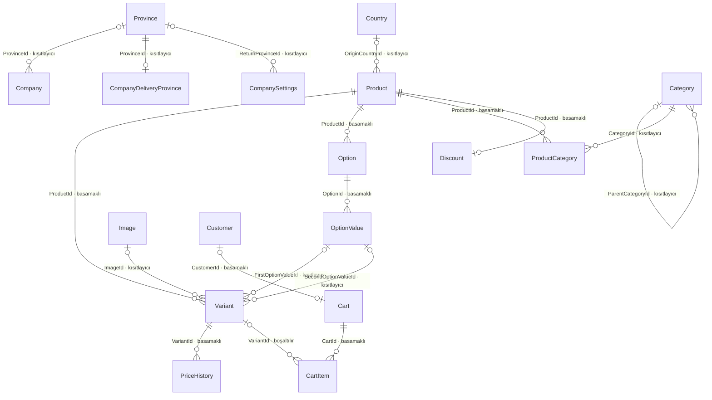
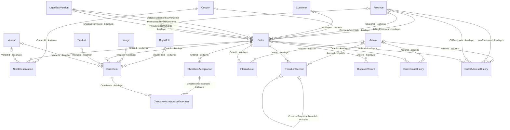
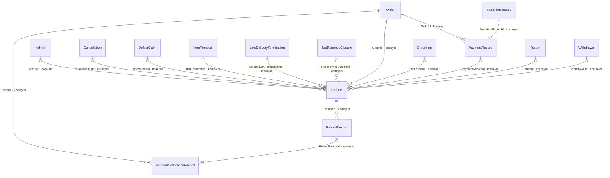
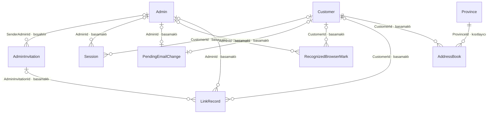

# Shopfolio — Data Model

**Versiyon: v0.33** | **Bağımlılıklar:** `02`, `03`, `05`, `10_MVP_SCOPE.md` | **Son güncelleme:** 2026-10-28

> **Aşama:** 5 — Veri Modeli · **Rol:** Data / Domain Modeler
> **Traceability zorunlu: EVET** — §1 tamamlanmadan §3'e (entity envanteri) geçilmez.

> **Aşama 1'den park edilen girdiler** — kaynak: [`PRODUCT_DISCOVERY_STATUS.md`](PRODUCT_DISCOVERY_STATUS.md) §2, mekanizma: K-36.
> Bu satırlar **talimattır, karar değildir** — bağlayıcı olan kaynak karardır; bu aşamada karara bağlanacak olan, talimatın nasıl uygulanacağıdır.
>
> - **K-06 · K-97 · Aktörler ve yetki derinliği:** Dört aktör — ziyaretçi · misafir alıcı · üye müşteri · firma yöneticisi (`02 §1.3`; misafir alıcıyı K-97 ekledi, satır Aşama 2'nin çakışma taramasında hizalandı); yönetim tarafı **tek rol, çoklu kullanıcı** — yönetici hesapları arasında yetki farkı yoktur, rol/izin modeli buna göre kurulur.
> - **K-17 · K-531 · K-977 · K-988 · Terim sözlüğü:** Sözlük `02 §1`'de yaşar (Türkçe terim · İngilizce kod karşılığı · tanım). Bu doküman sözlüğü **birebir devralır, isim icat etmez**; bir kavramın tek adı vardır. **Tek istisna:** kapalı listelerin — Firma tipi, Hesap türü, Konu tipi, İptal sebebi, Düzeltme sebebi, Cayma istisnası sebebi, Ana sayfa düzeni, Teslim tarihi — değerlerinin kod adlarını bu doküman verir; değerler `02` gövdesindeki kapalı listeden birebir adlandırılır (K-531, K-617, `02 §1.2`; Hesap türü'nü K-617 ekledi, satır Aşama 3'ün çakışma taramasında hizalandı). Teslim tarihi kapalı liste değil kalemin tarih alanıdır — K-531 onu sözlüğe "kapalı liste ve kayıt adı" ikilisiyle aldı; sözlüğün kapalı listeleri bugün on üçtür ve hangisinin enum, hangisinin tablo olduğu §5.3'tedir (satır Veri modeli aşamasının yazım turunda hizalandı — K-1036). **Sözlük ürünün terimlerini taşır:** biçimini Teknik Mimari'nin kurduğu, sözlükte (`02 §1.2`) yer almayan teknik kavramların — adı ürün kuralında geçenler dahil: iş kuyruğu ve iş satırı, gönderim kaydı, gelen bildirim kaydı, geri ödeme kaydı, kanal hâli kaydı, nabız ve kesinti kaydı, deneme kaydı, bağlantı kaydı, onay anahtarı, imha kaydı, geçiş kaydı, sürüm değeri; Veri modeli aşamasında siparişin ödeme kaydı ve giriş kaydı (K-1006 (2), K-1009 (2)), yedeğin durum kaydı ve veri koruma anahtarı (K-1034) da girdi — tam liste `06 §3.3`'tedir — ve onların kapalı listelerinin — geri ödeme kaydının, bağlantı kaydının ve iş satırının hâlleri, gönderim sonucunun sınıfı — kod adlarını bu doküman kavramın `05`'teki adından birebir verir; API Tasarımı ve Kodlama Kılavuzu onları buradan alır. Ürüne görünen kavram sözlüğe girer (`02 §1.1`; K-977 — Aşama 4'ün çakışma taraması; tanım K-988 ile Aşama 4'ün checkpoint'inde hizalandı).

> **Aşama 2'den park edilen girdiler** — kaynak: [`PRODUCT_DISCOVERY_STATUS.md`](PRODUCT_DISCOVERY_STATUS.md) §2, mekanizma: K-36 (yeri: §8.3 AK0-04).
> Bu satırlar **talimattır, karar değildir** — bağlayıcı olan kaynak karardır; bu aşamada karara bağlanacak olan, talimatın nasıl uygulanacağıdır.
>
> - **Dizin — Aşama 2 kararlarının bu dokümana devirleri:** karar kaydında K-647…K-718'in etki sütunlarında bu dokümanı gösteren yirmi üç atıf (yirmi üç karar) [`CHECKPOINT_REPORTS/PHASE2_CONFLICT_SCAN.md`](CHECKPOINT_REPORTS/PHASE2_CONFLICT_SCAN.md) §6.1'dedir; etki sütununda yalnız doküman numarası taşıyan on altı atfın işinin adını dizin verir. Devir taraması (`checklists/document-stage.md` §4) buradan başlar; devrin evi karar satırıdır, dizin onu ikinci kez kaydetmez. Aşama 1'in dizini: `PHASE1_CONFLICT_SCAN.md` §6.

> **Aşama 3'ten park edilen girdiler** — kaynak: [`PRODUCT_DISCOVERY_STATUS.md`](PRODUCT_DISCOVERY_STATUS.md) §2 ve §3, mekanizma: K-36 (yeri: §10.3 UI0-04).
> Bu satırlar **talimattır, karar değildir** — bağlayıcı olan kaynak karardır; bu aşamada karara bağlanacak olan, talimatın nasıl uygulanacağıdır.
>
> - **K-787 · K-790 · K-793 · K-794 · Kalemde işlem görmüş adet:** sipariş kaleminin kayıtları — iptal, çıkarma, gecikme feshi, cayma beyanı, iade teslim alma, iade reddi, "mal dönmedi" kapanışı ve ayıp talebi — kapsadıkları adedi taşır; aynı türden kayıt aynı kalemde birden çok kez doğar (ardışık işlemler, parça parça ulaşan iade) ve kalemin açık adedi iptal, çıkarma, gecikme feshi ve cayma beyanı kayıtlarının adetlerinden okunur — düzeltmeyle geri alınmış firma iptali sayılmaz (Ürün Gereksinimleri `02 §5.8`, §7.1.6; *Veri modeli aşamasında K-1024 (2) ve K-1056 ile; `06 §4.18`, §2.7.2*). Adedin kayıtta nasıl tutulduğu ve açık adedin saklanıp saklanmadığı bu aşamanın kararıdır; aynı adedi kullanmak isteyen eşzamanlı iki işlem siparişin satır kilidiyle sıraya girer ve sonraki, koşulunu güncel işleme açık adede — ayıpta sözleşmeden dönülmüş adetler de düşülerek (K-1077) — karşı denetler (Teknik Mimari `05 §4.1.2`, §7.3.2; K-874, K-889 — satır Aşama 4'ün çakışma taramasında hizalandı; Aşama 5'in çakışma taramasında yeniden hizalandı — K-1129'un sınıfı).
> - **K-788 · Adet başına ayrılan tutar:** kalemin bir kısmı işleme girdiğinde kupon payı ve KDV kalemin donmuş değerlerinden adetle orantılı ve aşağı yuvarlanarak ayrılır; kalemin işleme açık son adetlerini kapatan işlem kalanı alır (`02 §7.1.7`). Son işlemin kalanı hesaplayabilmesi için her işlemin ayırdığı pay ve KDV'nin kayda geçmesi gerekir; nerede ve hangi biçimde tutulduğu bu aşamanın kararıdır.
> - **K-791 · Sayaçların adetle dönüşü:** stok, hizmet kontenjanı ve kupon hakkı işleme giren adet kadar döner; kupon hakkı yalnız siparişin bütün kalemlerinin bütün adetleri iptal ya da iade edildiğinde (`02 §7.2.6`, §7.4.8); stok iptal ve çıkarmada, gecikme feshinde yalnız kalem kargoya verilmemişse döner, iadede fiziksel stok yalnız "Stoğa ekle" adımıyla girer; kupon hakkı siparişin her adedini son hâline getiren kaydın işleminde bir kez döner — işleme açık adet ve teslim alması, reddi ya da "mal dönmedi" kapanışı beklenen fiziksel cayma adedi kalmadığında —, iade reddi ya da "mal dönmedi" ile kapanan adedi olan siparişte dönmez — gecikme feshi kupon sayımında iptal sayılır (`02 §5.11.3`) (*Veri modeli aşamasında K-1106 ile; `06 §4.14`* — satır Aşama 5'in çakışma taramasında hizalandı). Dönüşün hangi kayıttan türetildiği bu aşamanın kararıdır.
> - **K-736 · Yönetici hesabının adı:** yönetici hesabı zorunlu bir ad taşır — davetli hesabını açarken yazar, ilk yöneticininki kurulumda verilir, yönetici adını kendi hesabından değiştirir (`02 §10.2.1`, §10.2.4). Alanın tanımı bu aşamanın kararıdır.
> - **K-800 · Eşzamanlı düzenleme:** düzenleme ekranlarında araya giren kaydın yakalanması için kaydın düzenlemeye açıldığı andaki hâlinin kaydetme anında karşılaştırılması gerekir (`02 §3.31.1`; `04 §2.10`). Karşılaştırmanın veri karşılığı bu aşamanın kararıdır ve Teknik Mimari'nin (`05`) mekanizmasıyla birlikte tasarlanır.
> - **K-804 · Siparişin e-posta geçmişi:** sipariş ayrıntısının e-posta geçmişi siparişin müşteriye giden bildirimlerini — adı, gönderim tarihi, gittiği adres ve sonucu; yeniden gönderim ayrı satır — ve misafir siparişinin e-posta düzeltmelerini taşır; kayıt siparişin saklama kuralıyla imha edilir (`02 §4` Z-43; `04 §9.9`). Gönderim kaydının siparişe nasıl bağlandığı bu aşamanın kararıdır.
> - **K-806 · Kupon kodunun tekilliği:** kupon kodu kuponlar arasında tekildir ve büyük-küçük harf ayrımı olmadan eşleşir; kupon silinmez (`02 §3.10.5`). Tekilliğin veride nasıl korunduğu bu aşamanın kararıdır.
> - **K-811 · Doğrulanmamış kayıt:** panelin üye kaydı görünümü e-postayla aranır ve e-postası doğrulanmamış kaydı da bulur (`02 §3.13.4`, §3.15.5; `04 §9.12`). Doğrulanmamış kaydın nasıl tutulduğu ve aramada nasıl bulunduğu bu aşamanın kararıdır.
> - **K-817 · İade adresinin alanları:** firmanın iade adresi alıcının adını, ili (kapalı liste), ilçeyi ve açık adresi zorunlu, telefonu isteğe bağlı taşır (`02 §3.1.7`; `04 §9.18`). Alanların tanımı bu aşamanın kararıdır.
> - **`02 §3.8.5` · Ölçü birimlerinin listesi (Arayüz Tanımları'nın audit'i, bulgu FORM-16):** ürünün "ölçü birimi + net miktar" alanı tek alandır — ikisi birlikte girilir, net miktar sıfırdan büyüktür (`04` 7.2.4.13). Birimin seçildiği listenin içeriği — birim fiyatın hesaplandığı birimler (Fiyat Etiketi Yönetmeliği m.5) — bu aşamanın kararıdır. Bu aşamanın workshop'unda alanın düzlemi değişti: ölçü birimi ürün düzleminde, net miktar varyant düzlemindedir ve birim seçiliyse her varyantta zorunludur (K-1019 — proje sahibinin kararı; K-1020).
> - **Dizin — Aşama 3 kararlarının bu dokümana devirleri:** karar kaydında K-723…K-850'nin etki sütunlarında bu dokümanı gösteren on dört atıf (on dört karar) ve Arayüz Tanımları'nın (`04`) gövdesinde bu dokümana iş bırakan cümleler [`CHECKPOINT_REPORTS/PHASE3_CONFLICT_SCAN.md`](CHECKPOINT_REPORTS/PHASE3_CONFLICT_SCAN.md) §6'dadır; Aşama 3'ün atıflarının hepsi işin adını taşır. Yukarıdaki ölçü birimi satırının kaynağı karar satırı değil Ürün Gereksinimleri ve audit bulgusudur. Devir taraması (`checklists/document-stage.md` §4) buradan başlar; devrin evi karar satırıdır, dizin onu ikinci kez kaydetmez. Önceki aşamaların dizinleri: `PHASE1_CONFLICT_SCAN.md` §6, `PHASE2_CONFLICT_SCAN.md` §6.

> **Aşama 4'ten park edilen girdiler** — kaynak: [`PRODUCT_DISCOVERY_STATUS.md`](PRODUCT_DISCOVERY_STATUS.md) §2, mekanizma: K-36 (yeri: §12.3 TM0-04).
> Bu satırlar **talimattır, karar değildir** — bağlayıcı olan kaynak karardır; bu aşamada karara bağlanacak olan, talimatın nasıl uygulanacağıdır.
>
> - **K-870 · Zamanın, tarihin ve paranın türleri:** an saat dilimli damga (UTC) olarak tutulur, Türkiye saatiyle sayılır ve gösterilir; tarih olarak anlam taşıyan değer — son gün, iş günü — tarih olarak tutulur; para ondalıklı sayıyla tutulur, kayan noktalı sayı kullanılmaz (Teknik Mimari `05 §7`; `02 §4.1`; K-335). Her alanın hangi türü taşıdığı bu aşamanın kararıdır.
> - **K-873 · K-874 · K-980 · Sürüm alanları:** düzenlenebilir kayıtlar — ürün (varyant tablosunun değişikliği dahil), kupon, kurumsal içerik, ayarlar; bölümleri ayrı kaydedilen ekranda bölüm başına — ve sipariş bir sürüm değeri taşır; siparişin sürümü sipariş, kalemleri, kalem kayıtları ve siparişe bağlı müşteri girdileri — geri ödeme IBAN'ı dahil — değiştikçe artar (`05 §7`; `02 §3.31`); siparişin hâlini değiştirmeyen sistem yazımları — kalemin dosya bağının sistem yazımı (ürün ya da varyant silinirken, dosya yerine yenisi konmadan kaldırılırken ve düzleme yeni dosya bağlanırken), müşterinin indirmesi, hesabın silinmesinin ve hesaba bağlanmanın siparişe yazımı — sürümü artırmaz (*Veri modeli aşamasında K-1029 (4), K-1098 (3) ve K-1119 (1) ile; liste `06 §2.6.4`'tedir* — satır Aşama 5'in çakışma taramasında hizalandı). Sistemin stok ve kontenjan hareketleri — ayırma, kesin düşme, dönüş — ürünün sürümünü artırmaz; panelin stok ve kontenjan alanı ürünün sürümüyle değil kendi koşullu güncellemesiyle yazılır — yeni değer yalnız alanın değeri formun gösterdiği değerle hâlâ aynıysa ve yeni değer ayrılmış adetten az değilse yazılır, değilse `04` 2.10.1'in mesajı çıkar (`05 §7.3.1`; `02 §3.6.7`; K-980). Sürüm değerinin alanı ve onu artıran yazımların listesi bu aşamanın kararıdır; K-800'ün Aşama 3 park satırı bu mekanizmayla karşılanır.
> - **K-875 · K-876 · K-877 · K-879 · K-944 · K-975 · K-979 · K-984 · İmha ve anahtar halkası:** imha işi her kaydın süresini başlangıç değerinden hesaplar — oluştuğu yılın sonu, kapatılış, gönderim anı (`02 §4` Z-28…Z-44); silme fiziksel silmedir; siparişte kişisel alanlar boşaltılır ve hesap bağı kaldırılır (K-582) — imha siparişe bağlı kayıtları da kapsar: iç not, e-posta adresinin düzeltme geçmişi, ayıp talebi — bu aşamanın matrisi adres düzeltme geçmişini de ekledi (adres geçmişi; K-1008, §1.3); ayıp talebi siparişin imha parçasında silinmez — durumunun son değiştiği andan on yıl sonra imha işinin ayrı parçasında, siparişin imha parçasından önce olmamak üzere silinir (*Veri modeli aşamasında K-1092 ile; `06 §4.30`* — satır Aşama 5'in çakışma taramasında hizalandı); bağlı kayıtların alan listesi bu aşamanın işidir (`05 §7.4.3`); imha kaydının ve geçiş kaydının "yalnız eklenen" oluşu uygulama düzeyindedir, veritabanı yetkisiyle korunan yalnız iz tablosudur (`05 §4.1.4`, §7.4.2); imha kaydı yalnız eklenen ayrı bir tabloda durur — tarih, kayıt türü, sayı; sunucunun kayıtlarının kendi döngüsüyle silinen günü her gece "döngüyle silindi" satırı olarak sayı yerine tarih aralığıyla girer (`05 §9.2.2`); işlem izi tablosunda uygulamanın veritabanı kullanıcısı yalnız ekler ve okur, süresi dolan satırı veritabanındaki bir imha fonksiyonu siler (`05 §7`); iz satırı yöneticinin adını ve e-posta adresini ve kaydın kimliğini değer olarak taşır ve izden başka tablolara silmeyle basamaklanan ya da boşaltan bağ yoktur; imha fonksiyonu sahibinin yetkisiyle çalışır, arama yolu sabittir ve çağırma yetkisi yalnız uygulamanın veritabanı kullanıcısınındır (`05 §7.5.1`); periyodik imhanın her parçası imha kaydındaki satırını parçanın işleminde yazar — var olan satırı güncellemez (`05 §7.4.2`); gecelik temizlik kişisel veri taşıyan geçici kayıtların — deneme, oturum, tanınan tarayıcı ve misafir sepeti kayıtları ve yönetici daveti; geri alma bağlantısının kaydında ömrü dolan eski adres de boşaltılır — silinmesini de imha kaydına kayıt türü ve sayıyla yazar (`05 §5.2.9`, §7.4.4; K-979, K-984; yönetici daveti ve eski adres Veri modeli aşamasında K-1030 (8), K-1064 (3) ve K-1065 (3) ile eklendi — satır Aşama 5'in çakışma taramasında hizalandı); bekleyen e-posta değişikliğinin ömrü dolunca zamanlayıcının silmesi de imha kaydına silmeyle aynı işlemde kayıt türü ve sayıyla yazılır (`05 §5.2.7`, §7.4.2; K-984); istek içinde silinen oturum kayıtları — çıkış, şifre değişikliği ve sıfırlama, oturumları sonlandırma komutu gibi — imha değildir, oturumun işleyişidir (`05 §5.2.9`; K-984). Siparişe ait üretilen belgelerin — Ön Bilgilendirme Formu, Mesafeli Satış Sözleşmesi — kopya olarak mı saklandığı, donmuş şablon sürümünden mi yeniden üretildiği bu aşamanın kararıdır; kopya saklanırsa imha kopyadaki kişisel veriyi de kapsar (*Veri modeli aşamasında K-1027 (4), (6) ile: belge siparişe kişisel verisiz kopya olarak donar, müşterinin kişisel alanları yer tutucudur — imha kopyaya dokunmaz, koşul boştur; `06 §4.17`* — satır Aşama 5'in checkpoint'inde hizalandı). Çatının şifreleme anahtar halkası veritabanında tutulur ve onunla birlikte yedeklenir (K-879); eski bir ana dönüşte o arada üretilen veri koruma anahtarı da geri gider — onunla korunan çerezler geçersizleşir (K-975 (4); `05 §7.6.3`; kol 2b'de eklendi — K-1009). Başlangıç değerlerinin alanları, imha kaydının, iz tablosunun ve anahtar halkasının tablosunun tanımı bu aşamanın kararıdır.
> - **K-883 · K-884 · K-948 · K-980 · Dosya kaydı ve indirme:** her yükleme yeni bir dosya kaydıdır; varyantın o anki dosyası ona bağlı ve kaldırılmamış en son kayıttır, yoksa ürününki — dosya ürün düzleminde de yaşar (`02 §3.12.2`); hiçbir ürüne ya da varyanta bağlı olmayan, yüklemesi bir günden eski ve sipariş sayfası açılabilen hiçbir kalemin bağı olmayan kayıt imhada silinir (*Veri modeli aşamasında K-1029 (3)–(4), K-1069 (4) ve K-1118 (1) ile; `06 §4.70`* — satır Aşama 5'in çakışma taramasında hizalandı); kalem indirme sayacını ve kısa ömürlü indirme bağlantısını taşır (*Veri modeli aşamasında K-1029 (5) ile: bağlantı saklanmaz — kalemin kimliğini ve ömrünü taşıyan imzalı bir değerdir; `06 §4.18`, §4.68* — satır Aşama 5'in checkpoint'inde hizalandı); hak tek bir koşullu güncellemeyle düşer — kalan hak yoksa bağlantı üretilmez ya da dosya gönderilmez (`05 §7`, §7.7.4; `02 §3.12`; K-980). Görsel — kaynak kopya ve türevleri — ürüne, içerik kaydına ve sipariş kalemine birer bağla bağlıdır; kalem görselin kendisini değil ona bağını dondurur ve ürünün silinmesinden etkilenmez (`02 §3.23.1`); hiçbir kayda bağlı olmayan ve bir günden eski görsel imhada silinir — kaydedilmeden bırakılan yükleme de bağsız görseldir, aynı koşulla aynı parçada silinir (*Veri modeli aşamasında K-1029 (2) ve K-1069 (3) ile; Teknik Mimari'ye K-1098 (1) ile geri beslendi — `05 §7.7.2`; `06 §4.69`* — satır Aşama 5'in çakışma taramasında hizalandı); önce kayıt silinir, kaydı olmayan dosyayı imha işi süpürür (`05 §7.7.1`, §7.7.2). Kayıtların ve bağların tanımı bu aşamanın kararıdır.
> - **K-886 · Ürün adının arama biçimi:** ürün adının küçük harfe çevrilmiş ve Türkçe harfleri sadeleşmiş arama biçimi ayrı bir alanda tutulur ve ad değiştikçe yenilenir; arama bu alanda içerir eşleşmesiyle, trigram dizini üzerinden yapılır (`05 §7`; `02 §3.5.1`). Alanın ve dizinin tanımı bu aşamanın kararıdır.
> - **K-889 · K-890 · Geçiş kaydı ve ayırma:** siparişin her durum geçişi yalnız eklenen bir geçiş kaydına yazılır — kim (müşteri, yönetici, sistem), ne zaman, hangi geçiş, sebep; kayıt `02 §3.34.8`'in "durum geçişleri"nin karşılığıdır ve işlem izinin yerine geçmez. Sipariş onayı stoğu, hizmet kontenjanını ve kupon hakkını koşullu güncellemeyle — kalan adet yetiyorsa — ayırır (Teknik Mimari `05 §4`, §7). Geçiş kaydının tanımı ve ayrılmış adedin alanları bu aşamanın kararıdır.
> - **K-891 · K-892 · K-893 · K-894 · K-940 · K-941 · K-946 · K-954 · K-970 · K-985 · İş kuyruğu, gönderim kaydı, gelen bildirim ve geri ödeme kaydı:** dış yan etkiler veritabanındaki bir iş kuyruğuna geçişle aynı işlemde yazılır — satır kişisel veri taşımaz, kayda kimlikle işaret eder; iş satırı deneme sayısını, sonraki deneme anını ve sonucunu taşır — kuralı yazılmamış iş türünde, işleyicinin hatasında ve kart iadesinin kaydı yazılmadan düşen denemesinde beşinci yeniden denemeden sonra "başarısız" hâlindedir (*Veri modeli aşamasında K-1111 ile; `06 §4.59`*) ve sıradaki satırları bekletmez; "başarısız" satır gecelik temizlikte silinmez, kurulumu yapanın yönetim komutuyla yeniden kuyruğa alınır ya da kapatılır — kapatılan satır tamamlanmış sayılır ve gecelik temizlikte silinir (`05 §4.3.4`, §5.2.9, §8.5.9; K-985); her e-posta gönderim kaydında bir satırdır ve e-postanın kuyruğu odur — e-posta iş kuyruğuna ayrıca satır yazmaz (`05 §4.3.1`); satır tür, alıcı, ilgili kayıt, olayın değerleri, deneme sayısı, sonraki deneme anı ve sonucu taşır; gövde saklanmaz (Z-34, Z-43); ödeme adımı formunun onay anahtarı sipariş kaydında tekildir; sağlayıcının imzası doğru bildirimi gelen bildirim kaydına yazılır — imzası tutmayan istek yazılmaz — ve tekil olan bildirimin kendisidir: sağlayıcının bildirime verdiği kimlik, yoksa işlem kimliği olay türü ve sonuçla birlikte (`05 §4.5.2`); siparişin ödeme kaydı ödemeyi sağlayıcının ödeme işlem kimliğiyle taşır ve kimlik orada tekildir — aynı ödeme ikinci kez gelirse işlenmez, iptal edilmiş siparişte tek kart iadesi doğar (`05 §4.5.3`); gelen bildirim kaydı kişisel alan taşımaz — sağlayıcının referansı, siparişin referansı, tutar, sonuç ve anlar —; tutarı tutmayan ya da siparişi kayıtta olmayan satır işaretlidir, siparişe bağlanan satır oluşturulma anından on yıl sonra silinir — ödemesi alınmış siparişte siparişin imha parçasından önce değil, ödemesi hiç alınmamış siparişte Z-41'in on yılı dolunca (*Veri modeli aşamasında K-1030 (5) ve K-1092 (3) ile; `06 §4.35`* — satır Aşama 5'in çakışma taramasında hizalandı) —, hiçbir siparişe bağlanmayan satır on yıl sonra imha işinde silinir — kişisel alan taşımaz, elektronik ticaret kayıtlarının on yılını izler (K-954; `05 §4.5.2`, §4.5.5, §7.4.4); karta para gönderen her istekten önce geri ödeme kaydı "istek gönderiliyor" hâliyle yazılır ve kendi işleminde kesinleşir — istek ondan sonra gider (`05 §4.6.1`); kaydın hâlleri istek gönderiliyor, sonucu bekleniyor, başarılı ve gerçekleşmedi'dir — sonucu bilinmeyen istek "sonucu bekleniyor"da kalır, sorgunun sonucuyla ya da firmanın "gerçekleşmedi" işaretiyle (işlem izine düşer) çıkar — firmanın işareti sorguyu durdurur, sonradan gelen başarılı sonuç — geç bildirim ya da işaret anında yanıtı beklenen sorgu — siparişe işlenmez, gelen bildirim kaydında ya da geri ödeme kaydında işaretli kalır ve panelde uyarı olur; panelin "geri ödeme sonucu bekleniyor" ve "geri ödeme gerçekleşmedi" işaretleri bu hâlle aynı işlemde yazılır (`05 §4.6.2`; K-940). Tabloların ve hâllerin tanımı bu aşamanın kararıdır.
> - **K-895 · K-898 · K-946 · Zaman alanları, nabız ve kesinti kaydı:** zamanlanmış işlerin zamanı kendi kaydında bir alandır — ödeme süresinin bittiği an, hatırlatmanın anı, IBAN'ın silineceği gün, e-postanın sonraki denemesi — ve onayda ya da süre yeniden başladığında yazılır; IBAN'ın silineceği an beyanın teslimden önce/sonra sınıfını değiştiren yazımda da aynı işlemde yeniden hesaplanır ya da boşaltılır (*Veri modeli aşamasında K-1109 ile; `06 §4.31`* — satır Aşama 5'in çakışma taramasında hizalandı); gecelik işin — imha ve geçici kayıtların temizliği — son başarılı çalışmasının ve son denemesinin anı veritabanında durur — başarısız biten iş en erken bir saat sonra yeniden denenir (`05 §5.1.1`, §9.4.17); zamanlayıcının nabzı ve iki dakikayı aşan boşlukların kesinti kaydı veritabanında durur; kesintide ertelenen havale iptalinin yeni son anı siparişte saklanır ve sipariş sayfasında görünür (`05 §5`; `02 §4.2` Z-8). Alanların tanımı bu aşamanın kararıdır.
> - **K-899 · K-901 · K-903 · K-906 · K-945 · K-971 · K-972 · K-982 · Oturum, deneme, bağlantı ve tanınan tarayıcı kayıtları:** oturum sunucuda tutulur — anahtarın özeti, hesap, hesap türü, kısa ya da uzun, son işlem anı, yeniden doğrulamanın tek işlemlik izni — izin dönülen işlem formuna konan tek kullanımlık değere bağlıdır (`05 §6.1.5`); müşteri ve yönetici hesapları ayrı tablolardadır — e-posta adresi kendi hesap türü içinde tekildir; tekillikte, girişte, deneme limitlerinin ve L-7/L-8'in e-posta ekseninde ve misafir siparişlerinin hesaba bağlanmasında büyük-küçük harf ayrımı olmadan karşılaştırılır — "I", "İ", "ı" ve "i" de tek harfe iner (*Veri modeli aşamasında K-1016 ile; `06 §2.8.1`* — satır Aşama 5'in çakışma taramasında hizalandı), gösterimde ve gönderimde girildiği gibi kalır; tekillik veritabanında korunur (`05 §3.5.2`; K-982); sayılan her deneme bir deneme kaydıdır — limit, eksen, değer, an — ve penceresi geçince silinir; başarısızlıkta sayılan limitlerde satır denemeden önce yazılıp kesinleşir, başarılı ya da eşikte durdurulan denemede silinir (`05 §6.3.1`); girişte birleşen sepet iki sayacın büyüğünü taşır — penceresinde satırı çok olan sepetin deneme satırları hesabın sepetinin kimliğine yazılır, ötekininki silinir (`05 §6.3.2`); giriş kaydı (`02 §3.13.20`) iki hesap türünün girişini taşır, veritabanındadır ve okuma komutuyla okunur (`05 §3.3.11`, §9.3.1); L-7 ve L-8 siparişlerden sayılır ve siparişte IP durur; hesap bağlantıları bağlantı kaydında yalnız özetle durur — tür, hesap, oluşma anı, ömrün sonu, kullanıldığı an, yerine yenisi geçtiği an — yönetici davetinde daveti gönderen yönetici de (*Veri modeli aşamasında K-1025 (6) ve K-1062 (1) ile: gönderen davetin satırındadır, bağlantı kaydı davete bağlıdır; `06 §4.38`, §4.42* — satır Aşama 5'in checkpoint'inde hizalandı); bağlantı tek bir koşullu güncellemeyle tüketilir (`05 §6.4.6`); hesabın bağlantı kaydı hesabıyla yaşar ve hesapla silinir — gecelik temizlik onu silmez, ömrü dolmuş kayıt "ömrü dolmuş", "kullanılmış" ya da "yerine yenisi geçmiş" hâlini korur (`05 §6.4.4`, §6.4.6); yönetici davetinin bağlantı kaydı davete bağlıdır ve davetle birlikte gecelik temizlikte silinir; geri alma bağlantısının kaydı değişiklikten önceki adresi de taşır, bağlantı kullanılmadan ömrü dolunca adres gecelik temizlikte boşaltılır (*Veri modeli aşamasında K-1062 (1), K-1030 (8), K-1064 (3) ve K-1065 ile* — satır Aşama 5'in çakışma taramasında hizalandı); sipariş erişim anahtarı siparişte durur, numara ve anahtar tekildir; tanınan tarayıcı işareti sunucuda hesap başına kaydıyla tutulur ve süresi dolan ya da geçersizleşen kayıt gecelik temizlikte silinir (`05 §5.2.9`); misafir sepeti son erişim anını taşır ve 400 gün açılmazsa silinir (`05 §6`). Kayıtların tanımı ve e-posta tekilliğinin veride korunuşu bu aşamanın kararıdır.
> - **K-913 · K-918 · K-937 · K-963 · Kanal hâli ve yedeğin durum kaydı:** e-posta göndericisi tek satırlık bir kanal hâli kaydı tutar — son başarılı gönderimin anı, art arda kanal hatası sayısı, dizinin ilk hatasının anı — ve her gönderim denemesinin sonucu üç sınıftan birini taşır: gönderildi, alıcı hatası, kanal hatası; firma bildirimleri uyarısı gönderim kaydından okunur, ayrı bir işaret saklanmaz. Sunucunun dışındaki depoya alınan gecelik tam yedeğin sonucunu — yerel kopyanınki sayılmaz — veritabanı konteynerindeki zamanlayıcı yerel soketle veritabanındaki bir durum kaydına yazar; dosya yedeğinin sonucu veritabanında değil, yedek aracının durum dosyasındadır — yedek aracı veritabanına bağlanmaz ve ağ üzerinden bağlanan bir yedek kullanıcısı yoktur (Teknik Mimari `05 §9.4.5`, §9.4.10, §10). Kayıtların tanımı bu aşamanın kararıdır.
> - **K-951 · Elektronik ticaret kayıtlarının on yıllık saklaması (6563 sayılı Kanun m.11/3):** siparişe bağlı müşteri bildiriminin gönderim kaydı on yıl saklanır ve imha işi satırın siparişine bakar — ödemesi alınmış siparişin satırı on yıl alıcısıyla durur ve sonra silinir; ödemesi hiç alınmamış siparişin satırında üç yılda alıcı ve olayın değerleri boşaltılır, satır on yılda silinir. Ödemesi hiç alınmamış siparişin kişisel verisiz kaydı on yıl dolmadan silinmez. İletişim talebinin süresi konu tipinden okunur — "Sipariş hakkında" on yıl, öteki tipler iki yıl (`02 §4.2` Z-33, Z-41, Z-43, §11.2 P-40; Teknik Mimari `05 §4.4.4`, §7.4.3). Gönderim kaydının siparişe bağı, siparişin ödemesi alınmış sayıldığının (`02 §4.2` Z-28, §6.2.16) hangi alandan okunduğu ve boşaltılan alanların listesi bu aşamanın kararıdır.
> - **Dizin — Aşama 4 kararlarının bu dokümana devirleri:** karar kaydında K-855…K-979'un etki sütunlarında bu dokümanı gösteren kırk bir atıf (otuz dokuz karar) ve Teknik Mimari'nin (`05`) gövdesinde bu dokümana iş bırakan cümleler [`CHECKPOINT_REPORTS/PHASE4_CONFLICT_SCAN.md`](CHECKPOINT_REPORTS/PHASE4_CONFLICT_SCAN.md) §6'dadır; Aşama 4'ün atıflarının hepsi işin adını taşır. Aşama 4'ün checkpoint'inin kararları (K-980…K-988) tarama raporunda yoktur — bu dokümana bıraktıkları iş yukarıdaki satırlarda etiketiyle durur. K-977'nin satırı Aşama 1 bloğunun K-17 satırıdır. Sayfa adresinin veride tutuluşu (`05 §3.7.1`) karar satırı olmadan devredilmiştir — tek yazılı yeri o cümledir. Devir taraması (`checklists/document-stage.md` §4) buradan başlar; devrin evi karar satırıdır, dizin onu ikinci kez kaydetmez. Önceki aşamaların dizinleri: `PHASE1_CONFLICT_SCAN.md` §6, `PHASE2_CONFLICT_SCAN.md` §6, `PHASE3_CONFLICT_SCAN.md` §6.

> **Aşama 6 — API tasarımı aşamasının kalite döngüsünün audit'inin geri beslemesi (2026-10-19, v0.29; K-652):** iki kararın yansıması; ✓ korunur, kalite döngüsü yeniden açılmaz. **K-1199 (⚠ öneriyle kaydedildi):** §4.17 — `ConfirmationKey`'in açıklaması: aynı anahtarla ikinci gönderim var olan siparişin teyit ekranına götürür. **K-1200:** §4.15 — `IsPaymentUnavailableNoticePending`'in açıklaması: işaret teyit ekranından ödeme sağlayıcısına bağlanılamayınca siparişin iptalinin işleminde de yazılır; alan ve okunuş değişmez (K-1183). §3'ün Cart satırı, §1.1'in `03 §10.1` satırı ve §4.15'in Kaynak satırı K-1200'ü taşır. Geri besleme tablosu API Tasarımı'nın §1.3'ündedir.

> **Aşama 6 — API tasarımı aşamasının kalite döngüsünün deep review'unun geri beslemesi (2026-10-19, v0.30; K-652):** iki kararın yansıması; ✓ korunur, kalite döngüsü yeniden açılmaz. **K-1212:** §4.15 — `IsPaymentUnavailableNoticePending`'in açıklaması: ödeme dönüşü işaretinin yazıldığı sepet ve gizli alanın ilk form değeri; alan ve okunuş değişmez. **K-1215:** §4.47 — satış özeti dönemleri, üretilen metnin yeni sürümü ve yeni kaydın sıralaması. İlgili Kaynak satırları anılan kararları taşır. Geri besleme tablosu API Tasarımı'nın §1.3'ündedir.
> **Aşama 6 — API tasarımı aşamasının etki yansıtmasının geri beslemesi (2026-10-28, v0.31; K-652, K-1226):** yalnız Kaynak satırları; ✓ korunur, kalite döngüsü yeniden açılmaz ve gövdeye dokunulmadı. Gövdede anılıp Kaynak satırında bulunmayan altı karar atfı dört satıra eklendi: K-1183 ve K-1200 (§1.1 ve §3), K-1212 (§4.15), K-1199 (§4.17). Geri besleme tablosu API Tasarımı'nın §1.3'ündedir.
> **Aşama 6 — API tasarımı aşamasının çakışma taramasının geri beslemesi (2026-10-28, v0.32; K-652, K-1228):** ürün dizini (`PublishStatus`, `CreatedAt`, `Id`) olur (§4.5, §7.5.1) ve kurumsal içeriğin eşit `SortOrder`'ında iç anahtar son anahtardır (§4.47); ✓ korunur, kalite döngüsü yeniden açılmaz. Geri besleme tablosu API Tasarımı'nın §1.3'ündedir.
> **Aşama 6 — API tasarımı aşamasının checkpoint'inin geri beslemesi (2026-10-28, v0.33; K-652):** bir bulgunun yansıması; ✓ korunur, kalite döngüsü yeniden açılmaz. **K-823:** §1.1'in `02 §10.7.4` satırı — üye dosyası bütün üye hesaplarını (sipariş vermemişler dahil) ve saklanan iletişim taleplerini taşır; satır dosyayı sipariş vermemiş üyelerle daraltıyordu. Geri besleme tablosu API Tasarımı'nın §1.3'ündedir.

> **Yazım durumu (K-28, K-30, K-432; karar kaydı §14.2): yazım turu tamam (2026-10-17, v0.16).** İzlenebilirlik matrisi (§1) altı oturumda, workshop iki oturumda tamamlandı; doküman Veri modeli aşamasının **tek yazım turunda**, üç oturumda — 1, 2a, 2b1, 2b2, 3a, 3b, 3c — yazıldı. Sıradaki adım kalite döngüsüdür — audit, deep review, cross-review ve etki yansıtma (`00 §C.5`; karar kaydı §14.2). **Audit adımı uygulandı (2026-10-18, v0.17):** on dokuz mercek 161 ham bulgu üretti, iki şüpheci doğruladı ve 148'i beş kümede uygulandı — kararlar K-1075…K-1103 yer tutucularıyla karar kaydına girdi, üst doküman geri beslemeleri §1.3'tedir; §6/§7 sayıları, atıf ve Kaynak taramaları ve matris kümeleri yeniden koşuldu. **Deep review uygulandı (2026-10-18, v0.18):** dokuz mercek (sekiz katman — kapsam ve tutarlılık audit'in düzeltmelerine odaklı tek mercekte, hata modu güvence merceğinin dışında) 29 ham bulgu üretti, on şüpheci karşı-doğruladı; 26 bulgu dört kümede işlendi — 20 uygulandı, 5 kısmen uygulandı, 1 başka bulguyla karşılandı —, 3 bulgu elendi ya da çürütüldü. Kararlar K-1104…K-1124 (yedisi ⚠ öneriyle); üst doküman geri beslemeleri §1.3'tedir; §6/§7 yeniden karşılaştırıldı (130 bağ — `Refund.NotReturnedClosureId`), atıf ve Kaynak taramaları ve matris kümeleri yeniden koşuldu; rapor `AUDIT_REPORTS/06_DEEP_REVIEW.md`. **Cross-review 1. tur (2026-10-18, v0.19):** Codex CLI (`gpt-5.6-terra`), ciddiyet ölçüsüyle 1. turdan (K-1125); tek parça çağrı modelin girdi sınırını aştı ve yerine en büyük iki birleşim koştu, yedi parçalı kontrol koşumu sınırları başlıkla sabitlendi (K-1126); yedi ayrı bulgu — 1 kabul, 3 kısmi, 3 ret —; düzeltmeler §1.1.4'ün sözlük sayısı, matrisin dört Z-33 özeti ve iki yeniden gönderim özeti (K-1115'in yansıması) ile §4.40 ve §4.42'nin yeniden istek / yeni istek ayrımıdır; yeni ürün kararı yok; rapor `CROSS_REVIEW_REPORTS/06_CROSS_REVIEW.md`. **Cross-review 2. tur (2026-10-18, v0.20):** aynı istem, parça notu ve betiklerle iki birleşim ve yedi parça (K-1126); dokuz ham bulgu, sekiz ayrı — 1 kabul, 3 kısmi, 4 ret —; düzeltmeler iade reddinde ve "mal dönmedi" kapanışında paylaşılan IBAN'ın silinme anı (K-1127 — Ürün Gereksinimleri v0.86), matrisin üç işlem izi özeti, §3.1'in müşteri hesabı satırı ve §7.3.2'nin geri ödeme satırıdır; rapor `CROSS_REVIEW_REPORTS/06_CROSS_REVIEW_R2.md`. **Cross-review 3. tur (2026-10-18, v0.21):** aynı istem, parça notu ve betiklerle iki birleşim ve yedi parça (K-1126); dokuz çağrının sekizi `SONUÇ: TEMİZ`, bir bulgu — reddedildi (matrisin ayıp talebi özeti K-1092'nin uygulanışıyla aynıdır); TEMİZ değil — tek reddedilen bulgu turun sonucunu belirler, çıkış kuralı beşinci turdan önce uygulanmaz; ek bulgu: K-1127'nin Kullanıcı Akışları'na geri beslenmemesinin öncülü tutmuyordu — süre ve süreç satırları ile yönetim adımları geri beslendi (K-1128 — Kullanıcı Akışları v0.35; §1.3); rapor `CROSS_REVIEW_REPORTS/06_CROSS_REVIEW_R3.md`. **Cross-review 4. tur (2026-10-18, v0.22):** aynı istem, parça notu ve betiklerle iki birleşim ve yedi parça (K-1126) — beş çağrı kullanım sınırı yüzünden aynı girdiyle yeniden koşuldu; dokuz çağrının beşi `SONUÇ: TEMİZ`; beş bulgu — iki metin farkı düzeltildi (§2.2.3, §4.61 ve §4.62'de yalnız eklenen iki geçmişin yönetici bağının boşaltılması istisnası; matrisin `03 §8.2` satırının teslim tarihi hücresi), üçü reddedildi (ikisi 1. turun bulgularının ikinci dönüşü); TEMİZ değil — çıkış kuralı beşinci turdan önce uygulanmaz; karar yok; rapor `CROSS_REVIEW_REPORTS/06_CROSS_REVIEW_R4.md`. **Cross-review 5. tur (2026-10-18, v0.23) — döngü kapandı:** aynı istem, parça notu ve betiklerle iki birleşim ve yedi parça (K-1126); dokuz çağrının beşi `SONUÇ: TEMİZ`; beş ayrı bulgu — iki metin farkı düzeltildi (matrisin `02 §12.2.7` satırında işlem izinin taşımadığı kişisel verinin müşterininki olduğu; açık adedin hangi kayıtların adetlerinden düşüldüğü — matrisin `03 §1.7.4`, `02 §5.8` metin ve K-790 satırları, §2.7.2), üçü reddedildi; **sonuç: TEMİZ — çıkış kuralıyla, 5 tur (K-1129)** — iki yerin metin farkı sınıfının kalan riski Veri modeli aşamasının checkpoint'ine devredildi; rapor `CROSS_REVIEW_REPORTS/06_CROSS_REVIEW_R5.md`. **Etki yansıtma (2026-10-18, v0.24) — kalite döngüsü tamam:** Arayüz Tanımları'nın iki notu yazıldı (silinmiş yüklemeyle form kaydı — `04` 2.12.8.7; yeniden açılmış talepte saklama süresi — 9.11.3) ve bu doküman yazılan yere işaret eder (§4.57, §4.69, §4.70); park satırları iki yönde eşleşir; geri beslemelerin dört kümede yeniden taranması on dokuz kararın kırk atlanmış yüzünü hizaladı ve iki tutarlılık boşluğunu kapattı — düzeltmede IBAN'ın silinmesi ve geç gelen ödemenin geri ödemesinde "havale gerçekleşmedi"nin kalemsiz isteği (§4.29, §4.31; K-1131); on bir Kaynak satırına otuz bir atıf eklendi ve matrisin on özet hücresi kaynağın yeni hâline hizalandı (K-1130 — Ürün Gereksinimleri v0.87, Kullanıcı Akışları v0.36, Arayüz Tanımları v0.34, Teknik Mimari v0.23; §1.3); rapor `CROSS_REVIEW_REPORTS/06_CROSS_REVIEW_R5.md` §7. **v0.25 (2026-10-18) — Veri modeli aşamasının kapanışı, çakışma taraması:** Aşama 1–4 park satırlarının dokuz maddesinde on iki hizalama (K-1092, K-1030, K-1029, K-1069, K-1098, K-1062, K-1064, K-1065, K-1024, K-1077, K-1106, K-1109, K-1006, K-1009, K-1034, K-1016); matrisin iki satırı; §4.11, §4.20 (`09` park satırına işaret), §4.29, §4.40 (K-1134), §4.42 (K-1133), §9.4.1 (K-1135); §1.3'e on bir geri besleme satırı; rapor `CHECKPOINT_REPORTS/PHASE5_CONFLICT_SCAN.md`. **v0.26 (2026-10-18) — Veri modeli aşamasının kapanışı, checkpoint:** devredilen metin farkı sınıfı (K-1129) dokümanın tamamında arandı — matrisin özet hücreleri ve K anahtarlı satırları (§1.1.3…§1.1.12, §1.2, §1.3), §2, §3, §5–§9'un genel kural cümleleri ve özet tabloları, başlık notu; güvence merceğinin koşmadığı ya da sonradan değişen bölgeler; geri beslemenin yan yüzleri ve çakışma taramasının değiştirdiği park satırları. On beş mercek 180 ham bulgu üretti; şüpheciler 159'unu kabul etti, yan yüz doğrulayıcısı on üç yan yüz ekledi. Matrisin 157 satırı ayrıntıya hizalandı — ödeme onayından önceki iptal geçiş kaydındadır, ödeme onayının ve kargoya verilmenin anı geçiş kaydından okunur, ayırmanın hâl alanı yoktur, iki eksenin yasak çiftleri kontrol kısıtıdır; §1.2'nin sayıları betikle yeniden üretildi (2.990 çift). §4.56'ya `HostingLocation` (K-818'in alanı), §4.17'nin sürüm tablosuna K-1119'un iki yazımı, §4.22, §4.33, §4.34 ve §7.4'e yolda olan kart iadesinin düzeltmeyi kapatması, §4.14'e kupon hakkının dönüşünün ölçütü (K-1104, K-1106), §4.24'e işleme açık adet ve fesih düğmesinin sınırı (K-1077, K-1140 ⚠), §4.42 ve §9.5.2'ye kuyruktaki geri alma e-postasının açılıştaki yeniden yazımı (K-1137 ⚠), §4.58'e düzeltmede gönderilmemiş bildirimin alıcısı (K-1138 ⚠); §2.6.4, §4.18 ve §4.70'e kalemin indireceği dosyanın ölçütü (K-1119, K-1029 (4)); §1.1.2, §2.7, §3.1, §3.2, §5.5.3, §5.6, §7.3, §7.4, §7.6.1, §9.1, §9.3, §9.4.2, §9.5, konvansiyon 8 ve başlık notunun Aşama 3–4 park satırları hizalandı; dört karar (K-1137…K-1140); §1.3'e geri besleme satırları; geri besleme Ürün Gereksinimleri v0.89, Kullanıcı Akışları v0.38, Arayüz Tanımları v0.36, Teknik Mimari v0.25, MVP Kapsamı v0.55; rapor `CHECKPOINT_REPORTS/CP05_PHASE5_CHECKPOINT.md`. **v0.27 (2026-10-18) — Veri modeli aşamasının kapanışı, arşiv işareti (K-437'nin 6. adımı): doküman ✓ Tamamlandı; kapanış sürümü budur.** Bu sürümde yalnız bu not ve dosya sonu dipnotu değişti — bölümler, matris, entity tabloları ve enum'lar v0.26 ile aynıdır. Öğrenim terfisi (K-1141) ve önerilerinin sonucu (K-1143 — `00` v1.0.7) bu dokümana dokunmadı; sorulmadan kaydedilen otuz yedi ⚠ karar proje sahibine gösterildi, itiraz yok (K-1142). Karar kaydında Aşama 5'in kayıtları salt okunurdur; bu dokümanın dayandığı Aşama 5 kararlarının otoriter kaynağı artık bu doküman ve kararların geri beslendiği Ürün Gereksinimleri, Kullanıcı Akışları, Arayüz Tanımları, Teknik Mimari ve MVP Kapsamı'dır (`PRODUCT_DISCOVERY_STATUS.md` başlık notu; K-647, K-652). Sonraki aşamalara devir: `PRODUCT_DISCOVERY_STATUS.md` §15 ve hedef dokümanların Aşama 5 park blokları. Kalite döngüsünün girdisi karar kaydı (K-992…K-1074 ve önceki aşamaların bu dokümana devirleri — §1.1.11), bu dokümanın şablonu ve park blokları, matris ve üst dokümanlardır — workshop'un sohbet geçmişi değil. **v0.28 (2026-10-18) — API tasarımı aşamasının yazım turunun 2b oturumunun geri beslemesi (K-1183; K-652):** ✓ korunur, kalite döngüsü yeniden açılmaz. Bir kez söylenen mesajın kaynağı kayıtta olmayan iki hâli iki işaret aldı — sepet kalemine girişteki birleşmenin işareti `IsMergeNoticePending` (§4.16), sepete ödeme yöntemi kalmadığı için sepete dönüşün işareti `IsPaymentUnavailableNoticePending` (§4.15); ikisi de gösterildiği istekte kaldırılır, `RemovedProductName`'in kalıbıdır. §3'ün Cart ve CartItem satırları, §1.1'in `02 §3.16.4` (veri doğurmaz → CartItem) ve `03 §10.1` satırları, §1.2'nin Cart (33 → 34) ve CartItem (15 → 16) satırları hizalandı. Geri besleme tablosu API Tasarımı'nın §1.3'ündedir.
>
> **1. oturum (2026-10-17, v0.10):** yazım konvansiyonları ve alt bölüm haritası (blok VM0; K-1032, K-1033) · §2 modelleme kuralları (blok VM2 ve K-1017, K-1021 (3), K-1026 (4), K-1029 (4)) · §3 entity envanteri — 79 entity (blok VM3; K-1034, K-1035) · §5 enum tanımları (blok VM5'in T konuları; K-1036). Başlığın "Bağımlılıklar" alanı `00 §C.1`'in girdileriyle dolduruldu (K-996).
>
> **2. oturum** — §4'ün ilk yarısı: §4.1…§4.35; yönetici iki parçaya böldü (K-1037). **2a (2026-10-17, v0.11):** §4.1…§4.16 — firma ve ayarlar, il ve ülke listeleri, katalog, fiyat, kupon ve ayırma, sepet (blok VM4'ün VM4-01…VM4-05'i); §4'ün girişi — alan tablosunun okunuşu (K-1038); §2.2.5, §2.3.3, §2.5.1, §2.6.2, §2.7.1 ve §3.1'in altı satırı yazımın bulduğu kararlarla güncellendi (K-1038…K-1044). **2b** yönetici tarafından iki parçaya bölündü (K-1045). **2b1 (2026-10-17, v0.12):** §4.17…§4.21 — sipariş, sipariş kalemi, geçiş kaydı, iç not, onay kutusu kaydı (blok VM4'ün VM4-06'sı ve VM4-11'in onay kutusu kaydı); siparişin sürümünün tablo düzeyindeki uygulanışı ve sipariş tarafının bağları §4.17'dedir (K-1047); §2.2.5, §2.2.6, §2.3.3, §2.5.1, §2.6.4, §2.6.5, §2.7.2, §3.1'in yedi satırı, §4.15 ve §5.2.6 güncellendi, §5.6.5 eklendi (K-1046…K-1052); imhanın alan listesine siparişin sepet bağı, yöneticinin bağı ve düzeltmenin açıklaması girdi — sepet bağı Ürün Gereksinimleri'ne geri beslendi (K-1052; §1.3). **2b2 (2026-10-17, v0.13):** §4.22…§4.35 — dokuz kalem kaydı, geri ödeme IBAN'ı, siparişin ödeme kaydı, geri ödeme, geri ödeme kaydı, gelen bildirim kaydı (blok VM4'ün VM4-07'sinin alanları ve VM4-08); kalem kayıtlarının ortak kuralları §4.22'dedir (K-1055); kalem kayıtları geçiş kaydına satır yazmaz — Teknik Mimari'ye geri beslendi (K-1053; §1.3), ayıp talebinin durum değişiklikleri talebin geçmişindedir (K-1054); geri ödeme başlatıldığında doğar, kart iadesinin her isteği bir geri ödeme kaydıdır (K-1059); düzeltilen firma iptalinin kalem kayıtlarına, geri ödemesine ve IBAN'ına etkisi (K-1056 ⚠), cayma beyanının parça parça teslim alınan adetlerinin geri ödemesi (K-1057 ⚠) ve geri ödeme IBAN'ının girildiği an (K-1058 ⚠) Ürün Gereksinimleri'ne geri beslendi, ilki Kullanıcı Akışları'na da (§1.3); §2.2.5, §2.5.1, §2.7.2, §2.7.3, §2.7.4, §3.1'in on dört satırı, §4.2, §4.14, §4.17, §4.18, §4.19, §5.4.10, §5.5.3 güncellendi, §5.6.6 ve §5.6.7 eklendi (K-1053…K-1059).
>
> **3. oturum** — §4'ün kalanı ve §9, §8, §7, §6 (K-993'ün sırası); yönetici üç parçaya böldü (K-1060). **3a (2026-10-17, v0.14):** §4.36…§4.53 — hesaplar, oturum ve güvenlik kayıtları, adres defteri, kurumsal içerik ve içerik–ürün bağları (blok VM4'ün VM4-09'unun ve VM4-10'unun alanları); Google bağı bağlandığı andır, Google hesabının kalıcı kimliği saklanmaz (K-1061); hesap kayıtlarının ve kurumsal içeriğin yazımın türettiği yerleşimi (K-1062, K-1063); yöneticinin kaldırılması imha kaydına ve uygulama kaydına yazılır, adres defteri girdisinin silinmesi imha değildir, yönetici davetinin gecelik temizliği Teknik Mimari'ye işlendi (K-1064 ⚠); geri alma bağlantısı eski adresi taşır ve adres ömrü dolunca boşaltılır (K-1065 ⚠) — Ürün Gereksinimleri'ne, Kullanıcı Akışları'na, Teknik Mimari'ye ve MVP Kapsamı'na geri beslendi (§1.3); §2.2.1, §2.2.5, §2.3.2, §2.6.5, §3.1'in dokuz satırı ve kapanış cümlesi, §3.2, §5.4.8, §5.5.3 güncellendi, §5.6.8 eklendi; "(3. oturum)" geçici hedeflerinin §4.36…§4.53'e düşenleri madde numarasına, öteki hedefler "(3b oturumu)" ve "(3c oturumu)"na çevrildi (K-682). **3b (2026-10-17, v0.15):** §4.54…§4.72 — marka, sosyal bağlantı, yasal metin sürümü, iletişim talebi, gönderim kaydı, iş kuyruğu, kanal hâli, siparişin iki geçmişi, iz ve sistem kayıtları, anahtar halkası, dosyalar, galeri bağları, sayfa adresi (VM4-10'un marka kısmı, VM4-11'in yasal metin sürümü, VM4-12…VM4-16); gönderim kaydının ilgili kaydı ve işaretlerin okunuşu (K-1066); işlem izinin alanları (K-1067); sistem kayıtlarının alanları ve veri koruma anahtarının iki istisnası (K-1068); dosyaların ve galeri bağlarının yazımı, görseli olan galerinin ana görseli, kalemin dosya bağının imhada boşaltılması (K-1069); sayfa adresinin veride tutuluşu (K-1070); marka, sosyal bağlantı ve yasal metin sürümünün yazımı (K-1071); iletişim talebi, iş kuyruğu, kanal hâli ve iki geçmişin yazımı (K-1072) — K-1069, K-1070 ve K-1071 Ürün Gereksinimleri'ne geri beslendi (§1.3); §2.2.6, §2.3.1, §2.3.3, §2.5.1, §2.7.3, §2.8.4, §3.1'in yedi satırı ve kapanış cümlesi, §4'ün girişi, §4.5, §4.9, §4.18, §4.47, §4.48, §4.51 güncellendi, §5.6.9…§5.6.11 eklendi; "(3b oturumu)" geçici hedefleri madde numarasına çevrildi (K-682). **3c (2026-10-17, v0.16):** §9 saklama ve arşivleme — sürelerin başlangıç değerleri, siparişin imha parçasının alan listesi, öteki kayıtların süreyle imhası, anlık silmeler ve gecelik temizlik, arşiv tablosunun yokluğu ve yedekler (VM9-01, VM9-03; Z-41'in başlangıç değeri — K-1074) · §8 başlangıç verisi — seed, fail-fast, kuruluma özgü kayıtlar, veritabanında olmayanlar, `DEPLOY_RUNBOOK`'a yansıma (VM8-02) · §7 indeks ve kısıt özeti — tekillikler, 130 bağ ve silme davranışları, kontrol kısıtları, koşullu güncellemeler, sorgu dizinleri, hacim kabulleri (VM7-01) · §6 ilişki diyagramı — Mermaid, altı diyagram ve bağsız tablolar (VM6-01; biçim K-1073); §7 ve §6 §4'ten betikle toplandı ve §4 ile bire bir karşılaştırıldı; §2.7.2 ve §4.19 güncellendi (K-1074); "(3c oturumu)" geçici hedefleri madde numarasına çevrildi (K-682). Yazım turunun kapanışı — Doküman Tamamlama Protokolü'nün üç kontrolü ve blok kapanış taramaları — karar kaydı §14.3'tedir.

**Yazım konvansiyonları (K-994, K-1032).** Bu on dört madde §2–§9'un bütün yazım oturumlarını bağlar; "konvansiyon n" diye anılır.

1. **Bu doküman kural koymaz.** Ürün Gereksinimleri'nin (`02`) kurallarının ve Kullanıcı Akışları'nın (`03`) akışlarının sakladığı her bilgiyi entity'ye, alana, ilişkiye, enum'a ve kısıta çevirir; Teknik Mimari'nin veri katmanı kararlarının (`05 §7`) ve park satırlarının veriye düşen yüzünü kurar. Ürün davranışı `02`'de, mekanizma `05`'tedir. Alan yazılırken eksik çıkan kural bir **boşluktur:** uydurulmaz, karar kaydında bir K satırıyla karara bağlanır; üst dokümana dönüyorsa aynı PR'da yazılır ve §1.3'ün geri besleme tablosuna satır girer (K-652, K-994). Verinin biçimi — tablo, alan, tür, anahtar, kısıt, silme davranışı — bu dokümanın kararıdır ve üst dokümana dönmez.
2. **Adlar sözlükten birebirdir** (`02 §1.1`, §1.2; K-17): entity ve ürüne görünen alan adları `02 §1.2`'nin İngilizce kod karşılığıdır; bu doküman ürün kavramına ad **icat etmez** — sözlükte terimi olmayan ürüne görünen bir kavram bir boşluktur (konvansiyon 1) ve sözlüğe girer (K-1006, K-1031'in kalıbı). Ad veren üç yer vardır: teknik kavramların kod adı kavramın `05`'teki adından birebir türer (§3.3; K-977, K-988); bağ tablosunun ve ayrı tabloya alınan alan grubunun adı K-1012 (2)'nin kuralıyla türer (§2.4); kapalı listelerin ve kayıt düzeyindeki kapalı değerlerin kod adlarını §5 verir (K-531). Ürünün **durumu** sözlüğün `…Status` adını taşır; teknik kaydın **hâli** `…State` diye adlandırılır — iki kavram karışmaz (§5.4). Tek başına "müşteri" `Buyer`'ı — misafir alıcı ya da üye —, tek başına "üye" üye müşteriyi (`Customer`) anlatır (`02 §1.2`; K-526).
3. **Entity kod adıyla anılır, alan `Entity.Alan` biçimindedir** (K-995): `Order`, `OrderItem.VatRate`. Kod adı tekil ve Pascal yazımlıdır; veritabanındaki tablo ve sütun adı onun §2.4'teki dönüşümüdür (`orders`, `order_items.vat_rate`) ve metinde yalnız şema anlatılırken yazılır. §3'ün "#" sütunu sıra numarasıdır ve dışarıdan anılmaz; harf önekli bir entity kimliği açılmaz.
4. **Satır ve alt madde kimliği bölüm numaralıdır** (Kullanıcı Akışları'nın kalıbı — K-669): bir alt bölümün kuralı `n.m.k` diye numaralanır ve dışarıdan `06 §n.m.k` diye anılır — §2.6'nın üçüncü kuralı `06 §2.6.3`. §3'ün envanter satırı entity adıyla, §5'in tablosu enum adıyla ve değerin kod adıyla (`OrderStatus.Shipped`), §4'ün alan tablosunun satırı `Entity.Alan` ile anılır; onlara ayrıca numara verilmez.
5. **Atıf biçimi.** Önsüz `§` bu dokümanı gösterir; başka dokümana atıf numarasıyla yazılır (`02 §3.23.3`, `05 §7.4.3`, `10 §2` KP-17). Bir hücrede ya da cümlede `0X §` ile başlayan dizideki sonraki önsüz `§`'ler o dokümanı gösterir; dizi ` · `, `;`, parantezin kapanışı ya da cümle sonuyla biter (K-701). Karar kaydının bölümleri "karar kaydı §n" diye anılır. Sütun başlığı bir dokümanı adlandıran tablonun önsüz `§` hücreleri o dokümanı gösterir (§3.3, §8.5.1; K-1102 (4)). Matrisin (§1) hücrelerindeki konu kimlikleri (`VM4-06`) karar kaydının §14.3'üne işaret eder; konunun yazıldığı alt bölüm aşağıdaki haritanın "Plan konuları" sütunundadır — matrisin hücreleri bu yüzden değişmez.
6. **`02`, `03` ve `10`'un kimlikleri olduğu gibi kullanılır** (K-532; `03 §0.3.3`): S1…S11, Ö1…Ö5, B-1…B-16, F-1…F-6, Z-, L-, P-, H-, KP-, KD-, ÖK-, SK-. **Değer yazılmaz, kimlik yazılır** (`03 §0.5.3`): süre, limit, tutar ve parametre değerleri `02 §4`, §8.2 ve §11'de yaşar. İstisna bu dokümanın kendi teknik değerleridir — türler, ölçek, hassasiyet, sütun uzunlukları —; evleri burasıdır ve değerleriyle yazılır (§2.5). Bir kimlik kod adına dönüşürken tanımlayıcı kuralına uyar: tire atılır, Türkçe harf ASCII karşılığına iner (`B-5` → `B5`, `Ö1` → `O1`; §5.1).
7. **Aktörler ve yetki derinliği** (K-06, K-97; `02 §1.3`): dört aktör — ziyaretçi · misafir alıcı · üye müşteri · firma yöneticisi. Ziyaretçinin ve misafir alıcının hesap kaydı yoktur; misafir alıcının izi siparişin kendisidir. Yönetim tarafı **tek rol, çoklu kullanıcıdır** — rol, izin ya da yetki tablosu yoktur; bütün yöneticiler bütün kayıtları görür (`02 §10.2.3`). Kurulum başına tek firma vardır — **kiracı alanı yoktur** (`10 §4.2` SK-1; K-10). Kaydı yazanın türü — müşteri, yönetici, sistem — `ActorKind`'dır (§5.4).
8. **Kaynak gösterme.** Her alt bölüm bir *Kaynak* satırıyla kapanır; kural, alan ve değer tablolarının satırı — §2.5.1, §2.7.1, §3.1, §4'ün alan tabloları, §5'in değer tabloları — Kaynak sütunu taşır; özet ve harita tabloları — ör. §2.1, §3.2, §6–§9 — kaynağı §4 sütunuyla, evinin atfıyla ya da alt bölümün Kaynak satırıyla gösterir. Kaynak önce kuralın evidir (`02 §…`, `03 §…`, `10` KP-), mekanizma `05 §…` ile, kararın satırı K numarasıyla yazılır: Aşama 1–4'ün kararları dokümanların atfıyla gösterilir — kararın evi dokümandır (K-647) —, devir dizinlerinin ve park satırlarının bu dokümana bıraktığı işi kapatan yer devreden kararı "devir:" diye anar; **Aşama 5'in kararları** (K-992 ve sonrası) K numarasıyla, kolu varsa kol numarasıyla (`K-1010 (4)`) yazılır. §4'ün alan tablosunun Kaynak hücresi alanın en az bir kaynağını taşır — kaynağı olmayan alan gerekçesiz eklemedir (`00 §C.3`; §1.2).
9. **Kural ayrıntısı evinde kalır.** Bir alan bir kurala dayanıyorsa kuralın koşullarını kopyalamaz; alanın neyi taşıdığını bir cümleyle yazar ve kurala bölüm numarasıyla işaret eder (`checklists/document-stage.md` §4). Modelleme kurallarının evi §2'dir: §4 onları yinelemez, uygulandığı yeri yazar.
10. **Geçici hedef hücre.** Yazılmamış bir bölüme bağlanan atıf hedef alt bölümü ve oturumunu taşır — "§4.18 (2. oturum)" —; o bölümü yazan oturum hücreyi aynı PR'da madde numarasına çevirir (K-682). Alt bölüm haritasını değiştirmek zorunda kalan oturum tabloyu ve ona atıf yapan satırları aynı PR'da günceller (K-670).
11. **Açık kalem ve devir.** Bu dokümanın şablonunda açık kararlar bölümü yoktur: karara bağlanmış bir varlığın yalnız **detayı** açık kalabilir ve karar kaydının §4'ünde **A-19**'dan sürer, gözlemlenebilir bir kapıyla (K-37; `00 §N.1`). Sonraki dokümana — API Tasarımı, Entegrasyon Spesifikasyonu, Kodlama Kılavuzu, Implementation Planı, Doğrulama Protokolü, `DEPLOY_RUNBOOK` — talimat bırakan karar o dokümanın başındaki **"Aşama 5'ten park edilen girdiler"** bloğuna satır olarak girer, blok yoksa açılır (K-36); aşama içi ileri referans karar satırının etki sütununda `(downstream)` olarak kalır.
12. **"Yoktur" ve belirsiz ifade.** Ürünün bilinçli olarak sunmadığı bir yeteneğin verisi modelde yer tutmaz ve yer ayırma alanı açılmaz — kapsam dışı satırlar (`10 §3`) ve yol haritası adayları (`10 §5`) dahil; şablonun beklediği ama bu projede karşılığı olmayan yapı ilgili bölümde tek cümleyle ve kaynağıyla "yoktur" diye anılır. "Muhtemelen", "belki", "gereksinime göre" yazılmaz (`GUARDRAILS §5`); teknik bir değerin bugünkü sürümlere dayanan okuması "bilgim tarihli" diye işaretlenir ve doğrulanacağı yer yazılır.
13. **Düzey ve dışarıda kalanlar** (`GUARDRAILS §1`): teknoloji seçilmiştir — PostgreSQL 18 ve EF Core (`05 §2.1` MK-03, MK-06). Endpoint ve istek biçimi API Tasarımı'nın (`07`), dış servislerin alan eşlemesi Entegrasyon Spesifikasyonu'nun (`08`), sorgu ve kod kalıpları — çatıda eşleme, adlandırma kuralının uygulanışı, normalleştirme ve temizleme işlevleri — Kodlama Kılavuzu'nun (`09`) işidir; bu doküman onlara park satırıyla işaret eder.
14. **Özet ile ayrıntı birlikte değişir.** §3'ün envanteri, §5'in enum'ları ve §6–§9'un özetleri §4'ün alanlarının özetidir; bir alanı, bir değeri ya da bir silme davranışını değiştiren her düzeltme onu anan özet yerleri betikle bulur ve aynı PR'da okur (`checklists/document-stage.md` §4; K-1102 (1)).

**Alt bölüm haritası (K-1033).** Şablonun §1…§9 numaraları değişmez; alt düzey aşağıdaki tabloyla sabittir. §1'in haritası §1'in başındadır (K-998). §4'te her entity kendi alt bölümünü alır ve §3'ün sırasını izler; kendi alanı olmayan bağ tablosu sahibinin alt bölümündedir, aynı biçimdeki bağ tabloları tek alt bölümü paylaşır (K-1033).

| Bölüm | Alt bölümler | Plan konuları | Oturum |
|---|---|---|---|
| Başlık notu | Yazım durumu · yazım konvansiyonları (1–14) · alt bölüm haritası | VM0-01…VM0-07 | 1 ✓ |
| §1 Traceability Matrix | Haritası §1'in başındadır (K-998, K-1004) | VM1-01…VM1-06 | matris ✓ |
| §2 Modelleme kuralları | 2.1 Şablonun altı dersi ve bu projedeki yeri · 2.2 Silme kategorileri ve bağların silme davranışı · 2.3 Anahtarlar ve dışa görünen kimlikler · 2.4 Adlandırma ve şema · 2.5 Türler ve sayısal ölçek · 2.6 Eşzamanlılık — sürüm değeri ve koşullu güncelleme · 2.7 Denormalizasyon envanteri · 2.8 Metin karşılaştırma, sıralama, oluşturulma anı ve boş değer · 2.9 Enum'ların biçimi · 2.10 Uzun metnin saklanışı | VM2-01…VM2-07, VM5-01 | 1 ✓ |
| §3 Entity envanteri | 3.1 Envanter · 3.2 Aday listeden envantere · 3.3 Teknik kavramların kod adları | VM3-01…VM3-03 | 1 ✓ |
| §4 Entity tanımları — 1. yarı, 2a | 4.1 Company · 4.2 CompanySettings (CompanyDeliveryProvince dahil) · 4.3 Province · 4.4 Country · 4.5 Product · 4.6 Variant · 4.7 Option · 4.8 OptionValue · 4.9 Category · 4.10 ProductCategory · 4.11 PriceHistory · 4.12 Discount · 4.13 Coupon · 4.14 StockReservation · 4.15 Cart · 4.16 CartItem — ve §4'ün girişi (alan tablosunun okunuşu) | VM4-01…VM4-05 | 2a ✓ |
| §4 Entity tanımları — 1. yarı, 2b1 | 4.17 Order · 4.18 OrderItem · 4.19 TransitionRecord · 4.20 InternalNote · 4.21 CheckboxAcceptance (CheckboxAcceptanceOrderItem dahil) | VM4-06, VM4-11 (onay kutusu kaydı) | 2b1 ✓ |
| §4 Entity tanımları — 1. yarı, 2b2 | 4.22 Cancellation · 4.23 ItemRemoval · 4.24 LateDeliveryTermination · 4.25 Withdrawal · 4.26 Return · 4.27 ReturnRejection · 4.28 NotReturnedClosure · 4.29 RefundIbanRequest · 4.30 DefectClaim · 4.31 RefundIban · 4.32 PaymentRecord · 4.33 Refund · 4.34 RefundRecord · 4.35 InboundNotificationRecord | VM4-07 (kalem kayıtları), VM4-08 | 2b2 ✓ |
| §4 Entity tanımları — 2. yarı, 3a | 4.36 Customer · 4.37 Admin · 4.38 AdminInvitation · 4.39 Session · 4.40 PendingEmailChange · 4.41 RecognizedBrowserMark · 4.42 LinkRecord · 4.43 AttemptRecord · 4.44 LoginRecord · 4.45 AddressBook · 4.46 AboutPage · 4.47 Offering · 4.48 PortfolioItem · 4.49 FaqItem · 4.50 Branch · 4.51 CustomPage · 4.52 Announcement · 4.53 İçerik–ürün bağları (OfferingProduct, PortfolioItemProduct) | VM4-09, VM4-10 (kurumsal içerik) | 3a ✓ |
| §4 Entity tanımları — 2. yarı, 3b | 4.54 Branding · 4.55 SocialLink · 4.56 LegalTextVersion · 4.57 ContactRequest · 4.58 DispatchRecord · 4.59 Job · 4.60 ChannelStateRecord · 4.61 OrderEmailHistory · 4.62 OrderAddressHistory · 4.63 AuditLog · 4.64 DisposalRecord · 4.65 HeartbeatRecord · 4.66 OutageRecord · 4.67 BackupStatusRecord · 4.68 DataProtectionKey · 4.69 Image · 4.70 DigitalFile · 4.71 Galeri bağları (ProductImage, AboutPageImage, OfferingImage, PortfolioItemImage, FaqItemImage, CustomPageImage) · 4.72 Sayfa adresi — ortak alan | VM4-10 (marka ve sosyal bağlantı), VM4-11 (yasal metin sürümü), VM4-12…VM4-16 | 3b ✓ |
| §5 Enum tanımları | 5.1 Biçim, kaynak ve okunuş · 5.2 Durum setleri ve geçiş kimlikleri · 5.3 Sözlüğün listeleri · 5.4 Teknik kayıtların listeleri · 5.5 Kimlikli ürün listeleri · 5.6 Kayıt düzeyindeki kapalı değerler | VM5-01…VM5-05 | 1 ✓ — 5.6'ya 2. ve 3. oturum §4'ün yazımında doğan değeri ekler |
| §6 İlişki diyagramı | 6.1 Okunuş · 6.2 Firma, ayarlar ve katalog · 6.3 Sipariş, kalem kayıtları ve ödeme · 6.4 Hesaplar ve oturum · 6.5 İçerik, yasal metinler ve dosyalar · 6.6 Bağsız sistem kayıtları | VM6-01 | 3c ✓ |
| §7 İndeks ve kısıt özeti | 7.1 Tekillikler · 7.2 Yabancı anahtarlar ve silme davranışları · 7.3 Kontrol kısıtları · 7.4 Koşullu güncellemelerin dayandığı kısıtlar · 7.5 Sorgu dizinleri · 7.6 Hacim kabulleri | VM7-01 | 3c ✓ |
| §8 Seed / başlangıç verisi | 8.1 Seed · 8.2 Fail-fast zorunlu · 8.3 Kuruluma özgü · 8.4 Veritabanında olmayanlar · 8.5 `DEPLOY_RUNBOOK`'a yansıma | VM8-01, VM8-02 | 3c ✓ |
| §9 Saklama ve arşivleme | 9.1 Sürelerin başlangıç değerleri · 9.2 Siparişin imha parçası — alan listesi · 9.3 Öteki kayıtların süreyle imhası · 9.4 Anlık silmeler ve gecelik temizlik · 9.5 Arşiv tablosu yoktur; yedeklerdeki kopyalar | VM9-01…VM9-03 | 3c ✓ |

Yazım sırası başlık notu → §2 → §3 → §5 → §4 → §9 → §8 → §7 → §6'dır (K-993). 2. oturum ağır çıkarsa yönetici onu bölebilir; bölünme bir karar satırıyla bu tabloya işlenir (`checklists/document-stage.md` §4; K-778) — 2. oturum 2a ve 2b'ye, 2b de 2b1 ve 2b2'ye bölündü (K-1037, K-1045); 3. oturum 3a, 3b ve 3c'ye bölündü (K-1060).

*Kaynak: K-992…K-997 · K-1032, K-1033, K-1037, K-1045, K-1060 · K-17, K-526, K-532, K-669, K-670, K-682, K-701, K-977, K-988 · devir: K-06, K-97 (aktörler — Aşama 1 park satırı), K-10 · `02 §1.1`, §1.2, §1.3, §10.2 · `03 §0.3`–§0.6 · `04` başlık notu (konvansiyon kalıbı) · `05 §7` girişi · `10 §4.2` SK-1 · K-1102.*

---

## 1. Traceability Matrix (ÖNCE BU)

> **Ne yazılır:** `02` gereksinimleri + `03` akış adımları → entity/alan eşlemesi.
> Gereksinimlerdeki her *"X bilgisi saklanır"* ifadesi bir alana dönüşmelidir. Eşlenmeyen gereksinim = **eksik entity veya alan**.

**Alt bölüm haritası (K-998).** Matris altı oturumda kurulur (K-997; 2. oturum 2a ve 2b'ye bölündü — K-1004): **1a** (2026-10-17) kaynak birimini, envanteri ve kapsama denetimini, aday entity listesini ve Ürün Gereksinimleri'nin `02 §0`–§5'i ile MVP Kapsamı'nın `10 §2`'sinin ileri izlenebilirliğini yazdı; **1b** (2026-10-17) `02 §6`–§13'ün ileri izlenebilirliğini yazdı (K-1001); **1c** (2026-10-17) Kullanıcı Akışları'nın (`03`) ileri izlenebilirliğini yazdı (K-1002); **1d** (2026-10-17) devirleri yazdı (K-1003); **2a** (2026-10-17) geri izlenebilirliği ve gerekçesiz ekleme listesini yazdı, kesilmiş okumanın örnekleminin uygulanmadığını kayda geçirdi ve GAP adaylarını karar için hazırladı (K-1004, K-1005); **2b** (2026-10-17) GAP kararlarını, §1.3'ü ve üst dokümanlara geri beslemeyi yazdı, 2a'nın dört gözlemini kapattı (K-1006…K-1009) — **matris tamamlandı**. Şablonun §1.1, §1.2 ve §1.3 numaraları değişmez; alt düzey aşağıdaki tabloyla sabittir. Bir oturum bir alt bölümü bölmek ya da birleştirmek zorunda kalırsa bu tabloyu ve ona atıf yapan satırları aynı PR'da günceller (K-670'in kalıbı; `checklists/document-stage.md` §4).

| Alt bölüm | İçerik | Oturum | Durum |
|---|---|---|---|
| §1.1.1 | Kaynak envanteri ve sayım — aile × oturum, betik komutları, kapsama denetimi | 1a; her oturum kendi ailesinin sayımını ve denetimini ekler | ✓ (1a, 1b, 1c ve 1d'nin aileleri) |
| §1.1.2 | Aday entity listesi ve "veri doğurmaz" değer kümesi | 1a; 1b, 1c, 1d listenin sonuna aday ekleyebilir | ✓ (sonraki oturum ekleme yaparsa günceller) |
| §1.1.3 | MVP Kapsamı — `10 §2` KP satırları (77) | 1a | ✓ |
| §1.1.4 | Ürün Gereksinimleri — `02 §0`–§2: sözlük terimleri (105; 2b'de 119 — GAP-12 ve GAP-13'ün on dört terimi; workshop 1'de 121 — K-1018; workshop 2'de 125 — K-1031), kural numarası taşımayan madde ve metin (42) — 147; 2b'de 161; workshop 1'de 163; workshop 2'de 167 | 1a; 2b on dört, workshop 1 iki, workshop 2 dört terim ekledi | ✓ |
| §1.1.5 | Ürün Gereksinimleri — `02 §3` iş kuralları: 257 kalın kural, 19 madde ve metin — 276 | 1a | ✓ |
| §1.1.6 | Ürün Gereksinimleri — `02 §4` zaman kuralları (61) ve §5 durum tanımları (109) — 170 | 1a | ✓ |
| §1.1.7 | Ürün Gereksinimleri — `02 §6` hata ve istisna senaryoları: 6 kalın kural ve bölüm metni (7); 141 hata satırı alt bölüm düzeyinde — hata tablosu taşıyan sekiz alt bölüm, §6.2–§6.9 (8) — ve kayıt, işaret, tarih, sayaç ya da bağ doğuran 66 satır kimliğiyle ayrıca (K-997, K-1001) — 81 | 1b | ✓ |
| §1.1.8 | Ürün Gereksinimleri — `02 §7`–§13: 152 kalın kural ve `02 §13`'ün dört iki düzeyli maddesi (156); L-1…L-9, B-1…B-16, F-1…F-6, P-1…P-49, H-1…H-4 (84); kural numarası taşımayan madde (77) ve metin (13) (K-1000, K-1001) — 330 | 1b | ✓ |
| §1.1.9 | Kullanıcı Akışları — `03 §1` ve §4 satır düzeyinde: numaralı tablo satırı (158 — §1 99, §4 59), kalın numaralı paragraf (16), durum satırı (20), geçiş satırı (16), madde (20) ve metin (17) (K-997, K-1002) — 247 | 1c | ✓ |
| §1.1.10 | Kullanıcı Akışları — `03 §2`, §3, §5, §6, §8, §9, §10: 39 alt bölüm düzeyinde ve bölüm metni (7); 505 satır tam okunur ve `02`'de karşılığı olmayan veri taşıyan satır kimliğiyle ayrıca girer — 1c'de çıkmadı; §7'nin 131 satırı `02 §9`'un B ve F satırlarıyla toplu — 3 alt bölüm satırı ve bölüm metni (K-997, K-1002) — 50 | 1c | ✓ |
| §1.1.11 | Devirler — K-479…K-991'in etki sütununda `06` taşıyan 126 karar satırı (Aşama 1 45, Aşama 2 23, Aşama 3 14, Aşama 4 44); park bloklarının 23 talimat maddesi; gövde cümleleri — dizinlerin 21'i (Aşama 1 on, Aşama 3 iki, Aşama 4 dokuz) ve dizinlerden sonra eklenen iki (K-1003) — 172; 2b'de 173 (K-879 — K-1009) | 1d; 2b bir devir satırı ekledi | ✓ |
| §1.1.12 | GAP adayları (`VA-n`) — karara bağlandı (2b) | 1a açtı; 1b, 1c, 1d ekler; 2a karar için hazırlar; 2b karara bağlar | ✓ — 2 aday karara bağlandı: VA-1 → GAP-12 (K-1006), VA-2 → GAP-13 (K-1007, K-1008); düşen aday yok |
| §1.2 | Geri izlenebilirlik (`Entity.alan` → kaynak); gerekçesiz ekleme listesi; kesilmiş okumanın örneklemi | 2a; 2b günceller | ✓ — 71 aday beslenir, gerekçesiz ekleme yok (K-1005); 2b'de 72 aday, hepsi beslenir (K-1006, K-1008, K-1009); workshop 2'de 73 aday (Country — K-1023, K-1031) |
| §1.3 | Boşluklar (GAP) ve kararlar; üst dokümanlara geri besleme tablosu (K-994) | 2b; workshop ve yazım geri besleme satırı ekler | ✓ — GAP-12, GAP-13; geri besleme tablosunun ilk satırları (2b); workshop 1'in üç satırı (K-1013, K-1016, K-1018); workshop 2'nin dört ve yazım turunun on satırı; kalite döngüsünün audit'inin yirmi yedi (K-1075…K-1103), deep review'ın on üç (K-1104…K-1124), cross-review'ın iki (K-1127, K-1128) ve etki yansıtmanın dört satırı (K-1130, K-1131); çakışma taramasının on bir satırı (K-1133…K-1136 ve yedi "karar gerektirmez"); checkpoint'in sekiz satırı (K-1137…K-1140 ve dört "karar gerektirmez") |

### 1.1 İleri izlenebilirlik (gereksinim/akış → entity.alan)

Her satır şablonun beş sütununu taşır: **Kaynak ID · Kaynak özeti · Entity · Alan · Durum** (K-999). **Kaynak ID** kaynağın kimliğidir: kural `02 §n.m.k`; sözlük terimi `02 §1.2` ve kod karşılığı; kimlikli tablo satırı `02 §4.2` Z-n, `02 §5.4` Sn, `02 §5.5` Ön; durum satırı `02 §5.x` ve durumun kodu; kural numarası taşımayan liste maddesi ya da tablo satırı `02 §n.m` mk — k alt bölümdeki sırasıdır —; alt bölümün kural ve madde dışındaki metni `02 §n.m` metin; kapsam satırı KP-n (K-1000); devir satırı `K-n`, park maddesi `park An-m`, gövde cümlesi `0X §bölüm gN` (K-1003). **Kaynak özeti** satırın özetidir, kuralın evi kaynaktır. **Entity** §1.1.2'nin değer kümesinden bir ya da birkaç değerdir (` · ` ile). **Alan** aday alanın Türkçe tarifidir; sözlükte kod karşılığı olan alan kod adıyla yazılır (`ShippingAddress`), öteki alanlara ad verilmez — alanın adı, türü ve kısıtı §4'ün işidir (VM2, VM4; K-17); "—" satırın kaydın kendisini gösterdiğini söyler. **Durum** üç değerden biridir: **eşlendi** (en az bir aday), **veri doğurmaz** (§1.1.2'nin adıyla yazılmış değerlerinden biri — GAP değildir), **GAP adayı (VA-n)** (§1.1.12'de numarasıyla durur). Atıflar K-669 ve K-701'in okunuşuyla yazılır; iki istisnayla: parantez içindeki `§1.1.n` ve `§1.n` bu dokümanın matris alt bölümünü, kaynak öneki taşımayan grup satırlarının, "Grup tablosu" maddelerinin ve sayım tablolarının önsüz `§`'leri satırın ya da bölümün kaynak dokümanını (`02`, `03`) gösterir (K-1102 (2)).

#### 1.1.1 Kaynak envanteri ve sayım

Birim K-997'dir; 1a'nın netleştirmesi K-1000'de, 1b'ninki K-1001'de, 1c'ninki K-1002'de, 1d'ninki K-1003'tedir. Sayımlar `02` v0.76, `03` v0.28, `10` v0.51 ve karar kaydı v0.117 üzerinde, 2026-10-17'de alındı; 1b'nin sayımları aynı `02` sürümünde, 1c'ninki aynı `03` sürümünde, 1d'ninki karar kaydı v0.120, `04` v0.28 ve `05` v0.17 üzerinde, aynı gün. 2b GAP kararlarını geri besledikten sonra bütün kümeleri yeniden koştu — `02` v0.77, `03` v0.29, `04` v0.29, `05` v0.18, `10` v0.52 ve karar kaydı v0.123 üzerinde, aynı gün (K-1006…K-1009). Workshop 1 sözlüğe iki terim ekledi (K-1018); kümeler `02` v0.78, `04` v0.30 ve karar kaydı v0.124 üzerinde yeniden koştu — 1a 686, öteki kümeler eski çıktıyla satır satır aynı (`cmp`). Workshop 2 sözlüğe dört terim ekledi (K-1031) ve net miktarı varyanta taşıdı (K-1019); kümeler `02` v0.79, `03` v0.30, `04` v0.31, `10` v0.53 ve karar kaydı v0.125 üzerinde yeniden koştu — 1a 690; 1b, 1c ve 1d eski çıktıyla satır satır aynı (`cmp`); geri izlenebilirlik 73 aday, 2.911 çift. Yazım turunun 2b2 oturumu Ürün Gereksinimleri'ne ve Kullanıcı Akışları'na geri besledi (K-1056…K-1058); kümeler `02` v0.81, `03` v0.31 ve karar kaydı v0.129 üzerinde yeniden koştu — 1a, 1b, 1c ve 1d eski çıktıyla satır satır aynı (`cmp`) — geri beslenen metin birim açmadı; iki satırın Entity hücresi aday aldı — geri izlenebilirlik 73 aday, 2.916 çift (§1.2). Yazım turunun öteki geri beslemelerinden (2b1, 3a, 3b) ve kalite döngüsünün audit'inden sonraki koşumlar §1.3'ün tarama notlarındadır — kümeler eski çıktıyla satır satır aynıdır.

| Aile | Betiğin saydığı | 1a | Sonraki oturum | Matrise girmeyen |
|---|---|---|---|---|
| `10 §2` KP satırları | 77 | 77 | — | — |
| `02 §1.2` sözlük terimleri | 105; 2b'de 119; workshop 1'de 121; workshop 2'de 125 | 105 | 2b ✓: 14 — GAP-12'nin on üç terimi ve GAP-13'ün Adres geçmişi (`02` v0.77; K-1006, K-1008) · workshop 1 ✓: 2 — Ölçü birimi, Net miktar (`02` v0.78; K-1018) · workshop 2 ✓: 4 — İl, Ülke, Kargo şirketi, Sosyal medya platformu (`02` v0.79; K-1031) | — (K-997'nin gerekçe hücresindeki 97 betik sayımında 105'tir — K-1000) |
| `02` kalın numaralı kurallar | 438 | 280 — §3 257 · §4 5 · §5 18 | 1b ✓: 158 — §6 6 · §7 44 · §8 28 · §9 10 · §10 42 · §12 28; ayrıca `02 §13`'ün iki düzeyli dört maddesi (13.1–13.4) kural kimliğiyle — üç düzeyli kalıp onları saymaz (K-1001) | — |
| `02` kimlikli tablo satırları | 147 — Z 47 · S 11 · Ö 5 · L 9 · B 16 · F 6 · P 49 · H 4 | 63 — Z, S, Ö | 1b ✓: 84 — L 9 · B 16 · F 6 · P 49 · H 4 | — |
| `02 §5` durum satırları | 20 | 20 — §5.1 3 · §5.2 2 · §5.4 6 · §5.5 5 · §5.10 2 · §5.13 2 | — | — |
| `02` kural numarası taşımayan madde | §0–§5: 101 · §6–§13: 77 | 101 | 1b ✓: 77 — §7 4 · §9 7 · §10 32 · §12 34 | — |
| `02` alt bölümün kural ve madde dışındaki metni | §0–§5: 24 · §6–§13: 14 | 24 | 1b ✓: 14 — §6 1 · §7 3 · §8 3 · §9 2 · §10 2 · §11 2 · §12 1 | Kaynak satırları (`*Kaynak:`), şablonun "Ne yazılır" notları, sözlüğün grup başlıkları, dosya sonundaki sürüm dipnotu (`*Shopfolio — Product Requirements …*`) |
| `02 §6` hata satırları | 141 (9 alt bölüm) | — | 1b ✓: hata tablosu taşıyan 8 alt bölüm satırı (§6.2–§6.9; §6.1 hata satırı taşımaz, altı kuralıyla girer) ve kimliğiyle 66 satır — §6.2 11 · §6.3 5 · §6.4 23 · §6.5 8 · §6.6 4 · §6.7 11 · §6.8 1 · §6.9 3 | — (kimliğiyle girmeyen 75 satır alt bölüm satırıyla karşılanır; hepsi tam okundu) |
| `03` numaralı satırlar | 794 | — | 1c ✓: §1 99 · §4 59 satır düzeyinde (158); §2 99 · §3 147 · §5 33 · §6 52 · §8 106 · §9 35 · §10 33 alt bölüm düzeyinde — 39 alt bölüm satırı; §7 131 toplu — 3 alt bölüm satırı (K-1002); kimliğiyle giren satır yok | `03 §0` (yazım konvansiyonu) ve `03 §11` (`02`'ye geri besleme tablosu; `n.m` biçimli) — kimliğiyle girmeyen 636 satır alt bölüm satırıyla karşılanır; hepsi tam okundu |
| `03` numaralı tablo satırı dışındaki birimler (K-1002) | §1 ve §4: 89 · öteki bölümler: 8 | — | 1c ✓: §1 ve §4'te kalın numaralı paragraf 16, durum satırı 20, geçiş satırı 16, madde 20, metin 17 (89); §2, §3, §5–§10'un bölüm metni 8 | Alt bölüm düzeyindeki bölümlerde alt bölümün içindeki metin ve kalın paragraf — alt bölüm satırıyla karşılanır; `03 §0`'ın 21 kalın paragrafı |
| Devir satırları — K-479…K-991, etki sütununda `06` | 126 — Aşama 1 45 · Aşama 2 23 · Aşama 3 14 · Aşama 4 44 | — | 1d ✓: 126 (`K-n`); etki sütununda yalnız `06` taşıyan 44 — iş karar ve gerekçe hücresinden (K-1003); 2b ✓: K-879 — etki sütununa `06` geri işaretle eklendi (K-1009) — 127 | Aşama 5'in kendi kararları (K-992 ve sonrası) devir değildir |
| Park maddeleri | 26 | — | 1d ✓: 23 talimat maddesi — Aşama 1 2 · Aşama 3 10 · Aşama 4 11 (`park An-m`) | 3 dizin maddesi — dizinin kendisine işaret eder, devirleri karar satırlarıyla girer |
| Gövde cümleleri — önceki dokümanların gövdesinde `06` ya da "Veri Modeli" (K-1003) | 23 — `02` 11 · `04` 2 · `05` 10; dizinlerin 21'i ve dizinlerden sonra eklenen 2 | — | 1d ✓: 23 (`0X §bölüm gN`) | Başlık ve sürüm notları, `04 §1.1`–§1.2'nin eşleme hücreleri, `05 §12`; `01`, `03` ve `10`'un gövdesinde eşleşme yok |
| **1a toplamı** | | **670** — 2b'de **684** (sözlüğün on dört terimi); workshop 1'de **686** (iki terim — K-1018); workshop 2'de **690** (dört terim — K-1031) | | |
| **1b toplamı** | | | **411** — beklenen küme 345 (§6 15, §7–§13 330) ve kimliğiyle giren 66 hata satırı | |
| **1c toplamı** | | | **297** — beklenen küme 297 (§1 ve §4 247, öteki bölümler 50); kimliğiyle giren satır yok | |
| **1d toplamı** | | | **172** — beklenen küme 172 (devir 126, park 23, gövde 23); 2b'de **173** (devir 127 — K-879) | |

**1a — bölüm bazında** (670): `10 §2` 77 · `02 §0` 4 · §1 117 (sözlük 105, madde 9, metin 3) · §2 26 (madde 23, metin 3) · §3 276 (kural 257, madde 11, metin 8) · §4 61 (kural 5, Z 47, madde 7, metin 2) · §5 109 (kural 18, durum 20, S ve Ö 16, madde 47, metin 8). §1.1.3 77 · §1.1.4 147 · §1.1.5 276 · §1.1.6 170. **2b:** `02 §1` 131 (sözlük 119) — §1.1.4 161; 1a'nın kümesi 684. **Workshop 1:** `02 §1` 133 (sözlük 121) — §1.1.4 163; 1a'nın kümesi 686 (K-1018). **Workshop 2:** `02 §1` 137 (sözlük 125) — §1.1.4 167; 1a'nın kümesi 690 (K-1031).

**1b — bölüm bazında** (411): `02 §6` 81 (kural 6, metin 1, alt bölüm 8, kimliğiyle hata satırı 66) · §7 51 (kural 44, madde 4, metin 3) · §8 40 (kural 28, L 9, metin 3) · §9 41 (kural 10, B 16, F 6, madde 7, metin 2) · §10 76 (kural 42, madde 32, metin 2) · §11 55 (P 49, H 4, metin 2) · §12 63 (kural 28, madde 34, metin 1) · §13 4 (iki düzeyli kural 4). §1.1.7 81 · §1.1.8 330.

**1c — bölüm bazında** (297): `03 §1` 183 (numaralı satır 115 — tablo satırı 99, kalın numaralı paragraf 16 —, durum 20, geçiş S ve Ö 16, madde 17, metin 15) · §4 64 (numaralı satır 59, madde 3, metin 2) · §2 11 (alt bölüm 10, metin 1) · §3 6 (5, 1) · §5 4 (3, 1) · §6 4 (3, 1) · §7 4 (3, 1) · §8 10 (9, 1) · §9 6 (5, 1) · §10 5 (4, 1). §1.1.9 247 · §1.1.10 50.

**1d — aile bazında** (172): devir 126 (Aşama 1 45 — K-480…K-645 · Aşama 2 23 — K-653…K-713 · Aşama 3 14 — K-736…K-830 · Aşama 4 44 — K-870…K-988; etki sütununda yalnız `06` taşıyan 44) · park 23 (Aşama 1 2 · Aşama 3 10 · Aşama 4 11) · gövde 23 (`02` 11 — §1.1 5, §3.31 2, §4.1 1, §5 2, §11 1 · `04` 2 · `05` 10). §1.1.11 172.

**Betik komutları** (Git Bash; depo kökünden). Sayımlar yukarıdaki sayılarla aynı çıkmalı; kapsama denetimleri — 1a'nın üçü, 1b'nin üçü, 1c'nin üçü, 1d'nin üçü ve başlığa bağlılığın beşi —, konusuz park satırı denetimi, değer kümesi denetimi, 2a'nın üç denetimi ve 2b'nin denetimi boş dönmelidir (sayılar 2b'nin yeniden koşumunundur — K-1006…K-1009):

```sh
# 10 §2 — KP satırları (77)
grep -cE '^\| KP-[0-9]+ ' Docs/10_MVP_SCOPE.md
# 02 — kalın numaralı kurallar, üst bölüm bazında (438)
grep -oE '^\*\*[0-9]+\.[0-9]+\.[0-9]+ ' Docs/02_PRODUCT_REQUIREMENTS.md | tr -d '*' \
  | awk -F. '{c[$1]++} END{for(k in c) print "S"k, c[k]}' | sort -V
# 02 — kimlikli tablo satırları, aile bazında (147)
grep -oE '^\| ((Z|L|B|F|P|H)-|S|Ö)[0-9]+ ' Docs/02_PRODUCT_REQUIREMENTS.md | sed -E 's/^\| //; s/[0-9]+ $//' | sort | uniq -c
# 02 §6 — hata satırları (141) ve alt bölümleri (9)
awk '/^## 6\. /{f=1} /^## 7\. /{f=0} f' Docs/02_PRODUCT_REQUIREMENTS.md | grep -cE '^\| [0-9]+\.[0-9]+\.[0-9]+ \|'
awk '/^## 6\. /{f=1} /^## 7\. /{f=0} f' Docs/02_PRODUCT_REQUIREMENTS.md | grep -cE '^### '
# 03 — numaralı satırlar, üst bölüm bazında (794) ve alt bölümler
grep -oE '^\| [0-9]+(\.[0-9]+){2,} \|' Docs/03_USER_FLOWS.md \
  | awk '{split($2,a,"."); c[a[1]]++} END{for(k in c) print "S"k, c[k]}' | sort -V
grep -oE '^### [0-9]+\.[0-9]+ ' Docs/03_USER_FLOWS.md | awk '{split($2,a,"."); c[a[1]]++} END{for(k in c) print "S"k, c[k]}' | sort -V
# devir satırları — K-479…K-991, etki sütununda 06 (127 — 1d 126; 2b K-879, K-1009)
awk -F'|' '/^\| K-[0-9]+ /{k=$2; gsub(/ /,"",k); n=substr(k,3)+0; if (n>=479 && n<=991 && $7 ~ /(^|[ ·(,`])06([ ,(·)`]|$)/) print k}' \
  Docs/PRODUCT_DISCOVERY_STATUS.md | sort -u | wc -l
# park maddeleri (26 — 23 talimat, 3 dizin)
grep -cE '^> - \*\*' Docs/06_DATA_MODEL.md
grep -cE '^> - \*\*Dizin' Docs/06_DATA_MODEL.md

# beklenen küme — 1a (670): 02 §0–§5'in birimleri ve KP satırları; 1b (345): 02 §6–§13'ün birimleri — birim kuralı K-1000, K-1001
# sınır "## 14." başlığıdır (02'de yok — dosyanın sonuna kadar okur); dosya sonu sürüm dipnotu birim değildir
exp() {
  awk '
    /^## 14\. /{exit}
    /^## 0\. /{on=1}
    !on{next}
    /^##+ [0-9]/{s=$2; sub(/\.$/,"",s); next}
    /^[[:space:]]*$/ || /^---/ || /^\|[-| ]+\|[[:space:]]*$/{next}
    /^\*\*[0-9]+\.[0-9]+\.[0-9]+ /{r=$1; gsub(/\*/,"",r); print "02 §" r; next}
    /^\*\*13\.[0-9]+ /{r=$1; gsub(/\*/,"",r); print "02 §" r; next}
    /^\|/{
      n=split($0,c,"|"); for(i=1;i<=n;i++){gsub(/^[[:space:]]+|[[:space:]]+$/,"",c[i])}
      if (c[2] ~ /^(Türkçe terim|#|Durum|Siparişin kalemleri|Akış|Aktör|Gruplar)$/) next
      if (c[3] ~ /^(Yönetici ne yapar|Adım|Ürünün sağladığı)$/) next
      if (s=="1.2"){x=c[3]; gsub(/[`†]/,"",x); gsub(/^[[:space:]]+|[[:space:]]+$/,"",x); print "02 §1.2 " x; next}
      if (c[2] ~ /^6\.[0-9]+\.[0-9]+$/){if (!(s in g)){g[s]=1; print "02 §" s}; next}
      if (c[2] ~ /^((Z|L|B|F|P|H)-[0-9]+|S[0-9]+|Ö[0-9]+)$/){print "02 §" s " " c[2]; next}
      if (c[2]=="") next
      if (s ~ /^5\.(1|2|4|5|10|13)$/ && c[3] ~ /^`[A-Za-z]+`$/){x=c[3]; gsub(/`/,"",x); print "02 §" s " " x; next}
      m[s]++; print "02 §" s " m" m[s]; next
    }
    /^[[:space:]]*(- |[0-9]+\. )/{m[s]++; print "02 §" s " m" m[s]; next}
    /^\*Kaynak:/ || /^> \*\*Ne yazılır/ || /^\*Shopfolio — /{next}
    s=="1.2" && /^\*\*[^*]+\*\*[[:space:]]*$/{next}
    !(s in t){t[s]=1; print "02 §" s " metin"}
  ' Docs/02_PRODUCT_REQUIREMENTS.md
  grep -oE '^\| KP-[0-9]+ ' Docs/10_MVP_SCOPE.md | sed 's/^| //; s/ $//'
}
e1a() { exp | grep -vE '^02 §(6|7|8|9|10|11|12|13)([. ]|$)'; }
e1b() { exp | grep -E '^02 §(6|7|8|9|10|11|12|13)([. ]|$)'; }
# 02 §6'nın kimliğiyle girebilen hata satırları (141) — 1b'nin isteğe bağlı kümesi (K-997)
opt() { awk '/^## 6\. /{f=1} /^## 7\. /{f=0} f' Docs/02_PRODUCT_REQUIREMENTS.md | grep -oE '^\| 6\.[0-9]+\.[0-9]+ ' | sed 's/^| /02 §/; s/ $//'; }
# beklenen küme — 1c (297): 03 §1 ve §4 satır düzeyinde, öteki bölümler alt bölüm düzeyinde — birim kuralı K-997, K-1002
# §1 ve §4: numaralı tablo satırı ve kalın numaralı paragraf (03 §n.m.k); durum satırı (bağlam + kod — tablonun başlığı "Durum");
# geçiş satırı (bağlam + S/Ö kimliği); kimliksiz tablo satırı ve liste maddesi (bağlam + mk); metin (bağlam başına bir) —
# bağlam: alt bölümün içinde son kalın numaralı paragraf, yoksa alt bölüm. Öteki bölümler: ### alt bölüm (03 §n.m) ve bölüm metni (03 §n metin).
# sınır "## 11." başlığıdır (03 §11 geri besleme tablosu); 03 §0 matrise girmez
exp03() {
  awk '
    /^## 11\. /{exit}
    /^## 1\. /{on=1}
    !on{pt=0; next}
    /^## [0-9]+\. /{s=$2; sub(/\.$/,"",s); x=s; pt=0; d=(s=="1"||s=="4"); next}
    /^### [0-9]/{s=$2; x=s; pt=0; if (!d) print "03 §" s; next}
    /^#### [0-9]/{if (d){s=$2; x=s}; pt=0; next}
    !d && s ~ /\./{pt=0; next}
    /^\|/{
      if (!pt){pt=1; n=split($0,c,"|"); h=c[2]; gsub(/^[[:space:]]+|[[:space:]]+$/,"",h); next}
      if ($0 ~ /^\|[-| ]+\|[[:space:]]*$/) next
      if (!d){next}
      n=split($0,c,"|"); for(i=1;i<=n;i++){gsub(/^[[:space:]]+|[[:space:]]+$/,"",c[i])}
      if (c[2]=="") next
      if (c[2] ~ /^[0-9]+(\.[0-9]+){2,}$/){print "03 §" c[2]; next}
      if (c[2] ~ /^(S|Ö)[0-9]+$/){print "03 §" x " " c[2]; next}
      if (h=="Durum" && match(c[2], /\(`[A-Za-z]+`\)$/)){k=substr(c[2],RSTART+2,RLENGTH-4); print "03 §" x " " k; next}
      m[x]++; print "03 §" x " m" m[x]; next
    }
    {pt=0}
    /^[[:space:]]*$/ || /^---/ || /^> \*\*Ne yazılır/{next}
    !d{ if (!(s in t)){t[s]=1; print "03 §" s " metin"}; next }
    /^\*\*[0-9]+\.[0-9]+\.[0-9]+ /{r=$1; gsub(/\*/,"",r); x=r; print "03 §" r; next}
    /^[[:space:]]*(- |[0-9]+\. )/{m[x]++; print "03 §" x " m" m[x]; next}
    !(x in t){t[x]=1; print "03 §" x " metin"}
  ' Docs/03_USER_FLOWS.md
}
# 03'ün kimliğiyle girebilen satırları — §1 ve §4 dışındaki numaralı satırlar (636) — 1c'nin isteğe bağlı kümesi (K-997)
opt03() { grep -oE '^\| [0-9]+(\.[0-9]+){2,} \|' Docs/03_USER_FLOWS.md | sed -E 's/^\| /03 §/; s/ \|$//' | grep -vE '^03 §(1|4|11)\.'; }
# bu dokümanın matris satırları — $1 alt bölüm süzgeci: 1a '[3-6]' · 1b '[78]' · 1c '(9|10)' · 1d '11' · tek alt bölüm '7'
mat() {
  awk -v h="$1" '$0 ~ ("^#### 1\\.1\\." h " "){f=1; next} /^#### /{f=0}
       f && /^\| (`0[1-5] |KP-|K-[0-9]|park A)/{split($0,c,"|"); x=c[2]; gsub(/`/,"",x); gsub(/^ +| +$/,"",x); gsub(/ +/," ",x); print x}' Docs/06_DATA_MODEL.md
}
# 1a — 690 · 690 (1a 670; 2b sözlüğün on dört terimi — K-1006, K-1008; workshop 1 iki terim — K-1018; workshop 2 dört terim — K-1031)
e1a | wc -l; mat '[3-6]' | wc -l
comm -23 <(e1a | sort) <(mat '[3-6]' | sort)                        # eksik — boş dönmeli
comm -13 <(e1a | sort) <(mat '[3-6]' | sort)                        # fazla — boş dönmeli
mat '[3-6]' | sort | uniq -d                                        # yinelenen — boş dönmeli
# 1b — 345 · 411 (345 + kimliğiyle giren 66 hata satırı)
e1b | wc -l; mat '[78]' | wc -l
comm -23 <(e1b | sort) <(mat '[78]' | sort)                         # eksik — boş dönmeli
comm -13 <(e1b | sort) <(mat '[78]' | sort) | grep -vxF -f <(opt)   # fazla — boş dönmeli
mat '[78]' | sort | uniq -d                                         # yinelenen — boş dönmeli
mat 7 | grep -vE '^02 §6([. ]|$)'                                   # §1.1.7 yalnız 02 §6 — boş dönmeli
mat 8 | grep -vE '^02 §(7|8|9|10|11|12|13)([. ]|$)'                 # §1.1.8 yalnız 02 §7–§13 — boş dönmeli
exp | awk '{split($2,a,"."); sub(/§/,"",a[1]); t=($3 ~ /^m[0-9]+$/)?"madde":($3=="metin")?"metin":($3=="" && $2 ~ /^§6\.[0-9]+$/)?"alt bölüm":($3=="")?"kural":"kimlik"; if ($1 ~ /^KP-/) {a[1]="KP"; t="KP"} c[a[1]" "t]++} END{for(k in c) print k, c[k]}' | sort -V
mat 7 | grep -cxF -f <(opt)                                         # kimliğiyle giren hata satırı — 66
# 1c — 297 · 297 (kimliğiyle giren satır yok)
exp03 | wc -l; mat '(9|10)' | wc -l
comm -23 <(exp03 | sort) <(mat '(9|10)' | sort)                      # eksik — boş dönmeli
comm -13 <(exp03 | sort) <(mat '(9|10)' | sort) | grep -vxF -f <(opt03)  # fazla — boş dönmeli
mat '(9|10)' | sort | uniq -d                                       # yinelenen — boş dönmeli
mat 9 | grep -vE '^03 §(1|4)([. ]|$)'                               # §1.1.9 yalnız 03 §1 ve §4 — boş dönmeli
mat 10 | grep -vE '^03 §(2|3|5|6|7|8|9|10)([. ]|$)'                 # §1.1.10 yalnız öteki bölümler — boş dönmeli
exp03 | awk '{split($2,a,"."); sub(/§/,"",a[1]); t=($3 ~ /^m[0-9]+$/)?"madde":($3=="metin")?"metin":($3 ~ /^(S|Ö)[0-9]+$/)?"geçiş":($3!="")?"durum":(a[1] ~ /^(1|4)$/)?"satır":"alt bölüm"; c[a[1]" "t]++} END{for(k in c) print k, c[k]}' | sort -V
grep -oE '^\*\*[0-9]+\.[0-9]+\.[0-9]+ ' Docs/03_USER_FLOWS.md | grep -cE '^\*\*(1|4)\.'  # kalın numaralı paragraf — 16
mat 10 | grep -cxF -f <(opt03)                                      # kimliğiyle giren satır — 0
# beklenen küme — 1d (172): devir satırları (126), park maddeleri (23), gövde cümleleri (23) — birim kuralı K-1003
# devir: K-479…K-991, etki sütununda 06 — Kaynak ID K-n
dev() {
  awk -F'|' '/^\| K-[0-9]+ /{k=$2; gsub(/ /,"",k); n=substr(k,3)+0; if (n>=479 && n<=991 && $7 ~ /(^|[ ·(,`])06([ ,(·)`]|$)/) print k}' \
    Docs/PRODUCT_DISCOVERY_STATUS.md | sort -u
}
# park: dört bloğun talimat maddeleri — park An-m (n aşama, m bloktaki sıra); dizin maddeleri girmez
park() {
  awk '/^> \*\*Aşama [0-9]+.(den|ten) park edilen girdiler/{a=$0; sub(/^> \*\*Aşama /,"",a); sub(/[^0-9].*$/,"",a); m=0; next}
       /^## /{exit}
       a!="" && /^> - \*\*/ && !/^> - \*\*Dizin/{m++; print "park A" a "-" m}' Docs/06_DATA_MODEL.md
}
# gövde: önceki dokümanların gövdesinde `06`'yı ya da "Veri Modeli"ni anan paragraf ya da tablo satırı — 0X §bölüm gN
# sınır: 01, 02, 03, 10 ilk "## n." başlığından sona (başlık ve sürüm notları dışarıda); 04 "### 1.3"ten (§1.1–§1.2'nin eşleme
# hücreleri dışarıda); 05 "## 0."dan "## 12."ye; bölüm son başlıktır — 04'te tablo satırının kimliği, 05'te kalın numaralı paragrafın numarası
gov() {
  for f in 01_PROJECT_VISION 02_PRODUCT_REQUIREMENTS 03_USER_FLOWS 10_MVP_SCOPE; do
    awk -v d="${f%%_*}" '/^## [0-9]+\. /{on=1} !on{next} /^#+ [0-9]/{s=$2; sub(/\.$/,"",s); next} /^\*Shopfolio — /{next}
         /`06`|Veri Modeli/{g[s]++; print d " §" s " g" g[s]}' "Docs/$f.md"
  done
  awk '/^### 1\.3 /{on=1} !on{next} /^#+ [0-9]/{s=$2; sub(/\.$/,"",s); next} /^\*Shopfolio — /{next}
       /`06`|Veri Modeli/{x=s; if (match($0,/^\| [0-9]+(\.[0-9]+)+ \|/)) x=substr($0,3,RLENGTH-4); g[x]++; print "04 " x " g" g[x]}' Docs/04_UI_SPECS.md
  awk '/^## 0\. /{on=1} /^## 12\. /{on=0} !on{next} /^#+ [0-9]/{s=$2; sub(/\.$/,"",s); next}
       /`06`|Veri Modeli/{x=s; if (match($0,/^\*\*[0-9]+\.[0-9]+\.[0-9]+ /)) {x=substr($0,3,RLENGTH-3); sub(/ $/,"",x)}; g[x]++; print "05 §" x " g" g[x]}' Docs/05_TECHNICAL_ARCHITECTURE.md
}
e1d() { dev; park; gov; }
# 1d — 173 · 173 (1d 172; 2b K-879 — K-1009)
e1d | wc -l; mat 11 | wc -l
comm -23 <(e1d | sort) <(mat 11 | sort)                             # eksik — boş dönmeli
comm -13 <(e1d | sort) <(mat 11 | sort)                             # fazla — boş dönmeli
mat 11 | sort | uniq -d                                             # yinelenen — boş dönmeli
mat 11 | grep -vE '^(K-[0-9]+|park A[0-9]+-[0-9]+|0[1-5] .+ g[0-9]+)$'   # §1.1.11 yalnız 1d'nin birimleri — boş dönmeli
e1d | awk '{t=($1 ~ /^K-/)?"devir":($1=="park")?"park":"gövde " $1; c[t]++} END{for(k in c) print k, c[k]}' | sort
awk '/^#### 1\.1\.11 /{f=1; next} /^#### /{f=0} f && /^\| park A/ && !/VM[0-9]-[0-9]/{split($0,c,"|"); print c[2]}' Docs/06_DATA_MODEL.md  # konusuz park satırı — boş dönmeli
# "Entity" sütunu §1.1.2'nin değer kümesinin dışına çıkmıyor (boş dönmeli)
awk '/^#### 1\.1\.([3-9]|1[01]) /{f=1; next} /^#### /{f=0} f && /^\| (`0[1-5] |KP-|K-[0-9]|park A)/{split($0,c,"|"); n=split(c[4],e," · "); for(i=1;i<=n;i++){x=e[i]; gsub(/^ +| +$/,"",x); print x}}' Docs/06_DATA_MODEL.md | sort -u \
  | grep -vxF -f <(awk '/^#### 1\.1\.2 /{f=1; next} /^#### /{f=0} f && /^\| [0-9]+ \|/{split($0,c,"|"); x=c[3]; gsub(/^ +| +$/,"",x); print x} f && /^\| (veri doğurmaz|yoktur)/{split($0,c,"|"); x=c[2]; gsub(/^ +| +$/,"",x); print x}' Docs/06_DATA_MODEL.md)
# 2a — geri izlenebilirlik (K-1005): §1.1.2'nin adayları (71) ve §1.1.3–§1.1.11'in satırlarının aday başına dökümü
aday() { awk '/^#### 1\.1\.2 /{f=1; next} /^#### /{f=0} f && /^\| [0-9]+ \|/{split($0,c,"|"); x=c[3]; gsub(/^ +| +$/,"",x); print x}' Docs/06_DATA_MODEL.md; }
# "aday<TAB>kaynak kimliği" — yalnız §1.1.2'nin adayları; "veri doğurmaz" değerleri dökülmez
geri() {
  awk -F'|' 'NR==FNR{a[$0]=1; next}
       /^#### 1\.1\.([3-9]|1[01]) /{f=1; next} /^#### /{f=0}
       f && /^\| (`0[1-5] |KP-|K-[0-9]|park A)/{x=$2; gsub(/`/,"",x); gsub(/^ +| +$/,"",x); gsub(/ +/," ",x)
         n=split($4,e," · "); for(i=1;i<=n;i++){y=e[i]; gsub(/^ +| +$/,"",y); if (y in a) print y "\t" x}}' <(aday) Docs/06_DATA_MODEL.md
}
# §1.2'nin satırları — "aday<TAB>satır sayısı<TAB>durum"
geri12() {
  awk -F'|' '/^### 1\.2 /{f=1; next} /^### /{f=0}
       f && /^\| / && $3 ~ /^ [0-9]+ satır/{y=$2; sub(/ — .*/,"",y); gsub(/^ +| +$/,"",y); n=$3; sub(/^ /,"",n); sub(/ satır.*/,"",n)
         s=$4; gsub(/^ +| +$/,"",s); print y "\t" n "\t" s}' Docs/06_DATA_MODEL.md
}
# 2a — 73 · 2916 · 73 (2a 71 · 2858 · 71; 2b 2898 — K-1006, K-1008, K-1009; workshop 1 2900 — K-1018; workshop 2 73 · 2911 · 73 — K-1019, K-1023, K-1031; yazım 2b2 2916 — K-1056)
aday | wc -l; geri | wc -l; geri12 | wc -l
comm -23 <(aday | sort) <(geri | cut -f1 | sort -u)                 # kaynak satırı olmayan aday (gerekçesiz ekleme) — boş dönmeli
diff <(geri | cut -f1 | sort | uniq -c | awk '{c=$1; sub(/^ *[0-9]+ /,""); print $0 "\t" c}' | sort) <(geri12 | cut -f1,2 | sort)   # §1.2'nin satır sayıları — boş dönmeli
geri12 | cut -f3 | sort | uniq -c                                   # durum: beslenir 56 · biçimi park satırından 17 (2a: 54 · 16 · 1; workshop 2 — Country)
comm -23 <(geri12 | awk -F'\t' '$3 ~ /park satırından/{print $1}' | sort) <(geri | awk -F'\t' '$2 ~ /^park A/{print $1}' | sort -u)   # "biçimi park satırından" deyip park satırı olmayan — boş dönmeli
# 2b — karara bağlanmamış GAP adayı satırı (boş dönmeli)
awk '/^#### 1\.1\.([3-9]|1[01]) /{f=1; next} /^#### /{f=0} f && /GAP adayı \(VA-/' Docs/06_DATA_MODEL.md
```

**Yanlış pozitif ve kapsam denetimi (1a).** Kural kalıbı yalnız satır başındaki kalın `n.m.k`'yı yakalar; dört düzeyli kalın kural yoktur ve kuralın devamında liste maddesi yoktur — `02 §3`'ün maddeleri yalnız bölüm girişindedir (betikle sayıldı). KP kalıbı yalnız ilk hücreyi yakalar. Kimlikli satır kalıbı yalnız ilk hücresi kimlik olan satırı yakalar; grup başlığı satırları (`| | **…** |`) ve tablo başlıkları birim değildir. Sözlüğün 105 satırının hepsi bir kod karşılığı taşır (18'i † ile); yinelenen kod yoktur. Durum satırı ikinci hücresi tek bir kod olan satırdır; `02 §5.7`'nin hat tablosu durum taşımaz, maddesiyle girer. Matrisin 1a satırlarında yinelenen kaynak kimliği yoktur; beklenen kümeyle karşılaştırmada eksik ve fazla sıfırdır (2026-10-17). **Betik iki yönlü sınandı** (`audit` skill'i, "Koşum biçimi" 4. madde): matristen bir satır çıkarıldığında denetim o kimliği eksik, bir satır ikilendiğinde yinelenen, kaynakta olmayan bir kimlik eklendiğinde fazla diye döndürdü; değer kümesinin dışında bir "Entity" değeri yazıldığında son denetim o değeri döndürdü.

**Yanlış pozitif ve kapsam denetimi (1b).** `exp()`'in sınırı `## 6.` başlığından `## 14.` başlığına genişletildi — Ürün Gereksinimleri'nde `## 14.` yoktur, betik dosyanın sonuna kadar okur ve dosya sonundaki sürüm dipnotunu birim saymaz; 1a ile 1b aynı işlevden, bölüm süzgeciyle (`e1a`, `e1b`) okunur ve genişletilmiş işlevin 1a parçası eski işlevin çıktısıyla satır satır aynıdır (670; 2026-10-17). Üç ek kural: (1) `02 §6`'nın hata satırı (`| 6.n.k |`) alt bölüm satırını doğurur (`02 §6.n`) — kimliğiyle giren satır `opt()`'un kümesinden gelir ve fazla sayılmaz; (2) `02 §13`'ün kalın maddeleri iki düzeylidir (`**13.1 …**`) ve kural kimliğiyle girer; (3) `02 §10.1.2`, §10.5.1 ve §12.5'in tablo başlıkları ikinci hücreleriyle tanınır — ilk hücreleri ("Alan", "Sipariş", "Yükümlülük") sözlüğün "Sipariş" terimiyle çakışır; ilk denemede ilk hücreyle tanıyan kural sözlüğün `Order` satırını düşürdü ve 1a'nın kümesi 669'a indi — denetim farkı yakaladı. `02 §6`–§13'te dört düzeyli kalın kural yoktur; kimlikli satır kalıbı L, B, F, P, H ailesini yakalar, `02 §11.2`'nin grup başlığı satırları (`| | **…** |`) birim değildir; `02 §11.1`'in kaldırılmış P-2 ve P-11 satırları kimliğiyle girer. Matrisin 1b satırlarında yinelenen kaynak kimliği yoktur; beklenen kümeyle karşılaştırmada eksik ve fazla sıfırdır; §1.1.7 yalnız `02 §6`'yı, §1.1.8 yalnız `02 §7`–§13'ü taşır (2026-10-17). **Betik iki yönlü sınandı:** §1.1.8'den bir satır çıkarıldığında eksik, bir satır ikilendiğinde yinelenen, kaynakta olmayan bir hata satırı (`02 §6.2.99`) eklendiğinde fazla, §1.1.8'e bir `02 §6` satırı taşındığında başlığa bağlılık denetimi o satırı döndürdü.

**Yanlış pozitif ve kapsam denetimi (1c).** `exp03()` `exp()`'in kalıbıyla yazılmış ayrı bir işlevdir; `exp()`'e dokunulmadı. `mat()`'in satır kalıbı `03 §` satırlarını da okuyacak biçimde genişletildi (`0[23] §`) ve değer kümesi denetimi §1.1.9 ile §1.1.10'u kapsar; **önceki oturumların kümeleri eski çıktıyla satır satır aynıdır** — `e1a` (670), `e1b` (345), `opt` (141), `mat '[3-6]'` (670) ve `mat '[78]'` (411) genişletmeden önce ve sonra dosyaya yazılıp `cmp` ile karşılaştırıldı; betik bloğunun 1a ve 1b parçasının çıktısı da aynıdır (2026-10-17). Birim kuralı K-1002'dedir: K-997'nin 99 ve 59'u yalnız `| n.m.k |` biçimli tablo satırlarının sayımıdır; `03 §1`'in on altı kalın numaralı paragrafı (1.4.1…1.9.2 — biri, 1.7.4, kuralın kendisidir), durum tabloları (20 durum — kodu `02 §1.2`'den birebir), S ve Ö geçiş tabloları (16), kimliksiz tablolar (§1.1'in envanteri, §1.4.1'in birleşim tablosu), liste maddeleri (§1.4.3, §1.7.2, §4'ün girişi) ve bağlamın metni bu kalıbın dışındadır ve birim olarak girer. Durum satırı tablonun başlığı "Durum" olan ve ilk hücresi kodla biten satırdır — §1.1'in envanteri de kodla biter ama başlığı "Varlık"tır ve madde olarak girer; aynı kod bir alt bölümde iki tabloda geçtiği için (`Draft` §1.8.1 ve §1.8.4'te, `Open` §1.9.1 ve §1.9.2'de) bağlam kalın paragrafın numarasıdır. Tablo başlığı tablonun ilk satırı olarak tanınır, hücre içeriğiyle değil — 1b'nin `Order` satırını düşüren kalıp hatası (K-1001) burada doğmaz. `03 §4.1`'in grup başlığı satırları (`| | **…** |`) birim değildir. Alt bölüm düzeyindeki bölümlerde `###` başlığı birimdir, `####` alt başlıkları ve satırları onun içindedir; bölümün ilk alt bölümden önceki metni ayrı birimdir. Matrisin 1c satırlarında yinelenen kaynak kimliği yoktur; beklenen kümeyle karşılaştırmada eksik ve fazla sıfırdır; §1.1.9 yalnız `03 §1` ve §4'ü, §1.1.10 yalnız öteki bölümleri taşır; kimliğiyle giren satır yoktur (2026-10-17). **Betik iki yönlü sınandı:** belgenin bir kopyasında §1.1.9'dan bir satır çıkarıldığında eksik, bir satır ikilendiğinde yinelenen, kaynakta olmayan bir kimlik (`03 §2.1.99`) eklendiğinde fazla, §1.1.10'a bir `03 §1` satırı taşındığında başlığa bağlılık denetimi, değer kümesinin dışında bir "Entity" yazıldığında değer kümesi denetimi o satırı döndürdü; isteğe bağlı kümeden bir satırın (`03 §2.1.1`) eklenmesi fazla sayılmadı.

**Yanlış pozitif ve kapsam denetimi (1d).** Birim kuralı K-1003'tedir. `dev()` açılışın sayım komutunun işlev biçimidir (126 — karar kaydı §14.2'nin betiğiyle aynı küme). `park()` blok başlığını aşama numarasıyla tanır; ilk denemede başlık kalıbı yalnız "'den" ekini aradı, "'ten" alan Aşama 3 ve Aşama 4 başlıklarını görmedi ve 21 maddeyi Aşama 2'nin kimliğiyle yazdı — sayım 23 tuttuğu hâlde kimlikler yanlıştı; kimlikler blok blok okunarak düzeltildi ve kalıp iki eki de alır. `gov()` `06`'yı ya da "Veri Modeli"ni anan satırı sayar: aynı paragraftaki iki anma bir birimdir (`05 §7.4.3`); Arayüz Tanımları'nın başlık notu ("veri modeli yazılmaz") ve dokümanların sürüm notları sınırın dışındadır; Teknik Mimari'nin sınırı dizininkidir — §0'dan önceki başlık notu ve §12 dışarıda (`PHASE4_CONFLICT_SCAN.md` §6.2). Dizinin dokuz `05` maddesi bugün de yerindedir ve K-982'nin cümlesi (`05 §3.5.2`) onlara eklenir; Ürün Gereksinimleri'nin on cümlesine K-977'nin cümlesi (`02 §1.1` m4) eklenir — iki ekleme dizinler alındıktan sonra, Aşama 4'ün kapanışında doğdu. `mat()`'in satır kalıbı 1d'nin kimliklerini de okuyacak biçimde genişletildi (`0[1-5] `, `K-`, `park A`) ve değer kümesi denetimi §1.1.11'i kapsar; **önceki oturumların kümeleri eski çıktıyla satır satır aynıdır** — `e1a` (670), `e1b` (345), `opt` (141), `exp03` (297), `opt03` (636), `mat '[3-6]'` (670), `mat '[78]'` (411) ve `mat '(9|10)'` (297) genişletmeden önce ve sonra dosyaya yazılıp `cmp` ile karşılaştırıldı; betik bloğunun 1a–1c parçasının çıktısı da aynıdır (2026-10-17). Matrisin 1d satırlarında yinelenen kaynak kimliği yoktur; beklenen kümeyle karşılaştırmada eksik ve fazla sıfırdır; §1.1.11 yalnız 1d'nin birimlerini taşır; konusuz park satırı yoktur. **Betik iki yönlü sınandı:** belgenin bir kopyasında §1.1.11'den bir satır çıkarıldığında eksik, bir satır ikilendiğinde yinelenen, karar kaydında olmayan bir kimlik (`K-1999`) eklendiğinde fazla, §1.1.11'e bir `02 §3` satırı taşındığında başlığa bağlılık denetimi, bir park satırının konu atfı silindiğinde konusuz park denetimi, değer kümesinin dışında bir "Entity" yazıldığında değer kümesi denetimi o satırı döndürdü.

**Yanlış pozitif ve kapsam denetimi (2a).** Birim ve biçim K-1005'tedir. `aday()` §1.1.2'nin "Aday" sütununu okur (71); `geri()` §1.1.3–§1.1.11'in satırlarını `mat()`'in satır kalıbıyla okur ve "Entity" hücresini ` · ` ile böler — yalnız §1.1.2'nin adayları dökülür, "veri doğurmaz" değerleri dökülmez; bir satır birden çok adayı besliyorsa her aday için bir çift yazılır (2.858 çift, 1.550 satırın 1.260'ı en az bir aday taşır). `geri12()` §1.2'nin tablosunu okur: aday "Entity.alan" hücresinin " — "dan önceki kısmı, satır sayısı "Beslendiği kaynak" hücresinin başındaki sayıdır. Üç denetim: kaynak satırı olmayan aday (gerekçesiz ekleme), tablonun satır sayısı ile betiğin sayısının farkı ve "biçimi park satırından" deyip park satırı olmayan aday — üçü de boştur. `aday()`, `geri()` ve `geri12()` yeni işlevdir, önceki işlevlere dokunulmadı; **önceki oturumların kümeleri eski çıktıyla satır satır aynıdır** — `e1a` (670), `e1b` (345), `opt` (141), `exp03` (297), `opt03` (636), `e1d` (172), `mat '[3-6]'` (670), `mat '[78]'` (411), `mat '(9|10)'` (297) ve `mat 11` (172) eklemeden önce ve sonra dosyaya yazılıp `cmp` ile karşılaştırıldı; betik bloğunun 1a–1d parçasının çıktısı da aynıdır (2026-10-17). **Betik iki yönlü sınandı:** belgenin bir kopyasında K-975'in satırı silindiğinde ilk denetim *anahtar halkası*'nı, ikinci denetim beş adayın sayı farkını döndürdü; §1.2'de bir sayı değiştirildiğinde ikinci denetim o adayı, §1.1.2'ye kaynağı olmayan bir aday eklendiğinde ilk denetim o adayı, park satırı olmayan bir adayın durumu "biçimi park satırından" yazıldığında üçüncü denetim o adayı döndürdü.

**Yanlış pozitif ve kapsam denetimi (2b).** 2b yeni işlev yazmadı; betik bloğuna yorumlar ve bir denetim satırı eklendi (karara bağlanmamış GAP adayı satırı — boş). GAP kararlarının geri beslemesi kaynak dokümanları değiştirdiği için kümeler geri beslemeden önce ve sonra dosyaya yazılıp karşılaştırıldı (öğrenim adayı 4'ün denetimi): `e1b` (345), `opt` (141), `exp03` (297), `opt03` (636), `park` (23), `gov` (23), `mat '[78]'` (411) ve `mat '(9|10)'` (297) **satır satır aynıdır** (`cmp`) — geri beslenen metin yeni birim açmadı ve Ürün Gereksinimleri'nin, Kullanıcı Akışları'nın, Arayüz Tanımları'nın ve Teknik Mimari'nin gövdesinde bu dokümanı anan yeni cümle doğmadı (anma yalnız başlık notlarında ve dipnotlarda). Değişen üç küme beklenen farkı taşır: `e1a` ve `mat '[3-6]'` 670 → 684 — fark yalnız sözlüğün on dört yeni terimidir (`02 §1.2` Image … OrderAddressHistory); `dev`, `e1d` ve `mat 11` 172 → 173 — fark yalnız K-879'dur; `aday()` 71 → 72 — fark yalnız OrderAddressHistory'dir; `geri()` 2.858 → 2.898 — yedi adın yeni adıyla eşlenmesinden sonra 2a'nın çiftlerinin hepsi yerindedir, 40 yeni çift sözlüğün yeni satırlarından (19), K-879'dan ve `park A4-3`'ten (3) ve adres geçmişinin eklendiği satırlardan (18) gelir. Kapsama denetimlerinin hepsi boştur (2026-10-17). **Betik iki yönlü sınandı:** belgenin bir kopyasında §1.1.4'ten `02 §1.2` ItemRemoval satırı çıkarıldığında 1a'nın eksik denetimi, bir satırın durumu yeniden "GAP adayı (VA-1)" yazıldığında 2b'nin denetimi o satırı döndürdü.

**Okuma derinliği (checklist §2).** 1a her birimin metnini betikle **satırın tamamı** olarak çıkardı ve tam okudu — sözlük satırları tanım hücresiyle, KP satırları "Neden MVP'de" ve "Kaynak" hücreleriyle, Z satırları altı hücresiyle; hücre başına kesilerek okunan satır yoktur; checklist §2'nin kesilmiş okuma örneklemi bu yüzden 1a'nın satırlarına uygulanmaz. `02 §3`'ün kural dışı gövdesi, §4.2'nin grup başlıkları ve bölüm girişleri de okundu. Tam okunan yalnız matrisin kaynağıdır: `02 §6`–§13, `03` ve devirler kendi oturumlarındadır. **1b** `02 §6`–§13'ü (satır 1339–2189; 288 KB) betikle on üç parçaya bölerek ve hiçbir satırı kesmeden tam okudu — en uzun satır 6.500 karakterdir; hata satırları üç hücresiyle, L satırları ölçüm ekseni ve aşıldığında hücreleriyle, B satırları "E-posta neyi taşır" hücresiyle, P satırları altı hücresiyle, `02 §12.5`'in satırları dört hücresiyle okundu; kimliğiyle girmeyen 75 hata satırı da okundu ve verisi alt bölüm satırında ya da kurala bağlandığı `02 §3` ve §7 satırındadır. GAP adayının dayandığı yerler (`02 §3.23.3`, §10.3.1, §10.4.2, §12.2.7) ve Kullanıcı Akışları ile Arayüz Tanımları'nda "eski adres" taraması ayrıca okundu (VA-2; K-739). Kesilmiş okuma yoktur. **1c** Kullanıcı Akışları'nın `03 §1`–§10'unu (satır 136–1753; 380 KB) bölüm bölüm, hiçbir satırı kesmeden tam okudu — bu aralıkta en uzun satır 1.911 karakterdir; `03 §0` yazım konvansiyonu olarak ayrıca okundu, `03 §11` matrise girmez ve okunmadı. §1 ve §4'ün her birimi; §2, §3, §5, §6, §8, §9, §10'un 505 ve §7'nin 131 satırı adım, sistem, durum, bildirim ve kaynak hücreleriyle okundu ve her birinin veriye dokunan ayrıntısı gösterdiği `02` kuralının satırında (§1.1.4–§1.1.8) arandı; aday satırlar `02`'nin tam metnine karşı ayrıca okundu (`02 §10.4.11`, §7.5.3, §3.22.4). `03 §1`–§10'da anılan K numaralarından `02`'de geçmeyenler betikle bulundu ve okundu: beşi Kullanıcı Akışları'nın yazım konvansiyonudur (K-650, K-651, K-682, K-689, K-702); K-808'in kuralı `02 §7.5.3`'te yazılıdır; K-826 sipariş sayfasının gösterdiğidir — geri ödemenin tarihi, tutarı ve yolu `02 §5.5`'in Refund satırındadır (betiğin `\bK-` kalıbı `10`'un ÖK- kimliklerinden üç parça da döndürür). Kesilmiş okuma yoktur. **1d** devirlerin 126 karar satırını konu, karar, gerekçe ve etki hücreleriyle (338 KB, on parça), park bloklarının 26 maddesini, dört dizinin `06` başlıklarını ve 23 gövde cümlesinin paragrafını satır kesmeden tam okudu; devrin işinin karşılandığı `02` ve `03` satırları matrisin metninde arandı, gösterilen kimliklerin varlığı betikle denetlendi. Kesilmiş okuma yoktur. **2a** geri yönde §1.1.3–§1.1.11'in satırlarını betikle aday başına topladı ve her adayın "Sorumluluk" hücresindeki her alan grubu için gösterdiği kaynak satırını "Alan" hücresinin tamamıyla okudu; 1a–1d'nin kesilmiş okuma olmadığını yazan dört kaydı okudu (§1.2). GAP adaylarının dayandığı kaynaklar tam okundu — `02`, `03`, `04`, `05` ve `10`'un bölümleri ve K-527, K-585, K-586, K-601, K-617, K-645, K-675, K-977, K-988'in dört hücresi; liste §1.1.12'nin hazırlık bloğundadır (K-739). Kesilmiş okuma yoktur. **2b** geri beslemenin yüzlerini tam okudu — sözlüğün 105 terimi, kararın değiştirdiği ve kapalı listelerini taradığı Ürün Gereksinimleri bölümleri, Kullanıcı Akışları'nın, Arayüz Tanımları'nın ve Teknik Mimari'nin satırları ve K-879 ile K-975'in dört hücresi (liste karar kaydı §14.1'in okuma maddesinde); matrisin satırlarını yeniden okumadı — değişen satırlar GAP kararının dokunduğu satırlardır ve her biri tam metniyle yeniden yazıldı. Kesilmiş okuma yoktur.

#### 1.1.2 Aday entity listesi ve "veri doğurmaz" değer kümesi

Bu liste matrisin "Entity" sütununun değer kümesidir; **nihai entity envanteri değildir** — envanter §3'te, yazım turunda doğar (VM3-01…VM3-03) ve bir adayı bölebilir, birleştirebilir ya da bir alan grubuna çevirebilir: hangi adayın ayrı tablo, hangisinin bir kaydın alan grubu olacağı §4'ün kararıdır (VM4). Aday kod adıyla anılır (K-995); sözlükte (`02 §1.2`) terimi olmayan aday **italik Türkçe adıyla** yazılır ve kod adı taşımaz — teknik kavramın kod adı yazım turunda `05`'teki adından verilir (VM3-03; K-977, K-988), ürüne görünen kaydın adı sözlüğe girer (GAP-12 — 2b yedi italik adaya sözlüğün kod adını verdi; K-1006), bağ ve ayar kayıtlarının adı adlandırma kuralıyla türer (K-1012). **"Kaynak" sütunu adayın doğduğu yeri gösterir,** besleyen satırları değil — 24 (*ödeme kaydı*) ve 71 (*anahtar halkası*) Teknik Mimari'nin maddesini, 61 (*gönderim kaydı*) adlandırma kuralını (`02 §1.1` m4) gösterir; adayı besleyen satırlar §1.2'dedir (2a'nın 3. gözlemi; K-1009). 1b, 1c ve 1d yeni adayı listenin **sonuna** ekler ve bu tabloyu günceller (K-999). "Konu" sütunu adayın alanlarını kuracak workshop ya da yazım konusudur (karar kaydı §14.3).

| # | Aday | Kaynak | Sorumluluk | Konu |
|---|---|---|---|---|
| 1 | Company | `02 §1.2`, §3.1 | Kurulumun tekil firması: tip, tipe göre yasal kimlik alanları, iletişim, KEP, ETBİS bağlantısı | VM4-01 |
| 2 | *firma ayarları* | `02 §3.1`, §3.18–§3.21, §3.28, §3.29.6, §11 | Firmanın panelden değiştirdiği ayarlar: ödeme yöntemleri ve havale IBAN'ı, kargo ücreti, eşikler, teslimat illeri, süreler, iade adresi, geçici kapatma, ana sayfa düzeni, menü adları, platform imzası | VM4-01 |
| 3 | Branding | `02 §1.2`, §3.29 | Marka kimliğinin dört ayarı: marka adı, logo, site simgesi, marka rengi | VM4-10 |
| 4 | SocialLink | `02 §1.2`, §3.27.12 | Kapalı platform listesindeki hesap bağlantıları ve WhatsApp numarası | VM4-10 |
| 5 | Province | `02 §1.2`, §3.14.3 | 81 ilin kapalı listesi — başlangıç verisi; workshop 2'de sözlüğün kod adını aldı (K-1031) | VM8-01 |
| 6 | Product | `02 §1.2`, §3.2–§3.11 | Vitrin ve katalog birimi: ad, açıklama, tip, KDV oranı, üretim yeri, ölçü birimi, sınırlar, sayfa adresi | VM4-02 |
| 7 | Variant | `02 §1.2`, §3.3, §3.6, §3.8 | Satılan birim: stok kodu, fiyat, net miktar, stok ya da kontenjan, yayın durumu | VM4-02 |
| 8 | Option | `02 §1.2`, §3.3.2 | Ürünün seçenek boyutu (en çok iki) | VM4-02 |
| 9 | OptionValue | `02 §1.2`, §3.3.3 | Seçeneğin değeri; varyantın kombinasyonu | VM4-02 |
| 10 | Category | `02 §1.2`, §3.4 | Üç seviyeli kategori ağacının düğümü | VM4-02 |
| 11 | *ürün–kategori bağı* | `02 §3.4.2`, §3.4.4 | Ürünün asıldığı kategoriler | VM4-02 |
| 12 | Image | `02 §3.11`, §3.27.15 | Ürünün, varyantın ve içerik kaydının görseli: sıra, ana görsel işareti, alternatif metin | VM4-15 |
| 13 | DigitalFile | `02 §3.12`; park (K-883) | Dijital ürünün yüklenen dosyası; varyantın o anki dosyası | VM4-15 |
| 14 | Discount | `02 §1.2`, §3.9 | Ürün düzleminde tarihli yüzdesel indirim | VM4-03 |
| 15 | PriceHistory | `02 §3.8.5`, §3.9.3 | Varyantın uygulanmış fiyatları ve başlangıç anları — referans fiyat ve fiyat tarihi | VM4-03 |
| 16 | Coupon | `02 §1.2`, §3.10 | Kupon: kod, tür, değer, tarih aralığı, kullanım adedi, haklar | VM4-04 |
| 17 | StockReservation | `02 §1.2`, §3.17.3 | Siparişin ayırdığı stok, kontenjan ve kupon hakkı | VM4-04 |
| 18 | Cart | `02 §1.2`, §3.16 | Üyenin ya da misafir tarayıcısının sepeti | VM4-05 |
| 19 | CartItem | `02 §1.2`, §3.16.5 | Sepetteki varyant, adet ve ilk eklendiği fiyat | VM4-05 |
| 20 | Order | `02 §1.2`, §3.17–§3.25, §5.3–§5.6 | Sipariş: numara, iki eksen, donan adresler, kimlik, sürümler, IBAN, tutarlar, kargo, zaman alanları | VM4-06 |
| 21 | OrderItem | `02 §1.2`, §3.23, §5.8 | Siparişin kalemi: donan değerler, teslim işareti, indirme hakkı ve sayacı | VM4-06 |
| 22 | OrderEmailHistory | `02 §1.2`; `02 §10.4.11` | Misafir siparişinin e-posta düzeltmelerinin eski ve yeni değeri | VM4-13 |
| 23 | CheckboxAcceptance | `02 §3.24.6` | Dijital ve hizmet kalemi için işaretlenen kutuların kaydı | VM4-11 |
| 24 | *ödeme kaydı* | `02 §1.2` (`Failed`), §5.5; `05 §4.5.3` | Siparişin ödemesi, sağlayıcının işlem kimliği ve geç gelen ödeme | VM4-08 |
| 25 | Cancellation | `02 §1.2`, §5.8 | Sipariş, kalem ya da adet iptali: adet, sebep, türü | VM4-07 |
| 26 | ItemRemoval | `02 §5.8` | Yöneticinin kalemi çıkarması ya da adedini azaltması | VM4-07 |
| 27 | LateDeliveryTermination | `02 §1.2`, §5.8 | Gecikme feshi: damga, kapsadığı kalemler ve adetler | VM4-07 |
| 28 | Withdrawal | `02 §1.2`, §5.8 | Cayma beyanı: damga, adet, iade adresi, teslim sırası cevabı | VM4-07 |
| 29 | Return | `02 §1.2`, §5.8 | İade teslim alma: ulaşma tarihi, ulaşan adet | VM4-07 |
| 30 | ReturnRejection | `02 §1.2`, §5.8 | İade reddi | VM4-07 |
| 31 | NotReturnedClosure | `02 §1.2`, §5.8 | "Mal dönmedi" kapanışı | VM4-07 |
| 32 | RefundIbanRequest | `02 §1.2`, §5.8 | Kaleme düşen IBAN isteği ve tarihi | VM4-07 |
| 33 | DefectClaim | `02 §1.2`, §5.8, §5.10 | Ayıp talebi: kalem, ayıplı adet, durum | VM4-07 |
| 34 | Refund | `02 §1.2`, §5.5 | Paranın müşteriye dönüşü: tür, tutar, yol, kalem bağı | VM4-08 |
| 35 | Customer | `02 §1.2`, §3.13 | Müşteri hesabı: ad, e-posta, şifre, doğrulama | VM4-09 |
| 36 | Admin | `02 §1.2`, §1.3 | Yönetici hesabı: ad, e-posta, şifre | VM4-09 |
| 37 | AdminInvitation | `02 §1.2`; Z-3 | Yönetici daveti | VM4-09 |
| 38 | Session | `02 §1.2`, §3.13.12 | Sunucudaki oturum | VM4-09 |
| 39 | SocialLogin | `02 §1.2`, §3.13.7 | Müşteri hesabının Google bağı | VM4-09 |
| 40 | RecognizedBrowserMark | `02 §1.2`; Z-46 | Hesap başına tanınan tarayıcı kaydı | VM4-09 |
| 41 | AddressBook | `02 §1.2`, §3.14 | Üyenin adlandırılmış adresleri | VM4-09 |
| 42 | PendingEmailChange | `02 §3.13.14` | Doğrulanmayı bekleyen yeni e-posta adresi | VM4-09 |
| 43 | *giriş kaydı* | `02 §3.13.20`; Z-40 | Her giriş denemesi: an, IP, hesap, sonuç | VM4-09 |
| 44 | *deneme kaydı* | `02 §3.13.17`; Z-27; park (K-901) | Sayılan her deneme: limit, eksen, değer, an | VM4-09 |
| 45 | *bağlantı kaydı* | `02 §3.13.5`, §3.13.9, §3.13.14; Z-1…Z-3, Z-45; park (K-903) | Hesap bağlantılarının özeti: tür, ömür, kullanılma | VM4-09 |
| 46 | Content | `02 §1.2`, §3.27, §5.2 | Kurumsal içerik kaydı: tip, yayın durumu, sıra | VM4-10 |
| 47 | AboutPage | `02 §1.2`, §3.27.3 | Tekil Hakkımızda | VM4-10 |
| 48 | Offering | `02 §1.2`, §3.27.4 | Hizmet tanıtımı | VM4-10 |
| 49 | PortfolioItem | `02 §1.2`, §3.27.5 | Referans iş | VM4-10 |
| 50 | FaqItem | `02 §1.2`, §3.27.6 | Sık sorulan soru | VM4-10 |
| 51 | Branch | `02 §1.2`, §3.27.7 | Şube | VM4-10 |
| 52 | CustomPage | `02 §1.2`, §3.27.9 | Genel sayfa | VM4-10 |
| 53 | Announcement | `02 §1.2`, §3.27.21 | Tekil duyuru | VM4-10 |
| 54 | *içerik–ürün bağı* | `02 §3.27.10` | Hizmet tanıtımının ve referans işin bağlı ürünleri | VM4-10 |
| 55 | PreInformationForm | `02 §1.2`, §3.24.3 | Ayarlardan üretilen form | VM4-11 |
| 56 | DistanceSalesContract | `02 §1.2`, §3.33.1 | Ayarlardan üretilen sözleşme | VM4-11 |
| 57 | PrivacyNotice | `02 §1.2`, §3.33.2 | Firmanın düzenlediği aydınlatma metni | VM4-11 |
| 58 | CookiePolicy | `02 §1.2`, §3.33.2 | Firmanın düzenlediği çerez politikası | VM4-11 |
| 59 | LegalTextVersion | `02 §3.33.3` | Dört metnin sürümleri; siparişe donan sürüm | VM4-11 |
| 60 | ContactRequest | `02 §1.2`, §3.32 | İletişim talebi: konu tipi, durum, son kapatıldığı an | VM4-12 |
| 61 | *gönderim kaydı* | `02 §1.1` (m4); Z-34, Z-43; park (K-892) | Her e-postanın gönderim satırı — `Notification` kavramının kaydı | VM4-13 |
| 62 | *iş kuyruğu* | park (K-891) | Dış yan etkilerin iş satırları | VM4-13 |
| 63 | *kanal hâli kaydı* | park (K-913) | E-posta göndericisinin tek satırlık kanal hâli | VM4-13 |
| 64 | *gelen bildirim kaydı* | park (K-893, K-954) | Sağlayıcının imzası doğru bildirimleri | VM4-08 |
| 65 | *geri ödeme kaydı* | park (K-894, K-940) | Karta para gönderen isteğin hâlleri | VM4-08 |
| 66 | *geçiş kaydı* | park (K-889) | Siparişin her durum geçişi: kim, ne zaman, hangi geçiş, sebep | VM4-06 |
| 67 | AuditLog | `02 §1.2`; Z-30 | İşlem izi | VM4-14 |
| 68 | *imha kaydı* | `02 §4.2` Z-44; park (K-875) | İmha çalışmalarının ve anında silmelerin tarihi, türü, sayısı | VM4-14 |
| 69 | *nabız ve kesinti kaydı* | park (K-895) | Zamanlayıcının nabzı, kesintiler, gecelik işin çalışma anları | VM4-14 |
| 70 | *yedeğin durum kaydı* | park (K-918) | Gecelik tam yedeğin sonucu — 1a–1c satırlarında kullanılmadı; 1d eşledi (K-918, K-937, K-963, `park A4-10`) | VM4-14 |
| 71 | *anahtar halkası* | `05 §7.6.3` | Çatının şifreleme anahtar halkası — 1a–1c satırlarında kullanılmadı; 1d'de yalnız K-975'in (4). kolunda; 2b'de K-879 ve `park A4-3` (K-1009) | VM4-14 |
| 72 | OrderAddressHistory | `02 §1.2`, §10.4.2 | Teslimat ve fatura adresi düzeltmelerinin eski ve yeni değeri, yönetici, tarih — 2b'de eklendi (GAP-13; K-1008) | VM4-13 |
| 73 | Country | `02 §1.2`, §3.8.5 | Ürünün üretim yerinin seçildiği ülke listesi — başlangıç verisi; workshop 2'de eklendi (K-1023, K-1031) | VM4-03 |

Aday sayısı 73'tür: sözlükte kodu olan 56, italik 17 — workshop 2 *il listesi*'ne sözlüğün kod adını verdi (Province) ve 73'ü (Country) ekledi (K-1023, K-1031); 72 iken: sözlükte kodu olan 54, italik 18. 1b, 1c ve 1d yeni aday eklemedi; 2b yedi italik adaya sözlüğün kod adını verdi — *görsel* → Image, *dosya kaydı* → DigitalFile, *fiyat geçmişi* → PriceHistory, *onay kaydı* → CheckboxAcceptance, *çıkarma kaydı* → ItemRemoval, *bekleyen e-posta değişikliği* → PendingEmailChange, *yasal metin sürümü* → LegalTextVersion (GAP-12; K-1006) — ve 72'yi ekledi (GAP-13; K-1008); 1a–2a'nın satırlarında eski adlar "Entity" sütununda yeni adlarla değiştirildi, satırların eşlemesi değişmedi. Sözlüğün `Notification` terimi ayrı aday değildir — kaydı gönderim kaydıdır (K-892); `Visitor`, `Buyer` ve `Consumer` aktör ya da sıfattır, kaydı yoktur. Kapalı listeler ve durum setleri aday değildir — §5'in enum'larıdır (VM5).

**"Veri doğurmaz" değer kümesi (K-999).** Veri doğurmayan bir kaynak satırı GAP değildir; "Entity" sütununa aşağıdaki sabit değerlerden biri adıyla yazılır. Bir satır hem bir adaya hem bir değere eşlenebilir (` · ` ile); en az bir aday taşıyan satırın durumu "eşlendi"dir.

| Değer | Ne zaman yazılır | Gerekçesi |
|---|---|---|
| veri doğurmaz — kod | Kural koddaki bir hesap, sınır, çit, sabit metin ya da ürün sabitidir | Ürün sabitleri ve kurallar koddadır, veritabanında değil (`05 §8.4`) |
| veri doğurmaz — türetilir | Değer başka alanlardan ya da bir koşuldan okunur, saklanmaz | Panel işaretleri ayrı alan olarak saklanmaz, saklanan kayıtların koşulundan okunur; bekleyen işler sayaçları ve satış özeti koşuldan türer (K-675, K-1015); satış kapısı ayarlardan (`02 §3.1.5`). Saklanan türetilmiş değerler — ayrılmış adet ve kupon hakları, ürün adının arama biçimi, kimlik karşılaştırma sütunu, kategorinin düzeyi — bu değeri almaz, alanıyla eşlenir (K-1015; dördüncüsü K-1040 (4) — §2.7.1) |
| veri doğurmaz — arayüz (`04`) | Satır yalnız gösterimi, metni ya da ekranın davranışını söyler | Arayüz Tanımları'nın işidir; kaydedilen bir değer yoktur |
| veri doğurmaz — mimari (`05`) | Karşılığı altyapıdadır: çerez, bellek, dosya, yedek, sistem kayıtları | Teknik Mimari'nin mekanizmasıdır; veritabanında satırı yoktur |
| veri doğurmaz — ürünün dışında | Sağlayıcının, bankanın, kargonun ya da firmanın sistem dışı yükümlülüğü | Ürün o adımı izlemez ve sayaç tutmaz |
| veri doğurmaz — e-posta (`08`) | Satırın çıktısı bir e-postanın içeriğidir | İçerik Entegrasyon Spesifikasyonu'nun işidir; gönderimin satırı gönderim kaydına eşlenir |
| veri doğurmaz — yazım konvansiyonu | Sözlük kuralı, atıf biçimi, dokümanın kendi düzeni | `06`'nın başlık notuna yazılır (K-994; VM0-06) |
| veri doğurmaz — kurulum | Kurulum tarafının işi: alan adı, sırlar, sağlayıcı anahtarları | Veritabanında değil, kurulumdadır (`02 §3.1.2`; `10 §4.1`) |
| veri doğurmaz — doğrulama (`12`) | Yalnız doğrulanan kural: tarayıcı tabanı, erişilebilirlik | Doğrulama ölçütüne dönüşür |
| yoktur — kapsam dışı | Kaynağın "yoktur" dediği yetenek ya da alan | Modelde yer tutmaz, yer ayırma alanı açılmaz (karar kaydı §14.2, kapsam notu) |

#### 1.1.3 MVP Kapsamı — `10 §2` KP satırları (77)

Kapsam ağıdır: her satır en az bir adaya ya da adıyla yazılmış bir "veri doğurmaz" değerine eşlenir (K-997). Sıra `10 §2`'nin sırasıdır — KP-77 komşu satırıyla birlikte okunduğu için üyelik grubundadır (`10 §2` girişi). Satırın ayrıntısı kuralın satırındadır (§1.1.4–§1.1.6 ve 1b).

| Kaynak ID | Kaynak özeti | Entity | Alan | Durum |
|---|---|---|---|---|
| KP-1 | Üç seviyeli kategori ağacında gezinme; alt dallar listelenir; boş kategori menüde yok | Category · *ürün–kategori bağı* | üst kategori bağı; menü görünürlüğü türetilir | eşlendi |
| KP-2 | Ürün adında arama; harf ve Türkçe karakter duyarsız | Product | ürün adının arama biçimi (K-886) | eşlendi |
| KP-3 | Fiyat aralığı ve stok durumuyla süzme; en yeni önce | Product · Variant | oluşturulma anı; fiyat; satın alınabilirlik türetilir | eşlendi |
| KP-4 | Varyant seçimi, en çok iki boyut; tükenmiş ya da açılmamış kombinasyon seçilemez | Variant · Option · OptionValue | varyantın seçenek değerleri | eşlendi |
| KP-5 | Ürün sayfası: görsel, açıklama, KDV dahil fiyat, fiyat tarihi, üretim yeri, yerli üretim logosu, birim fiyat, referans fiyat ve indirim tarihleri | Product · Variant · Image · PriceHistory · Discount | üretim yeri, ölçü birimi (ürün) + net miktar (varyant — K-1019), fiyat, fiyatın başlangıcı, indirim tarihleri; birim fiyat ve logo türetilir | eşlendi |
| KP-6 | Üç ürün tipi aynı katalog ve sepette; hizmette ifa süresi | Product | `ProductType`, ifa süresi | eşlendi |
| KP-7 | Arşiv sayfası fiyatsız; taslak ve silinmiş ürün "sayfa bulunamadı"; silinenin adresi serbest; taslak varyant görünmez | Product · Variant | `PublishStatus`, sayfa adresi (silmeyle serbest kalır) | eşlendi |
| KP-8 | Hesap açmadan sipariş; misafirin e-postası özette, düzeltilebilir; sonradan firma düzeltir | Order · OrderEmailHistory | iletişim e-postası; düzeltme geçmişi | eşlendi |
| KP-9 | Sepete ekleme; canlı fiyat; stok ve ürün sınırı; dijitalde adet bir; kalem tavanı yok; daha önce alınmış dijital uyarısı | CartItem · Product | adet, ilk eklendiği fiyat; bir siparişte en fazla adet | eşlendi |
| KP-10 | Üyenin sepeti hesapta, misafirinki tarayıcıda; girişte birleşir; kendiliğinden boşalmaz | Cart · CartItem | sahibi (hesap ya da tarayıcı anahtarı), son erişim anı | eşlendi |
| KP-11 | Kupon kodu; yüzde ya da sabit; sıfıra indiremez | Coupon · Order · OrderItem | kod, tür, değer, asgari sepet tutarı; siparişin kupon bağı; kalem payı | eşlendi |
| KP-12 | Teslimat ve fatura adresi; adres defteri; yalnız dijital ve hizmette teslimat adresi yok; adresin alanları; posta kodu ve kimlik numarası yok | Order · AddressBook · Province | `ShippingAddress`, `BillingAddress`; defter kaydı | eşlendi |
| KP-13 | Sabit kargo ücreti, ücretsiz kargoya kalan tutar, asgari tutar, teslimat illeri | *firma ayarları* · Order | kargo ücreti, eşik, asgari tutar, teslimat illeri; siparişin kargo ücreti | eşlendi |
| KP-14 | Onay özeti, ÖBF, sabit metin, cayma özeti, onay kutuları, ödeme yükümlülüğü düğmesi; sürüm değişince yeniden onay | CheckboxAcceptance · LegalTextVersion · Order | kutuların kaydı; onaylanan sürümler | eşlendi |
| KP-15 | Kart (3D Secure) ya da havale; numara ve IBAN gösterilir; yarıda kalırsa yeni sipariş; süresinde ödenmeyen iptal; geç gelen kart ödemesi geri ödenir | Order · *ödeme kaydı* · *geri ödeme kaydı* · *gelen bildirim kaydı* | `PaymentMethod`, donmuş IBAN, ödeme süresinin bittiği an; ödeme ve otomatik geri ödemesi | eşlendi |
| KP-16 | Stok ödeme süresi boyunca ayrılır, onayda kesinleşir; kontenjan ve kupon hakkı aynı | StockReservation | ayrılan adet ya da kupon hakkı — satır ayırma sürdükçe yaşar, ayrı hâl alanı yoktur (K-1035 (1)) | eşlendi |
| KP-17 | Tahmin edilemez numara; tutar, kalem tanımı, adresler, iletişim e-postası — iki istisnası firmanın adres ve misafir e-postası düzeltmesi —, kargo sözü, firma kimliği, havale IBAN'ı, yasal metin sürümleri, onay kutuları donar | Order · OrderItem · LegalTextVersion · CheckboxAcceptance · OrderAddressHistory · OrderEmailHistory | `OrderNumber` ve donan değerler (`02 §3.23`); düzeltmelerin önceki değeri adres ve e-posta geçmişinde (GAP-13) | eşlendi |
| KP-18 | Sipariş sayfası: üç giriş yolu, erişim anahtarı; durumlar, geri ödemeler, takip, indirme, IBAN; kendiliğinden iptal edilen ödenmemiş sipariş müşteriye görünmez | Order · Refund · OrderItem · *geçiş kaydı* | `OrderAccessKey`, `OrderStatus`, `PaymentStatus`; geri ödemelerin tarih, tutar ve yolu; iptalin türü — geçiş kaydının `TransitionReason`'ı | eşlendi |
| KP-19 | Kargoya verme süresi vitrinde; kargo şirketi ve takip numarası ya da "kendi aracımızla" | Product · Order | kargoya verme süresi; kargo şirketi, takip numarası, kendi aracıyla | eşlendi |
| KP-20 | Dijital ürünü indirme hakkı kadar indirme; güncel dosya | OrderItem · DigitalFile | indirme hakkı ve sayacı; varyantın o anki dosyası | eşlendi |
| KP-21 | Müşterinin kalem ve adet iptali; 14 günde geri ödeme; havalede IBAN; ödemeden önce bütünüyle; gecikme feshi; başka kanaldan feshi firma kaydeder | Cancellation · *geçiş kaydı* · LateDeliveryTermination · Refund | iptal edilen adet, IBAN (havalede), fesih damgası ve kapsamı; ödeme onayından önceki bütün sipariş iptali kalem kaydı yazmaz, sebebi siparişi kapatan geçişin kaydındadır (§4.19; K-1024 (2), K-1050) | eşlendi |
| KP-22 | Cayma — adetle, ardışık beyanlar; pencereler; beyan damgası; iade malı gönderme; geri ödeme süresi; IBAN; başka kanaldan bildirimin kaydı; istisnalar | Withdrawal · Return · RefundIbanRequest · Refund · OrderItem | beyan damgası, adet, iade adresi, IBAN; donmuş istisna işareti ve sebebi | eşlendi |
| KP-23 | Ayıp talebi — ayıplı adetle; kanalın açılışı; iki yıllık zamanaşımı; çözüldü ve yeniden açılma | DefectClaim | kalem, ayıplı adet, durum | eşlendi |
| KP-24 | Kalem ve adet düzeyinde iptal ve iade; ardışık işlemler; kupon payı adetle; kargo ücretinin iki hâlde geri ödenmesi | Cancellation · Withdrawal · Refund · OrderItem | işlem başına adet, ayrılan kupon payı ve KDV (K-788) | eşlendi |
| KP-25 | Ad, e-posta ve şifreyle hesap; kapı; doğrulanana kadar çalışmaz | Customer | ad, e-posta, şifre özeti, doğrulanmış mı | eşlendi |
| KP-26 | Google ile giriş; eşleşme; bekleyen kayıt silinir; doğrulanmamış e-postada hesap açılmaz | SocialLogin · Customer | Google bağı | eşlendi |
| KP-27 | Uzun oturum; şifre sıfırlama ve değiştirme; ad ve e-posta değişikliği; geri alma; yeniden doğrulama; oturumların ve işaretlerin düşmesi | Session · Customer · PendingEmailChange · *bağlantı kaydı* · RecognizedBrowserMark | oturum türü; bekleyen değişiklik; geri alma bağlantısı | eşlendi |
| KP-28 | Misafir siparişlerinin hesaba düşmesi; e-posta düzeltmesinde bağın değişmesi | Order · Customer | hesap bağı | eşlendi |
| KP-29 | Hesabın silinmesi — hemen silinenler; siparişler ticari kayıt; e-posta; geri alma bağlantısı açıkken silinmez | Customer · Session · AddressBook · Cart · RecognizedBrowserMark · Order · *imha kaydı* | anında fiziksel silme; siparişte hesap bağı kalkar | eşlendi |
| KP-30 | KVKK başvurusu iletişim formunun "KVKK talebi" tipiyle | ContactRequest | `ContactTopic` | eşlendi |
| KP-77 | Üye kaydı görünümü — e-postayla arama, salt okunur; talep üzerine silme, işlem izine | Customer · AuditLog | e-postayla arama (harf duyarsız); silmenin iz satırı | eşlendi |
| KP-31 | Ana sayfada tanıtım ve vitrin birlikte; düzen sırayı değiştirir; vitrin en yeni ürünler | *firma ayarları* · AboutPage | `HomepageLayout` | eşlendi |
| KP-32 | Hakkımızda, hizmet tanıtımı, referans iş, SSS, genel sayfa; "İlgili ürünler" | Content · *içerik–ürün bağı* | — | eşlendi |
| KP-33 | İletişim sayfası — iletişim bilgileri, şubeler, form | Company · Branch | iletişim bilgileri; şubeler | eşlendi |
| KP-34 | İletişim formu girişsiz; talep panele düşer | ContactRequest | — | eşlendi |
| KP-35 | Yasal kimlik ve iletişim bilgileri her sayfada; ETBİS bandı; yasal metin ve "İşlem rehberi" bağlantıları | Company · veri doğurmaz — arayüz (`04`) | kimlik alanları, KEP, işletme adı ya da marka, meslek odası, davranış kuralları, ETBİS bağlantısı | eşlendi |
| KP-36 | Sosyal medya ve WhatsApp bağlantıları; duyuru; "Paylaş" | SocialLink · Announcement | — | eşlendi |
| KP-37 | Arama motoru bilgileri kendiliğinden; kapalı sayfalar; adresler ilk yayında sabit | Product · Category · Content | sayfa adresi; arama motoru bilgileri türetilir | eşlendi |
| KP-38 | Satış kapalıyken vitrin yayında, sepet ve ödeme kapalı | *firma ayarları* · veri doğurmaz — türetilir | geçici kapatma anahtarı; kapı türetilir | eşlendi |
| KP-39 | Ürünü ad, ana kategori ve tiple yayına alma; varyant, stok kodu, fiyat, KDV, stok, üretim yeri, ölçü birimi ve varyantın net miktarı, ifa süresi, kontenjan; ayrılmış adet; ürün listesinde arama ve süzme | Product · Variant · StockReservation | ürün ve varyant alanları — net miktar varyantta (K-1019); ayrılmış adet; adla arama | eşlendi |
| KP-40 | Yayın durumları arasında taşıma; önizleme; kalıcı silme; açık siparişli silmede sayı | Product · Variant · OrderItem | `PublishStatus`; fiziksel silme | eşlendi |
| KP-41 | Kategori ağacı, taşıma, çoklu kategori, ana kategori; dolu kategori silinemez | Category · *ürün–kategori bağı* · Product | `PrimaryCategory` | eşlendi |
| KP-42 | Görsel yükleme, sıralama, ana görsel, alternatif metin; biçimli açıklama | Image · Product | sıra, ana görsel işareti, alternatif metin; açıklama | eşlendi |
| KP-43 | Tarihli yüzde indirim; referans fiyatı sistem hesaplar; kupon tanımı ve sınırları | Discount · PriceHistory · Coupon | indirim alanları; fiyat geçmişi; kupon alanları ve hakları | eşlendi |
| KP-44 | Dijital dosya yükleme ve güncelleme; indirme hakkının yenilenmesi | DigitalFile · OrderItem | dosya kaydı; indirme sayacı | eşlendi |
| KP-45 | Cayma istisnası işareti ve sebebi; mutlak ya da koşullu | Product · OrderItem | `WithdrawalExemptionReason` — istisna işareti alanın doluluğudur (K-1040 (1)); kaleme donar | eşlendi |
| KP-46 | Sipariş listesinde numara ya da e-postayla arama, durumla süzme; havale "ödendi"; kargoya verme; teslim; teslim edilemedi; yeniden gönderim; iptal; hizmet tamamlama | Order · OrderItem · *geçiş kaydı* | `OrderNumber`, iletişim e-postası; durumlar; kargo bilgisi; teslim işaretleri | eşlendi |
| KP-47 | Firma iptali sebepli; kart geri ödemesi; başarısızlık ve sonuç bekleniyor; havale geri ödemesi; iade teslim alma; iade reddi; kanuni faiz uyarısı; havale gerçekleşmedi; başka kanaldan caymanın kaydı ve teyidi | Cancellation · Refund · *geri ödeme kaydı* · Return · ReturnRejection · Withdrawal · RefundIbanRequest | sebep, adet; geri ödemenin hâli; ulaşma tarihi ve adet; ret; kaydeden ve bildirimin ulaştığı tarih | eşlendi |
| KP-48 | Müdahaleler: adres düzeltmesi — eski ve yeni adres adres geçmişinde —, adet azaltma ve çıkarma, takip bilgisi, teslim ve ulaşma tarihinin düzeltilmesi, geçiş düzeltmesi, iç not, "mal dönmedi", başka kanal kaydı, misafir e-postası düzeltmesi; elle sipariş ve fiyat değişikliği yok; tutar bazlı kısmi geri ödeme | Order · ItemRemoval · *geçiş kaydı* · NotReturnedClosure · OrderEmailHistory · OrderAddressHistory · Refund · AuditLog | düzeltilen alanlar; iç not (`InternalNote`); e-posta ve adres düzeltme geçmişi; tutar bazlı geri ödeme; iz satırları | eşlendi |
| KP-49 | Ayıp talebini çözme ve yeniden açma; iletişim taleplerini kapatma ve yeniden açma | DefectClaim · ContactRequest | durumlar | eşlendi |
| KP-50 | Panel ana sayfasında altı sayaç; kanal uyarısı; firma bildirimi uyarısı; "e-posta ulaşmadı" süzgeci | veri doğurmaz — türetilir · *kanal hâli kaydı* · *gönderim kaydı* | sayaçlar saklanmaz (K-675); kanal hâli; gönderim sonucu | eşlendi |
| KP-51 | Manuel adım bütçesi; fatura sistem dışında | veri doğurmaz — kod | — | veri doğurmaz |
| KP-52 | Sipariş, üye listesi ve iletişim talepleri CSV dışa aktarma; işlem izine | Order · Customer · ContactRequest · AuditLog | dışa aktarılan alanlar kayıtlardan; dışa aktarmanın iz satırı | eşlendi |
| KP-53 | Satış özeti ölçüleri — kayıtlardan hesaplanır, yeni veri tutmaz | veri doğurmaz — türetilir | — (sipariş, ödeme ve iletişim talebinden) | veri doğurmaz |
| KP-54 | Kurumsal içerik girişi: taslak, önizleme, yayın, sıralama, ana sayfa, ürün bağı, silme | Content · *içerik–ürün bağı* | `PublishStatus`, sıra, ana sayfada göster | eşlendi |
| KP-55 | Ana sayfa düzeni, menü adları, genel sayfayı menüde gösterme, sosyal bağlantılar ve WhatsApp | *firma ayarları* · CustomPage · SocialLink | `HomepageLayout`, menü adları; menüde göster işareti | eşlendi |
| KP-56 | Logo, marka adı, site simgesi, marka rengi; platform imzası | Branding · *firma ayarları* | `Logo`, `BrandName`, `Favicon`, `BrandColor`; platform imzası anahtarı | eşlendi |
| KP-57 | Duyuru kurumsal içerik kaydı; taslak, önizleme, tarihli yayın | Announcement | metin, bağlantı, tarihler, `PublishStatus` | eşlendi |
| KP-58 | Firma kimliği — tip, zorunlu alanlar, KEP, isteğe bağlı alanlar, ETBİS; silinmez | Company | kimlik alanları | eşlendi |
| KP-59 | Havale ve IBAN (siparişe donar); kargo ücreti, eşik, asgari tutar, teslimat illeri, süreler, iade adresi | *firma ayarları* · Order · Withdrawal | ayarlar; siparişin donmuş IBAN'ı; beyanın iade adresi | eşlendi |
| KP-60 | Satışın geçici kapatılması; açık siparişler etkilenmez | *firma ayarları* | geçici kapatma anahtarı | eşlendi |
| KP-61 | Aydınlatma metni ve çerez politikası taslaktan düzenlenip yayına alınır; dört metin sürümlü | PrivacyNotice · CookiePolicy · LegalTextVersion | metin, sürüm | eşlendi |
| KP-62 | Yönetici daveti, kaldırma, geri çekme; ad; bildirim; aynı yetki; son yönetici kaldırılamaz; ayrı hesap türü; e-posta değişikliği | Admin · AdminInvitation · *bağlantı kaydı* · *gönderim kaydı* · AuditLog | ad, e-posta, şifre; davet ve geri çekilme; F-6 satırları | eşlendi |
| KP-63 | İşlem izi — kapsam alanları, eski ve yeni değerle; tarih ve yönetici süzgeci; on yıl değiştirilemez | AuditLog | an, yönetici (değer olarak), alan, kayıt kimliği, eski ve yeni değer | eşlendi |
| KP-64 | İşletme parametreleri — on firma ayarı, kurulumda dolu; ürün sabitleri değişmez | *firma ayarları* · veri doğurmaz — kod | firma ayarları (varsayılanları başlangıç verisi — VM8-01); ürün sabitleri kodda | eşlendi |
| KP-65 | Kurulum kontrol listesi; site boş kurulur | veri doğurmaz — türetilir | — (ayarlardan — `02 §10.8`) | veri doğurmaz |
| KP-66 | Müşteriye on altı olayın e-postası, düzeltmeler, IBAN isteği, e-posta düzeltme bildirimi, iade reddi | *gönderim kaydı* · veri doğurmaz — e-posta (`08`) | gönderim satırı; içerik `08`'in | eşlendi |
| KP-67 | Firmaya bildirimler; IBAN ve yönetici olaylarında bütün yöneticilere | *gönderim kaydı* | gönderim satırı | eşlendi |
| KP-68 | Yanıt firmanın iletişim e-postasına; üç yeniden deneme; "e-posta ulaşmadı" işareti; yeniden gönderim; firma bildirimi uyarısı | *gönderim kaydı* · *kanal hâli kaydı* · Company | deneme sayısı, sonuç; iletişim e-postası (yanıt adresi) | eşlendi |
| KP-69 | Tek adres, duyarlı site; panel telefondan | veri doğurmaz — arayüz (`04`) | — | veri doğurmaz |
| KP-70 | Tarayıcı tabanı | veri doğurmaz — doğrulama (`12`) | — | veri doğurmaz |
| KP-71 | Erişilebilirlik tabanı ve yedi kural | veri doğurmaz — doğrulama (`12`) · Image | alternatif metin | eşlendi |
| KP-72 | Deneme limitleri; açık ödenmemiş havale tavanı; tanınan tarayıcı; giriş kaydı altı ay | *deneme kaydı* · Order · RecognizedBrowserMark · *giriş kaydı* | deneme satırları; IP ve hesap bağı; giriş kaydının alanları | eşlendi |
| KP-73 | Yalnız zorunlu çerezler; üçüncü taraf ve ölçüm yok | veri doğurmaz — mimari (`05`) | — | veri doğurmaz |
| KP-74 | Aydınlatma bağlantısı; açık rıza yok; her gün imha; imha kaydı en az üç yıl | *imha kaydı* · veri doğurmaz — arayüz (`04`) | tarih, kayıt türü, sayı | eşlendi |
| KP-75 | Sipariş tarafında veri kaybı yok; disk kaybı istisnası; sepet ve oturum kaybı kabul | Order · *ödeme kaydı* · *geçiş kaydı* · *gönderim kaydı* · AuditLog · veri doğurmaz — mimari (`05`) | sipariş tarafı kayıtların sınıfı; yedek `05 §7.6` | eşlendi |
| KP-76 | Sessiz üzerine yazma yok; siparişe işlemler güncel hâle karşı | Product · Content · Coupon · *firma ayarları* · Order | sürüm değeri (K-873, K-874) | eşlendi |

#### 1.1.4 Ürün Gereksinimleri — `02 §0`–§2: sözlük, aktörler ve temel akış (167)

Sözlük terimi kod karşılığıyla, bölümlerin kural numarası taşımayan maddeleri ve metni K-1000'in birimiyle girer. Terimin alanları kuralın satırında ayrıca eşlenir; terim satırı adayın ya da alanın adını sabitler (K-17).

**`02 §0` ve §1'in kural dışı metni (16)**

| Kaynak ID | Kaynak özeti | Entity | Alan | Durum |
|---|---|---|---|---|
| `02 §0` m1 | Her iş kuralı numaralanır ve bölüm referansıyla anılır | veri doğurmaz — yazım konvansiyonu | — | veri doğurmaz |
| `02 §0` m2 | Sayısal parametreler tablo hâlinde toplanır | veri doğurmaz — yazım konvansiyonu | — | veri doğurmaz |
| `02 §0` m3 | Firma ayarı ile ürün sabiti ayrımı; katman §11'de | *firma ayarları* · veri doğurmaz — kod | firma ayarı olan parametreler veride, ürün sabitleri kodda (`05 §8.4`) — liste `02 §11` (1b) | eşlendi |
| `02 §0` m4 | Belirsiz ifade yasak; varlık kararı burada | veri doğurmaz — yazım konvansiyonu | — | veri doğurmaz |
| `02 §1.1` metin | Sözlük üç sütunlu, burada yaşar; gerekçe ve bedeli — `06` yazılırken birkaç satır revize edilebilir | veri doğurmaz — yazım konvansiyonu | — (adlar sözlükten — VM0-06) | veri doğurmaz |
| `02 §1.1` m1 | İngilizce karşılık Aşama 1'de yazılır | veri doğurmaz — yazım konvansiyonu | — | veri doğurmaz |
| `02 §1.1` m2 | Bir kavramın tek adı vardır | veri doğurmaz — yazım konvansiyonu | — | veri doğurmaz |
| `02 §1.1` m3 | `06`, `07`, `09` sözlüğü birebir devralır, isim icat etmez | veri doğurmaz — yazım konvansiyonu | — (VM0-06) | veri doğurmaz |
| `02 §1.1` m4 | Sözlük ürünün terimlerini taşır; teknik kavramların kod adını `06` `05`'teki adından verir; ürüne görünen kavram sözlüğe girer | veri doğurmaz — yazım konvansiyonu | — (teknik kavramlar VM3-03; ürüne görünen on üç kavram ve adres geçmişi sözlüğe girdi — GAP-12, GAP-13) | veri doğurmaz |
| `02 §1.1` m5 | Kapalı listelerin değer kod adları `06`'da verilir | veri doğurmaz — yazım konvansiyonu | — (değerler VM5-03) | veri doğurmaz |
| `02 §1.2` metin | Kod karşılıklarının kaynağı († işareti); kapsam notu — ürün türü denetimi ve mevzuat belgesi alanı yok; ölçek notu — ölçek sınırı uygulanmaz, iki seçenek boyutu sınırı geçerli | yoktur — kapsam dışı · Option | mevzuat belgesi ve yasaklı kategori alanı yok; varyant ve seçenek değeri sayısına tavan yok; ürün başına en çok iki seçenek | eşlendi |
| `02 §1.3` metin | Dört aktör; tek başına "müşteri" ve "üye"nin anlamı | veri doğurmaz — yazım konvansiyonu | — (VM0-07) | veri doğurmaz |
| `02 §1.3` m1 | Yönetim tek rol, çoklu kullanıcı; yetki matrisi yok; kimlik doğrulama müşteriyle aynı; yönetici hesabıyla alışveriş yok, iki hesap bağlanmaz | Admin | rol ve izin alanı yok; müşteri hesabına bağ yok | eşlendi |
| `02 §1.3` m2 | Ürün tüketiciye satış için; ticari alıcıya özel akış ve alan yok | yoktur — kapsam dışı | ticari alıcı alanı yok | veri doğurmaz |
| `02 §1.3` m3 | Üyelik zorunlu değil; numara + e-postayla takip; doğrulanmış e-postayla bağlanma; silinmiş hesabın siparişi düşmez | Order · Customer | hesap bağı isteğe bağlı; iletişim e-postası | eşlendi |
| `02 §1.3` m4 | Platform operatörü aktör değil; çok kiracılık yok | yoktur — kapsam dışı | kiracı ve operatör alanı yok (SK-1; K-10) | veri doğurmaz |

**`02 §1.2` — terim sözlüğü (125 — 1a 105; 2b on dört terim ekledi: GAP-12 ve GAP-13, `02` v0.77; workshop 1 iki terim — K-1018; workshop 2 dört terim — K-1031)**

| Kaynak ID | Kaynak özeti | Entity | Alan | Durum |
|---|---|---|---|---|
| `02 §1.2` `Product` | Ürün — vitrin birimi; ad, açıklama, kategori, tip, KDV, indirim, üretim yeri, ölçü birimi; net miktar varyantta (K-1019); görsel | Product | — (alanlar `02 §3`'ün kurallarında) | eşlendi |
| `02 §1.2` `Variant` | Varyant — satılan birim; stok, fiyat ve net miktar (K-1019) | Variant | — | eşlendi |
| `02 §1.2` `Option` | Seçenek — boyutun adı; en fazla iki | Option | ad | eşlendi |
| `02 §1.2` `OptionValue` | Seçenek değeri | OptionValue | değer | eşlendi |
| `02 §1.2` `SKU` | Stok kodu — zorunlu, tekil | Variant | `SKU` | eşlendi |
| `02 §1.2` `Image` | Görsel — ürünün, varyantın ve içerik kaydının görseli; ana görsel işareti, sıra, alternatif metin (GAP-12) | Image | — (alanlar `02 §3.11`'in kurallarında) | eşlendi |
| `02 §1.2` `ProductType` | Ürün tipi — üç değerli kapalı alan, ürün düzleminde | Product | `ProductType` | eşlendi |
| `02 §1.2` `Physical` | Fiziksel ürün — stok zorunlu | Product | `ProductType` değeri | eşlendi |
| `02 §1.2` `Digital` | Dijital ürün — stok yok | Product | `ProductType` değeri | eşlendi |
| `02 §1.2` `Service` | Hizmet — isteğe bağlı kontenjan, zorunlu ifa süresi | Product · Variant | `ProductType` değeri; ifa süresi; kontenjan | eşlendi |
| `02 §1.2` `DigitalFile` | Dijital ürün dosyası — düzlem başına tek dosya; sipariş sayfası o anki dosyayı verir (GAP-12) | DigitalFile | — (alanlar `02 §3.12`'nin kurallarında) | eşlendi |
| `02 §1.2` `Category` | Kategori — en çok üç seviye | Category | — | eşlendi |
| `02 §1.2` `PrimaryCategory` | Ana kategori — kırıntı yolu; yayın için zorunlu | Product | `PrimaryCategory` | eşlendi |
| `02 §1.2` `PublishStatus` | Yayın durumu — ürün ve varyantta üç değer, içerikte iki | Product · Variant · Content | `PublishStatus` | eşlendi |
| `02 §1.2` `Draft` | Taslak | Product · Variant · Content | `PublishStatus` değeri | eşlendi |
| `02 §1.2` `Published` | Yayında — en az bir Yayında varyant; içerikte zorunlu alanlar | Product · Variant · Content | `PublishStatus` değeri | eşlendi |
| `02 §1.2` `Archived` | Arşiv — silme değil; içerikte yok | Product · Variant | `PublishStatus` değeri | eşlendi |
| `02 §1.2` `StockQuantity` | Stok — varyantın adedi; ürün düzleminde yok | Variant | `StockQuantity` | eşlendi |
| `02 §1.2` `StockReservation` | Stok ayırma — onayda ayrılır, ödemede düşer, dönebilir; kontenjan ve kupon hakkı aynı | StockReservation | — | eşlendi |
| `02 §1.2` `VatRate` | KDV oranı — ürün düzleminde; varsayılanı ayardan | Product · *firma ayarları* | `VatRate`; varsayılan oran | eşlendi |
| `02 §1.2` `MeasurementUnit` | Ölçü birimi — dokuz değerli kapalı liste; ürün düzleminde; birim fiyat temel birim için (workshop 1; K-1019) | Product | `MeasurementUnit` (değerler K-1018) | eşlendi |
| `02 §1.2` `NetQuantity` | Net miktar — varyant düzleminde; sıfırdan büyük; birim seçiliyse her varyantta zorunlu (workshop 1; workshop 2 — K-1019, K-1020) | Variant | `NetQuantity` — üç ondalık (K-1013) | eşlendi |
| `02 §1.2` `Country` | Ülke — üretim yerinin kapalı ülke listesi; Türkiye logoyu tetikler (workshop 2) | Country · Product | ülke listesi (başlangıç verisi — K-1031); üretim yeri bağı (K-1023) | eşlendi |
| `02 §1.2` `PriceHistory` | Fiyat geçmişi — uygulanmış fiyatlar ve başlangıç anları; referans fiyat ve fiyat tarihi ondan (GAP-12) | PriceHistory | — | eşlendi |
| `02 §1.2` `Discount` | İndirim — ürün düzleminde yüzdesel, tarihli; sıfıra indiremez | Discount | — | eşlendi |
| `02 §1.2` `ReferencePrice` | Referans fiyat — sistem hesaplar | PriceHistory · OrderItem | hesap fiyat geçmişinden; kaleme donan `ReferencePrice` | eşlendi |
| `02 §1.2` `Coupon` | Kupon — sepet toplamına iner; yüzde ya da sabit; tarih ve kullanım sınırı | Coupon | — | eşlendi |
| `02 §1.2` `Company` | Firma — kurulumun sahibi, tekil; unvan ve marka adı; veri sorumlusu | Company | — | eşlendi |
| `02 §1.2` `CompanyType` | Firma tipi — üç değerli kapalı liste | Company | `CompanyType` (değerler VM5-03) | eşlendi |
| `02 §1.2` `Visitor` | Ziyaretçi | veri doğurmaz — yazım konvansiyonu | — (aktör; kaydı yok) | veri doğurmaz |
| `02 §1.2` `GuestBuyer` | Misafir alıcı — numara + e-postayla takip; e-posta düzeltilebilir | Order | girişsiz sipariş işareti (`IsGuestOrder`) — hesap bağından ayrıdır: hesaba düşen misafir siparişi girişsiz kalır; iletişim e-postası | eşlendi |
| `02 §1.2` `Customer` | Üye müşteri | Customer | — | eşlendi |
| `02 §1.2` `Buyer` | Müşteri — aktör değil, ortak ad | veri doğurmaz — yazım konvansiyonu | — | veri doğurmaz |
| `02 §1.2` `Admin` | Firma yöneticisi — tek rol; ayrı hesap türü; e-posta kendi türünde tekil | Admin | e-posta (türünde tekil) | eşlendi |
| `02 §1.2` `Consumer` | Tüketici — hukuki sıfat, aktör değil | veri doğurmaz — yazım konvansiyonu | — | veri doğurmaz |
| `02 §1.2` `Session` | Oturum — kısa ya da uzun; düşme hâlleri | Session | — | eşlendi |
| `02 §1.2` `SocialLogin` | Sosyal giriş — yalnız Google; doğrulanmış e-postayla bağ | SocialLogin | — | eşlendi |
| `02 §1.2` `AddressBook` | Adres defteri — üyenin adlandırılmış adresleri; misafirin yok | AddressBook | — | eşlendi |
| `02 §1.2` `ShippingAddress` | Teslimat adresi — ad, telefon, il, ilçe, açık adres; siparişe donar; firma Kargoya verildi'ye kadar düzeltir, önceki değer adres geçmişinde | Order · OrderAddressHistory | `ShippingAddress`; düzeltmenin önceki değeri (GAP-13) | eşlendi |
| `02 §1.2` `BillingAddress` | Fatura adresi — telefonsuz; siparişe donar; düzeltmesi teslimat adresininki gibi | Order · OrderAddressHistory | `BillingAddress`; düzeltmenin önceki değeri (GAP-13) | eşlendi |
| `02 §1.2` `Province` | İl — 81 ilin kapalı listesi; teslimat illeri alt kümesi (workshop 2) | Province | il listesi (başlangıç verisi — K-1031) | eşlendi |
| `02 §1.2` `AccountType` | Hesap türü — yönetici ve müşteri; ayrı kapılar | Customer · Admin · Session · *giriş kaydı* | `AccountType` (değerler VM5-03) — iki ayrı tablo (K-899); giriş kaydının sütunu; oturumda ayrı sütun yoktur, hangi bağın dolu olduğundan okunur (K-1062 (3)) | eşlendi |
| `02 §1.2` `RecognizedBrowserMark` | Tanınan tarayıcı işareti — zorunlu çerez; ömrü P-48 | RecognizedBrowserMark | — | eşlendi |
| `02 §1.2` `PendingEmailChange` | Bekleyen e-posta değişikliği — doğrulanmayı bekleyen yeni adres; yenisi yerine geçer, ömrüyle düşer (GAP-12) | PendingEmailChange | — | eşlendi |
| `02 §1.2` `Cart` | Sepet — üyede hesapta, misafirde tarayıcıda; kendiliğinden boşalmaz | Cart | — | eşlendi |
| `02 §1.2` `CartItem` | Sepet kalemi — canlı; ilk eklendiği fiyatı hatırlar | CartItem | — | eşlendi |
| `02 §1.2` `Order` | Sipariş — onayda oluşur, numara, iki eksen; donan değerler | Order | — | eşlendi |
| `02 §1.2` `OrderItem` | Sipariş kalemi — donan değerler; adetle iptal ve iade; teslim işareti | OrderItem | — | eşlendi |
| `02 §1.2` `DeliveryDate` | Teslim tarihi — kalemin teslim işaretinin tarihi | OrderItem | `DeliveryDate` | eşlendi |
| `02 §1.2` `Carrier` | Kargo şirketi — ürünle gelen kapalı liste, "Diğer" adıyla (workshop 2) | Order · veri doğurmaz — kod | Order: seçilen şirket ya da "Diğer"in adı; liste ve kalıplar kodda (K-1031) | eşlendi |
| `02 §1.2` `OrderNumber` | Sipariş numarası — tahmin edilemez, tekrar kullanılmaz | Order | `OrderNumber` | eşlendi |
| `02 §1.2` `OrderAccessKey` | Erişim anahtarı — siparişe özgü; e-posta düzeltmesinde yenilenir | Order | `OrderAccessKey` | eşlendi |
| `02 §1.2` `OrderEmailHistory` | E-posta geçmişi — eski ve yeni adres, yönetici, tarih; siparişle imha | OrderEmailHistory | eski adres, yeni adres, yönetici, tarih | eşlendi |
| `02 §1.2` `OrderAddressHistory` | Adres geçmişi — adres düzeltmesinin eski ve yeni değeri, yönetici, tarih; panelde, müşteriye görünmez; siparişle imha (GAP-13) | OrderAddressHistory | eski değer, yeni değer (teslimat telefonu dahil), yönetici, tarih | eşlendi |
| `02 §1.2` `InternalNote` | İç not — serbest metin; müşteriye görünmez; iz metinsiz; siparişle imha (GAP-12) | Order | iç not | eşlendi |
| `02 §1.2` `EmailCorrectedMark` | "E-posta düzeltildi" işareti — kalkmaz; e-posta geçmişiyle imha (GAP-12) | OrderEmailHistory | e-posta geçmişinin varlığı (işaret türer — K-1015) | eşlendi |
| `02 §1.2` `OrderStatus` | Sipariş durumu — sevkiyat ekseni | Order | `OrderStatus` | eşlendi |
| `02 §1.2` `Placed` | Alındı | Order | `OrderStatus` değeri | eşlendi |
| `02 §1.2` `Preparing` | Hazırlanıyor | Order | `OrderStatus` değeri | eşlendi |
| `02 §1.2` `Shipped` | Kargoya verildi | Order | `OrderStatus` değeri | eşlendi |
| `02 §1.2` `Delivered` | Teslim edildi — terminal | Order | `OrderStatus` değeri | eşlendi |
| `02 §1.2` `DeliveryFailed` | Teslim edilemedi | Order | `OrderStatus` değeri | eşlendi |
| `02 §1.2` `Cancelled` | İptal edildi — terminal; açık kalemsiz kapanış da | Order | `OrderStatus` değeri | eşlendi |
| `02 §1.2` `PaymentMethod` | Ödeme yöntemi — kart ve havale | Order | `PaymentMethod` | eşlendi |
| `02 §1.2` `BankTransfer` | Havale/EFT — firma açar, IBAN zorunlu; firma "ödendi" işaretler | Order · *firma ayarları* | `PaymentMethod` değeri; havale açık mı, IBAN | eşlendi |
| `02 §1.2` `PaymentWindow` | Ödeme süresi — kartta sabit, havalede firma ayarı | Order · *firma ayarları* | ödeme süresinin bittiği an; havale ödeme süresi | eşlendi |
| `02 §1.2` `PaymentStatus` | Ödeme durumu — ödeme ekseni | Order | `PaymentStatus` | eşlendi |
| `02 §1.2` `Pending` | Bekliyor | Order | `PaymentStatus` değeri | eşlendi |
| `02 §1.2` `Paid` | Ödendi | Order | `PaymentStatus` değeri | eşlendi |
| `02 §1.2` `Failed` | Başarısız — terminal; geç gelen ödeme ödeme kaydında | Order · *ödeme kaydı* | `PaymentStatus` değeri | eşlendi |
| `02 §1.2` `PartiallyRefunded` | Kısmen geri ödendi | Order | `PaymentStatus` değeri | eşlendi |
| `02 §1.2` `Refunded` | Geri ödendi — terminal | Order | `PaymentStatus` değeri | eşlendi |
| `02 §1.2` `Chargeback` | Ters ibraz — ürünün dışında; kayıt ve durum yok | yoktur — kapsam dışı | — | veri doğurmaz |
| `02 §1.2` `PaymentOutcomeUnknownMark` | "Ödeme sonucu alınamadı" işareti — son sorgu yanıtsızken; sonuç gelince kalkar (GAP-12) | Order · *ödeme kaydı* | ödeme Bekliyor ve ödeme süresinin bittiği an (işaret türer — K-1015) | eşlendi |
| `02 §1.2` `Cancellation` | İptal — sipariş, kalem ya da adet; firma sebep seçer | Cancellation · *geçiş kaydı* | — (kalem ve adet iptali; ödeme onayından önceki bütün sipariş iptali kalem kaydı yazmaz, sebebi siparişi kapatan geçişin kaydındadır (§4.19; K-1024 (2), K-1050)) | eşlendi |
| `02 §1.2` `CancellationReason` | İptal sebebi — kapalı liste; "diğer"de açıklama | Cancellation · *geçiş kaydı* | `CancellationReason` (değerler VM5-03), açıklama — ödeme onayından önceki bütün sipariş iptali kalem kaydı yazmaz, sebebi siparişi kapatan geçişin kaydındadır (§4.19; K-1024 (2), K-1050) | eşlendi |
| `02 §1.2` `ItemRemoval` | Kalem çıkarma — firmanın ödeme onayından sonra kalemi çıkarması ya da adedini azaltması; sebep listesi yok; iz ve B-11 (GAP-12) | ItemRemoval | — (alanlar `02 §10.4.3`'te) | eşlendi |
| `02 §1.2` `Withdrawal` | Cayma — adetle; pencereler; başka kanaldan firmanın kaydı; uzayan süre | Withdrawal | — | eşlendi |
| `02 §1.2` `WithdrawalExemptionReason` | Cayma istisnası sebebi — kapalı liste, ürün düzleminde | Product · OrderItem | `WithdrawalExemptionReason` (değerler VM5-03); kaleme donar | eşlendi |
| `02 §1.2` `LateDeliveryTermination` | Gecikme feshi — ayrı kayıt tipi; işleme açık adetlerin tamamı | LateDeliveryTermination | — | eşlendi |
| `02 §1.2` `Return` | İade — malın dönüşü; ulaşma tarihi ve adet, parça parça | Return | — | eşlendi |
| `02 §1.2` `ReturnPendingMark` | "İade malı bekleniyor" işareti — teslimden sonraki caymada mal ulaşana kadar; teslim alma, ret ya da kapanışla kalkar (GAP-12) | Withdrawal · Return · ReturnRejection · NotReturnedClosure | beyanın adedi ile teslim alınan, reddedilen ve açık "mal dönmedi" kapanışıyla kapatılan adetler (işaret türer — K-1015; §2.7.3) | eşlendi |
| `02 §1.2` `Refund` | Geri ödeme — paranın dönüşü, geldiği yoldan | Refund | — | eşlendi |
| `02 §1.2` `NotReturnedClosure` | "Mal dönmedi" kapanışı | NotReturnedClosure | — | eşlendi |
| `02 §1.2` `ReturnRejection` | İade reddi | ReturnRejection | — | eşlendi |
| `02 §1.2` `RefundIbanRequest` | IBAN isteği — kaleme, iptal edilmiş siparişe geç gelen ödemenin geri ödemesinde siparişe düşen istek ve tarihi (K-1075) | RefundIbanRequest | — | eşlendi |
| `02 §1.2` `IbanPendingMark` | "IBAN bekleniyor" işareti — IBAN isteği açıkken; sayaca girmez (GAP-12) | RefundIbanRequest | isteğin hâli (işaret türer — K-1015) | eşlendi |
| `02 §1.2` `RefundFailedMark` | "Geri ödeme gerçekleşmedi" işareti — panel satırında | Order · *geri ödeme kaydı* | geri ödeme kaydının "gerçekleşmedi" hâli (işaret türer — K-940, K-1015) | eşlendi |
| `02 §1.2` `RefundOutcomePendingMark` | "Geri ödeme sonucu bekleniyor" işareti | Order · *geri ödeme kaydı* | geri ödeme kaydının "sonucu bekleniyor" hâli (işaret türer — K-1015) | eşlendi |
| `02 §1.2` `DefectClaim` | Ayıp talebi — kalem ve ayıplı adetle; iki durum | DefectClaim | — | eşlendi |
| `02 §1.2` `DefectClaimStatus` | Ayıp talebi durumu | DefectClaim | `DefectClaimStatus` | eşlendi |
| `02 §1.2` `Open` | Açık — iki durum alanında ortak değer | DefectClaim · ContactRequest | durum değeri | eşlendi |
| `02 §1.2` `Resolved` | Çözüldü | DefectClaim | `DefectClaimStatus` değeri | eşlendi |
| `02 §1.2` `PreInformationForm` | Ön Bilgilendirme Formu — ayarlardan üretilir; sürüm siparişe donar | PreInformationForm · LegalTextVersion · Order | sürüm; siparişe donan sürüm bağı | eşlendi |
| `02 §1.2` `DistanceSalesContract` | Mesafeli Satış Sözleşmesi — ayarlardan üretilir; sürüm ve kimlik siparişe donar | DistanceSalesContract · LegalTextVersion · Order | sürüm; siparişe donan sürüm bağı | eşlendi |
| `02 §1.2` `PrivacyNotice` | Aydınlatma metni — taslakla gelir, firma düzenler; sürümü siparişe donar | PrivacyNotice · LegalTextVersion · Order | metin, sürüm; siparişe donan sürüm bağı | eşlendi |
| `02 §1.2` `CookiePolicy` | Çerez politikası — taslakla gelir, firma düzenler | CookiePolicy · LegalTextVersion | metin, sürüm | eşlendi |
| `02 §1.2` `LegalTextVersion` | Yasal metin sürümü — dört metnin sürümleri; kendiliğinden artar — düzenlenen metinde yayına almayla, üretilen metinde besleyen ayar ya da ürünün şablonu değişince; eski sürümler silinmez (GAP-12; K-1027) | LegalTextVersion | — | eşlendi |
| `02 §1.2` `CheckboxAcceptance` | Onay kutusu kaydı — kutu, gösterilen metni, kalemler; siparişe donar; KVKK rızası değildir (GAP-12) | CheckboxAcceptance | — | eşlendi |
| `02 §1.2` `Content` | Kurumsal içerik — yedi tip; her kayıt kendi yayın durumu | Content | — | eşlendi |
| `02 §1.2` `AboutPage` | Hakkımızda — tekil; silinmez | AboutPage | — | eşlendi |
| `02 §1.2` `Offering` | Hizmet tanıtımı — fiyatsız; ürün bağı | Offering | — | eşlendi |
| `02 §1.2` `PortfolioItem` | Referans iş — ürün bağı | PortfolioItem | — | eşlendi |
| `02 §1.2` `FaqItem` | Sık sorulan soru | FaqItem | — | eşlendi |
| `02 §1.2` `Branch` | Şube — ad ve adres zorunlu | Branch | — | eşlendi |
| `02 §1.2` `CustomPage` | Genel sayfa | CustomPage | — | eşlendi |
| `02 §1.2` `Announcement` | Duyuru — tekil; tarih aralığı; yayın durumu | Announcement | — | eşlendi |
| `02 §1.2` `SocialLink` | Sosyal medya bağlantısı — kapalı platform listesi; WhatsApp | SocialLink | platform, bağlantı | eşlendi |
| `02 §1.2` `SocialPlatform` | Sosyal medya platformu — altı değerli kapalı liste (workshop 2) | SocialLink | `SocialPlatform` (değerler `06 §5` — K-1031) | eşlendi |
| `02 §1.2` `Branding` | Marka kimliği — dört ayar; siparişe donmaz; platform imzası ayrı | Branding | — | eşlendi |
| `02 §1.2` `BrandName` | Marka adı — zorunlu | Branding | `BrandName` | eşlendi |
| `02 §1.2` `LegalName` | Unvan — tipe göre; siparişe donar | Company · Order | `LegalName`; donmuş unvan | eşlendi |
| `02 §1.2` `Logo` | Logo — zorunlu değil | Branding | `Logo` | eşlendi |
| `02 §1.2` `Favicon` | Site simgesi — isteğe bağlı | Branding | `Favicon` | eşlendi |
| `02 §1.2` `BrandColor` | Marka rengi | Branding | `BrandColor` | eşlendi |
| `02 §1.2` `HomepageLayout` | Ana sayfa düzeni — iki değerli kapalı liste | *firma ayarları* | `HomepageLayout` (değerler VM5-03) | eşlendi |
| `02 §1.2` `ContactRequest` | İletişim talebi | ContactRequest | — | eşlendi |
| `02 §1.2` `ContactRequestStatus` | İletişim talebi durumu — Açık, Kapatıldı | ContactRequest | `ContactRequestStatus` | eşlendi |
| `02 §1.2` `Closed` | Kapatıldı — yeniden açılabilir | ContactRequest | `ContactRequestStatus` değeri | eşlendi |
| `02 §1.2` `ContactTopic` | Konu tipi — beş değerli kapalı liste | ContactRequest | `ContactTopic` (değerler VM5-03) | eşlendi |
| `02 §1.2` `AdminInvitation` | Yönetici daveti — tek kullanımlık, süreli; geri çekilebilir | AdminInvitation · *bağlantı kaydı* | davet edilen e-posta, daveti gönderen; bağlantı | eşlendi |
| `02 §1.2` `CorrectionReason` | Düzeltme sebebi — kapalı liste; "diğer"de açıklama | *geçiş kaydı* · AuditLog | `CorrectionReason` (değerler VM5-03), açıklama | eşlendi |
| `02 §1.2` `AuditLog` | İşlem izi — kim, ne zaman, neyi; on yıl değiştirilemez | AuditLog | — | eşlendi |
| `02 §1.2` `Notification` | Bildirim — e-posta; firma bildirimleri iletişim e-postasına, F-5 ve F-6 yöneticilere | *gönderim kaydı* | bildirimin satırı — gövde saklanmaz (B-, F- listesi `02 §9`, 1b) | eşlendi |
| `02 §1.2` `EmailUndeliveredMark` | "E-posta ulaşmadı" işareti — üç deneme başarısızsa sipariş, ayıp talebi ya da davet satırında; yeniden gönderimle kalkar (GAP-12) | *gönderim kaydı* · Order · DefectClaim · AdminInvitation | gönderimin sonucu (işaret türer — K-913, K-1015) | eşlendi |

**`02 §2` — temel akış (26)**

| Kaynak ID | Kaynak özeti | Entity | Alan | Durum |
|---|---|---|---|---|
| `02 §2` metin | Sekiz akış; satış doğrudan; teklif hattı yok; üç tip aynı sepetten | veri doğurmaz — yazım konvansiyonu | — (akışların verisi `02 §3`'ün satırlarında) | veri doğurmaz |
| `02 §2.1` m1 | Akış 1 — satın alma | Cart · Order | — | eşlendi |
| `02 §2.1` m2 | Akış 2 — sipariş takibi, üç yol | Order | `OrderNumber`, iletişim e-postası, `OrderAccessKey`, hesap bağı | eşlendi |
| `02 §2.1` m3 | Akış 3 — iptal, cayma, iade; ayıp talebi | Cancellation · Withdrawal · Return · DefectClaim | — | eşlendi |
| `02 §2.1` m4 | Akış 4 — üyelik | Customer | — | eşlendi |
| `02 §2.1` m5 | Akış 5 — katalog yönetimi | Product · Variant · Discount · Coupon | — | eşlendi |
| `02 §2.1` m6 | Akış 6 — sipariş yürütümü; müdahaleler | Order · OrderItem · Refund | — | eşlendi |
| `02 §2.1` m7 | Akış 7 — kurumsal içerik; üç kol | Content · Branding · ContactRequest | — | eşlendi |
| `02 §2.1` m8 | Akış 8 — mağaza ayarları: kimlik, ödeme yöntemleri, kargo, eşikler, iade adresi, yasal metinler, yöneticiler | Company · *firma ayarları* · LegalTextVersion · Admin | — | eşlendi |
| `02 §2.2` metin | Ana akış fiziksel ürünün yolculuğu; dijital ve hizmet teslimde ayrılır; hiçbir adım e-postaya bağlı değil | veri doğurmaz — yazım konvansiyonu | — | veri doğurmaz |
| `02 §2.2` m1 | Ürünü bulur, varyant seçer | veri doğurmaz — arayüz (`04`) | — | veri doğurmaz |
| `02 §2.2` m2 | Varyantı adediyle sepete ekler | CartItem | varyant, adet | eşlendi |
| `02 §2.2` m3 | Ödeme adımı: adres defteri ya da yeni adres; misafir adres ve e-posta; kupon ve yöntem | Order · AddressBook | adresler, iletişim e-postası, kupon, `PaymentMethod` | eşlendi |
| `02 §2.2` m4 | Onay özeti, ÖBF, cayma özeti, iki kutu, ödeme yükümlülüğü | CheckboxAcceptance · veri doğurmaz — arayüz (`04`) | kutuların kaydı | eşlendi |
| `02 §2.2` m5 | Sipariş oluşur: yeniden değerlendirme, numara, donma, ayırma; Alındı + Bekliyor; e-posta | Order · StockReservation · *gönderim kaydı* | — | eşlendi |
| `02 §2.2` m6 | Ödeme onaylanır; Ödendi + Hazırlanıyor; kesin düşme; siparişe giren kalemler sepetten çıkar; süre başlar | Order · *geçiş kaydı* · StockReservation · CartItem | ödeme onayının anı — son Ö1 geçiş kaydından okunur, saklanmaz (§4.17) | eşlendi |
| `02 §2.2` m7 | Kargoya verilir; takip bilgisi; e-posta | Order · *gönderim kaydı* | kargo şirketi, takip numarası | eşlendi |
| `02 §2.2` m8 | Teslim işareti ve tarihi; cayma ve ayıbın başlangıcı | OrderItem | `DeliveryDate` | eşlendi |
| `02 §2.3` metin | Yedinci akışın adımları; üç kolu: marka, duyuru, iletişim talebi | veri doğurmaz — yazım konvansiyonu | — | veri doğurmaz |
| `02 §2.3` m1 | Firma içerik tipini seçer | Content | tip | eşlendi |
| `02 §2.3` m2 | Kayıt taslak açılır; adla kaydedilebilir; Hakkımızda ve duyuru boş da | Content | `PublishStatus` = `Draft`; ad ya da başlık | eşlendi |
| `02 §2.3` m3 | Yönetici "Taslak" bandıyla önizler | veri doğurmaz — arayüz (`04`) | — | veri doğurmaz |
| `02 §2.3` m4 | Zorunlu alanlar dolunca yayına alınır | Content | `PublishStatus` | eşlendi |
| `02 §2.3` m5 | Ana sayfada gösterilir; genel sayfa menüde | Offering · PortfolioItem · CustomPage | ana sayfada göster işareti; menüde göster işareti | eşlendi |
| `02 §2.3` m6 | Yayındaki kaydın düzenlemesi anında yayında | veri doğurmaz — kod | — (sürüm geçmişi yok) | veri doğurmaz |
| `02 §2.3` m7 | Kayıt taslağa alınır ya da silinir | Content | `PublishStatus`; fiziksel silme | eşlendi |

#### 1.1.5 Ürün Gereksinimleri — `02 §3` iş kuralları (276)

Kural kimliğiyle (K-997); grupları `02 §3`'ün girişindeki grup tablosudur. Bölümün kural numarası taşımayan maddeleri ve metni K-1000'in birimiyle girer.

**`02 §3` — bölüm girişi (12)**

| Kaynak ID | Kaynak özeti | Entity | Alan | Durum |
|---|---|---|---|---|
| `02 §3` metin | Kuralların biçimi: numara, kalın başlık, koşul–sonuç–istisna | veri doğurmaz — yazım konvansiyonu | — | veri doğurmaz |
| `02 §3` m1 | Ayarlanabilir parametrelerin değeri §11'de; yapısal sınırlar ve yasal süreler kuralın kendisi | veri doğurmaz — yazım konvansiyonu | — (değerler `02 §11`'in satırlarıyla, 1b) | veri doğurmaz |
| `02 §3` m2 | Başka bölümde yaşayan kurallar burada tekrarlanmaz | veri doğurmaz — yazım konvansiyonu | — | veri doğurmaz |
| `02 §3` m3 | Kapsamın sınırları `01 §7`, `01 §6`, `10 §3`, §5'te | veri doğurmaz — yazım konvansiyonu | — | veri doğurmaz |
| `02 §3` m4 | Biçimi `04`'e bırakan ifade arayüz kararıdır | veri doğurmaz — arayüz (`04`) | — | veri doğurmaz |
| `02 §3` m5 | Grup tablosu: §3.1–§3.2 firma, satış kapısı ve satış modeli | veri doğurmaz — yazım konvansiyonu | — (satırlar kendi kurallarıyla) | veri doğurmaz |
| `02 §3` m6 | Grup tablosu: §3.3–§3.12 katalog | veri doğurmaz — yazım konvansiyonu | — | veri doğurmaz |
| `02 §3` m7 | Grup tablosu: §3.13–§3.15 hesap | veri doğurmaz — yazım konvansiyonu | — | veri doğurmaz |
| `02 §3` m8 | Grup tablosu: §3.16–§3.26 sepet, sipariş, ödeme ve teslim | veri doğurmaz — yazım konvansiyonu | — | veri doğurmaz |
| `02 §3` m9 | Grup tablosu: §3.27–§3.30 kurumsal içerik, marka ve site | veri doğurmaz — yazım konvansiyonu | — | veri doğurmaz |
| `02 §3` m10 | Grup tablosu: §3.31 panel | veri doğurmaz — yazım konvansiyonu | — | veri doğurmaz |
| `02 §3` m11 | Grup tablosu: §3.32–§3.34 iletişim talebi, yasal metinler, site geneli | veri doğurmaz — yazım konvansiyonu | — | veri doğurmaz |

**§3.1–§3.2 — firma, satış kapısı ve satış modeli (11)**

| Kaynak ID | Kaynak özeti | Entity | Alan | Durum |
|---|---|---|---|---|
| `02 §3.1.1` | Kurulum başına tek firma; firmanın kimlik kaydı silinemez, yalnız düzenlenir | Company | tekil kayıt — kiracı alanı yok (SK-1); silinmez | eşlendi |
| `02 §3.1.2` | Kimlik panelden (tip, kimlik alanları, adres, iletişim, KEP, işletme adı ya da marka, davranış kuralları, ETBİS, logo); altyapı kurulumdan; değişiklik işlem izine | Company · AuditLog · veri doğurmaz — kurulum | Company: kimlik alanları; AuditLog: kimlik değişikliğinin satırı; alan adı, gönderim kimliği, sağlayıcı anahtarları ve Google kimlik bilgileri veritabanında değil | eşlendi |
| `02 §3.1.3` | Firma tipi (esnaf, gerçek kişi tacir, tüzel kişi) ve tipe göre zorunlu alanlar; KEP zorunlu ve boşaltılamaz; meslek odası, işletme adı ya da marka, davranış kuralları isteğe bağlı | Company | `CompanyType`; unvan — ticaret unvanı ya da esnafta ad-soyad (`LegalName`, tek alan — K-1039 (1)), vergi kimlik numarası, MERSİS numarası, ticaret sicil numarası, adres, telefon, e-posta, KEP adresi, meslek odası, işletme adı ya da tescilli marka, davranış kuralları (bağlantı ya da kısa metin) | eşlendi |
| `02 §3.1.4` | Yasal kimlik sürekli erişilebilir; ETBİS doğrulama bilgisi isteğe bağlı alan; değişikliği işlem izine | Company · AuditLog | Company: ETBİS doğrulama bağlantısı; AuditLog: alanın değişikliği | eşlendi |
| `02 §3.1.5` | Satış kapısı dört koşul (kimlik, ödeme yöntemi, geçici kapatma anahtarı, dört yasal metin ve iade adresi); veri toplayan girişlerin ayrı kapısı | *firma ayarları* · veri doğurmaz — türetilir | Kapı saklanmaz, koşullardan okunur: Company'nin kimlik alanları, ödeme yöntemlerinin açıklığı, geçici kapatma anahtarı, yasal metinlerin yayın hâli, iade adresi; aydınlatma metninin "tamamlandı" hâli `02 §3.33`'ün alanlarından | eşlendi |
| `02 §3.1.6` | Satışın geçici kapatılması; açık siparişler etkilenmez; bakım modu yoktur | *firma ayarları* · yoktur — kapsam dışı | satışı geçici kapatma anahtarı; bakım modu ve planlı bakım penceresi yok | eşlendi |
| `02 §3.1.7` | İade adresi zorunlu firma ayarı; beyanla birlikte beyan kaydına yazılır; panel iade malı beklenen kalem sayısını söyler | *firma ayarları* · Withdrawal · DefectClaim | *firma ayarları*: iade adresi (kimlik adresinden ayrı alan); Withdrawal ve DefectClaim: beyan anındaki iade adresi (K-665); bekleyen kalem sayısı türetilir | eşlendi |
| `02 §3.2.1` | Satış yalnız doğrudan; teklif, talep, randevu ve rezervasyon yoktur | yoktur — kapsam dışı | — | veri doğurmaz |
| `02 §3.2.2` | Üç ürün tipi; hizmette zorunlu ifa süresi — kaleme donar | Product · OrderItem | Product: `ProductType`, ifa süresi (gün); OrderItem: donmuş ifa süresi | eşlendi |
| `02 §3.2.3` | Tip ürün düzleminde, üç değerli kapalı alan; varyant devralır | Product | `ProductType` | eşlendi |
| `02 §3.2` metin | Tipe göre ayrılan kurallar kendi gruplarında | veri doğurmaz — yazım konvansiyonu | — | veri doğurmaz |

**§3.3–§3.12 — katalog (66)**

| Kaynak ID | Kaynak özeti | Entity | Alan | Durum |
|---|---|---|---|---|
| `02 §3.3.1` | Satılan birim varyant; seçeneksiz ürünün de tek varyantı; vitrinde ürün başına tek kart | Product · Variant | Variant: ürüne bağ; stok ve fiyat varyantta | eşlendi |
| `02 §3.3.2` | En fazla iki seçenek boyutu | Option | ürüne bağ; ürün başına en çok iki — kısıt | eşlendi |
| `02 §3.3.3` | Birleşim matrisi tam olmak zorunda değil; yalnız var olan kombinasyon varyant | Variant · OptionValue | varyantın seçenek değerleri (en çok iki) | eşlendi |
| `02 §3.3.4` | Her varyant zorunlu ve tekil stok kodu taşır; tekillik harf ayrımsız, kod yazıldığı gibi saklanır (workshop 1) | Variant | `SKU` — zorunlu, tekil (harf ayrımsız — normalleştirilmiş sütun, K-1016) | eşlendi |
| `02 §3.3.5` | Asgari adet yoktur; paket varyant olarak tanımlanır | yoktur — kapsam dışı | — | veri doğurmaz |
| `02 §3.3.6` | Yorum, puan ve öneri bloğu yoktur; "İlgili ürünler" elle kurulan bağdır | yoktur — kapsam dışı | — (elle kurulan bağ `02 §3.27.10`'da) | veri doğurmaz |
| `02 §3.4.1` | Ağaç en fazla üç seviye; kategori üründe; alfabetik sıra, elle sıralama yok | Category | ad, üst kategori bağı (seviye en çok üç) | eşlendi |
| `02 §3.4.2` | Ürün ağacın herhangi bir düğümüne asılabilir | *ürün–kategori bağı* | — | eşlendi |
| `02 §3.4.3` | Kategori sayfası alt dallardaki ürünleri de gösterir | veri doğurmaz — türetilir | — (ağaçtan okunur) | veri doğurmaz |
| `02 §3.4.4` | Ürün birden çok kategoriye asılabilir; biri ana kategori, yayın için zorunlu | *ürün–kategori bağı* · Product | `PrimaryCategory` | eşlendi |
| `02 §3.4.5` | İçinde ürün ya da alt kategori olan kategori silinemez | Category · *ürün–kategori bağı* | silme engeli — kısıt | eşlendi |
| `02 §3.4.6` | Taşıma serbest; üç seviyeyi aşamaz, kendi alt ağacına taşınamaz | Category | üst kategori bağı — kısıt | eşlendi |
| `02 §3.4` metin | Boş kategorinin menüdeki görünürlüğü §3.28.6'da | veri doğurmaz — yazım konvansiyonu | — | veri doğurmaz |
| `02 §3.5.1` | Arama yalnız ürün adında; büyük-küçük harf ve Türkçe karakter duyarsız | Product | ürün adının arama biçimi (K-886) | eşlendi |
| `02 §3.5.2` | Süzgeç fiyat aralığı ve stok durumu; seçenek değerine göre süzme yok | veri doğurmaz — türetilir | — (varyant fiyatı ve satın alınabilirlikten) | veri doğurmaz |
| `02 §3.5.3` | Sıralama seçeneği yok; en yeni önce; ürünlerde elle sıralama yok | Product | oluşturulma anı (sıralama ölçüsü) | eşlendi |
| `02 §3.6.1` | Stok varyantın sayısal adedi; ürünün stok durumu türetilir | Variant | `StockQuantity` | eşlendi |
| `02 §3.6.2` | Stok tipe göre: fizikselde zorunlu, dijitalde yok, hizmette isteğe bağlı kontenjan | Variant | `StockQuantity` — fizikselde zorunlu, dijitalde yok; hizmet kontenjanı (boş = sınırsız) | eşlendi |
| `02 §3.6.3` | Tükenmiş varyant "Tükendi"; satın alınabilirlik ayrılmış adetler düşülerek | Variant · StockReservation | ayrılmış adet (K-890) | eşlendi |
| `02 §3.6.4` | Bütün varyantları tükenmiş ürün vitrinde kalır, sepete eklenemez | veri doğurmaz — türetilir | — | veri doğurmaz |
| `02 §3.6.5` | Stok adedi ziyaretçiye gösterilmez | veri doğurmaz — arayüz (`04`) | — | veri doğurmaz |
| `02 §3.6.6` | İptal edilen adet kendiliğinden döner; iade edilen adedi firma panelden ekler | Variant · Cancellation · Return | dönüşün okunduğu kayıt (K-791) | eşlendi |
| `02 §3.6.7` | Stok ve kontenjan ayrılmış adedin altına indirilemez; panel ayrılmış adedi ve tutan siparişleri gösterir | Variant · StockReservation | ayrılmış adet, ayırmanın siparişi; koşullu güncelleme (K-980) | eşlendi |
| `02 §3.7.1` | Ürün ve varyant yayın durumunu ayrı taşır; zamanlanmış yayın yok; değişiklik işlem izine | Product · Variant · AuditLog | `PublishStatus` (iki düzlemde); AuditLog: yayın durumu değişikliği | eşlendi |
| `02 §3.7.2` | Arşiv silme değildir | Product · Variant | `PublishStatus` = `Archived` | eşlendi |
| `02 §3.7.3` | Yayın kapısı: ad, ana kategori, tip, en az bir Yayında varyant; yayındaki varyantın fiyatı sıfırdan büyük | Product · Variant | ad, `PrimaryCategory`, `ProductType`; varyant fiyatı sıfırdan büyük — kısıt | eşlendi |
| `02 §3.7.4` | Dijital ürünün yayındaki her varyantı bir dosyaya bağlı; hizmetin kapısı ifa süresini ister | Variant · Product · DigitalFile | varyantın dosyası (kendi ya da ürününki); ifa süresi | eşlendi |
| `02 §3.7.5` | Taslak ürün ziyaretçiye "sayfa bulunamadı"; yönetici "Taslak" bandıyla görür | veri doğurmaz — arayüz (`04`) | — (`PublishStatus`'tan) | veri doğurmaz |
| `02 §3.7.6` | Arşivlenmiş ürün sayfası çalışır, fiyatsız; listelerde görünmez | veri doğurmaz — arayüz (`04`) | — (`PublishStatus`'tan) | veri doğurmaz |
| `02 §3.7.7` | Kalıcı silme; geçmiş siparişler etkilenmez; açık siparişli ürün ya da varyant silinebilir; ayırma varyantla düşer | Product · Variant · OrderItem · StockReservation | silme fizikseldir; kalem donmuş bilgisini taşır, ürüne bağı silmeyle kalkar; silinen varyantın ayırması düşer (K-655) | eşlendi |
| `02 §3.7.8` | Yayındaki ürünün son Yayında varyantı arşivlenemez, taslağa çekilemez, silinemez | Product · Variant | yayın kapısı — kısıt | eşlendi |
| `02 §3.8.1` | Fiyat varyantta, KDV dahil girilir; matrah ve KDV geriye hesaplanır | Variant | fiyat (KDV dahil) | eşlendi |
| `02 §3.8.2` | KDV oranı ürün düzleminde, varsayılanı ayardan; matrah ve KDV sipariş kaydında ayrışır; kargonun oranı kalemleri izler | Product · *firma ayarları* · OrderItem · Order | `VatRate`; varsayılan KDV oranı; kalemin KDV tutarı — matrah türer, saklanmaz (§4.18); kargo ücretinin KDV'si (K-500) | eşlendi |
| `02 §3.8.3` | KDV kalem bazında, kuruşa yuvarlanır; hesap sırası sabit; kupon payı, KDV ve matrah kaleme donar; yuvarlamanın yönü | OrderItem | donmuş birim fiyat ve indirimli birim fiyat, kupon payı, KDV; tutar ve matrah bunlardan türer, saklanmaz (§4.18); hesap ve yuvarlama kodda | eşlendi |
| `02 §3.8.4` | Fiyat hassasiyeti kuruş (iki ondalık); fiyat sıfırdan büyük | Variant | fiyat — ölçek iki ondalık, sıfırdan büyük (K-1013) | eşlendi |
| `02 §3.8.5` | Fiyat etiketi: üretim yeri ülke listesinden, ölçü birimi (dokuz değerli kapalı liste) ürün düzleminde ve net miktar varyant düzleminde, birim fiyat her varyantın fiyatından ve net miktarından temel birim için türetilir — indirimde indirimli fiyattan —, fiyatın başlangıç tarihi fiyat geçmişinden, yerli üretim logosu kendiliğinden | Product · Variant · Country · PriceHistory · veri doğurmaz — türetilir | üretim yeri (ülke bağı — K-1023); `MeasurementUnit` (değerler K-1018) ürünün, `NetQuantity` varyantın alanı (K-1019, K-1020); fiyatın başlangıç tarihi geçmişten; birim fiyat ve yerli üretim logosunun gösterimi türetilir — logo ürünle gelen varlık | eşlendi |
| `02 §3.9.1` | İndirim ürün düzleminde yüzde, bütün varyantlara iner; hiçbir varyantı sıfıra indiremez | Discount | yüzde (ölçek K-1013), ürüne bağ; sıfır fiyat engeli — kısıt | eşlendi |
| `02 §3.9.2` | İndirim tarihli, sistem başlatır ve bitirir; tarihler gösterilir | Discount | başlangıç ve bitiş tarihi — zamanlanmış anlar tarihlerden türer, ayrı an alanı yoktur (K-1023 (4); §2.5.2) | eşlendi |
| `02 §3.9.3` | Referans fiyatı sistem hesaplar; her varyantın fiyat geçmişi tutulur; indirimli fiyat da geçmişe yazılır | PriceHistory | varyant, fiyat, uygulanmaya başladığı an (indirimli fiyat dahil) | eşlendi |
| `02 §3.9.4` | 10 günlük geçmişi olmayan malda referans satışa sunuluştan beri en düşük fiyat | PriceHistory · Variant | varyantın satışa sunulduğu ilk an (kendisinin ve ürününün birlikte Yayında olduğu an) | eşlendi |
| `02 §3.9.5` | İndirimli fiyat referansın altına inmiyorsa indirim kaydedilmez | veri doğurmaz — türetilir | — (doğrulama kuralı, kodda) | veri doğurmaz |
| `02 §3.9.6` | Beyan edilen referans fiyat kaleme donar | OrderItem | donmuş `ReferencePrice` | eşlendi |
| `02 §3.10.1` | Kupon sepet toplamına iner; siparişe en fazla bir kupon kodu | Coupon · Order | Order: kupon bağı (en çok bir) | eşlendi |
| `02 §3.10.2` | Kupon yüzde ya da sabit tutar | Coupon | tür (yüzde ya da sabit tutar), değer | eşlendi |
| `02 §3.10.3` | Kupon payı kalem kalem; sabit tutar orantılı dağıtılır; pay kaleme donar | OrderItem | donmuş kupon payı | eşlendi |
| `02 §3.10.4` | Kupon siparişi sıfıra indiremez; sabit tutarlı kuponun zorunlu asgari sepet tutarı | Coupon | asgari sepet tutarı (sabit tutarlıda zorunlu, kupon tutarından büyük) | eşlendi |
| `02 §3.10.5` | Sınır tarih aralığı ve toplam kullanım adedi; kod tekil, harf duyarsız; kupon silinmez | Coupon | kod (tekil, harf duyarsız — K-1016), başlangıç ve bitiş, toplam kullanım adedi; silinmez | eşlendi |
| `02 §3.10.6` | Kullanım hakkı stok gibi ayrılır; toplam adet kullanılmış + ayrılmış hakların altına inemez | Coupon · StockReservation | kullanılmış ve ayrılmış haklar (K-654) | eşlendi |
| `02 §3.10.7` | Kupon kargo eşiğinin ve asgari tutarın tabanını düşürmez | veri doğurmaz — kod | — | veri doğurmaz |
| `02 §3.11.1` | Görsel ürün düzleminde; varyant kendi görselini taşıyabilir | Image | ürüne bağ, varyanta bağ | eşlendi |
| `02 §3.11.2` | Ana görsel işareti galeri sırasından bağımsız; galeri sırası elle; görseli olan galerinin her zaman bir ana görseli vardır | Image | ana görsel işareti, galeri sırası — galeri bağında (`IsMain`, `SortOrder` — §4.71); görseli olan galerinin tam bir ana görseli (K-1069) | eşlendi |
| `02 §3.11.3` | Görselin format, boyut ve adet tavanı | veri doğurmaz — kod | — (değerler `02 §11`'de) | veri doğurmaz |
| `02 §3.11.4` | Alternatif metin isteğe bağlı, boşsa sistem üretir | Image | alternatif metin (isteğe bağlı); üretilen metin türetilir | eşlendi |
| `02 §3.11.5` | Ürün adına karakter tavanı; açıklama serbest | Product | ad (uzunluk tavanı), açıklama | eşlendi |
| `02 §3.11.6` | Uzun metinler kapalı biçim setini kullanır; ham HTML yok | Product · AboutPage · Offering · PortfolioItem · FaqItem · CustomPage · PrivacyNotice · CookiePolicy | biçimli metin alanları (set kodda) | eşlendi |
| `02 §3.11.7` | Garanti bilgisinin ayrı alanı yok; garanti belgesi saklanmaz | yoktur — kapsam dışı | — | veri doğurmaz |
| `02 §3.12.1` | Dijital ürünü sistem teslim eder; ödemede indirme açılır | OrderItem | teslim işareti (dijitalde ödeme onayı) | eşlendi |
| `02 §3.12.2` | Dosya ürün düzleminde, varyant kendi dosyasını taşıyabilir; her düzlemde tek dosya | DigitalFile · Product · Variant | ürünün ve varyantın o anki dosyası (K-883) | eşlendi |
| `02 §3.12.3` | Tek dosyanın boyut tavanı; tür ve güvenlik `05`'in işi | veri doğurmaz — kod | — | veri doğurmaz |
| `02 §3.12.4` | Dijital üründe adet her zaman 1 | CartItem · OrderItem | adet = 1 — kısıt | eşlendi |
| `02 §3.12.5` | İndirme hakkı adetle sınırlı, kalem başına; kaleme donar | OrderItem | indirme hakkı (donmuş), indirme sayacı | eşlendi |
| `02 §3.12.6` | Hakkı dolana firma kalemin hakkını yeniler, sayaç sıfırlanır | OrderItem | indirme sayacı (sıfırlanır) | eşlendi |
| `02 §3.12.7` | Sipariş sayfası varyantın o anki dosyasını verir; silinse de son hâl indirilir | OrderItem · DigitalFile | kalemin varyant bağı ya da son dosya bağı (K-883, K-948) | eşlendi |
| `02 §3.12.8` | Dosya güncellemesi hakkı değiştirmez | veri doğurmaz — kod | — | veri doğurmaz |
| `02 §3.12.9` | Daha önce alınmış dijital varyant yeniden alınabilir; üyeye uyarı | veri doğurmaz — türetilir | — (üyenin siparişlerinden okunur) | veri doğurmaz |
| `02 §3.12` metin | Dijital kalemin teslim hattı §5.7'de, iptali ve cayma istisnası §7'de | veri doğurmaz — yazım konvansiyonu | — | veri doğurmaz |

**§3.13–§3.15 — hesap (33)**

| Kaynak ID | Kaynak özeti | Entity | Alan | Durum |
|---|---|---|---|---|
| `02 §3.13.1` | Sipariş için üyelik zorunlu değil; misafir numara + e-postayla takip eder | Order | hesap bağı isteğe bağlı; iletişim e-postası, `OrderNumber` | eşlendi |
| `02 §3.13.2` | Hesap açılınca o e-postanın misafir siparişleri hesaba düşer; dayanak doğrulanmış e-posta; silinmiş hesabın siparişi bağlanmaz | Order · Customer | Order: hesap bağı; Customer: doğrulanmış e-posta | eşlendi |
| `02 §3.13.3` | Hesabı olan kişinin misafir siparişi hesaba anında düşer; e-posta düzeltmesinde bağ kesilir ya da yeni hesaba düşer — bağlı hesabı silinmiş sipariş düşmez (K-1116) | Order · Customer | Order: hesap bağı (düzeltmede yeniden kurulur); hatırlatma `04`'te | eşlendi |
| `02 §3.13.4` | E-posta doğrulaması sert kapı; doğrulanmamış hesap bekleme aşaması | Customer | doğrulanmış mı — doğrulanmamış kaydın biçimi (K-811, VM4-09) | eşlendi |
| `02 §3.13.5` | Doğrulanmamış hesap geçici; bağlantının ömrü; doğrulama ekrandaki düğmeyle; yeniden istenen bağlantı öncekini geçersiz kılar, ömrü uzatmaz | Customer · *bağlantı kaydı* | bekleyen kaydın oluşma anı; bağlantının türü, oluşma anı, ömrün sonu, yerine yenisi geçtiği an (K-903) | eşlendi |
| `02 §3.13.6` | Sosyal giriş yalnız Google; kimlik bilgileri kurulum ayarı; panelde anahtar yok | SocialLogin · veri doğurmaz — kurulum | Google bağı; uygulama kimlik bilgileri veritabanında değil | eşlendi |
| `02 §3.13.7` | Aynı e-posta iki yoldan tek hesaba; doğrulanmamış bekleyen kayıt devralınmaz, silinir; üye Google bağını kaldıramaz | Customer · SocialLogin | Google bağı — bağlandığı an; Google hesabının kalıcı kimliği saklanmaz (K-1061); doğrulanan e-posta değişikliğinde ve geri almada boşalır (K-1117); bekleyen kaydın silinmesi | eşlendi |
| `02 §3.13.8` | Google ile açılan hesap şifresiz başlar, sonradan şifre konabilir | Customer | şifre özeti (boş olabilir) | eşlendi |
| `02 §3.13.9` | Şifre sıfırlama bağlantısı süreli ve tek kullanımlık | *bağlantı kaydı* | tür = sıfırlama; ömrün sonu; kullanıldığı an | eşlendi |
| `02 §3.13.10` | Sıfırlamada bütün oturumlar, hesaptan değişiklikte öteki oturumlar ve öteki tarayıcıların işaretleri düşer | Session · RecognizedBrowserMark | hesap başına silme; değişikliği yapan oturumun ayrımı | eşlendi |
| `02 §3.13.11` | Sıfırlama ekranı nötr, kayıt ekranı dürüst; e-posta değişikliği dürüst | veri doğurmaz — arayüz (`04`) | — | veri doğurmaz |
| `02 §3.13.12` | Oturum ömrünü kullanıcı seçer: beni hatırla — uzun, değilse kısa | Session | kısa ya da uzun; son işlem anı | eşlendi |
| `02 §3.13.13` | Üç işlem yeniden doğrulama ister; Google hesabında Google ile; başarısız deneme L-1'e sayılır | Session · *deneme kaydı* | yeniden doğrulamanın tek işlemlik izni (K-899); deneme satırı | eşlendi |
| `02 §3.13.14` | E-posta yeni adres doğrulanmadan değişmez; eski adrese bildirim ve geri alma bağlantısı; doğrulama Google bağını kaldırır; geri alma Google bağını kaldırır, şifreyi geçersizleştirir; bekleyen değişiklik görünür, yenisi yerine geçer; doğrulanmamış bekleyen kayıt adresi tutmaz — doğrulamada ve geri almada silinir, adres başka hesabınsa doğrulanmaz | Customer · PendingEmailChange · *bağlantı kaydı* · SocialLogin · *gönderim kaydı* · *imha kaydı* | bekleyen yeni adres ve bağlantısı; geri alma bağlantısı (ömür Z-45) ve eski adres (ömrü dolunca boşaltılır — K-1065); Google bağının kurulduğu an (doğrulamada boşalır; geri almada değişiklik süresince kurulmuş olan boşalır — K-1117); eski adrese giden bildirimin satırı; adresi tutan doğrulanmamış bekleyen kaydın silinmesi — imha kaydına `PendingRegistration` türüyle (§4.36; K-1080) | eşlendi |
| `02 §3.13.15` | Şifre politikası uzunluk tabanlı; yaygın şifre listesi ürünle gelir | veri doğurmaz — kod | — | veri doğurmaz |
| `02 §3.13.16` | Kimlik doğrulama kuralları yöneticiye de aynen; yöneticinin e-postası firmanın iletişim e-postasından ayrı; geri alma işlem izine | Admin · Company · AuditLog | Admin: e-posta, şifre — doğrulanmamış hâli yoktur, adres davet bağlantısıyla doğrulanmıştır (K-1062 (7)); Company: iletişim e-postası (ayrı alan); AuditLog: değişiklik ve geri alması | eşlendi |
| `02 §3.13.17` | Giriş, sıfırlama, kayıt ve yeniden istek limitli (L-9); hesap kilitlenmez; tanınan tarayıcı e-posta ekseninde engellenmez | *deneme kaydı* · RecognizedBrowserMark | limit, eksen, değer, an (K-901) | eşlendi |
| `02 §3.13.18` | Kayıtta ve hesapta pazarlama onayı yok; alan tutulmaz | yoktur — kapsam dışı | — | veri doğurmaz |
| `02 §3.13.19` | Kayıt ve Google ile ilk giriş veri toplayan girişlerin kapısına bağlı | veri doğurmaz — türetilir | — (yasal metinlerin yayın hâlinden) | veri doğurmaz |
| `02 §3.13.20` | Her giriş denemesi giriş kaydına: zaman, IP, hesap (e-posta), sonuç; altı ay | *giriş kaydı* | an, IP, hesap türü, e-posta, sonuç; süresi Z-40 | eşlendi |
| `02 §3.13.21` | Hesap zorunlu bir ad taşır; Google'da Google'ın adı; değiştirilebilir; siparişin alıcı adı değildir; silmede hemen silinir | Customer | ad (zorunlu) | eşlendi |
| `02 §3.14.1` | Üyenin adres defteri; adlandırılmış kayıtlar; ödeme adımında yazılan adres isteğe bağlı deftere kaydedilir | AddressBook | müşteri bağı, kaydın adı (Ev, İş), adres alanları | eşlendi |
| `02 §3.14.2` | Fatura adresi teslimattan ayrı seçilebilir; varsayılan aynı | Order | `ShippingAddress`, `BillingAddress` | eşlendi |
| `02 §3.14.3` | İl 81 ilden oluşan kapalı listeden | Province | il (kapalı liste; başlangıç verisi — VM8-01) | eşlendi |
| `02 §3.14.4` | Siparişin istediği adresler kalem tipine bağlı; yalnız dijital ve hizmette teslimat adresi yok | Order | `ShippingAddress` isteğe bağlı (fiziksel kalem varsa zorunlu), `BillingAddress` zorunlu | eşlendi |
| `02 §3.14.5` | Sipariş adreslerini kendi içine dondurur | Order | donmuş `ShippingAddress` ve `BillingAddress` | eşlendi |
| `02 §3.14.6` | Adresin alanları: ad-soyad, il, ilçe (serbest), açık adres; teslimatta telefon zorunlu; posta kodu ve T.C. kimlik numarası yok; defterde telefon isteğe bağlı | Order · AddressBook · Province | ad ve soyad, il, ilçe, açık adres, telefon (teslimatta zorunlu, defterde isteğe bağlı); posta kodu ve kimlik numarası alanı yok | eşlendi |
| `02 §3.15.1` | Hesap silinince ad, giriş bilgileri, şifre, oturumlar, adres defteri ve sepet hemen silinir; siparişteki kişisel veri süresinde imha; "hesabınız silindi" e-postası | Customer · Session · AddressBook · Cart · Order · *imha kaydı* · *gönderim kaydı* | anında fiziksel silme; Order: hesap bağı kalkar; silme imha kaydına (K-708); bildirim satırı | eşlendi |
| `02 §3.15.2` | Yürüyen sipariş silmeyi engellemez; sipariş kendi iletişim e-postasını dondurur | Order | donmuş iletişim e-postası | eşlendi |
| `02 §3.15.3` | Silinmiş hesabın siparişleri hiçbir hesaba bağlanmaz | Order | silinmiş hesaba ait olduğunun işareti — `02 §3.13.2`'nin bağlamasından dışlar (biçimi VM4-06) | eşlendi |
| `02 §3.15.4` | Başvuru kanalı iletişim formu, "KVKK talebi" konu tipi; ayrı modül ve sayaç yok | ContactRequest | `ContactTopic` = KVKK talebi; süre sayacı yok | eşlendi |
| `02 §3.15.5` | Uygulama içi veri indirme yok; üye kaydı görünümü e-postayla aranır, salt okunur; firma talep üzerine siler, işlem izine | Customer · AuditLog | e-postayla arama (harf duyarsız — K-1016); silmenin iz satırı | eşlendi |
| `02 §3.15.6` | Geri alma bağlantısı açıkken hesap silinmez | *bağlantı kaydı* | geri alma bağlantısının ömrün sonu ve kullanıldığı an | eşlendi |

**§3.16–§3.26 — sepet, sipariş, ödeme ve teslim (76)**

| Kaynak ID | Kaynak özeti | Entity | Alan | Durum |
|---|---|---|---|---|
| `02 §3.16.1` | Üyenin sepeti hesapta, her cihazda aynı; misafirinki tarayıcıya bağlı | Cart | sahibi: müşteri hesabı ya da misafir sepetinin tarayıcı anahtarı | eşlendi |
| `02 §3.16.2` | Sepet kendiliğinden boşalmaz; süre parametresi yok | Cart | misafir sepetinin son erişim anı (K-906 — `05 §6`'nın temizliği) | eşlendi |
| `02 §3.16.3` | Girişte iki sepet birleşir; aynı varyantta büyük adet kalır | Cart · CartItem | adet; birleşmede kalemlerin taşınması | eşlendi |
| `02 §3.16.4` | Birleştirmenin eklediği ürün bir kez söylenir | CartItem | birleşmenin işareti (`IsMergeNoticePending`) — birleşmenin işleminde yazılır, mesajın gösterildiği istekte kaldırılır (K-1183; v0.28) | eşlendi |
| `02 §3.16.5` | Sepet kalemi canlı; ilk eklendiği andaki birim fiyatı hatırlar | CartItem | varyant bağı, adet, ilk eklendiği andaki birim fiyat | eşlendi |
| `02 §3.16.6` | Satın alınamayan kalem "Tükendi" işaretiyle kalır, siparişe girmez | veri doğurmaz — türetilir | — (stoktan ve ayrılmış adetten) | veri doğurmaz |
| `02 §3.16.7` | Vitrinden kalkan kalem sepetten çıkar ve bir kez söylenir; siparişe girecek kalem kalmazsa sipariş verilemez | CartItem | vitrinden kalkan kalemin işareti (`RemovedProductName`) — arşive ya da taslağa alma ve kalıcı silme işleminde ürünün adıyla yazılır, kalıcı silmede varyant bağı boşaltılır; kalem müşteriye gösterildiği istekte silinir (K-1044 (3)) | eşlendi |
| `02 §3.16.8` | Stoktan fazla adet eklenmez; adet söylenmez | veri doğurmaz — türetilir | — (stok ve ayrılmış adetten) | veri doğurmaz |
| `02 §3.16.9` | Ürüne "bir siparişte en fazla" sınırı; boşsa yok, doluysa en az 1 | Product | bir siparişte en fazla adet (isteğe bağlı, en az 1) | eşlendi |
| `02 §3.16.10` | Sonradan aşılan sınırda kalemler sepette mesajıyla kalır | veri doğurmaz — türetilir | — | veri doğurmaz |
| `02 §3.16.11` | Sepette kalem tavanı yok; elli kalem performans kabulü | veri doğurmaz — mimari (`05`) | — | veri doğurmaz |
| `02 §3.16.12` | Sepet ödeme başarılı olunca boşalır, yalnız siparişe giren kalemler çıkar; siparişe girmiş varyantın kalemi bütünüyle çıkar; girişte birleşen misafir sepetinin siparişi hesabın sepetinden kalem çıkarmaz | CartItem · Order | sepetin kalemi ile siparişin kalemi arasındaki karşılık (varyant) | eşlendi |
| `02 §3.16.13` | İstek listesi ve sepet hatırlatması yok | yoktur — kapsam dışı | — | veri doğurmaz |
| `02 §3.16` metin | Dijital adet ve uyarı §3.12'de; misafir sepetinin çerezi zorunlu çerez | veri doğurmaz — mimari (`05`) | — (çerez `05 §6.7`'de) | veri doğurmaz |
| `02 §3.17.1` | Sipariş onay anında oluşur; numara, donma, ayırma; site numarayı gösterir; B-1 | Order | oluşma anı, `OrderNumber` | eşlendi |
| `02 §3.17.2` | Onaylanan özet ile sipariş birebir aynı; fark durdurur; ÖBF ya da MSS sürümünü artıran fark da durdurur | Order · LegalTextVersion | onaylanan sürümler (karşılaştırma onay anında — K-591) | eşlendi |
| `02 §3.17.3` | Onayda adet ayrılır, ödeme süresi tanınır; başarıda kesin düşer, süre dolunca döner; kontenjan ve kupon hakkı aynı | StockReservation · Variant · Coupon | ayrılan adet ya da kupon hakkı — satır ayırma sürdükçe yaşar, kesin düşme ve serbest bırakma satırı siler; ayrı hâl alanı yoktur (K-1035 (1)) | eşlendi |
| `02 §3.17.4` | Ödeme süresi yönteme göre; kartta ürün sabiti, havalede firma ayarı ve çitli | Order · *firma ayarları* | ödeme süresinin bittiği an (K-895); havale ödeme süresi (iş günü) | eşlendi |
| `02 §3.17.5` | Süre dolan ya da kart ödemesi başarısız sipariş kendiliğinden iptal; son sorgu; ödeme Başarısız | Order · *geçiş kaydı* | `OrderStatus`, `PaymentStatus`; geçişin kimi = sistem | eşlendi |
| `02 §3.17.6` | Başarısız ödemenin tekrarı yeni siparişle | Order | — (yeni kayıt) | eşlendi |
| `02 §3.17.7` | Aynı sepetten yeni sipariş, o sepete bağlı ödenmemiş önceki siparişi iptal eder; girişte birleşen misafir sepetinin siparişi bunun dışındadır | Order | siparişin doğduğu sepetin kimliği — değer, bağ değil (§2.2.6; K-1086) | eşlendi |
| `02 §3.17.8` | Kendiliğinden iptal edilmiş ödenmemiş sipariş müşteriye görünmez; ödeme denemesi limiti iki eksende; açık ödenmemiş havale tavanı; ödemesi alınmamış siparişin süreleri | Order · *geçiş kaydı* · *ödeme kaydı* | iptalin türü (kendiliğinden — süre, kart başarısızlığı, aynı sepet, ödeme sayfası açılmadı) — `TransitionReason`; ödeme onayından önceki bütün sipariş iptali kalem kaydı yazmaz, sebebi siparişi kapatan geçişin kaydındadır (§4.19; K-1024 (2), K-1050); IP; hesap bağı ve girişsiz sipariş işareti (`IsGuestOrder`) — e-posta ekseni yalnız girişli siparişi hesabın e-postasıyla sayar (K-579); ödemesi alınmış sayılması — ödeme kaydından okunur, saklanmaz (K-951, K-1030 (3)) | eşlendi |
| `02 §3.18.1` | İsteğe bağlı tek asgari sipariş tutarı; sepette ve onayda denetlenir | *firma ayarları* | asgari sipariş tutarı (boş = kapalı) | eşlendi |
| `02 §3.18.2` | Karşılaştırma tabanı kupondan önceki indirimli toplam | veri doğurmaz — kod | — | veri doğurmaz |
| `02 §3.18.3` | Asgari tutar yalnız fiziksel kalem içeren siparişe | veri doğurmaz — kod | — | veri doğurmaz |
| `02 §3.19.1` | Kargo ücreti sipariş başına sabit tek tutar; fiziksel kalem varsa | *firma ayarları* · Order | kargo ücreti (ayar); siparişin kargo ücreti | eşlendi |
| `02 §3.19.2` | Kargo ücreti KDV dahil; KDV fiziksel kalemlerin oranını izler, orantılı bölünür, bölüşüm donar | Order | kargo ücretinin oranlara bölüşümü ve parçaların KDV'si (donmuş) | eşlendi |
| `02 §3.19.3` | İsteğe bağlı ücretsiz kargo eşiği | *firma ayarları* | ücretsiz kargo eşiği (boş = kapalı) | eşlendi |
| `02 §3.19.4` | Eşiğin tabanı kupondan önceki tutar | veri doğurmaz — kod | — | veri doğurmaz |
| `02 §3.19.5` | Eşiğe kalan tutar ve "Kargo ücretsiz" yazar; kampanya değildir | veri doğurmaz — arayüz (`04`) | — | veri doğurmaz |
| `02 §3.19.6` | Kargo ücreti ve ücretsiz kargo kararı donar; iki hâlde geri ödenir | Order · Refund | donmuş kargo ücreti ve ücretsiz kargo kararı; kargo ücretinin geri ödenmesi | eşlendi |
| `02 §3.20.1` | Firma teslimat illerini seçer, varsayılan tüm Türkiye; kısıt il düzeyinde | *firma ayarları* · Province | teslimat yapılan iller (il listesinin alt kümesi; varsayılan hepsi) | eşlendi |
| `02 §3.20.2` | Tek teslimat yolu kargo; mağazadan teslim ve adlandırılmış seçenekler yok | yoktur — kapsam dışı | — | veri doğurmaz |
| `02 §3.20.3` | Sipariş tek parça gider, tek takip numarası | Order | tek takip numarası — parçalı gönderim alanı yok | eşlendi |
| `02 §3.20.4` | Teslimat sözü kargoya verme süresi; yasal 30 gün sözleşmede; panelde üst çit | *firma ayarları* · Product | kargoya verme süresi (iş günü; P-5'in üst çiti kontrol kısıtı, değeri parametrenin evinde — §4 girişi) | eşlendi |
| `02 §3.20.5` | Firma varsayılanı, ürün kendi süresini taşıyabilir; siparişin sözü en uzunu, onayda donar | *firma ayarları* · Product · Order | varsayılan süre; ürünün süresi (isteğe bağlı); siparişin donmuş kargoya verme süresi | eşlendi |
| `02 §3.20.6` | Kargoya verme süresi ödeme onayında başlar | Order · *geçiş kaydı* | ödeme onayının anı — son Ö1 geçiş kaydından okunur, saklanmaz (§4.17) | eşlendi |
| `02 §3.20.7` | Kargoya verildi işaretinde kargo şirketi + takip numarası ya da "kendi aracımızla" | Order · *geçiş kaydı* | kargo şirketi, takip numarası, kendi aracıyla teslim işareti; kargoya verildiği an — son S5 ya da S8 geçiş kaydından okunur, saklanmaz (§4.17) | eşlendi |
| `02 §3.20.8` | Kargo şirketi ürünle gelen listeden, "Diğer" adıyla; liste ve takip kalıbı ürünün varlığı (`08`) | Order · veri doğurmaz — kod | Order: seçilen şirket (`Carrier` — K-1031) ya da "Diğer"in adı; liste ve kalıplar kodda | eşlendi |
| `02 §3.20.9` | Kalemin teslimi tipine göre; hizmet "tamamlandı" işareti ödeme onaylıyken | OrderItem | teslim işareti (`DeliveryMarkedAt` — işaretin anı, teslim tarihinden ayrı; K-608) — fizikselde firma, dijitalde ödeme onayı, hizmette tamamlama; teslim tarihi (`DeliveryDate`) | eşlendi |
| `02 §3.20.10` | Karışık siparişte tek eksen; kalem düzeyinde teslim işareti, ayrı durum makinesi yok | OrderItem | teslim işareti | eşlendi |
| `02 §3.20.11` | Fiziksel teslimi firma işaretler, tarih geçmişe dönük olabilir, ileri ve kargo gününden önce olamaz; sipariş düzeyinde bir kez, kalemlere yazılır; düzeltilebilir | OrderItem · AuditLog | `DeliveryDate` (fiziksel kalemlerde aynı tarih); tarihin düzeltilmesi (`02 §10.4`) | eşlendi |
| `02 §3.20.12` | Fiziksel kalemi olmayan sipariş kargo adımlarından geçmez | veri doğurmaz — kod | — (hat `02 §5.7`) | veri doğurmaz |
| `02 §3.21.1` | Satıcı firma; ürün kart verisini görmez, saklamaz; sağlayıcıya aktarım | yoktur — kapsam dışı · veri doğurmaz — ürünün dışında | kart verisi alanı yok | veri doğurmaz |
| `02 §3.21.2` | İki ödeme yöntemi: kart ve havale; kapıda ödeme yok | Order | `PaymentMethod` | eşlendi |
| `02 §3.21.3` | Her kart ödemesi 3D Secure'dan geçer | veri doğurmaz — ürünün dışında | — | veri doğurmaz |
| `02 §3.21.4` | Kart yönteminin anahtarı yok; sağlayıcı anahtarları kurulumdan | veri doğurmaz — kurulum | — | veri doğurmaz |
| `02 §3.21.5` | Havale panelden açılıp kapanır, IBAN zorunlu; L-8 doluyken seçilemez; IBAN değişikliği bütün yöneticilere bildirilir; IBAN siparişe donar | *firma ayarları* · Order · *gönderim kaydı* | havale açık mı, havale IBAN'ı; siparişin donmuş IBAN'ı (K-663); F-5'in satırları | eşlendi |
| `02 §3.21.6` | Havalede müşteri donmuş IBAN'ı görür; firma "ödendi" işaretler; son iş günü bir kez hatırlatma | Order · *geçiş kaydı* · *gönderim kaydı* | ödeme onayının anı ve onaylayan — Ö1 geçiş kaydından okunur, saklanmaz (§4.17, §4.19); hatırlatmanın anı (K-685, K-895) | eşlendi |
| `02 §3.21.7` | Havalede gelen tutar girilmez; eksik ödeme durumu yok | yoktur — kapsam dışı | — | veri doğurmaz |
| `02 §3.21.8` | Süresi dolup iptal edilmiş sipariş sonradan "ödendi" işaretlenemez; kesintide iptal ertelenir | Order | ertelenen son an (K-898) | eşlendi |
| `02 §3.21.9` | Ürün taksiti bilmez; sipariş tek tutar | Order | tek toplam tutar — taksit alanı yok | eşlendi |
| `02 §3.21.10` | Sipariş hazırlığa ödeme onaylanınca geçer | veri doğurmaz — kod | — (geçiş koşulu `02 §5.6`) | veri doğurmaz |
| `02 §3.21.11` | Ters ibraz ürünün dışında; eksen değişmez; iç nota yazılabilir; çift ödemeye karşı firmanın elle adımı | veri doğurmaz — ürünün dışında · Order | Order: iç not (`02 §10.4.7`); ters ibraz alanı yok | eşlendi |
| `02 §3.22.1` | Sipariş numarası yıl + rastgele blok, karışan karakter yok | Order | `OrderNumber` (biçim kodda) | eşlendi |
| `02 §3.22.2` | Numara oluşta verilir, tekrar kullanılmaz, tekildir; fatura numarası değildir | Order | `OrderNumber` — tekil | eşlendi |
| `02 §3.22.3` | Sipariş sayfasına üç yol; numara + e-posta sorgusu iki eksende limitli | Order · *deneme kaydı* | `OrderNumber`, iletişim e-postası, `OrderAccessKey`; L-5 denemeleri | eşlendi |
| `02 §3.22.4` | Sipariş sayfası her bilgiyi taşır; e-postaya bağlı akış yok | veri doğurmaz — arayüz (`04`) | — | veri doğurmaz |
| `02 §3.22.5` | Erişim anahtarı numaradan ayrı, tahmin edilemez; ömrü yok; e-posta düzeltmesinde yenilenir | Order | `OrderAccessKey` — tekil (K-562, K-903) | eşlendi |
| `02 §3.23.1` | Kalem ödenen tutarı üreten her değeri ve ürünün o anki tanımını dondurur: fiyat, KDV oranı ve tutarı, indirim oranı, referans fiyat, kupon payı, ad, seçenek değerleri, görsel; tip, cayma istisnası işareti, sebebi ve koşulu, ifa süresi, indirme hakkı | OrderItem · Image | donmuş birim fiyat, `VatRate`, KDV tutarı, indirim oranı, `ReferencePrice`, kupon payı, ürün adı, seçenek değerleri, görsel bağı (K-883), `ProductType`, cayma istisnası işareti, `WithdrawalExemptionReason` ve koşulu, ifa süresi, indirme hakkı | eşlendi |
| `02 §3.23.2` | Donan değer kalemde düz yaşar; sipariş düzleminde kupon kodu, kargo ücreti, toplamlar; ara gruplama yok | OrderItem · Order | Order: kupon kodu, kargo ücreti, toplamlar | eşlendi |
| `02 §3.23.3` | Sipariş adresleri, iletişim e-postası, firmanın yasal kimliği, ÖBF ve MSS sürümleri, onay kutularının kaydı, havale IBAN'ı ve aydınlatma metni sürümünü dondurur; iki istisna — firmanın adres düzeltmesi ve misafirin e-postası, önceki değer adres ya da e-posta geçmişinde; donmuş sürümler silinmez; iki belge onay anındaki adı, adresi ve e-postayı gösterir | Order · LegalTextVersion · CheckboxAcceptance · OrderAddressHistory · OrderEmailHistory | `ShippingAddress`, `BillingAddress`, iletişim e-postası, firmanın donmuş kimliği (tipe göre kimlik alanları, adres, iletişim, `LegalName`), ÖBF ve MSS ile aydınlatma metninin sürüm bağı, havale IBAN'ı; düzeltilen adresin ve e-postanın önceki değeri (GAP-13); iki belgenin kişisel verisiz kopyası — onay anındaki değerler geçmişlerin ilk satırından (K-1027) | eşlendi |
| `02 §3.23.4` | Donma anı siparişin oluştuğu an; onaylanan tutar bağlayıcı | Order | oluşma anı | eşlendi |
| `02 §3.23.5` | Marka ayarları siparişe donmaz | Branding | — (siparişe kopyalanmaz) | eşlendi |
| `02 §3.24.1` | İki onay kutusu (ÖBF teyidi, MSS onayı); KVKK rızası kutusu yok; ödeme yükümlülüğü yazısı | Order · veri doğurmaz — arayüz (`04`) | iki kutunun kaydı tutulmaz — sipariş ancak işaretlenince oluşur; onaylanan sürümler siparişin bağıdır (`02 §3.24.6`); onay kutusu kaydı yalnız dijital ve hizmet kutusunundur (§4.21) | eşlendi |
| `02 §3.24.2` | Dijital kalemde ve hizmet kaleminde ek zorunlu kutu — cayma istisnasının kurucu koşulu | CheckboxAcceptance | dijital ve hizmet kutusu | eşlendi |
| `02 §3.24.3` | ÖBF onay özetiyle aynı, dört bilgi ekler; sabit metinler; "sipariş nasıl kurulur"; kısa cayma özeti; on iki punto | PreInformationForm · Order · veri doğurmaz — arayüz (`04`) | form ayarlardan ve siparişten üretilir; kişisel verisiz kopyası siparişe donar (`Order.PreInformationFormText` — K-1027 (4)); sabit metinler kodda | eşlendi |
| `02 §3.24.4` | Yaş için ayrı beyan yok; üyelik sözleşmesi yok | yoktur — kapsam dışı | doğum tarihi ve yaş beyanı alanı yok | veri doğurmaz |
| `02 §3.24.5` | Misafirin e-postası kodla sınanmaz, özette gösterilir | Order | iletişim e-postası | eşlendi |
| `02 §3.24.6` | Onaylanan sürümler ve kimlik donar; dijital ve hizmet kutularının kaydı: hangi kutu, gösterilen metni, kapsadığı kalemler; ayrı zaman damgası yok | CheckboxAcceptance · Order | kutu, kutunun gösterilen metni, kapsadığı kalemler (K-595); an siparişin oluşma anı | eşlendi |
| `02 §3.24.7` | Ödeme adımında müşteri notu alanı yok | yoktur — kapsam dışı | — | veri doğurmaz |
| `02 §3.24.8` | "İşlem rehberi" sabit sayfası; ürünün ürettiği sabit metin | veri doğurmaz — kod | — | veri doğurmaz |
| `02 §3.25.1` | Ürün fatura kesmez; fatura verisini taşır ve dışa aktarır | Order · OrderItem | fatura verisinin alanları siparişte ve kalemde — dışa aktarma `02 §10.7` (1b) | eşlendi |
| `02 §3.25.2` | Fatura sistemde saklanmaz ve gösterilmez | yoktur — kapsam dışı | — | veri doğurmaz |
| `02 §3.25.3` | Dışa aktarmada siparişin donmuş firma kimliği kullanılır | Order | firmanın donmuş kimliği | eşlendi |
| `02 §3.26` metin | İptal, cayma, iade ve ayıp kuralları §7'de | veri doğurmaz — yazım konvansiyonu | — (`02 §7` 1b'de) | veri doğurmaz |

**§3.27–§3.30 — kurumsal içerik, marka ve site (47)**

| Kaynak ID | Kaynak özeti | Entity | Alan | Durum |
|---|---|---|---|---|
| `02 §3.27.1` | Kurumsal içerik hazır tiplerle ve düzeni sabit genel sayfayla; sayfa kurucu yok | Content | tip (kayıt türü) — modeli VM4-10 | eşlendi |
| `02 §3.27.2` | Beş hazır tip + genel sayfa ve duyuru; galeri tipi yok | Content | içerik tipleri: AboutPage, Offering, PortfolioItem, FaqItem, Branch, CustomPage, Announcement | eşlendi |
| `02 §3.27.3` | Hakkımızda tek kayıt: kısa tanıtım, uzun metin, görseller; silinmez | AboutPage · Image | kısa tanıtım (uzunluk tavanı), uzun metin; tekil; silinmez | eşlendi |
| `02 §3.27.4` | Hizmet tanıtımı fiyatsız: ad, kısa açıklama, metin, görseller, sayfa | Offering · Image | ad, kısa açıklama, metin, sayfa adresi | eşlendi |
| `02 §3.27.5` | Referans iş: başlık, kısa açıklama, metin, görseller, sayfa; müşteri adı, yıl, kategori alanı yok | PortfolioItem · Image | başlık, kısa açıklama, metin, sayfa adresi | eşlendi |
| `02 §3.27.6` | SSS soru ve cevap, tek sayfada; soru tavanlı | FaqItem | soru (uzunluk tavanı), cevap | eşlendi |
| `02 §3.27.7` | Şube: ad ve adres zorunlu (il listeden); telefon, çalışma saatleri, görsel, harita bağlantısı isteğe bağlı | Branch · Province · Image | ad, il, ilçe ve açık adres, telefon, çalışma saatleri (tavanlı), harita bağlantısı | eşlendi |
| `02 §3.27.8` | İletişim sayfası ayrı tip değil | veri doğurmaz — türetilir | — (Company, Branch ve form) | veri doğurmaz |
| `02 §3.27.9` | Genel sayfa başlık, metin, görseller; adet sınırı yok; yasal metin genel sayfa değil | CustomPage · Image | başlık, metin, sayfa adresi | eşlendi |
| `02 §3.27.10` | Hizmet tanıtımı ve referans iş ürün bağlayabilir; yalnız yayındaki ürün görünür; silinen ürün bağdan kalkar | *içerik–ürün bağı* | içerik kaydı, ürün (ürün düzlemi; silmeyle kalkar) | eşlendi |
| `02 §3.27.11` | Listeleri firma elle sıralar | Offering · PortfolioItem · FaqItem · Branch · CustomPage | sıra | eşlendi |
| `02 §3.27.12` | Sosyal medya bağlantıları (kapalı platform listesi) ve WhatsApp numarası; siparişe donmaz | SocialLink · *firma ayarları* | platform (`SocialPlatform` — K-1031), bağlantı; WhatsApp numarası — ayarda (`CompanySettings.WhatsAppNumber` — §4.2; K-1026 (6)) | eşlendi |
| `02 §3.27.13` | Hiçbir tip zorunlu değil; kayıt düzeyinde yayın kapısı tipe göre | Content | tipe göre zorunlu alanlar — kısıt (yayında) | eşlendi |
| `02 §3.27.14` | Hakkımızda boşken kurumsal blok marka adı ve logoyu gösterir | veri doğurmaz — arayüz (`04`) | — | veri doğurmaz |
| `02 §3.27.15` | İçerik görselleri ürünün kurallarına tabi; kısa alanlara karakter tavanı | Image · Content | ana görsel işareti, galeri sırası, alternatif metin; kısa alanların uzunluk tavanı | eşlendi |
| `02 §3.27.16` | Uzun metinler metin biçimi setini kullanır | Content | biçimli metin alanları | eşlendi |
| `02 §3.27.17` | Gömülü video oynatıcı yok | yoktur — kapsam dışı | — | veri doğurmaz |
| `02 §3.27.18` | İçeriğe dosya eki eklenmez | yoktur — kapsam dışı | — | veri doğurmaz |
| `02 §3.27.19` | Müşteri görüşleri ayrı tip değil | yoktur — kapsam dışı | — | veri doğurmaz |
| `02 §3.27.20` | Blog yok | yoktur — kapsam dışı | — | veri doğurmaz |
| `02 §3.27.21` | Duyuru tekil kayıt: metin, isteğe bağlı bağlantı, isteğe bağlı tarih aralığı; yayın durumu; metin düzenlemesi ize yazılmaz | Announcement · AuditLog | metin (tavanlı), bağlantı, başlangıç ve bitiş tarihi; `PublishStatus`; yayın durumu değişikliğinin iz satırı | eşlendi |
| `02 §3.27.22` | Site boş kurulur; örnek kayıt yok | veri doğurmaz — kod | — (başlangıç verisi taşımaz — VM8-01) | veri doğurmaz |
| `02 §3.27.23` | Her içerik kaydı yayın durumu taşır: Taslak ya da Yayında | Content | `PublishStatus` (iki değer) | eşlendi |
| `02 §3.27.24` | Taslak adla kaydedilebilir; yayın zorunlu alanları ister; yayın kapısını bozan düzenleme kaydedilmez | Content | ad ya da başlık (taslakta yeterli); kapı — kısıt | eşlendi |
| `02 §3.27.25` | Taslak sayfası ziyaretçiye "sayfa bulunamadı", yöneticiye bantla | veri doğurmaz — arayüz (`04`) | — | veri doğurmaz |
| `02 §3.27.26` | İçerikte sürüm geçmişi yok; yayın değişikliği ize yazılır, metin düzenlemesi yazılmaz | Content · AuditLog | sürüm geçmişi tablosu yok; yayın durumu değişikliğinin iz satırı | eşlendi |
| `02 §3.27.27` | Kurumsal içerik kalıcı silinebilir; işaretler ve ürün bağları kalkar; Hakkımızda silinmez | Content · *içerik–ürün bağı* | fiziksel silme; bağların silinmesi | eşlendi |
| `02 §3.27.28` | İleri tarihli yayın yok; istisna duyurunun tarih aralığı | yoktur — kapsam dışı | — | veri doğurmaz |
| `02 §3.28.1` | İki hazır ana sayfa düzeni; vitrin en yeni ürünleri gösterir; kurulumda tanıtım öncelikli | *firma ayarları* | `HomepageLayout` (varsayılan tanıtım öncelikli) | eşlendi |
| `02 §3.28.2` | Kurumsal blok her zaman Hakkımızda | veri doğurmaz — arayüz (`04`) | — | veri doğurmaz |
| `02 §3.28.3` | Hizmet tanıtımı ve referans iş "ana sayfada göster" işareti taşır | Offering · PortfolioItem | ana sayfada göster işareti | eşlendi |
| `02 §3.28.4` | Menü düzenleyici yok; sabit iskelet; firma menü adlarını değiştirebilir, varsayılanlar ürünle gelir | *firma ayarları* | menü öğelerinin adları (varsayılanı kodda) | eşlendi |
| `02 §3.28.5` | Genel sayfalar altbilgide; "menüde göster" işareti | CustomPage | menüde göster işareti | eşlendi |
| `02 §3.28.6` | Yayında ürünü olmayan kategori menüde görünmez | veri doğurmaz — türetilir | — | veri doğurmaz |
| `02 §3.29.1` | Dört görünüm ayarı: logo, marka adı, site simgesi, marka rengi; koyu tema yok; platform imzası ayrı | Branding | `Logo`, `BrandName`, `Favicon`, `BrandColor` | eşlendi |
| `02 §3.29.2` | Logo zorunlu değil; tek logo; görsel kuralları | Branding · Image | `Logo` (isteğe bağlı) | eşlendi |
| `02 §3.29.3` | Marka adı unvandan ayrı, zorunlu, boşaltılamaz | Branding | `BrandName` | eşlendi |
| `02 §3.29.4` | Site simgesi isteğe bağlı | Branding | `Favicon` (isteğe bağlı) | eşlendi |
| `02 §3.29.5` | Marka rengi okunurluğu bozamaz; seçilmezse varsayılan | Branding | `BrandColor` (boş = varsayılan) | eşlendi |
| `02 §3.29.6` | Platform imzası varsayılan açık, kapatılabilir; değişikliği ize yazılır | *firma ayarları* · AuditLog | platform imzası anahtarı | eşlendi |
| `02 §3.30.1` | Ürünün ve kategorinin adresi adından üretilir, ağaçtan bağımsız; önek `07`'nin | Product · Category | sayfa adresi — `Slug` (§4.72; K-1070) | eşlendi |
| `02 §3.30.2` | Adres kaydın adından üretilir, ilk yayında sabitlenir; çakışmada sayı eklenir; taslak ve arşivdeki adres dolu; silinenin adresi serbest; kategori adresi oluşturulunca sabit; elle düzenlenmez | Product · Category · Offering · PortfolioItem · CustomPage | sayfa adresi — `Slug`, tür içinde tekil (silinenler dışında); `SlugFixedAt` — ilk yayın anı; sadeleşen ad boşsa kök türün adı (§4.72; K-1070) | eşlendi |
| `02 §3.30.3` | Yönlendirme sistemi yok | yoktur — kapsam dışı | yönlendirme tablosu yok | veri doğurmaz |
| `02 §3.30.4` | Var olmayan, silinmiş ya da taslak adres "sayfa bulunamadı" | veri doğurmaz — arayüz (`04`) | — | veri doğurmaz |
| `02 §3.30.5` | Arama motoru bilgileri kendiliğinden üretilir; SEO alanı yok | veri doğurmaz — türetilir | — (ad, kısa açıklama, ana görsel, marka adından) | veri doğurmaz |
| `02 §3.30.6` | Arama motorlarına kapalı sayfalar | veri doğurmaz — mimari (`05`) | — | veri doğurmaz |
| `02 §3.30.7` | Tek "Paylaş" düğmesi; platform kodları yok | veri doğurmaz — arayüz (`04`) | — | veri doğurmaz |

**§3.31 — panel (3)**

| Kaynak ID | Kaynak özeti | Entity | Alan | Durum |
|---|---|---|---|---|
| `02 §3.31.1` | Sessiz üzerine yazma yok; içerik, ürün ve ayarlarda aynı; mekanizma `05`/`06` | Product · Variant · Content · Coupon · *firma ayarları* | sürüm değeri (bölüm başına sürüm — K-873, K-1014) | eşlendi |
| `02 §3.31.2` | Siparişe yönelik her işlem güncel hâle karşı; ikinci işlem reddedilir; sipariş kilitlenmez | Order | siparişin sürüm değeri (K-874; artıran yazımlar K-1014) | eşlendi |
| `02 §3.31` metin | Yönetim tarafının öteki kuralları §10'da | veri doğurmaz — yazım konvansiyonu | — (`02 §10` 1b'de) | veri doğurmaz |

**§3.32–§3.34 — iletişim talebi, yasal metinler, site geneli (28)**

| Kaynak ID | Kaynak özeti | Entity | Alan | Durum |
|---|---|---|---|---|
| `02 §3.32.1` | İletişim formu girişsiz açık; üyede ad ve e-posta ön dolu; her form bir iletişim talebi | ContactRequest | — (kayıt) | eşlendi |
| `02 §3.32.2` | Form alanları: ad, e-posta, konu tipi, mesaj zorunlu; telefon isteğe bağlı; dosya eki ve sipariş numarası alanı yok | ContactRequest | ad, e-posta, `ContactTopic`, mesaj, telefon (isteğe bağlı) | eşlendi |
| `02 §3.32.3` | Konu tipi kapalı beş değer; ayıp talebi listede yok | ContactRequest | `ContactTopic` — değerler VM5-03 | eşlendi |
| `02 §3.32.4` | İki durum Açık ve Kapatıldı; saklama son kapatılıştan, hiç kapatılmamış açık talep açılıştan; "Sipariş hakkında" on yıl | ContactRequest | `ContactRequestStatus`, oluşma anı, son kapatıldığı an; süre konu tipinden (K-951) | eşlendi |
| `02 §3.32.5` | Sistem talebi kaydeder ve iletir, yazışma yürütmez | ContactRequest · *gönderim kaydı* | firma bildiriminin satırı; yazışma tablosu yok | eşlendi |
| `02 §3.32.6` | Müşteri talebini takip etmez; numara ve "taleplerim" yok | yoktur — kapsam dışı | müşteriye görünen talep numarası yok | veri doğurmaz |
| `02 §3.32.7` | Spam'e karşı görünmez tuzak alan ve IP başına limit | *deneme kaydı* · veri doğurmaz — kod | IP başına gönderim denemeleri; tuzak alan saklanmaz | eşlendi |
| `02 §3.32.8` | Aydınlatma metni ve çerez politikası yayında değilse form kapalı | veri doğurmaz — türetilir | — | veri doğurmaz |
| `02 §3.32.9` | Ayrı şikâyet kanalı ve canlı destek yok | yoktur — kapsam dışı | — | veri doğurmaz |
| `02 §3.32.10` | İndirme hakkı yenileme ve siparişe dair talepler "Sipariş hakkında" tipiyle | ContactRequest | `ContactTopic` | eşlendi |
| `02 §3.32` metin | Kapatılan talebin saklama süresi §4'te | veri doğurmaz — yazım konvansiyonu | — (`02 §4.2` Z-33) | veri doğurmaz |
| `02 §3.33.1` | Dört yasal metin, sürümlü; ilk ikisi üretilir, son ikisi taslakla gelir ve firma düzenler | LegalTextVersion · PreInformationForm · DistanceSalesContract · PrivacyNotice · CookiePolicy | metin türü (dört değer), sürüm numarası; düzenlenen iki metnin içeriği | eşlendi |
| `02 §3.33.2` | Firmanın düzenlediği iki metin zorunlu, boşaltılamaz; aydınlatma taslağı yer tutucular, barındırma konumu bölümü, alıcı grupları bölümü | PrivacyNotice · CookiePolicy | metin (zorunlu); barındırma konumu bölümü (`HostingLocation`); metin bölüm ve firma kimliği alanları doluyken tamamlanmış (`02 §3.32.8`); taslak kodda gelir — başlangıç verisi (VM8-01) | eşlendi |
| `02 §3.33.3` | Sürüm kendiliğinden artar — düzenlenen metinde yayına almayla, üretilen metinde besleyen ayar ya da ürünle gelen şablon değişince; eski sürümler silinmez, siparişin süresini izler; firmanın ve ayarın doğurduğu sürüm ize yazılır, şablonun doğurduğu sürüm sistem olayıdır | LegalTextVersion · AuditLog | metin türü, sürüm numarası, yayın anı, metin — üretilen metinde şablonun ayarlarla doldurulmuş metni ve şablonun sürüm kimliği (K-1027); silinmez — siparişin süresini izler; iz satırı | eşlendi |
| `02 §3.33.4` | Metin değişince yeniden onay alınmaz; onay adımı açıkken sürüm artarsa sipariş oluşmaz | Order · LegalTextVersion | onaylanan sürüm bağı; onay anında karşılaştırma (K-591) | eşlendi |
| `02 §3.33.5` | Aydınlatma bağlantısı veri açan her ekranda; çerez bandı yok; "gördü" kaydı tutulmaz | Order · veri doğurmaz — arayüz (`04`) | aydınlatma metninin donmuş sürüm bağı; kullanıcı başına gösterim kaydı yok | eşlendi |
| `02 §3.33.6` | ÖBF ve MSS onay e-postasının gövdesinde tam metin; ek yok; donmuş sürümle yeniden gönderilebilir | *gönderim kaydı* · Order · LegalTextVersion | gönderim satırı (gövde saklanmaz — Z-34); yeniden gönderim siparişin donmuş kopyasından (`PreInformationFormText`, `DistanceSalesContractText`) — yer tutucular onay anındaki değerlerle (K-1027 (4), (5)) | eşlendi |
| `02 §3.33.7` | Uyuşmazlık bilgisi iki metnin zorunlu parçası; parasal sınır rakamla yazılmaz | veri doğurmaz — kod | — (metnin sabit parçası) | veri doğurmaz |
| `02 §3.33.8` | Ayarlarla çelişen serbest metin firmanın sorumluluğunda; ürün tespit etmez | veri doğurmaz — arayüz (`04`) | — | veri doğurmaz |
| `02 §3.33.9` | Dört metin tamamlanmadan satış açılmaz | veri doğurmaz — türetilir | — (`02 §3.1.5`) | veri doğurmaz |
| `02 §3.34.1` | Tek site, duyarlı tasarım | veri doğurmaz — arayüz (`04`) | — | veri doğurmaz |
| `02 §3.34.2` | Vitrin mobil, panel masaüstü öncelikli; panelde işlev kapatılmaz | veri doğurmaz — arayüz (`04`) | — | veri doğurmaz |
| `02 §3.34.3` | Tarayıcı tabanı son iki büyük sürüm | veri doğurmaz — doğrulama (`12`) | — | veri doğurmaz |
| `02 §3.34.4` | En dar desteklenen genişlik bir sayıdır | veri doğurmaz — arayüz (`04`) | — | veri doğurmaz |
| `02 §3.34.5` | Erişilebilirlik tabanı ve yedi test edilen kural | veri doğurmaz — doğrulama (`12`) · Image | alternatif metin (`02 §3.11.4`'ün alanı) | eşlendi |
| `02 §3.34.6` | Ziyaretçi ölçümü yok; satış özeti yalnız sipariş ve iletişim talebinden | yoktur — kapsam dışı | ölçüm tablosu yok | veri doğurmaz |
| `02 §3.34.7` | Çalışma süresi taahhüdü yok; kesintide süreler dondurulmaz; havale iptali ertelenir | Order · *nabız ve kesinti kaydı* | ertelenen son an (K-898); kesinti kaydı (K-895) | eşlendi |
| `02 §3.34.8` | Sipariş tarafında veri kaybı toleransı sıfır: sipariş, ödeme, geçişler, kalem kayıtları, iletişim talepleri, donmuş sürümler, onay kaydı, gönderim kaydı, işlem izi; sepet ve oturum kaybı kabul | Order · OrderItem · Cancellation · ItemRemoval · LateDeliveryTermination · Withdrawal · Return · ReturnRejection · NotReturnedClosure · DefectClaim · *ödeme kaydı* · *geçiş kaydı* · ContactRequest · LegalTextVersion · CheckboxAcceptance · *gönderim kaydı* · AuditLog · veri doğurmaz — mimari (`05`) | sipariş tarafı kayıtların sınıfı (silme kategorisi K-1010); yedek ve aktarım `05 §7.6` | eşlendi |

#### 1.1.6 Ürün Gereksinimleri — `02 §4` zaman kuralları ve §5 durum tanımları (170)

Sayım kuralları kural kimliğiyle, süreler Z kimliğiyle, durumlar kodlarıyla, geçişler S ve Ö kimlikleriyle, kendiliğinden işleyen anlar ve kalem kayıtları madde sırasıyla girer (K-997, K-1000). Bir sürenin satırı başlangıç değerinin alanına eşlenir — imha işi süreyi o alandan hesaplar (K-875; VM9-01).

**`02 §4` — zaman kuralları (61)**

| Kaynak ID | Kaynak özeti | Entity | Alan | Durum |
|---|---|---|---|---|
| `02 §4` metin | Sürelerin evi; değer §11'de; firmanın resmî kurumlara karşı süreleri §12.5'te; sayaçsız yasal yükümlülükler satır olarak | veri doğurmaz — yazım konvansiyonu | — | veri doğurmaz |
| `02 §4.1.1` | Tek saat dilimi Türkiye saati; depolama biçimi `05` ve `06`'nın | veri doğurmaz — mimari (`05`) | anların türü — saat dilimli damga, UTC (K-870, K-1013) | veri doğurmaz |
| `02 §4.1.2` | İş günü pazartesi–cuma, resmî tatiller hariç; tatil listesi ürünle gelir, firma düzenlemez | veri doğurmaz — kod | — (iş günü takvimi veritabanında değil — `05 §7.2.3`) | veri doğurmaz |
| `02 §4.1.3` | İki süre iş günüyle, gerisi takvim günüyle | veri doğurmaz — kod | — | veri doğurmaz |
| `02 §4.1.4` | Gün olarak süre ertesi gün başlar, son günün 23:59'unda dolar; dakika ve saat süreleri anından işler; tarih aralığı başlangıç gününün 00.00'ında başlar, bitiş gününün 23.59'unda biter (K-1023) | veri doğurmaz — kod | — (tarih olarak anlam taşıyan değer tarih türünde — K-870; aralığın uçları `date` — K-1023) | veri doğurmaz |
| `02 §4.1.5` | Üç süre çitli: kargoya verme süresi üst, havale süresi alt ve üst, ifa süresi alt | veri doğurmaz — kod | — (çitler kodda ve veritabanında kontrol kısıtı — değerleri `02 §11`'de; §4'ün girişi; K-1022 (4)) | veri doğurmaz |
| `02 §4.2` Z-1 | E-posta doğrulama bağlantısının ömrü; dolunca doğrulanmamış kayıt silinir, bekleyen değişiklik düşer | *bağlantı kaydı* · Customer · PendingEmailChange | ilk bağlantının gönderildiği an, ömrün sonu; bekleyen kaydın ve değişikliğin silinmesi | eşlendi |
| `02 §4.2` Z-2 | Şifre sıfırlama bağlantısının ömrü; tek kullanımlık | *bağlantı kaydı* | talep anı, ömrün sonu, kullanıldığı an | eşlendi |
| `02 §4.2` Z-3 | Yönetici daveti bağlantısının ömrü; geri çekme, yeni davet, gönderenin kaldırılması ya da kabuldeki adres çakışmasıyla geçersizleşir (K-1085) | *bağlantı kaydı* · AdminInvitation | gönderildiği an, ömrün sonu, kullanıldığı an, geri çekildiği an, geçersizleştiği an (yeni davet, gönderenin kaldırılması, kabuldeki adres çakışması — K-1085), daveti gönderen yönetici | eşlendi |
| `02 §4.2` Z-4 | Kısa oturum — son işlemden | Session | kısa; son işlem anı | eşlendi |
| `02 §4.2` Z-5 | Uzun oturum — son işlemden | Session | uzun; son işlem anı | eşlendi |
| `02 §4.2` Z-6 | Sepetin ömrü süresiz | Cart | — (süre alanı yok; misafir sepetinin son erişim anı K-906) | eşlendi |
| `02 §4.2` Z-7 | Kart ödeme süresi; dolunca iptal; son sorgu yanıtsızsa iptal edilmez, "ödeme sonucu alınamadı" işareti | Order · StockReservation | ödeme süresinin bittiği an; ödeme sonucu alınamadı işareti (`02 §6.1.2`, 1b) | eşlendi |
| `02 §4.2` Z-8 | Havale ödeme süresi; düzeltmede yeniden başlar; kesintide iptal ertelenir, sipariş sayfası yeni son günü gösterir | Order · *firma ayarları* | ödeme süresinin bittiği an; ertelenen son an (K-898); havale ödeme süresi ayarı | eşlendi |
| `02 §4.2` Z-9 | Havale ödeme hatırlatması — son iş gününün başında bir kez, ödeme süresi başına | Order · *gönderim kaydı* | hatırlatmanın anı (K-895); süre başına bir kez — gönderildi bilgisi | eşlendi |
| `02 §4.2` Z-10 | Kargoya verme süresi — ödeme onayından; siparişin sözü en uzun, donar | Order · *geçiş kaydı* · Product · *firma ayarları* | donmuş süre; ödeme onayının anı — son Ö1 geçiş kaydından okunur, saklanmaz (§4.17) | eşlendi |
| `02 §4.2` Z-11 | Yasal teslim üst sınırı 30 gün — sipariş onayından; aşılırsa gecikme feshi | Order · LateDeliveryTermination | oluşma anı (sınırın başlangıcı) | eşlendi |
| `02 §4.2` Z-12 | Teslim tarihi — firmanın girdiği, kargo gününden önce ve ileri olamaz | OrderItem | `DeliveryDate` | eşlendi |
| `02 §4.2` Z-39 | İfa süresi — ödeme onayından, kaleme donmuş | OrderItem | donmuş ifa süresi | eşlendi |
| `02 §4.2` Z-13 | Cayma penceresi fiziksel kalem — teslim tarihinden 14 gün; eksik bilgilendirmede bir yıla kadar uzar, firma kaydeder | OrderItem · Withdrawal | `DeliveryDate`; uzayan pencerenin kaydı (K-606, `02 §10.4.10`) | eşlendi |
| `02 §4.2` Z-14 | Cayma penceresi hizmet — sipariş tarihinden ya da fizikselli siparişte teslim tarihinden; ifa tamamlanınca düşer | Order · OrderItem | oluşma anı, `DeliveryDate`, hizmetin tamamlama işareti | eşlendi |
| `02 §4.2` Z-15 | Dijital kalemde cayma hakkı ödemede, üçüncü kutuyla düşer | CheckboxAcceptance · OrderItem | dijital kutusunun kaydı; teslim işareti | eşlendi |
| `02 §4.2` Z-16 | Cayma geri ödemesi 14 gün — beyandan ya da iade malının ulaştığı tarihten; panel kalan süreyi gösterir | Withdrawal · Return · Refund | beyanın tarih damgası; ulaşma tarihi (geçmişe dönük olabilir, teslim tarihinden önce olamaz) | eşlendi |
| `02 §4.2` Z-42 | Müşterinin iade malını gönderme süresi — beyandan 14 gün; sistem denetlemez | Withdrawal | beyanın tarih damgası (süre türetilir) | eşlendi |
| `02 §4.2` Z-17 | İptalde geri ödeme 14 gün — iptal anından; kartta sistem, havalede firma | Cancellation · Refund | iptal anı | eşlendi |
| `02 §4.2` Z-47 | İfanın imkânsızlaştığının bildirimi 3 gün — firmanın yükümlülüğü, sayaç yok | veri doğurmaz — ürünün dışında | — | veri doğurmaz |
| `02 §4.2` Z-18 | Ayıp talebinin iki yıllık zamanaşımı — kalemin teslim işaretinden; dolunca kanal kapanır | OrderItem · DefectClaim | teslim işaretinin tarihi (süre türetilir) | eşlendi |
| `02 §4.2` Z-19 | İndirme hakkı — süre yok, adet var | OrderItem | indirme hakkı ve sayacı | eşlendi |
| `02 §4.2` Z-20 | İndirimin tarih aralığı | Discount | başlangıç ve bitiş tarihi — aralığın uçları `date`, anlar tarihlerden türer (K-1023 (4); §2.5.2) | eşlendi |
| `02 §4.2` Z-21 | Referans fiyatın geriye bakış penceresi — fiziksel ve dijitalde 10 gün (satışa kapalı aralıklar dahil) ya da satışa sunuluştan beri; hizmette ve çabuk bozulanda pencere yok — hemen önceki fiyat | PriceHistory · Variant | fiyat geçmişi; satışa sunulduğu ilk an | eşlendi |
| `02 §4.2` Z-22 | Kuponun tarih aralığı | Coupon | başlangıç ve bitiş | eşlendi |
| `02 §4.2` Z-23 | Duyurunun tarih aralığı — isteğe bağlı | Announcement | başlangıç ve bitiş (isteğe bağlı) | eşlendi |
| `02 §4.2` Z-24 | İleri tarihli yayın yok | yoktur — kapsam dışı | — | veri doğurmaz |
| `02 §4.2` Z-25 | KVKK başvurusuna 30 günde cevap — sayaç yok | veri doğurmaz — ürünün dışında | — | veri doğurmaz |
| `02 §4.2` Z-26 | Gönderilemeyen e-postanın üç yeniden denemesi; "e-posta ulaşmadı" işareti ve firma uyarısı | *gönderim kaydı* · *kanal hâli kaydı* | deneme sayısı, sonraki deneme anı, sonuç; işaret gönderim kaydından türer (K-913) | eşlendi |
| `02 §4.2` Z-27 | Deneme limitlerinin kayan penceresi | *deneme kaydı* | an (pencere geçince silinir) | eşlendi |
| `02 §4.2` Z-28 | Sipariş, ödeme, fatura verisi, sözleşme kayıtları, donmuş sürümler, onay kaydı — yılın sonundan 10 yıl; kişisel veri imha, hesap bağı kesilir; yalnız ödemesi alınmış sipariş; geç gelip geri ödenen kart ödemesi de | Order · OrderItem · *ödeme kaydı* · LegalTextVersion · CheckboxAcceptance · *imha kaydı* | oluşma yılı (başlangıç değeri — K-875); ödemesi alınmış sayılma (K-951); boşaltılan kişisel alanlar (VM9-02) | eşlendi |
| `02 §4.2` Z-41 | Ödemesi hiç alınmamış siparişin kişisel verisi 3 yıl, kişisel verisiz kaydı en az 10 yıl — Başarısız olduğu andan | Order · *geçiş kaydı* · *ödeme kaydı* · *imha kaydı* | Başarısız olduğu an — Ö2 geçiş kaydının anı (başlangıç değeri, saklanmaz — §9.1; K-1074); ödemesi alınmamış sayılma — düzeltilmemiş ödeme kaydı yok (K-1030 (3)); kişisel alanların boşaltılması | eşlendi |
| `02 §4.2` Z-29 | Ayıp talebi kaydı — durumunun son değiştiği andan, hiç değişmemişse açılıştan on yıl; siparişin imhasından önce silinmez | DefectClaim | durum geçmişinin son girdisinin anı, girdi yoksa açılış anı (süre türetilir — K-1054); siparişe bağ — kendi süresiyle imha | eşlendi |
| `02 §4.2` Z-30 | İşlem izi — yılın sonundan 10 yıl; süre boyunca değiştirilemez, silinemez; süre dolunca imha edilir | AuditLog | yazıldığı an (başlangıç değeri); yalnız eklenir (K-877) | eşlendi |
| `02 §4.2` Z-31 | Hesap verisi hesap durdukça; silinince hemen | Customer · Session · AddressBook | anında fiziksel silme | eşlendi |
| `02 §4.2` Z-32 | Sepet süresiz; hesapla silinir | Cart | hesapla silinir | eşlendi |
| `02 §4.2` Z-33 | İletişim talebi — son kapatılıştan, hiç kapatılmamış açık talepte açılıştan; "Sipariş hakkında" yasal | ContactRequest | son kapatıldığı an, oluşma anı, `ContactTopic` | eşlendi |
| `02 §4.2` Z-34 | Bildirim gönderim kaydı — hesap, yönetim ve firma bildirimleri; gönderim anından | *gönderim kaydı* | gönderim anı (başlangıç değeri); tür | eşlendi |
| `02 §4.2` Z-43 | Siparişe bağlı müşteri bildirimlerinin gönderim kaydı 10 yıl; ödemesiz siparişte kişisel veri 3 yıl; kol ödeme kaydından okunur | *gönderim kaydı* · *ödeme kaydı* | sipariş bağı, gönderim anı, alıcı ve olayın değerleri (boşaltılabilir); kol ödeme kaydından okunur (K-951) | eşlendi |
| `02 §4.2` Z-35 | Havale hattında geri ödeme IBAN'ı — geri ödeme tamamlanana kadar; erken silinme hâlleri — düzeltilen firma iptali (K-1056) ve firmanın "havale gerçekleşmedi" işareti (K-1097) dahil; kapanışta, retle silmede ve düzeltmede IBAN'ı kullanan başka bekleyen geri ödeme varken kalır (K-1127, K-1131); ödemenin kaydı kalır | Withdrawal · LateDeliveryTermination · Cancellation · RefundIbanRequest · Refund | geri ödeme IBAN'ı (yeri VM4-08), girildiği an, silinme anı; geri ödemenin tarih, tutar, sipariş kaydı | eşlendi |
| `02 §4.2` Z-36 | Periyodik imha — kendiliğinden çalışan iş | *imha kaydı* · *nabız ve kesinti kaydı* | gecelik işin son çalışma anları (K-895) | eşlendi |
| `02 §4.2` Z-40 | Giriş kaydı ve sistem kayıtları; içerikleri `05 §9` | *giriş kaydı* · veri doğurmaz — mimari (`05`) | giriş kaydı: an, IP, hesap, sonuç; sistem kayıtları dosyada | eşlendi |
| `02 §4.2` Z-44 | İmha kaydı — tarih, kayıt türü, sayı; kişisel veri yok; en az 3 yıl; anlık silmeler — yöneticinin kaldırılması dahil (K-1064) | *imha kaydı* | tarih, kayıt türü (VM5-05), sayı | eşlendi |
| `02 §4.2` Z-45 | Geri alma bağlantısının ömrü; tek kullanımlık; süre dolunca bağlantının taşıdığı eski adres silinir | *bağlantı kaydı* | değişikliğin geçerli olduğu an, ömrün sonu, kullanıldığı an, eski adres (K-1065) | eşlendi |
| `02 §4.2` Z-46 | Tanınan tarayıcı işaretinin ömrü; süre dolmadan geçersizleşme hâlleri | RecognizedBrowserMark | ömrün sonu (`ExpiresAt`) — son başarılı giriş ya da sıfırlamadan P-48 sonra, her girişte yenilenir; geçersizleşme bu anı o âna çeker, ayrı alan yoktur (K-1062 (4)) | eşlendi |
| `02 §4.2` Z-37 | Veri ihlalinde Kurul'a bildirim 72 saat — firmanın yükümlülüğü | veri doğurmaz — ürünün dışında | — | veri doğurmaz |
| `02 §4.2` Z-38 | Malı dönmeyen caymada havale IBAN'ının kendiliğinden silinmesi; aynı kalemin başka geri ödemesi ya da başka kalem kullanıyorsa kalır | Withdrawal · Order | IBAN'ın silineceği gün (K-895); silme anı | eşlendi |
| `02 §4.3` metin | Süresi olmayan ama zamanı kural olan anlar | veri doğurmaz — yazım konvansiyonu | — | veri doğurmaz |
| `02 §4.3` m1 | Sipariş onayı: numara, donma, ayırma; aynı sepetin önceki siparişi iptal | Order · StockReservation | oluşma anı | eşlendi |
| `02 §4.3` m2 | Ödeme onayı: kesin düşme, kupon kullanılmış, kalemler sepetten çıkar, süre başlar, dijital teslim | Order · *geçiş kaydı* · StockReservation · Coupon · OrderItem | ödeme onayının anı — son Ö1 geçiş kaydından okunur, saklanmaz (§4.17); ayırma satırlarının silinmesi — ayrı hâl alanı yoktur (K-1035 (1)); teslim işareti | eşlendi |
| `02 §4.3` m3 | İptal: adet stoğa ve kontenjana döner; kupon hakkı yalnız tamamı iptal ya da iadede | Cancellation · Variant · Coupon | iptal edilen adet (dönüşün kaynağı — K-791) | eşlendi |
| `02 §4.3` m4 | İade: fiziksel stok firma ekleyince; hizmet kontenjanı cayılan adet kadar; kupon tamamında | Return · Withdrawal · Coupon | teslim alınan adet; cayılan adet | eşlendi |
| `02 §4.3` m5 | Kısmi iptal ve iade: kupon ve kargo yeniden hesaplanmaz; kargo ücreti iki hâlde son geri ödemeye eklenir | Refund · Order | geri ödemenin kargo ücreti parçası | eşlendi |
| `02 §4.3` m6 | Malı dönmeyen caymada IBAN'ın silinmesi — kapanışta ya da otuz gün sonra | NotReturnedClosure · Withdrawal | IBAN'ın silinme anı | eşlendi |
| `02 §4.3` m7 | Kesintide süreler işler; kaçırılanlar sırayla çalışır; yasal süreler dondurulmaz; havale iptali ertelenir | Order · *nabız ve kesinti kaydı* · *iş kuyruğu* | ertelenen son an; kesinti kaydı; zamanlanmış işlerin alanları (K-895) | eşlendi |

**`02 §5` — durum tanımları (109)**

| Kaynak ID | Kaynak özeti | Entity | Alan | Durum |
|---|---|---|---|---|
| `02 §5` metin | Durum adları ve kodları sözlükte; `06` birebir devralır; satış açıklığı varlık durumu değil kapı | veri doğurmaz — yazım konvansiyonu | — (kodlar VM5-02) | veri doğurmaz |
| `02 §5.1` metin | Ürün ve varyant aynı üç değerli seti ayrı ayrı taşır | Product · Variant | `PublishStatus` (iki düzlemde) | eşlendi |
| `02 §5.1` `Draft` | Taslak — ziyaretçiye "sayfa bulunamadı", yöneticiye bantla; taslak varyant listede görünmez | Product · Variant | `PublishStatus` = `Draft` | eşlendi |
| `02 §5.1` `Published` | Yayında — vitrinde, kategoride ve aramada | Product · Variant | `PublishStatus` = `Published` | eşlendi |
| `02 §5.1` `Archived` | Arşiv — listelerde yok, "artık satılmıyor"; silme değil | Product · Variant | `PublishStatus` = `Archived` | eşlendi |
| `02 §5.1` m1 | Yayın kapısı: ad, ana kategori, tip, en az bir Yayında varyant; dijitalde dosya, hizmette ifa süresi | Product · Variant · DigitalFile | kapının okuduğu alanlar — kısıt | eşlendi |
| `02 §5.1` m2 | Altı geçiş serbest; tek sınır yayın kapısı | veri doğurmaz — kod | — (geçiş kaydı tutulmaz; değişiklik işlem izinde — `02 §3.7.1`) | veri doğurmaz |
| `02 §5.1` m3 | Yayın kapısını bozan işlem engellenir | Product · Variant | kapı — kısıt | eşlendi |
| `02 §5.1` m4 | Kalıcı silme bir durum değil | Product · Variant | fiziksel silme — `PublishStatus`'a "silindi" değeri eklenmez | eşlendi |
| `02 §5.1` m5 | Zamanlanmış yayın ve "fiyat sorunuz" durumu yok; satışın kapatılması yayın durumunu değiştirmez | yoktur — kapsam dışı | — | veri doğurmaz |
| `02 §5.1` m6 | Tükenmişlik yayın durumu değil | veri doğurmaz — türetilir | — | veri doğurmaz |
| `02 §5.2` metin | Kurumsal içerik yayın durumunun iki değerini kullanır; her kayıt kendi durumunu taşır | Content | `PublishStatus` (iki değer) | eşlendi |
| `02 §5.2` `Draft` | Taslak — sayfa "sayfa bulunamadı", menüde ve listelerde yok; yönetici önizler | Content | `PublishStatus` = `Draft` | eşlendi |
| `02 §5.2` `Published` | Yayında — kayıt sitede görünür | Content | `PublishStatus` = `Published` | eşlendi |
| `02 §5.2` m1 | Taslak → Yayında: zorunlu alanlar dolu; ikinci onay yok | Content | tipe göre zorunlu alanlar — kısıt | eşlendi |
| `02 §5.2` m2 | Yayında → Taslak | Content | `PublishStatus` | eşlendi |
| `02 §5.2` m3 | Arşiv, ileri tarihli yayın ve sürüm geçmişi yok | yoktur — kapsam dışı | — | veri doğurmaz |
| `02 §5.2` m4 | Yayın kapısını bozan düzenleme kaydedilmez | Content | kapı — kısıt | eşlendi |
| `02 §5.2` m5 | Duyuru tekil; tarihleri girilmişse yalnız aralıkta görünür | Announcement | tekil; başlangıç ve bitiş | eşlendi |
| `02 §5.2` m6 | Kalıcı silme durum değil; Hakkımızda silinmez | Content · AboutPage | fiziksel silme; Hakkımızda silinmez | eşlendi |
| `02 §5.3.1` | Sipariş iki bağımsız eksende durum taşır; kalem düzeyinde durum makinesi yok, kayıtlar var | Order | `OrderStatus`, `PaymentStatus` | eşlendi |
| `02 §5.3.2` | Sipariş Alındı + Bekliyor doğar; numara, donma, ayırma; dijital dosya donmaz | Order · OrderItem · StockReservation | başlangıç değerleri `Placed`, `Pending`; oluşma anı | eşlendi |
| `02 §5.3.3` | Onay anında özet değişmişse sipariş doğmaz | veri doğurmaz — kod | — | veri doğurmaz |
| `02 §5.3.4` | Her ödeme denemesi ayrı sipariş; kendiliğinden iptal edilen ödenmemiş sipariş müşteriye görünmez; limite yalnız iki tür sayılır | Order · *geçiş kaydı* | kendiliğinden iptalin türü — `TransitionReason`; ödeme onayından önceki bütün sipariş iptali kalem kaydı yazmaz, sebebi siparişi kapatan geçişin kaydındadır (§4.19; K-1024 (2), K-1050) | eşlendi |
| `02 §5.3.5` | Sipariş hesabın kaderinden bağımsız | Order | hesap bağı isteğe bağlı (hesap silinince kalkar) | eşlendi |
| `02 §5.4` metin | İzin verilen geçişler beyaz liste | *geçiş kaydı* | geçiş kimliği S1…S11 (değer — K-889) | eşlendi |
| `02 §5.4` `Placed` | Alındı — ödeme onayına ya da fizikselsizde teslim işaretlerine kadar | Order | `OrderStatus` = `Placed` | eşlendi |
| `02 §5.4` `Preparing` | Hazırlanıyor — ödenmiş fiziksel sipariş; kargoya verme süresi başlar | Order | `OrderStatus` = `Preparing` | eşlendi |
| `02 §5.4` `Shipped` | Kargoya verildi — kargo bilgisiyle; iptal kapanır, cayma açılır | Order | `OrderStatus` = `Shipped` | eşlendi |
| `02 §5.4` `Delivered` | Teslim edildi — terminal; teslim işaretleri | Order · OrderItem | `OrderStatus` = `Delivered`; kalemlerin teslim işareti | eşlendi |
| `02 §5.4` `DeliveryFailed` | Teslim edilemedi — kargo geri döndürdü | Order | `OrderStatus` = `DeliveryFailed` | eşlendi |
| `02 §5.4` `Cancelled` | İptal edildi — terminal; açık kalemi kalmamış siparişin kapanışı da | Order | `OrderStatus` = `Cancelled`; kapanışın sebebi kalem kayıtlarından (K-592) | eşlendi |
| `02 §5.4` S1 | Alındı → Hazırlanıyor — ödeme Ödendi, fiziksel kalem var | *geçiş kaydı* | S1 | eşlendi |
| `02 §5.4` S2 | Alındı → Teslim edildi — ödeme onaylı, fizikselsiz siparişin kalemleri teslim işareti aldı | *geçiş kaydı* · OrderItem | S2; teslim işaretleri | eşlendi |
| `02 §5.4` S3 | Alındı → İptal edildi — müşteri, firma (sebepli), süre, kart, aynı sepet ya da son açık kalemin kapanışı | *geçiş kaydı* · Cancellation | S3; kim, sebep; kapanış firma iptali değil | eşlendi |
| `02 §5.4` S4 | Hazırlanıyor → İptal edildi — müşteri, firma ya da fesih, cayma, çıkarmayla kapanış | *geçiş kaydı* · Cancellation | S4; kim, sebep | eşlendi |
| `02 §5.4` S5 | Hazırlanıyor → Kargoya verildi — açık fiziksel kalem; kargo bilgisi | *geçiş kaydı* · Order | S5; kargo şirketi, takip numarası ya da kendi aracıyla | eşlendi |
| `02 §5.4` S6 | Kargoya verildi → Teslim edildi — teslim işareti ve tarihi | *geçiş kaydı* · OrderItem | S6; `DeliveryDate` | eşlendi |
| `02 §5.4` S7 | Kargoya verildi → Teslim edilemedi — firma işaretler | *geçiş kaydı* | S7 | eşlendi |
| `02 §5.4` S8 | Teslim edilemedi → Kargoya verildi — yeniden gönderim, uygun kalemler | *geçiş kaydı* · Order | S8; kargo bilgisi yeniden | eşlendi |
| `02 §5.4` S9 | Teslim edilemedi → İptal edildi — firma iptali ya da açık kalemsiz kapanış | *geçiş kaydı* · Cancellation | S9; sebep ya da kapanış | eşlendi |
| `02 §5.4` S10 | Hazırlanıyor → Teslim edildi — fiziksel kalemler kapandı, kalanlar teslim işareti aldı | *geçiş kaydı* | S10 | eşlendi |
| `02 §5.4` S11 | Teslim edilemedi → Teslim edildi — geri dönen fiziksel kalemler kapandı, kalanlar teslim işareti aldı | *geçiş kaydı* | S11 | eşlendi |
| `02 §5.4` m1 | Geri yönlü geçiş yasak; iptal yeniden açılmaz; düzeltme ayrı | veri doğurmaz — kod | — | veri doğurmaz |
| `02 §5.4` m2 | Hangi geçişin e-posta ürettiği §9.2'de | veri doğurmaz — yazım konvansiyonu | — (`02 §9.2` 1b'de) | veri doğurmaz |
| `02 §5.4` m3 | Yönetici müdahaleleri geçiş değil; adres düzeltmesi ve çıkarmanın sınırı | ItemRemoval · AuditLog | çıkarma kaydı; müdahalelerin iz satırı (`02 §10.4`) | eşlendi |
| `02 §5.4` m4 | Kalem ve adet düzeyinde iptal; ödenmemiş sipariş bütünüyle iptal | Cancellation · *geçiş kaydı* | kalem, adet — ödeme onayından sonra; ödeme onayından önceki bütün sipariş iptali kalem kaydı yazmaz, sebebi siparişi kapatan geçişin kaydındadır (§4.19; K-1024 (2), K-1050) | eşlendi |
| `02 §5.4` m5 | Yanlış geçişin düzeltilmesi yeni bir geçiş; sebep seçilir; iz temizlenmez; terminalden yalnız bir öncekine | *geçiş kaydı* · AuditLog · StockReservation | düzeltme geçişi ve `CorrectionReason`; ayırmaların yeniden istenmesi (K-566) | eşlendi |
| `02 §5.5` `Pending` | Bekliyor | Order | `PaymentStatus` = `Pending` | eşlendi |
| `02 §5.5` `Paid` | Ödendi — kartta sağlayıcı bildirimi, havalede firmanın işareti | Order · *ödeme kaydı* | `PaymentStatus` = `Paid`; ödemenin kaydı | eşlendi |
| `02 §5.5` `Failed` | Başarısız — terminal; sonradan gelen kart ödemesi geri ödenir, ödeme kaydında durur | Order · *ödeme kaydı* | `PaymentStatus` = `Failed`; geç gelen ödeme ve geri ödemesi | eşlendi |
| `02 §5.5` `PartiallyRefunded` | Kısmen geri ödendi | Order | `PaymentStatus` = `PartiallyRefunded` | eşlendi |
| `02 §5.5` `Refunded` | Geri ödendi — terminal | Order | `PaymentStatus` = `Refunded` | eşlendi |
| `02 §5.5` Ö1 | Bekliyor → Ödendi — sağlayıcı bildirimi ya da havale işareti (geri alınamaz) | *geçiş kaydı* · *ödeme kaydı* | Ö1 | eşlendi |
| `02 §5.5` Ö2 | Bekliyor → Başarısız — süre, kart ya da ödenmeden iptal | *geçiş kaydı* | Ö2 | eşlendi |
| `02 §5.5` Ö3 | Ödendi → Kısmen geri ödendi | *geçiş kaydı* · Refund | Ö3 | eşlendi |
| `02 §5.5` Ö4 | Ödendi → Geri ödendi | *geçiş kaydı* · Refund | Ö4 | eşlendi |
| `02 §5.5` Ö5 | Kısmen geri ödendi → Geri ödendi | *geçiş kaydı* · Refund | Ö5 | eşlendi |
| `02 §5.5` m1 | Geri ödemenin tetikleyicileri; tutar bazlı kısmi geri ödeme kalemden bağımsız ya da kaleme bağlı, ödenmiş ve henüz geri ödenmemiş tutarı aşamaz (başlatılmış geri ödemeler düşülür); havalede IBAN yoksa istenir | Refund · RefundIbanRequest | tür (iptal, cayma, ayıp, tutar bazlı), tutar, kalem bağı (isteğe bağlı), kim işledi, gönderildiği an | eşlendi |
| `02 §5.5` m2 | Başarısız → Ödendi yasak; iptal edilmiş siparişe gelen kart ödemesi kendiliğinden geri ödenir | *ödeme kaydı* · *geri ödeme kaydı* | geç ödeme ve otomatik geri ödemesi | eşlendi |
| `02 §5.5` m3 | Kart iadesi başarısızsa eksen değişmez; "gerçekleşmedi" ve "sonuç bekleniyor" işaretleri | *geri ödeme kaydı* · Order | geri ödeme kaydının hâli (K-940); iki işaret ondan türer (K-1015) | eşlendi |
| `02 §5.5` m4 | Tek düzeltme yanlış havale "ödendi" işareti | *geçiş kaydı* · AuditLog | düzeltme geçişi | eşlendi |
| `02 §5.5` m5 | Ödeme eksenine "İptal edildi" eklenmez; sebep iptal kaydından | *geçiş kaydı* · Cancellation | iptal sebebi — ödeme onayından önceki bütün sipariş iptali kalem kaydı yazmaz, sebebi siparişi kapatan geçişin kaydındadır (`TransitionReason`, `CancellationReason` — §4.19; K-1024 (2), K-1050); ödeme onayından sonraki kalem iptalinin sebebi iptal kaydında (§4.22) | eşlendi |
| `02 §5.5` m6 | Ters ibraz ekseni değiştirmez | yoktur — kapsam dışı | — | veri doğurmaz |
| `02 §5.5` m7 | Eksik ödeme durumu yok | yoktur — kapsam dışı | — | veri doğurmaz |
| `02 §5.6.1` | Tek kapı koşulu; eşzamanlı kendiliğinden geçişler; yasak birleşimler; düzeltme bağı bozamaz | Order | iki eksenin yasak çiftleri — kontrol kısıtı (K-1046); izinli çiftin hangi geçişle doğduğu geçiş biriminin koşulu (`05 §4.1.2`) | eşlendi |
| `02 §5.6.2` | Yalnız dijital siparişte ödeme onayı Teslim edildi'ye alır | *geçiş kaydı* | S2 (sistem) | eşlendi |
| `02 §5.6.3` | Süre dolunca ya da kart başarısızsa kendiliğinden iptal; son sorgu; yanıtsızsa iptal edilmez | Order · StockReservation | ödeme süresinin bittiği an; ödeme sonucu alınamadı işareti | eşlendi |
| `02 §5.6.4` | Aynı sepetten yeni sipariş öncekini iptal eder | Order | doğduğu sepetin kimliği — değer, bağ değil (§2.2.6) | eşlendi |
| `02 §5.6.5` | Ödenmeden iptal edilen siparişin ödemesi Başarısız; sebep iptal kaydında | *geçiş kaydı* · Order | S3 ve aynı işlemdeki Ö2'nin geçiş kaydı — yapan ve sebep (`ActorKind`, `TransitionReason`, `CancellationReason`); ödeme onayından önceki bütün sipariş iptali kalem kaydı yazmaz, sebebi siparişi kapatan geçişin kaydındadır (§4.19; K-1024 (2), K-1050); `PaymentStatus` `Failed` | eşlendi |
| `02 §5.6.6` | Cayma beyanı ekseni değiştirmez; teslim işaretsiz kalemde cayılan adetleri kapatır; açık kalem kalmazsa kendiliğinden kapanış | Withdrawal | cayılan adet; kalemin açık adedi kayıtlardan (K-790) | eşlendi |
| `02 §5.7` metin | Tipler için ayrı durum seti yok; hatlar kullanılmayan durumlarla | veri doğurmaz — kod | — | veri doğurmaz |
| `02 §5.7` m1 | En az bir fiziksel kalem: tam hat; dijital ve hizmet hattı beklemez | veri doğurmaz — kod | — (hat kalemlerin `ProductType`'ından) | veri doğurmaz |
| `02 §5.7` m2 | Yalnız dijital: ödeme onayında Teslim edildi | veri doğurmaz — kod | — | veri doğurmaz |
| `02 §5.7` m3 | Yalnız hizmet: tamamlamada Teslim edildi | veri doğurmaz — kod | — | veri doğurmaz |
| `02 §5.7` m4 | Dijital + hizmet: Alındı'da bekler | veri doğurmaz — kod | — | veri doğurmaz |
| `02 §5.7` m5 | Fiziksel kalemleri iptal edilmiş karışık sipariş fizikselsiz hatta düşer; hizmetin penceresi onay anındaki kalemlerden | veri doğurmaz — kod · OrderItem | kalemin donmuş `ProductType`'ı | eşlendi |
| `02 §5.8` metin | Kalem durum makinesi taşımaz; kayıtlar adedi taşır, aynı tür birden çok kez doğar; açık adet kayıtlardan okunur | OrderItem · Cancellation · ItemRemoval · LateDeliveryTermination · Withdrawal · Return · ReturnRejection · NotReturnedClosure · DefectClaim | her kaydın adedi; açık adet saklanmaz — iptal, çıkarma, gecikme feshi ve cayma kayıtlarının adetlerinden türer (§4.18; K-787, K-1015) | eşlendi |
| `02 §5.8` m1 | Teslim işareti ve teslim tarihi — fizikselde sipariş düzeyinde bir kez | OrderItem | teslim işareti (`DeliveryMarkedAt`), teslim tarihi (`DeliveryDate`) — ayrı alanlar (K-608) | eşlendi |
| `02 §5.8` m2 | İptal kaydı — adet ve firma iptalinde sebep | Cancellation | kalem, adet, `CancellationReason` (firma iptalinde), açıklama ("diğer") | eşlendi |
| `02 §5.8` m3 | Çıkarma kaydı — yöneticinin kalemi çıkarması ya da adedini azaltması; işlem izine | ItemRemoval · AuditLog | kalem, adet, yönetici; iz satırı — `ItemRemoval` (GAP-12) | eşlendi |
| `02 §5.8` m4 | Gecikme feshi — tarih damgası, teslim edilmemiş fiziksel kalemlerin işleme açık adetleri; sipariş sayfasından ya da firmanın kaydıyla | LateDeliveryTermination | tarih damgası (başka kanalda bildirimin ulaştığı tarih), kapsadığı kalemler ve adetler, kaydeden (müşteri ya da yönetici) | eşlendi |
| `02 §5.8` m5 | Cayma beyanı — damga, cayılan adet, iade adresi, gönderme süresi, geri ödemesi; ardışık beyanlar ayrı; teslim günü çakışmasında firmanın cevabı | Withdrawal | tarih damgası, adet, iade adresi, kaydeden, teslimden önce mi sonra mı cevabı (K-608) | eşlendi |
| `02 §5.8` m6 | İade teslim alma — ulaşma tarihi ve ulaşan adet; parça parça ayrı kayıt; stoğa ekleme | Return | ulaşma tarihi, ulaşan adet, beyan bağı | eşlendi |
| `02 §5.8` m7 | İade reddi — ulaşma tarihi; işlem izine; geri ödeme yok, IBAN silinir; geri alınmaz | ReturnRejection · AuditLog | ulaşma tarihi, adet; iz satırı | eşlendi |
| `02 §5.8` m8 | "Mal dönmedi" kapanışı — malı dönmemiş adetlere; işlem izine; mal ulaşırsa yeniden açılır; IBAN'ı siler | NotReturnedClosure · AuditLog | adet, an; iz satırı; yeniden açılma (teslim alma kaydıyla) | eşlendi |
| `02 §5.8` m9 | IBAN isteği — kaleme, geç gelen ödemenin geri ödemesinde siparişe (K-1075) düşen istek ve tarihi; altı tetikleyici; IBAN girilene kadar "IBAN bekleniyor"; işlem izine | RefundIbanRequest · AuditLog | kalem, istek tarihi, tetikleyen kayıt, karşılandığı an | eşlendi |
| `02 §5.8` m10 | Ayıp talebi — kalem, ayıplı adet, sipariş; yeniden açılabilir; iade adresini taşır | DefectClaim | kalem, ayıplı adet, iade adresi, açıklama | eşlendi |
| `02 §5.8` m11 | İndirme sayacı — dijital kalemde | OrderItem | indirme sayacı | eşlendi |
| `02 §5.9` metin | Dört geçiş "geri alınamaz" onayı ister; müşterinin dört işlemi de son adımda onaylanır | veri doğurmaz — arayüz (`04`) | — | veri doğurmaz |
| `02 §5.10` metin | Ayıp talebinin kodları kayda geçmiş | veri doğurmaz — yazım konvansiyonu | — | veri doğurmaz |
| `02 §5.10` `Open` | Açık — talep bu durumda doğar | DefectClaim | `DefectClaimStatus` = `Open` | eşlendi |
| `02 §5.10` `Resolved` | Çözüldü | DefectClaim | `DefectClaimStatus` = `Resolved` | eşlendi |
| `02 §5.10` m1 | Açık → Çözüldü; seçimlik hakların yürütümü sistem dışında | DefectClaim | `DefectClaimStatus`; seçimlik hak alanı yok | eşlendi |
| `02 §5.10` m2 | Çözüldü → Açık; firma ya da müşteri; tek kayıt | DefectClaim | durum ve yeniden açılma | eşlendi |
| `02 §5.10` m3 | Kalem başına tek ayıp talebi kaydı | DefectClaim | kalem başına tekil — kısıt | eşlendi |
| `02 §5.11.1` | İndirim tarih aralığında kendiliğinden işler; indirimli fiyat fiyat geçmişine yazılır | Discount · PriceHistory | başlangıç ve bitiş; indirimli fiyatın geçmiş satırı | eşlendi |
| `02 §5.11.2` | Kupon tarih aralığında ve hak kaldıkça geçerli | Coupon | tarih aralığı, kalan hak (türetilir) | eşlendi |
| `02 §5.11.3` | Kupon hakkının ömrü: ayrılır → kullanılır → döner | Coupon · StockReservation | hakkın hâli | eşlendi |
| `02 §5.11.4` | Kuponun kalem payı donar, geri ödemede kullanılır | OrderItem | donmuş kupon payı | eşlendi |
| `02 §5.12.1` | Hesabın durum makinesi yok; doğrulanmamış hesap bekleme aşaması | Customer | durum alanı yok; doğrulanmış mı | eşlendi |
| `02 §5.12.2` | Oturum kısa ya da uzun; kapanma hâlleri | Session | kısa ya da uzun; hesap başına silme | eşlendi |
| `02 §5.12.3` | Deneme limiti hesabın durumunu değiştirmez | *deneme kaydı* | — (hesapta kilit alanı yok) | eşlendi |
| `02 §5.13` `Open` | Açık — talep bu durumda doğar | ContactRequest | `ContactRequestStatus` = `Open` | eşlendi |
| `02 §5.13` `Closed` | Kapatıldı | ContactRequest | `ContactRequestStatus` = `Closed` | eşlendi |
| `02 §5.13` m1 | Açık → Kapatıldı; "Cevaplandı" ara durumu yok | ContactRequest | `ContactRequestStatus` | eşlendi |
| `02 §5.13` m2 | Kapatıldı → Açık; firmanın işlemi | ContactRequest | durum | eşlendi |
| `02 §5.13` m3 | KVKK talebi aynı iki durumu kullanır | ContactRequest | `ContactTopic` | eşlendi |
| `02 §5.13` m4 | Saklama son kapatılıştan; açık talep açılıştan | ContactRequest | son kapatıldığı an, oluşma anı | eşlendi |

#### 1.1.7 Ürün Gereksinimleri — `02 §6` hata ve istisna senaryoları

Bölüm girişi ve §6.1'in altı ilkesi kural kimliğiyle; §6.2–§6.9'un 141 hata satırı alt bölüm düzeyinde (`02 §6.n`, K-997) — her satır tam okundu; bir kayıt, işaret, tarih, sayaç ya da bağ doğuran satır kimliğiyle (`02 §6.n.k`) ayrıca girer. `02 §6`'nın dokuz alt bölümünün sekizi hata tablosu taşır; §6.1 kural taşır ve alt bölüm satırı almaz (§1.1.1). Alt bölüm satırının "Alan" hücresi alt bölümün veri doğurmayan satırlarını da özetler; kimliğiyle girmeyen satırın verisi aynı alt bölümün kurala bağlandığı `02 §3` ya da §7 satırındadır (§1.1.5, §1.1.8).

**`02 §6` — bölüm girişi ve §6.1 ilkeler (7)**

| Kaynak ID | Kaynak özeti | Entity | Alan | Durum |
|---|---|---|---|---|
| `02 §6` metin | Envanter §2.1'in sekiz akışına göre dizilir; kuralın tam metni §3 ya da §7'de, metnin biçimi `04`'te | veri doğurmaz — yazım konvansiyonu | — | veri doğurmaz |
| `02 §6.1.1` | Akış e-postaya bağlı değildir; üç yeniden deneme, "e-posta ulaşmadı" işareti (işlem izine yazılmaz), yeniden gönderim (B-1…B-16; B-1 donmuş sürümle), kanal uyarısı; misafir e-postası düzeltmesi; hesap bağlantıları kuralın dışında | *gönderim kaydı* · *kanal hâli kaydı* · OrderEmailHistory · Order · LegalTextVersion · *bağlantı kaydı* | gönderimin deneme sayısı ve sonucu; işaret gönderim kaydından türer (K-913), yeniden gönderim ayrı satır (Z-43); kanal hâli; e-posta düzeltmesinin eski ve yeni değeri; B-1'in metni siparişin donmuş kopyasından, yer tutucular onay anındaki değerlerle (K-1027 (4), (5)) | eşlendi |
| `02 §6.1.2` | Kart ödeme süresi dolunca son sorgu; yanıtsızsa iptal yok, ayrılanlar tutulur, "ödeme sonucu alınamadı" işareti; geç başarı bildirimi §6.2.16 | Order · StockReservation · *ödeme kaydı* | ödeme süresinin bittiği an; ödeme sonucu alınamadı işareti (sorgu yanıt verince kalkar); ayırmanın süresi | eşlendi |
| `02 §6.1.3` | Onaylanan özet ile oluşan sipariş birebir aynı; fark siparişi durdurur | veri doğurmaz — kod | — (karşılaştırma onay anında; donan değerler `02 §3.17.2`'nin satırında) | veri doğurmaz |
| `02 §6.1.4` | Sepet hatalarda korunur | Cart | — (sepet silinmez; siparişe giren kalemler ödeme başarısında çıkar, ödenmeyen siparişte sepet olduğu gibi kalır — `02 §3.16.12`) | eşlendi |
| `02 §6.1.5` | Limit aşımı nötr mesaj; hesap kilitlenmez | veri doğurmaz — arayüz (`04`) · *deneme kaydı* | hesapta kilit alanı yok | eşlendi |
| `02 §6.1.6` | Hata ve uyarının anlamı yalnız renkle taşınmaz | veri doğurmaz — arayüz (`04`) | — | veri doğurmaz |

**§6.2 — satın alma (alt bölüm ve 11 satır)**

| Kaynak ID | Kaynak özeti | Entity | Alan | Durum |
|---|---|---|---|---|
| `02 §6.2` | 22 satır: kart reddi, yarım kalan ödeme, onay anında değişen özet, tükenen kalem, arşivlenen ürün, stok ve adet sınırı, dijitalin ikinci kez eklenmesi, teslimat ili, asgari tutar, kupon, misafir e-postası, misafir sipariş, sağlayıcı kesintisi, geç ödeme, satış kapısı, kupon denemesi, kendiliğinden iptal tavanı, sipariş notu, havale tavanı, ters ibraz | Order · OrderItem · Cart · CartItem · StockReservation · Coupon · *ödeme kaydı* · *deneme kaydı* · veri doğurmaz — kod · veri doğurmaz — türetilir | durum ve ödeme ekseni (`02 §5.4`, §5.5); donan değerler ve sürümler; sepetin kalemleri; ayırma; tavanlar siparişlerden sayılır (L-8); sipariş notu alanı yok (6.2.20) | eşlendi |
| `02 §6.2.2` | Aynı sepetten yeniden onayda önceki ödenmemiş sipariş hemen iptal edilir; müşteri kendi ayırdığı stoğa takılmaz | Order · Cart · StockReservation | siparişin doğduğu sepetin kimliği (değer, bağ değil — §2.2.6); ayırmanın sahibi | eşlendi |
| `02 §6.2.3` | Onay anında fiyat, indirim, kupon, kargo, eşik, teslimat ili, ayırma ya da yasal metin sürümü değişmişse sipariş oluşmaz; metin değiştiyse kutular yeniden işaretlenir | LegalTextVersion · CheckboxAcceptance · Order | özetin gösterildiği andaki sürüm — onay anında karşılaştırılır; siparişe donan sürüm ve kutuların kaydı | eşlendi |
| `02 §6.2.13` | Misafir e-postası onaydan sonra yanlışsa firma düzeltir: yeni bağlantı, eski adrese B-15; yanlış hesaba düşen siparişin bağı kesilir | OrderEmailHistory · Order · *gönderim kaydı* | eski ve yeni değer; `OrderAccessKey` yenilenir; siparişin hesap bağı (kesilebilir) | eşlendi |
| `02 §6.2.14` | Hesabı olan kişinin misafir siparişi hesaba anında düşer | Order · Customer | siparişin hesap bağı — e-posta eşleşmesiyle (`02 §3.13.3`) | eşlendi |
| `02 §6.2.15` | Sağlayıcıya erişilemez: kart yöntemi seçilemez; ödeme sayfası hiç açılmayan sipariş Başarısız iptal olur, müşteri listesinde görünmez ve L-7'ye sayılmaz | *geçiş kaydı* · Order | kendiliğinden iptalin türü — `TransitionReason` `PaymentPageNotOpened` (ödeme sayfası hiç açılmadı): L-7 sayımından ve müşteri listesinden ayırır (§4.19; K-1050); ödeme kaydı yazılmaz | eşlendi |
| `02 §6.2.16` | İptal edilmiş siparişe geç başarı bildirimi: kendiliğinden geri ödeme, F-4, B-8; durumlar değişmez; geç ödeme ve geri ödemesi ödeme kaydında tarih ve tutarla, dışa aktarmada; Z-28 ve Z-41 | *ödeme kaydı* · Refund · *geri ödeme kaydı* · *gelen bildirim kaydı* · *gönderim kaydı* | geç ödemenin tarihi ve tutarı; geri ödemenin tarihi ve tutarı; siparişin ödemesi alınmış sayılması — saklamanın kolu Z-28 (ödeme kaydından; K-1030 (3)); başlangıç oluşma yılının sonu; havale hattında kayıt yok; kart iadesi gerçekleşmezse havale yolu bu geri ödemeye de açılır — geri ödeme kaleme bağlı değildir, IBAN isteği siparişe düşer | eşlendi |
| `02 §6.2.18` | Sepette art arda geçersiz kupon: eşikte o sepetin kupon alanı geçici kapanır | *deneme kaydı* · Cart | deneme satırı — sepet ekseni (L-6) | eşlendi |
| `02 §6.2.19` | E-posta (yalnız üye) ve IP ekseninde kendiliğinden iptal edilen ödenmemiş siparişler eşiği aşınca yeni sipariş onaylanamaz; ödeme sayfası açılmamış sipariş hariç | Order · *geçiş kaydı* | L-7 siparişlerin kendisinden sayılır, deneme satırı yazmaz (`05 §6.3.2`): siparişin IP'si, giriş yapmış üyenin hesabı (`IsGuestOrder` yanlış — K-579), ödeme durumu; iptalin kendiliğinden olduğu, türü ve anı — geçiş kaydından (`TransitionReason`, oluşturulma anı) | eşlendi |
| `02 §6.2.20` | Ödeme adımında not alanı yoktur; müşteri iletişim formunu kullanır | yoktur — kapsam dışı · ContactRequest | siparişte müşteri notu alanı yok; `ContactTopic` "Sipariş hakkında" | eşlendi |
| `02 §6.2.21` | Açık ödenmemiş havale siparişleri tavanda: havale seçilemez (L-8) | veri doğurmaz — türetilir · Order | tavan açık siparişlerden sayılır — siparişin e-postası (üye) ve IP'si | eşlendi |
| `02 §6.2.22` | Ters ibraz ürünün dışında; eksen ve satış özeti değişmez; firma sonucu iç nota yazabilir; kart iadesi reddinde panel hatırlatır | veri doğurmaz — ürünün dışında · Order | iç not (`02 §10.4.7`); ters ibraz alanı yok | eşlendi |

**§6.3 — sipariş takibi (alt bölüm ve 5 satır)**

| Kaynak ID | Kaynak özeti | Entity | Alan | Durum |
|---|---|---|---|---|
| `02 §6.3` | 6 satır: ulaşmayan sipariş e-postası, yanlış sorgu, silinen hesap, müşteriye görünmeyen siparişler, e-postanın ve adresin istenmeden düzeltilmesi | Order · *deneme kaydı* · OrderEmailHistory · AuditLog | siparişe donan e-posta; sorgu denemeleri; düzeltmelerin izi | eşlendi |
| `02 §6.3.2` | Misafir sorgusu IP ve e-posta ekseninde ayrı ayrı limitli (L-5) | *deneme kaydı* | deneme satırı — iki eksen | eşlendi |
| `02 §6.3.3` | Silinen hesabın siparişi misafir yolundan sürer — numara + siparişe donmuş e-posta | Order | `OrderNumber`; siparişe donan iletişim e-postası; hesap bağı silmede kalkar (`02 §3.15.2`) | eşlendi |
| `02 §6.3.4` | Ödemesi hiç başarılı olmamış ve kendiliğinden iptal edilmiş sipariş müşterinin listesinde görünmez; müşterinin ya da firmanın iptal ettiği görünür | Order · *geçiş kaydı* · veri doğurmaz — türetilir | iptalin kendiliğinden mi kişiyle mi olduğu — geçişin yapanı; görünürlük türetilir | eşlendi |
| `02 §6.3.5` | Misafir e-postası istemeden düzeltilir: eski adrese B-15, yeni anahtar, öncekiler geçersiz; aradaki işlemler kalem kayıtlarından ve e-posta geçmişinden okunur; IBAN'ın girildiği ya da son düzeltildiği an IBAN'la birlikte durur, öncesinin izi yoktur (K-710, K-1058) | OrderEmailHistory · Order · RefundIbanRequest | eski ve yeni değer, an; `OrderAccessKey` yenilenir; IBAN'ın girildiği an IBAN'ın kaydında (K-1058) | eşlendi |
| `02 §6.3.6` | Teslimat adresi istemeden düzeltilir: firma kendi kanallarına dönerek teyit eder; B-10; ilk adres adres geçmişinden okunup geri düzeltilir; "Kargoya verildi"den sonra düzeltme yok | Order · OrderAddressHistory · AuditLog · *gönderim kaydı* | `ShippingAddress` düzeltmesi; iz satırı sipariş, alan ve işlemi taşır, adres değerini taşımaz (`02 §10.3.1`) — eski ve yeni değer `OrderAddressHistory`'de, geri düzeltmenin dayanağı (GAP-13); teyit kaydedilmez | eşlendi |

**§6.4 — iptal, cayma ve iade (alt bölüm ve 23 satır)**

| Kaynak ID | Kaynak özeti | Entity | Alan | Durum |
|---|---|---|---|---|
| `02 §6.4` | 36 satır: iptal ve caymanın sınırları, istisnalar, hizmet, pencere, havale IBAN'ı, geri ödeme süresi, iade malı, kısmi işlemde kupon ve kargo, ayıp, başka kanaldan bildirim, kart iadesinin başarısızlığı, IBAN hataları, kayıp gönderi, iade reddi, değer kaybı | Cancellation · Withdrawal · LateDeliveryTermination · Return · ReturnRejection · NotReturnedClosure · RefundIbanRequest · Refund · *geri ödeme kaydı* · DefectClaim · OrderItem · AuditLog | kalem kayıtları ve adetleri (`02 §5.8`); tarihler; IBAN; geri ödemenin hâli; işaretler | eşlendi |
| `02 §6.4.1` | Kargoya verildikten sonra iptal yolu kapalı; cayma düğmesi o anda açılır | Order · veri doğurmaz — türetilir | `OrderStatus` = `Shipped`; düğmeler durumdan türetilir | eşlendi |
| `02 §6.4.2` | Kargoya verme süresi aşımında iptal düğmesi; otuz günde gecikme feshi — kargo dahil geri ödeme, kanuni faiz uyarısı; kişiye özel üretimde de otuz gün | LateDeliveryTermination · OrderItem · veri doğurmaz — türetilir | fesih damgası, kapsadığı kalemler ve adetler; siparişin firmaya ulaştığı an; düğme ve uyarı türetilir | eşlendi |
| `02 §6.4.4` | Mutlak istisnada cayma düğmesi yok; koşullu istisnada beyan kayda geçer, ambalajı açılmış malda ret teslim alma adımında kaydedilir | Product · OrderItem · Withdrawal · ReturnRejection | `WithdrawalExemptionReason` — ürünün işareti (`02 §3.5`) ve kaleme donan değeri; düğme, beyan ve ret kaleme donan değerden okunur (`02 §3.23.1`; K-1040 (1)); beyan; ret kaydı | eşlendi |
| `02 §6.4.7` | Havale hattında IBAN iptal, fesih ya da cayma beyanında alınır; kartta istenmez | Cancellation · LateDeliveryTermination · Withdrawal · RefundIbanRequest | geri ödeme IBAN'ı — işlemin kaydıyla | eşlendi |
| `02 §6.4.8` | Teslimden sonraki caymada geri ödeme süresi malın ulaştığı tarihten; teslimden önce ve hizmette beyandan; panel kalan süreyi gösterir | Withdrawal · Return · OrderItem · veri doğurmaz — türetilir | beyanın damgası, `DeliveryDate`, ulaşma tarihi; kalan süre türetilir | eşlendi |
| `02 §6.4.9` | "Gönderi teslim edilemedi — müşteri kaynaklı" sebebiyle iptalde gidiş kargosu ödenmez | Cancellation · Refund | `CancellationReason`; geri ödemeye kargo girip girmediği | eşlendi |
| `02 §6.4.12` | Teslim geç işaretlenir ve pencere işaret anında dolmuştur: düğme kapanır, önceki beyan geçerli | OrderItem · Withdrawal | `DeliveryDate` ile teslim işaretinin konduğu an ayrı; beyanın damgası | eşlendi |
| `02 §6.4.13` | Bir kalemden caymada gidiş kargosu yalnız gönderilen fiziksel kalemlerin tamamından cayıldığında son caymanın geri ödemesine girer | Refund · Withdrawal | geri ödemeye kargonun girip girmediği | eşlendi |
| `02 §6.4.15` | Çözülmüş ayıp tekrarlar: talep yeniden açılır, yeni talep açılmaz | DefectClaim | `DefectClaimStatus`; kalem başına tek kayıt | eşlendi |
| `02 §6.4.16` | Teslimden sonra cayılıp mal gönderilmez: "iade malı bekleniyor", beyandan geçen gün; süre geçince "mal dönmedi" kapanışı (işlem izine, bildirim yok); havalede IBAN kapanışla ya da otuz gün sonra kendiliğinden silinir | Withdrawal · NotReturnedClosure · RefundIbanRequest · AuditLog · veri doğurmaz — türetilir | beyanın damgası; kapanışın anı ve yapanı; IBAN'ın silinme anı (Z-38); bekleme işareti ve gün sayısı türetilir | eşlendi |
| `02 §6.4.17` | Teslim alma işareti gecikirse süre girilen ulaşma tarihinden; tarih geçmişe dönük | Return | ulaşma tarihi (girilen) ile kaydın anı ayrı | eşlendi |
| `02 §6.4.18` | "Mal dönmedi"den sonra mal ulaşırsa kalem yeniden açılır; süre ulaşma tarihinden | NotReturnedClosure · Return | kapanışın geri açılması; ulaşma tarihi | eşlendi |
| `02 §6.4.19` | IBAN silindikten sonra mal ulaşır: kalem yeniden açılır, IBAN alanı açılır, B-14; "IBAN bekleniyor" ve kalan süre | Return · RefundIbanRequest · *gönderim kaydı* · veri doğurmaz — türetilir | ulaşma tarihi; IBAN isteği ve tarihi; işaret türetilir | eşlendi |
| `02 §6.4.20` | IBAN isteğinin tarihi işlem izinde durur; süre durmaz | RefundIbanRequest · AuditLog | isteğin tarihi; iz satırı | eşlendi |
| `02 §6.4.24` | Kart iadesi reddedilir: "geri ödeme gerçekleşmedi" işareti, sayaç, uyarı; yeniden deneme ya da havale yolu; zaman aşımında "geri ödeme sonucu bekleniyor", sorgu, firmanın "gerçekleşmedi" işareti | *geri ödeme kaydı* · Order · RefundIbanRequest · Refund | geri ödeme kaydının hâli (K-940); iki işaret ondan türer (K-1015); IBAN girildi mi — girildikten sonra kart denenmez | eşlendi |
| `02 §6.4.25` | Başka kanaldan cayma: teyit, panelden kayıt — kalem, adet, bildirimin ulaştığı tarih (geçmişe dönük, ileri tarihli olamaz), IBAN yalnız iletişim e-postasından; B-9; işlem izine | Withdrawal · RefundIbanRequest · AuditLog · *gönderim kaydı* | beyanın kaynağı (panel kaydı), bildirimin ulaştığı tarih ile kaydın anı, adet; IBAN'sız kayıtta IBAN isteği; kaydı yapan | eşlendi |
| `02 §6.4.27` | Yanlış IBAN müşteri tarafından düzeltilir; "havale gerçekleşmedi": IBAN silinir, alan açılır, B-14 | RefundIbanRequest · AuditLog | IBAN'ın düzeltilmesi ve silinmesi; yeni istek | eşlendi |
| `02 §6.4.29` | Fiziksel kalemlerin tamamı teslimden önce kapanırsa teslim tarihi oluşmaz; hizmetin penceresi tamamlanmaya kadar sürer | OrderItem · Order | `DeliveryDate` boş kalır; hizmetin tamamlandı işareti | eşlendi |
| `02 §6.4.30` | Kayıp iade gönderisi: ürün taşıyıcı belgesini almaz; firma öderse kaleme bağlı tutar bazlı geri ödeme, mal sonradan ulaşırsa düşülür | Refund · NotReturnedClosure · veri doğurmaz — ürünün dışında | tutar bazlı geri ödemenin kalem bağı ve tutarı; taşıyıcı belgesi alanı yok | eşlendi |
| `02 §6.4.32` | Pencere dışı ya da mutlak istisnalı kalemden eksik bilgilendirme gerekçesiyle cayma: panel kaydı ayrıca onay ister; pencere bitiminden bir yıldan sonraya tarihli kayıt reddedilir | Withdrawal · AuditLog | bildirimin tarihi; pencere dışı ya da istisna onayı — işlem izinde, alan doğurmaz (K-606) | eşlendi |
| `02 §6.4.34` | Teslim tarihi beyan günüyle çakışır: panel teslimin beyandan önce mi sonra mı olduğunu sorar; cevap işlem izinde | Withdrawal · OrderItem · AuditLog | beyanın damgası (saat); teslim sırası cevabı (`02 §3.20.11`) | eşlendi |
| `02 §6.4.35` | Ambalajı açılmış dönen mal: "iade reddedildi — koruyucu ambalaj açılmış"; geri ödeme yok, IBAN silinir, stoğa girmez, B-16; ret geri alınmaz | ReturnRejection · RefundIbanRequest · *gönderim kaydı* · Refund | ret kaydı — ulaşma tarihi, adet; geri alınmaz; sonradan tutar bazlı geri ödeme | eşlendi |
| `02 §6.4.36` | Kullanılmış ya da hasarlı dönen mal reddedilemez; değer kaybı ürünün dışında, değerlendirilmez ve kaydedilmez | yoktur — kapsam dışı · veri doğurmaz — ürünün dışında | değer kaybı ve kesinti alanı yok | veri doğurmaz |

**§6.5 — üyelik (alt bölüm ve 8 satır)**

| Kaynak ID | Kaynak özeti | Entity | Alan | Durum |
|---|---|---|---|---|
| `02 §6.5` | 17 satır: doğrulama bağlantısı, doğrulanmamış giriş, kayıtlı e-posta, sıfırlama, zayıf şifre, Google'ın doğrulanmamış e-postası, şifresiz hesap, yeni e-posta, hesap silme, deneme limitleri, veri toplayan girişlerin kapısı, istenmeyen e-posta değişikliği, yeniden doğrulama | Customer · *bağlantı kaydı* · PendingEmailChange · SocialLogin · Session · *deneme kaydı* · RecognizedBrowserMark · veri doğurmaz — kod | doğrulanmış mı; bağlantıların ömrü; şifre özeti (boş olabilir); deneme satırları; şifre kuralı kodda | eşlendi |
| `02 §6.5.1` | Doğrulama bağlantısının süresi dolunca kayıt silinir; e-posta yeniden kayda açık | Customer · *bağlantı kaydı* | doğrulanmamış kaydın silinmesi (Z-1) | eşlendi |
| `02 §6.5.9` | Yeni e-posta doğrulanmazsa değişiklik geçerli olmaz | PendingEmailChange · *bağlantı kaydı* | bekleyen adres; ömrü — doğrulama bağlantısının ömrü, ayrı alan yoktur (K-1062 (2)) | eşlendi |
| `02 §6.5.11` | Giriş, sıfırlama ve kayıt denemeleri IP ve e-posta ekseninde limitli; hesap kilitlenmez; e-posta eksenindeki engel tanınan tarayıcıyı kapatmaz | *deneme kaydı* · RecognizedBrowserMark | deneme satırı (L-1…L-3); tanınan tarayıcı kaydı | eşlendi |
| `02 §6.5.13` | E-posta istenmeden değiştirilir: eski adrese bildirim, "bu değişikliği ben yapmadım" bağlantısıyla geri alma, bütün oturumlar kapanır, şifre yeniden belirlenir; bağlantı açıkken yeniden değiştirilemez | *bağlantı kaydı* · Session · Customer | geri alma bağlantısının ömrü ve kullanılması; eski adres — geri alma bağlantısında, ömrü dolunca boşaltılır (K-1065); oturumların silinmesi | eşlendi |
| `02 §6.5.14` | Doğrulama bağlantısı yeniden isteği L-9 ile limitli; yeni bağlantı öncekileri geçersiz kılar, kaydın ömrünü uzatmaz | *deneme kaydı* · *bağlantı kaydı* · Customer | deneme satırı; geçerli tek bağlantı; ilk bağlantının gönderildiği an | eşlendi |
| `02 §6.5.15` | Geri alma bağlantısı açıkken hesap silinmez; ekran bağlantının bitiş tarihini söyler | *bağlantı kaydı* | bağlantının bitiş anı | eşlendi |
| `02 §6.5.16` | Google'ın doğrulanmış e-postası bekleyen kayda eşleşir: kayıt devralınmaz, adı ve şifresiyle silinir; hesap Google ile şifresiz doğar; kapı kapalıysa giriş yok | Customer · SocialLogin | bekleyen kaydın silinmesi; şifresiz hesap; Google bağı | eşlendi |
| `02 §6.5.17` | Yeniden doğrulamada yanlış şifre L-1'e sayılır; işlem yapılmaz | *deneme kaydı* · Session | deneme satırı; tek işlemlik izin verilmez | eşlendi |

**§6.6 — katalog yönetimi (alt bölüm ve 4 satır)**

| Kaynak ID | Kaynak özeti | Entity | Alan | Durum |
|---|---|---|---|---|
| `02 §6.6` | 16 satır: referans fiyat, kategori silme ve taşıma, yayın kapısı, dosyasız dijital varyant, ondalık, kupon tutarları, kargoya verme süresinin çiti, eşzamanlı düzenleme, son yayındaki varyant, sıfır fiyat, %100 indirim, ayrılmış adet, kupon hakkı, açık siparişli ürünün silinmesi | veri doğurmaz — kod · Product · Variant · Category · Discount · Coupon · StockReservation · DigitalFile | sınırlar ve çitler kodda ve veritabanında kontrol kısıtı (§4'ün girişi; K-1022 (4)); fiyat iki ondalık; yayın durumu | eşlendi |
| `02 §6.6.10` | İki yönetici aynı kaydı düzenler: ikinci kaydeden uyarılır | Product · Variant · Content · Coupon · *firma ayarları* · veri doğurmaz — mimari (`05`) | sürüm değeri — kaydetmede düzenlemeye açıldığı andaki değerle karşılaştırılır, bölümleri ayrı kaydedilen ekranda bölüm başına (§2.6; K-873, K-1014); mekanizma `05` | eşlendi |
| `02 §6.6.14` | Stok ya da kontenjan ayrılmış adedin altına inemez; ayırmayı tutan siparişler gösterilir | Variant · StockReservation | `StockQuantity`; ayrılmış adet ve siparişi | eşlendi |
| `02 §6.6.15` | Kuponun toplam kullanım adedi kullanılmış ve ayrılmış hakların altına inemez | Coupon · StockReservation | toplam adet; kullanılmış ve ayrılmış haklar | eşlendi |
| `02 §6.6.16` | Açık siparişli ürün ya da varyant silinir: sipariş donmuş kalemiyle sürer, silinen varyantın ayırması düşer | OrderItem · StockReservation · Variant | donan ürün değerleri; varyant bağı silinmeye dayanır; ayırmanın düşmesi | eşlendi |

**§6.7 — sipariş yürütümü (alt bölüm ve 11 satır)**

| Kaynak ID | Kaynak özeti | Entity | Alan | Durum |
|---|---|---|---|---|
| `02 §6.7` | 17 satır: havale tutarı ve geç havale, geri dönen gönderi, takip numarası, yanlış geçiş, karşılanamayan sipariş, indirme hakkı, ayıplı dosya, iptale gelen kart ödemesi, işaretlenmeyen teslim, yanlış tarih ve adres, ulaşmayan e-posta, ödenmemiş hizmet, eşzamanlı işlem, gecikme feshi, kesintide dolan havale süresi | Order · OrderItem · Cancellation · LateDeliveryTermination · Return · Refund · *geçiş kaydı* · AuditLog · *gönderim kaydı* · *nabız ve kesinti kaydı* | durumlar; kargo bilgisi; sebepler; tarih düzeltmeleri; havale tutarı alanı yok (6.7.1) | eşlendi |
| `02 §6.7.4` | Kargo şirketi + takip numarası ya da "kendi aracımızla teslim" olmadan kargoya verildi işareti konamaz | Order | kargo şirketi, takip numarası, kendi aracıyla teslim beyanı | eşlendi |
| `02 §6.7.5` | Yanlış geçiş: geri al yok; düzeltme sebep seçilerek yeni geçiş; iz temizlenmez; yanlış iptalin ve erken "ödendi"nin düzeltilme koşulları | *geçiş kaydı* · AuditLog · Order | geçişin düzeltme olduğu ve `CorrectionReason`; düzeltme koşulları kalem kayıtlarından ve geri ödemelerden okunur | eşlendi |
| `02 §6.7.6` | Firma sebep seçerek iptal eder; sebep müşteriye bildirilir ve işlem izine; "stokta bulunamadı" uyarısı | Cancellation · AuditLog · *gönderim kaydı* | `CancellationReason`, adet, an, yapan | eşlendi |
| `02 §6.7.7` | İndirme hakkı dolar; firma kalemin hakkını yeniler | OrderItem · AuditLog | indirme sayacı ve hakkı; yenileme | eşlendi |
| `02 §6.7.8` | Ayıplı dijital dosya yeniden yüklenir; düzeltme eski alıcılara da ulaşır | DigitalFile · Variant | varyantın o anki dosyası — kalem dosyayı varyant üzerinden okur | eşlendi |
| `02 §6.7.11` | Teslim tarihi ve takip bilgisinin düzeltilmesi işlem izine; takip düzeltmesi bildirilir | OrderItem · Order · AuditLog · *gönderim kaydı* | `DeliveryDate`, kargo bilgisi; eski ve yeni değer izde | eşlendi |
| `02 §6.7.12` | Teslimat ya da fatura adresi "Kargoya verildi"ye kadar müşterinin talebiyle düzeltilir; teyit; müşteriye bildirilir | Order · OrderAddressHistory · AuditLog · *gönderim kaydı* | `ShippingAddress`, `BillingAddress`; iz satırı adres değerini taşımaz (`02 §10.3.1`) — eski ve yeni değer `OrderAddressHistory`'de (GAP-13) | eşlendi |
| `02 §6.7.13` | E-posta üç denemeden sonra ulaşmaz: "e-posta ulaşmadı" işareti; yeniden gönderim | *gönderim kaydı* | sonuç; işaret türer (K-913) | eşlendi |
| `02 §6.7.14` | Hizmetin "tamamlandı" işareti ödeme onayından sonra | OrderItem · Order | tamamlandı işareti; `PaymentStatus` | eşlendi |
| `02 §6.7.15` | Eşzamanlı işlem: önce tamamlanan uygulanır; aynı geçiş ya da geri ödeme kaydı iki kez işlenmez | Order · veri doğurmaz — mimari (`05`) · *geçiş kaydı* · Refund | siparişin sürüm değeri (§2.6; K-874, K-1014) — mekanizması `05`; tekilleştirme | eşlendi |
| `02 §6.7.17` | Site kesintisinde dolan havale süresi: iptal sitenin dönüşünden sonraki ilk iş gününün sonuna ertelenir | *nabız ve kesinti kaydı* · Order | kesintinin başlangıç ve bitişi; ertelenen iptal anı (Z-8) | eşlendi |

**§6.8 — kurumsal içerik (alt bölüm ve 1 satır)**

| Kaynak ID | Kaynak özeti | Entity | Alan | Durum |
|---|---|---|---|---|
| `02 §6.8` | 11 satır: zorunlu alan, Hakkımızda silinmez, boş Hakkımızda, içeriğe bağlı ürün, silinmiş içeriğin adresi, eşzamanlı düzenleme, bot tuzağı, form limiti, veri toplayan girişlerin kapısı, e-posta yanıtı, yayındaki kaydın zorunlu alanı | Content · AboutPage · *içerik–ürün bağı* · ContactRequest · *deneme kaydı* · veri doğurmaz — arayüz (`04`) · veri doğurmaz — türetilir | yayın durumu; bağ (taslak ve arşivde kalır, silmede kalkar); tuzağa düşen gönderim kayıt doğurmaz; yanıt sisteme girmez | eşlendi |
| `02 §6.8.8` | Aynı IP'den çok form gönderimi eşikte engellenir (L-4) | *deneme kaydı* | deneme satırı — IP ekseni | eşlendi |

**§6.9 — mağaza ayarları (alt bölüm ve 3 satır)**

| Kaynak ID | Kaynak özeti | Entity | Alan | Durum |
|---|---|---|---|---|
| `02 §6.9` | 16 satır: kimlik alanları, IBAN'sız havale, sağlayıcı anahtarları, ödeme yöntemi, çitler, marka kimliğinin dört boşluğu, yasal metinler ve iade adresi, son yönetici, davet bağlantısı, çelişen serbest metin, IBAN değişikliği, havalenin kapatılması, iade adresi değişikliği | Company · *firma ayarları* · Branding · PrivacyNotice · CookiePolicy · Admin · AdminInvitation · veri doğurmaz — türetilir · veri doğurmaz — kurulum | satış kapısı koşullardan türer; marka kimliğinin boş hâlleri arayüzün varsayılanı; hatırlatma satırı arayüzde | eşlendi |
| `02 §6.9.12` | Davet bağlantısı kullanılmış, süresi dolmuş, geri çekilmiş, yeni davetle, gönderenin kaldırılmasıyla ya da kabuldeki adres çakışmasıyla geçersiz (K-1085) | AdminInvitation · *bağlantı kaydı* | davetin hâli, ömrü, gönderen yönetici | eşlendi |
| `02 §6.9.14` | Havale IBAN'ı değişir: yeni IBAN yalnız yeni siparişlere; bekleyen sipariş donan IBAN'ı gösterir | *firma ayarları* · Order | havale IBAN'ı; siparişe donan IBAN | eşlendi |
| `02 §6.9.16` | İade adresi değişir: yapılmış beyanın adresi değişmez | Withdrawal · DefectClaim · *firma ayarları* | beyana ve ayıp talebine donan iade adresi (K-665) | eşlendi |

#### 1.1.8 Ürün Gereksinimleri — `02 §7`–§13

Kural kimliğiyle; kimlikli tablo satırları (L, B, F, P, H) kimliğiyle; kural numarası taşımayan madde ve metin K-1000'in birimiyle (`02 §n.m` mk, `02 §n.m` metin). `02 §13`'ün dört iki düzeyli kalın maddesi kural kimliğiyle girer (`02 §13.n` — §1.1.1). Bir parametrenin satırı (`02 §11`) değerin saklandığı alana eşlenir: firma ayarı *firma ayarları*na — ürün formundaki üçü (P-6, P-9, P-44) ürüne —, ürün sabiti koda (`05 §8.4`).

**§7.1–§7.2 — üç yol, ortak ilkeler ve iptal (17)**

| Kaynak ID | Kaynak özeti | Entity | Alan | Durum |
|---|---|---|---|---|
| `02 §7.1.1` | Üç yol — iptal, cayma, ayıp talebi; sınırları kalem tipine göre; kayıtta aynı sebep kodunu paylaşmazlar | Cancellation · Withdrawal · DefectClaim | üç ayrı kayıt türü; ayrı sebep alanları | eşlendi |
| `02 §7.1.2` | Tek akış tüketici akışıdır; ürün alıcıdan ticari bilgi istemez | yoktur — kapsam dışı | alıcının tüketici ya da tacir sıfatı alanı yok | veri doğurmaz |
| `02 §7.1.3` | İptal ve iade kalem düzeyinde ve adetle; para işleme giren adet kadar döner | Cancellation · Withdrawal · Return · Refund · OrderItem | işlemin kalem bağı ve adedi; geri ödemenin kalem bağı | eşlendi |
| `02 §7.1.4` | Üç yol sipariş sayfasından; işlemin tarihini taşıyan kayıt kopyası e-postayla | *gönderim kaydı* · veri doğurmaz — e-posta (`08`) | gönderim satırı; içerik `08`'in | eşlendi |
| `02 §7.1.5` | Ayrı şikâyet kanalı yok; uyuşmazlık yolları form ve sözleşmede | veri doğurmaz — kod · PreInformationForm · DistanceSalesContract | — (metin ayarlardan üretilir) | eşlendi |
| `02 §7.1.6` | Kalemin işlem birimi adettir; ardışık işlemler kendi kaydı, damgası, geri ödemesi ve süresiyle; açık adet kayıtlardan okunur ve aşılamaz — ayıpta sözleşmeden dönülen adet kalemi kapatmaz ama işleme açık adetten düşer; gecikme feshinde seçim yok; dijitalin adedi bir; hizmette tamamlandı işareti açık adetlere | Cancellation · ItemRemoval · LateDeliveryTermination · Withdrawal · OrderItem · veri doğurmaz — türetilir | her kaydın adedi ve damgası; açık adet kayıtlardan türetilir , saklanmaz (K-787'nin park satırı; K-1015); kalemde durum alanı yok | eşlendi |
| `02 §7.1.7` | İşleme giren adedin tutarı donmuş değerlerden: kupon payı ve KDV orantılı ve aşağı yuvarlanır; işleme açık son adetleri kapatan işlem kalanı alır; parça parça teslim alınan beyanda parçalar beyanın payından aynı kuralla, son parça kalanı alır (K-1057); kargo adede bölünmez | OrderItem · Cancellation · ItemRemoval · LateDeliveryTermination · Withdrawal · Refund | kalemin donmuş birim fiyatı, kupon payı, KDV'si; her işlemin ayırdığı pay ve KDV (K-788'in park satırı); parça parça geri ödemenin tutarı (K-1057) | eşlendi |
| `02 §7.2` metin | Ödenmemiş siparişin kendiliğinden iptali §3.17.5 ve §3.17.7'de | veri doğurmaz — yazım konvansiyonu | — | veri doğurmaz |
| `02 §7.2.1` | Müşteri fiziksel kalemi "Kargoya verildi"ye kadar firma onayı beklemeden iptal eder | Cancellation · *geçiş kaydı* · Order | iptalin yapanı (müşteri) — ödeme onayından sonra kalem iptalinin kaydında; ödeme onayından önceki bütün sipariş iptali kalem kaydı yazmaz, yapanı ve sebebi siparişi kapatan geçişin kaydındadır (§4.19; K-1024 (2), K-1050); `OrderStatus` | eşlendi |
| `02 §7.2.2` | İptal kalem ve adet düzeyinde, ödeme onayından sonra; önce yalnız bütünüyle; karışık siparişte kalan hatta düşer | Cancellation · *geçiş kaydı* · Order | kalem ve adet; sipariş düzeyindeki iptal — ödeme onayından önceki bütün sipariş iptali kalem kaydı yazmaz; sebebi siparişi kapatan geçişin kaydındadır (§4.19; K-1024 (2), K-1050) | eşlendi |
| `02 §7.2.3` | Gecikme feshi: otuz günde ayrı kayıt tipi; kişiye özel üretimde de; başka kanaldan kayıt (bildirimin ulaştığı tarih); teslim edilmemiş fiziksel kalemlerin işleme açık adetlerinin tamamı; kargo dahil geri ödeme; IBAN fesihte; kalem kargoya verilmez, stok döner, dönen mal teslim alma adımıyla; kanuni faiz uyarısı | LateDeliveryTermination · RefundIbanRequest · Return · Refund · Order · veri doğurmaz — türetilir | fesih damgası, kalemler ve adetler, kaynağı (düğme ya da panel kaydı) ve bildirimin tarihi; siparişin firmaya ulaştığı an; uyarı türetilir | eşlendi |
| `02 §7.2.4` | Firma iptali — sipariş, kalem, adet; kapalı sebep listesi, "diğer"de açıklama; teyit; geri alınamaz onayı; Yönetmelik m.16/4; "stokta bulunamadı" uyarısı | Cancellation · *geçiş kaydı* · AuditLog · *gönderim kaydı* | `CancellationReason` ve açıklaması, adet, yapan, an (B-7) — ödeme onayından önceki bütün sipariş iptali kalem kaydı yazmaz; sebebi siparişi kapatan geçişin kaydındadır (§4.19; K-1024 (2), K-1050) | eşlendi |
| `02 §7.2.5` | Dijital kalem ödeme onayından sonra iptal edilemez; hizmet tamamlandı işaretine kadar; ifa süresi aşımında faiz uyarısı | OrderItem · veri doğurmaz — türetilir | tamamlandı işareti; ifa süresinin bittiği an türetilir (sipariş tarihi + kaleme donan ifa süresi — `FulfilmentPeriod`) | eşlendi |
| `02 §7.2.6` | İptalde stok ve kontenjan adet kadar döner; kupon hakkı yalnız siparişin tamamında | Variant · Coupon · StockReservation · Cancellation | `StockQuantity`; kupon hakkının dönüşü — iptal kayıtlarından (K-791'in park satırı) | eşlendi |
| `02 §7.2.7` | Kısmi iptalde kupon yeniden hesaplanmaz; iptal edilen adetlerin payı geri ödemeye | Refund · OrderItem | ayrılan kupon payı (`02 §7.1.7`) | eşlendi |
| `02 §7.2.8` | İptalin parası geldiği yoldan: kartta sistem kendiliğinden, havalede firma elle; firma iptalinde IBAN isteği düşer; on dört gün; başarısız kart iadesi, "sonuç bekleniyor", firmanın "gerçekleşmedi" işareti (işlem izine), sonradan gelen gerçekleşme uyarı olarak; havale yolu müşterinin seçimi; geç gelen ödemenin kart iadesi gerçekleşmezse yol bu geri ödemeye de açılır | Refund · *geri ödeme kaydı* · RefundIbanRequest · Order · AuditLog | geri ödemenin yolu ve hâli; `RefundFailedMark`, `RefundOutcomePendingMark`; IBAN girildi mi; firmanın işaretinden sonra gelen gerçekleşme siparişe işlenmez | eşlendi |
| `02 §7.2.9` | İptalde kargo ücreti: fiziksel kalemlerin bütün adetleri kargodan önce iptal edilirse son iptale eklenir; müşteri kaynaklı teslim edilemeyen gönderide gidiş kargosu ödenmez; fesihte her durumda | Refund · Cancellation · Order | geri ödemeye kargo girip girmediği; `CancellationReason`; siparişin donmuş kargo ücreti | eşlendi |

**§7.3–§7.6 — cayma, iade ve geri ödeme, ayıp talebi, geri alma sınırları (34)**

| Kaynak ID | Kaynak özeti | Entity | Alan | Durum |
|---|---|---|---|---|
| `02 §7.3.1` | Cayma penceresi on dört gün, sabit; teslim tarihinden; malı teslim almadan cayma; geç işarette düğme kapanır, önceki beyan geçerli; eksik bilgilendirmede bir yıla uzama — kayıt §10.4.10'la | OrderItem · Withdrawal · LegalTextVersion · *gönderim kaydı* | `DeliveryDate`; beyanın damgası; bilgilendirmenin ispatı — siparişe donan form sürümü ve gönderim kaydı (Z-43); pencere kodda | eşlendi |
| `02 §7.3.2` | Dijitalde cayma yok; üçüncü kutu, kaydı siparişe donar; hak ödeme başarısında düşer | CheckboxAcceptance · Order · *geçiş kaydı* | dijital kutunun kaydı; ödeme onayının anı — son Ö1 geçiş kaydından okunur, saklanmaz (§4.17) | eşlendi |
| `02 §7.3.3` | Hizmette hak onaylı ifa tamamlanınca düşer; ifanın başladığı an izlenmez; kısmi ifadan cayma tam; pencere sipariş tarihinden ya da fiziksel kalemli siparişte teslimden; düğme ödeme onayından sonra | CheckboxAcceptance · OrderItem · Order · yoktur — kapsam dışı | hizmet kutusunun kaydı; tamamlandı işareti; sipariş tarihi, `DeliveryDate`; "ifaya başlandı" alanı yok | eşlendi |
| `02 §7.3.4` | Fiziksel üründe cayma istisnası ürün düzleminde isteğe bağlı işaret; kapalı sebep listesi (m.15/1) | Product | `WithdrawalExemptionReason` — istisna işareti alanın doluluğudur (K-1040 (1)) | eşlendi |
| `02 §7.3` m1 | (b) kişiye özel hazırlanan mal — mutlak | Product | `WithdrawalExemptionReason` değeri (kod adı VM5) | eşlendi |
| `02 §7.3` m2 | (c) çabuk bozulan ya da son kullanma tarihi geçebilecek mal — mutlak | Product | `WithdrawalExemptionReason` değeri | eşlendi |
| `02 §7.3` m3 | (ç) koruyucu unsuru açılınca sağlık ve hijyen açısından iadesi uygun olmayan — koşullu | Product | `WithdrawalExemptionReason` değeri | eşlendi |
| `02 §7.3` m4 | (e) koruyucu unsuru açılmış maddi ortamdaki kitap, dijital içerik, sarf malzemesi — koşullu | Product | `WithdrawalExemptionReason` değeri | eşlendi |
| `02 §7.3` metin | Mutlakta düğme yok, koşulluda ret firmanın kararı; işaret varyanta inmez, yayın kapısına girmez; işaret, sebep ve koşul sipariş anında kaleme donar; listede olmayan bentte hak tanınır | Product · OrderItem | ürün düzleminde tek işaret; kaleme donan sebep — işaret alanın doluluğu, koşul sebebin koddaki davranışıdır (`02 §3.23.1`; K-1040 (1)) | eşlendi |
| `02 §7.3.5` | Cayma sipariş sayfasından, kalem ve adetle, tarih damgasıyla; ardışık beyan; başka kanaldan firma kaydı; iade adresi beyana yazılır; IBAN beyan sırasında; B-9 | Withdrawal · RefundIbanRequest · *gönderim kaydı* | beyanın damgası, kalem, adet, kaynağı; beyana donan iade adresi; IBAN | eşlendi |
| `02 §7.3.6` | Cayma beyanı siparişi kapatmaz; sevkiyat değişmez, ödeme paranın döndüğü anda | Withdrawal · Order | — (`PaymentStatus` geri ödemeyle değişir) | eşlendi |
| `02 §7.3.7` | Kargoya verilmemiş fiziksel kalemde yol iptaldir; başka kanaldan gelen cayma da iptal olarak işlenir — cayma kaydı açılmaz | Cancellation | `CancellationReason` "müşteriyle anlaşıldı (müşteri talebi)" | eşlendi |
| `02 §7.4.1` | Geri ödemenin on dört günü beyandan ya da ulaşma tarihinden (geç olanı); teslim tarihiyle damganın karşılaştırması; aynı gün iki yol — teslim sırası sorusu, cevap işlem izine; kısmi iadede her ulaşma kendi tarihiyle; panelin iki modu, "iade malı bekleniyor" işareti | Withdrawal · Return · OrderItem · AuditLog · veri doğurmaz — türetilir | beyanın damgası (saatli); ulaşma tarihi; `DeliveryDate` ve teslim işaretinin anı; teslim sırası cevabı; kalan gün ve bekleme işareti türetilir | eşlendi |
| `02 §7.4.2` | Caymada iade kargosu firmaya ait; ayar yok | veri doğurmaz — kod | — | veri doğurmaz |
| `02 §7.4.3` | Ayıplı malda iade kargosu her hâlde firmaya ait | veri doğurmaz — kod | — | veri doğurmaz |
| `02 §7.4.4` | Müşteri malı iade adresine karşı ödemeli gönderir; adres beyan kaydına yazılır; taşıyıcıyı müşteri seçer; gönderme süresi on dört gün; süre dolunca kendiliğinden işlem yok — yalnız IBAN otuz gün sonra silinir | Withdrawal · DefectClaim · *firma ayarları* · RefundIbanRequest · yoktur — kapsam dışı | cayma beyanına ve ayıp talebine donan iade adresi; IBAN'ın silinme anı (Z-38); taşıyıcı ve iade etiketi alanı yok | eşlendi |
| `02 §7.4.5` | Geri ödeme geldiği yoldan; IBAN biçim denetimi, düzeltme; "havale gerçekleşmedi"; IBAN yalnız o geri ödeme için, gönderilince silinir; malı dönmeyen caymada erken silme; yeniden istek, B-14; "IBAN bekleniyor" sayaca girmez; ayıp, tutar bazlı ve ret sonrası ödemede istek; firma iptalinde ve çıkarmada istek kayıtla düşer | RefundIbanRequest · Refund · AuditLog · *gönderim kaydı* · veri doğurmaz — türetilir | IBAN ve girildiği an; isteğin tarihi ve sebebi — altı olay (`RefundIbanRequestReason`, §5.6.4); malı dönmeyen caymada silineceği an (Z-38) — silinme imha kaydına yazılır, sebebi saklanmaz; ödeme kaydı ticari kayıt olarak kalır; aynı beyanın IBAN'ını paylaşan kalemler | eşlendi |
| `02 §7.4.6` | Kısmi iadede kargo yeniden hesaplanmaz; gönderilen fiziksel kalemlerin bütün adetlerinden cayılınca son caymaya — teslimden sonraki caymada son adetleri teslim alan geri ödemeye — eklenir; iade reddi ya da "mal dönmedi" adedi varsa eklenmez | Refund · Order | geri ödemeye kargo girip girmediği; donmuş kargo ücreti | eşlendi |
| `02 §7.4.7` | İade edilen adet stoğa kendiliğinden eklenmez; teslim alma — ulaşma tarihi (geçmişe dönük, ileri ve teslim tarihinden önce olamaz), ulaşan adet; kalan adetler bekler; stoğa ekleme ayrı | Return · Variant | ulaşma tarihi, ulaşan adet, beyan ya da fesih bağı; stoğa eklenen adet | eşlendi |
| `02 §7.4.8` | Caymada kontenjan adet kadar döner; kupon hakkı yalnız siparişin tamamı iptal ya da iade edildiğinde | Variant · Coupon · Withdrawal | kontenjan; kupon hakkının dönüşü kayıtlardan (K-791) | eşlendi |
| `02 §7.4.9` | Koşullu istisnada "iade reddedildi — koruyucu ambalaj açılmış": adetle, ulaşma tarihiyle, işlem izine; geri ödeme yok, IBAN silinir — başka bekleyen geri ödeme kullanmıyorsa (K-1127), stoğa girmez, oran değişmez; B-16; ret geri alınmaz; sonradan tutar bazlı geri ödeme | ReturnRejection · OrderItem · RefundIbanRequest · Refund · AuditLog · *gönderim kaydı* | ret kaydı — ulaşma tarihi, adet; kaleme donan istisna sebebi; kanıt alanı yok | eşlendi |
| `02 §7.4.10` | Kullanılmış ya da hasarlı dönen malda tam geri ödeme; değer kaybı ürünün dışında, tutar alanı yok; iç nota yazılabilir | yoktur — kapsam dışı · Order | değer kaybı alanı yok; iç not (`02 §10.4.7`) | eşlendi |
| `02 §7.5.1` | Ayıp talebi sebepli; kanal iki yıllık zamanaşımı boyunca açık; süre teslim işaretinin tarihinden — fiziksel teslim tarihi, hizmet tamamlandı, dijital ödeme onayı | DefectClaim · OrderItem · veri doğurmaz — türetilir | talebin damgası; `DeliveryDate`, tamamlandı işareti, ödeme onayı; kanalın açıklığı türetilir (Z-18) | eşlendi |
| `02 §7.5.2` | "Sorun bildir": kalem, ayıplı adet, açıklama; fotoğraf yok; kanal kargoya verilince, dijitalde ödeme onayında, hizmette tamamlandıda açılır | DefectClaim | kalem, ayıplı adet, açıklama; dosya alanı yok | eşlendi |
| `02 §7.5.3` | Sistem talebi kaydeder, çözümü yürütmez; Açık ve Çözüldü; yeniden açılır; sözleşmeden dönme iade hattıyla, bedel indirimi tutar bazlı geri ödemeyle; IBAN isteği | DefectClaim · Refund · Return · RefundIbanRequest | `DefectClaimStatus`; geri ödemenin ayıp bağı; seçimlik hak alanı yok | eşlendi |
| `02 §7.5.4` | Ayıplı dijitalde dosya güncellenir, eski alıcılara ulaşır | DigitalFile · Variant | varyantın o anki dosyası | eşlendi |
| `02 §7.5` metin | Garanti bilgisinin yeri §3.11.7 | veri doğurmaz — yazım konvansiyonu | — | veri doğurmaz |
| `02 §7.6.1` | Panel "geri al" sunmaz; dört geçiş ve öteki işlemler geri alınamaz onayı ister; düzeltme sebep seçilen yeni geçişle, iz temizlenmez | *geçiş kaydı* · AuditLog · veri doğurmaz — arayüz (`04`) | düzeltme geçişi ve `CorrectionReason`; onayın kendisi saklanmaz | eşlendi |
| `02 §7.6.2` | Süresi dolup iptal edilmiş siparişe gelen havale işlenemez | veri doğurmaz — ürünün dışında | — (havale hattının geç parası ürün dışı — `02 §6.2.16`) | veri doğurmaz |
| `02 §7.6.3` | Müşteri akışında iptal ya da teslim edilmiş sipariş yeniden açılmaz; yöneticinin düzeltmesi §10.4.6'da | veri doğurmaz — kod | — (geçiş kuralı kodda; düzeltme `02 §10.4.6`) | veri doğurmaz |
| `02 §7.6.4` | Kurumsal içerikte sürüm geçmişi yok, silme geri alınmaz | yoktur — kapsam dışı · Content | sürüm geçmişi tablosu yok; silme fiziksel | eşlendi |
| `02 §7.6.5` | Silinmiş hesabın siparişleri hiçbir hesaba geri bağlanmaz | Order | hesap bağı silmede kalıcı olarak kalkar | eşlendi |
| `02 §7.6.6` | Yöneticinin düzeltmeleri ileri yönlü ve tutarı değiştirmez: adres, adet ya da çıkarma, takip, teslim tarihi, durum; kalem eklenemez, fiyat değişmez | Order · ItemRemoval · *geçiş kaydı* · AuditLog | onaylanan tutar değişmez — donan alanlar; düzeltmelerin izi | eşlendi |
| `02 §7.6.7` | Cayma beyanı geri alınmaz ve düzeltilmez; kayıt kimin yaptığıyla işlem izinde | Withdrawal · AuditLog | beyanda düzeltme alanı yok; kaydı yapan (müşteri ya da yönetici) | eşlendi |

**§8 — kötüye kullanım ve güvenlik kuralları (40)**

| Kaynak ID | Kaynak özeti | Entity | Alan | Durum |
|---|---|---|---|---|
| `02 §8` metin | Ürün düzeyindeki önlemler; teknik güvenlik `05`'te; eşikler §11'de, süreler §4'te | veri doğurmaz — yazım konvansiyonu | — | veri doğurmaz |
| `02 §8.1` metin | Kuralların tam metni §3.13'te, burada güvenlik açısından toplanır | veri doğurmaz — yazım konvansiyonu | — | veri doğurmaz |
| `02 §8.1.1` | Doğrulanmamış hesapla giriş ve sipariş yok; kayıt bağlantının ömrü dolunca silinir | Customer · *bağlantı kaydı* | doğrulanmış mı; ilk bağlantının ömrü (Z-1) | eşlendi |
| `02 §8.1.2` | Sipariş ya da giriş yolunun hesaba bağlanmasının tek dayanağı doğrulanmış e-posta; misafir siparişi hesaba düşer; e-posta düzeltmesinde bağ kesilir | Order · Customer · SocialLogin | siparişin hesap bağı; Google bağı yalnız doğrulanmış e-postayla | eşlendi |
| `02 §8.1.3` | Bağlantılar süreli ve tek kullanımlık; şifre sıfırlanınca oturumlar kapanır; bağlantının açılması işlem yapmaz — ekrandaki düğme | *bağlantı kaydı* · Session · AdminInvitation | ömür, kullanıldığı an; oturumların silinmesi | eşlendi |
| `02 §8.1.4` | Ekranlar hesabın varlığını kayıtta, ödeme hatırlatmasında ve e-posta değişikliğinde ele verir; L-3 daraltır | veri doğurmaz — arayüz (`04`) | — | veri doğurmaz |
| `02 §8.1.5` | Üç işlem yeniden doğrulama ister; şifresiz hesapta Google ile; yeni e-posta doğrulanmadan geçersiz; eski adrese geri alma bağlantısı | Session · PendingEmailChange · *bağlantı kaydı* | yeniden doğrulamanın tek işlemlik izni (K-899); bekleyen adres; geri alma bağlantısının ömrü | eşlendi |
| `02 §8.1.6` | Şifre politikası uzunluk tabanlı, yaygın şifre listesi ürünle gelir; Google hesabına şifre "şifremi unuttum"la | veri doğurmaz — kod · Customer | şifre özeti (boş olabilir) | eşlendi |
| `02 §8.1.7` | Yönetici tarafı aynı rejimde; iki adımlı doğrulama yok; kaldırılan yöneticinin oturumları anında sonlanır; panel yalnız yönetici hesaplarını arar, Google yok | Admin · Session · yoktur — kapsam dışı | şifre özeti; oturumun hesap türü — `AdminId` dolu, ayrı sütun yoktur (K-1062 (3)); iki adımlı doğrulama alanı yok | eşlendi |
| `02 §8.2` metin | Dokuz limit; eşik ve pencere §11'de; kayan pencere; L-8 aynı anda açık kayıt sayar | *deneme kaydı* · veri doğurmaz — türetilir | deneme satırı ve anı (Z-27); L-8 siparişlerden sayılır | eşlendi |
| `02 §8.2` L-1 | Başarısız şifreli giriş ve yeniden doğrulama; IP ve e-posta ekseni; tanınan tarayıcının denemeleri hesap ve tarayıcı başına kendi sayacında; Google girmez | *deneme kaydı* · RecognizedBrowserMark | deneme satırı — limit, eksen (IP, e-posta, hesap + tarayıcı), değer, an | eşlendi |
| `02 §8.2` L-2 | Şifre sıfırlama talebi; IP ve e-posta ekseni | *deneme kaydı* | deneme satırı | eşlendi |
| `02 §8.2` L-3 | Hesap kaydı; IP ve e-posta ekseni | *deneme kaydı* | deneme satırı | eşlendi |
| `02 §8.2` L-4 | İletişim formu gönderimi; IP ekseni | *deneme kaydı* | deneme satırı | eşlendi |
| `02 §8.2` L-5 | Başarısız misafir sipariş sorgusu; IP ve sorguya yazılan e-posta ekseni | *deneme kaydı* | deneme satırı | eşlendi |
| `02 §8.2` L-6 | Geçersiz kupon kodu; sepet ekseni; birleşen sepet iki sayacın büyüğünü taşır | *deneme kaydı* · Cart | deneme satırı — sepet ekseni; birleşmede sayacın taşınması (mekanizma `05`) | eşlendi |
| `02 §8.2` L-7 | Kendiliğinden iptal edilen ödenmemiş sipariş; ödeme sayfası açılmamış sipariş sayılmaz; e-posta ekseni yalnız üyenin siparişleri | Order · *geçiş kaydı* | L-7 siparişlerin kendisinden sayılır, deneme satırı yazmaz (`05 §6.3.2`; §4.43): siparişin IP'si, hesap bağı (`IsGuestOrder` yanlış — K-579); iptalin kendiliğinden olduğu, türü ve anı — geçiş kaydından (`TransitionReason`, oluşturulma anı); ödeme sayfası hiç açılmamış sipariş `PaymentPageNotOpened` ile ayrılır, ödeme kaydı yazılmaz (§4.19; K-1050) | eşlendi |
| `02 §8.2` L-8 | Aynı anda açık ödenmemiş sipariş tavanı; IP ve e-posta (yalnız üye); yalnız havale yolunu kapatır | veri doğurmaz — türetilir · Order | açık siparişlerden sayılır — `PaymentStatus` = `Pending`, siparişin IP'si, hesap bağı | eşlendi |
| `02 §8.2` L-9 | Doğrulama bağlantısının yeniden istenmesi; müşteri ve yönetici; IP ve e-posta; kayıt silinmez; yeni davet limite girmez; bekleyen e-posta değişikliğinin yerine geçen istek sayılır | *deneme kaydı* · *bağlantı kaydı* · PendingEmailChange | deneme satırı; önceki bağlantı ömrü içinde geçerli | eşlendi |
| `02 §8.2.1` | Limit aşılınca yalnız o işlem geçici engellenir, kendiliğinden açılır; hesap kilitlenmez; nötr mesaj | *deneme kaydı* · yoktur — kapsam dışı | hesapta kilit alanı yok | eşlendi |
| `02 §8.2.2` | İki eksen ayrı sayılır; kupon sepet ekseninde; L-5'te e-posta sorguya yazılan adres; sipariş numarası ekseni yok; L-7 ve L-8'de e-posta yalnız üyenin siparişleri | *deneme kaydı* · Order | eksen ve değer; siparişin hesap bağı ve IP'si | eşlendi |
| `02 §8.2.3` | L-7 tekrarı ölçer; sağlayıcıya bağlanılamayan sipariş sayılmaz; L-8 eşzamanlı kilidi durdurur; IP değiştiren saldırganda firmanın yolu panel | Order · *geçiş kaydı* | — (L-7 ve L-8'in satırlarıyla; sağlayıcıya bağlanılamayan sipariş `PaymentPageNotOpened` ile ayrılır — §4.19; K-1050) | eşlendi |
| `02 §8.2.4` | Yönetici de aynı limitlere tabi | *deneme kaydı* | — (eksen e-posta; hesap türünden bağımsız) | eşlendi |
| `02 §8.2.5` | Sepet ve stok tarafında ürün düzeyinde limit yok; genel istek hızı sınırı `05`'te | veri doğurmaz — mimari (`05`) | — | veri doğurmaz |
| `02 §8.2.6` | Girişin e-posta ekseni tanınan tarayıcıyı engellemez: başarılı girişte ve sıfırlama bağlantısıyla şifre yenilemede işaret; ömrü son başarılı girişten P-48 (Z-46); şifre değişiminde, geri almada ve hesap silmede işaretler geçersizleşir | RecognizedBrowserMark · *deneme kaydı* | hesap, tarayıcı işaretinin özeti, son geçerlilik anı (son başarılı girişten P-48); toplu geçersizleştirme son geçerlilik anını o âna çeker (işlemi yapan tarayıcınınki hariç) | eşlendi |
| `02 §8.3.1` | İletişim formu captcha kullanmaz; tuzak alan ve L-4 | *deneme kaydı* | — (tuzağa düşen gönderim kayıt doğurmaz) | eşlendi |
| `02 §8.3.2` | Siteye kod eklenmez | yoktur — kapsam dışı | betik ya da etiket alanı yok | veri doğurmaz |
| `02 §8.3.3` | Üçüncü taraf gömme içerik yok; çerez envanteri zorunlu ve birinci taraf | yoktur — kapsam dışı · veri doğurmaz — mimari (`05`) | gömme alanı yok; çerezler altyapıda | veri doğurmaz |
| `02 §8.3.4` | Ürün kart verisini görmez, saklamaz, loglamaz; 3D Secure | yoktur — kapsam dışı · veri doğurmaz — ürünün dışında | kart verisi alanı yok | veri doğurmaz |
| `02 §8.3.5` | Sipariş erişimi tahmin edilemez anahtarlara dayanır: numara ve ayrı erişim anahtarı; L-5 | Order · *deneme kaydı* | `OrderNumber` (tahmin edilemez), `OrderAccessKey` | eşlendi |
| `02 §8.3.6` | Misafir e-postası yalnız firmanın teyidiyle değişir: eski anahtar geçersiz, B-15, işlem izine; eski ve yeni adres e-posta geçmişinde siparişin kişisel verileriyle | OrderEmailHistory · Order · AuditLog · *gönderim kaydı* | eski ve yeni değer; `OrderAccessKey` yenilenir; imhası siparişle | eşlendi |
| `02 §8.3.7` | Siparişin adresi yalnız firmanın teyidiyle "Kargoya verildi"ye kadar düzeltilir; B-10, işlem izine; eski ve yeni adres adres geçmişinde | Order · OrderAddressHistory · AuditLog · *gönderim kaydı* | `ShippingAddress`; iz satırı adres değerini taşımaz (`02 §10.3.1`) — eski ve yeni değer `OrderAddressHistory`'de (GAP-13) | eşlendi |
| `02 §8.3.8` | Başka kanaldan cayma yalnız teyitle işlenir; tarih bildirimin ulaştığı tarih; IBAN yalnız iletişim e-postasından gelen bildirimden aktarılır | Withdrawal · RefundIbanRequest | bildirimin ulaştığı tarih; IBAN'ın kaynağı; teyit kaydedilmez | eşlendi |
| `02 §8.4.1` | Yalnız işlenen kişisel veri: pazarlama onayı, açık rıza, doğum tarihi, ziyaretçi ölçümü, dosya eki yok | yoktur — kapsam dışı | bu alanların hiçbiri açılmaz | veri doğurmaz |
| `02 §8.4.2` | IBAN yalnız gerektiğinde, iş bitince silinir; malı dönmeyen caymada erken silme; tek giriş yolu müşterinin beyanı, tek istisna iletişim e-postasından gelen bildirim | RefundIbanRequest | IBAN, kaynağı, silinme anı; hesapta IBAN alanı yok | eşlendi |
| `02 §8.4.3` | Serbest metin alanları risk taşır: iç not siparişle imha edilir; müşteri notu alanı yok | Order · yoktur — kapsam dışı | iç not — imhası siparişle; müşteri notu alanı yok | eşlendi |
| `02 §8.4.4` | Çerezler yalnız zorunlu; onay bandı yok; misafir sepetinin çerezi zorunlu | veri doğurmaz — mimari (`05`) · Cart | misafir sepetinin tarayıcı anahtarı (`02 §3.16.1`); çerez altyapıda | eşlendi |
| `02 §8.4.5` | Saklama süreleri §4'te, imha ve yükümlülükler §12'de | veri doğurmaz — yazım konvansiyonu | — | veri doğurmaz |
| `02 §8.5.1` | Ayrı ihlal kaydı yok; kapsam işlem izi, giriş kaydı (altı ay, panelde görünmez) ve sistem kayıtlarından; limit sayaçları kaynak değil | AuditLog · *giriş kaydı* · veri doğurmaz — mimari (`05`) · yoktur — kapsam dışı | giriş kaydının an, IP, hesap, sonucu (Z-40); ihlal kaydı tablosu yok | eşlendi |
| `02 §8.5.2` | İşlem izi on yıl değiştirilemez ve silinemez; kaldırılan yöneticinin satırları adıyla kalır; süre dolunca imha | AuditLog | satırın yapanı adıyla — yönetici silinse de; değiştirilemezlik; oluştuğu an (Z-30) | eşlendi |

**§9 — bildirimler (41)**

Bildirim satırları (B, F) gönderim kaydına eşlenir — her e-postanın gönderim satırı (K-892); e-postanın içeriği Entegrasyon Spesifikasyonu'nun işidir. "Alan" hücresi e-postanın taşıdığı ve kayıtta durması gereken değeri gösterir; `03 §7`'nin bildirim haritası bu satırlarla toplu eşlenir (1c; K-997).

| Kaynak ID | Kaynak özeti | Entity | Alan | Durum |
|---|---|---|---|---|
| `02 §9.1.1` | Tek kanal e-posta; SMS, anlık bildirim ve bildirim merkezi yok | yoktur — kapsam dışı · *gönderim kaydı* | kanal alanı yok — tek kanal | eşlendi |
| `02 §9.1.2` | Akış e-postaya bağlı değil; hesap ve yönetim bağlantıları dışında | veri doğurmaz — kod | — (`02 §6.1.1`'in satırıyla) | veri doğurmaz |
| `02 §9.1.3` | İşlem bildirimleri ticari ileti değil, kapatılamaz; tercih ekranı yok | yoktur — kapsam dışı | bildirim tercihi ve İYS alanı yok | veri doğurmaz |
| `02 §9.1.4` | Gönderen adı marka adı ya da alan adı; gönderen adresi kurulumdan; yanıt iletişim e-postasına, sisteme girmez; logo ve marka rengi | Branding · Company · veri doğurmaz — kurulum | `BrandName`, `Logo`, `BrandColor`; iletişim e-postası (yanıt adresi); gönderen adresi kurulumda | eşlendi |
| `02 §9.1.5` | Çalışan e-posta yapılandırması dış ön koşuldur | veri doğurmaz — kurulum | — | veri doğurmaz |
| `02 §9.1.6` | Üç yeniden deneme; müşteri bildiriminde "e-posta ulaşmadı" işareti (B-9'da talep satırında da), işlem izine yazılmaz; yeniden gönderim siparişin güncel iletişim e-postasına (B-15'te düzeltmeden önceki adrese), B-1 donmuş sürümle; firma bildiriminde işaret yok, "firma bildirimleri ulaşmıyor" uyarısı — sonraki bildirim ulaşınca ya da iletişim e-postası değişince kalkar; kanal uyarısı; saklama Z-43 ve Z-34 | *gönderim kaydı* · *kanal hâli kaydı* · DefectClaim · Order · Company | gönderimin alıcısı, deneme sayısı, sonucu, sipariş ya da talep bağı; işaretler gönderim kaydından türer (K-913); firma bildirimleri uyarısı — F-1…F-4'ün sonucu kesinleşmiş son satırı ve alıcısının güncel iletişim e-postasıyla karşılaştırılması (`Company.Email`; değişiklik anı saklanmaz — §4.58); gönderim anı (Z-43, Z-34) | eşlendi |
| `02 §9.2` B-1 | Sipariş alındı — e-posta düzeltmesinde yeni adrese yeniden; numara, bağlantı, donan sürümlerle form ve sözleşme tam metin | *gönderim kaydı* · Order · LegalTextVersion | gönderim satırı; `OrderNumber`, `OrderAccessKey`; siparişe donan sürümler — form ve sözleşmenin tam metni siparişin donmuş kopyasından (`PreInformationFormText`, `DistanceSalesContractText`), yer tutucular onay anındaki değerlerle (K-1027 (4), (5)) | eşlendi |
| `02 §9.2` B-2 | Havale/EFT seçildi — donan IBAN ve numara | *gönderim kaydı* · Order | siparişe donan IBAN | eşlendi |
| `02 §9.2` B-3 | Havale ödeme hatırlatması — son iş gününün başında bir kez; düzeltmeyle yeniden başlayan sürede bir kez daha | *gönderim kaydı* · Order | ödeme süresinin bittiği an; hatırlatmanın gönderildiği — sürede bir kez (gönderim kaydından okunur) | eşlendi |
| `02 §9.2` B-4 | Ödeme onaylandı — dijitalde indirmenin hazır olduğu | *gönderim kaydı* | gönderim satırı | eşlendi |
| `02 §9.2` B-5 | Kargoya verildi — kargo şirketi, takip numarası, "Takip et" ya da kendi aracı | *gönderim kaydı* · Order | kargo şirketi, takip numarası, kendi aracıyla teslim beyanı | eşlendi |
| `02 §9.2` B-6 | Teslim edilemedi | *gönderim kaydı* | gönderim satırı | eşlendi |
| `02 §9.2` B-7 | İptal edildi — sipariş ya da kalem; sebep, kalem ve adet; m.16/4 bildirimi; kapanışlarda gitmez | *gönderim kaydı* · Cancellation · *geçiş kaydı* | `CancellationReason`, kalem, adet — ödeme onayından önceki bütün sipariş iptali kalem kaydı yazmaz; sebebi siparişi kapatan geçişin kaydındadır (§4.19; K-1024 (2), K-1050) | eşlendi |
| `02 §9.2` B-8 | Geri ödeme işlendi — geç gelen ödemenin geri ödemesi dahil | *gönderim kaydı* · Refund | geri ödemenin tutarı ve anı | eşlendi |
| `02 §9.2` B-9 | Cayma beyanı, gecikme feshi ya da ayıp talebi alındı — panel kaydı ve yeniden açma dahil; tarih damgası, kalemler ve adetler, iade adresi | *gönderim kaydı* · Withdrawal · LateDeliveryTermination · DefectClaim | damga, kalem, adet; beyana donan iade adresi | eşlendi |
| `02 §9.2` B-10 | Teslimat ya da fatura adresi düzeltildi | *gönderim kaydı* · Order | düzeltilen adres | eşlendi |
| `02 §9.2` B-11 | Kalem çıkarıldı ya da adedi azaltıldı | *gönderim kaydı* · ItemRemoval | değişen kalem ve adet | eşlendi |
| `02 §9.2` B-12 | Kargo şirketi ya da takip numarası düzeltildi | *gönderim kaydı* · Order | düzeltilmiş takip bilgisi | eşlendi |
| `02 §9.2` B-13 | Yanlış durum geçişi düzeltildi — havale düzeltmesinde donan havale bilgisi ve yeni son ödeme günü | *gönderim kaydı* · *geçiş kaydı* · Order | düzeltilmiş durum; yeni ödeme süresinin sonu | eşlendi |
| `02 §9.2` B-14 | IBAN'ın sipariş sayfasından girilmesi istenir — altı tetik: IBAN silindikten sonra ulaşan mal, başarısız kart iadesi, gerçekleşmeyen havale, IBAN'sız panel kaydı, firmanın IBAN isteği, havale hattında firma iptali ya da çıkarma | *gönderim kaydı* · RefundIbanRequest | isteğin tetiği ve tarihi | eşlendi |
| `02 §9.2` B-15 | Misafir e-postası düzeltildi — eski adrese; numara ve tarih; yeni adres ve bağlantı yok | *gönderim kaydı* · OrderEmailHistory | eski adres, değişikliğin tarihi | eşlendi |
| `02 §9.2` B-16 | İade reddedildi — kalem, adet, sebep, geri ödeme yok, geri gönderim, uyuşmazlık yolları | *gönderim kaydı* · ReturnRejection | reddedilen kalem ve adet | eşlendi |
| `02 §9.2` metin | Bildirim üretmeyen olaylar: teslim işareti, Hazırlanıyor, teslim tarihi düzeltmesi ve iç not, teslim alma (B-14 dışında), "mal dönmedi", IBAN silinmesi, ayıbın Çözüldü işareti ve firmanın yeniden açması, kart iadesinin başarısızlığı, son sorgu, indirme hakkının yenilenmesi, dosya güncellemesi, IBAN girişi, ulaşma tarihi düzeltmesi | veri doğurmaz — kod | — (bu olaylar gönderim satırı doğurmaz) | veri doğurmaz |
| `02 §9.3` F-1 | Yeni sipariş | *gönderim kaydı* | gönderim satırı — firmanın iletişim e-postasına | eşlendi |
| `02 §9.3` F-2 | Yeni iletişim talebi | *gönderim kaydı* · ContactRequest | gönderim satırı | eşlendi |
| `02 §9.3` F-3 | Yeni cayma beyanı, gecikme feshi ya da ayıp talebi — yeniden açma dahil | *gönderim kaydı* | gönderim satırı | eşlendi |
| `02 §9.3` F-4 | Sistemin kendiliğinden yaptığı karta geri ödeme — geç ödeme, iptal, fesih, çıkarma | *gönderim kaydı* · Refund | gönderim satırı; geri ödemenin kendiliğinden olduğu | eşlendi |
| `02 §9.3` F-5 | Havale IBAN'ı girildi ya da değişti — bütün yöneticilerin kendi adreslerine | *gönderim kaydı* · Admin · AuditLog | yöneticinin e-postası; değişikliği yapan, an, yeni IBAN'ın son dört hanesi (izden) | eşlendi |
| `02 §9.3` F-6 | Yönetici daveti gönderildi ya da yönetici kaldırıldı — bütün yöneticilere | *gönderim kaydı* · Admin · AdminInvitation | yöneticinin e-postası; işlem, yapan, an, davet edilen adres ya da kaldırılan yönetici | eşlendi |
| `02 §9.3.1` | Firma bildirimleri iletişim e-postasına; yöneticilere ve ayrı bildirim adresine gitmez; ulaşmayınca uyarı; iki istisna | Company · *gönderim kaydı* | iletişim e-postası; bildirim adresi alanı yok | eşlendi |
| `02 §9.3.2` | Firmanın kendi işlemi kendisine bildirilmez; bekleyen işler sayaçla | veri doğurmaz — türetilir | sayaçlar saklanmaz (K-675) | veri doğurmaz |
| `02 §9.3.3` | IBAN değişikliği bütün yöneticilere: an, yapan, son dört hane; geri alma yok; işlem izi eski ve yeni değerle; işaret düşmez | *gönderim kaydı* · AuditLog · Admin · *firma ayarları* | havale IBAN'ı; izde eski ve yeni değer, yapan, an | eşlendi |
| `02 §9.3.4` | Davet ve kaldırma bütün yöneticilere; geri çekme ve süre dolması bildirim üretmez | *gönderim kaydı* · AdminInvitation · Admin | davetin ve kaldırmanın yapanı ve anı | eşlendi |
| `02 §9.4` metin | Hesap ve yönetim e-postaları: doğrulama, sıfırlama, yeni e-posta doğrulaması, eski adrese bildirim, yönetici daveti (işaret davet satırına), hesabın silindiği bildirimi; üç deneme, işaret yok; bildirim üretmeyen hesap olayları | *gönderim kaydı* · AdminInvitation · *bağlantı kaydı* | gönderim satırı; davetin "e-posta ulaşmadı" işareti; hesabın silindiği bildirimi silme anında | eşlendi |
| `02 §9.5` m1 | Pazarlama iletisi yok; İYS bağlantısı ve pazarlama onayı yok | yoktur — kapsam dışı | — | veri doğurmaz |
| `02 §9.5` m2 | Terk edilmiş sepet hatırlatması ve "stokta haber ver" yok | yoktur — kapsam dışı | — | veri doğurmaz |
| `02 §9.5` m3 | Yasal metin değişince bildirim yok | yoktur — kapsam dışı | — | veri doğurmaz |
| `02 §9.5` m4 | Veri ihlalinde toplu bildirim yok | yoktur — kapsam dışı | — | veri doğurmaz |
| `02 §9.5` m5 | Duyuru şeridi gönderilmez | yoktur — kapsam dışı | — | veri doğurmaz |
| `02 §9.5` m6 | İletişim formuna alındı e-postası yok; talebin firmaya ulaştığı an talebin kaydında | ContactRequest | oluşma anı | eşlendi |
| `02 §9.5` m7 | Müşterinin kendi iptali firmaya bildirilmez; sayaç ve F-4 | veri doğurmaz — türetilir | — | veri doğurmaz |

**§10.1–§10.3 — panelin kapsamı, yönetici hesapları, işlem izi (30)**

| Kaynak ID | Kaynak özeti | Entity | Alan | Durum |
|---|---|---|---|---|
| `02 §10` metin | Tek rol, çoklu kullanıcı; bölümün içeriği; kurallar kendi bölümlerinde, tabloda işaretlenir | veri doğurmaz — yazım konvansiyonu · Admin | yönetici hesabında rol alanı yok (`02 §1.3`) | eşlendi |
| `02 §10.1.1` | Panel tek firmayı yönetir; firma seçimi ve çok kiracılık yok; operatör paneli yok; kurtarma kurulum tarafında | Company · yoktur — kapsam dışı | tekil kayıt — kiracı alanı yok (SK-1, K-10) | eşlendi |
| `02 §10.1.2` | Yöneticinin yapabildikleri ve yapamadıkları — alan tablosu | veri doğurmaz — yazım konvansiyonu | — (satırlar maddeleriyle) | veri doğurmaz |
| `02 §10.1` m1 | Firma kimliği ve satış: kimlik alanları, KEP, tip, meslek odası, işletme adı ya da marka, davranış kuralları, ETBİS; satışı geçici kapatma — silinmez, bakım modu yok | Company · *firma ayarları* | kimlik alanları; geçici kapatma anahtarı | eşlendi |
| `02 §10.1` m2 | Ödeme yöntemleri: havaleyi açar ve kapatır, IBAN girer; kart kurulumdan | *firma ayarları* · veri doğurmaz — kurulum | havalenin açıklığı, IBAN | eşlendi |
| `02 §10.1` m3 | Kargo, teslimat ve ödeme süreleri: kargo ücreti, eşik, asgari tutar, teslimat illeri, kargoya verme ve havale süresi, iade adresi; kargo KDV'si girilmez | *firma ayarları* · Province | P-1, P-3, P-4, P-5 ve P-7'nin değerleri; teslimat illeri; iade adresi | eşlendi |
| `02 §10.1` m4 | Katalog: ad ve yayın durumuyla arama; ürün, varyant, stok, fiyat, KDV, indirim, kupon, kategori, görsel, dosya; ifa süresi, üretim yeri, ölçü birimi; kalıcı silme; iade malını stoğa ekleme — elle sıralama ve toplu işlem yok | Product · Variant · Discount · Coupon · Category · Image · DigitalFile · yoktur — kapsam dışı | sıra alanı yok — kategoriler alfabetik | eşlendi |
| `02 §10.1` m5 | Kurumsal içerik ve site: içerik, ana sayfa düzeni, menü adları, duyuru, sosyal bağlantılar — sayfa kurucu ve kod yok; Hakkımızda silinmez | Content · AboutPage · Announcement · SocialLink · *firma ayarları* | `HomepageLayout`, menü adları | eşlendi |
| `02 §10.1` m6 | Marka: logo, marka adı, site simgesi, marka rengi; platform imzası | Branding · *firma ayarları* | `Logo`, `BrandName`, `Favicon`, `BrandColor`; platform imzası anahtarı | eşlendi |
| `02 §10.1` m7 | Yasal metinler: aydınlatma ve çerez politikasını düzenler ve yayına alır; form ve sözleşme ayarlardan; yayındaki metin yayından çekilmez | PrivacyNotice · CookiePolicy · LegalTextVersion | sürümler — yayındaki sürüm geri çekilmez | eşlendi |
| `02 §10.1` m8 | Siparişler: numara ve e-postayla arama, durum süzgeci; bütün sipariş işlemleri ve müdahaleler — elle sipariş, tutar, kalem ekleme yok; IBAN girilmez (başka kanal istisnası); ileri tarihli ulaşma ve bildirim tarihi yok | Order · OrderItem · Cancellation · Return · ReturnRejection · Refund · *geri ödeme kaydı* · RefundIbanRequest · *gönderim kaydı* | `OrderNumber`, iletişim e-postası (aranır), durumlar; yapamadıkları kodda | eşlendi |
| `02 §10.1` m9 | Talepler: iletişim taleplerini listeler, kapatır, açar; ayıbı çözer ve açar — panelden yanıt yok | ContactRequest · DefectClaim | durumlar; yanıt alanı yok | eşlendi |
| `02 §10.1` m10 | Üye hesapları: e-postayla arama; ad, adres defteri, giriş yolları, bağlı siparişler; talep üzerine silme — salt okunur | Customer · AddressBook · SocialLogin · Order · AuditLog | hesap, giriş yolları, sipariş bağı; silme izi (`02 §10.3.1` (8)) | eşlendi |
| `02 §10.1` m11 | Yönetici hesapları: davet, geri çekme, kaldırma — son yönetici ve kendisi kaldırılamaz; yönetici adresine davet yok | Admin · AdminInvitation | davetin hâli; yönetici sayısı türetilir | eşlendi |
| `02 §10.1` m12 | İz, özet ve dışa aktarma: izi ve özeti görür; siparişleri, üyeleri ve talepleri dışa aktarır — izi düzeltemez, izi ve özeti dışa aktaramaz | AuditLog · veri doğurmaz — türetilir | dışa aktarma izi; özet saklanmaz | eşlendi |
| `02 §10.1.3` | Parametreler üç katmanda: firma ayarı, kurulum ayarı, ürün sabiti; atama ölçütü; firma ayarları kurulumda dolu gelir | *firma ayarları* · veri doğurmaz — kurulum · veri doğurmaz — kod | firma ayarları varsayılanlarıyla — başlangıç verisi (VM8) | eşlendi |
| `02 §10.1.4` | Panel mobilde kapatılmaz; eşzamanlı düzenlemede sessiz üzerine yazma yok; siparişte önce tamamlanan işlem | veri doğurmaz — arayüz (`04`) · veri doğurmaz — mimari (`05`) | — (karşılaştırmanın veri karşılığı sürüm değeridir — §2.6; K-873, K-874, K-1014; eşlemesi `02 §3.31.1` ve §6.6.10'un satırlarında) | veri doğurmaz |
| `02 §10.1.5` | Firmaya giden bildirimler §9.3'te | veri doğurmaz — yazım konvansiyonu | — | veri doğurmaz |
| `02 §10.2.1` | İlk yönetici kurulumda, sonrakiler davetle; davetli adını yazar ve şifresini kurar; ad zorunlu | Admin · AdminInvitation · *bağlantı kaydı* | yöneticinin adı (K-736'nın park satırı), e-postası, şifre özeti; davetin adresi ve ömrü | eşlendi |
| `02 §10.2.2` | Yönetici kaldırılır; son yönetici ve kendi hesabı değil; oturumlar anında sonlanır; iz satırları adıyla ve e-postasıyla kalır; pasifleştirme yok; gönderdiği davetler geçersizleşir; F-6 | Admin · Session · AuditLog · AdminInvitation | iz satırında yöneticinin adı ve e-postası — hesap silinse de okunur; davetin gönderen yöneticisi; aktiflik alanı yok | eşlendi |
| `02 §10.2.3` | Bütün yöneticiler aynı yetkide; rol ve veri kısıtı yok | yoktur — kapsam dışı | yetki matrisi ve rol tablosu yok | veri doğurmaz |
| `02 §10.2.4` | Yönetici kimlik doğrulaması müşteriyle aynı; e-posta değişikliği işlem izine, iletişim e-postasını değiştirmez; ad hesabından değişir, yeniden doğrulama istemez, müşteriye görünmez | Admin · AuditLog · PendingEmailChange | yöneticinin adı ve e-postası; değişiklik izi | eşlendi |
| `02 §10.2.5` | Yöneticinin sepeti ve siparişi yok; ayrı hesap türleri, ayrı kapılar; e-posta hesap türü içinde tekil, büyük-küçük harf ayrımsız karşılaştırılır, girildiği gibi kalır | Admin · Customer · Session | e-posta — hesap türü içinde tekil, harf ayrımsız (K-982); `AccountType` — iki ayrı tablo (K-899), oturumda hangi bağın dolu olduğundan okunur (K-1062 (3)) | eşlendi |
| `02 §10.2.6` | Kullanılmamış davet geri çekilir; bir adres için tek geçerli davet; yönetici adresine davet yok — adres davetten sonra yönetici adresi olmuşsa kabulde hesap açılmaz; gönderme ve geri çekme işlem izine | AdminInvitation · AuditLog | davetin hâli (geçerli, kullanıldı, geri çekildi, geçersizleşti), adresi, gönderim anı (Z-3) | eşlendi |
| `02 §10.2.7` | Panele erişimin kaybında kurtarma kurulum tarafında; kurulum işlemi işlem izine yazılmaz | veri doğurmaz — kurulum · yoktur — kapsam dışı | kurtarma kodu alanı yok | veri doğurmaz |
| `02 §10.3.1` | İz sekiz alanda: kimlik ve marka; yayın durumu; siparişe yönelik yönetici işlemleri (teslim sırası cevabı, IBAN isteğinin tarihi dahil) — kişisel veri değer olarak girmez, adres düzeltmesinde sipariş, alan ve işlem — değerler adres geçmişinde —, iç notun metni girmez; yönetici hesapları; yasal metin sürümü; her ayar eski ve yeni değerle; dışa aktarma; üye silme — işlem ve tarih; her satır kim, ne zaman, ne değişti; fiyat, stok ve içerik metni ize girmez | AuditLog | yapan yönetici (adı, e-postası), an, alan (sekizden biri), işlemin adı, ilgili kayıt (sipariş, ayar, hesap), ayarlarda ve tarihlerde eski ve yeni değer; sipariş satırında kişisel veri değeri yok | eşlendi |
| `02 §10.3.2` | İz saklama süresi boyunca değiştirilemez ve silinemez; düzeltme yeni satır | AuditLog | yalnız ekleme — güncelleme ve silme yok (`05`'in mekanizması) | eşlendi |
| `02 §10.3.3` | Sistem olayları ize yazılmaz: "e-posta ulaşmadı" satırında, imha imha kaydında (tarih, tür, sayı; en az üç yıl, Z-44), giriş denemeleri giriş kaydında | *gönderim kaydı* · *imha kaydı* · *giriş kaydı* | imha çalışmasının tarihi, kayıt türü, sayısı — kişisel veri yok | eşlendi |
| `02 §10.3.4` | İz panelde düz liste; tarih ve yönetici süzgeci | veri doğurmaz — arayüz (`04`) · AuditLog | süzgeç alanları: an, yapan | eşlendi |
| `02 §10.3.5` | İz on yıl saklanır; kaldırılan yöneticinin satırları adıyla | AuditLog | oluştuğu an (Z-30) | eşlendi |

**§10.4 — sipariş müdahaleleri (21)**

| Kaynak ID | Kaynak özeti | Entity | Alan | Durum |
|---|---|---|---|---|
| `02 §10.4.1` | Dokuz müdahale: adres, adet ya da çıkarma, takip, teslim ya da ulaşma tarihi, geçiş düzeltmesi, iç not, "mal dönmedi", başka kanal kaydı, misafir e-postası; her biri işlem izine; elle sipariş yok | AuditLog · Order · ItemRemoval · *geçiş kaydı* · NotReturnedClosure · Withdrawal · LateDeliveryTermination · OrderEmailHistory | müdahalenin iz satırı; elle sipariş alanı yok | eşlendi |
| `02 §10.4.2` | Adres yalnız "Kargoya verildi"ye kadar düzeltilir (fiziksel kalemsizde Teslim edildi'ye kadar); fatura kesildiyse firmanın aracı; düzeltme bildirilir; eski ve yeni değer adres geçmişinde, siparişle imha | Order · OrderAddressHistory · AuditLog | `ShippingAddress`, `BillingAddress` yerinde düzeltilir; iz satırı adres değerini taşımaz (`02 §10.3.1`) ; eski ve yeni değer — teslimat telefonu dahil —, yönetici ve tarih `OrderAddressHistory`'de, siparişin kişisel verisiyle imha; `02 §3.23.3` iki istisnayı sayar (GAP-13) | eşlendi |
| `02 §10.4` m1 | Kimin talebiyle: teslimat telefonu dahil, müşterinin talebi; siparişin kendi kanalına dönerek teyit; ispat firmada | Order · veri doğurmaz — ürünün dışında | teslimat telefonu; teyit kaydedilmez | eşlendi |
| `02 §10.4` m2 | Bildirim: B-10 düzeltilen adresle; işlem izine | *gönderim kaydı* · AuditLog | gönderim satırı; iz satırı | eşlendi |
| `02 §10.4` m3 | Kalan risk: kandırılan firma adresi çevirir; B-10 uyarır; paket yola çıktıysa düzeltilemez | veri doğurmaz — ürünün dışında | — | veri doğurmaz |
| `02 §10.4` m4 | Elenen yol: müşterinin sipariş sayfasından onayı — ara adım ve süre sorunu | yoktur — kapsam dışı | onay bekleyen ara durum yok | veri doğurmaz |
| `02 §10.4.3` | Kalem adedi azaltılır ya da kalem çıkarılır; kalem eklenmez, fiyat değişmez; parası §7.2.8'den, tutarı §7.1.7'den; havalede IBAN isteği kayıtla düşer; sayaçlar iptalin rejimiyle; sebep listesi yok; durum makinesinde iptal gibi; teslim işaretli kalem çıkarılmaz; kartta geri alınamaz onay; kalem kaydına düşer; fiziksel kalem kargoya verildikten sonra çıkarılamaz | ItemRemoval · OrderItem · Refund · RefundIbanRequest · AuditLog · *gönderim kaydı* | çıkarılan adet, an, yapan yönetici, ayrılan kupon payı ve KDV; sebep alanı yok — `ItemRemoval` (GAP-12) | eşlendi |
| `02 §10.4.4` | Kargo şirketi ve takip numarası düzeltilir; bildirilir | Order · AuditLog · *gönderim kaydı* | kargo şirketi, takip numarası; iz satırı | eşlendi |
| `02 §10.4.5` | Teslim tarihi düzeltilir — sipariş düzeyinde; pencere ve ayıp süresi düzeltilmiş tarihten; aynı gün sorusu; kargoya verildiği günden önce ve ileri olamaz; bildirim yok; izde eski ve yeni tarih; ulaşma tarihi aynı kalıpla | Order · OrderItem · Return · AuditLog · *geçiş kaydı* | `DeliveryDate` (fiziksel kalemlerin tamamı birlikte); kargoya verildiği an — son S5 ya da S8 geçiş kaydından okunur, saklanmaz (§4.17); ulaşma tarihi; izde eski ve yeni tarih | eşlendi |
| `02 §10.4.6` | Yanlış geçiş yeni geçişle düzeltilir: kapalı sebep listesi ve "diğer"de açıklama; terminalden yalnız bir önceki duruma; iptal düzeltmesinin koşulu ve yeniden ayırma — silinmiş varyantın kalemi yeniden ayırma istemez; düzeltilen iptalin gönderilmemiş geri ödemesi ve IBAN isteği kapanır, IBAN'ı — başka bir bekleyen geri ödeme kullanmıyorsa — silinir (K-1056, K-1131); havale "ödendi" düzeltmesi iki ekseni birlikte geri alır, ödeme süresi yeniden başlar; her düzeltme işlem izine | *geçiş kaydı* · AuditLog · Order · StockReservation · Coupon · *gönderim kaydı* · Cancellation · Refund · RefundIbanRequest | `CorrectionReason` ve açıklaması; düzeltilen geçiş; yeniden ayırma; ödeme süresinin yeni başlangıcı (Z-8); B-3'ün yeni sürede bir kez daha; iptalin siparişi kapatan geçişe bağı — geri alınmış iptal, geri ödemenin geçersizleşmesi, isteğin kapanması, IBAN'ın silinmesi (K-1056) | eşlendi |
| `02 §10.4.7` | İç not müşteriye görünmez; yazılması ve değiştirilmesi işlem izine (metin değil); not siparişin saklama süresini izler, imha edilmiş siparişe yazılamaz; kişisel veri riski | Order · AuditLog | iç not — siparişte tek serbest metin, düzenlenebilir; imhası siparişle; iz satırı metinsiz | eşlendi |
| `02 §10.4.8` | Firma iptalinin sebep listesi §7.2.4'te, geri alınamaz onaylar §5.9'da | veri doğurmaz — yazım konvansiyonu | — | veri doğurmaz |
| `02 §10.4.9` | "Mal dönmedi" kapanışı: gönderme süresi geçince, ulaşmamış adetlere; işlem izine, bildirim yok, geri ödeme yok, IBAN silinir — başka bekleyen geri ödeme kullanmıyorsa (K-1127); mal ulaşırsa yeniden açılır; kapanış borca karar vermez — kaleme bağlı tutar bazlı geri ödeme, sonradan düşülür; kendiliğinden kapanış yok | NotReturnedClosure · Return · Refund · RefundIbanRequest · AuditLog | kapanışın adedi, anı, yapanı; yeniden açılma; tutar bazlı geri ödemenin kalem ve kapanış bağı | eşlendi |
| `02 §10.4.10` | Başka kanaldan cayma kaydı: kalem, adet, bildirimin ulaştığı tarih (geçmişe dönük); teyit; IBAN yalnız iletişim e-postasından ve denetimden geçerse; IBAN'sız kayıtta istek ve B-14; beyanın tarihi girilen tarih; aynı gün sorusu; pencere dışı ve mutlak istisnada ayrı onay, bir yıl sınırı; gönderim tarihi tutulmaz; kargoya verilmemiş kalemde iptal; gecikme feshinin kaydı — kalem ve adet seçilmez | Withdrawal · LateDeliveryTermination · RefundIbanRequest · Cancellation · AuditLog · *gönderim kaydı* | beyanın kaynağı (panel kaydı), bildirimin ulaştığı tarih ile kaydın anı, adet; pencere dışı ya da istisna onayı; teslim sırası cevabı; bildirimin gönderim tarihi alanı yok | eşlendi |
| `02 §10.4.11` | Misafir siparişinin iletişim e-postası müşterinin talebiyle düzeltilir | Order · OrderEmailHistory | siparişin iletişim e-postası — donmanın iki istisnasından biri (GAP-13) | eşlendi |
| `02 §10.4` m5 | Kapsam: yalnız giriş yapılmadan verilmiş sipariş; kişisel veriler imha edilene kadar | Order | siparişin giriş yapılarak mı verildiği — hesap bağından ayrı (sonradan düşen misafir siparişi düzeltilebilir) | eşlendi |
| `02 §10.4` m6 | Teyit: siparişteki bilgilerle; ürün denetlemez | veri doğurmaz — ürünün dışında | — | veri doğurmaz |
| `02 §10.4` m7 | Sonuçlar: e-posta yeni değer; yeni erişim anahtarı; yeni adrese B-1, eskisine B-15; hesap bağı kesilir ya da yeni hesaba düşer — hesabı silinmiş siparişte düşmez; işlem izine — değer taşımaz; eski ve yeni adres e-posta geçmişinde yönetici ve tarihle — liste müşteriye görünmez, ilk değer belgelerde görünür (K-1136) —, siparişle imha; "e-posta düzeltildi" işareti kalkmaz | OrderEmailHistory · Order · AuditLog · *gönderim kaydı* · veri doğurmaz — türetilir | eski ve yeni adres, yönetici, an; `OrderAccessKey` yenilenir; hesap bağı; işaret geçmişin varlığından türer | eşlendi |
| `02 §10.4` m8 | Ne değişmez: IBAN, durumlar, süreler, kalemler | veri doğurmaz — kod | — | veri doğurmaz |
| `02 §10.4` m9 | Kalan risk: aradaki işlemler kalem kayıtlarından ve e-posta geçmişinden okunur; IBAN'ın girildiği ya da son düzeltildiği an IBAN'la birlikte durur (K-710, K-1058) | OrderEmailHistory · RefundIbanRequest | IBAN'ın girildiği an IBAN'ın kaydında; girişlerin ve düzeltmelerin geçmişi yok (K-1058) | eşlendi |
| `02 §10.4` m10 | Elenen yollar: kurtarma kodu, telefonla IBAN, numara ve telefonla erişim | yoktur — kapsam dışı | kurtarma kodu alanı yok | veri doğurmaz |

**§10.5–§10.8 — manuel adımlar, bekleyen işler ve satış özeti, toplu veri, ilk kurulum (25)**

| Kaynak ID | Kaynak özeti | Entity | Alan | Durum |
|---|---|---|---|---|
| `02 §10.5.1` | Sipariş başına sistem içi zorunlu elle adımlar | veri doğurmaz — kod | — (adımların verisi kendi satırlarında) | veri doğurmaz |
| `02 §10.5` m1 | Kart ile ödenen fiziksel: 2 — kargoya verme ve takip; teslim işareti ve tarihi | Order · OrderItem | kargo bilgisi; `DeliveryDate` | eşlendi |
| `02 §10.5` m2 | Havale ile ödenen fiziksel: 3 — + "ödendi" işareti | Order · *geçiş kaydı* | `PaymentStatus`; ödeme onayının anı ve onaylayan — Ö1 geçiş kaydından okunur, saklanmaz (§4.17, §4.19) | eşlendi |
| `02 §10.5` m3 | Hizmet siparişi: 1 — "tamamlandı" işareti | OrderItem | tamamlandı işareti | eşlendi |
| `02 §10.5` m4 | Dijital sipariş: 0 — sistem teslim eder | veri doğurmaz — kod | — | veri doğurmaz |
| `02 §10.5` metin | "Ödendi" işareti sipariş düzeyinde bir kez; karışık siparişte adımlar toplanır; bütçe hat başına | veri doğurmaz — kod | — | veri doğurmaz |
| `02 §10.5.2` | Koşullu adımlar ve bütçeye girmeyen olağan dışı işler; kısmi adet yeni adım eklemez | veri doğurmaz — kod | — | veri doğurmaz |
| `02 §10.5.3` | Fatura sistem dışı bir adım; ürün göremez | yoktur — kapsam dışı · veri doğurmaz — ürünün dışında | fatura numarası ve kesilme alanı yok | veri doğurmaz |
| `02 §10.5.4` | Bütçe hat başına üçü geçmez; ileriye dönük kural | veri doğurmaz — kod | — | veri doğurmaz |
| `02 §10.5.5` | Hacim varsayımı: günde 10, tepe 50 sipariş | veri doğurmaz — mimari (`05`) | — (hacim kabulleri `02 §11.3`) | veri doğurmaz |
| `02 §10.6.1` | Panel ana sayfası altı sayaç; "IBAN bekleniyor" sayılmaz; kanal ve firma bildirimi uyarıları; "e-posta ulaşmadı" satırı; sayaçlar hesaplanır, saklanmaz | veri doğurmaz — türetilir · *kanal hâli kaydı* · *gönderim kaydı* | sayaçlar durumlardan ve kalem kayıtlarından (K-405, K-675); uyarılar kanal hâlinden ve gönderim kaydından | eşlendi |
| `02 §10.6.2` | Satış özeti analitik değil: sipariş sayısı ve cirosu (ödemesi tamamlanmış, oluştuğu tarihin dönemine), en çok satanlar, ödeme yöntemi dağılımı, iptal ve iade sayısı, oranlar, talep sayısı; hesaplanır, saklanmaz, dışa aktarılmaz | veri doğurmaz — türetilir · Order · OrderItem | sipariş tarihi, onaylanan toplam, `PaymentMethod`, `PaymentStatus`; kalemin donmuş ürün değerleri | eşlendi |
| `02 §10.6.3` | Ölçülerin tanımı | veri doğurmaz — türetilir | — (maddeleriyle) | veri doğurmaz |
| `02 §10.6` m1 | Ödeme tamamlama oranı: onaya gelen sepetler; aynı sepetten art arda siparişler tek deneme; sepet ilk siparişinin dönemine; kişisel verisi imha edilmiş siparişin sepet bağı yoktur — kendi denemesi sayılır | veri doğurmaz — türetilir · Order · Cart | siparişin doğduğu sepetin kimliği — sepet boşalsa da imhaya kadar kalıcı (`02 §6.2.2`, §12.2.7; K-1052); sipariş tarihi | eşlendi |
| `02 §10.6` m2 | İletişim talebi sayısı: KVKK ve "Sipariş hakkında" dışındakiler | veri doğurmaz — türetilir · ContactRequest | `ContactTopic`, oluşma anı | eşlendi |
| `02 §10.6` m3 | Kargoya verme sözüne uyum: ödeme onayından kargoya verilene, donmuş söz iş günüyle | veri doğurmaz — türetilir · Order · *geçiş kaydı* | ödeme onayının anı — son Ö1, kargoya verildiği an — son S5 ya da S8 geçiş kaydından okunur, saklanmaz (§4.17); donmuş kargoya verme sözü | eşlendi |
| `02 §10.6` m4 | İptal ve iade oranı: iptal, fesih ve cayma kayıtlarından; caymayı beyan anında sayar; "mal dönmedi" ve ret değiştirmez | veri doğurmaz — türetilir · Cancellation · LateDeliveryTermination · Withdrawal | kayıtların damgaları | eşlendi |
| `02 §10.6` m5 | Sıfır payda "değerlendirilemez" | veri doğurmaz — arayüz (`04`) | — | veri doğurmaz |
| `02 §10.6` m6 | Ölçüm penceresi satışın ilk açıldığı gün başlar — dört koşulun ilk kez birlikte sağlandığı gün; iptal ve iade oranının okunma günü | veri doğurmaz — türetilir · AuditLog | ilk açılış günü saklanmaz — dört koşulun değişiklikleri işlem izinin (1), (5) ve (6) alanlarında eski ve yeni değerle durur (`02 §10.3.1`); yeni alan açılmaz (`01 §6`, "yeni veri tutulmaz") | eşlendi |
| `02 §10.7.1` | Siparişler CSV dışa aktarılır: fatura verisi, donmuş fatura adresi ve firma kimliği, ödeme yöntemi ve onay tarihi, kargoya verme tarihi, kargo şirketi, alan adı, iletişim e-postası ve alıcı adı; geç ödeme ve geri ödemesi; işlem izine | Order · OrderItem · *ödeme kaydı* · *geçiş kaydı* · Refund · AuditLog · veri doğurmaz — kurulum | donmuş tutarlar, KDV'ler, kupon payları, kargo ücreti ve KDV bölüşümü; ödeme onayının ve kargoya verilmenin anı — geçiş kaydından okunur, saklanmaz (§4.17) (hizmette tamamlanma, dijitalde ödeme onayı); alıcı adı; dışa aktarma izi; alan adı kurulumdan | eşlendi |
| `02 §10.7.2` | Ürün içe aktarma ve toplu güncelleme yok | yoktur — kapsam dışı | — | veri doğurmaz |
| `02 §10.7.3` | Katalog ve içerik için dışa aktarma yok; iz ve özet dışa aktarılmaz | yoktur — kapsam dışı · veri doğurmaz — mimari (`05`) | — (çıkış hakkı barındırma düzleminde) | veri doğurmaz |
| `02 §10.7.4` | Bütün üye hesapları (sipariş vermemişler dahil) ve saklanan iletişim talepleri için ad ve e-posta CSV; işlem izine | Customer · ContactRequest · AuditLog | hesabın adı (`02 §3.13.21`), formun ad alanı, e-postalar; dışa aktarma izi | eşlendi |
| `02 §10.8.1` | Site boş kurulur; örnek içerik yok | veri doğurmaz — kod | — (başlangıç verisinde örnek kayıt yok — VM8) | veri doğurmaz |
| `02 §10.8.2` | Kurulum kontrol listesi: satış koşulları ve zorunlu doldurulacaklar; madde tamamlandıkça işaretlenir, hepsi tamamlanınca kaybolur; dış ön koşullar `10 §4.1`'de | veri doğurmaz — türetilir | liste koşullardan okunur, saklanmaz | veri doğurmaz |

**§11 — sayısal parametreler (55)**

| Kaynak ID | Kaynak özeti | Entity | Alan | Durum |
|---|---|---|---|---|
| `02 §11` metin | Parametreler koda gömülmez; envanterin evi; katmanlar; firma ayarları dolu gelir — ifa süresi istisna; firma ayarı değişikliği eski ve yeni değerle işlem izine; çıkan ve giren kimlikler; envantere girmeyenler — yasal süreler, ürünün listeleri, ölçüler, kurulum ayarları | *firma ayarları* · AuditLog · veri doğurmaz — kod · veri doğurmaz — kurulum | firma ayarlarının varsayılanları (VM8); izde eski ve yeni değer; ürünün listeleri — kargo şirketi, resmî tatil, yaygın şifre, konu tipleri, sebepler — kodda ya da başlangıç verisinde (VM5, VM8) | eşlendi |
| `02 §11.1` P-1 | Kargo ücreti — sipariş başına, KDV dahil; varsayılan 0 TL | *firma ayarları* · Order | kargo ücreti; siparişe donan kargo ücreti | eşlendi |
| `02 §11.1` P-2 | Kaldırıldı — kargonun KDV'si fiziksel kalemlerin oranını izler | veri doğurmaz — kod | — (kimlik yeniden kullanılmaz) | veri doğurmaz |
| `02 §11.1` P-3 | Ücretsiz kargo eşiği; boş — kapalı | *firma ayarları* | eşik (boş olabilir) | eşlendi |
| `02 §11.1` P-4 | Asgari sipariş tutarı; boş — kapalı | *firma ayarları* | tutar (boş olabilir) | eşlendi |
| `02 §11.1` P-5 | Kargoya verme süresi — firma varsayılanı 2 iş günü; üst çit 10 | *firma ayarları* · veri doğurmaz — kod | süre; üst çit kodda ve veritabanında kontrol kısıtı (§4.2; §4'ün girişi; K-1022 (4)) | eşlendi |
| `02 §11.1` P-6 | Kargoya verme süresi — ürün düzeyi; boş — varsayılanı devralır | Product · Order | ürünün süresi (boş olabilir); siparişe donan kargoya verme sözü | eşlendi |
| `02 §11.1` P-7 | Havale ödeme süresi 2 iş günü; çit 1–3 | *firma ayarları* · Order | süre; siparişin ödeme süresinin bittiği an | eşlendi |
| `02 §11.1` P-8 | İndirme hakkı — kalem başına 5; en az 1 | *firma ayarları* · OrderItem | hak; kaleme donan hak ve sayaç | eşlendi |
| `02 §11.1` P-9 | Bir siparişte en fazla adet — ürün başına; boş | Product | sınır (boş olabilir) | eşlendi |
| `02 §11.1` P-10 | KDV oranı varsayılanı %20; ürün kendi oranını taşır | *firma ayarları* · Product | varsayılan oran; `VatRate` | eşlendi |
| `02 §11.1` P-11 | Kaldırıldı — duyuru metni kurumsal içerik kaydıdır | Announcement | — (kimlik yeniden kullanılmaz) | eşlendi |
| `02 §11.1` P-44 | İfa süresi — hizmet ürünü; varsayılan yok, zorunlu; alt çit 1 gün | Product · OrderItem | ifa süresi; kaleme donan ifa süresi | eşlendi |
| `02 §11.2` P-12 | E-posta doğrulama bağlantısının ömrü 24 saat | veri doğurmaz — kod · *bağlantı kaydı* | ömrün sonu kayıtta (Z-1) | eşlendi |
| `02 §11.2` P-13 | Şifre sıfırlama bağlantısının ömrü 60 dakika | veri doğurmaz — kod · *bağlantı kaydı* | ömrün sonu | eşlendi |
| `02 §11.2` P-14 | Yönetici daveti bağlantısının ömrü 72 saat | veri doğurmaz — kod · *bağlantı kaydı* · AdminInvitation | ömrün sonu — davetin bağlantı kaydında (Z-3) | eşlendi |
| `02 §11.2` P-47 | E-posta değişikliğini geri alma bağlantısının ömrü 7 gün | veri doğurmaz — kod · *bağlantı kaydı* | ömrün sonu (Z-45) | eşlendi |
| `02 §11.2` P-15 | Kısa oturum 2 saat, son işlemden | veri doğurmaz — kod · Session | son işlem anı | eşlendi |
| `02 §11.2` P-16 | Uzun oturum 30 gün, son işlemden | veri doğurmaz — kod · Session | son işlem anı; kısa ya da uzun | eşlendi |
| `02 §11.2` P-48 | Tanınan tarayıcı işaretinin ömrü 90 gün, son başarılı girişten | veri doğurmaz — kod · RecognizedBrowserMark | son geçerlilik anı — son başarılı girişten P-48; geçersizleşme onu o âna çeker (Z-46; K-1062 (4)) | eşlendi |
| `02 §11.2` P-17 | Asgari şifre uzunluğu 10 karakter | veri doğurmaz — kod | — | veri doğurmaz |
| `02 §11.2` P-18 | Kart ödeme süresi 30 dakika | veri doğurmaz — kod · Order | ödeme süresinin bittiği an (Z-7) | eşlendi |
| `02 §11.2` P-19 | Sipariş numarasının rastgele blok uzunluğu 6 karakter | veri doğurmaz — kod · Order | `OrderNumber` — biçimi kodda, tekil | eşlendi |
| `02 §11.2` P-20 | Kategori ağacının derinliği 3 seviye | veri doğurmaz — kod · Category | üst kategori bağı; düzey (`Level`) — 1 ile P-20 arasında kontrol kısıtı, değeri kodda (§4.9; §4'ün girişi; K-1022 (4), K-1040 (4)) | eşlendi |
| `02 §11.2` P-21 | Ürün başına seçenek boyutu 2 | veri doğurmaz — kod · Option | — | eşlendi |
| `02 §11.2` P-22 | Görsel biçimleri JPEG, PNG, WebP | veri doğurmaz — kod | — | veri doğurmaz |
| `02 §11.2` P-23 | Tek görselin boyut tavanı 10 MB | veri doğurmaz — kod | — | veri doğurmaz |
| `02 §11.2` P-24 | Ürün başına görsel adedi 20 — ürün ve varyantlar birlikte | veri doğurmaz — kod · Image | görselin ürün bağı | eşlendi |
| `02 §11.2` P-25 | İçerik kaydı başına görsel adedi 20 | veri doğurmaz — kod · Image | görselin içerik bağı | eşlendi |
| `02 §11.2` P-26 | Dijital dosyanın boyut tavanı 500 MB | veri doğurmaz — kod | — | veri doğurmaz |
| `02 §11.2` P-27 | Ürün adı ve içerikte ad ya da başlık 150 karakter | veri doğurmaz — kod | — (alan uzunluğu VM4) | veri doğurmaz |
| `02 §11.2` P-28 | SSS sorusu, kısa açıklama, şube çalışma saatleri 200 karakter | veri doğurmaz — kod | — | veri doğurmaz |
| `02 §11.2` P-29 | Hakkımızda kısa tanıtımı 400 karakter | veri doğurmaz — kod | — | veri doğurmaz |
| `02 §11.2` P-30 | Duyuru metni 120 karakter | veri doğurmaz — kod | — | veri doğurmaz |
| `02 §11.2` P-31 | L-1 — e-posta başına 5 / 15 dakika (tanınan tarayıcının sayacı da); IP başına 20 / 15 dakika | veri doğurmaz — kod · *deneme kaydı* | deneme satırının anı; eşik kodda | eşlendi |
| `02 §11.2` P-32 | L-2 — e-posta 3 / 1 saat; IP 10 / 1 saat | veri doğurmaz — kod · *deneme kaydı* | deneme satırı | eşlendi |
| `02 §11.2` P-33 | L-3 — e-posta 3 / 1 saat; IP 5 / 1 saat | veri doğurmaz — kod · *deneme kaydı* | deneme satırı | eşlendi |
| `02 §11.2` P-34 | L-4 — IP 5 / 1 saat | veri doğurmaz — kod · *deneme kaydı* | deneme satırı | eşlendi |
| `02 §11.2` P-35 | L-5 — e-posta 5 / 15 dakika; IP 10 / 15 dakika | veri doğurmaz — kod · *deneme kaydı* | deneme satırı | eşlendi |
| `02 §11.2` P-36 | L-6 — sepet 5 / 15 dakika; birleşen sepet büyüğü taşır | veri doğurmaz — kod · *deneme kaydı* | deneme satırı — sepet ekseni | eşlendi |
| `02 §11.2` P-37 | L-7 — e-posta (üye) ya da IP 5 / 24 saat | veri doğurmaz — kod · Order | — (siparişlerden sayılır — §4.43) | eşlendi |
| `02 §11.2` P-46 | L-8 — e-posta (üye) ya da IP 3 açık sipariş; pencere yok | veri doğurmaz — kod · veri doğurmaz — türetilir | açık siparişlerden sayılır | veri doğurmaz |
| `02 §11.2` P-49 | L-9 — e-posta 3 / 1 saat; IP 10 / 1 saat | veri doğurmaz — kod · *deneme kaydı* | deneme satırı | eşlendi |
| `02 §11.2` P-38 | Yeniden deneme aralıkları 5 dakika, 30 dakika, 2 saat | veri doğurmaz — kod · *gönderim kaydı* | sonraki deneme anı (Z-26) | eşlendi |
| `02 §11.2` P-39 | Periyodik imha günde bir | veri doğurmaz — kod · *imha kaydı* | imha çalışmasının tarihi | eşlendi |
| `02 §11.2` P-40 | İletişim talebinin saklama süresi: son kapatılıştan 2 yıl, "Sipariş hakkında" 10 yıl; hiç kapatılmamış açık talepte açılıştan | veri doğurmaz — kod · ContactRequest | son kapatıldığı an, oluşma anı, `ContactTopic` (Z-33) | eşlendi |
| `02 §11.2` P-41 | Hesap, yönetim ve firma bildirimlerinin gönderim kaydı 1 yıl; siparişe bağlı müşteri bildirimleri 10 yıl ve envantere girmez | veri doğurmaz — kod · *gönderim kaydı* | gönderim anı, bildirimin türü — sipariş bağı süreyi ayırır (Z-34, Z-43) | eşlendi |
| `02 §11.2` P-43 | Malı dönmeyen caymada IBAN'ın saklaması — gönderme süresinin bitiminden 30 gün | veri doğurmaz — kod · RefundIbanRequest · Withdrawal | beyanın damgası (gönderme süresinin başlangıcı); IBAN'ın silinme anı (Z-38) | eşlendi |
| `02 §11.2` P-45 | Giriş kaydının ve sistem kayıtlarının saklaması 6 ay | veri doğurmaz — kod · *giriş kaydı* · veri doğurmaz — mimari (`05`) | giriş kaydının oluştuğu an (Z-40) | eşlendi |
| `02 §11.2` P-42 | En dar ekran genişliği 320 CSS pikseli | veri doğurmaz — doğrulama (`12`) | — | veri doğurmaz |
| `02 §11.3` metin | Hacim kabulleri parametre değildir; tabandır, tavan değil; aşımın tetikleyicisi `10 §4`'te | veri doğurmaz — mimari (`05`) | — | veri doğurmaz |
| `02 §11.3` H-1 | Katalog — birkaç yüz ürün; tavan yok; tek depo kalıcı sınır | veri doğurmaz — mimari (`05`) · yoktur — kapsam dışı | depo alanı yok (`01 §7` S-5) | veri doğurmaz |
| `02 §11.3` H-2 | Sipariş hacmi — günde 10, tepe 50; tetikleyici ödemesi tamamlanmış siparişleri sayar | veri doğurmaz — mimari (`05`) · veri doğurmaz — türetilir | — (günlük sayı satış özetinden — `02 §10.6.2`) | veri doğurmaz |
| `02 §11.3` H-3 | Sepet — elli kaleme kadar yeniden değerlendirme; kalem sayısına tavan yok | veri doğurmaz — mimari (`05`) | — | veri doğurmaz |
| `02 §11.3` H-4 | Eşzamanlı ziyaretçi — `05`'in tasarım girdisi | veri doğurmaz — mimari (`05`) | — | veri doğurmaz |

**§12.1–§12.4 — ticari çerçeve, kişisel veriler, veri sahipliği, erişilebilirlik (29)**

| Kaynak ID | Kaynak özeti | Entity | Alan | Durum |
|---|---|---|---|---|
| `02 §12` metin | Ürün mekanizmayı sağlar, yükümlülük firmanındır; firmanın yükümlülükleri §12.5'te | veri doğurmaz — yazım konvansiyonu | — | veri doğurmaz |
| `02 §12.1.1` | Tek pazar Türkiye, tek dil Türkçe, tek para birimi TRY | veri doğurmaz — kod · yoktur — kapsam dışı | para birimi ve dil alanı yok | veri doğurmaz |
| `02 §12.1.2` | Ürün tüketiciye satış için; ticari alıcıya özel akış yok | yoktur — kapsam dışı | alıcının ticari bilgisi alanı yok | veri doğurmaz |
| `02 §12.1.3` | Satıcı firmadır; tahsilat firmanın sağlayıcı hesabına; kart verisi yok | veri doğurmaz — ürünün dışında · yoktur — kapsam dışı | kart verisi alanı yok | veri doğurmaz |
| `02 §12.1.4` | ETBİS kaydı firmanın; isteğe bağlı ETBİS doğrulama bilgisi alanı ve bant; yasal kimlik sürekli erişilebilir | Company | ETBİS doğrulama bilgisi (boş olabilir); kimlik alanları | eşlendi |
| `02 §12.1.5` | Fiyat KDV dahil; üretim yeri ve yerli üretim logosu; ölçüyle satılan üründe birim fiyat; fiyatın başlangıç tarihi | Variant · Product · PriceHistory · veri doğurmaz — türetilir | KDV dahil fiyat; üretim yeri, ölçü birimi (ürün) ve net miktar (varyant — K-1019); fiyatın başlangıç anı; birim fiyat türetilir | eşlendi |
| `02 §12.1.6` | İndirim beyanı referans fiyata dayanır: on gün içindeki en düşük ya da hemen önceki fiyat; referans kaleme donar; başlangıç ve bitiş gösterilir | PriceHistory · Discount · OrderItem | uygulanmış fiyatlar ve anları; indirimin başlangıç ve bitişi; kaleme donan `ReferencePrice` | eşlendi |
| `02 §12.1.7` | Mesafeli satış: iki kutu; sürümler ve firma kimliği donar; dijital ve hizmet onayı gösterilen metniyle donar; onay sırasında sürüm artarsa sipariş durur; metinler B-1'de tam; işlem rehberi; dört metin sürümlü, yeniden onay yok | CheckboxAcceptance · LegalTextVersion · Order · CustomPage · *gönderim kaydı* | kutuların kaydı ve gösterilen metni; siparişe donan sürümler ve firma kimliği; işlem rehberi sayfası (`02 §3.24.8`) | eşlendi |
| `02 §12.1.8` | Teslim: taahhüt edilen süre, en geç otuz gün; kişiye özel üretimde de; gecikme feshi kalemlerle sınırlı; kanuni faiz firmada; firma iptali m.16/4 | LateDeliveryTermination · Order · Cancellation | siparişin firmaya ulaştığı an; fesih kaydı; sebepli iptal | eşlendi |
| `02 §12.1.9` | Cayma, iade ve ayıbın özeti; kuralların tamamı §7'de | Withdrawal · Return · DefectClaim | — (§7'nin satırlarıyla, §1.1.8) | eşlendi |
| `02 §12.1.10` | Fatura ürünün dışında; ürün fatura verisini taşır ve dışa aktarır; fatura saklanmaz | yoktur — kapsam dışı · Order | fatura alanı yok; donmuş fatura verisi siparişte (`02 §3.25`) | eşlendi |
| `02 §12.1.11` | Ticari elektronik ileti yok; İYS yok | yoktur — kapsam dışı | — | veri doğurmaz |
| `02 §12.1.12` | Ürün ne satıldığını denetlemez; izinli ürünler kapsam dışı | yoktur — kapsam dışı | ürün türü denetim alanı yok | veri doğurmaz |
| `02 §12.2.1` | Veri sorumlusu firma; bakım ve destekte geliştirici veri işleyen | veri doğurmaz — ürünün dışında | — | veri doğurmaz |
| `02 §12.2.2` | Aydınlatma metni sürümlü ayrı kayıt; zorunlu, boşaltılamaz; kapı; bağlantısı veri toplayan ekranlarda; onay ve "gördü" kaydı yok; sipariş o günkü sürümü dondurur | PrivacyNotice · LegalTextVersion · Order · yoktur — kapsam dışı | sürümler; siparişe donan aydınlatma sürümü; kullanıcı bazında görme kaydı yok | eşlendi |
| `02 §12.2.3` | Hukuki sebepler m.5/2'nin sayımıyla; açık rıza yok | veri doğurmaz — ürünün dışında | — (metnin içeriği) | veri doğurmaz |
| `02 §12.2.4` | Açık rıza toplanmaz; rıza ekranı ve kaydı yok; onay kutuları sözleşmeye ilişkin | yoktur — kapsam dışı · CheckboxAcceptance | rıza kaydı yok | eşlendi |
| `02 §12.2.5` | Yalnız zorunlu çerezler; misafir sepetinin çerezi kalıcı; ödeme çerçevesinin çerezleri politikada; onay bandı yok; çerez politikası sürümlü; ilk yayından önce çerez yazılmaz | veri doğurmaz — mimari (`05`) · CookiePolicy · LegalTextVersion · Cart · Session · RecognizedBrowserMark | çerez politikasının sürümleri; misafir sepetinin tarayıcı anahtarı (Z-6); oturum ve tanınan tarayıcı kayıtları sunucuda | eşlendi |
| `02 §12.2.6` | KVKK talebi tipi başvuru kanalı; kimlik doğrulama ve otuz gün firmada; sayaç yok; veri indirme yok | ContactRequest · yoktur — kapsam dışı | `ContactTopic` "KVKK talebi"; süre sayacı yok | eşlendi |
| `02 §12.2.7` | Saklama ve imha: günlük iş, düğme yok, ize yazılmaz; her imha çalışması ve anında silme imha kaydına (tarih, tür, sayı; en az üç yıl); ödemesi alınmamış siparişin kişisel verisi üç yılda; geç ödeme siparişi ödenmiş yapar; on yıllık saklamanın beş kaydı — ayıp talebi kendi işleminden (Z-29); siparişte kişisel alanlar boşaltılır, adres ve e-posta geçmişi silinir, hesap ve sepet bağı kesilir; hesap silmede giriş bilgileri, oturumlar, adres defteri, sepet silinir; IBAN'ın silinmesi; iz müşterinin kişisel verisini değer olarak taşımaz — yöneticinin adı ve e-postası izde değer olarak kalır (§4.63) | *imha kaydı* · Order · Customer · Session · AddressBook · Cart · RefundIbanRequest · *gönderim kaydı* · ContactRequest · DefectClaim · OrderEmailHistory · OrderAddressHistory · PendingEmailChange · AuditLog | imha kaydının tarih, tür, sayısı (Z-44); siparişin ödemesi alınmış mı (Z-28, Z-41) ve oluştuğu yıl; kişisel alanların boşaltılması, adres ve e-posta geçmişinin silinmesi, hesap ve sepet bağının kesilmesi (K-1052); ayıp talebinin kendi süresiyle silinmesi (Z-29; K-1092); kalan ticari kaydın alanları | eşlendi |
| `02 §12.2.8` | Ürün kişisel veriyi yurt dışına aktarmaz; kurulumdan doğan aktarım firmada; ödeme sağlayıcısına alıcı verisi; Google girişi aktarım değil | veri doğurmaz — ürünün dışında · veri doğurmaz — kurulum | — | veri doğurmaz |
| `02 §12.2.9` | Veri ihlali: ayrı kayıt yok; iz, giriş kaydı, sistem kayıtları; bildirim firmada; ulaşma bilgisi dışa aktarmalardan | AuditLog · *giriş kaydı* · yoktur — kapsam dışı | ihlal kaydı tablosu yok | eşlendi |
| `02 §12.2.10` | Yönetim tarafında veri erişimi ayrımı yok | yoktur — kapsam dışı | — | veri doğurmaz |
| `02 §12.2.11` | İçerikte üçüncü kişi verisinin izni firmada | veri doğurmaz — ürünün dışında | — | veri doğurmaz |
| `02 §12.2.12` | Veri asgariliği §8.4'te | veri doğurmaz — yazım konvansiyonu | — | veri doğurmaz |
| `02 §12.3.1` | Veri firmanındır; abonelik bitse de kurulum çalışır; uyum korunmaz | veri doğurmaz — ürünün dışında | — | veri doğurmaz |
| `02 §12.3.2` | Çıkış hakkı barındırma düzleminde; sipariş tarafı panelden dışa aktarılır | veri doğurmaz — mimari (`05`) | — | veri doğurmaz |
| `02 §12.3.3` | Çalışma süresi taahhüdü yok; sipariş tarafında veri kaybına tolerans sıfır — disk kaybında en çok bir dakika | veri doğurmaz — mimari (`05`) | — (`02 §3.34.7`, §3.34.8; `05`) | veri doğurmaz |
| `02 §12.4.1` | Erişilebilirlik yasal yükümlülük; taban Kontrol Listesi A ve WCAG 2.2; beyan verilmez | veri doğurmaz — doğrulama (`12`) · Image | görselin alternatif metni (`02 §3.34.5`) | eşlendi |

**§12.5 — firmanın yükümlülükleri (34)**

| Kaynak ID | Kaynak özeti | Entity | Alan | Durum |
|---|---|---|---|---|
| `02 §12.5` m1 | ETBİS kaydı — isteğe bağlı alan ve bant; kayıt ve güncellemeler firmada | Company · veri doğurmaz — ürünün dışında | ETBİS doğrulama bilgisi | eşlendi |
| `02 §12.5` m2 | Yasal kimliğin doğruluğu — zorunlu alan ve işlem izi | Company · AuditLog | kimlik alanları; değişiklik izi | eşlendi |
| `02 §12.5` m3 | Fiyat etiketinin birim fiyatı — ölçü birimi ve net miktar | Product · Variant · veri doğurmaz — türetilir | ölçü birimi (ürün), net miktar (varyant — K-1019); birim fiyat türetilir | eşlendi |
| `02 §12.5` m4 | VERBİS — ürünün sağladığı yok | veri doğurmaz — ürünün dışında | — | veri doğurmaz |
| `02 §12.5` m5 | Aydınlatma metni ve çerez politikası — taslak, yer tutucular, sürüm | PrivacyNotice · CookiePolicy · LegalTextVersion | metnin içeriği ve sürümü; taslak başlangıç verisi (VM8) | eşlendi |
| `02 §12.5` m6 | Barındırma, e-posta ve ödeme sağlayıcısının konumu; yurt dışı aktarım şartları | veri doğurmaz — ürünün dışında | — | veri doğurmaz |
| `02 §12.5` m7 | Ödeme sağlayıcısı ve Google'ın aydınlatmada anılması — yer tutucu | PrivacyNotice | — (metnin içeriği) | eşlendi |
| `02 §12.5` m8 | KVKK başvurusuna cevap — kanal ve talep kaydı; üye kaydı görünümü ve silme | ContactRequest · Customer | talep; hesap | eşlendi |
| `02 §12.5` m9 | Veri ihlali bildirimi — iz, giriş kaydı, dışa aktarmalar | AuditLog · *giriş kaydı* | — | eşlendi |
| `02 §12.5` m10 | İhlal kaydı ve müdahale planı — iz ve giriş kaydı; kayıt firmada | AuditLog · *giriş kaydı* · veri doğurmaz — ürünün dışında | — | eşlendi |
| `02 §12.5` m11 | Saklama ve imha politikası — süre tablosu, periyodik imha, imha kaydı; ürün dışı kayıtların imhası firmada | *imha kaydı* | imha kaydı (Z-44) | eşlendi |
| `02 §12.5` m12 | Elektronik ticaret kayıtlarının on yıllık saklaması — sipariş, gönderim kaydı, "Sipariş hakkında" talebi ve ayıp talebi | Order · *gönderim kaydı* · ContactRequest · DefectClaim | süre başlangıçları (Z-28, Z-41, Z-43, Z-33, Z-29 — ayıp talebinin durumunun son değiştiği an; K-1092) | eşlendi |
| `02 §12.5` m13 | İçerikte üçüncü kişi verisi — yayım izni firmada | veri doğurmaz — ürünün dışında | — | veri doğurmaz |
| `02 §12.5` m14 | Yönetici hesabı açılan kişiler — tek rol, işlem izi | Admin · AuditLog | — | eşlendi |
| `02 §12.5` m15 | İfanın imkânsızlaştığının bildirimi — B-7 ve geri ödeme hattı; uyarı | Cancellation · *geçiş kaydı* · *gönderim kaydı* | `CancellationReason`, iptal anı — ödeme onayından önceki bütün sipariş iptali kalem kaydı yazmaz; sebebi siparişi kapatan geçişin kaydındadır (§4.19; K-1024 (2), K-1050) | eşlendi |
| `02 §12.5` m16 | Ters ibrazda ikinci ödeme yapmamak — hatırlatma; çift ödemenin riski firmada | veri doğurmaz — ürünün dışında · *geri ödeme kaydı* | ters ibraz alanı yok; geri ödemenin hâli | eşlendi |
| `02 §12.5` m17 | Ayıpta geri ödemenin zamanı — süre sayacı yok | Refund · RefundIbanRequest · DefectClaim | — (sayaç yok) | eşlendi |
| `02 §12.5` m18 | Faturanın kesilmesi — fatura verisi ve dışa aktarma | Order · OrderItem | donmuş fatura verisi | eşlendi |
| `02 §12.5` m19 | Satılan ürünün mevzuata uygunluğu | veri doğurmaz — ürünün dışında | — | veri doğurmaz |
| `02 §12.5` m20 | İkinci el malın ayrı kategoride sunulması — kategori ağacı; ikinci el alanı eklenmez | Category · yoktur — kapsam dışı | ikinci el alanı yok | eşlendi |
| `02 §12.5` m21 | Erişilebilirlik incelemesi — uygun site | veri doğurmaz — doğrulama (`12`) | — | veri doğurmaz |
| `02 §12.5` m22 | Serbest metnin ayarlarla tutarlılığı — hatırlatma | veri doğurmaz — arayüz (`04`) | — | veri doğurmaz |
| `02 §12.5` m23 | Kargo ücretinin KDV'sinin bölüşümü — hesap ve döküm, dışa aktarmada | Order · veri doğurmaz — türetilir | kargo ücretinin bölünmüş KDV'si — onayda siparişte donar (K-1015) | eşlendi |
| `02 §12.5` m24 | Gecikme feshinde kanuni faiz — uyarı; sistem faizi hesaplamaz | LateDeliveryTermination · yoktur — kapsam dışı | faiz alanı yok | eşlendi |
| `02 §12.5` m25 | Güncelleme almayan kurulumun yasal uyumu | veri doğurmaz — ürünün dışında | — | veri doğurmaz |
| `02 §12.5` m26 | Bakım, destek ve altyapı sağlayıcılarıyla veri işleme sözleşmesi | veri doğurmaz — ürünün dışında | — | veri doğurmaz |
| `02 §12.5` m27 | Teslim tarihinin ve ulaşma tarihinin doğruluğu — tarih alanları ve iz | OrderItem · Return · AuditLog | `DeliveryDate`, ulaşma tarihi — ileri tarihli olamaz | eşlendi |
| `02 §12.5` m28 | İade reddinin ispatı ve malın geri gönderilmesi — ret kaydı, B-16, iz; kanıt alınmaz | ReturnRejection · AuditLog · *gönderim kaydı* | ret kaydı; kanıt alanı yok | eşlendi |
| `02 §12.5` m29 | Eski iade adresine gönderilen malın teslim alınması — beyana yazılan adres | Withdrawal · DefectClaim · Return | cayma beyanına ve ayıp talebine donan iade adresi; ulaşma tarihi | eşlendi |
| `02 §12.5` m30 | Geri ödemenin yasal süre içinde yapılması — kalan süre (Z-16, Z-17) | Refund · veri doğurmaz — türetilir | kalan süre türetilir | eşlendi |
| `02 §12.5` m31 | Dışa aktarılan dosya — dışa aktarmanın izi | AuditLog | dışa aktarma satırı | eşlendi |
| `02 §12.5` m32 | Misafir e-postasını düzeltirken kimlik teyidi — eski anahtarın geçersizleşmesi, B-15, iz, e-posta geçmişi | OrderEmailHistory · Order · AuditLog | eski ve yeni adres; `OrderAccessKey` | eşlendi |
| `02 §12.5` m33 | Siparişin adresini düzeltirken talebin teyidi — düzeltme ekranı, B-10, iz satırı, adres geçmişi | Order · OrderAddressHistory · AuditLog · *gönderim kaydı* | adres düzeltmesinin iz satırı; `OrderAddressHistory` (GAP-13) | eşlendi |
| `02 §12.5` m34 | Başka kanaldan cayma ya da fesih bildiriminin teyidi — kayıt ekranı, B-9, iz; IBAN sipariş sayfasından | Withdrawal · LateDeliveryTermination · RefundIbanRequest · AuditLog | panel kaydı; IBAN isteği | eşlendi |

**§13 — açık kararlar (4)**

| Kaynak ID | Kaynak özeti | Entity | Alan | Durum |
|---|---|---|---|---|
| `02 §13.1` | Tablo `02`'nin kendi açık kararlarını taşır; dönemin kaydı tracker §4 | veri doğurmaz — yazım konvansiyonu | — | veri doğurmaz |
| `02 §13.2` | Aşama kapanışında tracker §4'ün açık satırları dokümana atanır | veri doğurmaz — yazım konvansiyonu | — | veri doğurmaz |
| `02 §13.3` | Kapanıştan önce çakışma taraması koşar | veri doğurmaz — yazım konvansiyonu | — | veri doğurmaz |
| `02 §13.4` | Yazım turu sonunda `02`'ye ait açık karar yok; kapanan satırların listesi | veri doğurmaz — yazım konvansiyonu | — | veri doğurmaz |

#### 1.1.9 Kullanıcı Akışları — `03 §1` ve §4, satır düzeyi (247)

Kullanıcı Akışları kural koymaz, `02`'nin kurallarını adıma çevirir (`03 §0.1.1`); bu iki bölüm verinin biçimini doğrudan taşıdığı için satır düzeyindedir (K-997). Birim K-1002'dir: numaralı satır (`03 §n.m.k` — tablo satırı ya da kalın numaralı paragraf, K-669), durum satırı (`03 §1.2` `Placed` — durum kodu ve bağlamı; aynı kod bir alt bölümde iki tabloda geçiyorsa bağlam kalın paragrafın numarasıdır: `03 §1.8.1` `Draft`, `03 §1.8.4` `Draft`), geçiş satırı (`03 §1.2` S1, `03 §1.3` Ö1), kimliksiz tablo satırı ve liste maddesi (`03 §1.1` m1 — bağlamındaki sırası) ve bağlamın kural ve madde dışındaki metni (`03 §1.6.1` metin) — bağlam, alt bölümün içinde son kalın numaralı paragraf, yoksa alt bölümdür. Bir geçişin bıraktığı iz — kim, ne zaman, hangi geçiş, hangi sebeple — *geçiş kaydı*na eşlenir (park K-889); durum ve geçiş kodları `02 §1.2` ve §5'ten birebirdir. Satırın kuralı `02`'deyse "Alan" hücresi `02`'nin satırına (§1.1.4–§1.1.8) işaret eder; burada yalnız Kullanıcı Akışları'nın veriye kattığı ayrıntı yazılır.

**`03 §1` — bölüm girişi ve §1.1 envanter (8)**

| Kaynak ID | Kaynak özeti | Entity | Alan | Durum |
|---|---|---|---|---|
| `03 §1` metin | Durum adları, kodları ve koşulları `02 §5`'te; bölüm geçişi kimin tetiklediğini, hangi akışta olduğunu ve bildirimini yazar | veri doğurmaz — yazım konvansiyonu | — | veri doğurmaz |
| `03 §1.1` m1 | Sipariş — sevkiyat ekseni: altı durum (`02 §5.4`) | Order | `OrderStatus` — `Placed`, `Preparing`, `Shipped`, `Delivered`, `DeliveryFailed`, `Cancelled` | eşlendi |
| `03 §1.1` m2 | Sipariş — ödeme ekseni: beş durum (`02 §5.5`) | Order | `PaymentStatus` — `Pending`, `Paid`, `Failed`, `PartiallyRefunded`, `Refunded` | eşlendi |
| `03 §1.1` m3 | Ürün ve varyant — üç yayın durumu (`02 §5.1`) | Product · Variant | `PublishStatus` — `Draft`, `Published`, `Archived` (iki düzlemde) | eşlendi |
| `03 §1.1` m4 | Kurumsal içerik kaydı — iki yayın durumu (`02 §5.2`) | Content | `PublishStatus` — `Draft`, `Published` | eşlendi |
| `03 §1.1` m5 | Ayıp talebi — iki durum (`02 §5.10`) | DefectClaim | `DefectClaimStatus` — `Open`, `Resolved` | eşlendi |
| `03 §1.1` m6 | İletişim talebi — KVKK talebi dahil, iki durum (`02 §5.13`) | ContactRequest | `ContactRequestStatus` — `Open`, `Closed` | eşlendi |
| `03 §1.1` metin | Durum makinesi taşımayanlar: kalem (kayıtlar), indirim, kupon, stok ayırma, hesap, oturum, davet (geçerlilik); duyurunun tarih aralığı; satış açıklığı bir kapı | OrderItem · Discount · Coupon · StockReservation · Customer · Admin · Session · AdminInvitation · Announcement · veri doğurmaz — türetilir | kalemde durum alanı yok; geçerlilik alanları (tarih aralığı, ömür, kullanım) satırlarında (§1.10); satış açıklığı ayarlardan türer (`02 §3.1.5`) | eşlendi |

**§1.2 — sevkiyat ekseni: durumlar ve geçişler (18)**

| Kaynak ID | Kaynak özeti | Entity | Alan | Durum |
|---|---|---|---|---|
| `03 §1.2` `Placed` | Alındı — müşterinin onayıyla doğar; ödeme ya da fizikselsiz siparişte teslim işaretleri beklenir; S1, S2, S3 | Order | `OrderStatus` = `Placed` (başlangıç değeri) | eşlendi |
| `03 §1.2` `Preparing` | Hazırlanıyor — ödenmiş fiziksel sipariş; Z-10 açık fiziksel kalem varken işler; S5, S4, S10 | Order · *geçiş kaydı* | `OrderStatus` = `Preparing`; Z-10'un başladığı an ödeme onayının anı — son Ö1 geçiş kaydından okunur, saklanmaz (`02 §4.2` Z-10; §4.17) | eşlendi |
| `03 §1.2` `Shipped` | Kargoya verildi — iptal yolu kapandı, cayma açıldı; S6, S7 | Order | `OrderStatus` = `Shipped` | eşlendi |
| `03 §1.2` `DeliveryFailed` | Teslim edilemedi — gönderi döndü; S8, S9, S11 | Order | `OrderStatus` = `DeliveryFailed` | eşlendi |
| `03 §1.2` `Delivered` | Teslim edildi — terminal; yalnız yöneticinin düzeltmesiyle değişir | Order · OrderItem | `OrderStatus` = `Delivered`; kalemlerin teslim işareti | eşlendi |
| `03 §1.2` `Cancelled` | İptal edildi — terminal; teslimattan önce iptal ya da açık kalemsiz kapanış | Order | `OrderStatus` = `Cancelled`; kapanışın sebebi kalem kayıtlarından (K-592) | eşlendi |
| `03 §1.2` metin | Geçiş tablosunun okunuşu; beyaz liste dışı geçiş yasak; geri yönlü geçiş müşteri akışında yok; düzeltme §1.6 | veri doğurmaz — kod | — (geçiş kuralı kodda; düzeltme *geçiş kaydı*nda — §1.6.2) | veri doğurmaz |
| `03 §1.2` S1 | Alındı → Hazırlanıyor — sistem, Ö1 ile aynı anda; fiziksel kalem var; bildirim yalnız Ö1'in B-4'ü | *geçiş kaydı* · *gönderim kaydı* | S1; aktör sistem; an (Ö1'in anıyla aynı); B-4'ün gönderim satırı Ö1'in işleminde yazılır, siparişe bağlıdır (K-1066) | eşlendi |
| `03 §1.2` S2 | Alındı → Teslim edildi — kapanış kuralını tamamlayan son olay: dijitalde ödeme onayı, son "tamamlandı", son açık kalemin iptali, çıkarılması ya da cayma beyanı | *geçiş kaydı* · OrderItem · Cancellation · ItemRemoval · Withdrawal | S2; aktör sistem — tetikleyen olayla aynı an; tetikleyen kalem kaydı; kalemlerin teslim işaretleri | eşlendi |
| `03 §1.2` S3 | Alındı → İptal edildi — müşteri (bütünüyle ya da son açık kalem), yönetici (sebepli), sistem (Z-7, Z-8, kart başarısız, aynı sepetten yeni sipariş) ya da kapanış (cayma, çıkarma; teslim yok — K-672); kapanışta B-7 yok | *geçiş kaydı* · Cancellation · *gönderim kaydı* | S3; aktör (müşteri · yönetici · sistem); an; firma iptalinde `CancellationReason`; kendiliğinden iptalin türü (`02 §5.3.4`); kapanışta `TransitionReason` = `Closure` — iptal kaydı açılmaz, doğuran kalem kaydı kendi satırındadır (K-1050) | eşlendi |
| `03 §1.2` S4 | Hazırlanıyor → İptal edildi — müşteri ya da yönetici son açık kalemi iptal eder; kapanış (fesih, cayma, çıkarma) sistemin, olayla aynı anda | *geçiş kaydı* · Cancellation · LateDeliveryTermination · Withdrawal · ItemRemoval | S4; aktör; an; firma iptalinde sebep; kapanışta tetikleyen kalem kaydı | eşlendi |
| `03 §1.2` S5 | Hazırlanıyor → Kargoya verildi — yönetici, geri alınamaz onayla; yalnız açık fiziksel kalemler gider; B-5 | *geçiş kaydı* · Order · OrderItem | S5; aktör yönetici; an; kargo şirketi, takip numarası ya da kendi aracıyla teslim beyanı (`02 §5.4` S5); gönderiye giren kalemler | eşlendi |
| `03 §1.2` S6 | Kargoya verildi → Teslim edildi — yönetici teslim işaretini ve tarihini girer; kendiliğinden geçiş yok; bildirim yok | *geçiş kaydı* · OrderItem | S6; aktör yönetici; `DeliveryDate` (fizikselde sipariş düzeyinde tek tarih — `02 §5.8` m1) | eşlendi |
| `03 §1.2` S7 | Kargoya verildi → Teslim edilemedi — yönetici işaretler; B-6 | *geçiş kaydı* | S7; aktör yönetici; an | eşlendi |
| `03 §1.2` S8 | Teslim edilemedi → Kargoya verildi — yönetici açık fiziksel kalemleri yeniden gönderir, geri alınamaz (K-677); B-5 yeniden | *geçiş kaydı* · Order | S8; aktör yönetici; an; yeniden gönderimin kargo bilgisi | eşlendi |
| `03 §1.2` S9 | Teslim edilemedi → İptal edildi — yönetici sebepli iptal ya da açık kalemsiz, teslimsiz siparişin sebepsiz kapanışı (K-717) | *geçiş kaydı* · Cancellation | S9; aktör yönetici; firma iptalinde `CancellationReason`; kapanışta `TransitionReason` = `Closure` — `CancellationReason` yok, iptal kaydı açılmaz (K-1050) | eşlendi |
| `03 §1.2` S10 | Hazırlanıyor → Teslim edildi — son açık fiziksel kalemin iptali, çıkarılması ya da feshi; son hizmet kaleminin iptali, çıkarılması, tamamlanması ya da caymayla kapanması | *geçiş kaydı* · OrderItem | S10; aktör sistem — tetikleyen olayla aynı an; tetikleyen kalem kaydı | eşlendi |
| `03 §1.2` S11 | Teslim edilemedi → Teslim edildi — S7'nin kendisi dahil, geri dönen fiziksel kalemler kapanmışsa | *geçiş kaydı* | S11; aktör sistem ya da S7 ile aynı an | eşlendi |

**§1.3 — ödeme ekseni: durumlar ve geçişler (11)**

| Kaynak ID | Kaynak özeti | Entity | Alan | Durum |
|---|---|---|---|---|
| `03 §1.3` `Pending` | Bekliyor — ödeme gelmedi; Ö1, Ö2 | Order | `PaymentStatus` = `Pending` (başlangıç değeri) | eşlendi |
| `03 §1.3` `Paid` | Ödendi; Ö3, Ö4 | Order | `PaymentStatus` = `Paid` | eşlendi |
| `03 §1.3` `Failed` | Başarısız — terminal; sebep iptal kaydında | Order · *geçiş kaydı* | `PaymentStatus` = `Failed`; sebep siparişi kapatan S3'ün geçiş kaydında — kendiliğinden iptalde `TransitionReason`, firma iptalinde `CancellationReason`; ödeme onayından önceki bütün sipariş iptali kalem kaydı yazmaz (§4.19; K-1024 (2), K-1050) | eşlendi |
| `03 §1.3` `PartiallyRefunded` | Kısmen geri ödendi; Ö5 | Order | `PaymentStatus` = `PartiallyRefunded` | eşlendi |
| `03 §1.3` `Refunded` | Geri ödendi — terminal | Order | `PaymentStatus` = `Refunded` | eşlendi |
| `03 §1.3` Ö1 | Bekliyor → Ödendi — sistem (sağlayıcı bildirimi ya da son sorgunun olumlu cevabı) ya da yönetici (havale işareti, geri alınamaz); B-4 | *geçiş kaydı* · *ödeme kaydı* · *gelen bildirim kaydı* | Ö1; aktör (sistem · yönetici); an; ödemenin kaynağı — sağlayıcının işlem kimliği ya da havale işareti | eşlendi |
| `03 §1.3` Ö2 | Bekliyor → Başarısız — S3 ile aynı anda, ödenmemiş siparişin her iptalinde | *geçiş kaydı* | Ö2; S3 ile aynı an ve aktör | eşlendi |
| `03 §1.3` Ö3 | Ödendi → Kısmen geri ödendi — sistem (kart iadesi gerçekleşince) ya da yönetici (havale, cayma, ayıp çözümü, tutar bazlı; geri alınamaz); B-8, sistemin iadesinde F-4 | *geçiş kaydı* · Refund · *geri ödeme kaydı* · *gönderim kaydı* | Ö3; aktör; geri ödemenin türü, tutarı, yolu, kalem bağı, işleyen; kendiliğinden olduğu (F-4) | eşlendi |
| `03 §1.3` Ö4 | Ödendi → Geri ödendi — Ö3'ün tetikleyenleri, paranın tamamı | *geçiş kaydı* · Refund | Ö4; tutarların toplamı ödenmiş tutara eşit (türetilir) | eşlendi |
| `03 §1.3` Ö5 | Kısmen geri ödendi → Geri ödendi — kalan paranın tamamı | *geçiş kaydı* · Refund | Ö5 | eşlendi |
| `03 §1.3` metin | Ekseni değiştirmeyen olaylar: kart iadesinin başarısızlığı ya da bilinmeyen sonucu (işaret), iptal edilmiş siparişe gelen kart ödemesi ve kendiliğinden geri ödemesi, ters ibraz, cayma ve teslim alma; Başarısız → Ödendi yasak; tek düzeltme havale işareti | *geri ödeme kaydı* · Order · *ödeme kaydı* · Refund · yoktur — kapsam dışı | geri ödeme kaydının hâli; `RefundFailedMark`, `RefundOutcomePendingMark` (K-940); geç gelen ödeme ve kendiliğinden geri ödemesi (K-684); ters ibraz alanı yok (`02 §3.21.11`) | eşlendi |

**§1.4 — iki eksenin bağı (27)**

| Kaynak ID | Kaynak özeti | Entity | Alan | Durum |
|---|---|---|---|---|
| `03 §1.4.1` | Birleşim tablosu — her siparişin her an iki durumu var | Order | `OrderStatus` × `PaymentStatus` — yasak çiftler kontrol kısıtıdır: ödeme Başarısız ise İptal edildi, Bekliyor ise Alındı (§4.17; K-1046); izinli çiftin hangi geçişle doğduğu geçiş biriminde (`02 §5.6.1`) | eşlendi |
| `03 §1.4.1` m1 | Alındı satırı: Bekliyor, Ödendi (fizikselsiz), Kısmen ve tamamen geri ödendi izinli; Başarısız yok | Order | birleşim kısıtı | eşlendi |
| `03 §1.4.1` m2 | Hazırlanıyor satırı: Bekliyor ve Başarısız yok | Order | birleşim kısıtı | eşlendi |
| `03 §1.4.1` m3 | Kargoya verildi satırı: Bekliyor ve Başarısız yok | Order | birleşim kısıtı | eşlendi |
| `03 §1.4.1` m4 | Teslim edilemedi satırı: Bekliyor ve Başarısız yok | Order | birleşim kısıtı | eşlendi |
| `03 §1.4.1` m5 | Teslim edildi satırı: Bekliyor ve Başarısız yasak | Order | birleşim kısıtı | eşlendi |
| `03 §1.4.1` m6 | İptal edildi satırı: Bekliyor yok; Ödendi ve Kısmen geri ödendi geri ödeme beklenirken | Order | birleşim kısıtı | eşlendi |
| `03 §1.4.1` metin | Harflerin okunuşu: fizikselsiz siparişte Alındı + Ödendi; havale düzeltmesinde birlikte dönüş; tutar bazlı tam geri ödeme; son sorgu yanıtsızken Alındı + Bekliyor; geri ödemesi beklenen iptal; kart iadesinin sonucu beklenirken düzeltme yok; müşteri kaynaklı dönen gönderinin kalıcı son hâli | Order · Refund · *geri ödeme kaydı* · *geçiş kaydı* | birleşim kısıtı; geri ödemenin tutarı (ödenmiş ve geri ödenmemiş tutarı aşmaz — `02 §5.5`); `RefundOutcomePendingMark` düzeltmeyi kapatır (K-940) | eşlendi |
| `03 §1.4.2` | Eşzamanlı geçişler — iki ekseni ya da ekseni ve kalemi aynı anda değiştiren olaylar | *geçiş kaydı* | aynı anda yazılan geçişler — tek işlem (`05 §7.3`) | eşlendi |
| `03 §1.4.2.1` | Ödeme onayı: S1 ya da S2; dijital kalemlerin teslim işareti; fizikselsizde kapanış kuralı | *geçiş kaydı* · OrderItem | Ö1 ile S1 ya da S2 aynı an; dijital kalemin teslim işareti | eşlendi |
| `03 §1.4.2.2` | Ödenmemiş siparişin iptali: S3 + Ö2 | *geçiş kaydı* | iki geçiş aynı an | eşlendi |
| `03 §1.4.2.3` | Son açık kalemin kapanması ya da teslim işareti: kapanış kuralı | *geçiş kaydı* · OrderItem | kapanış geçişi olayla aynı an | eşlendi |
| `03 §1.4.2.4` | Havale işaretinin düzeltilmesi: Ödendi → Bekliyor ve Hazırlanıyor → Alındı birlikte | *geçiş kaydı* | iki düzeltme geçişi aynı an; `CorrectionReason` | eşlendi |
| `03 §1.4.3` | Kapanış kuralı — açık kalem adetle okunur; fizikselsiz siparişte son açık kalemin kapanması ya da teslim işareti hattı bitirir | OrderItem · Cancellation · ItemRemoval · LateDeliveryTermination · Withdrawal · veri doğurmaz — türetilir | kalemin açık adedi kayıtlardan türetilir , saklanmaz (K-787'nin park satırı; K-1015); kalemin donmuş `ProductType`'ı | eşlendi |
| `03 §1.4.3` m1 | En az bir kalem teslim edilmişse Teslim edildi (S2, S10, S11) | *geçiş kaydı* · OrderItem | teslim işaretleri | eşlendi |
| `03 §1.4.3` m2 | Hiçbir kalem teslim edilmemişse İptal edildi: iptal ya da kapanış; kargodayken yöneticinin S7 + S9 kapanışı (1.11.40) | *geçiş kaydı* · Cancellation | kapanış mı iptal mi — geçiş kaydının `TransitionReason` = `Closure` değerinden; firma iptalinde `CancellationReason` dolar, kapanışta boştur — ayrım iptal kaydının varlığından okunmaz, ödeme onayından önceki iptal de iptal kaydı yazmaz (K-672, K-717, K-1024 (2), K-1050) | eşlendi |
| `03 §1.4.3` metin | Kart son sorgusu yanıtsızken ve kesintide dolan havale süresinde iptal ertelenir | Order | ödeme sonucu alınamadı işareti (`02 §6.1.2`); ertelenen son an (K-898; `02 §3.21.8`) | eşlendi |
| `03 §1.4.4` | Geçişlerin sayaçlara etkisi — stok, kontenjan, kupon hakkı | StockReservation · Variant · Coupon | ayırma satırı — varlığı ayırmadır, kesin düşme ve serbest bırakma satırı siler (K-1035 (1)); stok ve kontenjan sayacı; kupon hakkı sayacı | eşlendi |
| `03 §1.4.4.1` | Sipariş oluşur: stok, kontenjan ve kupon hakkı ayrılır | StockReservation | ayrılan adet ve kupon hakkı; oluşma anı | eşlendi |
| `03 §1.4.4.2` | Ödeme onayı: ayrılan kesin düşer, kupon kullanılmış | StockReservation · Variant · Coupon | ayırma satırının silinmesi (K-1035 (1)); `StockQuantity`; kupon kullanım sayacı | eşlendi |
| `03 §1.4.4.3` | Ödenmeden iptal: serbest kalır, kupon geri döner | StockReservation | ayırmanın serbest kalması | eşlendi |
| `03 §1.4.4.4` | Ödenmiş kalemin iptali ve çıkarma: adet stoğa ve havuza döner; kupon yalnız tamamı iptal ya da iadede | Cancellation · ItemRemoval · Variant · Coupon | iptal edilen ve çıkarılan adet (dönüşün kaynağı — K-791) | eşlendi |
| `03 §1.4.4.5` | Gecikme feshi: kargoya verilmemiş kalemde döner; kargodan dönen mal teslim almayla; kupon siparişin bütün adetleri iptal ya da iade edilmişse döner — feshedilen adet iptal sayılır; teslim edilmiş adet, iade reddi ya da "mal dönmedi" kapanışı varsa dönmez (K-1106) | LateDeliveryTermination · Return · ReturnRejection · NotReturnedClosure · Variant · Coupon | feshedilen adet; teslim alınan adet; kuponun dönüşü kalem kayıtlarının adetlerinden okunur (§4.14; K-1106) | eşlendi |
| `03 §1.4.4.6` | Cayma ve iade: teslim alınan adet kadar eklemeyle; reddedilen dönmez; hizmet kontenjanı cayılan adet kadar | Return · ReturnRejection · Withdrawal · Variant · Coupon | teslim alınan adet, stoğa ekleme (ayrı adım); cayılan adet | eşlendi |
| `03 §1.4.4.7` | Yanlış iptalin düzeltilmesi: yeniden ayrılır, yetmezse düzeltme yok — varyantı silinmiş kalem ayırma istemez (K-1091) | Variant · Coupon · *geçiş kaydı* | adet koşullu güncellemeyle yeniden alınır ve aynı işlemde kesin düşer — ayırma satırı yazılmaz; kupon hakkı yeniden kullanılmış sayılır (§4.14 (6); K-566, K-1091) | eşlendi |
| `03 §1.4.4.8` | Havale işaretinin düzeltilmesi: tutulu kalır | StockReservation · Variant · Coupon | kesin düşmüş adet ayırmaya döner — ayırma satırı yeniden yazılır, stok ve ayrılmış adet artar, kuponda kullanılmış hak ayrılmış hakka döner (§4.14 (5)) | eşlendi |
| `03 §1.4.4.9` | Varyantın kalıcı silinmesi: silinen varyantın ayırması düşer | StockReservation · Variant | varyant bağı — fiziksel silmeyle düşer (K-655) | eşlendi |

**§1.5 — tipe göre hatlar (8)**

| Kaynak ID | Kaynak özeti | Entity | Alan | Durum |
|---|---|---|---|---|
| `03 §1.5` metin | Hatların tanımı `02 §5.7`'de; tiplere ayrı durum seti yok; zorunlu elle adım sayısı (`02 §10.5.1`) | veri doğurmaz — kod | — (hat kalemlerin donmuş `ProductType`'ından) | veri doğurmaz |
| `03 §1.5.1` | Fiziksel — kart: Ö1 ve S1 sistemin; S5, S6 yöneticinin; iki elle adım | veri doğurmaz — kod | — | veri doğurmaz |
| `03 §1.5.2` | Fiziksel — havale: Ö1'i yöneticinin işareti tetikler; üç elle adım | veri doğurmaz — kod | — | veri doğurmaz |
| `03 §1.5.3` | Yalnız dijital: Ö1 ve S2 | veri doğurmaz — kod | — | veri doğurmaz |
| `03 §1.5.4` | Yalnız hizmet: Ö1, son "tamamlandı" ile S2 | veri doğurmaz — kod | — | veri doğurmaz |
| `03 §1.5.5` | Dijital + hizmet: dijital ödeme onayında teslim, son "tamamlandı" ile S2 | veri doğurmaz — kod | — | veri doğurmaz |
| `03 §1.5.6` | Karışık, fiziksel kalemli: fiziksel hat; dijital ve hizmet kalem düzeyinde teslim | OrderItem | kalemin teslim işareti | eşlendi |
| `03 §1.5.7` | Fiziksel kalemleri kapanmış karışık: bulunduğu durumda kapanış kuralıyla biter | veri doğurmaz — kod | — | veri doğurmaz |

**§1.6 — geri alınamaz geçişler ve düzeltme (16)**

| Kaynak ID | Kaynak özeti | Entity | Alan | Durum |
|---|---|---|---|---|
| `03 §1.6.1` | Geri alınamaz onay isteyen işlemler — sonuç tek cümleyle; "geri al" düğmesi yok | veri doğurmaz — arayüz (`04`) | — (onayın kendisi saklanmaz; işlemin kaydı satırlarında) | veri doğurmaz |
| `03 §1.6.1.1` | Havale "ödendi" işareti — Ö1 ve eşzamanlıları; dijital kalemde düzeltilemeyeceği önceden söylenir | *geçiş kaydı* · *ödeme kaydı* | Ö1; aktör yönetici | eşlendi |
| `03 §1.6.1.2` | Kargoya verme ve yeniden gönderim — S5, S8 | *geçiş kaydı* | S5, S8; aktör yönetici | eşlendi |
| `03 §1.6.1.3` | Firma iptali — S3, S4, S9 ya da kalemin iptal kaydı; "stokta bulunamadı"da yasal uyarı | Cancellation · *geçiş kaydı* | `CancellationReason`; kalem ve adet | eşlendi |
| `03 §1.6.1.4` | Yöneticinin geri ödemeyi işlemesi — tutar bazlı dahil; Ö3–Ö5 | Refund · *geçiş kaydı* | geri ödemenin türü, tutarı, işleyen | eşlendi |
| `03 §1.6.1.5` | Kart hattında karta para gönderen kalem çıkarma | ItemRemoval · *geri ödeme kaydı* | çıkarma kaydı; sistemin kart iadesi | eşlendi |
| `03 §1.6.1.6` | İade reddi — kalemin iade reddi kaydı (K-656) | ReturnRejection | — | eşlendi |
| `03 §1.6.1.7` | Başka kanaldan gelen cayma ya da fesih kaydı — geri alınmaz, düzeltilmez (K-688, K-715) | Withdrawal · LateDeliveryTermination | kaydeden (yönetici); kaydın düzeltme alanı yok | eşlendi |
| `03 §1.6.1.8` | Üye hesabının talep üzerine silinmesi — geri alınmaz | Customer · *imha kaydı* | anında fiziksel silme; silme imha kaydına (K-708) | eşlendi |
| `03 §1.6.1` metin | Sistemin kart iadesi onay penceresi değil, F-4 ile bildirilir; siparişe dokunmayan onaylar kendi akışlarında; müşterinin geri alınamaz dört işlemi son adımda onaylanır (K-732) | *geri ödeme kaydı* · *gönderim kaydı* · veri doğurmaz — arayüz (`04`) | kendiliğinden geri ödeme; F-4'ün gönderim satırı; müşteri onayının kaydı yok | eşlendi |
| `03 §1.6.2` | Düzeltme — yanlış geçiş kapalı listeden sebep seçilerek yeni bir geçişle düzeltilir; ikisi de işlem izinde; dış sonuç geri alınmaz; B-13 | *geçiş kaydı* · AuditLog · *gönderim kaydı* | düzeltme geçişi — düzelttiği geçişe bağ, `CorrectionReason`, yapan, an; iz satırı; B-13 | eşlendi |
| `03 §1.6.2.1` | Erken ya da yanlış teslim işareti: bir önceki duruma; işaret kalkar, pencereler yeni tarihe kadar işlemez | *geçiş kaydı* · OrderItem | teslim işareti ve `DeliveryDate` boşalır; düzeltme geçişi | eşlendi |
| `03 §1.6.2.2` | Yanlış iptal: iptalden önceki duruma; yalnız ödeme Ödendi'de kalmışsa; kart iadesinin sonucu beklenirken yok (K-940); ayırma yeniden — varyantı silinmiş kalem ayırma istemez (K-1091); gönderilmemiş geri ödeme ve IBAN isteği kapanır, IBAN — başka bir bekleyen geri ödeme kullanmıyorsa — silinir (K-1056, K-1131); kapanış konu değil (K-703) | *geçiş kaydı* · Variant · Coupon · *geri ödeme kaydı* · Cancellation · Refund · RefundIbanRequest | düzeltme geçişi; iptalden önceki durum (geçiş kaydından okunur); geri ödeme kaydının hâli düzeltmeyi kapatır; adetler yeniden alınıp kesin düşer — ayırma satırı yazılmaz (§4.14 (6)); geri alınmış iptal, geri ödemenin geçersizleşmesi, isteğin kapanması (K-1056) | eşlendi |
| `03 §1.6.2.3` | Yanlış Kargoya verildi ya da Teslim edilemedi işareti: yanlış geçişten önceki duruma; aradaki kayıtlar kalır (K-703) | *geçiş kaydı* | düzeltme geçişi | eşlendi |
| `03 §1.6.2.4` | Para gelmeden konmuş havale işareti: iki eksen birlikte geri; kayıt varsa yok (K-703); Z-8 düzeltme anından, B-3 yeniden (K-685) | *geçiş kaydı* · Order · *gönderim kaydı* | düzeltme geçişleri; ödeme süresinin yeniden başladığı an ve yeni sonu; B-3'ün süre başına gönderimi | eşlendi |
| `03 §1.6.2` metin | Kartta ödeme ekseninin düzeltmesi yok; cayma beyanı düzeltilmez ve geri alınmaz (K-688); teslim tarihi, ulaşma tarihi, adres ve takip bilgisi düzeltmesi geçiş değil müdahale | Withdrawal · AuditLog | caymada düzeltme alanı yok; müdahalelerin iz satırı (`02 §10.4`) | eşlendi |

**§1.7 — kalem kayıtları ve panel işaretleri (26)**

| Kaynak ID | Kaynak özeti | Entity | Alan | Durum |
|---|---|---|---|---|
| `03 §1.7.1` | Kalemin kayıtları — kalem durum taşımaz; "Hatta sayılışı" kaydın kapanış kuralına etkisi | OrderItem | kalemde durum alanı yok (K-179) | eşlendi |
| `03 §1.7.1.1` | Teslim işareti ve tarihi — fizikselde S6, sipariş düzeyinde tek tarih; dijitalde ödeme onayı; hizmette "tamamlandı" | OrderItem · *geçiş kaydı* | kalemin teslim işareti ve anı; `DeliveryDate` (fizikselde sipariş düzeyinde bir kez — `02 §5.8` m1); işareti koyan (sistem ya da yönetici) | eşlendi |
| `03 §1.7.1.2` | İptal kaydı — müşteri ya da yönetici; yöneticide sebepli; iptal edilen adet (K-794); B-7 | Cancellation | kalem, adet, kaydeden, `CancellationReason` (firma iptalinde), an | eşlendi |
| `03 §1.7.1.3` | Çıkarma kaydı — yönetici; iptal edilmiş gibi; B-11 | ItemRemoval | kalem, adet, yönetici, an — `ItemRemoval` (GAP-12) | eşlendi |
| `03 §1.7.1.4` | Gecikme feshi — müşteri ya da yöneticinin başka kanal kaydı (K-706); işleme açık adetlerin tamamı; B-9, müşteride F-3 | LateDeliveryTermination | damga, kalemler ve adetler, kaydeden | eşlendi |
| `03 §1.7.1.5` | Cayma beyanı — müşteri ya da yönetici; cayılan adet ve iade adresi; ardışık beyanlar ayrı (K-790); B-9, müşteride F-3 | Withdrawal | damga, adet, iade adresi, kaydeden | eşlendi |
| `03 §1.7.1.6` | İade teslim alma — ulaşma tarihi ve adet; parça parça ayrı (K-794); tarih düzeltilir (K-712); stoğa ekleme ayrı adım; IBAN silinmişse B-14 | Return · AuditLog | ulaşma tarihi, ulaşan adet, beyan bağı; stoğa eklenen adet ve anı; tarih düzeltmesinin iz satırı | eşlendi |
| `03 §1.7.1.7` | İade reddi — koşullu istisna kaleminde, teslim almada; B-16 | ReturnRejection | kalem, adet, an | eşlendi |
| `03 §1.7.1.8` | "Mal dönmedi" kapanışı — Z-42 geçince, ulaşmamış adetlere (K-794) | NotReturnedClosure | adet, an, beyan bağı | eşlendi |
| `03 §1.7.1.9` | IBAN isteği — sistemin beş tetiği (teslim alma, havale gerçekleşmedi, IBAN'sız kayıt, havale yolunu açma, havale hattında firma iptali ya da çıkarma) ve yöneticinin kendi isteği (K-686, K-690, K-706); B-14 | RefundIbanRequest | kalem — geç gelen ödemenin geri ödemesinde boş, istek geri ödemeye bağlı (K-1075); sebep — altı olay (`RefundIbanRequestReason`); adımı yapan ya da isteği açan yönetici; istek anı; karşılandığı ya da karşılanmadan kapandığı an | eşlendi |
| `03 §1.7.1.10` | Ayıp talebi — müşteri, ayıplı adetle (K-793); hattı etkilemez; B-9, F-3 | DefectClaim | kalem, ayıplı adet, `DefectClaimStatus` | eşlendi |
| `03 §1.7.1.11` | İndirme sayacı — sistem her indirmede; yönetici yeniler | OrderItem | indirme sayacı; yenilenme | eşlendi |
| `03 §1.7.2` | Kalemin yolu tipe göre | veri doğurmaz — kod | — (yol kalemin donmuş `ProductType`'ından ve kayıtlarından) | veri doğurmaz |
| `03 §1.7.2` m1 | Fiziksel kalem: iptal ve çıkarma kargoya kadar; Z-11 feshi; kargodayken fesih ya da cayma; teslimden sonra cayma, teslim alma, ret, "mal dönmedi"; kapanıştan sonra ulaşan mal kalemi yeniden açar; ayıp talebi Kargoya verildi'den, iki yıl (Z-18) | OrderItem · Return · NotReturnedClosure · DefectClaim | teslim işaretinin tarihi (Z-18'in başlangıcı); "mal dönmedi"den sonra teslim alma kaydı | eşlendi |
| `03 §1.7.2` m2 | Dijital kalem: ödeme onayında teslim ve indirme; iptal ve cayma yok; ayıp talebi açık | OrderItem | teslim işareti; indirme sayacı | eşlendi |
| `03 §1.7.2` m3 | Hizmet kalemi: iptal, çıkarma, cayma "tamamlandı"ya ya da Z-14'e kadar; ayıp talebi tamamlamadan sonra | OrderItem | tamamlama işareti ve anı | eşlendi |
| `03 §1.7.3` | Panel işaretleri — durum değil; koşul sürdükçe görünür (K-675) | veri doğurmaz — türetilir | — (işaretler ayrı alan değildir, koşulun kaydından türer — K-1015; satırlarda koşulun kaydı) | veri doğurmaz |
| `03 §1.7.3.1` | "e-posta ulaşmadı" — sipariş, ayıp talebi ya da davet satırında; Z-26'nın üç denemesi başarısız olunca; yeniden gönderim başarılı olunca ya da davet geçersizleşince kalkar | *gönderim kaydı* · AdminInvitation · Order · DefectClaim | gönderimin sonucu; işaret gönderim kaydından türer (K-913) — `EmailUndeliveredMark` (GAP-12) | eşlendi |
| `03 §1.7.3.2` | "ödeme sonucu alınamadı" — kart son sorgusu yanıtsız kalınca; sonuç gelince kalkar | Order · *ödeme kaydı* | ödeme Bekliyor ve ödeme süresinin bittiği an — işaret türer (`02 §6.1.2`; K-1015) — `PaymentOutcomeUnknownMark` (GAP-12) | eşlendi |
| `03 §1.7.3.3` | "geri ödeme gerçekleşmedi" — sağlayıcı reddi, sorgunun "gerçekleşmedi" cevabı ya da yöneticinin işareti; iade gerçekleşince, IBAN'a ödeme işlenince ya da yanlış iptal düzeltilince kalkar | *geri ödeme kaydı* · Order · Refund | `RefundFailedMark` — geri ödeme kaydının hâlinden (K-940) | eşlendi |
| `03 §1.7.3.4` | "IBAN bekleniyor" — kalemde, kalemsiz istekte siparişte (K-1108); IBAN isteğiyle düşer, IBAN girilince kalkar | RefundIbanRequest | isteğin karşılandığı an (işaret ondan türer) — `IbanPendingMark` (GAP-12) | eşlendi |
| `03 §1.7.3.5` | "iade malı bekleniyor" — teslimden sonraki caymayla; teslim alma, ret ya da kapanışla — kalan adetler için sürer | Withdrawal · Return · ReturnRejection · NotReturnedClosure | beyanın adedi ile teslim alınan, reddedilen, kapatılan adetler (işaret türer) — `ReturnPendingMark` (GAP-12) | eşlendi |
| `03 §1.7.3.6` | "e-posta düzeltildi" — misafir e-postası düzeltilince; kalkmaz, e-posta geçmişiyle imha | OrderEmailHistory | e-posta geçmişinin varlığı (işaret türer) — `EmailCorrectedMark` (GAP-12) | eşlendi |
| `03 §1.7.3.7` | "geri ödeme sonucu bekleniyor" — sağlayıcıya ulaşılamayınca ya da zaman aşımında; sorgunun sonucuyla ya da yöneticinin "gerçekleşmedi" işaretiyle kalkar | *geri ödeme kaydı* · AuditLog | `RefundOutcomePendingMark` — geri ödeme kaydının hâlinden; yöneticinin işaretinin iz satırı (K-940) | eşlendi |
| `03 §1.7.3` metin | Bekleyen işler sayaçları `02 §10.6.1`'de | veri doğurmaz — türetilir | sayaçlar saklanmaz (K-675) | veri doğurmaz |
| `03 §1.7.4` | Kalemin adedi — işlem birimi adet; kayıtlar adedi taşır, aynı tür birden çok kez doğar; açık adet adetten iptal, çıkarma, gecikme feshi ve cayma beyanıyla kapanmış adetler düşülerek okunur; gecikme feshinde seçim yok; dijitalin adedi bir; hizmette tamamlandı açık adetlere | OrderItem · Cancellation · ItemRemoval · LateDeliveryTermination · Withdrawal · Return · ReturnRejection · NotReturnedClosure · DefectClaim | her kaydın adedi ve damgası; ardışık kayıtlar ayrı satır; açık adet türetilir, saklanmaz — iptal, çıkarma, gecikme feshi ve cayma kayıtlarının adetlerinden (§4.18; K-787'nin park satırı; K-1015) | eşlendi |

**§1.8–§1.9 — yayın ve talep durumları (18)**

| Kaynak ID | Kaynak özeti | Entity | Alan | Durum |
|---|---|---|---|---|
| `03 §1.8.1` | Ürün ve varyant üç değeri ayrı taşır; geçişler yöneticinin, bildirimsiz, işlem izine | Product · Variant · AuditLog | `PublishStatus` (iki düzlemde); değişikliğin iz satırı — geçiş kaydı tutulmaz | eşlendi |
| `03 §1.8.1` `Draft` | Taslak — vitrinde yok; Yayında'ya geçiş yayın kapısına bağlı | Product · Variant | `PublishStatus` = `Draft` | eşlendi |
| `03 §1.8.1` `Published` | Yayında — tükenmişlik ayrı durum değil | Product · Variant | `PublishStatus` = `Published` | eşlendi |
| `03 §1.8.1` `Archived` | Arşiv — kaydı korunan ürün; "Bu ürün artık satılmıyor" | Product · Variant | `PublishStatus` = `Archived` | eşlendi |
| `03 §1.8.2` | Yayın kapısını bozan işlem engellenir — son Yayında varyantın arşivi ya da silinmesi, dosyasız bırakma (K-674); ürünün kalıcı silinmesi durum değil, açık siparişler donmuş kalemleriyle sürer | Product · Variant · DigitalFile · OrderItem | kapı — kısıt; fiziksel silme; kalemin donmuş değerleri ürünün silinmesinden bağımsız | eşlendi |
| `03 §1.8.3` | Vitrinden kalkan kalem sepetten çıkar ve bir kez söylenir; yayın durumu siparişi etkilemez | CartItem | vitrinden kalkan kalemin işareti (`RemovedProductName`) — kaldırma işleminde yazılır, kalem gösterildiği istekte silinir (K-1044 (3)); yayın durumu siparişin donmuş kalemine dokunmaz | eşlendi |
| `03 §1.8.4` | Kurumsal içerik iki değer; arşiv, ileri tarihli yayın ve sürüm geçmişi yok | Content · yoktur — kapsam dışı | `PublishStatus` (iki değer); sürüm geçmişi alanı yok | eşlendi |
| `03 §1.8.4` `Draft` | Taslak — sitede yok; zorunlu alanlar doluysa Yayında | Content | `PublishStatus` = `Draft` | eşlendi |
| `03 §1.8.4` `Published` | Yayında — düzenleme kaydedildiği anda yayında | Content | `PublishStatus` = `Published` | eşlendi |
| `03 §1.8.4` metin | Duyuru yalnız tarih aralığında (Z-23); Hakkımızda silinmez; ötekilerin silinmesi geri alınamaz | Announcement · AboutPage · Content | başlangıç ve bitiş (isteğe bağlı); Hakkımızda tekil, silinmez; fiziksel silme | eşlendi |
| `03 §1.9.1` | Ayıp talebi — kalem başına tek kayıt (K-676); Çözüldü'yken müşteri ve yönetici yeniden açar | DefectClaim | kalem başına tekil — kısıt; yeniden açılma | eşlendi |
| `03 §1.9.1` `Open` | Açık — doğuşta B-9 ve F-3 | DefectClaim | `DefectClaimStatus` = `Open` (başlangıç değeri) | eşlendi |
| `03 §1.9.1` `Resolved` | Çözüldü — Z-18 içinde yeniden açılır; müşterinin açmasında B-9 ve F-3 (K-681) | DefectClaim · *gönderim kaydı* | `DefectClaimStatus` = `Resolved`; yeniden açanın türü (müşteri bildirim üretir, yönetici üretmez) | eşlendi |
| `03 §1.9.1` metin | Seçimlik hakların yürütümü sistem dışı; para gerektiren çözüm geri ödeme geçişleriyle | veri doğurmaz — ürünün dışında · Refund | seçimlik hak alanı yok; geri ödemenin türü ayıp çözümü | eşlendi |
| `03 §1.9.2` | İletişim talebi — ayrı durum makinesi ve süre sayacı yok | ContactRequest | `ContactRequestStatus` | eşlendi |
| `03 §1.9.2` `Open` | Açık — doğuşta F-2 | ContactRequest | `ContactRequestStatus` = `Open` (başlangıç değeri) | eşlendi |
| `03 §1.9.2` `Closed` | Kapatıldı — yönetici yeniden açar | ContactRequest | `ContactRequestStatus` = `Closed` | eşlendi |
| `03 §1.9.2` metin | Saklama son kapatılıştan, hiç kapatılmamışta açılıştan (Z-33) | ContactRequest | son kapatıldığı an, oluşma anı | eşlendi |

**§1.10 — durum makinesi olmayan varlıklar (9)**

| Kaynak ID | Kaynak özeti | Entity | Alan | Durum |
|---|---|---|---|---|
| `03 §1.10` metin | Durumu olmayan varlıkların geçerliliği zamana ya da kullanıma bağlı | veri doğurmaz — yazım konvansiyonu | — | veri doğurmaz |
| `03 §1.10.1` | İndirim — tarih aralığında (Z-20); sistem başlatır ve bitirir | Discount | başlangıç ve bitiş anı | eşlendi |
| `03 §1.10.2` | Kupon — tarih aralığı (Z-22) ve kullanım hakkı; kullanım adedi kullanılmış ve ayrılmış hakların altına inmez (K-654) | Coupon · StockReservation | başlangıç, bitiş, kullanım adedi; kullanılan ve ayrılan hak sayısı | eşlendi |
| `03 §1.10.3` | Kupon hakkı ve stok ayırma — ayrılır, kesin düşer ya da serbest kalır (§1.4.4) | StockReservation | ayırma satırı — varlığı ayırmadır, kesin düşme ve serbest bırakma satırı siler (K-1035 (1)) | eşlendi |
| `03 §1.10.4` | Duyurunun tarih aralığı — yayın durumuna ek koşul (Z-23) | Announcement | başlangıç ve bitiş (isteğe bağlı) | eşlendi |
| `03 §1.10.5` | Hesap — doğrulanmamış kayıt bekleme aşaması; Z-1 dolunca silinir; e-posta değişikliği beklemesi ve Z-45 geri alma; Google ile ilk girişte bekleyen kayıt silinir (K-696); e-posta değişikliğinin doğrulanmasında ve geri alınmasında adresi tutan bekleyen kayıt silinir (K-1080); silme geri alma bağlantısı açıkken yok (K-698); yöneticinin kaldırılması; kurulum tarafının yeni yönetici açması (K-699); limit durum değiştirmez | Customer · Admin · PendingEmailChange · *bağlantı kaydı* · SocialLogin · veri doğurmaz — kurulum | doğrulanma işareti ve anı; bekleyen yeni adres; geri alma bağlantısı; hesabın Google bağı; hesapta kilit alanı yok | eşlendi |
| `03 §1.10.6` | Oturum — Z-4 ya da Z-5; şifre sıfırlama, silme, geri alma ve kaldırma bütün oturumları, şifre değiştirme ötekileri kapatır (K-695) | Session | oturum türü (kısa, uzun); son işlem anı; hesap bağı (toplu silme) | eşlendi |
| `03 §1.10.7` | Yönetici daveti — Z-3, tek kullanımlık; kullanılınca hesap doğar; geçersizleşme: süre, geri çekme, yeni davet, gönderenin kaldırılması, kabuldeki adres çakışması (K-1085); gönderim ve geri çekme işlem izine; F-6 (K-692) | AdminInvitation · AuditLog · *gönderim kaydı* | adresi, gönderen yönetici, gönderim anı, kabul, geri çekme ve geçersizleşme anları — davetin geçerliliği bu anlardan ve bağlantı kaydından okunur (K-1085); iz satırları | eşlendi |
| `03 §1.10.8` | Mağazanın satış açıklığı — dört koşulun hepsi; geçici kapatma yeni siparişi durdurur (K-664) | *firma ayarları* · veri doğurmaz — türetilir | geçici kapatma ayarı; açıklık koşullardan türer (`02 §3.1.5`) | eşlendi |

**§1.11 — durum × rol × işlem (42)**

| Kaynak ID | Kaynak özeti | Entity | Alan | Durum |
|---|---|---|---|---|
| `03 §1.11` metin | Ekran varyantları tablodan türer; işlem aralığının dışında sunulmaz; müşteride iptal, cayma ve fesih açık kalemde, adet seçimiyle; fizikselde cayma ve ayıp yalnız kargoya verilmiş kalemde | veri doğurmaz — arayüz (`04`) · veri doğurmaz — türetilir | — (aralıklar durumlardan ve kayıtlardan türer) | veri doğurmaz |
| `03 §1.11.1` | Müşteri siparişi bütünüyle iptal eder — Alındı + Bekliyor | *geçiş kaydı* | S3 + Ö2; yapan müşteri (`ActorKind`) — ödeme onayından önceki bütün sipariş iptali kalem kaydı yazmaz; sebebi siparişi kapatan geçişin kaydındadır (§4.19; K-1024 (2), K-1050) | eşlendi |
| `03 §1.11.2` | Fiziksel kalemi iptal — ödeme onayından Kargoya verildi'ye kadar; Z-17 | Cancellation · Refund | kalem, adet, an; geri ödeme | eşlendi |
| `03 §1.11.3` | Hizmet kalemini iptal — tamamlanana kadar | Cancellation | kalem, adet | eşlendi |
| `03 §1.11.4` | Dijital kalemi iptal — yok | veri doğurmaz — kod | — | veri doğurmaz |
| `03 §1.11.5` | Fiziksel kalemden caymak — Kargoya verildi'den teslim tarihinden on dört güne (Z-13); mutlak istisnada yok, koşullu istisnada koşulla | Withdrawal · OrderItem · Product | beyan; `DeliveryDate`; kalemin donmuş cayma istisnası (`WithdrawalExemptionReason`) | eşlendi |
| `03 §1.11.6` | Hizmet kaleminden caymak — ödemeden tamamlanana ya da Z-14'e kadar (K-673, K-792) | Withdrawal · OrderItem | beyan, cayılan adet; tamamlama işareti | eşlendi |
| `03 §1.11.7` | Dijital kalemden caymak — yok; hak üçüncü kutuyla düşer | CheckboxAcceptance | dijital kutusunun kaydı | eşlendi |
| `03 §1.11.8` | Gecikme nedeniyle fesih — Z-11 geçmiş, teslim tarihi girilmemiş, işleme açık adedi kalan fiziksel kalem varken (K-717, K-1140) | LateDeliveryTermination · *geçiş kaydı* | fesih kaydı; kapanış geçişi | eşlendi |
| `03 §1.11.9` | Ayıp talebi açmak — tipe göre başlangıç; talep yokken (K-676); Z-18 | DefectClaim · OrderItem | talep; teslim işaretinin tarihi | eşlendi |
| `03 §1.11.10` | Ayıp talebini yeniden açmak — Çözüldü'yken, Z-18 içinde; B-9, F-3 (K-681) | DefectClaim | durum ve yeniden açan | eşlendi |
| `03 §1.11.11` | Geri ödeme IBAN'ını girmek — havalede iptal, fesih, cayma sırasında; IBAN isteğinde; havale yolu açılınca | RefundIbanRequest · Withdrawal · LateDeliveryTermination · Cancellation | geri ödeme IBAN'ı (yeri VM4-08), girildiği an; isteğin karşılandığı an | eşlendi |
| `03 §1.11.12` | Girilmiş IBAN'ı düzeltmek — geri ödeme işlenene kadar | RefundIbanRequest | geri ödeme IBAN'ı — düzeltilebilir; düzeltme girildiği anı yeniler (K-1058) | eşlendi |
| `03 §1.11.13` | Havale bilgisini görmek — Alındı + Bekliyor; donmuş IBAN (K-663) | Order | siparişe donan IBAN | eşlendi |
| `03 §1.11.14` | Dijital dosyayı indirmek — ödemeden sonra, hak (P-8) kaldıkça | OrderItem · DigitalFile | indirme hakkı ve sayacı; varyantın o anki dosyası | eşlendi |
| `03 §1.11.15` | Havale "ödendi" işareti — Alındı + Bekliyor; geri alınamaz; B-4 | *geçiş kaydı* · *ödeme kaydı* | Ö1; aktör yönetici | eşlendi |
| `03 §1.11.16` | Kargoya vermek — Hazırlanıyor, açık fiziksel kalem varken; B-5 | *geçiş kaydı* · Order | S5; kargo bilgisi | eşlendi |
| `03 §1.11.17` | Teslim işareti ve tarihi — Kargoya verildi | *geçiş kaydı* · OrderItem | S6; `DeliveryDate` | eşlendi |
| `03 §1.11.18` | "Teslim edilemedi" — Kargoya verildi; B-6 | *geçiş kaydı* | S7 | eşlendi |
| `03 §1.11.19` | Yeniden göndermek — Teslim edilemedi; geri alınamaz (K-677); B-5 | *geçiş kaydı* · Order | S8; kargo bilgisi | eşlendi |
| `03 §1.11.20` | Hizmet kalemini "tamamlandı" — ödeme onaylıyken (K-671), kalem açıkken | OrderItem | tamamlama işareti — teslim işareti, an | eşlendi |
| `03 §1.11.21` | Firma iptali — ödeme beklenirken sipariş, sonra kalem ve adet (K-794); Teslim edilemedi'de geri dönen kalem; S9 ya da S11; havale hattında IBAN isteği ve B-14 (K-690) | Cancellation · *geçiş kaydı* · RefundIbanRequest | kalem, adet, `CancellationReason`; S9 ya da S11; IBAN isteği | eşlendi |
| `03 §1.11.22` | Kalem çıkarmak ya da azaltmak — ödemeden sonra, tipine göre sınır; B-11; havalede IBAN isteği (K-690) | ItemRemoval · RefundIbanRequest | kalem, adet, yönetici, an — `ItemRemoval` (GAP-12); IBAN isteği | eşlendi |
| `03 §1.11.23` | Adresi düzeltmek — Kargoya verildi'ye kadar; fizikselsizde fatura adresi Teslim edildi'ye kadar; B-10 | Order · OrderAddressHistory · AuditLog | `ShippingAddress`, `BillingAddress` yerinde düzeltilir; iz satırı adres değerini taşımaz; eski ve yeni değer `OrderAddressHistory`'de (GAP-13) | eşlendi |
| `03 §1.11.24` | Kargo şirketi ve takip numarasını düzeltmek — kargoya verildikten sonra; B-12 | Order · AuditLog | kargo şirketi, takip numarası; iz satırı | eşlendi |
| `03 §1.11.25` | Teslim tarihini ya da ulaşma tarihini düzeltmek (K-712); pencereler ve Z-16 yeni tarihten | OrderItem · Return · AuditLog | `DeliveryDate`; ulaşma tarihi; iz satırı | eşlendi |
| `03 §1.11.26` | Durum geçişini düzeltmek — §1.6.2; B-13 | *geçiş kaydı* | düzeltme geçişi, `CorrectionReason` | eşlendi |
| `03 §1.11.27` | İç not yazmak — her durumda, siparişin kişisel verisi imha edilene kadar (K-1095) | Order | siparişin iç notu — tek serbest metin; iz satırı metinsiz (`02 §10.4.7`) — `InternalNote` (GAP-12) | eşlendi |
| `03 §1.11.28` | İade malını teslim almak — ulaşan adetle; "mal dönmedi"den sonra da; ayıpta sözleşmeden dönmede (K-808); IBAN silinmişse B-14 | Return · RefundIbanRequest · DefectClaim | ulaşma tarihi, ulaşan adet, beyan ya da ayıp talebi bağı; IBAN isteği | eşlendi |
| `03 §1.11.29` | İade malını reddetmek — koşullu istisnada; geri alınamaz; B-16 | ReturnRejection | kalem, adet | eşlendi |
| `03 §1.11.30` | "Mal dönmedi" kapanışı — Z-42 geçmiş, ulaşmamış adetlere | NotReturnedClosure | adet, an | eşlendi |
| `03 §1.11.31` | Geri ödemeyi işlemek — havalede IBAN varken; caymada iki hatta; ayıp çözümünde; tutar bazlı; iptal edilmiş siparişe geç gelen ödemenin havale yolu açılmış geri ödemesinde (K-1075); geri alınamaz; B-8 | Refund · *geçiş kaydı* · *ödeme kaydı* | tür, tutar, yol, kalem bağı, işleyen, an; Ö3–Ö5 — geç gelen ödemenin geri ödemesinde eksen değişmez, kalem bağı yoktur, ödeme kaydına bağlıdır (K-1075) | eşlendi |
| `03 §1.11.32` | Kart iadesini yeniden denemek ya da havale yolunu açmak; sonucu beklenen iadeyi "gerçekleşmedi" işaretlemek (K-940) | *geri ödeme kaydı* · RefundIbanRequest · AuditLog | geri ödeme kaydının hâli ve yeni deneme; IBAN isteği; "gerçekleşmedi" işaretinin iz satırı | eşlendi |
| `03 §1.11.33` | "Havale gerçekleşmedi" bildirmek — geri ödeme işlenmeden önce; IBAN silinir, B-14 | RefundIbanRequest · Refund | IBAN'ın silinmesi; yeni IBAN isteği | eşlendi |
| `03 §1.11.34` | Başka kanaldan gelen caymayı kaydetmek — fizikselde önce "müşteriyle anlaşıldı" iptali, hizmette bütünüyle iptal (K-673); pencere dışında onayla (K-709); bitimden bir yıl sonrasına tarihli kayıt reddedilir; geri alınamaz (K-715); IBAN'sızsa B-14 | Withdrawal · Cancellation · RefundIbanRequest · AuditLog | damga (bildirimin ulaştığı tarih), adet, kaydeden yönetici; pencere dışı onay — işlem izine, alan doğurmaz (uzayan pencere — `02 §10.4.10`; §4.25; K-606) | eşlendi |
| `03 §1.11.35` | Misafir siparişinin e-postasını düzeltmek — kişisel veriler imha edilene kadar; B-1 yeni, B-15 eski adrese | OrderEmailHistory · Order · *gönderim kaydı* | eski ve yeni adres, yönetici, an; `OrderAccessKey` yenilenir | eşlendi |
| `03 §1.11.36` | E-postayı yeniden göndermek — "e-posta ulaşmadı" işaretliyken müşteri bildirimi; davette yok (K-759) | *gönderim kaydı* | yeniden gönderim ayrı satır, siparişin güncel iletişim e-postasına — B-15'te düzeltmeden önceki adres (Z-43; K-1115) | eşlendi |
| `03 §1.11.37` | Ayıp talebini "çözüldü" ya da yeniden açmak | DefectClaim | `DefectClaimStatus` | eşlendi |
| `03 §1.11.38` | İndirme hakkını yenilemek — sayaç sıfırlanır (K-683) | OrderItem · AuditLog | indirme sayacı | eşlendi |
| `03 §1.11.39` | Geri ödeme için IBAN istemek — havalede IBAN'sız geri ödeme (K-686) | RefundIbanRequest | tetikleyen yönetici, istek anı | eşlendi |
| `03 §1.11.40` | Siparişi kapatmak (S9 kapanışı) — açık kalem yok, teslim yok; sebep, iptal kaydı, geri ödeme ve B-7 yok (K-717) | *geçiş kaydı* | S9; aktör yönetici; `TransitionReason` = `Closure` — `CancellationReason` yok (K-1050) | eşlendi |
| `03 §1.11.41` | Başka kanaldan gelen gecikme feshini kaydetmek — 1.11.8'in aralığında; geri alınamaz; IBAN'sızsa B-14 (K-706, K-715) | LateDeliveryTermination · RefundIbanRequest | damga, kalemler ve adetler, kaydeden yönetici | eşlendi |

**`03 §4` — bölüm girişi ve §4.1 süre envanterinden zaman aşımı akışları (51)**

| Kaynak ID | Kaynak özeti | Entity | Alan | Durum |
|---|---|---|---|---|
| `03 §4` metin | Süreler (Z-1…Z-47) ve kendiliğinden işleyen anlar burada akışa bağlanır; değer değil kimlik; sayım kuralları `02 §4.1`'de | veri doğurmaz — yazım konvansiyonu | — | veri doğurmaz |
| `03 §4` m1 | Tek uyarı havale hatırlatmasıdır (B-3, Z-9); kalan süre göstergesi uyarı değil | *gönderim kaydı* · veri doğurmaz — türetilir | B-3'ün gönderim satırı; kalan süre türetilir | eşlendi |
| `03 §4` m2 | Dondurma yok; tek istisna havalenin kendiliğinden iptali (K-666, K-667); yasal süreler dondurulmaz | Order · *nabız ve kesinti kaydı* | ertelenen son an (K-898); kesinti kaydı (K-895) | eşlendi |
| `03 §4` m3 | "Sona erişte" sistemin kendiliğinden işlemi; "kendiliğinden işlem yok" firmanın ya da müşterinin yükümlülüğü | veri doğurmaz — yazım konvansiyonu | — | veri doğurmaz |
| `03 §4.1.1` | Z-1 — ilk bağlantının gönderiminden; yeniden istenen ömrü uzatmaz; dolunca bekleyen kayıt silinir, bekleyen değişiklik düşer (K-659) | *bağlantı kaydı* · Customer · PendingEmailChange · *imha kaydı* | ilk bağlantının gönderildiği an, ömrün sonu; bekleyen kaydın silinmesi imha kaydına (K-708) | eşlendi |
| `03 §4.1.2` | Z-2 — talep anından; tek kullanımlık; L-2 içinde yeni talep | *bağlantı kaydı* · *deneme kaydı* | talep anı, ömrün sonu, kullanıldığı an | eşlendi |
| `03 §4.1.3` | Z-3 — davetin gönderiminden; geri çekme, yeni davet, gönderenin kaldırılması ya da kabuldeki adres çakışmasıyla da geçersizleşir (K-1085) | AdminInvitation · *bağlantı kaydı* | gönderim anı, ömrün sonu, geri çekildiği ve geçersizleştiği an (K-1085), gönderen yönetici | eşlendi |
| `03 §4.1.4` | Z-4 kısa oturum — son işlemden; sepet hesapta | Session · Cart | son işlem anı; sepetin hesap bağı | eşlendi |
| `03 §4.1.5` | Z-5 uzun oturum — "beni hatırla" | Session | oturum türü; son işlem anı | eşlendi |
| `03 §4.1.6` | Z-6 sepet — dolmaz | Cart | — (süre alanı yok) | eşlendi |
| `03 §4.1.7` | Z-7 kart ödeme süresi — onaydan; son sorgu; alınmamışsa iptal ve serbest; yanıtsızsa "ödeme sonucu alınamadı" ve yinelenen sorgu | Order · StockReservation · *ödeme kaydı* | ödeme süresinin bittiği an; ödeme sonucu alınamadı işareti; ayırmanın serbest kalması | eşlendi |
| `03 §4.1.8` | Z-8 havale ödeme süresi — onaydan ya da düzeltme anından; dolunca iptal; kesintide ertelenir (4.2.12) | Order · StockReservation · *firma ayarları* | ödeme süresinin başlangıcı ve sonu (düzeltmede yeniden); ertelenen son an; havale ödeme süresi ayarı | eşlendi |
| `03 §4.1.9` | Z-9 havale hatırlatması — son iş gününün başında bir kez; düzeltmeyle bir kez daha; kesintide kaçırılırsa süre işliyorsa dönüşte (K-685) | *gönderim kaydı* · Order | B-3'ün gönderim satırı — ödeme süresi başına bir kez (gönderim kaydından okunur) | eşlendi |
| `03 §4.1.10` | Z-10 kargoya verme süresi — ödeme onayından; kendiliğinden işlem yok; iptalde kanuni faiz uyarısı; söze uyum satış özetinde | Order · *geçiş kaydı* · veri doğurmaz — türetilir | donmuş süre, ödeme onayı anı; S5'in anı; uyum ve sayaç türetilir | eşlendi |
| `03 §4.1.11` | Z-11 yasal teslim üst sınırı — onaydan; teslim tarihi girilmemiş fiziksel kalem varken fesih düğmesi; geri ödeme on dört gün (2.7.8) | Order · OrderItem · LateDeliveryTermination | oluşma anı; `DeliveryDate`; fesih bildiriminin damgası | eşlendi |
| `03 §4.1.12` | Z-12 teslim tarihi — yöneticinin girdiği; girilmezse Z-13 ve Z-18 başlamaz | OrderItem | `DeliveryDate` | eşlendi |
| `03 §4.1.13` | Z-39 ifa süresi — ödeme onayından; "tamamlanmayı bekleyen hizmet" sayacı; iptalde kanuni faiz uyarısı | OrderItem · veri doğurmaz — türetilir | donmuş ifa süresi; tamamlama işareti; sayaç türetilir | eşlendi |
| `03 §4.1.14` | Z-13 fiziksel cayma penceresi — teslim tarihinden, düzeltilmişse yeni tarihten; önceki beyan geçerli; uzama §5.2.3 | OrderItem · Withdrawal | `DeliveryDate`; beyanın damgası | eşlendi |
| `03 §4.1.15` | Z-14 hizmet cayma penceresi — sipariş tarihinden ya da fizikselli siparişte teslim tarihinden; tamamlanınca düşer | Order · OrderItem | oluşma anı; `DeliveryDate`; tamamlama işareti; onay anındaki kalemlerin `ProductType`'ı | eşlendi |
| `03 §4.1.16` | Z-15 dijital cayma hakkı — üçüncü kutuyla düşer | CheckboxAcceptance | dijital kutusunun kaydı | eşlendi |
| `03 §4.1.17` | Z-16 cayma geri ödemesi — beyandan ya da ulaşma tarihinden; kendiliğinden işlem yok; IBAN beklenirken de işler | Withdrawal · Return · Refund | beyanın damgası; ulaşma tarihi; geri ödemenin anı | eşlendi |
| `03 §4.1.18` | Z-42 iade malını gönderme — beyandan; kendiliğinden işlem yok; "mal dönmedi" açılır; havalede Z-38 başlar | Withdrawal | beyanın damgası (süre türetilir) | eşlendi |
| `03 §4.1.19` | Z-17 iptalde geri ödeme — iptal anından; kartta sistem iadeyi başlatmış, havalede firma | Cancellation · Refund · *geri ödeme kaydı* | iptal anı; kart iadesinin isteği | eşlendi |
| `03 §4.1.20` | Z-47 ifanın imkânsızlaşması — sayaç yok; B-7 iptal anında sebebiyle | Cancellation · *gönderim kaydı* | `CancellationReason`; B-7'nin gönderim satırı | eşlendi |
| `03 §4.1.21` | Z-18 ayıp talebi — teslim işaretinin tarihinden; dolunca kanal kapanır; hak iletişim formundan | OrderItem · DefectClaim | teslim işaretinin tarihi (süre türetilir) | eşlendi |
| `03 §4.1.22` | Z-19 indirme hakkı — süre yok, adet (P-8); yönetici yeniler | OrderItem | indirme hakkı ve sayacı | eşlendi |
| `03 §4.1.23` | Z-20 indirim aralığı — sistem bitirir; onay anında bitmesi özet farkı | Discount | başlangıç ve bitiş anı | eşlendi |
| `03 §4.1.24` | Z-21 referans fiyatın penceresi — indirimin başladığı andan; işlem başlatmaz | PriceHistory · Discount | fiyat geçmişi; indirimin başlangıcı | eşlendi |
| `03 §4.1.25` | Z-22 kupon aralığı — yeni siparişte kabul edilmez; ayrılmış haklar kalır | Coupon · StockReservation | başlangıç ve bitiş; ayrılan haklar | eşlendi |
| `03 §4.1.26` | Z-23 duyuru aralığı — isteğe bağlı; dolunca görünmez | Announcement | başlangıç ve bitiş (isteğe bağlı) | eşlendi |
| `03 §4.1.27` | Z-24 ileri tarihli yayın — yok | yoktur — kapsam dışı | — | veri doğurmaz |
| `03 §4.1.28` | Z-25 KVKK cevabı — başvurunun ulaştığı an talebin kaydında; sayaç yok | ContactRequest · veri doğurmaz — ürünün dışında | oluşma anı; `ContactTopic` | eşlendi |
| `03 §4.1.29` | Z-26 e-postanın yeniden denenmesi — üç deneme başarısızsa "e-posta ulaşmadı" ya da firma uyarısı; hesap e-postasında işaret yok; yeniden gönderimle kalkar | *gönderim kaydı* · *kanal hâli kaydı* | deneme sayısı, sonraki deneme anı, sonuç; firma bildirimlerinin ulaşma hâli; işaret türer (K-913) | eşlendi |
| `03 §4.1.30` | Z-27 deneme limitlerinin penceresi — kayan; geçici engel; hesap kilitlenmez | *deneme kaydı* | an (pencere geçince silinir) | eşlendi |
| `03 §4.1.31` | Z-28 sipariş, ödeme, fatura verisi, sözleşme ve onay kayıtları — yılın sonundan; kişisel veri imha, hesap bağı kesilir; kalan ticari kayıt | Order · OrderItem · *ödeme kaydı* · CheckboxAcceptance · LegalTextVersion · *imha kaydı* | oluşma yılı (başlangıç); kişisel alanların boşaltılması; hesap bağının kesilmesi | eşlendi |
| `03 §4.1.32` | Z-41 ödemesi hiç alınmamış sipariş — Başarısız olduğu andan; kişisel veri imha, kayıt on yıl (K-951) | Order · *geçiş kaydı* · *imha kaydı* | Başarısız olduğu an — Ö2 geçiş kaydının anı (başlangıç değeri, saklanmaz — §9.1; K-1074); kişisel alanların boşaltılması | eşlendi |
| `03 §4.1.33` | Z-29 ayıp talebi kaydı — durumunun son değiştiği andan on yıl sonra imha | DefectClaim | durum geçmişinin son anı (süre türetilir) | eşlendi |
| `03 §4.1.34` | Z-30 işlem izi — yılın sonundan; süre boyunca değiştirilemez, silinemez; sonra imha edilir | AuditLog | yazıldığı an; yalnız eklenir (K-877) | eşlendi |
| `03 §4.1.35` | Z-31 hesap verisi — silinince hemen | Customer · Session · AddressBook · *imha kaydı* | anında fiziksel silme; silme imha kaydına | eşlendi |
| `03 §4.1.36` | Z-32 sepet — hesapla silinir | Cart | hesap bağı — hesapla silinir | eşlendi |
| `03 §4.1.37` | Z-33 iletişim talebi — son kapatılıştan, hiç kapatılmamışta açılıştan; "Sipariş hakkında" on yıl (P-40; K-707, K-951) | ContactRequest | son kapatıldığı an, oluşma anı, `ContactTopic` | eşlendi |
| `03 §4.1.38` | Z-34 hesap, yönetim ve firma bildirimlerinin gönderim kaydı — gönderim anından | *gönderim kaydı* | gönderim anı; tür | eşlendi |
| `03 §4.1.39` | Z-43 B-1…B-16'nın gönderim kaydı — on yıl; ödemesizde kişisel veri üç yılda (K-951); bilgilendirmenin kanıtı | *gönderim kaydı* · *ödeme kaydı* | sipariş bağı, gönderim anı, alıcı ve olayın değerleri (boşaltılabilir); kol ödeme kaydından | eşlendi |
| `03 §4.1.40` | Z-35 havale geri ödeme IBAN'ı — onu kullanan son geri ödeme tamamlanınca silinir, silme imha kaydına (K-708; K-1110); erken silme hâlleri — düzeltilen firma iptali dahil (K-1056); kapatma, Z-38 ve ret IBAN'ı başka bir bekleyen geri ödeme kullanmıyorsa siler (K-1127); mal sonra ulaşırsa yeniden istenir | RefundIbanRequest · Refund · *imha kaydı* | geri ödeme IBAN'ı, girildiği an, silinme anı; silmenin imha kaydı | eşlendi |
| `03 §4.1.41` | Z-36 periyodik imha — kendiliğinden çalışan iş; panelde düğme yok | *imha kaydı* · *nabız ve kesinti kaydı* | çalışmanın imha kaydı; gecelik işin çalışma anları | eşlendi |
| `03 §4.1.42` | Z-40 giriş kaydı ve sistem kayıtları — oluştuğu andan; periyodik imhayla, dosyaları da (K-687, K-916) | *giriş kaydı* · veri doğurmaz — mimari (`05`) | giriş kaydı: an, IP, hesap, sonuç; sistem kayıtları dosyada | eşlendi |
| `03 §4.1.43` | Z-44 imha kaydı — kişisel veri içermez | *imha kaydı* | tarih, kayıt türü, sayı | eşlendi |
| `03 §4.1.44` | Z-45 geri alma bağlantısı — değişikliğin geçerli olduğu andan; dolunca yeniden değiştirme engeli kalkar ve bağlantının taşıdığı eski adres silinir (K-1065) | *bağlantı kaydı* · *imha kaydı* | değişikliğin geçerli olduğu an, ömrün sonu, kullanıldığı an; eski adres — kullanılınca aynı işlemde, ömrü dolunca gecelik temizlikte boşaltılır; ikincisi imha kaydına (K-1065) | eşlendi |
| `03 §4.1.45` | Z-46 tanınan tarayıcı işareti — son başarılı girişten ya da sıfırlamayla şifre yenilemeden; süre dolmadan düşme hâlleri (K-695) | RecognizedBrowserMark | hesap, tarayıcı, son başarılı giriş ya da sıfırlama anı; toplu geçersizleştirme | eşlendi |
| `03 §4.1.46` | Z-37 veri ihlalinde Kurul'a bildirim — sayaç yok | veri doğurmaz — ürünün dışında | — | veri doğurmaz |
| `03 §4.1.47` | Z-38 malı dönmeyen caymada IBAN'ın silinmesi — Z-42'nin dolduğu günden; kalem kapanmaz; aynı IBAN'ı bekleyen geri ödeme varsa kalır | RefundIbanRequest · Withdrawal · *imha kaydı* | IBAN'ın silineceği gün (K-895), silme anı; IBAN'ı kullanan geri ödemeler | eşlendi |

**§4.2 — kendiliğinden işleyen anlar (13)**

| Kaynak ID | Kaynak özeti | Entity | Alan | Durum |
|---|---|---|---|---|
| `03 §4.2` metin | Süresi olmayan ama zamanı kural olan anlar ve kesintideki davranış (`02 §4.3`) | veri doğurmaz — yazım konvansiyonu | — | veri doğurmaz |
| `03 §4.2.1` | Sipariş onayı — numara; kalemler, adresler, firma kimliği, metin sürümleri, havalede IBAN ve kargoya verme sözü donar; ayırma; aynı sepetin önceki siparişi iptal; B-1, B-2, F-1 (K-663) | Order · OrderItem · StockReservation · LegalTextVersion · *geçiş kaydı* · *gönderim kaydı* | `OrderNumber`; donan değerler (`02 §3.17.2`, §3.23); donan sürümler; donan IBAN; donan Z-10; sepet bağı; önceki siparişin S3 + Ö2'si — `SameCartReorder`, geçiş kaydında; ödeme onayından önceki bütün sipariş iptali kalem kaydı yazmaz (§4.19; K-1024 (2), K-1050) | eşlendi |
| `03 §4.2.2` | Ödeme onayı — kesin düşer, kupon kullanılmış, kalemler sepetten çıkar, Z-10 ve Z-39 başlar, dijital teslim; B-4 | Order · *geçiş kaydı* · StockReservation · Coupon · CartItem · OrderItem | ödeme onayının anı — son Ö1 geçiş kaydından okunur, saklanmaz (§4.17); ayırma satırının silinmesi (K-1035 (1)); teslim işareti | eşlendi |
| `03 §4.2.3` | Kendiliğinden iptal — Z-7, Z-8, kart başarısız, aynı sepet; İptal edildi + Başarısız; son sorgu; B-7 | *geçiş kaydı* · StockReservation | kendiliğinden iptalin türü — geçiş kaydının `TransitionReason`'ı; ödeme onayından önceki bütün sipariş iptali kalem kaydı yazmaz (§4.19; K-1024 (2), K-1050); S3 + Ö2, aktör sistem; ayırmanın serbest kalması | eşlendi |
| `03 §4.2.4` | İptal, çıkarma ve fesih — işleme giren adedin stoğu ve kontenjanı döner; kupon tamamında; kapanış kuralı (K-672, K-791) | Cancellation · ItemRemoval · LateDeliveryTermination · Variant · Coupon | işleme giren adet (dönüşün kaynağı) | eşlendi |
| `03 §4.2.5` | İade — fiziksel stok yönetici ekleyince; hizmet kontenjanı cayılan adet kadar; kupon tamamında (K-791) | Return · Withdrawal · Variant · Coupon | teslim alınan ve eklenen adet; cayılan adet | eşlendi |
| `03 §4.2.6` | Kısmi iptal ve iade — kupon ve kargo yeniden hesaplanmaz; iki hâlde kargo ücreti son geri ödemeye eklenir (K-789) | Refund · Order | geri ödemenin kargo ücreti parçası; donmuş kargo ücreti | eşlendi |
| `03 §4.2.7` | Kart hattında kendiliğinden geri ödeme — onay penceresi yok; gerçekleşince Ö3–Ö5; başarısızsa işaret, yeniden deneme yok; sonuç bilinmezse sorgu (K-683, K-684, K-940); B-8, F-4 | *geri ödeme kaydı* · Refund · *ödeme kaydı* · *geçiş kaydı* · *gönderim kaydı* | geri ödeme kaydının hâlleri; geç gelen ödemenin geri ödemesi; F-4 | eşlendi |
| `03 §4.2.8` | Malı dönmeyen caymada IBAN'ın silinmesi — kapatmayla ya da Z-38'de; IBAN'ı başka bir bekleyen geri ödeme kullanıyorsa kalır (K-1127); kalemi kapatmaz | RefundIbanRequest · NotReturnedClosure · *imha kaydı* | IBAN'ın silinme anı | eşlendi |
| `03 §4.2.9` | Periyodik imha — her çalışmanın imha kaydı; hesap, bekleyen kayıt, IBAN ve bekleyen e-posta değişikliğinin silinmesi ve yöneticinin kaldırılması da kayda (K-708, K-984, K-1064) | *imha kaydı* | tarih, kayıt türü, sayı — çalışma ve anında silmeler; sayı sıfırdan büyüktür, silecek kaydı olmayan parça satır yazmaz (§4.64; K-1068 (2)) | eşlendi |
| `03 §4.2.10` | E-postanın yeniden denenmesi — artan aralıkla üç kez; art arda başarısızlıkta kanal uyarısı | *gönderim kaydı* · *kanal hâli kaydı* | deneme sayısı, sonraki deneme anı; kanal hâli | eşlendi |
| `03 §4.2.11` | Sitenin kesintisi — süreler işler; kaçırılanlar dönüşte sırayla; son sorgu ödemeyi bulur; yasal süreler dondurulmaz (K-666, K-667) | *iş kuyruğu* · *nabız ve kesinti kaydı* · Order | zamanlanmış işlerin alanları; kesinti kaydı (K-895); ertelenen son an | eşlendi |
| `03 §4.2.12` | Havale süresinin kesintide dolması — iptal ilk iş gününün sonuna ertelenir; sipariş sayfası yeni son günü gösterir; tespit `05`'in (K-667) | Order · *nabız ve kesinti kaydı* | ertelenen son an (K-898); kesintinin kaydı | eşlendi |

#### 1.1.10 Kullanıcı Akışları — öteki bölümler (50)

Alt bölüm düzeyinde (`03 §n.m` — `###` başlığı; K-997): bir satır alt bölümün bütün satırlarını ve alt başlıklarını (`####`) kapsar; bölümün ilk alt bölümden önceki metni ayrı satırla girer (`03 §n` metin — K-1002). `03 §2`, §3, §5, §6, §8, §9 ve §10'un 505 satırı ve `03 §7`'nin 131 satırı tek tek, satırın tamamıyla okundu. Ürün Gereksinimleri'nde karşılığı bulunmayan bir veri (kayıt, işaret, tarih, sayaç, bağ) taşıyan satır kimliğiyle ayrıca girecekti; **böyle satır çıkmadı:** bu bölümlerin her satırı "Kaynak" hücresinde `02`'nin kuralını gösterir — `03 §7.1`'in ve §7.3'ün kaynak sütunu olmayan satırları `02 §9`'un B, F ve hesap e-postası satırlarını adıyla taşır — ve satırların veriye dokunan ayrıntısı `02`'nin gösterilen kuralında yazılıdır (§1.1.1, okuma derinliği; betik `opt03`). Satırın "Alan" hücresi alt bölümün veri doğurmayan satırlarını da özetler. **`03 §7` `02 §9`'un B ve F satırlarıyla toplu eşlenir** (K-997): §7.1'in B-1…B-16 ve F-1…F-6 satırları §1.1.8'in `02 §9.2` ve §9.3 satırlarına, hesap ve yönetim e-postaları `02 §9.4` metin satırına, §7.2'nin satırları `02 §9.2` metin ve §9.5'in maddelerine düşer; her e-posta *gönderim kaydı*nın bir satırıdır (K-892).

**`03 §2` — müşteri tarafının ana akışları (11)**

| Kaynak ID | Kaynak özeti | Entity | Alan | Durum |
|---|---|---|---|---|
| `03 §2` metin | Müşteri tarafının akışları (akış 1, 2, 3, 7); biçim, aktör ve dalların yeri | veri doğurmaz — yazım konvansiyonu | — | veri doğurmaz |
| `03 §2.1` | Vitrinde gezinme: ana sayfa düzeni ve en yeni ürünler, alfabetik kategori menüsü, ad araması, iki süzgeç, ürün sayfasının gösterdikleri, "Tükendi", ayrılmış adetle satın alınabilirlik, satış kapalıyken vitrin, arşiv ve taslak adresi (11 satır) | *firma ayarları* · Product · Variant · Category · *ürün–kategori bağı* · Discount · PriceHistory · StockReservation · Announcement · veri doğurmaz — arayüz (`04`) · veri doğurmaz — türetilir | `HomepageLayout`; ürünün oluşma ya da ilk yayın anı (en yeni sıralaması); `PrimaryCategory`; fiyatın başlangıç tarihi; `ReferencePrice` ve indirimin tarihleri; ayrılan adet (satın alınabilirlik türetilir); `PublishStatus` — satırların kuralı `02 §3.2`–§3.9, §3.28 (§1.1.5) | eşlendi |
| `03 §2.2` | Kurumsal içerik ve iletişim formu: Hakkımızda bloğu, menü ve liste sırası, içerik sayfaları, ilgili ürünler, İletişim sayfası, üst ve alt bölüm, formun kapısı, beş konu tipi, tuzak alan, L-4, F-2, talep yalnız panelde (10 satır) | Content · AboutPage · Offering · PortfolioItem · FaqItem · Branch · CustomPage · *içerik–ürün bağı* · Company · SocialLink · ContactRequest · *deneme kaydı* · *gönderim kaydı* | elle sıra, "ana sayfada göster" ve "menüde göster" işaretleri; firma kimliğinin iletişim alanları; talebin adı, e-postası, telefonu, `ContactTopic`, mesajı, oluşma anı; F-2 — `02 §3.27`, §3.32 (§1.1.5) | eşlendi |
| `03 §2.3` | Sepet: ekleme denetimi (stok, P-9, dijitalde tek), üye ve misafir sepeti, "fiyatı değişti", eşikler, satın alınamayan kalem, vitrinden kalkan kalem, girişte birleşme ve L-6'nın taşınması, ödeme adımına geçiş (8 satır) | Cart · CartItem · *deneme kaydı* · *firma ayarları* · StockReservation · veri doğurmaz — türetilir | kalemin ilk eklendiği birim fiyat; üyenin hesap bağı, misafirin tarayıcı bağı; kupon deneme satırının sepet ekseni; ayrılan adet — `02 §3.16`, §3.18, §8.2 L-6 (§1.1.5, §1.1.8) | eşlendi |
| `03 §2.4` | Ödeme adımı ve onay: iletişim e-postası, teslimat ve fatura adresi, deftere kaydetme (K-680), kupon (K-654, K-679, K-806), ödeme yöntemi ve L-8, özet ve cayma özeti, onay kutuları, onay anında yeniden değerlendirme, siparişin oluşması ve donan değerler; önceki siparişin iptali — girişte birleşen misafir sepetinin siparişi hariç (9 satır) | Order · OrderItem · AddressBook · Coupon · StockReservation · CheckboxAcceptance · LegalTextVersion · *deneme kaydı* · *geçiş kaydı* · *gönderim kaydı* | iletişim e-postası, `ShippingAddress` (telefon dahil), `BillingAddress`; kupon ve kalemlere dağılan payı; `PaymentMethod`; onay kutularının kaydı; `OrderNumber`; donan değerler ve sürümler; önceki siparişin iptali — geçiş kaydında; ödeme onayından önceki bütün sipariş iptali kalem kaydı yazmaz (§4.19; K-1024 (2), K-1050) — `02 §3.10`, §3.14, §3.17, §3.21, §3.23, §3.24 (§1.1.5) | eşlendi |
| `03 §2.5` | Ödeme ve teslim: kart (3D Secure, başarı bildirimi, ret, yarıda kalan ödeme ve son sorgu), havale (donan IBAN, B-3, "ödendi", süre dolunca iptal), ödeme onayının sonuçları — siparişe giren kalemlerin sepetten çıkması —, indirme, kargoya verme, teslim edilemedi, teslim tarihi, hizmetin tamamlanması (17 satır) | Order · OrderItem · *ödeme kaydı* · *gelen bildirim kaydı* · *geçiş kaydı* · StockReservation · Cancellation · DigitalFile · *gönderim kaydı* | ödemenin kaynağı ve anı; ödeme sonucu alınamadı işareti; kargo şirketi, takip numarası ya da kendi aracıyla teslim; `DeliveryDate`; tamamlama işareti; indirme sayacı — `02 §3.20`, §3.21, §5.6 (§1.1.5, §1.1.6) | eşlendi |
| `03 §2.6` | Sipariş takibi: sipariş geçmişi, numara ve e-postayla sorgu (L-5), erişim anahtarlı bağlantı, sipariş sayfasının taşıdıkları (geri ödemeler dahil — K-826), ulaşmayan e-posta, hesabı silinen üyenin siparişi, misafir e-postasının düzeltilmesi (7 satır) | Order · Refund · *deneme kaydı* · *gönderim kaydı* · OrderEmailHistory · Customer · veri doğurmaz — türetilir | hesap bağı; `OrderAccessKey` (ömrü siparişin kişisel verisine bağlı); gerçekleşmiş geri ödemelerin tarihi, tutarı, yolu; sorgu deneme satırları — `02 §3.22`, §10.4.11 (§1.1.5, §1.1.8) | eşlendi |
| `03 §2.7` | İptal ve gecikme feshi: ödeme beklenirken bütünüyle iptal, fiziksel ve hizmet kaleminin adetle iptali (K-787, K-791, K-792), dijitalde yok, havale IBAN'ı, geri ödeme (K-788, K-789), gecikme feshi ve geri ödemesi (8 satır) | Cancellation · LateDeliveryTermination · Refund · RefundIbanRequest · StockReservation · *geri ödeme kaydı* · *geçiş kaydı* | iptal edilen adet ve anı; feshin damgası ve kapsadığı adetler; geri ödemenin tutarı ve kargo payı; geri ödeme IBAN'ı ve girildiği an (K-1058) — `02 §7.1`, §7.2 (§1.1.8) | eşlendi |
| `03 §2.8` | Cayma ve iade: fiziksel kalemde düğme, beyan (cayılan adet, iade adresi, damga), teslim sırası sorusu, gönderim, teslim alma, ret, kullanılmış mal, mal dönmeyince; hizmet ve dijital kalem; geri ödeme, havalenin gerçekleşmemesi, kart iadesinin gerçekleşmemesi — geç gelen ödemede IBAN isteği sipariş düzeyinde —, başka kanaldan cayma (15 satır) | Withdrawal · Return · ReturnRejection · NotReturnedClosure · Refund · RefundIbanRequest · *geri ödeme kaydı* · OrderItem · AuditLog | beyanın damgası, adedi, iade adresi, kaydedeni; teslim sırası cevabı (iz satırı — `02 §7.4.1`); kalemin donmuş cayma istisnası; ulaşma tarihi ve adedi; `RefundFailedMark`, `RefundOutcomePendingMark` — `02 §7.3`, §7.4, §10.4.10 (§1.1.8) | eşlendi |
| `03 §2.9` | Ayıp talebi: "sorun bildir"in aralığı (Z-18), ayıplı adet ve iade adresi (K-793), talep açıkken yeni talep yok, çözüm sistem dışında, "çözüldü", yeniden açma ve tarihi (K-681) (6 satır) | DefectClaim · Refund · RefundIbanRequest · Return · *gönderim kaydı* | kalem, ayıplı adet, açıklama, iade adresi, `DefectClaimStatus`, oluşma ve yeniden açılma anları; para gerektiren çözümün geri ödemesi — `02 §7.5`, §5.10 (§1.1.6, §1.1.8) | eşlendi |
| `03 §2.10` | Uçtan uca anlatılar: fiziksel siparişin ana akışı (8 satır) ve dört anlatı — karışık sipariş, kargodayken cayılan gönderi, IBAN silindikten sonra ulaşan mal, misafir e-postasının düzeltilmesi | Order · OrderItem · Withdrawal · Return · NotReturnedClosure · RefundIbanRequest · Refund · OrderEmailHistory · *geçiş kaydı* | anlatılar §2.1–§2.9'un satırlarına işaret eder, yeni veri taşımaz; ulaşma tarihinin teslim tarihi yokken alt sınırsız olması (`02 §7.4.1`); "mal dönmedi"den sonra ödenen tutarın düşülmesi (`02 §10.4.9`) | eşlendi |

**`03 §3` — hata akışları (6)**

| Kaynak ID | Kaynak özeti | Entity | Alan | Durum |
|---|---|---|---|---|
| `03 §3` metin | `02 §6`'nın her satırı burada tam bir kez kaynak olur; biçim, bildirim ve durum hücrelerinin okunuşu | veri doğurmaz — yazım konvansiyonu | — (satırlar `02 §6`'nın eşidir — §1.1.7) | veri doğurmaz |
| `03 §3.1` | Altı ilke: e-postaya bağlı olmama, ödenmiş siparişi bilgisizlikle iptal etmeme, özet ile siparişin aynılığı, sepetin korunması, nötr limit mesajı, renkle taşınmayan anlam (6 satır) | *gönderim kaydı* · *kanal hâli kaydı* · Order · Cart · *deneme kaydı* · veri doğurmaz — arayüz (`04`) | `02 §6.1.1`–§6.1.6'nın satırları (§1.1.7) | eşlendi |
| `03 §3.2` | Satın alma (22 satır) ve sipariş takibi (6 satır) hataları — `02 §6.2` ve §6.3'ün satırları birebir | Order · Cart · CartItem · Cancellation · StockReservation · *ödeme kaydı* · *geri ödeme kaydı* · *deneme kaydı* · OrderEmailHistory · OrderAddressHistory · AuditLog · yoktur — kapsam dışı | `02 §6.2` ve §6.3'ün alt bölüm ve kimlikli satırları (§1.1.7) — geri düzeltmede ilk adres `OrderAddressHistory`'den (3.2.2.6; GAP-13) | eşlendi |
| `03 §3.3` | İptal, cayma ve iade hataları (36 satır) — `02 §6.4`'ün satırları birebir | Cancellation · Withdrawal · Return · ReturnRejection · NotReturnedClosure · Refund · RefundIbanRequest · *geri ödeme kaydı* · DefectClaim · AuditLog | `02 §6.4`'ün satırları (§1.1.7) — IBAN isteğinin tarihi izde (3.3.20), teslim sırası cevabı izde (3.3.34) | eşlendi |
| `03 §3.4` | Üyelik hataları (17 satır) — `02 §6.5`'in satırları birebir | Customer · *bağlantı kaydı* · PendingEmailChange · *deneme kaydı* · Session · SocialLogin · *imha kaydı* | `02 §6.5`'in satırları (§1.1.7) | eşlendi |
| `03 §3.5` | Firma tarafı hataları: katalog (16), sipariş yürütümü (17), kurumsal içerik (11), mağaza ayarları (16) — `02 §6.6`–§6.9'un satırları birebir | Product · Variant · Category · Discount · Coupon · StockReservation · Order · Cancellation · *geçiş kaydı* · Content · ContactRequest · Company · Branding · *firma ayarları* · Admin · AdminInvitation · LegalTextVersion | `02 §6.6`–§6.9'un satırları (§1.1.7) — eşzamanlı düzenleme ve işlemde sürüm değeri (3.5.1.10, 3.5.2.15 — `05 §7.3`) | eşlendi |

**`03 §5` — itiraz ve anlaşmazlık akışları (4)**

| Kaynak ID | Kaynak özeti | Entity | Alan | Durum |
|---|---|---|---|---|
| `03 §5` metin | Ayrı şikâyet kanalı yok; ürün uyuşmazlığa karar vermez, kararın sonucunu panelin işlemleriyle uygular | yoktur — kapsam dışı | şikâyet ya da itiraz kaydı yok | veri doğurmaz |
| `03 §5.1` | Üç yol ve itirazın yeri: iletişim formu ("Sipariş hakkında"), firmanın e-postayla cevabı ve var olan işlemler, yeniden açma, uyuşmazlık yolları, lehine kararın uygulanması (iç not), kanıtın dayanakları (7 satır) | ContactRequest · DefectClaim · Refund · RefundIbanRequest · Order · LegalTextVersion · CheckboxAcceptance · *gönderim kaydı* · AuditLog · OrderEmailHistory | kanıt: donan metinler ve kutuların kaydı, B-1…B-16'nın gönderim kaydı (Z-43), işlem izi, beyanların damgası, e-posta geçmişi; kararın kendisi kaydedilmez — iç not (`InternalNote`, GAP-12) | eşlendi |
| `03 §5.2` | Ürünün dışında çözülen anlaşmazlıklar: ters ibraz (4 satır), yolda kaybolan iade (5), eksik bilgilendirmede uzayan cayma (4), teslim tarihine itiraz (4) | yoktur — kapsam dışı · *geri ödeme kaydı* · Order · NotReturnedClosure · Refund · Return · Withdrawal · OrderItem · ContactRequest · AuditLog | ters ibraz alanı yok (`02 §3.21.11`); iç not; "mal dönmedi"den sonra ödenen tutar ve sonra ulaşan malda düşülmesi (`02 §10.4.9`); pencere dışı kaydın tarihi ve onayının iz satırı — onay alan doğurmaz (`02 §10.4.10`; K-606); `DeliveryDate` düzeltmesi | eşlendi |
| `03 §5.3` | İade reddi (6 satır) ve kullanılmış, hasarlı, eksik dönen mal (3 satır) | ReturnRejection · Return · Refund · RefundIbanRequest · AuditLog · yoktur — kapsam dışı | ret kaydı — ulaşma tarihi, adet, iz satırı; kesinti ve değer kaybı alanı yok (`02 §7.4.10`) | eşlendi |

**`03 §6` — kötüye kullanım ve inceleme akışları (4)**

| Kaynak ID | Kaynak özeti | Entity | Alan | Durum |
|---|---|---|---|---|
| `03 §6` metin | Önlemler `02 §8`'de, teknik güvenlik `05`'te; teyidin ispatı ve kandırılmanın sonucu firmada | veri doğurmaz — yazım konvansiyonu | — | veri doğurmaz |
| `03 §6.1` | Deneme limitleri: L-1…L-9'un adımı, ekseni ve sonucu (9 satır), engel ve normale dönüş (4), girişe saldırıda gerçek kullanıcı (5), stok ve kupon kilitleme (4) | *deneme kaydı* · RecognizedBrowserMark · Order · StockReservation | deneme satırının limiti, ekseni, değeri, anı (`02 §8.2`, §11.2); tanınan tarayıcının ayrı sayacı; L-8 açık sipariş sayısından türer | eşlendi |
| `03 §6.2` | Teyit ve kandırılma: siparişin kanalına dönerek teyit (4 satır), adres çevirtme (3), sahte cayma ya da iptal (3), misafir e-postasını çevirtme (4), hesabın e-postasının ele geçirilmesi (3), havale IBAN'ının yetkisiz değişikliği (4) | Order · AuditLog · OrderEmailHistory · OrderAddressHistory · Withdrawal · Cancellation · RefundIbanRequest · *bağlantı kaydı* · Session · RecognizedBrowserMark · *firma ayarları* · *gönderim kaydı* · Admin | teyit kaydedilmez; iz satırı adres değerini taşımaz — geri düzeltmede ilk adres `OrderAddressHistory`'den (6.2.2.3; GAP-13); IBAN değişikliğinin izi eski ve yeni değerle (`02 §9.3.3`); geri alma bağlantısı | eşlendi |
| `03 §6.3` | Firmanın inceleme akışları: şüpheli açık havale siparişleri (3 satır), veri ihlalinde kapsam (4), etkilenen kişilere ulaşma (2) | StockReservation · *geçiş kaydı* · AuditLog · *giriş kaydı* · Admin · Order · Customer · ContactRequest · veri doğurmaz — mimari (`05`) | ayrılan adedi tutan siparişler; iz satırının süzgeç alanları (tarih, yönetici); dışa aktarmanın iz satırı; giriş kaydı panelde yok — sistem kayıtlarıyla | eşlendi |

**`03 §7` — bildirim haritası (4)**

| Kaynak ID | Kaynak özeti | Entity | Alan | Durum |
|---|---|---|---|---|
| `03 §7` metin | Tek kanal; alıcı adresleri; ulaşmayan e-postanın üç denemesi, işaret ve uyarı; içerik `08`'de; saklama Z-43 ve Z-34 | *gönderim kaydı* · *kanal hâli kaydı* · Company · Admin · veri doğurmaz — e-posta (`08`) | gönderimin alıcı adresi (siparişin iletişim e-postası, firmanın iletişim e-postası, yöneticinin kendi adresi); `02 §9.1`, §9.3.1 (§1.1.8) | eşlendi |
| `03 §7.1` | Bildirimler ve tetikleyicileri — B-1…B-16 (37 satır), F-1…F-6 (11), hesap ve yönetim e-postaları (6); tetikleyici, akış, alıcı ve içerik özeti | *gönderim kaydı* · veri doğurmaz — e-posta (`08`) | `02 §9.2` B-1…B-16 ve §9.3 F-1…F-6 satırlarının alanları (§1.1.8) — her satır bir gönderim satırı; hesap e-postaları `02 §9.4` metin; yeniden gönderim ayrı satır, siparişin güncel iletişim e-postasına — B-15'te düzeltmeden önceki adres (7.1.37; K-1115) | eşlendi |
| `03 §7.2` | Bildirim üretmeyen olaylar ve olmayan bildirimler (30 satır) | veri doğurmaz — kod · yoktur — kapsam dışı | `02 §9.2` metin, §9.3.2, §9.4, §9.5'in maddeleri (§1.1.8) — gönderim satırı doğmaz | veri doğurmaz |
| `03 §7.3` | Geçiş ve olay bazlı eşleme — durum geçişinden ve olaydan bildirime (47 satır) | *gönderim kaydı* · *geçiş kaydı* | gönderim satırının türü ve siparişe bağı (`OrderId`); B-9'da ilgili kalem kaydı — cayma, fesih ya da ayıp talebi — değer olarak (K-1066); geçişe ve tetikleyen olaya bağ yoktur — satır tetikleyen geçişin işleminde yazılır (§4.58; §1.1.9) | eşlendi |

**`03 §8` — yönetim akışları (10)**

| Kaynak ID | Kaynak özeti | Entity | Alan | Durum |
|---|---|---|---|---|
| `03 §8` metin | Firma tarafının akışları; tek rol; firmanın kendi işlemi kendine bildirilmez; iz işlem izinin sekiz alanından birine yazılan işlemdir — fiyat, stok girişi ve içerik metni yazılmaz | AuditLog · veri doğurmaz — yazım konvansiyonu | iz satırının alanları (`02 §10.3.1`) | eşlendi |
| `03 §8.1` | Katalog yönetimi: ürün (tip, ad, kategoriler, ana kategori, liste araması — K-737), varyant (`SKU`, fiyat, KDV), stok ve ayrılan adet (K-653), tipe özgü alanlar, görseller, dijital dosya, yayın kapısı, arşiv, kalıcı silme, fiyat geçmişi, indirim, kupon, kategori ağacı (K-805), toplu işlem yok (15 satır) | Product · Variant · Option · OptionValue · Category · *ürün–kategori bağı* · Image · DigitalFile · PriceHistory · Discount · Coupon · StockReservation · AuditLog · yoktur — kapsam dışı | `ProductType`, `PrimaryCategory`, `SKU`, `VatRate`, `StockQuantity`, `PublishStatus`; üretim yeri, ölçü birimi, cayma istisnası (`WithdrawalExemptionReason`), ifa süresi, P-9 sınırı; sayfa adresi ilk yayında; sürüm değeri (eşzamanlı düzenleme) — `02 §3.2`–§3.12 (§1.1.5) | eşlendi |
| `03 §8.2` | Olağan hat: yeni sipariş, havale "ödendi", ödeme onayının sonuçları, hazırlık ve fatura, kargoya verme (listeden şirket ya da "Diğer" ve adı), teslim tarihi ve sırası sorusu, teslim edilemedi, yeniden gönderim, hizmetin tamamlanması, indirme hakkının yenilenmesi, sipariş arama (K-714) (11 satır) | Order · OrderItem · *geçiş kaydı* · *ödeme kaydı* · AuditLog · *gönderim kaydı* · veri doğurmaz — türetilir · veri doğurmaz — ürünün dışında | kargo şirketi (liste değeri ya da "Diğer" ve adı), takip numarası ya da kendi aracıyla teslim beyanı; `DeliveryDate` (fizikselde sipariş düzeyinde bir kez girilir, kalemlere yazılır — `02 §3.20.11`); tamamlama işareti; indirme sayacı; sayaçlar türetilir; fatura ürünün dışında — `02 §3.20`, §3.21, §10.6.1 | eşlendi |
| `03 §8.3` | Firma iptali (2 satır — altı sebepli kapalı liste), iade teslim alma ve reddi (5), geri ödeme (9) — IBAN isteği, kart iadesinin gerçekleşmemesi ve sonucunun beklenmesi (K-940), tutar bazlı geri ödeme, "havale gerçekleşmedi" | Cancellation · Return · ReturnRejection · *geçiş kaydı* · Refund · *geri ödeme kaydı* · RefundIbanRequest · AuditLog · Variant | `CancellationReason` ve "diğer" açıklaması; ulaşma tarihi, ulaşan adet, stoğa eklenen adet; geri ödemenin türü, tutarı, yolu, kalem bağı (isteğe bağlı), işleyen; geri ödeme kaydının hâlleri; işaretten sonra gelen başarılı sonucun uyarısı (K-940) — `02 §7.2`, §7.4, §10.4.9 (§1.1.8) | eşlendi |
| `03 §8.4` | Sipariş müdahaleleri: adres, çıkarma, takip bilgisi, teslim ve ulaşma tarihi, durum düzeltmesi (üç sebepli kapalı liste), iç not, "mal dönmedi", başka kanaldan cayma ve fesih kaydı, misafir e-postası; ayıp talebinin yönetimi (11 satır) | Order · ItemRemoval · OrderItem · Return · *geçiş kaydı* · NotReturnedClosure · Withdrawal · LateDeliveryTermination · OrderEmailHistory · OrderAddressHistory · DefectClaim · AuditLog | `ShippingAddress`, `BillingAddress` — eski ve yeni değer `OrderAddressHistory`'de (GAP-13); çıkarma kaydı — `ItemRemoval` (GAP-12); iz eski ve yeni tarihi yazar (`02 §10.4.5`); `CorrectionReason`; iç not — `InternalNote` (GAP-12); damga ve kaydeden; e-posta geçmişi — `02 §10.4` (§1.1.8) | eşlendi |
| `03 §8.5` | Manuel adım bütçesi — hat başına zorunlu adımlar, koşullu adımlar, bütçeye girmeyenler, sistem dışı adımlar (8 satır) ve bütçe notu | veri doğurmaz — kod | — (`02 §10.5`; sayılar veri doğurmaz) | veri doğurmaz |
| `03 §8.6` | Kurumsal içerik kaydı (7 satır), ana sayfa, menü ve marka (4), duyuru (2), iletişim talepleri (4) | Content · AboutPage · Offering · PortfolioItem · FaqItem · Branch · CustomPage · Announcement · *içerik–ürün bağı* · Image · *firma ayarları* · Branding · SocialLink · ContactRequest · AuditLog | `PublishStatus`, elle sıra, ana sayfa ve menü işaretleri, sayfa adresi; `HomepageLayout`, menü adları; `BrandName`, `Logo`, `Favicon`, `BrandColor`, platform imzası; duyurunun metni ve tarihleri; `ContactRequestStatus`, son kapatıldığı an, `ContactTopic` — `02 §3.27`–§3.29, §3.32 (§1.1.5) | eşlendi |
| `03 §8.7` | Mağaza ayarları: kurulum kontrol listesi ve satış kapısı (2 satır), firma kimliği ve yasal metinler (3), ödeme yöntemleri (3), kargo, teslimat, süreler, eşikler ve iade adresi (5), satışın geçici kapatılması (2) | Company · *firma ayarları* · PrivacyNotice · CookiePolicy · PreInformationForm · DistanceSalesContract · LegalTextVersion · Province · AuditLog · *gönderim kaydı* · veri doğurmaz — türetilir | `CompanyType` ve tipe göre kimlik alanları, ETBİS bilgisi; havale IBAN'ı; kargo ücreti, eşikler, teslimat illeri, süreler, P-8, P-10, iade adresi, geçici kapatma; metinlerin sürümleri ve yayını; satış kapısı ve kontrol listesi türetilir; ayar değişikliğinin izi eski ve yeni değerle — `02 §3.1`, §3.18–§3.21, §3.33, §11 (§1.1.5, §1.1.8) | eşlendi |
| `03 §8.8` | Yönetici hesapları ve davet: davet, hesabın açılması (ad — K-736), geri çekme, süre dolması, kaldırma, yanlış adrese giden davet (6 satır) | Admin · AdminInvitation · *bağlantı kaydı* · Session · AuditLog · *gönderim kaydı* · *imha kaydı* | yöneticinin adı, e-postası, şifre özeti; davetin adresi, gönderen yönetici, hâli ve anları; iz satırları; kaldırmanın imha kaydı (K-1064); F-6 — `02 §10.2` (§1.1.8) | eşlendi |
| `03 §8.9` | Bekleyen işler (altı sayaç, IBAN listesi, kanal ve firma bildirimi uyarıları), yeniden gönderim (K-761), satış özeti, işlem izinin okunması, sipariş, üye ve talep dışa aktarması (7 satır) | veri doğurmaz — türetilir · *gönderim kaydı* · *kanal hâli kaydı* · AuditLog · Order · *ödeme kaydı* · Customer · ContactRequest | sayaçlar ve özet saklanmaz (`02 §10.6.1`); ulaşmayan her gönderim ayrı satır; iz satırı — kim, ne zaman, ne değişti; dışa aktarmanın alanları (`02 §10.7.1`) ve iz satırı | eşlendi |

**`03 §9` — üyelik akışları (6)**

| Kaynak ID | Kaynak özeti | Entity | Alan | Durum |
|---|---|---|---|---|
| `03 §9` metin | Üyelik akışı; siparişin ön koşulu değil; kurallar yöneticiye de; hesap e-postaları matrisin dışında, işaret düşmez | veri doğurmaz — yazım konvansiyonu | — | veri doğurmaz |
| `03 §9.1` | Kayıt, doğrulama ve Google ile ilk giriş: kapı (K-850), ad, şifre, L-3, doğrulanmamış kayıt, L-9, düğmeyle doğrulama (K-904), misafir siparişlerinin bağlanması, Google ile doğuş ve bekleyen kaydın silinmesi (K-696) (7 satır) | Customer · *bağlantı kaydı* · *deneme kaydı* · SocialLogin · Order · *imha kaydı* · *gönderim kaydı* | ad, e-posta, şifre özeti, doğrulanma işareti ve anı; bağlantının ömrü ve kullanılması; Google bağı; siparişin hesap bağı; bekleyen kaydın silinmesi imha kaydına (K-708) — `02 §3.13` (§1.1.5) | eşlendi |
| `03 §9.2` | Giriş, oturum, sıfırlama, yeniden doğrulama: "beni hatırla", L-1, giriş kaydı, tanınan tarayıcı, Google girişi ve bağı (K-733), çıkış, sıfırlama bağlantısı, oturumların kapanması, yeniden doğrulama (K-711), panel girişi ve şifresi (8 satır) | Session · *giriş kaydı* · RecognizedBrowserMark · SocialLogin · *bağlantı kaydı* · *deneme kaydı* · Customer · Admin · Cart | oturum türü ve son işlem anı; giriş kaydı — an, IP, hesap, sonuç; tanınan tarayıcı işareti; yeniden doğrulamanın tek işlemlik izni (K-899); `AccountType` — `02 §3.13`, §8.2 (§1.1.5, §1.1.8) | eşlendi |
| `03 §9.3` | Profil ve adres defteri: ad, adres defteri (K-680), şifre değiştirme (K-695), e-posta değişikliği ve bekleyen değişiklik (K-734), düğmeyle doğrulama, geri alma (K-839), yöneticinin e-postası ve adı (K-736) (7 satır) | Customer · Admin · AddressBook · PendingEmailChange · *bağlantı kaydı* · Session · RecognizedBrowserMark · SocialLogin · AuditLog · Province · *imha kaydı* | defterin alanları ve adı; bekleyen yeni adres; geri alma bağlantısı; doğrulamada ve geri almada adresi tutan doğrulanmamış bekleyen kaydın silinmesi — imha kaydına (§4.36; K-1080); Google bağının kaldırılması; yönetici e-postası değişikliğinin izi — `02 §3.13.14`, §3.14, §10.2.4 (§1.1.5, §1.1.8) | eşlendi |
| `03 §9.4` | Hesabın silinmesi ve kişisel veri başvurusu: silme (K-698), hemen silinenler ve imha kaydı (K-708), silinmiş hesabın siparişi, KVKK talebi, üye kaydı görünümü, talep üzerine silme ve izi (K-715), yeniden kayıt (7 satır) | Customer · Session · AddressBook · Cart · SocialLogin · RecognizedBrowserMark · PendingEmailChange · *imha kaydı* · Order · ContactRequest · AuditLog · *gönderim kaydı* | anında fiziksel silme; siparişin hesap bağı kalkar; silmenin imha kaydı ve iz satırı (işlem ve tarih); hesabın silindiği bildirimi — `02 §3.15`, §12.2.7 (§1.1.5, §1.1.8) | eşlendi |
| `03 §9.5` | Tercih yönetimi — bildirim tercihi, pazarlama onayı, dil, çerez tercihi, veri indirme, firma bildirim adresi: hepsi yoktur (6 satır) | yoktur — kapsam dışı | tercih, pazarlama onayı, dil ve ayrı bildirim adresi alanı yok — `02 §9.1.3`, §9.5, §12.1.1 (§1.1.8) | veri doğurmaz |

**`03 §10` — operasyonel akışlar (5)**

| Kaynak ID | Kaynak özeti | Entity | Alan | Durum |
|---|---|---|---|---|
| `03 §10` metin | Dış servisler, satışın durdurulması, sitenin kesintisi, panele erişimin kaybı; bildirim yok; tespit `05` ve `08`'de | veri doğurmaz — yazım konvansiyonu | — | veri doğurmaz |
| `03 §10.1` | Dış servis kesintileri: ödeme sağlayıcısı (7 satır — son sorgu, geç gelen ödeme, sonucu bilinmeyen iade — K-705, K-940), e-posta altyapısı (6 — denemeler, işaret, kanal uyarısı, yeniden gönderim), Google (4) | Order · *ödeme kaydı* · *gelen bildirim kaydı* · *geri ödeme kaydı* · *geçiş kaydı* · *gönderim kaydı* · *kanal hâli kaydı* · AdminInvitation · SocialLogin · Cart · veri doğurmaz — kurulum | ödeme sonucu alınamadı işareti; geri ödeme kaydının hâlleri; gönderimin deneme sayısı ve sonucu; kanal hâli; sağlayıcı anahtarları kurulumda — `02 §6.1`, §6.2.15, §6.2.16, §9.1.6 (§1.1.7, §1.1.8); ödeme yöntemi kalmadığı için ve teyit ekranından sağlayıcıya bağlanılamadığı için sepete dönüşün işareti (`IsPaymentUnavailableNoticePending` — 10.1.1.1, 10.1.1.2; K-1183, K-1200; v0.28, v0.29) | eşlendi |
| `03 §10.2` | Bakım ve güncelleme: geçici kapatma, duyuru, güncelleme, yedek ve sıfır kayıp — tek istisna bir dakikalık pencere (K-888, K-939, K-983) (4 satır) | *firma ayarları* · Announcement · veri doğurmaz — mimari (`05`) · yoktur — kapsam dışı | geçici kapatma ayarı; duyurunun tarihleri; kaybolmaz listesi `02 §3.34.8`'de, mekanizması `05 §7.5`; bakım modu yok | eşlendi |
| `03 §10.3` | Sitenin kesintisi: ürün çalışmaz, süreler işler, dönüşte kaçırılan işler sırayla, havale iptalinin ertelenmesi, sayaçlar, duyuru (6 satır) | Order · *iş kuyruğu* · *nabız ve kesinti kaydı* · veri doğurmaz — türetilir | ertelenen son an (K-898); zamanlanmış işler; kesinti kaydı (K-895) — `02 §3.34.7`, §4.3 (§1.1.5, §1.1.6) | eşlendi |
| `03 §10.4` | Panele erişimin kaybı: şifre sıfırlama, L-1 engeli, davet ve kaldırma, kurulum tarafının yeni yönetici açması ve ele geçirilmiş hesabın oturumlarını sonlandırması (K-699, K-702), paneli geri alma (6 satır) | Admin · AdminInvitation · Session · *firma ayarları* · AuditLog · veri doğurmaz — kurulum | kurtarma kodu alanı yok; kurulum işlemi işlem izine yazılmaz; IBAN düzeltmesi ve kaldırmanın izi — `02 §10.2.7` (§1.1.8) | eşlendi |

#### 1.1.11 Devirler — karar satırları, park maddeleri ve gövde cümleleri (173)

Birim K-1003'tür (K-997'nin 1d netleşmesi). **Devir satırı** K numarasıyla girer (`K-n`): K-479…K-991'in etki sütununda `06` taşıyan 126 karar satırı — Aşama 1'in kalite döngüsü ve checkpoint'i 45, Aşama 2 23, Aşama 3 14, Aşama 4 44 — 2b'de 127: K-879'un etki sütununa `06` eklendi (K-1009; checklist §3, "satırı güncelleyen karar bütün kollarını taşır") ve satırı Aşama 4'ün bloğuna girdi (45). **Park maddesi** `park An-m` kimliğiyle girer — n aşama, m maddenin bloğundaki sırası; dört bloğun 23 talimat maddesi (Aşama 1 iki, Aşama 3 on, Aşama 4 on bir); üç dizin maddesi girmez, gösterdikleri devirler karar satırlarıyla girer. **Gövde cümlesi** önceki dokümanların gövdesinde `06`'yı ya da "Veri Modeli"ni anan paragraf ya da tablo satırıdır, `0X §bölüm gN` kimliğiyle — Ürün Gereksinimleri 11, Arayüz Tanımları 2, Teknik Mimari 10; dizinlerin 21 cümlesi ve dizinlerden sonra eklenen iki cümle: `02 §1.1 g2` (K-977) ve `05 §3.5.2 g1` (K-982); Proje Vizyonu, Kullanıcı Akışları ve MVP Kapsamı'nın gövdesinde sıfır. Aşama 1'in workshop satırları (K-01…K-478) ayrı satır olarak girmez, `02`'nin kural ailesiyle karşılanır (K-997; karar kaydı §14.2, betik 2).

**Satırın yazımı.** "Kaynak özeti" devrin işini adıyla yazar; etki sütununda yalnız `06` taşıyan 44 satırda iş karar ve gerekçe hücresinden çıkarıldı ve özet `(yalnız `06`)` işaretiyle başlar (checklist §1 ve §4 — K-916'nın vakası: iş yalnız elenen seçeneğin gerekçesindeydi). Devrin işi önceki bir matris satırında ya da park satırında zaten eşlenmişse satır yine girer — kapsama devir başınadır — ama alanı ikinci kez tarif etmez: "Alan" hücresinin "→" işaretinden sonrası karşılayan satırı (`02` ya da `03` kimliği ve alt bölümü — §1.1.3–§1.1.10) ve park satırını (`park An-m`) gösterir; alanın adı, türü ve biçimi gösterilen konudadır (VMn-mm). Gösterilen her `02` ve `03` kimliği matriste vardır (betikle denetlendi, 2026-10-17); `02 §6`'nın kimliğiyle girmeyen hata satırları alt bölüm satırıyla gösterilir (`02 §6.7`). "Durum" karşılayan satırın değer kümesindendir; satırların 156'sı eşlendi, 17'si veri doğurmaz — yazım konvansiyonu 12, mimari (`05`) 4, kod 1.

**Okuma derinliği.** 126 karar satırı konu, karar, gerekçe ve etki hücreleriyle, kesilmeden tam okundu (338 KB, on parça); park bloklarının 26 maddesi, dört dizinin `06` başlıkları ve gövde cümleleri (`PHASE1_CONFLICT_SCAN.md` §6.1–§6.2, `PHASE2_CONFLICT_SCAN.md` §6.1–§6.2, `PHASE3_CONFLICT_SCAN.md` §6.1–§6.2, `PHASE4_CONFLICT_SCAN.md` §6.1–§6.2) ve 23 gövde cümlesinin paragrafı tam okundu. Kesilmiş okuma yoktur.

**Tarama sonuçları.** (1) **"Bu aşamanın kararıdır" diyen her madde konu planında karşılık bulur:** park bloklarının 21 maddesi (Aşama 3'ün onu, Aşama 4'ün on biri) ve "`06`'nın işidir" ya da "kararıdır" diyen gövde cümleleri bir VM konusuna bağlıdır — satırın "Alan" hücresi konuyu taşır (betik: konusuz park satırı sıfır); devirlerin ve park maddelerinin K numaralarının hepsi karar kaydı §14.3'te geçer (karar kaydı §14.2, betik 1 — boş). ★ konu çıkmadı. (2) **§1.1.2'nin 1a–1c'de kullanılmayan iki adayı:** 70 (*yedeğin durum kaydı*) K-918, K-937, K-963 ve `park A4-10` ile eşlendi. 71 (*anahtar halkası*) yalnız K-975'in (4). kolunda anılır — eski bir ana dönüşte veri koruma anahtarı da geri gider; halkanın veritabanında durduğu `05 §7.6.3`'tedir (K-879, MK-26) ve hiçbir park satırı onu taşımaz: K-879'un etki sütununda `06` yoktur, `park A4-3` K-975'in (4). kolunu almadı. Konu planındaki yeri VM4-14'tür; 2. oturum geri izlenebilirlikte kaynağını `05 §7.6.3` diye yazar — VM1-04'ün "teknik kayıtların kaynağı park satırıdır" kuralının park satırsız tek adayıdır. **2b (K-1009):** `park A4-3` K-879'u ve K-975'in (4). kolunu taşır, K-879'un etki sütunu `06`'yı sayar; 71'in kaynağı artık park satırıdır (§1.2). (3) **Yeni GAP adayı çıkmadı.** İki adaya devirlerin gerekçe hücrelerinden dayanak eklendi (§1.1.12): VA-1'e K-617 ve K-645'in elediği seçenekler, VA-2'ye K-527'nin elediği seçenek ve K-585'in gerekçe cümlesi. (4) **K-1015'ya not:** K-675 panel işaretlerinin saklanmadığını, doğuran koşuldan okunduğunu söyler; `park A4-7` ise "geri ödeme sonucu bekleniyor" ve "geri ödeme gerçekleşmedi" işaretlerinin geri ödeme kaydının hâliyle "aynı işlemde yazıldığını" (K-940; `05 §4.6.2`). İki okuma — işaret ayrı bir alan mı, hâlden mi okunur — denormalizasyon envanterinde ayrılır. **K-1015 ayırdı:** işaret ayrı alan değildir, geri ödeme kaydının hâlinden okunur (§2.7.3).

**Devir satırları — Aşama 1'in kalite döngüsü ve checkpoint'i (45)**

| Kaynak ID | Kaynak özeti | Entity | Alan | Durum |
|---|---|---|---|---|
| K-480 | Firma tipi üçtür — esnaf, gerçek kişi tacir, tüzel kişi; tipe göre yasal kimlik alanları (K-14'ü genişletir) | Company | `CompanyType` ve tipe göre kimlik alanları — → `02 §3.1.3`, §1.2 `CompanyType` (§1.1.4, §1.1.5); değerlerin kod adı VM5-03 | eşlendi |
| K-491 | İade malının ulaşma tarihi — teslimden sonraki caymada geri ödemenin on dört günü ondan işler; teslim alma adımı tarih alanı taşır | Return · Withdrawal · OrderItem | ulaşma tarihi (geçmişe dönük, ileri tarihli olamaz); beyanın damgası; `DeliveryDate` — → `02 §4.2` Z-16, §6.4.8, §7.4.1, §7.4.7 (§1.1.6–§1.1.8) | eşlendi |
| K-496 | Kalemin kapanış kaydı — "mal dönmedi" kapanışı, gönderme süresi geçince; mal ulaşırsa yeniden açılır | NotReturnedClosure · AuditLog | kapanışın adedi, anı, yapanı; yeniden açılma — → `02 §10.4.9`, §6.4.18, `03 §1.7.1.8` (§1.1.7–§1.1.9) | eşlendi |
| K-497 | IBAN'ın silinme anları — havale hattında iki ek an: "mal dönmedi" kapanışı ve gönderme süresinden otuz gün sonra — IBAN'ı başka bir bekleyen geri ödeme kullanıyorsa ikisinde de silinmez (K-1127) | Withdrawal · RefundIbanRequest · Order | IBAN'ın silineceği gün ve silme anı (K-895) — → `02 §4.2` Z-35, Z-38 (§1.1.6) | eşlendi |
| K-498 | IBAN isteği ve tarihi — silinen IBAN'ın sipariş sayfasından yeniden istenmesi, B-14, süre durmaz, "IBAN bekleniyor" | RefundIbanRequest · *gönderim kaydı* | isteğin tarihi ve kalem bağı; B-14'ün gönderim satırı; işaret türetilir — → `02 §6.4.19`, §7.4.5 (§1.1.7, §1.1.8) | eşlendi |
| K-500 | (yalnız `06`) Kargo ücretinin KDV'si fiziksel kalemlerin oranını izler ve orantılı bölünür; kargo KDV oranı ayarı kalkar (P-2) | Order | kargo ücretinin oranlara bölüşümü ve parçaların KDV'si (donmuş); ayarda oran yok — → `02 §3.19.2`, §11.1 P-2 (§1.1.5, §1.1.8) | eşlendi |
| K-508 | (yalnız `06`) Referans fiyatın penceresi — malda on gün içindeki en düşük fiyat, hizmette ve çabuk bozulanda önceki fiyat | PriceHistory · Product | varyantın uygulanmış fiyatları ve başlangıç anları; kuralı seçen `ProductType` ve `WithdrawalExemptionReason` — → `02 §3.9.3`, §3.9.4 (§1.1.5) | eşlendi |
| K-511 | (yalnız `06`) Fiyat etiketinin zorunlu bilgileri — üretim yeri, ölçü birimi ve net miktar, fiyatın başlangıç tarihi; birim fiyat türetilir | Product · Variant · PriceHistory | üretim yeri (ülke); `MeasurementUnit` (değerler K-1018) ürünün, `NetQuantity` varyantın alanı (K-1019); fiyatın başlangıç tarihi geçmişten — → `02 §3.8.5` (§1.1.5) | eşlendi |
| K-515 | (yalnız `06`) Giriş kaydı — iki hesap türünün her girişi: an, IP, hesap, sonuç; altı ay | *giriş kaydı* | an, IP, hesap türü, e-posta, sonuç; süresi Z-40 — → `02 §3.13.20`, §4.2 Z-40 (§1.1.5, §1.1.6) | eşlendi |
| K-519 | (yalnız `06`) Ödemesi hiç alınmamış siparişin kişisel verisi üç yıl; kişisel verisiz kayıt kalır | Order · *geçiş kaydı* · *imha kaydı* | Başarısız olduğu an (başlangıç değeri — saklanmaz, Ö2'nin geçiş kaydından okunur: K-1074); kişisel alanların boşaltılması — → `02 §4.2` Z-41 (§1.1.6) | eşlendi |
| K-526 | (yalnız `06`) Tek başına "müşteri" (`Buyer`) aktör değildir; `Customer` yalnız üye müşteridir | veri doğurmaz — yazım konvansiyonu · Customer | `Buyer`'ın kaydı yoktur; `Customer` üye müşterinin hesabıdır — → `02 §1.2` `Buyer`, `Customer`, §1.3 metin (§1.1.4); VM0-06, VM0-07 | eşlendi |
| K-527 | (yalnız `06`) İşlem izinin sipariş tarafındaki kapsamı — firmanın elle geçişleri ve kayıtları; iz müşterinin kişisel verisini değer olarak taşımaz | AuditLog | iz satırının alanı ve işlemi; siparişi adlandırır, adres değerini taşımaz — → `02 §10.3.1` (§1.1.8); adres düzeltmesinde eski ve yeni değer izde değil `OrderAddressHistory`'de (GAP-13; K-527 istisnasız kalır) | eşlendi |
| K-531 | (yalnız `06`) Taslak tanımı, eksen bağı ve kapalı listelerin sözlükteki yeri — değerlerin kod adlarını `06` verir | veri doğurmaz — yazım konvansiyonu · Product · Order | `PublishStatus` `Draft`; iki eksenin birleşim kısıtı; kapalı liste değerlerinin kod adı VM5-03 — → `02 §1.1` m5, §1.2 `Draft`, §5.6.1 (§1.1.4, §1.1.6); park A1-2 | eşlendi |
| K-532 | (yalnız `06`) Aynı harfle başlayan kimlik aileleri — ödeme geçişleri Ö1…Ö5, sevkiyat S1…S11; kimlikler olduğu gibi kullanılır | *geçiş kaydı* · veri doğurmaz — yazım konvansiyonu | geçişin kimliği (S1…S11, Ö1…Ö5) geçiş kaydının değeridir (VM5-02) — → `02 §5.5` Ö1…Ö5, §5.4 S1…S11 (§1.1.6); VM0-06 | eşlendi |
| K-548 | (yalnız `06`) Siparişe bağlı müşteri bildirimlerinin gönderim kaydının saklaması (Z-43) — K-951 on yıla çevirdi | *gönderim kaydı* · Order | gönderim anı (başlangıç değeri); sipariş bağı; süre kolu K-951'in satırında — → `02 §4.2` Z-43, Z-34 (§1.1.6) | eşlendi |
| K-561 | (yalnız `06`) Adresin alanları — alıcı adı, il (kapalı liste), ilçe, açık adres; teslimat adresinde zorunlu telefon; posta kodu ve T.C. kimlik no yok | Order · AddressBook · Province | `ShippingAddress` (telefon dahil), `BillingAddress` (telefonsuz); adres defteri kaydında telefon isteğe bağlı; il kapalı listeden — → `02 §3.14.6`, §1.2 `ShippingAddress`, `BillingAddress` (§1.1.4, §1.1.5) | eşlendi |
| K-563 | (yalnız `06`) On günden kısa geçmişli varyantta referans fiyatın başlangıcı — varyantın satışa sunulduğu ilk an | PriceHistory · Variant | fiyat geçmişinin başlangıç anı; varyantın ve ürününün birlikte Yayında olduğu ilk an — → `02 §3.9.4` (§1.1.5) | eşlendi |
| K-565 | (yalnız `06`) Kupon siparişi sıfır tutara indiremez; sabit kuponun asgari sepet tutarı kupon tutarından büyük | Coupon | kupon tutarı ve asgari sepet tutarı (kısıt: asgari > tutar; yüzde < 100) — → `02 §3.10.4` (§1.1.5) | eşlendi |
| K-566 | (yalnız `06`) Yanlış iptalin düzeltilmesi — yalnız ödeme Ödendi'de kalmışsa; düzeltme ayırmaları yeniden yapar, yetmezse yapılmaz — varyantı silinmiş kalem ayırma istemez (K-1091 (1)) | Variant · Order · Coupon · AuditLog | adetlerin koşullu güncellemeyle yeniden alınıp aynı işlemde kesin düşmesi — ayırma satırı yazılmaz; kupon hakkı yeniden kullanılmış sayılır (§4.14 (6)); düzeltmenin iz satırı — → `02 §10.4.6`, §5.4 (§1.1.6, §1.1.8) | eşlendi |
| K-567 | (yalnız `06`) Sipariş numarası bütün siparişler arasında tekildir; çakışmada yeni numara üretilir | Order | sipariş numarası (tekil kısıt; P-19) — → `02 §3.22.2` (§1.1.5); K-1011, VM7-01 | eşlendi |
| K-570 | (yalnız `06`) Para gelmeden konmuş havale "ödendi" işaretinin düzeltilmesi — iki eksen birlikte döner, ayırmalar tutulu kalır, Z-8 yeniden başlar | Order · StockReservation · AuditLog · *gönderim kaydı* | iki eksenin değeri; ödeme süresinin bittiği an (yeniden yazılır — K-895); B-13 gönderimi; iz satırı — → `02 §10.4.6`, §5.5, §4.2 Z-8 (§1.1.6, §1.1.8) | eşlendi |
| K-575 | (yalnız `06`) Geri ödeme IBAN'ının düzeltilmesi ve bankada gerçekleşmeyen havale — IBAN silinir, alan yeniden açılır, B-14 | Withdrawal · RefundIbanRequest · Refund · AuditLog | IBAN (girişte biçim denetimi), düzeltilebilirlik geri ödeme işlenene kadar; "havale gerçekleşmedi" adımının iz satırı; IBAN isteği — → `02 §7.4.5`, §6.4.27 (§1.1.7, §1.1.8) | eşlendi |
| K-582 | (yalnız `06`) Süresi dolan siparişte kalan ticari kayıt — kişisel alanlar boşalır, hesap bağı kesilir; kalanların listesi | Order · OrderItem | boşaltılan kişisel alanlar ve hesap bağı; kalan ticari alanlar (numara, kalemler, tutarlar, KDV, pay, yöntem, tarihler, durumlar, donmuş firma kimliği — K-1030 (2) ile genişledi: firmanın donmuş IBAN'ı; geçiş, kalem, ödeme ve geri ödeme kayıtları; beyanların iade adresi; sürüm bağları, onay kutusu kaydı ve belgelerin kişisel verisiz kopyası) — → `02 §12.2.7`, §4.2 Z-28, Z-41 (§1.1.6, §1.1.8); alan listesi VM9-02 | eşlendi |
| K-585 | (yalnız `06`) Misafir siparişinin iletişim e-postasının firmaca düzeltilmesi — yeni erişim anahtarı, B-1 ve B-15, hesap bağı, "e-posta düzeltildi" işareti | Order · OrderEmailHistory · *gönderim kaydı* · AuditLog | iletişim e-postası (donmanın iki istisnasından biri — öteki adres düzeltmesi; K-1007); erişim anahtarı yenilenir; eski ve yeni değer (K-586 ile e-posta geçmişinde) — → `02 §10.4.11`, §3.23.3, §6.3.5 (§1.1.5, §1.1.7, §1.1.8) | eşlendi |
| K-586 | E-posta geçmişi siparişin parçası — eski ve yeni adres siparişin kaydında, izde değil; sipariş verisiyle imha | OrderEmailHistory · AuditLog | eski ve yeni değer, düzeltmeyi yapan yönetici, tarih; iz satırı değer taşımaz — → `02 §10.4.11`, §10.3.1 (§1.1.8); imhası VM9-02 | eşlendi |
| K-587 | Eşzamanlılık mekanizması — siparişe yönelik her işlem güncel hâline karşı; ikinci işlem uygulanmaz | Order | siparişin sürüm değeri (K-874) — → `02 §3.31.2` (§1.1.5); K-1014 | eşlendi |
| K-588 | Hesap türü ve e-posta tekilliği — iki tür iki kapı; e-posta kendi türünde tekil | Customer · Admin | iki ayrı hesap tablosu; e-posta tekilliği tür içinde (K-982) — → `02 §10.2.5`, §8.1.7, §3.13.7 (§1.1.5, §1.1.8); K-1016 | eşlendi |
| K-589 | Siparişin ödeme kaydı — iptal edilmiş siparişe geç gelip sistemce geri ödenen kart ödemesi siparişi ödemesi alınmış yapar | *ödeme kaydı* · Refund · Order | ödemenin ve geri ödemesinin tarih ve tutarı; "ödemesi alınmış" Z-28'i seçer (K-951) — → `02 §6.2.16`, §4.2 Z-28 (§1.1.6, §1.1.7) | eşlendi |
| K-590 | Geçiş koşulları — gecikme feshine uğramış fiziksel kalem kargoya verilmez, yeniden gönderilmez, kapanışta iptal edilmiş kalem gibi sayılır; stok iptalin kalıbıyla döner | LateDeliveryTermination · OrderItem · Order · Variant | feshin kalem ve adet bağı (S5, S8, S10, S11'in koşulu kayıttan okunur); stoğun dönüşü — → `02 §5.4` S5, S8, §6.7, §7.2.3 (§1.1.6–§1.1.8) | eşlendi |
| K-591 | Onay anında sürüm karşılaştırması — formun ya da sözleşmenin sürümü artarsa sipariş oluşmaz; siparişe görülen sürüm donar | LegalTextVersion · Order | metnin sürümü; siparişe donan Ön Bilgilendirme Formu ve sözleşme sürümü — → `02 §3.24.3`, §3.33.4, §3.17.2 (§1.1.5) | eşlendi |
| K-592 | Kapanış kaydı — açık kalemi kalmayan sipariş İptal edildi'ye kapanış olarak geçer; firma iptali değildir, iptal kaydı düşmez | Order · *geçiş kaydı* | kapanışın geçişi (S4'ün sistem kolu, S9) — geçişin sebebi `Closure` (K-1050), doğuran cayma ya da fesih kendi kalem kaydında; kaleme iptal kaydı yok — → `02 §5.4` Cancelled, S4, S9, §6.7 (§1.1.6, §1.1.7) | eşlendi |
| K-593 | (yalnız `06`) Karışık siparişte fiziksel kalemleri teslimden önce kapanırsa hizmet kaleminin penceresi tamamlanma işaretine kadar açık kalır | OrderItem · Order | hizmetin "tamamlandı" işareti; onay anındaki kalemlerin tipi (donmuş `ProductType`); `DeliveryDate` yok — → `02 §7.3.3`, §6.4.29, §4.2 Z-14 (§1.1.6–§1.1.8) | eşlendi |
| K-594 | (yalnız `06`) Siparişe girebilecek kalemi kalmayan sepetten sipariş verilemez; onay anında oluşursa numara, ödeme ve ayırma doğmaz | veri doğurmaz — kod | — (sepetin kalemleri `Cart`, `CartItem`'da; kural koddadır) — → `02 §3.16.7`, §6.2 (§1.1.5, §1.1.7) | veri doğurmaz |
| K-595 | Onay kutusu kaydı — hangi kutu, gösterilen metni, kapsadığı kalemler siparişe donar; ayrı damga yok | CheckboxAcceptance · Order | kutunun türü, metni, kalem bağı; anı siparişin oluşma anı — → `02 §3.24.6`, §3.23.3 (§1.1.5); `CheckboxAcceptance` (GAP-12) | eşlendi |
| K-596 | (yalnız `06`) "Mal dönmedi" kapatması geri ödeme borcuna karar vermez; firmanın kararıyla kaleme bağlı tutar bazlı geri ödeme | Refund · NotReturnedClosure · AuditLog | tutar bazlı geri ödemenin kalem ve kapanış bağı; yeniden açılmada düşülen kısım — → `02 §10.4.9`, §6.4.30, §5.5 (§1.1.6–§1.1.8) | eşlendi |
| K-598 | Kalem alanları — kalem ürün tipini, cayma istisnası işaretini, sebebini ve koşulunu, hizmette ifa süresini dondurur | OrderItem | donmuş `ProductType`, `WithdrawalExemptionReason` ve koşulu, ifa süresi — → `02 §3.23.1`, §7.3.4, §4.2 Z-39 (§1.1.5, §1.1.6, §1.1.8) | eşlendi |
| K-600 | (yalnız `06`) Varyant fiyatı sıfırdan büyük; indirim fiyatı sıfıra indiremez (%100 indirim yok) | Variant · Discount | fiyat (en küçük 0,01 TL); indirim oranı < 100 ve indirimli fiyat > 0 (kısıt) — → `02 §3.8.4`, §3.9.1, §6.6 (§1.1.5, §1.1.7) | eşlendi |
| K-604 | S5'in koşulu — kargoya verilmemiş kalemde cayma kaydı açılmaz, bildirim iptalle işlenir; S5 açık fiziksel kalemi sayar | Cancellation · OrderItem · Order | iptalin sebebi "müşteriyle anlaşıldı (müşteri talebi)"; S5'in koşulu kalem kayıtlarından okunur — → `02 §5.4` S5, §6.4, §7.3.7 (§1.1.6–§1.1.8) | eşlendi |
| K-605 | Hesabın ad alanı — zorunlu ad, Google'dan gelen ad, kullanıcı değiştirir; siparişin alıcı adı değildir | Customer | hesabın adı — → `02 §3.13.21`, §3.15.1 (§1.1.5) | eşlendi |
| K-606 | (yalnız `06`) Eksik bilgilendirmede cayma süresinin yasal uzaması — firma pencere dışında ve istisnalı kalemde de beyan kaydedebilir, bir yıl sınırı | Withdrawal · AuditLog | beyanın tarihi (pencere dışı, ayrı onay); kaydın iz satırı — → `02 §7.3.1`, §6.4.32, §10.4.10, §4.2 Z-13 (§1.1.6–§1.1.8) | eşlendi |
| K-608 | (yalnız `06`) Teslim günü cayma beyanında teslimin sırası — sipariş sayfasından gelen beyan teslim işaretinden sonraysa sonra; ötekinde firmanın zorunlu cevabı | Withdrawal · OrderItem · AuditLog | teslim sırası cevabı (beyan kaydında); beyanın saati; teslim işaretinin anı — → `02 §7.4.1`, §6.4.34, §3.20.11 (§1.1.5, §1.1.7, §1.1.8) | eşlendi |
| K-610 | (yalnız `06`) Yerli üretim logosu — üretim yeri Türkiye olan fiziksel üründe kendiliğinden gösterilir; ürünle gelen varlık | Product · veri doğurmaz — kod | üretim yeri (tetik); logo koddadır, alan yok — → `02 §3.8.5` (§1.1.5) | eşlendi |
| K-617 | Beş adın şemadaki karşılığı — `OrderAccessKey`, `OrderEmailHistory`, `AccountType`, `RecognizedBrowserMark`, `Chargeback` sözlüğe girdi | Order · OrderEmailHistory · Customer · Admin · RecognizedBrowserMark · yoktur — kapsam dışı | `OrderAccessKey`; e-posta geçmişi kaydı; `AccountType` (iki tablo; değerler VM5-03); tanınan tarayıcı kaydı; ters ibrazın kaydı yok — → `02 §1.2` beş terim (§1.1.4) | eşlendi |
| K-627 | (yalnız `06`) Firma kimliğinin iletişim bilgileri — KEP adresi (üç tipte zorunlu, boşaltılamaz), işletme adı ya da tescilli marka, meslekle ilgili davranış kuralları | Company | KEP adresi; işletme adı ya da marka; davranış kuralları (bağlantı ya da kısa metin) — → `02 §3.1.2`, §3.1.3 (§1.1.5) | eşlendi |
| K-645 | Üç adın şemadaki karşılığı — `NotReturnedClosure`, `RefundIbanRequest`, `RefundFailedMark` sözlüğe girdi | NotReturnedClosure · RefundIbanRequest · Order · *geri ödeme kaydı* | üç kaydın ve işaretin kod adı sözlükten — → `02 §1.2` `NotReturnedClosure`, `RefundIbanRequest`, `RefundFailedMark` (§1.1.4) | eşlendi |

**Devir satırları — Aşama 2 (23)**

| Kaynak ID | Kaynak özeti | Entity | Alan | Durum |
|---|---|---|---|---|
| K-653 | (yalnız `06`) Varyantın ayrılmış adedi ve onu tutan siparişler; stok ve kontenjan ayrılmış adedin altına inmez | Variant · StockReservation | ayrılmış adet ve ayırmanın siparişi; koşullu güncelleme (K-980) — → `02 §3.6.7`, §6.6.14 (§1.1.5, §1.1.7); saklanır — sayaç satırda (K-1015) | eşlendi |
| K-654 | (yalnız `06`) Kuponun kullanılmış ve ayrılmış hak sayıları; toplam adet onların altına inmez | Coupon · StockReservation | kullanılmış ve ayrılmış haklar; toplam kullanım adedi — → `02 §3.10.6`, §6.6.15 (§1.1.5, §1.1.7); saklanır — sayaç (K-1015) | eşlendi |
| K-655 | (yalnız `06`) Silinen ürüne ya da varyanta bağlı açık siparişlerin sayımı; ayırma varyantla düşer, sipariş donmuş kalemle sürer | OrderItem · StockReservation · Variant | kalemin donmuş değerleri; varyant bağının silmeye dayanması; ayırmanın düşmesi — → `02 §3.7.7`, §6.6.16 (§1.1.5, §1.1.7) | eşlendi |
| K-656 | Ret kaydı — koşullu istisnalı kalemde "iade reddedildi — koruyucu ambalaj açılmış"; ulaşma tarihi, iz, IBAN silinir — başka bir bekleyen geri ödeme kullanmıyorsa (K-1127) —, geri alınmaz | ReturnRejection · AuditLog · RefundIbanRequest | ret kaydı — ulaşma tarihi, adet; iz satırı — → `02 §7.4.9`, §6.4.35, §1.2 `ReturnRejection` (§1.1.4, §1.1.7, §1.1.8) | eşlendi |
| K-659 | (yalnız `06`) Kayıt başına tek geçerli doğrulama bağlantısı; ömür ilk gönderimden işler (Z-1) | *bağlantı kaydı* · Customer | bağlantının oluşma anı, ömrün sonu, yerine yenisi geçtiği an; bekleyen kaydın oluşma anı — → `02 §3.13.5`, §4.2 Z-1 (§1.1.5, §1.1.6) | eşlendi |
| K-660 | (yalnız `06`) Yönetici davetinin geri çekilmesi; davetin gönderilmesi ve geri çekilmesi işlem izine | AdminInvitation · *bağlantı kaydı* · AuditLog | davetin hâli (geri çekildi); iz satırları — → `02 §10.2.6`, §4.2 Z-3 (§1.1.6, §1.1.8) | eşlendi |
| K-661 | (yalnız `06`) Adres başına tek geçerli yönetici daveti; yönetici adresine davet yok | AdminInvitation · *bağlantı kaydı* · Admin | davetin adresi ve hâli (yenisi öncekini geçersiz kılar); yönetici e-postasının tekilliği — → `02 §10.2.6`, §10.2.5 (§1.1.8) | eşlendi |
| K-663 | Siparişte IBAN — havale IBAN'ı siparişe donar; ayardaki değişiklik yalnız yeni siparişlere | Order · *firma ayarları* | siparişin donmuş havale IBAN'ı; ayarın havale IBAN'ı — → `02 §3.21.5`, §3.21.6, §3.23.3 (§1.1.5) | eşlendi |
| K-665 | Beyan kaydında adres — cayma ve ayıp talebinin beyanına güncel iade adresi yazılır, sonradan değişmez | Withdrawal · DefectClaim · *firma ayarları* | beyana donan iade adresi; ayarın iade adresi — → `02 §3.1.7`, §7.3.5 (§1.1.5, §1.1.8) | eşlendi |
| K-671 | (yalnız `06`) Hizmet tamamlama işaretinin ve S2'nin koşulu — ödeme Bekliyor ya da Başarısız değilken | OrderItem · Order | hizmetin "tamamlandı" işareti; ödeme ekseninin değeri (koşul) — → `02 §3.20.9`, §5.4 S2 (§1.1.5, §1.1.6) | eşlendi |
| K-672 | Kapanış kaydı — Alındı ya da Hazırlanıyor'da son açık kalem cayma ya da çıkarmayla kapanırsa sipariş kendiliğinden İptal edildi'ye kapanır | Order · *geçiş kaydı* | kapanışın geçişi (S3, S4) ve sebebi kayıtta — → `02 §5.6.6`, §5.4 S3, S4 (§1.1.6) | eşlendi |
| K-675 | (yalnız `06`) Panel işaretleri durum değildir, koşuldan türer ve koşulla kalkar; "e-posta düzeltildi" e-posta geçmişiyle imha | veri doğurmaz — türetilir · OrderEmailHistory · *geri ödeme kaydı* | işaretler saklanmaz — doğuran kayıtlardan okunur (gönderim sonucu, sorgu, geri ödeme kaydının hâli, kalem kayıtları, e-posta geçmişi) — → `02 §6.1.1`, §6.1.2, §7.4.1, §10.4.11 (§1.1.7, §1.1.8); ayrı alan olarak saklanmaz — K-1015; sözlükteki iki işaret K-940'ın satırında | eşlendi |
| K-676 | (yalnız `06`) Kalem başına tek ayıp talebi kaydı; çözülmüş talep yeniden açılır | DefectClaim | kalem başına tekil (kısıt); yeniden açılma — → `02 §5.10` m2, m3 (§1.1.6) | eşlendi |
| K-679 | (yalnız `06`) Siparişte en fazla bir kupon kodu | Order · Coupon | siparişin kupon bağı (en çok bir) — → `02 §3.10.1` (§1.1.5) | eşlendi |
| K-680 | (yalnız `06`) Siparişe donan adres ve adres defterine isteğe bağlı kayıt | Order · AddressBook | `ShippingAddress`, `BillingAddress` (donmuş); defter kaydı yalnız üyenin seçimiyle — → `02 §3.14.1` (§1.1.5) | eşlendi |
| K-685 | (yalnız `06`) Havale hatırlatması ödeme süresi başına bir kez; düzeltmede yeniden başlayan sürede bir kez daha (Z-9) | Order · *gönderim kaydı* | hatırlatmanın anı (sürenin yeniden başlamasıyla yeniden yazılır — K-895); B-3'ün gönderim satırı — → `02 §3.21.6`, §4.2 Z-9 (§1.1.5, §1.1.6) | eşlendi |
| K-686 | (yalnız `06`) Yöneticinin açtığı IBAN isteği — havale hattında IBAN'ı olmayan geri ödemede; "IBAN bekleniyor" listesi, iz satırı | RefundIbanRequest · *gönderim kaydı* · AuditLog | isteğin kalem bağı, tarihi, açan yönetici; B-14; iz satırı — → `02 §7.4.5` (§1.1.8) | eşlendi |
| K-695 | (yalnız `06`) Şifre değişikliğinde öteki oturumlar kapanır ve öteki tarayıcıların tanınan tarayıcı işaretleri düşer | Session · RecognizedBrowserMark | oturum ve işaret kayıtlarının hesap bağı (değiştiren oturum hariç silinir — imha değil, K-984) — → `02 §3.13.10`, §8.2.6 (§1.1.5, §1.1.8) | eşlendi |
| K-696 | (yalnız `06`) Google ile ilk girişte doğrulanmamış bekleyen kayıt silinir, hesap şifresiz ve Google'ın adıyla doğar | Customer · SocialLogin · *imha kaydı* | bekleyen kaydın silinmesi (imha kaydına — K-708); şifresiz hesap; Google bağı — → `02 §3.13.7`, §6.5.16 (§1.1.5, §1.1.7) | eşlendi |
| K-701 | (yalnız `06`) `03` atıflarının okunuşu — önsüz `§` dizideki öneki devralır | veri doğurmaz — yazım konvansiyonu | — (matrisin atıf biçimi K-669 ve K-701'in okunuşudur — §1.1'in girişi; VM0-06) | veri doğurmaz |
| K-707 | Talebin tipi saklamayı belirler — "Sipariş hakkında" tipi uzun süre (K-951 on yıla çevirdi), öteki tipler iki yıl | ContactRequest | `ContactTopic` süreyi seçer; son kapatılış anı (başlangıç değeri) — → `02 §3.32.4`, §4.2 Z-33, §11.2 P-40 (§1.1.5, §1.1.6, §1.1.8) | eşlendi |
| K-708 | Kayıt türleri — periyodik imha dışındaki anlık silmeler de imha kaydına: hesap, bekleyen kayıt, IBAN | *imha kaydı* | tarih, kayıt türü (anlık silmeler dahil), sayı — kişisel veri yok; değerler VM5-05 — → `02 §4.2` Z-44, §12.2.7 (§1.1.6, §1.1.8) | eşlendi |
| K-713 | Kalemin alanı — indirme hakkı (P-8) sipariş anında kaleme donar; yenileme sıfırlar | OrderItem | donmuş indirme hakkı ve sayacı — → `02 §3.12.5`, §3.23.1 (§1.1.5) | eşlendi |

**Devir satırları — Aşama 3 (14)**

| Kaynak ID | Kaynak özeti | Entity | Alan | Durum |
|---|---|---|---|---|
| K-736 | Yönetici hesabının ad alanı — zorunlu, sahibi yazar, ilk yöneticininki kurulumda; müşteriye görünmez | Admin | yöneticinin adı — → `02 §10.2.1`, §10.2.4 (§1.1.8); park A3-4 | eşlendi |
| K-787 | Kalem kayıtlarında işlem görmüş adedin tutulması — iptal, cayma ve iadede adet seçilir | Cancellation · Withdrawal · Return · OrderItem | kaydın adedi; kalemin adedi — → `02 §5.8`, §7.1.6 (§1.1.6, §1.1.8); park A3-1 | eşlendi |
| K-788 | İşlem başına ayrılan kupon payı ve KDV'nin tutulması — adetle orantılı, aşağı yuvarlanır; son işlem kalanı alır | Cancellation · ItemRemoval · LateDeliveryTermination · Withdrawal · OrderItem | işlemin ayırdığı kupon payı ve KDV; kalemin donmuş payı ve KDV'si — → `02 §7.1.7` (§1.1.8); park A3-2 | eşlendi |
| K-790 | Kalem kayıtlarında adet, açık adedin okunuşu, aynı adedi kullanan eşzamanlı işlemin önlenmesi — yeni durum yok | Cancellation · ItemRemoval · LateDeliveryTermination · Withdrawal · Return · ReturnRejection · NotReturnedClosure · DefectClaim · Order | kayıtların adedi; açık adet iptal, çıkarma, gecikme feshi ve cayma kayıtlarının adetlerinden okunur (§4.18); siparişin satır kilidi ve sürümü (K-874) — → `02 §7.1.6`, §5.6.6 (§1.1.6, §1.1.8); park A3-1 | eşlendi |
| K-791 | Sayaçların adetle dönüşü — stok ve kontenjan işleme giren adet kadar; kupon hakkı yalnız bütün adetler kapanınca | Variant · StockReservation · Coupon | dönen adet; dönüşün okunduğu kayıt — → `02 §3.6.6`, §7.2.6, §7.4.8 (§1.1.5, §1.1.8); park A3-3 | eşlendi |
| K-793 | Ayıp talebinde adet — kalemin ayıplı adedi; üst sınır talebe açık adet (K-830) | DefectClaim | ayıplı adet — → `02 §7.5.2`, §5.8 (§1.1.6, §1.1.8); park A3-1 | eşlendi |
| K-794 | Kalem kayıtlarında firma işlemlerinin adedi — firma iptali, teslim alma, iade reddi, "mal dönmedi" adetle | Cancellation · Return · ReturnRejection · NotReturnedClosure | kaydın adedi; parça parça ulaşan iade ayrı kayıt — → `02 §7.2.4`, §7.4.7, §10.4.9 (§1.1.8); park A3-1 | eşlendi |
| K-800 | Araya giren kaydın karşılaştırılan hâli — kayıt varyantında iki yol: güncel hâli aç, yine de kaydet | Product · Coupon · Content · *firma ayarları* | düzenlenebilir kaydın sürüm değeri (K-873; bölümleri ayrı kaydedilen ekranda bölüm başına) — → `02 §3.31.1` (§1.1.5); park A3-5, A4-2 | eşlendi |
| K-804 | Gönderim kaydının siparişe bağlanması — sipariş ayrıntısının "E-posta geçmişi" bildirimleri ve e-posta düzeltmelerini gösterir | *gönderim kaydı* · OrderEmailHistory · Order | gönderim satırının sipariş bağı, bildirimin türü, tarihi, alıcısı, sonucu; yeniden gönderim ayrı satır — → `02 §4.2` Z-43, §10.4.11 (§1.1.6, §1.1.8); park A3-6 | eşlendi |
| K-806 | Kupon kodunun tekilliği — büyük-küçük harf ayrımsız eşleşir; alanlar düzenlenir, yeni siparişlere işler; kupon silinmez | Coupon | kod (harf duyarsız tekil — K-1016); kupon silinmez — → `02 §3.10.5` (§1.1.5); park A3-7 | eşlendi |
| K-811 | Doğrulanmamış kaydın tutulması ve aramada bulunması — e-postayla tam eşleşme, harf ayrımsız | Customer | doğrulama hâli (doğrulanmamış kayıt da müşteri tablosunda); e-postanın harf duyarsız araması — → `02 §3.15.5`, §3.13.4 (§1.1.5); park A3-8 | eşlendi |
| K-817 | İade adresinin alanları — alıcı adı, il (kapalı liste), ilçe, açık adres zorunlu, telefon isteğe bağlı; firma IBAN'ının denetimi | *firma ayarları* · Province | iade adresi alanları; havale IBAN'ı (girişte biçim denetimi) — → `02 §3.1.7`, §3.21.5 (§1.1.5); park A3-9 | eşlendi |
| K-825 | Telefon ve IBAN alanının saklanan biçimi — Türkiye numarası on hane, IBAN boşluksuz denetlenir (park gerekmez) | Order · AddressBook · Withdrawal · *firma ayarları* · Company | teslimat telefonu, adres defterinin telefonu, firma telefonu; müşterinin ve firmanın IBAN'ı — saklanan biçim K-1013 — → `02 §3.14.6`, §7.4.5 (§1.1.5, §1.1.8) | eşlendi |
| K-830 | (yalnız `06`) Ayıplı adedin üst sınırı kalemin talebe açık adedidir — teslim işaretine bağlı değil | DefectClaim · OrderItem | ayıplı adet; açık adet kayıtlardan okunur — → `02 §7.5.2` (§1.1.8); park A3-1 (K-793'ün satırı değişmedi) | eşlendi |

**Devir satırları — Aşama 4 (45 — K-879 2b'de eklendi)**

| Kaynak ID | Kaynak özeti | Entity | Alan | Durum |
|---|---|---|---|---|
| K-870 | Zaman, tarih ve para alanlarının türleri — an UTC damga, tarih tarih, para ondalıklı | veri doğurmaz — mimari (`05`) | — (her alanın türü K-1013; veritabanı PostgreSQL 18 — `05 §7.1`, §7.2) — → `02 §4.1.1` (§1.1.6); park A4-1 | veri doğurmaz |
| K-873 | Düzenlenebilir kayıtların sürüm alanı; ürünün sürümünün varyantları kapsaması; bölüm başına sürüm | Product · Variant · Coupon · Content · *firma ayarları* | sürüm değeri (ürününki varyant tablosunu kapsar; ayarlarda bölüm başına) — → `02 §3.31.1` (§1.1.5); park A4-2; biçimi K-1014 | eşlendi |
| K-874 | Siparişin sürüm alanı ve sürümü artıran değişiklikler; işlem siparişin satır kilidiyle | Order | siparişin sürüm değeri — kalemlerin, kalem kayıtlarının ve müşteri girdilerinin (IBAN dahil) değişikliğinde artar — → `02 §3.31.2` (§1.1.5); park A4-2, A3-1 | eşlendi |
| K-875 | İmha kaydının tablosu; sürelerin başlangıç değerleri — gecelik tek iş, süre veriden hesaplanır | *imha kaydı* · Order · ContactRequest · *gönderim kaydı* · *giriş kaydı* · AuditLog | imha kaydı (tarih, tür, sayı — yalnız eklenen); her kaydın başlangıç değeri alanı — → `02 §4.2` Z-44, §12.2.7 (§1.1.6, §1.1.8); park A4-3; başlangıç alanları VM9-01 | eşlendi |
| K-876 | Fiziksel silme; siparişin kişisel alanları boşaltılır; üretilen belgelerin saklanma biçimi ve imha kapsamı | Order · PreInformationForm · DistanceSalesContract · LegalTextVersion | silme fiziksel — "silindi" işaretli satır yok; boşaltılan alanlar; belgenin kopya mı yeniden üretim mi olduğu VM4-11'in kararı — → `02 §12.2.7`, §3.24.3 (§1.1.5, §1.1.8); park A4-3 | eşlendi |
| K-877 | İz tablosunun yetkileri ve imha fonksiyonu — uygulama yalnız ekler ve okur | AuditLog | iz satırı; silme yalnız veritabanındaki imha fonksiyonuyla (Z-30) — → `02 §8.5.2`, §10.3.1 (§1.1.8); park A4-3 | eşlendi |
| K-879 | Yedeğin kapsamı — çatının şifreleme anahtar halkası veritabanında tutulur ve onunla birlikte yedeklenir; yedek sunucunun dışında, şifreli, otuz gün — etki sütununa `06` 2b'de eklendi (K-1009) | *anahtar halkası* · veri doğurmaz — mimari (`05`) | anahtar halkasının tablosu VM4-14; yedeğin yeri, şifrelenmesi ve saklanması altyapıdadır (`05 §7.6`) — → park A4-3 | eşlendi |
| K-883 | Dosya kaydı; ürüne ya da varyanta ve kaleme bağı (K-1029 (3)) — her yükleme yeni kayıt, o anki dosya en son bağlanan; tamamlanmayan parçalı yükleme bir gün sonra silinir | DigitalFile · Product · Variant · OrderItem | dosya kaydı, ürün ya da varyant bağı (en çok biri), bağlanma ve kaldırılma anı; kalemin indirebildiği dosya — → `02 §3.12.7` (§1.1.5); park A4-4 | eşlendi |
| K-884 | Kalemin indirme sayacı ve indirme bağlantısı — hak düğmede ve gönderim başlayınca bir kez düşer; bir saatlik bağlantı | OrderItem | indirme sayacı; kısa ömürlü indirme bağlantısı (hak koşullu güncellemeyle — K-980) — → `02 §3.12.5` (§1.1.5); park A4-4 | eşlendi |
| K-886 | Ürünün arama biçimi alanı — küçük harfli ve sadeleşmiş ad, trigram dizini, içerir eşleşmesi | Product | adın arama biçimi (ad değiştikçe yenilenir); trigram dizini (VM7-01) — → `02 §3.5.1` (§1.1.5); park A4-5 | eşlendi |
| K-889 | Geçiş kaydı — her durum geçişi yalnız eklenen satır: kim, ne zaman, hangi geçiş, sebep; durum alanlarına tek yazıcı | *geçiş kaydı* · Order | geçişin yapanı (müşteri, yönetici, sistem), anı, kimliği (S, Ö, düzeltme — kalem kayıtları geçiş kaydına satır yazmaz: K-1050 (5), K-1053 (1)), sebebi — → `02 §3.34.8`, §5.4 (§1.1.5, §1.1.6); park A4-6, A3-1 | eşlendi |
| K-890 | Ayrılmış adet alanları ve koşullu güncelleme — onay tek işlemde: kapı, parmak izi ve sürümler, ayırma, numara | StockReservation · Variant · Coupon · Order | ayrılmış adet (yalnız kalan yetiyorsa yazılır); siparişe donan sürümler; numara ve erişim anahtarı — → `02 §3.17.3`, §4.3 m1 (§1.1.5, §1.1.6); park A4-6 | eşlendi |
| K-891 | İş kuyruğu tablosu — dış yan etkiler geçişle aynı işlemde kuyruğa; satır kişisel veri taşımaz, kayda kimlikle işaret eder | *iş kuyruğu* | iş satırı: tür, kayda işaret, deneme sayısı, sonraki deneme anı, sonuç — → `02 §4.3` m7 (§1.1.6); park A4-7 | eşlendi |
| K-892 | Gönderim kaydının alanları — her e-posta bir satır ve kuyruğu odur; gövde saklanmaz; yeniden gönderim yeni satır | *gönderim kaydı* | tür, alıcı, ilgili kayıt, olayın değerleri, deneme sayısı, sonraki deneme anı, sonuç — → `02 §9.1.6`, §4.2 Z-26, Z-34, Z-43 (§1.1.6, §1.1.8); park A4-7 | eşlendi |
| K-893 | Onay anahtarı; gelen bildirim kaydı ve işlem kimliğinin tekilliği — bildirim önce kaydedilir, sonra işlenir | Order · *gelen bildirim kaydı* · *ödeme kaydı* | onay anahtarı (siparişte tekil); bildirimin kimliği, olay türü, sonuç (tekil — K-970); ödeme işlem kimliği — → `02 §6.2.16`, §3.31.2 (§1.1.5, §1.1.7); park A4-7 | eşlendi |
| K-894 | Geri ödeme kaydının hâlleri ve istek kimliği — karta para gönderen her istekten önce yazılır | *geri ödeme kaydı* | tutar, kalem ve adetler, hâl (istek gönderiliyor, sonucu bekleniyor, başarılı, gerçekleşmedi — K-940); kaydın kimliği tekrar anahtarı — → `02 §7.2.8` (§1.1.8); park A4-7 | eşlendi |
| K-895 | Kayıtlardaki zaman alanları — zamanlanmış işin zamanı kendi kaydında; zamanlayıcı dakikada bir sorar; tek çalışma kilidi | Order · Withdrawal · *gönderim kaydı* · *nabız ve kesinti kaydı* | ödeme süresinin bittiği an, hatırlatmanın anı, IBAN'ın silineceği gün, sonraki deneme anı; gecelik işin çalışma anları — → `02 §4.3` m7, §4.2 Z-36 (§1.1.6); park A4-8 | eşlendi |
| K-898 | Nabız ve kesinti kaydı; ertelenen son an — iki dakikayı aşan boşluk kesintidir; dönüşte havale iptali ilk iş gününe | *nabız ve kesinti kaydı* · Order | nabız; kesintinin başlangıç ve bitişi; ertelenen son an (sipariş sayfasında görünür) — → `02 §3.34.7`, §6.7.17 (§1.1.5, §1.1.7); park A4-8 | eşlendi |
| K-899 | Oturum kaydı; iki hesap türünün tabloları — oturum sunucuda, kapatmak kaydı silmektir | Session · Customer · Admin | anahtarın özeti, hesap, hesap türü, kısa ya da uzun, son işlem anı; iki ayrı hesap tablosu — → `02 §3.13.12`, §10.2.2 (§1.1.5, §1.1.8); park A4-9 | eşlendi |
| K-901 | Deneme kaydı; sepetin birleşmesinde sayaç — L-7 ve L-8 siparişlerden sayılır | *deneme kaydı* · Order · Cart | limit, eksen, değer, an; siparişin IP'si ve hesabı; sepet kimliği — → `02 §8.2.2` (§1.1.8); park A4-9 | eşlendi |
| K-903 | Bağlantı kaydı; erişim anahtarı ve numaranın tekilliği — hesap bağlantıları yalnız özetle | *bağlantı kaydı* · Order | bağlantının türü, hesabı, özeti, oluşma anı, ömrün sonu, kullanıldığı an, yerine yenisi geçtiği an; siparişin erişim anahtarı ve numarası (tekil) — → `02 §3.22.1`, §3.22.2, §3.13.5 (§1.1.5); park A4-9 | eşlendi |
| K-906 | Tanınan tarayıcı kaydı; misafir sepetinin son erişim anı — sepet 400 gün açılmazsa silinir | RecognizedBrowserMark · Cart | hesap başına işaret kaydı; misafir sepetinin son erişim anı — → `02 §4.2` Z-6, Z-46 (§1.1.6); park A4-9 | eşlendi |
| K-913 | Kanal hâli kaydı; gönderim denemesinin sonuç sınıfı — iki uyarı saklanmaz, gönderim kaydından okunur | *kanal hâli kaydı* · *gönderim kaydı* · veri doğurmaz — türetilir | tek satır: son başarılı gönderimin anı, art arda kanal hatası sayısı, dizinin ilk hatasının anı; denemenin sonucu üç sınıf (VM5-03) — → `02 §6.1.1`, §9.1.6 (§1.1.7, §1.1.8); park A4-10 | eşlendi |
| K-918 | Yedek aracının durum kaydı — gecelik çalışmanın sonucu veritabanında; durum ucunun koşulları | *yedeğin durum kaydı* · veri doğurmaz — mimari (`05`) | gecelik tam yedeğin sonucu ve anı (durum ucunun "son başarılı yedek" koşulu bundan okunur); uçlar ve dış kontrol mimaridedir — → park A4-10 (`02`'de satırı yok: yedeğin kendisi mimaridir — `02 §3.34.8`, §1.1.5) | eşlendi |
| K-937 | Yedeğin durum kaydı — tam yedeğin sonucunu veritabanı konteynerindeki zamanlayıcı yerel soketle yazar; dosya yedeğininki durum dosyasında | *yedeğin durum kaydı* · veri doğurmaz — mimari (`05`) | tam yedeğin sonucu; dosya yedeğinin sonucu veritabanında değil — → park A4-10 | eşlendi |
| K-940 | Geri ödeme kaydının hâlleri — sonucu bilinmeyen kart iadesi "geri ödeme sonucu bekleniyor"; firmanın "gerçekleşmedi" işareti sorguyu durdurur; geç sonuç işaretli kalır | *geri ödeme kaydı* · Order · *gelen bildirim kaydı* · AuditLog | kaydın dört hâli; `RefundOutcomePendingMark`, `RefundFailedMark` — saklanmaz, kaydın hâlinden okunur; hâl geçişle aynı işlemde yazılır (K-1015; §2.7.3); geç sonucun işareti; firmanın işaretinin iz satırı — → `02 §7.2.8`, §1.2 `RefundOutcomePendingMark` (§1.1.4, §1.1.8); park A4-7 | eşlendi |
| K-941 | Gelen bildirim kaydı, uç, imzalı makine uçları — imzası tutmayan istek yazılmaz; kişisel alan yok | *gelen bildirim kaydı* | sağlayıcının referansı, siparişin referansı, tutar, sonuç, anlar; tutmayan ya da tanınmayan satırın işareti; saklaması K-954 — → `02 §6.2.16` (§1.1.7); park A4-7 | eşlendi |
| K-944 | İmha — sunucunun kayıtları altı ay, kendi döngüsüyle silinir; silinen gün imha kaydına "döngüyle silindi" satırıyla, tarih aralığıyla | *imha kaydı* · veri doğurmaz — mimari (`05`) | imha kaydının tarih aralıklı satırı (sayı yerine); sunucunun kayıtları dosyadadır — → `02 §8.5.1`, §4.2 Z-40 (§1.1.6, §1.1.8); park A4-3 | eşlendi |
| K-945 | Oturum ve bağlantı kayıtları — hesabın bağlantı kaydı hesabıyla yaşar, gecelik temizlik onu silmez, süresi dolan oturumu siler; davetin bağlantı kaydı davetle gecelik temizlikte gider, geri almanın eski adresi ömrü dolunca boşaltılır (K-1030 (8), K-1064 (3), K-1065) | *bağlantı kaydı* · Session · AdminInvitation | bağlantı kaydının ömrü hesaba — davette davete — bağlı; "kullanılmış" ve "yerine yenisi geçmiş" hâlleri korunur — → `02 §3.13.5` (§1.1.5); park A4-9 | eşlendi |
| K-946 | İş kuyruğu, zaman, uyarılar — varsayılan beş yeniden deneme, "başarısız" hâli; gecelik işin son başarılı çalışma anı | *iş kuyruğu* · *nabız ve kesinti kaydı* | iş satırının deneme sayısı, sonraki deneme anı, "başarısız" hâli; gecelik işin son başarılı çalışması ve son denemesinin anı — → `02 §4.3` m7 (§1.1.6); park A4-7, A4-8 | eşlendi |
| K-948 | Dosya kaydı — bağsız görsel imhada silinir; kalem görselin bağını dondurur; kaydedilmeden bırakılan yükleme aynı koşulla imhada (K-1069 (3)) | Image · OrderItem · Product · Content | görselin ürüne, içerik kaydına ve kaleme bağı; kaynak kopya ve türevler — → `02 §3.23.1`, §3.11 (§1.1.5); park A4-4 | eşlendi |
| K-951 | Gönderim kaydının iki kolu, siparişin ödemesi alınmış sayılmasının okunduğu alan, boşaltılan alanlar, talebin tipe göre süresi — on yıl, karma (6563 m.11/3) | *gönderim kaydı* · Order · *ödeme kaydı* · ContactRequest · *imha kaydı* | gönderim satırının sipariş bağı, alıcısı ve olayın değerleri (üç yılda boşalan kol); "ödemesi alınmış" ödeme kaydından okunur; Z-41'in kişisel verisiz kaydı; `ContactTopic` süreyi seçer — → `02 §4.2` Z-28, Z-33, Z-41, Z-43, §12.2.7 (§1.1.6, §1.1.8); park A4-11; alan listesi VM9-02 | eşlendi |
| K-954 | Gelen bildirim kaydının saklanması — siparişe bağlanmayan satır on yıl; siparişe bağlanan oluşturulma anından on yıl sonra silinir — ödemesi alınmış siparişte siparişin imha parçasından önce değil (K-1030 (5), K-1092) | *gelen bildirim kaydı* · *imha kaydı* | satırın sipariş bağı (silmeyi seçer); on yıllık başlangıç değeri — → `02 §6.2.16` (§1.1.7); park A4-7 | eşlendi |
| K-963 | Yedeğin durum kaydı — sunucu dışı tam yedek; durum ucunun koşulu sunucunun dışındaki depoya alınan son başarılı tam yedeğe bakar | *yedeğin durum kaydı* · veri doğurmaz — mimari (`05`) | son başarılı sunucu dışı tam yedeğin anı (deposuyla); prova kaydı `DEPLOY_RUNBOOK`'tadır — → park A4-10 | eşlendi |
| K-970 | İş kuyruğu, gönderim kaydı, gelen bildirim ve geri ödeme kaydı — ödemenin ve bildirimin tekilliği, geri ödeme kaydının kesinleşmesi, sorgunun yinelenmesi, onay anahtarının yeri | *ödeme kaydı* · *gelen bildirim kaydı* · *geri ödeme kaydı* · *iş kuyruğu* · Order | ödeme işlem kimliği (ödeme kaydında tekil); bildirimin kimliği ya da işlem kimliği + olay türü + sonuç (tekil); geri ödeme kaydının kimliği dış isteğin anahtarı; sorgunun iş satırı; onay anahtarı — → `02 §6.2.16`, §7.2.8, §3.17.7 (§1.1.5, §1.1.7, §1.1.8); park A4-7 | eşlendi |
| K-971 | Oturum, deneme, bağlantı ve tanınan tarayıcı kayıtları — oturumların silinmesiyle girişin sırası, yeniden doğrulama izni, bağlantının tüketimi, davetin göndereni | Session · *bağlantı kaydı* · AdminInvitation · Customer · Admin | yeniden doğrulamanın tek işlemlik izni (forma konan değere bağlı); bağlantının koşullu tüketimi; davetin göndereni; şifre özeti — → `02 §8.1.5`, §10.2.2, §10.2.7 (§1.1.8); park A4-9 | eşlendi |
| K-972 | Oturum, deneme, bağlantı ve tanınan tarayıcı kayıtları — başarısızlıkta sayılan limitte satır denemeden önce kesinleşir, başarıda silinir | *deneme kaydı* | deneme satırının yazılma ve silinme sırası; L-7 ve L-8 siparişlerden — → `02 §8.2.2`, §8.2.3 (§1.1.8); park A4-9 | eşlendi |
| K-975 | İmha — iz satırı yöneticinin adını, e-postasını ve kaydın kimliğini değer olarak taşır, basamaklanan bağ yok; imha kaydı parçanın işleminde; nabız ve taşıma tek işlemde | AuditLog · *imha kaydı* · *nabız ve kesinti kaydı* · Order · *anahtar halkası* | iz satırının değer alanları (yabancı anahtar değil); imha kaydının parça satırı; kesinti kaydı ve ertelenen son an aynı işlemde; (4) eski bir ana dönüşte veri koruma anahtarı da geri gider — anahtar halkası veritabanındadır (`05 §7.6.3`; park A4-3 — 2b'de eklendi, K-1009) — → `02 §10.2.2`, §8.5.2 (§1.1.8); park A4-3 | eşlendi |
| K-977 | K-17 park satırları — Teknik Mimari'nin doğurduğu teknik kavramların ve kapalı listelerinin kod adını Veri Modeli verir | veri doğurmaz — yazım konvansiyonu | — (teknik kavramların kod adı `05`'teki adından — VM3-03, VM5-03; ürüne görünen kavram sözlüğe — GAP-12) — → `02 §1.1` m4 (§1.1.4); park A1-2 | veri doğurmaz |
| K-979 | İmha — gecelik temizliğin kişisel veri taşıyan geçici kayıtlarının (deneme, oturum, tanınan tarayıcı — K-984 ile misafir sepeti, K-1064 (3) ve K-1065 (3) ile yönetici daveti ve geri almanın eski adresi) silinmesi imha kaydına; istekteki sayım silmesi imha değil | *imha kaydı* · *deneme kaydı* · Session · RecognizedBrowserMark · Cart · AdminInvitation · *bağlantı kaydı* | imha kaydının kayıt türleri (geçici kayıtlar) ve sayısı — değerler VM5-05 — → `02 §12.2.7` (§1.1.8); park A4-3 | eşlendi |
| K-980 | Sürüm alanları; dosya kaydı ve indirme — stok alanı kendi koşullu güncellemesiyle, sistem hareketleri ürünün sürümünü artırmaz; indirme hakkı koşullu düşer; süpürme bir günden eski dosyada | Variant · Product · OrderItem · DigitalFile | stok ve kontenjan alanı (koşullu güncelleme: form değeri ve ayrılmış adet); ürünün sürümü; indirme sayacı; dosya kaydının oluşma anı — → `02 §3.6.7`, §3.12.5 (§1.1.5); park A4-2, A4-4 | eşlendi |
| K-982 | Oturum, deneme, bağlantı ve tanınan tarayıcı kayıtları — e-posta büyük-küçük harf ayrımı olmadan karşılaştırılır, girildiği gibi gösterilir; tekillik veritabanında | Customer · Admin · *deneme kaydı* · Order | e-posta (tekillik tür içinde, harf duyarsız — biçimi K-1016); deneme kaydının e-posta ekseni; siparişin iletişim e-postası (hesaba bağlanma) — → `02 §10.2.5` (§1.1.8); park A4-9 | eşlendi |
| K-984 | İmha — bekleyen e-posta değişikliğinin ömrü dolunca silinmesi ve misafir sepetinin gecelik silinmesi imha kaydına; istekte silinen oturum imha değil | *imha kaydı* · PendingEmailChange · Cart · Session | imha kaydının kayıt türleri (bekleyen değişiklik, misafir sepeti); bekleyen değişikliğin ömrü — → `02 §4.2` Z-44, §12.2.7 (§1.1.6, §1.1.8); park A4-3 | eşlendi |
| K-985 | İş kuyruğu, gönderim kaydı, gelen bildirim ve geri ödeme kaydı — kapatılan iş satırı tamamlanmış sayılır; dosya silen imha parçası satırını silmeden önce yazar | *iş kuyruğu* · *imha kaydı* | iş satırının "kapatıldı" sonucu; imha kaydı satırının yazılma sırası — → park A4-7, A4-3 (`02`'de satırı yok: iş satırının hâli teknik kavramdır — VM3-03) | eşlendi |
| K-988 | Terim sözlüğü — K-977'nin tanımının hizalanması: adı ürün kuralında geçen teknik kayıtlar da teknik kavram; geri ödeme kaydının hâlleri teknik kalır | veri doğurmaz — yazım konvansiyonu · *geri ödeme kaydı* | geri ödeme kaydının dört hâlinin kod adı `05`'teki adından (VM5-03); panel etiketi `04`'te — → `02 §1.1` m4 (§1.1.4); park A1-2 | eşlendi |

**Park maddeleri (23)**

| Kaynak ID | Kaynak özeti | Entity | Alan | Durum |
|---|---|---|---|---|
| park A1-1 | K-06 · K-97 · Aktörler ve yetki derinliği — dört aktör; yönetim tek rol, çoklu kullanıcı; rol ve izin modeli buna göre | Admin · Customer · Order · yoktur — kapsam dışı | rol ve izin alanı yok; misafir alıcının kaydı siparişin iletişim alanlarıdır; kiracı alanı yok — → `02 §1.3` m1, m3, m4 (§1.1.4); VM0-07 | eşlendi |
| park A1-2 | K-17 · K-531 · K-977 · K-988 · Terim sözlüğü — sözlük birebir devralınır; kapalı liste değerlerinin ve teknik kavramların kod adlarını bu doküman verir | veri doğurmaz — yazım konvansiyonu | — (adlar VM0-06; teknik kavramlar VM3-03; kapalı listeler ve teknik listeler VM5-03) — → `02 §1.1` m3, m4, m5 (§1.1.4) | veri doğurmaz |
| park A3-1 | K-787 · K-790 · K-793 · K-794 · Kalemde işlem görmüş adet — kalem kayıtları adedi taşır; açık adet kayıtlardan; aynı adedi kullanan iki işlem siparişin satır kilidiyle | Cancellation · ItemRemoval · LateDeliveryTermination · Withdrawal · Return · ReturnRejection · NotReturnedClosure · DefectClaim · OrderItem · Order | kayıtların adedi; açık adet saklanmaz (K-1015), alanlar VM4-07'nin; siparişin sürümü (K-874) — → `02 §5.8` metin, §7.1.6 (§1.1.6, §1.1.8); K-satırları K-787, K-790, K-793, K-794 | eşlendi |
| park A3-2 | K-788 · Adet başına ayrılan tutar — işlemin ayırdığı kupon payı ve KDV kayda geçer; son işlem kalanı alır | Cancellation · ItemRemoval · LateDeliveryTermination · Withdrawal · OrderItem | işlem başına pay ve KDV; yeri ve biçimi VM4-07 — → `02 §7.1.7` (§1.1.8); K-788 | eşlendi |
| park A3-3 | K-791 · Sayaçların adetle dönüşü — stok, kontenjan ve kupon hakkı; dönüşün hangi kayıttan türetildiği | Variant · StockReservation · Coupon · Cancellation · Return | dönüşün kaynağı kalem kayıtlarının adedi, kaydı yazan geçişte (K-1015) — VM4-04 — → `02 §7.2.6`, §7.4.8, §4.3 m3 (§1.1.6, §1.1.8); K-791 | eşlendi |
| park A3-4 | K-736 · Yönetici hesabının adı — zorunlu; davetli yazar, ilk yöneticininki kurulumda | Admin | yöneticinin adı — VM4-09 — → `02 §10.2.1`, §10.2.4 (§1.1.8); K-736 | eşlendi |
| park A3-5 | K-800 · Eşzamanlı düzenleme — açıldığı andaki hâlin kaydetmede karşılaştırılması; `05`'in mekanizmasıyla | Product · Variant · Coupon · Content · *firma ayarları* | sürüm değeri (K-873 — park A4-2 karşılar) — VM2-05, K-1014 — → `02 §3.31.1` (§1.1.5); K-800 | eşlendi |
| park A3-6 | K-804 · Siparişin e-posta geçmişi — bildirimler ve misafir e-posta düzeltmeleri; siparişin saklama kuralıyla imha; gönderim kaydının siparişe bağı | *gönderim kaydı* · OrderEmailHistory · Order | gönderim satırının sipariş bağı — VM4-13 — → `02 §4.2` Z-43, §10.4.11 (§1.1.6, §1.1.8); K-804 | eşlendi |
| park A3-7 | K-806 · Kupon kodunun tekilliği — harf ayrımsız eşleşir; kupon silinmez; tekilliğin veride korunuşu | Coupon | kod — harf duyarsız tekillik K-1016, VM4-04 — → `02 §3.10.5` (§1.1.5); K-806 | eşlendi |
| park A3-8 | K-811 · Doğrulanmamış kayıt — e-postayla aranır ve bulunur; tutuluşu ve aramada bulunuşu | Customer | doğrulama hâli; e-postanın harf duyarsız araması — VM4-09 — → `02 §3.13.4`, §3.15.5 (§1.1.5); K-811 | eşlendi |
| park A3-9 | K-817 · İade adresinin alanları — alıcı adı, il (kapalı liste), ilçe, açık adres zorunlu; telefon isteğe bağlı | *firma ayarları* · Province | iade adresinin alanları — VM4-01 — → `02 §3.1.7` (§1.1.5); K-817 | eşlendi |
| park A3-10 | `02 §3.8.5` · Ölçü birimlerinin listesi (FORM-16) — "ölçü birimi + net miktar" tek alan; listenin içeriği Fiyat Etiketi Yönetmeliği m.5'e göre | Product · Variant | ölçü birimi (ürün) + net miktar (varyant — K-1019); birim listesi enum'dur, değerleri `02 §3.8.5`'te — VM5-04, K-1018 (⚠) — → `02 §3.8.5` (§1.1.5); `04 7.2.4.13 g1` | eşlendi |
| park A4-1 | K-870 · Zamanın, tarihin ve paranın türleri — an UTC damga, tarih tarih, para ondalıklı; her alanın türü | veri doğurmaz — mimari (`05`) | — (türlerin ataması VM2-04, K-1013) — → `02 §4.1.1` (§1.1.6); K-870 | veri doğurmaz |
| park A4-2 | K-873 · K-874 · K-980 · Sürüm alanları — düzenlenebilir kayıtlar ve sipariş sürüm taşır; sistemin stok hareketleri ürünün sürümünü artırmaz; stok alanı kendi koşullu güncellemesiyle | Product · Variant · Coupon · Content · *firma ayarları* · Order | sürüm değeri ve artıran yazımların listesi — VM2-05, K-1014; stok ve kontenjan alanının koşullu güncellemesi — → `02 §3.31.1`, §3.31.2, §3.6.7 (§1.1.5); K-873, K-874, K-980 | eşlendi |
| park A4-3 | K-875 · K-876 · K-877 · K-879 · K-944 · K-975 · K-979 · K-984 · İmha ve anahtar halkası — süre başlangıç değerinden; fiziksel silme; siparişte boşaltma ve bağlı kayıtlar; imha kaydı ve iz tablosu; geçici kayıtlar; üretilen belgelerin saklanma biçimi; anahtar halkası veritabanında, onunla yedeklenir (K-879, K-975 (4) — 2b, K-1009) | *imha kaydı* · AuditLog · Order · OrderEmailHistory · OrderAddressHistory · DefectClaim · PreInformationForm · DistanceSalesContract · LegalTextVersion · *deneme kaydı* · Session · RecognizedBrowserMark · Cart · PendingEmailChange · AdminInvitation · *bağlantı kaydı* · *anahtar halkası* | başlangıç değeri alanları VM9-01; bağlı kayıtların alan listesi VM9-02; imha kaydı ve iz tablosu VM4-14; belgenin kopya mı yeniden üretim mi olduğu VM4-11 (W ⚠) ; anahtar halkasının tablosu VM4-14 — → `02 §4.2` Z-28…Z-44, §12.2.7 (§1.1.6, §1.1.8); K-satırları | eşlendi |
| park A4-4 | K-883 · K-884 · K-948 · K-980 · Dosya kaydı ve indirme — her yükleme yeni kayıt; indirme sayacı ve bağlantısı; görsel ve bağları; süpürme | DigitalFile · Image · Variant · OrderItem · Product · Content | dosya kaydı ve ürün ya da varyant bağı; kalemin indirme sayacı ve bağlantısı; görselin üç bağı — VM4-15 — → `02 §3.12.5`, §3.12.7, §3.23.1 (§1.1.5); K-satırları | eşlendi |
| park A4-5 | K-886 · Ürün adının arama biçimi — ayrı alan, trigram dizini | Product | adın arama biçimi; trigram dizini — VM4-02, VM7-01 — → `02 §3.5.1` (§1.1.5); K-886 | eşlendi |
| park A4-6 | K-889 · K-890 · Geçiş kaydı ve ayırma — yalnız eklenen geçiş kaydı; onay koşullu güncellemeyle ayırır | *geçiş kaydı* · StockReservation · Variant · Coupon | geçiş kaydının alanları VM4-06; ayrılmış adet VM4-04 — → `02 §3.34.8`, §3.17.3 (§1.1.5); K-889, K-890 | eşlendi |
| park A4-7 | K-891 · K-892 · K-893 · K-894 · K-940 · K-941 · K-946 · K-954 · K-970 · K-985 · İş kuyruğu, gönderim kaydı, gelen bildirim ve geri ödeme kaydı — tabloların ve hâllerin tanımı; onay anahtarı; ödeme kaydında işlem kimliği | *iş kuyruğu* · *gönderim kaydı* · *gelen bildirim kaydı* · *geri ödeme kaydı* · *ödeme kaydı* · Order | iş satırı ve hâlleri; gönderim satırı; bildirim satırı ve tekilliği; geri ödeme kaydının hâlleri; onay anahtarı — VM4-13, VM4-08, VM4-06; hâllerin kod adları VM5-03 — → `02 §9.1.6`, §6.2.16, §7.2.8 (§1.1.7, §1.1.8); K-satırları | eşlendi |
| park A4-8 | K-895 · K-898 · K-946 · Zaman alanları, nabız ve kesinti kaydı — zamanlanmış işin zamanı kendi kaydında; gecelik işin anları; ertelenen son an | Order · Withdrawal · *gönderim kaydı* · *nabız ve kesinti kaydı* | zaman alanları VM4-06; nabız, kesinti ve gecelik işin anları VM4-14 — → `02 §4.3` m7, §3.34.7 (§1.1.5, §1.1.6); K-satırları | eşlendi |
| park A4-9 | K-899 · K-901 · K-903 · K-906 · K-945 · K-971 · K-972 · K-982 · Oturum, deneme, bağlantı ve tanınan tarayıcı kayıtları — iki hesap tablosu, e-posta tekilliği, giriş kaydı, misafir sepeti, erişim anahtarı | Session · Customer · Admin · *deneme kaydı* · *bağlantı kaydı* · RecognizedBrowserMark · *giriş kaydı* · Cart · Order | kayıtların tanımı VM4-09; e-posta tekilliğinin veride korunuşu K-1016; misafir sepetinin son erişim anı VM4-05; erişim anahtarı ve numara VM4-06 — → `02 §3.13.12`, §3.13.20, §8.2.2, §10.2.5 (§1.1.5, §1.1.8); K-satırları | eşlendi |
| park A4-10 | K-913 · K-918 · K-937 · K-963 · Kanal hâli ve yedeğin durum kaydı — tek satırlık kanal hâli; sonuç üç sınıf; tam yedeğin sonucu veritabanındaki durum kaydında, dosya yedeğininki dosyada | *kanal hâli kaydı* · *gönderim kaydı* · *yedeğin durum kaydı* · veri doğurmaz — mimari (`05`) | kanal hâli kaydı VM4-13; yedeğin durum kaydı VM4-14 — §1.1.2'nin 70. adayı burada eşlenir — → `02 §6.1.1` (§1.1.7); K-satırları | eşlendi |
| park A4-11 | K-951 · Elektronik ticaret kayıtlarının on yıllık saklaması — gönderim kaydının iki kolu; ödemesi alınmamış siparişin kişisel verisiz kaydı; talebin süresi konu tipinden | *gönderim kaydı* · Order · *ödeme kaydı* · ContactRequest | gönderim kaydının siparişe bağı, "ödemesi alınmış"ın okunduğu alan, boşaltılan alanlar — VM9-02, VM4-13; talebin tipi VM4-12 — → `02 §4.2` Z-33, Z-41, Z-43 (§1.1.6); K-951 | eşlendi |

**Gövde cümleleri (23)**

| Kaynak ID | Kaynak özeti | Entity | Alan | Durum |
|---|---|---|---|---|
| `02 §1.1 g1` | "`06`, `07` ve `09` bu sözlüğü birebir devralır, isim icat etmez" (Aşama 1 dizini) | veri doğurmaz — yazım konvansiyonu | — (VM0-06) — → `02 §1.1` m3 (§1.1.4); park A1-2 | veri doğurmaz |
| `02 §1.1 g2` | Sözlük ürünün terimlerini taşır; teknik kavramların kod adını `06` `05`'teki adından verir; ürüne görünen kavram sözlüğe girer (K-977, K-988 — dizinden sonra eklendi) | veri doğurmaz — yazım konvansiyonu | — (teknik kavramlar VM3-03; ürüne görünen kavramlar sözlükte — GAP-12) — → `02 §1.1` m4 (§1.1.4); park A1-2 | veri doğurmaz |
| `02 §1.1 g3` | Kapalı listelerin değerlerinin kod adları `06`'da verilir — ilk kuralın tek istisnası (K-531; Aşama 1 dizini) | veri doğurmaz — yazım konvansiyonu | — (VM5-03) — → `02 §1.1` m5 (§1.1.4); park A1-2 | veri doğurmaz |
| `02 §1.1 g4` | Kuralın gerekçesi `03` ve `04`'ün `06`'dan önce yazılmasıdır (K-17; Aşama 1 dizini) | veri doğurmaz — yazım konvansiyonu | — — → `02 §1.1` metin (§1.1.4) | veri doğurmaz |
| `02 §1.1 g5` | Bedeli: `06` yazılırken birkaç satırın revize edilmesi beklenir (K-17; Aşama 1 dizini) | veri doğurmaz — yazım konvansiyonu | — (revize gerekirse K-652'nin geri beslemesi) — → `02 §1.1` metin (§1.1.4) | veri doğurmaz |
| `02 §3.31 g1` | Sessiz üzerine yazma yoktur; mekanizması `05`/`06`'nın eşzamanlılık kararıdır (K-270; Aşama 1 dizini) | Product · Variant · Content · Coupon · *firma ayarları* | sürüm değeri (K-873) — K-1014 — → `02 §3.31.1` (§1.1.5); park A3-5, A4-2 | eşlendi |
| `02 §3.31 g2` | Siparişe yönelik işlemde mekanizma `05`/`06`'nın eşzamanlılık kararıdır (K-587; Aşama 1 dizini) | Order | siparişin sürüm değeri (K-874) — K-1014 — → `02 §3.31.2` (§1.1.5); park A4-2 | eşlendi |
| `02 §4.1 g1` | Depolamanın biçimi `05` ve `06`'nın işidir (K-335; Aşama 1 dizini) | veri doğurmaz — mimari (`05`) | anların türü — saat dilimli damga, UTC (K-870) — K-1013 — → `02 §4.1.1` (§1.1.6); park A4-1 | veri doğurmaz |
| `02 §5 g1` | Durum makinesi mantığı burada başlar, `03`'te akışa, `06`'da şemaya döner (bölümün "Ne yazılır" notu; Aşama 1 dizini) | veri doğurmaz — yazım konvansiyonu | — (durum setleri VM5-02) — → `02 §5` metin (§1.1.6) | veri doğurmaz |
| `02 §5 g2` | Durum adları ve kodları sözlüktedir; `06`, `07` ve `09` birebir devralır (K-17; Aşama 1 dizini) | veri doğurmaz — yazım konvansiyonu | — (VM5-02) — → `02 §5` metin (§1.1.6) | veri doğurmaz |
| `02 §11 g1` | `06`, `07` ve `09` parametrenin değerini buradan okur (K-411; Aşama 1 dizini) | *firma ayarları* · veri doğurmaz — kod | firma ayarlarının değerleri ve varsayılanları (VM4-01, VM8-01); ürün sabitleri kodda — → `02 §11` metin (§1.1.8) | eşlendi |
| `04 2.10 g1` | Eşzamanlı düzenleme uyarısının mekanizması Teknik Mimari ile Veri Modeli'nin kararıdır (Aşama 3 dizini) | Product · Variant · Content · Coupon · *firma ayarları* · Order | sürüm değeri — K-1014 — → `02 §3.31.1`, §3.31.2 (§1.1.5); park A3-5 | eşlendi |
| `04 7.2.4.13 g1` | Ölçü biriminin listesi `02 §3.8.5`'tedir, kod adları Veri Modeli'nde (FORM-16; Aşama 3 dizini; K-1018) | Product · Variant | ölçü birimi (ürün) + net miktar (varyant — K-1019); liste `02 §3.8.5` — K-1018 (⚠) — → `02 §3.8.5` (§1.1.5); park A3-10 | eşlendi |
| `05 §3.5.2 g1` | E-posta tekilliği veritabanında korunur — biçimi `06`'nın işidir (K-982 — dizinden sonra, checkpoint'te eklendi) | Customer · Admin | e-posta tekilliği tür içinde, harf duyarsız — K-1016 — → `02 §10.2.5` (§1.1.8); park A4-9 | eşlendi |
| `05 §3.7.1 g1` | Sayfa adresinin veride tutuluşu `06`'nın işidir — karar satırı olmadan devredildi (Aşama 4 dizini) | Product · Category · Offering · PortfolioItem · CustomPage | sayfa adresi — tekil, ilk yayında sabitlenir (VM4-16) — → `02 §3.30.1`, §3.30.2 (§1.1.5) | eşlendi |
| `05 §4.6.3 g1` | Geri ödeme kaydının hâlleri teknik kalır, biçimi `06`'nın (park satırı) işidir (K-988; Aşama 4 dizini) | *geri ödeme kaydı* | dört hâl — kod adı VM5-03 — → `02 §7.2.8` (§1.1.8); park A4-7 | eşlendi |
| `05 §7 g1` | §7'nin "Ne yazılır" notu: şema `06`'da (Aşama 4 dizini — anma) | veri doğurmaz — yazım konvansiyonu | — | veri doğurmaz |
| `05 §7 g2` | §7'nin girişi: tabloların, alanların ve türlerin kendisi `06`'nın işidir; veriye düşen yüzler park bloğunda (Aşama 4 dizini — anma) | veri doğurmaz — yazım konvansiyonu | — (VM0-06; park blokları bu tablonun park satırlarıdır) | veri doğurmaz |
| `05 §7.2.5 g1` | Para ondalıklı sayıyla; alanların türleri `06`'nın işidir (Aşama 4 dizini — K-870 satırı) | veri doğurmaz — mimari (`05`) | para alanlarının türü — ondalıklı, kuruş hassasiyeti (K-1013) — → `02 §3.8.4` (§1.1.5); park A4-1 | veri doğurmaz |
| `05 §7.3.1 g1` | Sürümün veride tutuluşu `06`'nın işidir (Aşama 4 dizini — K-873 satırı) | Product · Variant · Coupon · Content · *firma ayarları* | sürüm değerinin biçimi — K-1014 — → `02 §3.31.1` (§1.1.5); park A4-2 | eşlendi |
| `05 §7.4.3 g1` | Bağlı kayıtların alan listesi `06`'nın işidir; ayıp talebi siparişin imha parçasında silinmez — kendi süresiyle ayrı parçada (K-1092); belgeler siparişe kişisel verisiz kopya olarak donar (`06 §4.17`; K-1027 (4)–(6)) (Aşama 4 dizini — park satırı) | Order · OrderEmailHistory · OrderAddressHistory · DefectClaim · PreInformationForm · DistanceSalesContract | boşaltılan alanlar ve bağlı kayıtlar VM9-02 — ayıp talebinin ayrı parçası §4.30 (Z-29; K-1092); belgenin saklanma biçimi VM4-11 (W ⚠) — kişisel verisiz kopya (K-1027 (4)–(6)) — → `02 §12.2.7` (§1.1.8); park A4-3 | eşlendi |
| `05 §7.5.1 g1` | İmha fonksiyonunun yetki biçimi `06`'nın işidir (Aşama 4 dizini — park satırı) | AuditLog | iz tablosu ve imha fonksiyonu — VM4-14 — → `02 §8.5.2` (§1.1.8); park A4-3 | eşlendi |
| `05 §7.7.2 g1` | Görselin bağlarının biçimi `06`'nın işidir (Aşama 4 dizini — park satırı) | Image · Product · Content · OrderItem | görselin üç bağı — VM4-15 — → `02 §3.23.1`, §3.11 (§1.1.5); park A4-4 | eşlendi |

#### 1.1.12 GAP adayları — karara bağlandı (2b)

**2b (2026-10-17; K-1006…K-1008).** İki aday karara bağlandı — VA-1 → **GAP-12** (K-1006), VA-2 → **GAP-13** (K-1007, K-1008); düşen aday yok; kararlar §1.3'te ve karar kaydının §3'ündedir. Adayların satırları §1.1'de "eşlendi" ya da — yazım konvansiyonu satırlarında — "veri doğurmaz" durumunu aldı; yedi italik aday sözlüğün kod adını, 72 (OrderAddressHistory) yeni aday olarak listeye girdi (§1.1.2). Aşağıdaki tablo ve hazırlık bloğu kararın girdisi olarak kalır.

**Kapı: matrisin 2b oturumu (K-1004).** Aşağıdakiler **adaydır, karar değildir**: 2a her adayı kaynakların tam metnine karşı doğruladı ve karar için hazırladı (tablonun altındaki hazırlık bloğu); 2b düşeni gerekçesiyle düşürür, kalanı karara bağlar — belirgin önerisi olan ve bir W konusuna bağlanmayan aday 2b'de öneriyle, bir W konusuna bağlanan aday o konuda (karar kaydı §14.1) — ve kararını §1.3'e ve karar kaydının §3'üne (GAP-12'den) yazar (VM1-05). 1b, 1c ve 1d buldukları adayı bu tabloya ekler. Bir adayın satırları §1.1'in tablolarında "GAP adayı (VA-n)" durumunu taşır.

| # | Aday | Dayandığı satırlar | Not |
|---|---|---|---|
| VA-1 | Ürüne görünen ama sözlükte terimi ve kod karşılığı olmayan kayıtların adı | `02 §1.1` m4, `02 §5.8` m3, `02 §10.4.3` · §1.1.2'nin italik adayları · `03 §1.7.1.3`, §1.7.3, §1.11.22, §1.11.27 · K-617, K-645, K-977, K-988 (§1.1.11) | `02 §1.1` m4 ürüne görünen kavramın — panelde ya da müşteriye görünen kayıt, işaret, sayaç — sözlüğe girdiğini, `06`'nın kod adını yalnız teknik kavramlara ve kapalı liste değerlerine verdiğini söyler (K-17, K-531, K-977, K-988). Sözlüğün 105 terimi tam okundu: **ürüne görünen ve terimi olmayanlar** — çıkarma kaydı (`02 §5.8`; panelde kalemin satırı), bekleyen e-posta değişikliği (`02 §3.13.14`; hesap ekranında görünür), onay kutularının kaydı (`02 §3.24.6`; sipariş sayfasında görünür), siparişe donan yasal metin sürümü (`02 §3.23.3`; sipariş sayfası gösterir), fiyat geçmişi (`02 §3.8.5`; fiyatın başlangıç tarihi ürün sayfasında), görsel (`02 §3.11`); **`05`'te kurulan ama K-977'nin teknik kavram listesinde olmayanlar** — siparişin ödeme kaydı (`05 §4.5.3`), dosya kaydı (`05 §7.7`), giriş kaydı (`02 §3.13.20`), yedeğin durum kaydı, anahtar halkası. 2. oturum ayrımı doğrular: teknik olan VM3-03'e, ürüne görünen `02 §1.2`'ye geri beslenecek bir terime (K-652) gider. Bağ ve ayar kayıtları (ürün–kategori bağı, içerik–ürün bağı, firma ayarları, il listesi) adayın dışındadır — adları K-1012'ün adlandırma kuralıyla türer **1b (2026-10-17):** çıkarma kaydının tanımı `02 §10.4.3`'tedir — kalemin çıkarılması ya da adedinin azaltılması; adet, an ve yönetici; sebep listesi istemez, işlem izine yazılır ve B-11 üretir; sözlükte terimi yoktur. `02 §6`–§13'te ürüne görünen ama sözlükte terimi olmayan **işaret ve alanlar** da vardır — panelde: "e-posta ulaşmadı" işareti (`02 §6.1.1`, §9.1.6), "ödeme sonucu alınamadı" işareti (`02 §6.1.2`), "e-posta düzeltildi" işareti (`02 §10.4.11`), "iade malı bekleniyor" ve "IBAN bekleniyor" işaretleri (`02 §7.4.1`, §7.4.5) ve siparişin iç notu (`02 §10.4.7`); sözlük aynı sınıftan iki işareti taşır (`RefundFailedMark`, `RefundOutcomePendingMark`). Bu satırlar eşlendi — alanın yeri bellidir, adı açıktır; 2. oturum ayrımı bunlara da uygular; saklanmayan, türetilen işaretin adı K-1015'nın kararına bağlıdır. **1c (2026-10-17):** Kullanıcı Akışları'nın panel işaretleri tablosu (`03 §1.7.3`) yedi işaret sayar — ikisi sözlükte (`RefundFailedMark`, `RefundOutcomePendingMark`), beşi yukarıdaki listededir; Kullanıcı Akışları'nda yeni bir işaret ya da terimsiz kayıt çıkmadı. Çıkarma kaydının satırları (`03 §1.7.1.3`, §1.11.22) bu adayın durumunu taşır; iç not `03 §1.11.27`, §5.1.6 ve §8.4.6'da anılır. **1d (2026-10-17):** devirlerin gerekçe hücreleri ayrımın yönünü yazar — K-645 *"§1.2'nin başına 'panel işaretlerinin kod adları `06`'da verilir' notu yazılsın"* seçeneğini K-17'ye ikinci bir istisna açacağı için eledi ve iki kalem kaydını ve bir panel işaretini sözlüğe aldı; K-617 *"kavramları sözlüğün dışında bırakmak"* seçeneğini *"`06` adları kendisi türetmek zorunda kalırdı"* diye eledi; K-977 ve K-988 ürüne görünen kavramı sözlüğe, teknik kavramı `06`'ya verir. Ürüne görünen kayıt ve işaretler için önceki kararların kalıbı `02 §1.2`'ye geri beslemedir (K-652); 2. oturumun önerisi bu kalıbın dışına çıkarsa önceki karardan ayrılır (`INSTRUCTIONS §2`'nin üçüncü grubu) |
| VA-2 | Siparişin adres düzeltmesinde eski adresin yeri ve donma kuralının istisnası | `02 §10.4.2` · `02 §3.23.3`, §10.3.1 · `02 §6.3.6`, §6.7.12, §8.3.7, §12.5 m33 · `03 §1.11.23`, §3.2.2.6, §6.2.2.3, §8.4.1 · K-527, K-585, K-586 (§1.1.11) | `02 §10.4.2` teslimat ve fatura adresini — teslimat telefonu dahil — "Kargoya verildi"ye kadar (fiziksel kalemsiz siparişte Teslim edildi'ye kadar) düzelttirir ve düzeltme B-10 ile bildirilir. `02 §10.3.1` iz satırının adres düzeltmesinde eski ve yeni adresi değil siparişi, alanı ve işlemi taşıdığını söyler; misafir e-postasının düzeltmesindeki "e-posta geçmişi"nin (`02 §10.4.11`) adres için bir eşi yazılı değildir; `02 §3.23.3` siparişe donan değerlerin "tek istisna"sını yalnız misafir siparişinin e-postası diye sayar, adres düzeltmesini saymaz; `02 §12.2.7`'nin imha listesi adres geçmişi anmaz. Sonuç: düzeltmeden sonra eski adres hiçbir kayıtta durmaz — kandırılmış düzeltmede (`02 §6.3.6`, §8.3.7) firmanın adresi "geri düzeltmesi" ve teyidin ispatı (§12.5) ürünün içinde dayanaksızdır. Kaynakların tam metni okundu; Kullanıcı Akışları, Arayüz Tanımları ve Teknik Mimari'de "eski adres", "önceki adres" ve "eski ve yeni adres" betikle tarandı — adres düzeltmesine ait karşılık yok (K-739). 2. oturum iki parçayı ayırır: (1) `02 §3.23.3`'ün "tek istisna" cümlesinin adres düzeltmesini de sayması — hizalama, K-652'nin geri beslemesi; (2) eski adresin tutulup tutulmayacağı ve nerede — kişisel veri saklama sorusudur, bir W konusuna bağlanır (VM4-06, VM9). **1c (2026-10-17):** Kullanıcı Akışları adres düzeltmesini dört satırda yürütür — aralık (`03 §1.11.23`), kandırılmış düzeltme (§3.2.2.6), geri düzeltme (§6.2.2.3: sahibi ulaşırsa "yönetici adresi geri düzeltir") ve müdahale (§8.4.1: "iz alanı ve işlemi yazar, adres değerini yazmaz"); geri düzeltme eski adresin bilinmesini gerektirir, dört satırın hiçbiri onu bir kayda yazmaz. Aday güçlenir, kapsamı değişmez. **1d (2026-10-17):** karar kaydı adres değerinin yerini iki kez tarttı. K-527 *"İz adres değerini taşısın, siparişle birlikte imha edilsin"* seçeneğini izin değiştirilemezliğine istisna açacağı için eledi — adresin izde durmamasının kararıdır, başka bir kayıtta durup durmamasının değil. K-585'in gerekçesi e-posta düzeltmesinde değerlerin tutulmasını *"K-527'nin elediği adres değeri teslimat adresiydi ve düzeltme önceki adresi kanıt olarak gerektirmiyordu"* diye adres düzeltmesinden ayırır; K-586 e-postanın değerlerini siparişin e-posta geçmişine taşıdı. Bu cümle (2). parçanın öncülüdür: eski adresin tutulması önerilirse K-585'in öncülünden ayrılır — öneri `INSTRUCTIONS §2`'nin üçüncü grubuna (önceki karardan ayrılan) ve kişisel veriye dokunduğu için ⚠ grubuna girer; öncülü sınayan dayanaklar geri düzeltme (`03 §6.2.2.3`) ve teyidin ispatıdır (`02 §12.5` m33) |

**2a'nın karar hazırlığı (2026-10-17; K-1004).** Hazırlık karar değildir: her aday için sorun, kaynakların tam okuması (checklist §2; K-739), seçenekler, öneri, ⚠ görüşü ve karar yeri 2b'nin girdisidir ve 2b onu buradan okur (K-30). 2a yeni GAP adayı açmadı: geri izlenebilirlik (§1.2) bir boşluk değil iki hizalama buldu — `park A4-3` ve VM3-03'ün listesi; ikisi de 2b'ye öneri olarak gider.

**VA-1 — sözlükte terimi olmayan ürün kavramlarının adı.**
- **Sorun (sade dille):** panelde ya da müşteriye görünen ya da ürün kuralının tanımladığı on üç kavramın — kayıt, alan ya da işaret — Ürün Gereksinimleri'nin sözlüğünde adı yok. Veri Modeli isim icat edemez (`02 §1.1` m3); bu kavramların tablosuna ve alanına ad verilemiyor.
- **Tam okunan kaynaklar:** `02 §1.1` (beş madde) ve §1.2'nin 105 terimi; `02 §3.8.5`, §3.9.3, §3.11.1–§3.11.5, §3.12.1, §3.12.2, §3.12.7, §3.13.14, §3.13.20, §3.24.6, §5.8 m3, §6.1.1, §6.1.2, §7.4.1, §7.4.5, §9.1.6, §10.4.3, §10.4.7, §10.4.11; `03 §1.7.1.3`, §1.7.3 (yedi işaret), §1.11.22, §1.11.27; `05 §4.5.3`, §7.6.3, §7.7.1, §7.7.2; K-617, K-645, K-977, K-988 (dört hücresiyle). **Ölçüt** K-988'in (1)'idir ve `02 §1.1` m4'te yazılıdır: teknik kavram biçimini Teknik Mimari'nin kurduğu, sözlükte yer almayan kayıt ya da yapıdır — adı ürün kuralında geçse de; öteki her kavram ürünün terimidir ve sözlüğe girer — ürüne görünen işaret, durum, sayaç ya da ekran öğesi dahil.
- **Ayrım (doğrulandı).** **Ürünün terimi — sözlüğe girer (13):** kayıt ve alan — çıkarma kaydı (`02 §10.4.3`, §5.8 m3; panelde kalemin satırı, B-11), bekleyen e-posta değişikliği (`02 §3.13.14`; hesap ekranında yeni adresiyle görünür — K-734), onay kutularının kaydı (`02 §3.24.6`; sipariş sayfasında görünür), yasal metin sürümü (`02 §3.33.3`, §3.23.3; sipariş sayfası onaylanan sürümü gösterir), fiyat geçmişi (`02 §3.9.3`; biçimini ürün kuralı kurar — varyant, fiyat, an; fiyatın başlangıç tarihi ve referans fiyat ondan okunur — `02 §3.8.5`), görsel (`02 §3.11`, §3.27.15), dijital ürün dosyası (`02 §3.12.2`; panelde yüklenir, sipariş sayfasından indirilir — her yüklemenin ayrı kayıt olması `05`'in biçimidir, K-883), iç not (`02 §10.4.7`; panelde); işaret — "e-posta ulaşmadı" (`02 §6.1.1`, §9.1.6), "ödeme sonucu alınamadı" (`02 §6.1.2`), "e-posta düzeltildi" (`02 §10.4.11`), "iade malı bekleniyor" (`02 §7.4.1`), "IBAN bekleniyor" (`02 §7.4.5`) — `03 §1.7.3`'ün yedi işaretinden sözlükte olmayan beşi. **Teknik — VM3-03'e girer, adı `05`'teki adından:** siparişin ödeme kaydı (`05 §4.5.3`; panelde görünen ödeme ekseni ve ödeme yöntemi sözlükte — `PaymentStatus`, `PaymentMethod`), giriş kaydı (`02 §3.13.20`; adı ürün kuralında geçer, panelde yoktur — `03 §6.3`), yedeğin durum kaydı ve anahtar halkası (ikisi VM3-03'te). **VM3-03'ün hizalanması:** "oturum" ve "tanınan tarayıcı" listeden çıkar — sözlükte terimleri vardır (`Session`, `RecognizedBrowserMark`), kayıtlarının biçimi park satırındandır (`park A4-9`); ödeme kaydı ve giriş kaydı listeye girer (§1.2, 2. gözlem).
- **Seçenekler:** **(1) Ürünün on üç terimini sözlüğe geri beslemek, teknikleri VM3-03'e eklemek** — K-617, K-645, K-977 ve K-988'in kalıbı; sözlük 105'ten 118 terime çıkar, karşılıklar sözlüğün konvansiyonuyla türetilir ve † taşır, tanımlar gösterilen kuralın cümlesinden alınır. Bedeli: Ürün Gereksinimleri'nin sürüm artışı ve gövdedeki anmaların sözlüğün adıyla hizalanması. **(2) Adları Veri Modeli versin** (sözlüğün dışında) — K-617 *"kavramları sözlüğün dışında bırakmak"* seçeneğini *"`06` adları kendisi türetmek zorunda kalırdı"* diye, K-645 *"panel işaretlerinin kod adları `06`'da verilir"* notunu *"K-17'nin kuralına ikinci bir istisna açardı"* diye eledi; önerilirse önceki karardan ayrılır (`INSTRUCTIONS §2`'nin üçüncü grubu). **(3) Kayıtlar sözlüğe, işaretler sözlüğün dışında** (yalnız Arayüz Tanımları'nın etiketi) — K-977 ve K-988 işareti ürüne görünen kavram sayar; `RefundFailedMark` ve `RefundOutcomePendingMark` sözlüktedir — iki işaret içeride, beşi dışarıda tek adlandırma kuralını böler.
- **Öneri: (1).** Alt ayrıntı — **"IBAN bekleniyor":** K-645 panelin "havale gerçekleşmedi" adımına ayrı terim vermedi (saklanan bir kayıt ya da işaret değil, panel adımıdır); "IBAN bekleniyor" ise `03 §1.7.3`'te bir işarettir ve panelde bir listedir — ayrı terim alır, tanımı IBAN isteğine (`RefundIbanRequest`) işaret eder. **Karşılık adayları** (2b doğrular; işaretlerde sözlüğün `…Mark` konvansiyonu): Kalem çıkarma `ItemRemoval` · Bekleyen e-posta değişikliği `PendingEmailChange` · Onay kutusu kaydı `CheckboxAcceptance` — `Consent` elenir: kutular sözleşmeye ilişkindir, KVKK rızası değildir (`02 §3.24.1`) · Yasal metin sürümü `LegalTextVersion` — eşzamanlılığın "sürüm değeri"yle (K-977'nin teknik listesi) karışmasın diye tam adıyla · Fiyat geçmişi `PriceHistory` · Görsel `Image` · Dijital ürün dosyası `DigitalFile` · İç not `InternalNote` · "E-posta ulaşmadı" işareti `EmailUndeliveredMark` · "Ödeme sonucu alınamadı" işareti `PaymentOutcomeUnknownMark` · "E-posta düzeltildi" işareti `EmailCorrectedMark` · "İade malı bekleniyor" işareti `ReturnPendingMark` · "IBAN bekleniyor" işareti `IbanPendingMark`. İşaretin saklanıp saklanmadığı adlandırmayı değiştirmez — sözlük kavramı adlandırır, alanı değil (K-1015).
- **⚠ görüşü:** ⚠ değildir — adlandırma ayrıntısıdır; varlık, para ya da yasal hak kararı değildir (K-617'nin gerekçe cümlesi) ve öneri önceki kararlardan ayrılmaz. Çok kritik değildir.
- **Karar yeri:** 2b, K-992 moduyla `(öneriyle kaydedildi)` — bir W konusuna bağlı değildir; işaretlerin saklanması K-1015'nın işidir ve adlandırmayı beklemez. **Geri besleme yüzleri** (K-652; checklist §3, betik 1 ve 2): `02 §1.2` — on üç satır (grupları: İptal, cayma ve iade · Hesap · Sipariş · Katalog · Fiyat · Yasal metinler) ve giriş notunun † sayımı; `02`'nin sürümü ve başlık notu; gövdede eski adlar ("çıkarma kaydı", "kalem çıkarma", "onay kutularının kaydı", "fiyat geçmişi", "iç not", beş işaretin tırnaklı adı) aranır ve sözlüğün adıyla okunur; `03` ve `04`'teki anmalar okunur. `06`: §1.1.2'nin italik adaylarından terim alanlar kod adı alır, §1.1'in "sözlükte terimi yok" ve "adı VA-1" ibareli satırları güncellenir; VM3-03'ün listesi (karar kaydı §14.3) hizalanır.

**VA-2 — siparişin adres düzeltmesinde eski adres.**
- **Sorun (sade dille):** firma siparişin teslimat ya da fatura adresini müşterinin talebiyle düzelttiğinde eski adres hiçbir yerde kalmıyor. Ürün Gereksinimleri "siparişe donan değerlerin tek istisnası misafirin e-postasıdır" der, adres düzeltmesini saymaz; kandırılmış bir düzeltmede firmanın adresi "geri düzeltmesini" ister, ama eski adres kaydedilmez.
- **Tam okunan kaynaklar:** `02 §3.17.2`, §3.23.3, §3.24.1–§3.24.3, §3.33.1, §3.33.3, §6.3.5, §6.3.6, §6.7.12, §8.3.7, §9.2 B-1 ve B-10, §10.3.1 (sekiz alan), §10.4.2, §10.4.11 (dört madde), §12.2.7, §12.5'in satırları (m32–m34 dahil); `03 §1.11.23`, §3.2.2.6, §6.2.2.3, §8.4.1; `04`'te siparişe donmuş adresi gösteren iki yer (siparişin sayfasının (7). bölümü ve müşteri bilgisinin satırı); `05 §7.4.3`; `10` KP-17, KP-48; K-527, K-585, K-586, K-601 (dört hücresiyle).
- **Parça (1) — "tek istisna" cümlesi (hizalama).** `02 §3.23.3` donmanın tek istisnasını misafirin e-postası diye sayar; `02 §10.4.2` adresleri — teslimat telefonu dahil — "Kargoya verildi"ye kadar düzelttirir. Kural evinde yazılıdır, özet cümle eksiktir: boşluk değil hizalama hatasıdır (`INSTRUCTIONS §2`). Tek seçenek: cümle iki istisnayı sayar — firmanın düzeltmesiyle değişen teslimat ve fatura adresi (§10.4.2) ve misafir siparişinin iletişim e-postası (§10.4.11). **Yüzler** (2b'nin betik 1'i; terimler "tek istisna", "donar", "dondurur", "donmuş hâliyle"): `02 §3.23.3`; §10.4.11'in (1). sonucu ("§3.23.3'ün donmasına tek istisna"); §1.2'nin `ShippingAddress` ve `BillingAddress` tanımları ("siparişin içine donar"); `10` KP-17 ("tek istisnası misafir siparişinde firmanın düzeltmesidir"); `04`'ün iki yeri. ⚠ değildir. Parça (2)'nin kararı cümleye eski adresin yerini ekleyebildiği için ikisi aynı satırda kaydedilir.
- **Parça (2) — eski adresin tutulması (⚠).**
  - **Öncülün sınanması.** Bugünkü hâlin dayanağı K-585'in gerekçe cümlesidir: *"K-527'nin elediği adres değeri teslimat adresiydi ve düzeltme önceki adresi kanıt olarak gerektirmiyordu."* Cümle Ürün Gereksinimleri'nin cross-review'ının 9. turunda yazıldı. Kandırılmış adres düzeltmesi, firmanın teyit yükü ve geri düzeltme 15. turda K-601 ile geldi — `02 §6.3.6` ve §8.3.7 K-601'in yeni maddeleridir —; K-601 eski adresin tutulmasını tartmadı. Öncülü sınayan üç dayanak: **(a)** geri düzeltme (`03 §6.2.2.3`) — gerçek sahip adresini yeniden söyleyebilir, ama firma ilk adresi göremez ve talebi siparişin bilgisiyle karşılaştıramaz; **(b)** teyidin ispatı firmadadır (`02 §12.5` m33) — ispatın konusu teyidin kendisidir, adresin değeri değil: bu dayanak (2)'yi tek başına zorunlu kılmaz; **(c)** siparişe ait belgeler — Ön Bilgilendirme Formu ve Mesafeli Satış Sözleşmesi kişisel veriyi siparişin alanlarından alır (`05 §7.4.3` (3)); belgenin kopya olarak mı saklandığı, donmuş şablondan mı yeniden üretildiği VM4-11'in kararıdır (W ⚠). Yeniden üretim seçilir ve eski adres tutulmazsa düzeltmeden sonra üretilen belge müşterinin onayladığından farklı adres taşır — belgenin adres taşıyıp taşımadığını `02 §3.24.3` yazmaz; VM4-11'in tamlık taraması bunu okur. **Simetri:** K-586 e-posta düzeltmesinde *"değerler hiç tutulmasın"* seçeneğini *"sahtekârlıkta gerçek sahibin hangi adresin erişim aldığını gösteren kaydı kalmaz; firmanın ispat yükü karşılıksız kalır"* diye eledi; adres düzeltmesinin kandırılma hâli (`02 §6.3.6`) e-postanınkiyle (§6.3.5) aynı biçimdedir.
  - **Seçenekler.** **1 · Tutulmaz** (bugünkü yazılı hâl) — adres yerinde değişir; geri düzeltmede gerçek sahip adresini yeniden verir. Saklama: yok. Kim görür: kimse. Bedeli: kandırılmış düzeltmede ilk adres ürünün içinde okunamaz; düzeltilen siparişin onaylanan adresi kaybolur ve siparişin "kendi kaydıyla ispat değeri taşır" cümlesi (`10` KP-17, "Neden MVP'de") o siparişte zayıflar; VM4-11 yeniden üretimi seçerse belge onaylanandan ayrışır. Yeni alan, ekran öğesi ya da imha kalemi yok; KVKK'nın ölçülülük ilkesine (m.4/2-ç) en yakın seçenek. **2 · Adres düzeltme geçmişi siparişin kaydında — e-posta geçmişinin kalıbıyla (K-586)** — her düzeltmede eski ve yeni değer (teslimat telefonu dahil), düzelten yönetici ve tarih siparişin kendi kaydında durur. Saklama: siparişin kişisel verileriyle birlikte imha edilir (Z-28, Z-41) — yeni bir süre sınıfı doğmaz, aynı siparişin adresi zaten bu süre boyunca tutulur; imhanın alan listesine girer (VM9-02; `05 §7.4.3` (2)'nin bağlı kayıtları). Kim görür: panelde siparişin sayfasında yöneticiler; müşteriye görünmez; işlem izi değer taşımamaya devam eder (K-527 istisnasız kalır). Bedeli: yeni bir alan grubu; Ürün Gereksinimleri (§10.4.2, §3.23.3, §10.3.1, §12.2.7, §12.5 m33), Arayüz Tanımları (panelin sipariş ayrıntısı — e-posta geçmişinin yanında), Teknik Mimari (`05 §7.4.3` (2)) ve MVP Kapsamı (KP-48) geri beslenir; K-585'in öncül cümlesinden ayrılır. **3 · Yalnız düzeltme penceresinde tutulur** — eski adres sipariş "Kargoya verildi"ye (fiziksel kalemsizde Teslim edildi'ye) geçene kadar durur ve geçişle silinir: geri düzeltmenin penceresi kapanınca amacı biter. Kim görür: panelde yöneticiler. Bedeli: duruma bağlı yeni bir silme tetiği — kişisel veriyi hemen silen her işlem imha kaydına yazılır (`02 §12.2.7`); pencereden sonra doğan uyuşmazlıkta (cayma, ayıp, kandırılma iddiası) değer yoktur; VM4-11'in yeniden üretim seçeneğindeki ayrışmayı çözmez.
  - **Öneri: 2.** K-586'nın eleme gerekçesi adres düzeltmesinin kandırılma hâline birebir uyar; geri düzeltme akışı ilk adresi bilmeyi varsayar; saklama yeni bir süre sınıfı doğurmaz ve görünürlük e-posta geçmişininkiyle aynıdır; VM4-11'in iki seçeneği de ayrışmasız kalır. 3 elenir: silme tetiği ekler, pencere dışındaki uyuşmazlığı karşılamaz. 1 elenir: kandırılmış düzeltmede ve belgenin yeniden üretiminde kayıp doğurur.
  - **⚠ ve çok kritik görüşü.** ⚠ grubundadır — kişisel veriye dokunur ve öneri K-585'in öncülünden ayrılır (`INSTRUCTIONS §2`'nin ikinci ve üçüncü grubu). **Çok kritik değildir:** seçenekler yasal olarak yakındır — üçü de KVKK'ya uygun kurulabilir: 1 ölçülülüğe (m.4/2-ç), 2 ve 3 sözleşmenin ifası ve bir hakkın korunması işleme şartına (m.5/2-c, m.5/2-e) dayanır ve süre siparişin kişisel verisinin süresini aşmaz (m.4/2-d); firmaya düşen para yükü değişmez — kandırılmanın sonucu üç seçenekte de firmadadır (`02 §8.3.7`); ürünün kimliğine dokunmaz; geri dönüşü ucuzdur — yayından önce veri yoktur, sonradan eklemek yalnız eklemeden önceki düzeltmelerin geçmişini kaybeder. K-992'nin ⚠ öneriyle kayıt moduyla `(öneriyle kaydedildi — ⚠)` kaydedilebilir.
  - **Karar yeri: 2b.** Kural ürün kuralıdır ve evi `02 §10.4.2`'dir; K-652 geri beslemeyi aynı PR'da ister. VM9-02 (W) ve VM4-06 (T) yalnız alanı devralır; VM4-11 (W ⚠) belgenin biçimini verirken bu kararı okur. **Elenen karar yeri — VM9-02:** imhanın alan listesi bir ürün kuralını kuramaz; kural Ürün Gereksinimleri'ne geri yazılacaksa kararın evi matrisin GAP satırıdır.

### 1.2 Geri izlenebilirlik (entity/alan → kaynak)

**2a (2026-10-17; K-1004, K-1005).** Tablo §1.1.2'nin adaylarından ve §1.1'in satırlarından betikle kurulur; kaynağı olmayan aday ya da alan gerekçesiz eklemedir ve listelenir; Teknik Mimari'nin doğurduğu teknik kayıtların kaynağı park satırıdır (VM1-04). 1a'nın ara denetimi: §1.1.2'nin 71 adayının 69'u §1.1.3–§1.1.6'nın en az bir satırında geçer; kalan ikisi (70, 71) devir adayıdır (§1.1.11). 1b'nin ara denetimi: §1.1.7–§1.1.8'in satırları 71 adayın 62'sini kullanır; kullanmadığı dokuzun yedisi (OptionValue, *ürün–kategori bağı*, Offering, PortfolioItem, FaqItem, Branch, *iş kuyruğu*) 1a'nın satırlarında eşlidir, ikisi (70, 71) devir adayı olarak kalır. 1c'nin ara denetimi: §1.1.9–§1.1.10'un satırları 71 adayın 69'unu kullanır; kalan ikisi (70, 71) devir adayıdır. 1d'nin ara denetimi: §1.1.11'in satırları 71 adayın 58'ini kullanır — 70 ve 71 dahil; kullanmadığı on üçü (Branding, SocialLink, Option, OptionValue, *ürün–kategori bağı*, CartItem, AboutPage, FaqItem, Branch, Announcement, *içerik–ürün bağı*, PrivacyNotice, CookiePolicy) önceki oturumların satırlarında eşlidir; 71 adayın hepsi §1.1.3–§1.1.11'in en az bir satırında geçer — 71'in park satırı yoktur (§1.1.11).

**Birim ve biçim (K-1005; matrisin 2a oturumu, 2026-10-17).** Satırın birimi §1.1.2'nin adayıdır; alan düzeyi adayın "Sorumluluk" hücresindeki alan gruplarıdır — alanın adı, türü ve kısıtı §4'ün işi olduğu için (K-17; VM4) gruplar Türkçe tarifleriyle ve §1.1.2'deki sırasıyla yazılır. **Entity.alan** adayı ve alan gruplarını taşır. **Beslendiği kaynak** adayın §1.1.3–§1.1.11'deki satır sayısını ve aile dağılımını, her alan grubu için en az bir kaynak satırını (`←`) — önce kuralın evi: `02` kuralı ya da sözlük satırı; yoksa `03`, `10`, devir — ve Teknik Mimari'nin biçimini kurduğu kayıtta biçimi veren park satırını taşır (VM1-04). Adayın kaynak satırlarının tam listesi tabloda tekrar edilmez, `geri()` ile üretilir (§1.1.1) — tablo §1.1'in satırlarını ters yönde ikinci kez yazmaz (K-1003'ün (4). maddesinin kalıbı); satır sayıları betikle karşılaştırılır. **Durum** dört değerden biridir: **beslenir** · **beslenir — biçimi park satırından** · **beslenir — park satırı yok** · **gerekçesiz ekleme** (kaynak satırı olmayan aday ya da kaynak satırında karşılığı olmayan alan grubu). §1.1'in her "Alan" tarifi bir kaynak satırının üzerinde durduğu için (K-999) satır düzeyinde gerekçesiz alan doğmaz; geri yönün denetimi adayın ve "Sorumluluk" hücresinin denetimidir.

**2b (2026-10-17; K-1006, K-1008, K-1009).** GAP kararları tabloyu dört yerden değiştirdi: yedi aday sözlüğün kod adını aldı (GAP-12); sözlüğün on dört yeni terimi §1.1.4'e satır olarak girdi; 72 (OrderAddressHistory) eklendi (GAP-13); K-879 devir satırı oldu ve 71 (*anahtar halkası*) `park A4-3`'ten biçim aldı (K-1009). Satır sayıları ve aile dağılımları betikle yeniden üretildi (`geri()`); **72 adayın hepsi beslenir** — 2.898 aday–satır çifti (1.565 satırın 1.275'i en az bir aday taşır); 55'i "beslenir", 17'si "beslenir — biçimi park satırından"; park satırsız aday kalmadı; gerekçesiz ekleme yoktur. ContactRequest'in alan grubu kaynağın sözüyle yazıldı — "son kapatıldığı an" (2a'nın 4. gözlemi; alanın adı yine VM4-12'nindir). **Workshop 1 (2026-10-17; K-1018):** sözlüğün iki yeni terimi Product'a satır ekledi — 105 satır, 2.900 aday–satır çifti; öteki adayların satırları değişmedi.

**Workshop 2 (2026-10-17; K-1019, K-1023, K-1031).** Üç karar tabloyu değiştirdi: net miktar Product'tan Variant'a geçti (K-1019) — Variant 90 → 96 satır, yeni alan grubu "net miktar"; *il listesi* sözlüğün kod adını aldı (Province) ve sözlük satırıyla 12 satıra çıktı; 73 (Country) eklendi — 2 satır, beslenir (K-1023, K-1031); Order ve SocialLink sözlüğün Kargo şirketi ve Sosyal medya platformu satırlarıyla birer satır aldı. 73 adayın hepsi beslenir — 2.911 çift; 56'sı "beslenir", 17'si "beslenir — biçimi park satırından"; gerekçesiz ekleme yoktur (betik `06 §1.1.1`).

**Yazım 2b2 (2026-10-17; K-1056).** Düzeltilen firma iptalinin kalem kayıtlarına, geri ödemesine ve IBAN isteğine etkisi iki satırın Entity hücresine aday ekledi — `02 §10.4.6` Cancellation, Refund ve RefundIbanRequest'i, `03 §1.6.2.2` Refund ve RefundIbanRequest'i taşır —; Cancellation 82 → 83, RefundIbanRequest 66 → 68, Refund 73 → 75 satır; 73 aday, 2.916 çift; durum dağılımı değişmedi. Beş satırın özet ve alan hücresi K-1056, K-1057 ve K-1058 ile güncellendi (`02 §4.2` Z-35, §6.3.5, §7.1.7, §10.4 m9, §10.4.6; `03 §1.6.2.2`, §1.11.12, §2.7, §4.1.40) — birim değişmedi.

**Kalite döngüsü — audit (2026-10-18; CR-6).** *firma ayarları* `02 §3.27.12`'nin satırıyla 75 → 76 (WhatsApp numarası ayardadır — K-1026 (6); alan grubu aday 4'te kalır, CompanySettings'e dönüşü §3.2'de), Order 357 → 358, *deneme kaydı* 60 → 57 satır; 73 aday, 2.915 çift; durum dağılımı değişmedi (betik `06 §1.1.1`).

**Aşama 5 checkpoint'i (2026-10-18).** Matris hücrelerinin Entity düzeltmeleri *firma ayarları* 76 → 77, Product 105 → 107, Variant 96 → 101, Coupon 56 → 60, StockReservation 62 → 59, Cart 32 → 33, Order 358 → 363, OrderItem 152 → 154, CheckboxAcceptance 22 → 21, *ödeme kaydı* 39 → 38, Cancellation 83 → 74, ItemRemoval 25 → 26, LateDeliveryTermination 38 → 39, Withdrawal 87 → 88, Return 51 → 52, ReturnRejection 25 → 28, NotReturnedClosure 28 → 31, DefectClaim 54 → 61, AdminInvitation 26 → 29, *giriş kaydı* 15 → 16, *bağlantı kaydı* 45 → 49, Content 51 → 52, *geçiş kaydı* 99 → 136, AuditLog 142 → 144, *imha kaydı* 37 → 41 satır sayılarını değiştirdi; 73 aday, 2.915 → 2.990 çift; adayların durum dağılımı değişmedi, matrisin bir satırı (`02 §6.6.10`) "veri doğurmaz"dan "eşlendi"ye geçti (eşlenen satır 1.281 → 1.282, veri doğurmaz 290 → 289; betik `06 §1.1.1`).

**Sonuç (2a):** 71 adayın hepsi beslenir — 2.858 aday–satır çifti; 54'ü "beslenir", 16'sı "beslenir — biçimi park satırından", biri (71) "beslenir — park satırı yok"; gerekçesiz ekleme yoktur (betik `06 §1.1.1`, 2026-10-17). Aday başına satır sayısı 1 (71) ile 353 (Order) arasındadır.

| Entity.alan | Beslendiği kaynak | Durum |
|---|---|---|
| Company — tip · tipe göre yasal kimlik alanları · iletişim · KEP · ETBİS bağlantısı | 29 satır — `10` 4 · `02` 18 · `03` 4 · devir 3. tip ← `02 §3.1.3`, `02 §1.2` CompanyType · tipe göre yasal kimlik alanları ← `02 §3.1.2`, `02 §3.1.3` · iletişim ← `02 §3.1.3`, `02 §3.13.16` · KEP ← `02 §3.1.3`, KP-35 · ETBİS bağlantısı ← `02 §3.1.4`, `02 §12.1.4` | beslenir |
| *firma ayarları* — ödeme yöntemleri · havale IBAN'ı · kargo ücreti · eşikler · teslimat illeri · süreler · iade adresi · geçici kapatma · ana sayfa düzeni · menü adları · platform imzası | 77 satır — `10` 9 · `02` 45 · `03` 10 · devir 6 · park 3 · gövde 4. ödeme yöntemleri ← `02 §3.1.5`, `02 §1.2` BankTransfer · havale IBAN'ı ← `02 §3.21.5`, `02 §6.9.14` · kargo ücreti ← `02 §3.8.2`, `02 §3.19.1` · eşikler ← `02 §3.18.1`, `02 §3.19.3` · teslimat illeri ← `02 §3.20.1`, `02 §10.1` m3 · süreler ← `02 §3.17.4`, `02 §3.20.4` · iade adresi ← `02 §3.1.5`, `02 §3.1.7` · geçici kapatma ← `02 §3.1.5`, `02 §3.1.6` · ana sayfa düzeni ← `02 §3.28.1`, `02 §1.2` HomepageLayout · menü adları ← `02 §10.1` m5, `03 §8.6` · platform imzası ← `02 §3.29.6`, `02 §10.1` m6 | beslenir |
| Branding — marka adı · logo · site simgesi · marka rengi | 18 satır — `10` 1 · `02` 15 · `03` 2. marka adı ← `02 §3.29.1`, `02 §3.29.3` · logo ← `02 §3.29.1`, `02 §3.29.2` · site simgesi ← `02 §3.29.1`, `02 §3.29.4` · marka rengi ← `02 §3.29.1`, `02 §3.29.5` | beslenir |
| SocialLink — kapalı platform listesindeki hesap bağlantıları · WhatsApp numarası | 8 satır — `10` 2 · `02` 4 · `03` 2. kapalı platform listesindeki hesap bağlantıları ← `02 §3.27.12`, `02 §1.2` SocialLink, `02 §1.2` SocialPlatform · WhatsApp numarası ← `02 §3.27.12` | beslenir |
| Province — 81 ilin kapalı listesi | 12 satır — `10` 1 · `02` 6 · `03` 2 · devir 2 · park 1. 81 ilin kapalı listesi ← `02 §3.14.3`, `02 §1.2` Province | beslenir |
| Product — ad · açıklama · tip · KDV oranı · üretim yeri · ölçü birimi · sınırlar · sayfa adresi | 107 satır — `10` 14 · `02` 62 · `03` 10 · devir 10 · park 5 · gövde 6. ad ← `02 §3.7.3`, `02 §3.11.5` · açıklama ← `02 §3.11.5`, KP-42 · tip ← `02 §3.2.2`, `02 §3.2.3` · KDV oranı ← `02 §3.8.2`, `02 §1.2` VatRate · üretim yeri ← `02 §3.8.5`, `02 §12.1.5`, `02 §1.2` Country · ölçü birimi ← `02 §3.8.5`, `02 §1.2` MeasurementUnit · sınırlar ← `02 §3.16.9`, `02 §6.6` · sayfa adresi ← `02 §3.30.1`, `02 §3.30.2` | beslenir |
| Variant — stok kodu · fiyat · net miktar · stok ya da kontenjan · yayın durumu | 101 satır — `10` 6 · `02` 52 · `03` 21 · devir 12 · park 6 · gövde 4. stok kodu ← `02 §3.3.4`, `02 §1.2` SKU · fiyat ← `02 §3.3.1`, `02 §3.7.3` · net miktar ← `02 §3.8.5`, `02 §1.2` NetQuantity · stok ya da kontenjan ← `02 §3.6.1`, `02 §3.6.2` · yayın durumu ← `02 §3.7.1`, `02 §3.7.2` | beslenir |
| Option — seçenek boyutu (en çok iki) | 6 satır — `10` 1 · `02` 4 · `03` 1. seçenek boyutu (en çok iki) ← `02 §3.3.2`, `02 §1.2` Option | beslenir |
| OptionValue — seçeneğin değeri; varyantın kombinasyonu | 4 satır — `10` 1 · `02` 2 · `03` 1. seçeneğin değeri; varyantın kombinasyonu ← `02 §3.3.3`, `02 §1.2` OptionValue | beslenir |
| Category — üç seviyeli ağacın düğümü | 17 satır — `10` 3 · `02` 10 · `03` 3 · gövde 1. üç seviyeli ağacın düğümü ← `02 §3.4.1`, `02 §3.4.6` | beslenir |
| *ürün–kategori bağı* — ürünün asıldığı kategoriler | 7 satır — `10` 2 · `02` 3 · `03` 2. ürünün asıldığı kategoriler ← `02 §3.4.4`, `03 §2.1` | beslenir |
| Image — sıra · ana görsel işareti · alternatif metin | 25 satır — `10` 3 · `02` 17 · `03` 2 · devir 1 · park 1 · gövde 1. sıra ← `02 §3.11.2`, `02 §3.27.15` · ana görsel işareti ← `02 §3.11.2`, `02 §3.27.15` · alternatif metin ← `02 §3.11.4`, `02 §3.27.15` | beslenir |
| DigitalFile — yüklenen dosya · varyantın o anki dosyası | 18 satır — `10` 2 · `02` 9 · `03` 4 · devir 2 · park 1. yüklenen dosya ← `02 §3.7.4`, `02 §3.12.2` · varyantın o anki dosyası ← `02 §3.12.2`, `02 §6.7.8` · biçimi ← park A4-4 | beslenir — biçimi park satırından |
| Discount — tarihli · yüzdesel indirim | 19 satır — `10` 2 · `02` 9 · `03` 7 · devir 1. tarihli ← `02 §3.9.2`, `02 §5.11.1` · yüzdesel indirim ← `02 §3.9.1`, K-600 | beslenir |
| PriceHistory — uygulanmış fiyatlar ve başlangıç anları · referans fiyat · fiyat tarihi | 17 satır — `10` 2 · `02` 9 · `03` 3 · devir 3. uygulanmış fiyatlar ve başlangıç anları ← `02 §3.9.3`, `02 §12.1.5` · referans fiyat ← `02 §12.1.6`, `02 §1.2` ReferencePrice · fiyat tarihi ← `02 §3.8.5`, `03 §2.1` | beslenir |
| Coupon — kod · tür · değer · tarih aralığı · kullanım adedi · haklar | 60 satır — `10` 3 · `02` 23 · `03` 17 · devir 9 · park 5 · gövde 3. kod ← `02 §3.10.5`, KP-11 · tür ← `02 §3.10.2`, `02 §5.11.2` · değer ← `02 §3.10.2`, `02 §3.10.4` · tarih aralığı ← `02 §3.10.5`, `02 §5.11.2` · kullanım adedi ← `02 §3.10.5`, `03 §1.4.4.2` · haklar ← `02 §3.10.6`, `02 §5.11.2` | beslenir |
| StockReservation — stok · kontenjan · kupon hakkı | 59 satır — `10` 2 · `02` 24 · `03` 25 · devir 6 · park 2. stok ← `02 §3.17.3`, `02 §3.6.7` · kontenjan ← `02 §3.17.3`, `03 §1.4.4` · kupon hakkı ← `02 §3.10.6`, `02 §3.17.3` | beslenir |
| Cart — üyenin ya da misafir tarayıcısının sepeti | 34 satır — `10` 2 · `02` 17 · `03` 9 · devir 4 · park 2. üyenin ya da misafir tarayıcısının sepeti ← `02 §3.16.1`, `02 §3.16.2` | beslenir |
| CartItem — varyant · adet · ilk eklendiği fiyat | 16 satır — `10` 2 · `02` 10 · `03` 4. varyant ← `02 §3.16.5`, `02 §3.16.7` · adet ← `02 §3.12.4`, `02 §3.16.3` · ilk eklendiği fiyat ← `02 §3.16.5`, `03 §2.3` | beslenir |
| Order — numara · iki eksen · donan adresler · kimlik · sürümler · IBAN · tutarlar · kargo · zaman alanları | 363 satır — `10` 18 · `02` 219 · `03` 69 · devir 45 · park 9 · gövde 3. numara ← `02 §1.2` OrderNumber, `02 §3.22.1` · iki eksen ← `02 §5.3.1`, `02 §5.6.1` · donan adresler ← `02 §3.23.3`, `02 §3.14.6` · kimlik ← `02 §3.23.3` · sürümler ← `02 §3.23.3`, `02 §3.17.2` · IBAN ← `02 §3.21.5`, `02 §3.23.3` · tutarlar ← `02 §3.21.9`, `02 §3.8.2` · kargo ← `02 §3.8.2`, `02 §3.19.1` · zaman alanları ← `02 §3.17.4`, `02 §4.2` Z-7 | beslenir |
| OrderItem — donan değerler · teslim işareti · indirme hakkı · indirme sayacı | 154 satır — `10` 10 · `02` 78 · `03` 45 · devir 17 · park 3 · gövde 1. donan değerler ← `02 §3.23.1`, `02 §1.2` ReferencePrice · teslim işareti ← `02 §3.20.9`, `02 §3.12.1` · indirme hakkı ← `02 §3.12.5`, `02 §3.23.1` · indirme sayacı ← `02 §3.12.5`, `02 §3.12.6` | beslenir |
| OrderEmailHistory — e-posta düzeltmelerinin eski ve yeni değeri | 34 satır — `10` 3 · `02` 15 · `03` 8 · devir 5 · park 2 · gövde 1. e-posta düzeltmelerinin eski ve yeni değeri ← `02 §10.4.11`, `02 §1.2` OrderEmailHistory | beslenir |
| OrderAddressHistory — adres düzeltmelerinin eski ve yeni değeri · yönetici · tarih | 18 satır — `10` 2 · `02` 10 · `03` 4 · park 1 · gövde 1. adres düzeltmelerinin eski ve yeni değeri ← `02 §10.4.2`, `02 §1.2` OrderAddressHistory · yönetici · tarih ← `02 §10.4.2`, `03 §1.11.23` | beslenir |
| Country — ürünün üretim yerinin seçildiği ülke listesi | 2 satır — `02` 2. ürünün üretim yerinin seçildiği ülke listesi ← `02 §1.2` Country, `02 §3.8.5` | beslenir |
| CheckboxAcceptance — işaretlenen kutuların kaydı | 21 satır — `10` 2 · `02` 13 · `03` 5 · devir 1. işaretlenen kutuların kaydı ← `02 §3.24.6`, `02 §3.24.2` | beslenir |
| *ödeme kaydı* — ödeme · sağlayıcının işlem kimliği · geç gelen ödeme | 38 satır — `10` 2 · `02` 15 · `03` 15 · devir 4 · park 2. ödeme ← `02 §5.5` Paid, `02 §5.5` Ö1 · sağlayıcının işlem kimliği ← `03 §1.3` Ö1, K-893 · geç gelen ödeme ← `02 §6.2.16`, `02 §5.5` Failed · biçimi ← park A4-7, park A4-11 | beslenir — biçimi park satırından |
| Cancellation — adet · sebep · türü | 74 satır — `10` 3 · `02` 37 · `03` 26 · devir 5 · park 3. adet ← `02 §7.1.6`, `02 §5.8` m2 · sebep ← `02 §6.7.6`, `02 §7.1.1` · türü ← `02 §7.1.1`, `02 §7.2.1` | beslenir |
| ItemRemoval — kalemi çıkarma ya da adedini azaltma | 26 satır — `10` 1 · `02` 11 · `03` 10 · devir 2 · park 2. kalemi çıkarma ya da adedini azaltma ← `02 §10.4.3`, `02 §5.8` m3 | beslenir |
| LateDeliveryTermination — damga · kapsadığı kalemler · adetler | 39 satır — `10` 1 · `02` 20 · `03` 13 · devir 3 · park 2. damga ← `02 §5.8` m4, `02 §7.2.3` · kapsadığı kalemler ← `02 §5.8` m4, `02 §7.2.3` · adetler ← `02 §5.8` m4, `02 §7.1.6` | beslenir |
| Withdrawal — damga · adet · iade adresi · teslim sırası cevabı | 88 satır — `10` 4 · `02` 46 · `03` 24 · devir 11 · park 3. damga ← `02 §5.8` m5, `02 §7.3.5` · adet ← `02 §5.8` m5, `02 §7.1.6` · iade adresi ← `02 §3.1.7`, `02 §5.8` m5 · teslim sırası cevabı ← `02 §7.4.1`, `02 §6.4.34` | beslenir |
| Return — ulaşma tarihi · ulaşan adet | 52 satır — `10` 2 · `02` 26 · `03` 18 · devir 4 · park 2. ulaşma tarihi ← `02 §5.8` m6, `02 §7.4.7` · ulaşan adet ← `02 §5.8` m6, `02 §7.4.7` | beslenir |
| ReturnRejection — iade reddi | 28 satır — `10` 1 · `02` 12 · `03` 11 · devir 3 · park 1. iade reddi ← `02 §7.4.9`, `02 §1.2` ReturnRejection | beslenir |
| NotReturnedClosure — "mal dönmedi" kapanışı | 31 satır — `10` 1 · `02` 12 · `03` 12 · devir 5 · park 1. "mal dönmedi" kapanışı ← `02 §10.4.9`, `02 §1.2` NotReturnedClosure | beslenir |
| RefundIbanRequest — IBAN isteği · tarihi | 68 satır — `10` 2 · `02` 35 · `03` 25 · devir 6. IBAN isteği ← `02 §7.4.5`, `02 §5.8` m9 · tarihi ← `02 §5.8` m9, `02 §7.4.5` | beslenir |
| DefectClaim — kalem · ayıplı adet · durum | 61 satır — `10` 2 · `02` 33 · `03` 18 · devir 5 · park 2 · gövde 1. kalem ← `02 §5.8` m10, `02 §7.5.2` · ayıplı adet ← `02 §7.5.2`, `02 §5.8` m10 · durum ← `02 §5.10` m2, `02 §1.2` Open | beslenir |
| Refund — tür · tutar · yol · kalem bağı | 75 satır — `10` 6 · `02` 39 · `03` 27 · devir 3. tür ← `02 §5.5` m1, `02 §7.2.3` · tutar ← `02 §5.5` m1, `02 §7.1.7` · yol ← `02 §7.2.8`, `03 §1.11.31` · kalem bağı ← `02 §5.5` m1, `02 §7.1.3` | beslenir |
| Customer — ad · e-posta · şifre · doğrulama | 65 satır — `10` 7 · `02` 31 · `03` 13 · devir 10 · park 3 · gövde 1. ad ← `02 §3.13.21`, `02 §10.7.4` · e-posta ← `02 §3.13.2`, `02 §3.15.5` · şifre ← `02 §3.13.8`, `02 §6.5.16` · doğrulama ← `02 §3.13.2`, `02 §3.13.4` | beslenir |
| Admin — ad · e-posta · şifre | 40 satır — `10` 1 · `02` 18 · `03` 10 · devir 7 · park 3 · gövde 1. ad ← `02 §10.2.1`, `02 §10.2.2` · e-posta ← `02 §3.13.16`, `02 §10.2.1` · şifre ← `02 §3.13.16`, `02 §8.1.7` | beslenir |
| AdminInvitation — davet | 29 satır — `10` 1 · `02` 14 · `03` 8 · devir 5 · park 1. davet ← `02 §1.2` AdminInvitation, `02 §10.2.6` | beslenir |
| Session — sunucudaki oturum | 44 satır — `10` 2 · `02` 22 · `03` 12 · devir 6 · park 2. sunucudaki oturum ← `02 §3.13.10`, `02 §6.5.13` · biçimi ← park A4-3, park A4-9 | beslenir — biçimi park satırından |
| SocialLogin — Google bağı | 17 satır — `10` 1 · `02` 8 · `03` 7 · devir 1. Google bağı ← `02 §3.13.6`, `02 §3.13.7` | beslenir |
| RecognizedBrowserMark — hesap başına tanınan tarayıcı kaydı | 25 satır — `10` 3 · `02` 10 · `03` 6 · devir 4 · park 2. hesap başına tanınan tarayıcı kaydı ← `02 §6.5.11`, `02 §8.2.6` · biçimi ← park A4-3, park A4-9 | beslenir — biçimi park satırından |
| AddressBook — adlandırılmış adresler | 17 satır — `10` 2 · `02` 8 · `03` 4 · devir 3. adlandırılmış adresler ← `02 §3.14.1`, `02 §3.14.6` | beslenir |
| PendingEmailChange — doğrulanmayı bekleyen yeni adres | 17 satır — `10` 1 · `02` 9 · `03` 5 · devir 1 · park 1. doğrulanmayı bekleyen yeni adres ← `02 §3.13.14`, `02 §6.5.9` | beslenir |
| *giriş kaydı* — an · IP · hesap · sonuç | 16 satır — `10` 1 · `02` 9 · `03` 3 · devir 2 · park 1. an ← `02 §3.13.20`, `02 §8.5.1` · IP ← `02 §3.13.20`, `02 §8.5.1` · hesap ← `02 §3.13.20`, `02 §8.5.1` · sonuç ← `02 §3.13.20`, `02 §4.2` Z-40 · biçimi ← park A4-9 | beslenir — biçimi park satırından |
| *deneme kaydı* — limit · eksen · değer · an | 57 satır — `10` 1 · `02` 38 · `03` 12 · devir 4 · park 2. limit ← `02 §3.13.17`, `02 §3.22.3` · eksen ← `02 §3.13.17`, `02 §6.2.18` · değer ← `02 §3.13.17`, `02 §8.2.2` · an ← `02 §3.13.13`, `02 §3.13.17` · biçimi ← park A4-3, park A4-9 | beslenir — biçimi park satırından |
| *bağlantı kaydı* — tür · ömür · kullanılma | 49 satır — `10` 2 · `02` 27 · `03` 11 · devir 7 · park 2. tür ← `02 §3.13.5`, `02 §3.13.9` · ömür ← `02 §3.13.14`, `02 §8.1.3` · kullanılma ← `02 §3.13.9`, `02 §3.15.6` · biçimi ← park A4-9 | beslenir — biçimi park satırından |
| Content — tip · yayın durumu · sıra | 52 satır — `10` 4 · `02` 30 · `03` 8 · devir 3 · park 3 · gövde 4. tip ← `02 §3.27.1`, `02 §3.27.2` · yayın durumu ← `02 §3.27.13`, `02 §3.27.23` · sıra ← `02 §3.27.15`, `03 §2.2` | beslenir |
| AboutPage — tekil Hakkımızda | 10 satır — `10` 1 · `02` 6 · `03` 3. tekil Hakkımızda ← `02 §3.27.3`, `02 §1.2` AboutPage | beslenir |
| Offering — hizmet tanıtımı | 10 satır — `02` 7 · `03` 2 · gövde 1. hizmet tanıtımı ← `02 §3.27.4`, `02 §1.2` Offering | beslenir |
| PortfolioItem — referans iş | 10 satır — `02` 7 · `03` 2 · gövde 1. referans iş ← `02 §3.27.5`, `02 §1.2` PortfolioItem | beslenir |
| FaqItem — sık sorulan soru | 6 satır — `02` 4 · `03` 2. sık sorulan soru ← `02 §3.27.6`, `02 §1.2` FaqItem | beslenir |
| Branch — şube | 6 satır — `10` 1 · `02` 3 · `03` 2. şube ← `02 §3.27.7`, `02 §1.2` Branch | beslenir |
| CustomPage — genel sayfa | 12 satır — `10` 1 · `02` 8 · `03` 2 · gövde 1. genel sayfa ← `02 §3.27.9`, `02 §1.2` CustomPage | beslenir |
| Announcement — tekil duyuru; tarih aralığı | 15 satır — `10` 2 · `02` 6 · `03` 7. tekil duyuru; tarih aralığı ← `02 §3.27.21`, `03 §1.1` metin | beslenir |
| *içerik–ürün bağı* — bağlı ürünler | 7 satır — `10` 2 · `02` 3 · `03` 2. bağlı ürünler ← `02 §3.27.10`, `02 §3.27.27` | beslenir |
| PreInformationForm — ayarlardan üretilen form | 8 satır — `02` 4 · `03` 1 · devir 1 · park 1 · gövde 1. ayarlardan üretilen form ← `02 §3.24.3`, `02 §3.33.1` | beslenir |
| DistanceSalesContract — ayarlardan üretilen sözleşme | 7 satır — `02` 3 · `03` 1 · devir 1 · park 1 · gövde 1. ayarlardan üretilen sözleşme ← `02 §3.33.1`, `02 §1.2` DistanceSalesContract | beslenir |
| PrivacyNotice — firmanın düzenlediği metin | 11 satır — `10` 1 · `02` 9 · `03` 1. firmanın düzenlediği metin ← `02 §3.33.2`, `02 §1.2` PrivacyNotice | beslenir |
| CookiePolicy — firmanın düzenlediği metin | 10 satır — `10` 1 · `02` 8 · `03` 1. firmanın düzenlediği metin ← `02 §3.33.2`, `02 §1.2` CookiePolicy | beslenir |
| LegalTextVersion — dört metnin sürümleri · siparişe donan sürüm | 35 satır — `10` 3 · `02` 23 · `03` 6 · devir 2 · park 1. dört metnin sürümleri ← `02 §3.33.3`, `02 §3.33.1` · siparişe donan sürüm ← `02 §3.23.3`, `02 §1.2` PreInformationForm | beslenir |
| ContactRequest — konu tipi · durum · son kapatıldığı an | 56 satır — `10` 4 · `02` 33 · `03` 15 · devir 3 · park 1. konu tipi ← `02 §3.32.3`, `02 §1.2` ContactTopic · durum ← `02 §3.32.4`, `02 §1.2` Open · son kapatıldığı an ← `02 §3.32.4`, `02 §4.2` Z-33 | beslenir |
| *gönderim kaydı* — her e-postanın gönderim satırı | 141 satır — `10` 6 · `02` 80 · `03` 38 · devir 12 · park 5. her e-postanın gönderim satırı ← `02 §9.1.6`, `02 §4.2` Z-43 · biçimi ← park A3-6, park A4-7, park A4-8, park A4-10, park A4-11 | beslenir — biçimi park satırından |
| *iş kuyruğu* — dış yan etkilerin iş satırları | 8 satır — `02` 1 · `03` 2 · devir 4 · park 1. dış yan etkilerin iş satırları ← K-891, K-946 · biçimi ← park A4-7 | beslenir — biçimi park satırından |
| *kanal hâli kaydı* — kanal hâli | 14 satır — `10` 2 · `02` 4 · `03` 6 · devir 1 · park 1. kanal hâli ← `02 §6.1.1`, `02 §10.6.1` · biçimi ← park A4-10 | beslenir — biçimi park satırından |
| *gelen bildirim kaydı* — imzası doğru bildirimler | 11 satır — `10` 1 · `02` 1 · `03` 3 · devir 5 · park 1. imzası doğru bildirimler ← K-893, K-970 · biçimi ← park A4-7 | beslenir — biçimi park satırından |
| *geri ödeme kaydı* — isteğin hâlleri | 38 satır — `10` 2 · `02` 10 · `03` 18 · devir 6 · park 1 · gövde 1. isteğin hâlleri ← `02 §6.4.24`, `02 §7.2.8` · biçimi ← park A4-7 | beslenir — biçimi park satırından |
| *geçiş kaydı* — kim · ne zaman · hangi geçiş · sebep | 136 satır — `10` 5 · `02` 60 · `03` 65 · devir 5 · park 1. kim ← `02 §3.17.5`, `02 §5.4` metin · ne zaman ← `02 §6.3.4`, `02 §6.7.15` · hangi geçiş ← `02 §3.17.5`, `02 §6.3.4` · sebep ← `02 §5.3.4`, `02 §6.7.5` · biçimi ← park A4-6 | beslenir — biçimi park satırından |
| AuditLog — işlem izi | 144 satır — `10` 6 · `02` 86 · `03` 33 · devir 17 · park 1 · gövde 1. işlem izi ← `02 §10.3.1`, `02 §1.2` AuditLog | beslenir |
| *imha kaydı* — tarih · tür · sayı | 41 satır — `10` 2 · `02` 10 · `03` 17 · devir 11 · park 1. tarih ← `02 §10.3.3`, `02 §12.2.7` · tür ← `02 §10.3.3`, `02 §12.2.7` · sayı ← `02 §10.3.3`, `02 §12.2.7` · biçimi ← park A4-3 | beslenir — biçimi park satırından |
| *nabız ve kesinti kaydı* — nabız · kesintiler · gecelik işin çalışma anları | 15 satır — `02` 5 · `03` 5 · devir 4 · park 1. nabız ← K-898, park A4-8 · kesintiler ← `02 §3.34.7`, `02 §6.7.17` · gecelik işin çalışma anları ← `02 §4.2` Z-36, `03 §4.1.41` · biçimi ← park A4-8 | beslenir — biçimi park satırından |
| *yedeğin durum kaydı* — gecelik tam yedeğin sonucu | 4 satır — devir 3 · park 1. gecelik tam yedeğin sonucu ← K-918, K-937 · biçimi ← park A4-10 | beslenir — biçimi park satırından |
| *anahtar halkası* — çatının şifreleme anahtar halkası | 3 satır — devir 2 · park 1. çatının şifreleme anahtar halkası ← K-975, K-879 · biçimi ← park A4-3, `05 §7.6.3` (park satırının kolu 2b'de eklendi — K-1009) | beslenir — biçimi park satırından |

**Gerekçesiz ekleme listesi (checklist §2; K-1005) — boş.** Kaynak satırı olmayan aday yoktur (betik); her adayın "Sorumluluk" hücresindeki her alan grubu en az bir satırın "Alan" hücresinde karşılık bulur — tablonun `←` kimlikleri, her biri ilgili satırda okundu; biçimini Teknik Mimari'nin kurduğu on yedi kaydın on altısının biçimi bir park satırından gelir (VM1-04) — 2b'den sonra on yedisinin de (K-1009). Gerekçesiz ekleme olmayan ama kayda geçmesi gereken dört gözlem:

1. **71 *anahtar halkası* — park satırı yok.** Tek kaynak satırı K-975'in (4). koludur, biçiminin yeri `05 §7.6.3`'tür; `park A4-3` K-975'in bu kolunu taşımaz (1d — checklist §3'ün "satırı güncelleyen karar bütün kollarını taşır" maddesinin kaçağı). Aday gerekçesiz değildir — kaynağı bir devir satırı ve Teknik Mimari'nin maddesidir. **2b'ye hizalama önerisi:** `park A4-3`'e kol eklenir ("anahtar halkası veritabanında tutulur ve onunla birlikte yedeklenir — tablonun biçimi bu aşamanın kararıdır; `05 §7.6.3`") — park satırı talimat yazar, karar yazmaz (K-36). **2b'de kapandı (K-1009):** `park A4-3` K-879'u ve K-975'in (4). kolunu taşır; K-879 ve K-975'in etki sütunu `06`'yı sayar.
2. **VM3-03'ün listesi ile sözlük ayrışır.** VM3-03 (karar kaydı §14.3) "oturum" ve "tanınan tarayıcı"yı "sözlükte yer almaz, kod adı `05`'teki adından" diye sayar; ikisi sözlükte terimi olan ürün kavramlarıdır (`Session`, `RecognizedBrowserMark` — `02 §1.2`): adları sözlükten, kayıtlarının biçimi park satırındandır (`park A4-9`). Siparişin ödeme kaydı (`05 §4.5.3`) ve giriş kaydı (`02 §3.13.20`) ise teknik kayıttır ve listede yoktur. **2b'ye hizalama önerisi:** VA-1'in kararıyla birlikte liste düzeltilir (§1.1.12, hazırlık bloğu). **2b'de kapandı (K-1009):** VM3-03'ün listesinden oturum ve tanınan tarayıcı çıktı, siparişin ödeme kaydı ve giriş kaydı girdi (karar kaydı §14.3).
3. **§1.1.2'nin "Kaynak" sütunu adayın doğduğu yeri gösterir.** 24 (*ödeme kaydı*) `05 §4.5.3`'ü, 61 (*gönderim kaydı*) `02 §1.1` m4'ü, 71 `05 §7.6.3`'ü gösterir; üçü de §1.1'de bu adayı besleyen satır değildir — Teknik Mimari'nin gövdesi matrise yalnız `06`'yı anan cümleleriyle girer (K-1003) ve `02 §1.1` m4 adlandırma kuralıdır (VA-1). Besleyen satırlar bu tablodadır; düzeltme gerekmez. **2b (K-1009):** §1.1.2'nin girişi sütunun doğum yerini gösterdiğini yazar; sütun değişmedi.
4. **İfade farkı.** 60 (ContactRequest) "kapanış anı" der, kaynak "son kapatıldığı an" der (`02 §3.32.4`, §4.2 Z-33); alanın adı §4'ün işidir (VM4-12). **2b (K-1009):** §1.1.2 ve bu tablo kaynağın sözünü yazar.

**Kesilmiş okumanın örneklemi — uygulanmadı (checklist §2, okuma derinliği).** Örneklem hücre başına kesilerek okunan satırlar içindir. 1a, 1b, 1c ve 1d satırlarını tam okudu ve dördü de bunu kayda yazdı — §1.1.1'in okuma derinliği paragrafı ("kesilmiş okuma yoktur" — dört oturum) ve §1.1.11'in başı; karar kaydı §14.1'in matris maddesi ("kesilmiş okuma yok" — dört kez). 2a dört oturumun kaydını okudu ve doğruladı (2026-10-17); örneklemin kümesi boştur.

### 1.3 Boşluklar (GAP) ve kararlar

**Kapı: matrisin 2b oturumu (K-1004) — geçildi.** GAP kararları buraya ve karar kaydının §3'üne yazılır; "#" sütunu karar kaydının GAP ailesini GAP-12'den sürdürür (K-995). Adaylar ve 2a'nın karar hazırlığı §1.1.12'dedir.

**2b (2026-10-17; K-1006…K-1008).** İki aday karara bağlandı, düşen aday yok; ikisi de bir W konusuna bağlanmadı — kuralın evi Ürün Gereksinimleri'dir ve karar matrisin GAP satırında verildi (K-1004; hazırlık bloğu, §1.1.12). Matris tamamlandı: checklist §2'nin son iki maddesi — GAP'ler karara bağlandı, çıktı üretimine geçilir — karşılandı; §3'ün (entity envanteri) kapısı açıktır (`06` şablonu başlık notu).

| # | Boşluk | Karar | Nereye yansıdı |
|---|---|---|---|
| GAP-12 | Ürüne görünen on üç kavramın — sekiz kayıt ve alan, beş panel işareti — sözlükte adı ve kod karşılığı yoktu; Veri Modeli isim icat edemez (`02 §1.1` m3); iki teknik kayıt — siparişin ödeme kaydı, giriş kaydı — VM3-03'ün listesinde değildi (aday VA-1) | **K-1006 (öneriyle kaydedildi).** On üç terim Ürün Gereksinimleri'nin sözlüğüne girdi — Görsel `Image`, Dijital ürün dosyası `DigitalFile`, Fiyat geçmişi `PriceHistory`, Bekleyen e-posta değişikliği `PendingEmailChange`, İç not `InternalNote`, Kalem çıkarma `ItemRemoval`, Yasal metin sürümü `LegalTextVersion`, Onay kutusu kaydı `CheckboxAcceptance` ve beş işaret: `EmailUndeliveredMark`, `PaymentOutcomeUnknownMark`, `EmailCorrectedMark`, `ReturnPendingMark`, `IbanPendingMark`; karşılıklar † ile türetildi. Onay kutusu kaydı KVKK rızası değildir — `Consent` elendi. İki teknik kayıt VM3-03'te (K-1009) | `02 §1.2` (v0.77) · §1.1.2 (yedi adayın kod adı), §1.1.4 (on üç satır), §1.1.3–§1.1.11 (VA-1'in satırları), §1.2 · karar kaydı §3, §14.3 VM3-03 |
| GAP-13 | Siparişin adres düzeltmesinde eski adres hiçbir kayıtta kalmıyordu — kandırılmış düzeltmede geri düzeltmenin dayanağı yoktu; `02 §3.23.3` donmanın tek istisnasını misafirin e-postası diye sayıyordu (aday VA-2) | **K-1007 (öneriyle kaydedildi):** donmanın iki istisnası vardır, ikisi de firmanın düzeltmesidir — adres ("Kargoya verildi"ye kadar) ve misafir siparişinin e-postası. **K-1008 (öneriyle kaydedildi — ⚠):** eski ve yeni adres — teslimat telefonu dahil —, düzeltmeyi yapan yönetici ve tarih siparişin kendi kaydında "adres geçmişi"nde durur (e-posta geçmişinin kalıbı); panelde yöneticiye görünür, müşteriye görünmez; işlem izi değer taşımaz; siparişin kişisel verileriyle imha edilir — yeni süre ya da silme tetiği yok. Sözlüğe Adres geçmişi `OrderAddressHistory` girdi; belgenin saklanma biçimiyle bağı VM4-11'dedir | `02 §1.2`, §3.23.3, §6.3.6, §8.3.7, §10.3.1, §10.4.2, §10.4.11, §12.2.7, §12.5 (v0.77) · `03` 3.2.2.6, 6.2.2.3, 8.4.1 (v0.29) · `04` 5.16.10, 9.9.10, 9.9.31, 9.9.40 (v0.29) · `05` 7.4.3 (v0.18) · `10` KP-17, KP-48 (v0.52) · §1.1.2 (aday 72), §1.1.3–§1.1.11 (VA-2'nin ve adres düzeltmesinin satırları), §1.2, başlık (`park A4-3`) · karar kaydı §3, §14.3 VM4-11, VM4-13, VM9-02 |

**Üst dokümanlara geri besleme** (K-994). Matrisin dışında — workshop'ta ya da yazımda — alınıp Ürün Gereksinimleri'ne, Kullanıcı Akışları'na, Arayüz Tanımları'na, Teknik Mimari'ye ya da MVP Kapsamı'na dönen her karar bu tabloya bir satırla girer (K-652; `checklists/document-stage.md` §3). Matrisin GAP kararlarının geri beslemesi de buradadır (2b). Üst dokümanların ✓ durumu korunur, kalite döngüleri yeniden açılmaz; her birinin başlık notunda ve dipnotunda sürüm satırı vardır.

| Bulgu | Karar | Değişen bölümler | Sürüm |
|---|---|---|---|
| GAP-12 — sözlükte adı olmayan ürün kavramları (matrisin 2b oturumu) | K-1006 (öneriyle kaydedildi) | `02 §1.2` — on üç satır, giriş notunun † cümlesi; §1'in Kaynak satırı | Ürün Gereksinimleri v0.77 |
| GAP-13 (1) — donmanın istisna cümlesi (2b) | K-1007 (öneriyle kaydedildi) | `02 §3.23.3`, §10.4.11 (1), §1.2 (Teslimat adresi, Fatura adresi); §3'ün ve §10'un Kaynak satırları · `10` KP-17 | Ürün Gereksinimleri v0.77 · MVP Kapsamı v0.52 |
| GAP-13 (2) — adres düzeltmesinde eski adres (2b) | K-1008 (öneriyle kaydedildi — ⚠) | `02 §1.2` (Adres geçmişi), §6.3.6, §8.3.7, §10.3.1, §10.4.2, §12.2.7, §12.5; §1, §6, §8, §10 ve §12'nin Kaynak satırları · `03` 3.2.2.6, 6.2.2.3, 8.4.1 · `04` 5.16.10, 9.9.10, 9.9.31, 9.9.40 · `05` 7.4.3 · `10` KP-17, KP-48 | Ürün Gereksinimleri v0.77 · Kullanıcı Akışları v0.29 · Arayüz Tanımları v0.29 · Teknik Mimari v0.18 · MVP Kapsamı v0.52 |
| Yüzde alanlarının hassasiyeti ve KDV oranının aralığı (workshop 1, VM2-04) | K-1013 (öneriyle kaydedildi) | `04` 7.2.4.13 (net miktarın üç ondalığı), 7.3.2.9; §7.2'nin ve §7.3'ün Kaynak satırları | Arayüz Tanımları v0.30 |
| Kimlik karşılaştırması ve stok kodunun harf duyarsız tekilliği (workshop 1, VM2-07) | K-1016 (öneriyle kaydedildi — ⚠) | `02 §3.3.4`; §3'ün Kaynak satırı · `04` 8.2.10; §8.2'nin Kaynak satırı | Ürün Gereksinimleri v0.78 · Arayüz Tanımları v0.30 |
| Ölçü birimlerinin listesi ve birim fiyatın temel birimi (workshop 1, VM5-04) | K-1018 (öneriyle kaydedildi — ⚠) | `02 §1.2` (Ölçü birimi, Net miktar; giriş notu), §3.8.5; §1'in ve §3'ün Kaynak satırları · `04` 7.2.4.13; §7.2'nin Kaynak satırı | Ürün Gereksinimleri v0.78 · Arayüz Tanımları v0.30 |
| Net miktarın düzlemi — workshop 1'in çok kritik sorusu (workshop 2, VM4-02) | K-1019 (proje sahibinin kararı) · K-1020 (öneriyle kaydedildi) | `02 §1.2` (Ürün, Varyant, Ölçü birimi, Net miktar), §3.8.5, §10.1.2; §1'in, §3'ün ve §10'un Kaynak satırları · `03` 8.1.2, 8.1.4 · `04` 5.4.4, 7.2.4.13, 9.5.5, 9.5.6, 9.5.21; §5.4'ün, §7.2'nin ve §9.5'in Kaynak satırları · `10` KP-39 | Ürün Gereksinimleri v0.79 · Kullanıcı Akışları v0.30 · Arayüz Tanımları v0.31 · MVP Kapsamı v0.53 |
| Üretim yerinin listesi ve tarih aralığının sınırları (workshop 2, VM4-03) | K-1023 (öneriyle kaydedildi) | `02 §1.2` (Ülke), §3.8.5, §4.1.4; §3'ün ve §4'ün Kaynak satırları · `03` 8.1.4 · `04` 2.12.5.3, 7.2.4.12, 9.5.6; §7.2'nin ve §9.5'in Kaynak satırları | Ürün Gereksinimleri v0.79 · Kullanıcı Akışları v0.30 · Arayüz Tanımları v0.31 |
| Belgenin onay anındaki değerleri; ürünün şablonu değişince artan sürüm (workshop 2, VM4-11) | K-1027 (öneriyle kaydedildi — ⚠) | `02 §1.2` (Yasal metin sürümü), §3.23.3, §3.33.3; §1'in ve §3'ün Kaynak satırları · `04` 5.16.9, 6.3.19.3, 9.9.13, 9.19.4; §5.16'nın, §6.3'ün, §9.9'un ve §9.19'un Kaynak satırları | Ürün Gereksinimleri v0.79 · Arayüz Tanımları v0.31 |
| Kapalı listelerin sözlük karşılığı (workshop 2, VM8-01) | K-1031 (öneriyle kaydedildi) | `02 §1.2` (İl, Ülke, Kargo şirketi, Sosyal medya platformu; giriş notu); §1'in Kaynak satırı | Ürün Gereksinimleri v0.79 |
| Siparişin sepet bağının imhadaki yeri; ödeme tamamlama oranının imha edilmiş siparişteki okunuşu (yazım 2b1, VM9-02) | K-1052 (öneriyle kaydedildi — ⚠) | `02 §12.2.7`, §10.6.3; §10'un ve §12'nin Kaynak satırları | Ürün Gereksinimleri v0.80 |
| Kalem kayıtlarının geçiş kaydıyla bağı — Teknik Mimari'nin sıra cümlesi kalem kaydını da geçiş kaydına yazdırıyordu (yazım 2b2, VM4-07) | K-1053 (öneriyle kaydedildi) | `05 §4.1.2`, §4.1.4; §4.1'in Kaynak satırı | Teknik Mimari v0.19 |
| Düzeltilen firma iptalinin geri ödemesi, IBAN isteği ve IBAN'ı (yazım 2b2, VM4-07) | K-1056 (öneriyle kaydedildi — ⚠) | `02 §10.4.6`, §4.2 Z-35 (satır ve Kaynak hücresi); §4'ün ve §10'un Kaynak satırları · `03` 1.6.2.2, 4.1.40 | Ürün Gereksinimleri v0.81 · Kullanıcı Akışları v0.31 |
| Cayma beyanının parça parça teslim alınan adetlerinin geri ödemesi (yazım 2b2, VM4-08) | K-1057 (öneriyle kaydedildi — ⚠) | `02 §7.1.7` (5); §7'nin Kaynak satırı | Ürün Gereksinimleri v0.81 |
| Geri ödeme IBAN'ının girildiği an — "IBAN girişinin zamanı kayıtlı değildir" (yazım 2b2, VM4-08) | K-1058 (öneriyle kaydedildi — ⚠) | `02 §6.3.5` (satır ve Kaynak hücresi), §10.4.11; §6'nın ve §10'un Kaynak satırları | Ürün Gereksinimleri v0.81 |
| Yöneticinin kaldırılmasının imha kaydı ve uygulama kaydı; adres defteri girdisinin silinmesi; yönetici davetinin gecelik temizliği — K-1010 (1)'in cümlesi ürünün listelerinden genişti, K-1030 (8) Teknik Mimari'ye işlenmemişti (yazım 3a, VM4-09) | K-1064 (öneriyle kaydedildi — ⚠) | `02 §4.2` Z-44 (satır ve Kaynak hücresi), §12.2.7; §4'ün ve §12'nin Kaynak satırları · `03` 4.2.9, 8.8.5 · `05 §5.2.9`, §6.4.4, §7.4.2, §7.4.5, MK-42, MK-72; §5.2'nin, §6.4'ün ve §7.4'ün Kaynak satırları · `10` KP-74 | Ürün Gereksinimleri v0.82 · Kullanıcı Akışları v0.32 · Teknik Mimari v0.20 · MVP Kapsamı v0.54 |
| Geri alma bağlantısının eski adresi — yeri hiçbir kayıtta yazılı değildi (yazım 3a, VM4-09) | K-1065 (öneriyle kaydedildi — ⚠) | `02 §4.2` Z-45 (satır ve Kaynak hücresi), §12.2.7; §4'ün ve §12'nin Kaynak satırları · `03` 4.1.44 · `05 §5.2.9`, §6.4.4, §6.4.9, MK-42; §5.2'nin ve §6.4'ün Kaynak satırları | Ürün Gereksinimleri v0.82 · Kullanıcı Akışları v0.32 · Teknik Mimari v0.20 |
| Görseli olan galerinin ana görseli — `02 §3.11.2` işareti taşımayan galeriyi yazmıyordu, `04` 2.11.4 "ana görseli olmayan kayıt"ı görselsiz gösterir (yazım 3b, VM4-15) | K-1069 (öneriyle kaydedildi) | `02 §3.11.2`; §3'ün Kaynak satırı | Ürün Gereksinimleri v0.83 |
| Sadeleşen adı boş kalan kaydın sayfa adresi (yazım 3b, ★VM4-16) | K-1070 (öneriyle kaydedildi) | `02 §3.30.2`; §3'ün Kaynak satırı | Ürün Gereksinimleri v0.83 |
| Şablonun değişmesiyle doğan yasal metin sürümünün işlem izi — `02 §3.33.3` her sürüm değişikliğini ize yazdırıyordu, `02 §10.3.3` sistem olaylarını izden çıkarır (yazım 3b, VM4-11) | K-1071 (öneriyle kaydedildi) | `02 §3.33.3`, §1.2 (Yasal metin sürümü); §1'in ve §3'ün Kaynak satırları | Ürün Gereksinimleri v0.83 |
| Geç gelen ödemenin kart iadesi gerçekleşmezse havale yolu — `02 §6.2.16` tanımlamıyordu, IBAN isteği kalemsiz doğamıyordu; karar kaydı §14.1 kalite döngüsü maddesi (3) (audit, K4b-1) | K-1075 (öneriyle kaydedildi — ⚠) | `02 §1.2` (IBAN isteği), §6.2.16 (satır ve Kaynak hücresi), §7.2.8; §1'in, §6'nın ve §7'nin Kaynak satırları · `03` 2.8.4.3, 8.3.3.5 (satırlar ve Kaynak hücreleri) · `04` 2.12.3.1, 2.12.3.2, 5.16.4, 5.16.12, 9.9.24; `04 §2.12`'nin, §5.16'nın ve §9.9'un Kaynak satırları | Ürün Gereksinimleri v0.84 · Kullanıcı Akışları v0.33 · Arayüz Tanımları v0.32 |
| Teslim alma başına geri ödemede kargo ücretinin eklendiği geri ödeme — "son caymanın geri ödemesi" birden çok satırdı (audit, K4b-3) | K-1076 (öneriyle kaydedildi — ⚠) | `02 §7.4.6`; §7'nin Kaynak satırı | Ürün Gereksinimleri v0.84 |
| Ayıpta sözleşmeden dönülen adedin iptale ve caymaya açık kalması — `02 §7.1.6`'nın ilkesi yalnız kapatan işlemi sayıyordu (audit, G3-2) | K-1077 (öneriyle kaydedildi — ⚠) | `02 §7.1.6`; §7'nin Kaynak satırı | Ürün Gereksinimleri v0.84 |
| Kart iadesinin isteğinin koşulu, tutar bazlı geri ödemenin tavanı, iade sonucunun tutarı ve siparişten önce gelen bildirim (audit, G3-1, G3-5, G3-8, G3-9) | K-1078 (öneriyle kaydedildi) | `02 §5.5`; §5'in Kaynak satırı · `05 §4.3.3`, §4.5.5, §4.6.1; §4.3'ün, §4.5'in ve §4.6'nın Kaynak satırları | Ürün Gereksinimleri v0.84 · Teknik Mimari v0.21 |
| Doğrulanmamış bekleyen kayıt "bu değişikliği ben yapmadım" geri almasını ve yeni adresin doğrulamasını tekil dizinle kilitliyordu — kayıt formu doğrulama istemez (audit, K5-1, G4-6) | K-1080 (öneriyle kaydedildi — ⚠) | `02 §3.13.14`; `02 §3`'ün Kaynak satırı · `04` 5.21.8; `04 §5.21`'in Kaynak satırı · `05 §5.2.7`, §6.4.6; `05 §5.2`'nin ve §6.4'ün Kaynak satırları | Ürün Gereksinimleri v0.84 · Arayüz Tanımları v0.32 · Teknik Mimari v0.21 |
| Hesap bağlantısı e-postasının ham anahtarı gönderime kadar gönderim kaydında durmak zorundaydı — gövde gönderim anında üretilir, kayıtta yalnız özet vardı (audit, G5-1) | K-1081 (öneriyle kaydedildi — ⚠) | `05 §4.4.2`, §6.4.1, §6.4.4, §6.4.9, §6.x — 6.x.3, 6.x.16, 6.x.19 ve yeni döndürme satırı 6.x.20; `05 §4.4`'ün, §6.4'ün ve §6.x'in Kaynak satırları | Teknik Mimari v0.21 |
| Veri koruma anahtar halkasının veritabanında şifresiz durduğu ve kalan riski yazılı değildi; karar kaydı §14.1 kalite döngüsü maddesi (2) (audit, G5-2, K6-2, AT-6) | K-1082 (öneriyle kaydedildi — ⚠) | `05 §7.1.3`, §7.6.3; `05 §7.1`'in ve §7.6'nın Kaynak satırları | Teknik Mimari v0.21 |
| Eski bir ana dönüşte hesap güvenliğinin geri gitmesi ve silmelerin yeniden uygulanmasının kapıları (audit, G4-1, G6-5, G4-2) | K-1083 (öneriyle kaydedildi) | `05 §7.4.5`, §8.5.10, §8.7.4; `05 §7.4`'ün, §8.5'in ve §8.7'nin Kaynak satırları | Teknik Mimari v0.21 |
| Hesap işlemlerinin eşzamanlılığı — yeniden doğrulama izninin tüketimi, hesabın ve yöneticinin satır kilidi (audit, G4-3, G4-4, G4-7) | K-1084 (öneriyle kaydedildi) | `05 §6.1.2`, §6.1.5; `05 §6.1`'in Kaynak satırı | Teknik Mimari v0.21 |
| Davet kabulünde adresin o arada bir yönetici hesabının adresi olması; aynı adrese yeni davetin önceki bağlantının ömrünü çekmemesi (audit, G4-11, K5-3) | K-1085 (öneriyle kaydedildi) | `02 §10.2.6`; `02 §10`'un Kaynak satırı · `03` 3.5.4.12 · `04` 9.2.4; `04 §9.2`'nin Kaynak satırı · `05 §6.4.6`; `05 §6.4`'ün Kaynak satırı | Ürün Gereksinimleri v0.84 · Kullanıcı Akışları v0.33 · Arayüz Tanımları v0.32 · Teknik Mimari v0.21 |
| Girişte birleşip silinen misafir sepetinin ödemesi beklenen siparişi "aynı sepet" kurallarından düşüyordu — sipariş sepetin kimliğini değer olarak taşır (audit, G2-1) | K-1086 (öneriyle kaydedildi — ⚠) | `02 §3.16.12`, §3.17.7; `02 §3`'ün Kaynak satırı · `03` 2.4.9, 2.5.3.1 (satırlar ve Kaynak hücreleri) | Ürün Gereksinimleri v0.84 · Kullanıcı Akışları v0.33 |
| ICU sıralama sürümünün değişmesi tekil dizinleri bozabilir — imaj ve ana sürüm değişince denetim (audit, G1-4) | K-1087 (öneriyle kaydedildi) | `05 §8.8.2`, §8.8.5; `05 §8.8`'in Kaynak satırı | Teknik Mimari v0.21 |
| Üretilen yasal metnin eşzamanlı iki besleme kaydında bir değişikliği kaybetmesi (audit, G1-5) | K-1088 (öneriyle kaydedildi) | `05 §7.3.5`; `05 §7.3`'ün Kaynak satırı | Teknik Mimari v0.21 |
| Kategori ağacının kilidi — K-1022 (4)'ün kolu `06`'ya ve `05`'e yazılmamıştı (audit, K3-1, G1-2) | K-1089 (öneriyle kaydedildi) | `05 §7.3.5`; `05 §7.3`'ün Kaynak satırı | Teknik Mimari v0.21 |
| Siparişe girmiş varyantın sepet kaleminin ödeme başarısında bütünüyle çıkması; yanlış iptalin düzeltilmesinde silinmiş varyantın kalemi (audit, G2-7, G2-5) | K-1091 (öneriyle kaydedildi) | `02 §3.16.12`, §10.4.6; `02 §3`'ün ve §10'un Kaynak satırları · `03` 2.5.3.1 (satır ve Kaynak hücresi) | Ürün Gereksinimleri v0.84 · Kullanıcı Akışları v0.33 |
| Ayıp talebinin ve ödemesi alınmış siparişe bağlanan gelen bildirimin saklaması siparişin yılının sonundan işliyordu — 6563 m.11/3 işlemin gerçekleştiği tarihten sayar (audit, YU-1) | K-1092 (öneriyle kaydedildi — ⚠) | `02 §4.2` Z-29 (satır), §12.2.7, §12.5; `02 §4`'ün ve §12'nin Kaynak satırları · `03` 4.1.33 · `05 §4.5.5`, §5.2.8, §7.4.3, §7.4.4; `05 §4.5`'in, §5.2'nin ve §7.4'ün Kaynak satırları | Ürün Gereksinimleri v0.84 · Kullanıcı Akışları v0.33 · Teknik Mimari v0.21 |
| Kalan ticari kayıtta kargo şirketinin ve ödeme kuruluşunun kaydına götüren takip numarası ve işlem kimliği — K-583'ün anonimlik öncülü yalnız firmanın kaydını tartıyordu (audit, YU-2, K7-1) | K-1093 (öneriyle kaydedildi — ⚠) | `02 §12.2.7`, §12.5; `02 §12`'nin Kaynak satırı | Ürün Gereksinimleri v0.84 |
| Cayma istisnası (e) bendinin metni ve onay kutusunun ispatının atfı (audit, K2-6, YU-3, YU-4) | K-1094 (öneriyle kaydedildi) | `02 §7.3.4`, §3.24.6; `02 §3`'ün ve §7'nin Kaynak satırları | Ürün Gereksinimleri v0.84 |
| İç not imhadan sonra ya da imhayla eşzamanlı yazılabiliyor ve süresiz kalıyordu (audit, G6-2) | K-1095 (öneriyle kaydedildi — ⚠) | `02 §10.4.7`; `02 §10`'un Kaynak satırı · `04` 6.3.9.9, 9.9.11; `04 §6.3`'ün ve §9.9'un Kaynak satırları | Ürün Gereksinimleri v0.84 · Arayüz Tanımları v0.32 |
| Eski bir ana dönüşün denetimi gelen bildirimi saymıyordu; imhanın ve silmelerin sipariş tarafına yazdığı güncellemeler dönüşü kapatıyordu (audit, G3-4, G6-3) | K-1096 (öneriyle kaydedildi) | `05 §8.5.11`, §8.7.4; `05 §8.5`'in ve §8.7'nin Kaynak satırları | Teknik Mimari v0.21 |
| IBAN'ın "havale gerçekleşmedi" ile silinmesi Z-35'in silinme anlarında yoktu (audit, K7-10) | K-1097 (öneriyle kaydedildi) | `02 §4.2` Z-35 (satır); `02 §4`'ün Kaynak satırı | Ürün Gereksinimleri v0.84 |
| Kaydedilmeden bırakılan görsel yüklemesi `06`'da imha işinin görsel parçasında, Teknik Mimari'de geçici kayıtların temizliğinde sayılıyordu; karar kaydı §14.1 kalite döngüsü maddesi (4) (audit, K6-1, K7-9) | K-1098 (öneriyle kaydedildi) | `05 §5.2.8`, §5.2.9, §7.7.2; `05 §5.2`'nin ve §7.7'nin Kaynak satırları | Teknik Mimari v0.21 |
| Süpürme ile aynı içerikli yüklemenin yarışı; bir günden uzun açık formun silinmiş yüklemeyle kaydı (audit, G5-8, G5-4) | K-1100 (öneriyle kaydedildi) | `05 §7.7.1`; `05 §7.7`'nin Kaynak satırı · `07` park satırı | Teknik Mimari v0.21 |
| İndirme bağlantısı `06`'da veri koruma anahtarıyla imzalı değer, `05 §6.4.5`'te rastgele üretilen anahtarlar arasındaydı (audit, CR-4) | K-1098 (2) (öneriyle kaydedildi) | `05 §6.4.5`, §7.6.3, §7.7.4; `05 §6.4`'ün, §7.6'nın ve §7.7'nin Kaynak satırları | Teknik Mimari v0.21 |
| Siparişin sürümünü artırmayan sistem yazımları `05 §7.3.2`'nin "her değişikliğinde artar" cümlesini daraltıyordu (audit, CR-5) | K-1098 (3) (öneriyle kaydedildi) | `05 §7.3.2`; `05 §7.3`'ün Kaynak satırı | Teknik Mimari v0.21 |
| Yedeğin durum kaydını yazan zamanlayıcının yetkisi `06`'da yalnız o satırın güncellemesi, `05`'te kurucu kullanıcınınkiydi (audit, G5-5) | K-1098 (4) (öneriyle kaydedildi) | `05 §3.2.5`, §6.x.8, §7.1.3; `05 §3.2`'nin, §6.x'in ve §7.1'in Kaynak satırları | Teknik Mimari v0.21 |
| İçerik–ürün bağının sırası — vitrinde görünen sıranın nasıl verildiği `02`'de ve `04`'te yazılı değildi (audit, CR-3) | K-1103 (öneriyle kaydedildi) | `04` 9.13.4; `04 §9.13`'ün Kaynak satırı | Arayüz Tanımları v0.32 |
| Ayıpta sözleşmeden dönülmüş adedi olan kalemde kalan kupon payı ve KDV'yi alan işlem tanımsızdı; toplam geri ödeme kalemin ödenmiş tutarını bir kuruş aşabiliyordu (deep review, L3a-1, L12-3) | K-1104 (öneriyle kaydedildi — ⚠) | `02 §7.1.7` (4); `02 §7`'nin Kaynak satırı | Ürün Gereksinimleri v0.85 |
| Yeniden açılan "mal dönmedi" kapanışında düşülecek ödenmiş kısım veriden bulunamıyordu (deep review, L3a-2) | K-1105 (öneriyle kaydedildi — ⚠) | `02 §10.4.9`; `04` 9.9.22; `02 §10`'un ve `04 §9.9`'un Kaynak satırları | Ürün Gereksinimleri v0.85 · Arayüz Tanımları v0.33 |
| Kupon hakkının dönüşünde gecikme feshiyle kapanan adedin yeri yazılı değildi (deep review, L3a-5) | K-1106 (öneriyle kaydedildi) | `02 §5.11.3`; `02 §5`'in Kaynak satırı | Ürün Gereksinimleri v0.85 |
| "IBAN bekleniyor" listesinin kalemsiz satırı sözlükte ve panel listesinde kalem satırı olarak kalmıştı; geç gelen ödemenin geri ödemesinin süre sayacı yazılı değildi (deep review, L12-1) | K-1108 (öneriyle kaydedildi) | `02 §1.2` (`IbanPendingMark`), §10.6.1; `04` 2.5.3.4, 2.6.2, 9.3.6; `02 §1`'in, `02 §10`'un ve `04 §9.3`'ün Kaynak satırları | Ürün Gereksinimleri v0.85 · Arayüz Tanımları v0.33 |
| Aynı kalemin birden çok bekleyen havale geri ödemesi tek IBAN'ı paylaşırken birincinin tamamlanması IBAN'ı siliyordu (deep review, L3a-4) | K-1110 (öneriyle kaydedildi — ⚠) | `02 §7.4.5`, §4.2 Z-35, Z-38; `02 §4`'ün ve `02 §7`'nin Kaynak satırları | Ürün Gereksinimleri v0.85 |
| Kart iadesinin "yeniden denenmez" kuralı, geri ödeme kaydı yazılmadan düşen denemeyi de kapsıyormuş gibi okunabiliyordu (deep review, L5-2) | K-1111 (öneriyle kaydedildi) | `05 §4.3.4`; `05 §4.3`'ün Kaynak satırı | Teknik Mimari v0.22 |
| Eski bir ana dönüşte kullanılmamış bütün bağlantıların ömrünün çekilmesi, e-posta değişikliğinin geri alma bağlantısını da kapatıyordu ve `02 §3.13.14`'ün "geri alma yolu kapatılamaz" güvencesiyle çelişiyordu (deep review, L12-2) | K-1113 (öneriyle kaydedildi) | `05 §8.5.10`, §8.7.4; `05 §8.5`'in ve §8.7'nin Kaynak satırları | Teknik Mimari v0.22 |
| Sipariş erişim anahtarının açık saklanmasının gerekçesi yalnız okuma yüzünü tartmıştı; sayfa numara ve e-postayla da açıldığı için özetin ek koruma vermemesinin nedeni ve veritabanını okuyanın sipariş sayfasının işlemlerini yapabilmesi yazılı değildi (deep review, L4-1) | K-1114 (öneriyle kaydedildi — ⚠) | `05 §6.4.9`; `05 §6.4`'ün Kaynak satırı | Teknik Mimari v0.22 |
| E-postası düzeltilmiş siparişte ulaşmayan e-postanın yeniden gönderimi "ilk alıcısına" gidiyordu; yeni erişim anahtarını eski, yanlış adrese götürebilirdi (deep review, L4-2) | K-1115 (öneriyle kaydedildi — ⚠) | `02 §9.1.6`; `03` 7.1.37, 8.9.2; `02 §9`'un Kaynak satırı | Ürün Gereksinimleri v0.85 · Kullanıcı Akışları v0.34 |
| Bağlı olduğu hesap silinmiş siparişin e-posta düzeltmesinde yeni adresin hesabına bağlanıp bağlanmayacağı iki kuralın kesişiminde yazılı değildi (deep review, L6b-1) | K-1116 (öneriyle kaydedildi) | `02 §10.4.11` (5); `03` 2.10.5, 6.2.4.2; `02 §10`'un Kaynak satırı | Ürün Gereksinimleri v0.85 · Kullanıcı Akışları v0.34 |
| Doğrulanan e-posta değişikliğinden sonra Google bağı hesapta dolu kalıyor, hesap ekranı ve üye kaydı görünümü yanlış bilgi veriyordu (deep review, L6b-3) | K-1117 (öneriyle kaydedildi — ⚠) | `02 §3.13.7`, §3.13.14; `03` 9.2.2; `04` 5.25.6; `02 §3`'ün ve `04 §5.25`'in Kaynak satırları | Ürün Gereksinimleri v0.85 · Kullanıcı Akışları v0.34 · Arayüz Tanımları v0.33 |
| Büyük veri dönüşümünün bitişini daraltma göçüne bağlayan bir koşul yoktu; geride kalmış kurulumun art arda sürüm geçişinde dönüşmemiş satırların eski sütunu düşebilirdi (deep review, L5-1) | K-1121 (öneriyle kaydedildi) | `05 §8.7.5`; `05 §8`'in Kaynak satırı | Teknik Mimari v0.22 |
| Trigram dizininin dayandığı `pg_trgm` eklentisini kimin kuracağı rol modelinde yazılı değildi (deep review, L8-1) | K-1124 (öneriyle kaydedildi) | `05 §7.1.3`; `05 §7.1`'in Kaynak satırı | Teknik Mimari v0.22 |
| İade reddi ve "mal dönmedi" kapanışı, IBAN'ı paylaşan başka bir bekleyen havale geri ödemesi varken IBAN'ı koşulsuz siliyordu — aynı kalemin teslim almasının ya da aynı beyandaki başka bir kalemin geri ödemesi IBAN'sız ve açık isteksiz kalıyordu (cross-review 2. tur, parça 5) | K-1127 (öneriyle kaydedildi — ⚠) | `02 §7.4.5`, §7.4.9, §10.4.9, §4.2 Z-35; `02 §4`'ün, `02 §7`'nin ve `02 §10`'un Kaynak satırları | Ürün Gereksinimleri v0.86 |
| K-1127'nin "Kullanıcı Akışları'na yazmak" elenen seçeneğinin öncülü tutmuyordu — Kullanıcı Akışları'nın Z-38 satırı (4.1.47) istisnayı Aşama 2'den beri taşır; Z-35 satırı (4.1.40) ve süreç satırı (4.2.8) istisnasızdı, 5.3.1.6 IBAN'ın retle silinmiş olduğunu kesin yazıyordu (cross-review 3. tur, ek bulgu) | K-1128 (öneriyle kaydedildi) | `03` 4.1.40, 4.2.8, 5.3.1.6, 8.3.2.3, 8.3.3.2, 8.4.7 | Kullanıcı Akışları v0.35 |
| Silinmiş yüklemeyle form kaydının ekrandaki hâli ve yeniden açılmış iletişim talebinde saklama süresinin sürdüğü — `04` 2.12.8 ve 9.11.3 yazmıyordu (etki yansıtma; K-1100'ün ve K-1099'un notları) | K-1130 (öneriyle kaydedildi) | `04` 2.12.8.7 (yeni), 7.3.2.18, 9.11.3, 9.11.8, 6.3.11.1; §2.12.8'in ve §9.11'in Kaynak satırları | Arayüz Tanımları v0.34 |
| Düzeltmede IBAN'ın silinmesi K-1110'un ilkesini taşımıyordu; geç gelen ödemenin geri ödemesinde "havale gerçekleşmedi"nin yeni isteği §4.29'un kısıtına takılıyordu (etki yansıtma, küme A) | K-1131 (öneriyle kaydedildi) | `02 §10.4.6`, §4.2 Z-35 (satır), §7.4.5; §4'ün, §7'nin ve §10'un Kaynak satırları · `03` 1.6.2.2, 4.1.40 · `04` 9.9.21; §9.9'un Kaynak satırı · `12` park satırı | Ürün Gereksinimleri v0.87 · Kullanıcı Akışları v0.36 · Arayüz Tanımları v0.34 |
| Kalite döngüsü kararlarının atlanmış yüzleri — kuralın yeni hâli bu yerlere yazılmamıştı (etki yansıtma, dört küme; kararlar: K-1075, K-1077, K-1080, K-1085, K-1091, K-1092, K-1093, K-1095, K-1097, K-1105, K-1106, K-1110, K-1111, K-1115, K-1116, K-1117, K-1119, K-1122, K-1127) | K-1130 (öneriyle kaydedildi) | `02 §1.2` (Yönetici daveti), §3.13.3, §4.2 Z-3, Z-28, §4.3, §6.7.5, §6.9.12, §12.2.7; §1'in, §3'ün, §4'ün ve §6'nın Kaynak satırları · `03` 1.4.4.5, 1.4.4.7, 1.6.2.2, 1.10.5, 1.10.7, 1.11.27, 1.11.31, 4.1.3, 4.1.40, 8.3.3.2, 8.3.3.7, 9.2.2, 9.3.5, 10.1.2.6 · `04` 2.12.1.8, 6.3.2.2, 6.3.9 (giriş), 7.2.13.2, 9.2.9, 9.9.4, 9.9.21, 9.9.38, 9.20.4; matrisin `03 §1.4.4.7`, §1.6.2.2, §1.10.7, §1.11.27 satırları; §7.2'nin ve §9.9'un Kaynak satırları · `05 §4.5.2`, §7.3.2, 11.1.20; §7.3'ün ve §11.1'in Kaynak satırları · `08` (Aşama 4 park satırı — K-1111), `09` (park satırı K-1026 · K-1122) | Ürün Gereksinimleri v0.87 · Kullanıcı Akışları v0.36 · Arayüz Tanımları v0.34 · Teknik Mimari v0.23 |
| Kaynak satırları ve kararların özet tablosu (etki yansıtma — Faz 5 madde 4; checklist §3, betik 2) | — (karar gerektirmez; K-1130'un (4) kolu) | `02 §1`'in ve §10'un Kaynak satırları · `03` 8.1.2, 8.1.4 (Kaynak hücresi) · `04 §9.9`'un Kaynak satırının parantezi · `05 §6.4`, §6.x, §7.1, §7.3, §7.6, §7.7, §8.1'in Kaynak satırları; §12'nin girişi ve MK-21, MK-35, MK-40, MK-50 (Karar hücresi de), MK-72, MK-74 | Ürün Gereksinimleri v0.87 · Kullanıcı Akışları v0.36 · Arayüz Tanımları v0.34 · Teknik Mimari v0.23 |
| Kalan ticari kaydın listesi — `02 §12.2.7`'nin "yalnız … taşır" listesi K-1030 (2)'nin genişlettiği listeyi taşımıyordu (çakışma taraması, Md-1) | — (karar gerektirmez; K-1030 (2), K-1093'ün taşınması) | `02 §12.2.7`; §12'nin Kaynak satırı | Ürün Gereksinimleri v0.88 |
| Referans fiyatın penceresinde satışa kapalı aralıklar — K-1023 (2)'nin kuralı yalnız kararın hücresindeydi (çakışma taraması, Md-4) | — (karar gerektirmez; K-1023 (2)'nin taşınması) | `02 §3.9.3`, §4.2 Z-21; §3'ün ve §4'ün Kaynak satırları | Ürün Gereksinimleri v0.88 |
| Kimlik karşılaştırmasının iki yüzü — `02 §10.2.5` ve §3.10.5 yalnız büyük-küçük harften söz ediyordu (çakışma taraması, Mc1-1, Mc1-2) | — (karar gerektirmez; K-1016'nın taşınması) | `02 §10.2.5`, §3.10.5, §3.3.4 | Ürün Gereksinimleri v0.88 |
| E-posta değişikliği isteğinde doğrulanmamış bekleyen kayıt (çakışma taraması, Mc3-17) | K-1134 (öneriyle kaydedildi — ⚠) | `02 §3.13.11`, §8.1.4; §3'ün ve §8'in Kaynak satırları · `03` 9.3.4 · `04` 5.25.11, 6.2.25.5; §5.25'in Kaynak satırı | Ürün Gereksinimleri v0.88, Kullanıcı Akışları v0.37, Arayüz Tanımları v0.35 |
| Kandırılmış e-posta düzeltmesinden sonra belgedeki onay anı e-postası (çakışma taraması, Mc1-5) | K-1136 (öneriyle kaydedildi — ⚠) | `02 §8.3.6`, §10.4.11, §10.4.2; §8'in ve §10'un Kaynak satırları | Ürün Gereksinimleri v0.88 |
| Dijital dosyanın ürün düzlemi ve bağsız dosyanın silinmesi — `05 §7.7.3` dosyayı yalnız varyanta bağlıyordu (çakışma taraması, M1a, Md-3) | — (karar gerektirmez; K-1029 (3)–(4), K-1069'un taşınması) | `05 §7.7.3`, §7.4.4, §5.2.8; MK-30 (gerekçe); §5.2'nin, §7.4'ün ve §7.7'nin Kaynak satırları | Teknik Mimari v0.24 |
| Siparişe ait belgelerin biçimi — `05 §7.4.3` (3) kararı açık bırakıyordu (çakışma taraması, Md-2) | — (karar gerektirmez; K-1027 (4)–(6)'nın taşınması) | `05 §7.4.3`; MK-23 (gerekçe); §7.4'ün Kaynak satırı | Teknik Mimari v0.24 |
| Gecelik temizliğin imha kaydı listesi — yönetici daveti ve geri alma bağlantısının eski adresi (çakışma taraması, Md-5) | — (karar gerektirmez; K-1064 (3), K-1065 (3)'ün taşınması) | `05 §7.4.4`; §7.4'ün Kaynak satırı | Teknik Mimari v0.24 |
| Bekleyen kaydın istek içindeki silmelerinin dönüşteki sınıfı (çakışma taraması, Md-6) | K-1135 (öneriyle kaydedildi — ⚠) | `05 §7.4.5`, §5.2.7, §8.7.4; §5.2'nin, §7.4'ün ve §8.7'nin Kaynak satırları | Teknik Mimari v0.24 |
| Girişte birleşen misafir sepetinin siparişi — `05 §4.2.2` (3)'ün sonucu istisnasız yazıyordu (çakışma taraması, Mc3-18) | — (karar gerektirmez; K-1086'nın taşınması) | `05 §4.2.2`; §4.2'nin Kaynak satırı | Teknik Mimari v0.24 |
| Türetme sırrının döndürülmesinde ve kurtarmada geri alma bağlantısı (çakışma taraması, Mc3-15) | K-1133 (öneriyle kaydedildi — ⚠) | `05 §6.x.20`, §6.x.15; §6'nın Kaynak satırı | Teknik Mimari v0.24 |
| Kuyruktaki geri alma e-postasının özetini yeni sırla yeniden yazacak bileşen yoktu; eski bir ana dönüş eski sırrın özetini geri getiriyordu (checkpoint, G-1) | K-1137 (öneriyle kaydedildi — ⚠) | `05 §6.x.20`, §6.x.15, §8.5.10; §6.x'in ve §8.5'in Kaynak satırları; `DEPLOY_RUNBOOK`'un K-1081 · K-1133 · K-1137 park satırı | Teknik Mimari v0.25 |
| E-postası düzeltilen siparişin gönderilmemiş müşteri bildirimi yeni anahtarlı bağlantıyı eski adrese götürüyordu (checkpoint, F2-8) | K-1138 (öneriyle kaydedildi — ⚠) | `02 §10.4.11` (Sonuçlar (2)); `03` 8.4.9; `05 §4.4.3`; §10'un ve §4.4'ün Kaynak satırları, 8.4.9'un Kaynak hücresi | Ürün Gereksinimleri v0.89, Kullanıcı Akışları v0.38, Teknik Mimari v0.25 |
| Doğrulamayla aynı anda onaylanan misafir siparişinin kalan riski yalnız bu dokümandaydı (checkpoint, F1-8) | K-1139 (öneriyle kaydedildi) | `02 §3.13.2`; `05 §6.1.2` (K-1084 (4)'ün hizalaması); §3'ün Kaynak satırı | Ürün Gereksinimleri v0.89, Teknik Mimari v0.25 |
| Bütün adetleri ayıpta sözleşmeden dönmeyle biten fiziksel kalemde fesih düğmesi açılıyor, fesih hiçbir adede düşmüyordu (checkpoint, yan yüz) | K-1140 (öneriyle kaydedildi — ⚠) | `02 §7.2.3`; `03` 1.11.8, 1.11.41, 8.4.8; §7'nin Kaynak satırı | Ürün Gereksinimleri v0.89, Kullanıcı Akışları v0.38 |
| Gecikme feshinin kapsamı "açık adetlerin tamamı" — ayıpta dönülmüş adet işleme açık adetten düşer (checkpoint, F1-5, P1-6) | — (karar gerektirmez; K-1077'nin taşınması) | `02 §1.2`, §5.8, §7.1.6, §7.2.3, §10.4.10; `03` 1.7.1.4, §1.7.4, 2.7.7, 8.4.8; `04` 5.17.4, 6.2.17.4, 9.9.20; `10` KP-21; `07` ve `12` park satırları | Ürün Gereksinimleri v0.89, Kullanıcı Akışları v0.38, Arayüz Tanımları v0.36, MVP Kapsamı v0.55 |
| Kupon hakkının dönüşü — karışık siparişte "yalnız iptal" / "yalnız iade" sözü ve feshedilen adet (checkpoint, F2-2, yan yüz) | — (karar gerektirmez; K-791, K-1106'nın taşınması) | `02 §4.3` (İptal, İade), §7.2.6, §7.4.8; `03` 1.4.4.4, 1.4.4.6, 2.7.2, 2.8.4.1, 4.2.4, 4.2.5, 8.3.1.1, 8.3.3.3; `04` matrisin `03 §1.4.4.4` satırı | Ürün Gereksinimleri v0.89, Kullanıcı Akışları v0.38, Arayüz Tanımları v0.36 |
| IBAN isteğinin tetikleyicileri, kalemsiz istek ve IBAN'ın onu kullanan son geri ödemeye kadar tutulması (checkpoint, F1-3, F2-3, F2-4, F2-5, F1-14, F1-15) | — (karar gerektirmez; K-569, K-575, K-1075, K-1108, K-1110, K-1127, K-1131'in taşınması) | `02 §5.8`, §7.4.4, §8.4.2, §12.2.7; `03` 1.7.3.4, 1.11.33, 8.3.3.8; `04` 3.5.3, 6.2.16.18 ve matrisin iki satırı | Ürün Gereksinimleri v0.89, Kullanıcı Akışları v0.38, Arayüz Tanımları v0.36 |
| Teknik Mimari'nin öteki yüzleri — görselin bütün bağları ve yaş koşulu, dijital dosyanın ölçütü, yeniden gönderimin kilidi, kart iadesinin denemesi, büyük veri dönüşümünün beklemesi, MK-36 ve MK-72; Kullanıcı Akışları'nın kargo ücreti, bekleyen kayıt, davet ve geçmiş satırları (checkpoint, F1-4, F1-7, F1-9, F1-10, F1-11, F2-6, F2-7, F2-9, F2-11, F2-12, F2-13, I3-1, I3-7) | — (karar gerektirmez; K-1029, K-1069, K-1098, K-1100, K-1084, K-1111, K-1121, K-1135, K-1086, K-1076, K-1080, K-1085, K-1136'nın taşınması) | `05 §4.4.3`, §5.2.8, §7.4.4, §7.7.2, §7.7.3, §8.7.1, §10.1.1, MK-29, MK-36, MK-72; `03` 1.7.3.1, 2.8.4.1, 8.3.3.3, 8.4.1, 9.3.5, 9.3.6 | Teknik Mimari v0.25, Kullanıcı Akışları v0.38 |

**Geri beslemenin taraması (checklist §3; 2b, 2026-10-17).** **Betik 1 — kuralın yüzleri.** Terimler Proje Vizyonu'nda, Ürün Gereksinimleri'nde, Kullanıcı Akışları'nda, Arayüz Tanımları'nda, Teknik Mimari'de ve MVP Kapsamı'nda arandı, her eşleşme okundu. (a) *GAP-13 — kuralın adı, nesnesi ve işlemi, iki ses biçimi:* "tek istisna" · "donar", "dondurur", "donmuş", "donma" (adresle birlikte) · "eski adres", "önceki adres" · "geri düzelt" · "adres düzelt", "adresini düzelt" · "düzeltme geçmiş" · kuralın eşi "e-posta geçmişi". Güncellenenler yukarıdaki tablodadır. Gerekçesiyle elenenler: "tek istisna"nın öteki eşleşmeleri başka kurallardır (dijital dosya `02 §3.12.7`, çerezler, IBAN girişi, sıfır kaybın istisnası, ileri tarihli yayın, göç ve yama, hizmet ifa süresi); "donmuş fatura adresi" (`02 §3.25` ve §10.7'nin fatura verisi, `03` 10.2.4) siparişin kaydındaki değeri anar — istisna `02 §3.23.3`'te tanımlıdır, cümle doğru kalır; "eski adres"in hesap e-postasına, iade adresine ve misafir e-postasına ait eşleşmeleri başka kurallardır; e-posta geçmişinin yalnız e-posta düzeltmesine ait yüzleri (`02 §6.3.5`, §8.3.6, §10.4.11, §12.5'in e-posta satırı; `04` 2.5.3.6, 9.9.12; `03` 8.4.9) değişmedi; `03` 1.11.23 aralığı ve bildirimi yazar, geçmişi 8.4.1 taşır. (b) *Sınıfı ölçüt alan kapalı listeler — adres geçmişi kişisel veridir:* imhanın biçimi (`02 §12.2.7` — güncellendi), siparişin imha parçasında bağlı kayıtlar (`05 §7.4.3` (2) — güncellendi; `park A4-3` — güncellendi), anında silme ve imha kaydı listeleri (`02 §12.2.7`, `10` KP-74 — değişmez: geçmiş anında silinmez, yeni silme tetiği yok), süre tablosu (`02 §4.2` Z-28, Z-29, Z-41 — değişmez: geçmiş siparişin verisidir ve Z-28/Z-41'i izler; e-posta geçmişinin de ayrı satırı yoktur), sıfır kayıp listesi (`02 §3.34.8` — değişmez: "onaylanmış sipariş" kaydın parçalarını kapsar, e-posta geçmişi de ayrı sayılmaz), hukuki sebepler (`02 §12.2.3` — değişmez: sipariş verisi m.5/2-c), veri asgariliği (`02 §8.4` — değişmez). (c) *GAP-12 — sözlük terimleri ve gövdedeki anmalar:* "çıkarma kaydı", "kalem çıkarma", "onay kutularının kaydı", "fiyat geçmişi", "iç not", "görsel", "dosya", "bekleyen e-posta değişikliği", "yasal metin sürümü" ve beş işaretin tırnaklı adı — gövdedeki anmalar sözlüğün adıyla aynıdır; "çıkarma kaydı" kalemin kaydıdır (`02 §5.8` — "iptal kaydı"nın kalıbı) ve değişmez. (d) *Kuralın evi — Kaynak hücreleri:* KP-17 ve KP-48'in Kaynak hücrelerindeki `02 §3.23.3`, §10.4.2, §10.4.11 yeni hâliyle okundu; `02 §10.4.2`'nin Kaynak'ı (§10'un satırı) K-1007 ve K-1008'i taşır. (e) *Matrisin özet hücreleri:* bu dokümanın §1.1'inde `02 §3.23.3`, §10.3.1, §10.4.2, §10.4.11, §12.2.7, §12.5 m33, sözlüğün iki adres terimi, KP-17, KP-48 ve `03` satırlarının özeti güncellendi; Arayüz Tanımları'nın matrisindeki KP-17, `02 §3.23`, §10.4, `03 §8.4.1`, §3.2.2.6, §6.2.2.3 özetleri genel kalır, değişmez. **Betik 2 — Kaynak satırları:** Ürün Gereksinimleri'nin gövdesine giren K-1006, K-1007 ve K-1008 bulundukları bölümün Kaynak satırında (§1, §3, §6, §8, §10, §12) — betik boş döndü; Kullanıcı Akışları, Arayüz Tanımları ve Teknik Mimari'nin gövdesine yeni K numarası girmedi (bölüm atfıyla yazıldı); MVP Kapsamı'nda K numaraları satırların Kaynak hücresindedir. Teknik Mimari'nin mimari karar özet tablosu değişen bir maddeyi taşımaz (MK-23'ün gerekçesi bağlı kayıtları saymaz).

**Geri beslemenin taraması (checklist §3; workshop 1, 2026-10-17).** **Betik 1 — kuralın yüzleri.** Terimler Proje Vizyonu'nda, Ürün Gereksinimleri'nde, Kullanıcı Akışları'nda, Arayüz Tanımları'nda, Teknik Mimari'de ve MVP Kapsamı'nda arandı, her eşleşme okundu. (a) *K-1018 — kuralın adı, nesnesi ve işlemi:* "ölçü birimi", "net miktar", "birim fiyat" — güncellenenler yukarıdaki tablodadır; gerekçesiyle elenenler: `02 §1.2` Ürün satırı alanın ürün düzleminde yaşadığını söyler (düzlem K-1018'in konusu değildir — karar kaydı §14.1'in çok kritik sorusu), `02 §10.1.2` panel tablosu, §12.1.5 ve §12.5'in yükümlülük satırı alanı ve yükümlülüğü anar, listeyi anmaz — değişmez; `03` 8.1.4, `04` 5.4.4, 9.5.6, `10` KP-5 ve KP-39 alanı ve birim fiyatın gösterimini anar — değişmez; `04 §1.1`–§1.2'nin eşleme hücreleri genel kalır. (b) *K-1016 — "stok kodu" + "tekil", "büyük-küçük harf", "harf duyarsız", "harf ayrımsız":* `02 §1.2` Stok kodu, `03` 8.1.2, `04` 7.2.4.7 ve 9.5.21, `05` MK-32 ve 7.8.1 tekilliği anar, karşılaştırmanın kuralı `02 §3.3.4`'te tek yerde yaşar — değişmez; e-posta ve kupon kodunun yüzleri (`02 §3.10.5`, §10.2.5; `03` 2.4.4; `04` 7.3.2.1, 7.3.2.19; `05` 3.5.2; `10` KP-2) "büyük-küçük harf ayrımı olmadan" der ve biçimi Veri Modeli'ne bırakır — değişmez; `04` 8.2.10 Türkçe dönüşümü genel kural olarak yazıyordu — güncellendi. (c) *K-1013 — "yüzde", "oran", "KDV oranı", "ondalık":* `02 §3.8.2`, §3.9.1, §3.10.2, §3.10.4 ve `04` 7.2.4.11, 7.2.21.5 alanı ve sınırları anar, hassasiyeti anmaz — kuralın evi `04` 7.3.2.9'dur; `02 §3.8.4` tutarın kuruş hassasiyetini yazar — değişmez. (d) *Kuralın evi — Kaynak hücreleri:* `04` 7.2.4.13'ün Kaynak hücresi `02 §3.8.5`'i gösterir ve yeni hâliyle okundu. (e) *Matrisin özet hücreleri:* bu dokümanın §1.1'inde `02 §3.3.4`'ün ve §3.8.5'in özeti, sözlüğün iki yeni satırı, `park A3-10` ve `04 7.2.4.13 g1` güncellendi; Arayüz Tanımları'nın matrisindeki `02 §3.3.4` ve §3.8.5 özetleri genel kalır, değişmez. **Betik 2 — Kaynak satırları:** Ürün Gereksinimleri'nin gövdesine giren K-1016 ve K-1018 §1'in ve §3'ün Kaynak satırında; Arayüz Tanımları'nın gövdesine giren K-1013, K-1016 ve K-1018 7.2'nin, 7.3'ün ve 8.2'nin Kaynak satırında — betik boş döndü. **Matrisin kümesi:** sözlüğün iki terimi 1a'yı 684'ten 686'ya çıkardı; öteki kümeler eski çıktıyla satır satır aynı (`cmp`) — karar kaydı §14.1'in öğrenim adayı 9'un ikinci uygulaması.

**Geri beslemenin taraması (checklist §3; workshop 2, 2026-10-17).** **Betik 1 — kuralın yüzleri.** Terimler Proje Vizyonu'nda, Ürün Gereksinimleri'nde, Kullanıcı Akışları'nda, Arayüz Tanımları'nda, Teknik Mimari'de ve MVP Kapsamı'nda arandı, her eşleşme okundu. (a) *K-1019, K-1020 — kuralın adı, nesnesi ve işlemi:* "net miktar", "ölçü birimi", "birim fiyat", "varyant tablosu", "fiyat etiketi" — güncellenenler yukarıdaki tablodadır; gerekçesiyle elenenler: `02 §12.1.5` ve §12.5'in yükümlülük satırı alanı ve firmanın yükümlülüğünü anar, düzlemi anmaz; `02 §3.23.1` kalemin donan değerlerini sayar — net miktar donmaz (K-1020 (4)); `03` 2.1.5'in ürün sayfası adımı "doluysa birim fiyatı" der — seçilen varyantınki `04` 5.4.4'te; `10` KP-5 birim fiyatın girilen değerlerden türediğini söyler; `04 §1.1`–§1.2'nin eşleme hücreleri genel kalır; "birim fiyat"ın sepet, kalem ve işlem tutarındaki anlamı (`02 §3.16`, §3.23.1, §7.1.7; `04` 5.12, 5.16, 9.9) başka kavramdır — kalemin fiyatı; başlık ve sürüm notları geçmiş kayıttır. (b) *K-1023:* "üretim yeri", "ülke"; "tarih aralığı", "başlangıç ve bitiş" — `02 §10.1.2`, `10` KP-39 ve `04` 9.5.21 alanı anar, biçimi anmaz; Z-20, Z-22, Z-23, `02 §3.9.2`, §3.10, §3.27.21 ve `04` 7.3.2.12, 9.7, 9.13 aralığı anar — sınırın kuralı `02 §4.1.4`'te tek yerdedir. (c) *K-1027:* "sürüm", "besleyen ayar", "şablon", "donmuş sürüm", "Belgeler" — `03` 8.7.2.3, 8.7.4.1 ve ayar satırları, `04` 9.16.4, 9.18.4, 9.18.9 ayarın kolunu anar, doğru kalır; `05 §4.2.1` sürüm kimliklerini taşır; `05 §7.4.3` (3) belgenin biçimini Veri Modeli'ne bırakır — karar evindedir, cümle doğru kalır; `02 §3.33.6`'nın donmuş sürümle yeniden gönderimi ve `02 §7.3.1`'in ispat cümlesi K-1027 (5)'in okunuşuyla uyumludur. (d) *K-1031:* "kapalı liste" — sözlüğün kapalı liste satırları ve `02 §1.1`'in son maddesi; `02 §3.14.3`, §3.20.8, §3.27.12 listenin kuralını yazar, değişmez; VM5-03'ün "dokuz kapalı liste" notu karar kaydında güncellendi. (e) *Kuralın evi — Kaynak hücreleri:* geri beslenen satırların Kaynak atıfları (`02 §3.8.5`, §3.23.3, §3.33.3, §4.1.4) kuralın yeni hâline karşı okundu; `03` 8.1.2'nin Kaynak hücresi §3.8.5'i kapsayacak biçimde genişledi. (f) *Sınıfı ölçüt alan kapalı listeler:* K-1027 belgenin kopyasını kişisel verisiz kurar — imhanın listeleri (`02 §12.2.7`, `05 §7.4.3`, `10` KP-74) değişmez, kopya kalan ticari kaydın alanlarından oluşur. (g) *Matrisin özet hücreleri:* §1.1.2, §1.1.3, §1.1.4, §1.1.5, §1.1.6, §1.1.8, §1.1.10, §1.1.11 ve §1.2'nin satırları kararlara hizalandı; kapsama betikleri yeniden koştu — 1a 690 (dört sözlük terimi); 1b, 1c ve 1d eski çıktıyla satır satır aynı (`cmp`); 73 aday, 2.911 çift, gerekçesiz ekleme yok (karar kaydı §14.1 öğrenim adayı 9'un üçüncü uygulaması). **Betik 2 — gövdede anılan K numarası ve Kaynak satırı:** `02 §1`, §3, §4, §10 ve `04 §5.4`, §5.16, §6.3, §7.2, §9.5, §9.9, §9.19'un Kaynak satırları yeni numaraları taşır (betik — eksik yok); `04 §2` Kaynak satırı taşımaz, 2.12.5.3'ün atfı satır içindedir; `03` ve `10` Kaynak sütunu kullanır — 8.1.2, 8.1.4 ve KP-39'un hücresi numarayı taşır.

**Geri beslemenin taraması (checklist §3; yazım 2b1, 2026-10-17).** **Betik 1 — kuralın yüzleri.** Terimler Proje Vizyonu'nda, Ürün Gereksinimleri'nde, Kullanıcı Akışları'nda, Arayüz Tanımları'nda, Teknik Mimari'de ve MVP Kapsamı'nda arandı, her eşleşme okundu — kuralın adı, nesnesi ve işlemi: "hesapla bağ", "hesap bağı", "sepet bağı", "sepete bağlı", "aynı sepet", "sepetin kimliği", "tek deneme", "deneme sayıl", "ödeme tamamlama oranı", "kişiye götüren", "kalan ticari kayıt", "ticari kayıt olarak", "kişisel verisiz kayıt". Güncellenenler yukarıdaki tablodadır (`02 §12.2.7`, §10.6.3). Gerekçesiyle elenenler: `02 §4.2` Z-28 ve Z-41 ile `03` 4.1.31 hesap bağının kesilmesini adıyla anar ve imhanın biçimine `02 §12.2.7`'yle işaret eder — cümleler doğru kalır, kalan ticari kaydın listesi orada; Z-41'in "ölçüler (ödeme tamamlama oranı)" gerekçesi korunur — imha edilmiş sipariş orana yine girer, kendi denemesi olarak; `01 §6` M-1'in ve `10 §5`'in oranı ölçüm penceresinde — ilk üç ay — okunur, üç yıllık imhadan önce; "aynı sepet" ve "sepete bağlı"nın `02 §3.17.7`, §5.4 S3, §5.6.4, §6.2.2, §6.2.16, `03 §1.2` S3, 2.4.9, 2.5.1.4, 2.5.2.6, 3.2.1.2, 3.2.1.16, 3.5.2.2, 4.1.7, 4.2.1, 4.2.3, 7.1.15, 7.3.17, `04` 5.13.9, 5.14.10 ve 6.2.13.14 ile `05 §4.2.2`, §7.3.5 ve MK-36'daki eşleşmeleri ödemesi beklenen siparişin iptalini, geç gelen ödemeyi ve onayın kilidini anar — imhadan çok önce; `05 §6.3.2`'nin "sepetin kimliği" deneme kaydının sepet eksenidir — kendi süresiyle yaşar (§2.2.6); `05 §7.4.3` (2) kalan ticari kaydı `02 §12.2.7`'nin listesine bağlar ve bağlı kayıtların alan listesini bu dokümana bırakır — doğru kalır; "hesap bağı"nın `03` 8.4.9'daki (e-posta düzeltmesi) ve `05 §6.4.9`'daki (bağlantı kaydı) eşleşmeleri başka işlemdir; başlık ve sürüm notları geçmiş kayıttır. Sınıfı ölçüt alan liste — siparişte boşaltılan kişisel alanlar — `05 §7.4.3` (2)'dedir ve listeyi bu dokümana bırakır (§9.2). Matrisin özet hücreleri: `02 §10.6` m1 ve `02 §12.2.7` (§1.1.8) güncellendi; `02 §4.2` Z-28 ve Z-41'in (§1.1.6) ve `03 §4.1.31`'in (§1.1.9) hücreleri kaynak metinleri değişmediği için aynı kalır. Geri beslenen iki maddenin Kaynak hücrelerindeki üst doküman atıfları — K-357, K-582, K-583, K-951 (§12.2.7); K-457, K-534 (§10.6.3) — kararın yeni hâline karşı okundu: kalan ticari kaydın kapalı listesi değişmedi, sepet bağı listede hiç yoktu. **Betik 2 — gövdedeki K numaraları ile Kaynak satırları:** iki maddede anılan K-1052 §10'un ve §12'nin Kaynak satırındadır (betik boş). **Matris:** kümeler geri beslemeden önce ve sonra satır satır aynıdır (`cmp`) — geri beslenen metin yeni birim açmadı ve gövdede bu dokümanı anmadı.

**Geri beslemenin taraması (checklist §3; yazım 2b2, 2026-10-17).** **Betik 1 — kuralın yüzleri.** Terimler Proje Vizyonu'nda, Ürün Gereksinimleri'nde, Kullanıcı Akışları'nda, Arayüz Tanımları'nda, Teknik Mimari'de ve MVP Kapsamı'nda arandı, her eşleşme okundu. (a) *K-1053 — kuralın adı, nesnesi ve işlemi:* "geçiş kaydı", "geçiş kaydına", "her geçiş", "kalem kayıtları", "durum alanlarına". Güncellenenler: `05 §4.1.2`, §4.1.4. Gerekçesiyle elenenler: `05 §4.1.1` ve §3.4.4 "geçiş"i geçiş biriminin adı olan bütün işlemleri — kalem kayıtları dahil — için kullanır ve tek yazıcıyı tanımlar, geçiş kaydını anmaz — doğru kalır; `05 §4.3.1` ve §4.4.1 yan etkilerin "geçişle aynı işlemde" yazıldığını aynı geniş anlamla söyler; `05 §12`'nin MK-35 satırı "yalnız eklenen geçiş kaydı"nı anar, kapsamını değil; `05 §8.7`'nin dönüş denetimi "geçiş kaydı, kalem düzeyindeki kayıtlar"ı zaten ayrı sayar; `03 §1`'in girişi "her geçişi kimin tetiklediği"ni yazar — durum makinesinin geçişleridir; Ürün Gereksinimleri ve MVP Kapsamı geçiş kaydını adıyla anmaz, `02 §3.34.8` iki kalemi ayrı sayar. (b) *K-1056:* "yanlış iptal", "iptalin düzeltil", "düzeltilen iptal", "yanlış siparişte yapılmış", "IBAN … silinir", "silinme anı", Z-35'in yüzleri; kuralın eşi — havale işaretinin düzeltilmesi. Güncellenenler yukarıdaki tablodadır. Gerekçesiyle elenenler: `02 §5.4`'ün düzeltme maddesi ve §7.2.8 düzeltmeye işaret eder, sonuçları §10.4.6'dadır; `02 §7.4.5` ve §8.4.2 IBAN'ın amacını ve olağan silinme anlarını yazar — düzeltmenin istisnası Z-35'te ve §10.4.6'da; `04` 9.9.31 düzeltmenin sonucunu B-13 diye yazar — IBAN alanının ve isteğin kapanması sipariş sayfasının ve panelin işaret kuralıyla görünür (`04` 5.16.4, 9.9.6); `04` 9.9.38 ve `05 §7.4.3` (1) değişmez; Ürün Gereksinimleri'nin başlık notlarındaki eski anmalar tarihseldir. (c) *K-1057:* "parça parça", "teslim alma", "§7.1.7", "kalan kuruşu", "son işlem". Güncellenen: `02 §7.1.7` (5). Gerekçesiyle elenenler: `02 §7.4.1` ve §7.4.7 sürenin her teslim almada işlediğini söyler — tutar §7.1.7'dedir; `03 §1.7.4`, `04` 9.9.6 ve `10` KP-24 tutarı §7.1.7'ye bırakır — KP-24'ün "son işlem kalan kuruşu alır"ı beyanın son parçasını da kapsar. (d) *K-1058:* "IBAN girişinin zamanı", "zaman damgası", "girildiği an", "IBAN girişi". Güncellenenler: `02 §6.3.5`, §10.4.11 ve matrisin dört özet hücresi (§1.1.7–§1.1.10). Gerekçesiyle elenenler: `02 §3.31.2` IBAN girişini eşzamanlılık kuralında anar — zamanını değil; Z-35'in başlangıç değeri zaten girildiği anı okur; Ürün Gereksinimleri'nin v0.54 başlık notu tarihseldir. **İzlenebilirlik matrisinin özet hücreleri:** `02 §4.2` Z-35, §6.3.5, §7.1.7, §10.4 m9, §10.4.6 ve `03 §1.6.2.2`, §1.11.12, §2.7, §4.1.40 satırlarının özet ve alan hücreleri güncellendi; `02 §10.4.6` ve `03 §1.6.2.2` yeni adayları aldı (§1.2 — 2.916 çift). **Kuralın evi:** geri beslenen hücrelerin üst doküman atıfları — `02 §7.4.5`, §8.4.2, §10.3.1, §3.34.8, §5.8 — kuralın yeni hâline karşı okundu, değişmez. **Sınıfı ölçüt alan listeler:** kişisel veriyi hemen silen işlemler — Z-44'ün listesi "IBAN'ın silinmesi"ni zaten sayar, düzeltmenin silmesi bu sınıftadır ve imha kaydına yazılır. **Betik 2 — Kaynak satırları.** Ürün Gereksinimleri'nin değişen dört bölümünde (§4, §6, §7, §10) gövdede anılan K-1056, K-1057 ve K-1058 bölümün sonundaki Kaynak satırında ve satırların Kaynak hücrelerinde geçer; Teknik Mimari'nin §4.1'inde K-1053 Kaynak satırında; Kullanıcı Akışları'nda K-1056 iki satırın Kaynak hücresinde. Kümeler geri beslemeden önce ve sonra dosyaya yazılıp karşılaştırıldı — 1a, 1b, 1c ve 1d satır satır aynıdır (`cmp`): geri beslenen metin birim açmadı ve Teknik Mimari'nin gövdesinde bu dokümanı anan yeni cümle doğmadı (anma başlık notunda ve dipnotta).

**Geri beslemenin taraması (checklist §3; yazım 3a, 2026-10-17).** **Betik 1 — kuralın yüzleri.** Terimler Proje Vizyonu'nda, Ürün Gereksinimleri'nde, Kullanıcı Akışları'nda, Arayüz Tanımları'nda, Teknik Mimari'de ve MVP Kapsamı'nda arandı, her eşleşme okundu. (a) *K-1064 — kuralın adı, nesnesi ve işlemi:* "kişisel veriyi hemen silen", "anlık silme", "imha kaydına", "yöneticinin kaldırılması", "kaldırma", "silmelerin yeniden uygulanması", "uygulama kaydı", "adres defteri" + silme, "davet" + "temizlik", "bağlantı kaydı", "gecelik temizlik". Güncellenenler yukarıdaki tablodadır. Gerekçesiyle elenenler: `02 §10.2.2`, §1.2 (Oturum, Firma yöneticisi), §5.12.2, §8.1.7 ve `03` 1.10.5, 1.10.6, `04` 9.20.10 kaldırmanın oturumlara, davetlere ve ize etkisini yazar — imha kaydı panelde görünmez ve listesinin evi Z-44 ile §12.2.7'dir; `03` 7.2.29, `05 §8.5.10`, §9.1.3 anlık silmeleri genel adla anar — doğru kalır; `02 §3.14`, §3.15.1, `03 §9.3.2`, `04` 5.26 adres defterinin düzenlemesini yazar ve imha kaydını anmaz — yeni cümle §12.2.7'dedir; `05 §6.4.6` davetin ömrünün o âna çekilmesini yazar, temizliği §5.2.9'dadır. (b) *K-1065:* "eski adres", "önceki adres", "geri alma bağlantısı", "bu değişikliği ben yapmadım", "Z-45", "P-47". Güncellenenler: `02 §4.2` Z-45, §12.2.7; `03` 4.1.44; `05 §5.2.9`, §6.4.4, §6.4.9, MK-42. Gerekçesiyle elenenler: `02 §3.13.14`, §3.15.6, §8.1.5 ve `03 §9.3.5`, 9.3.6, `04` 5.28, 9.25.5 geri almanın sonucunu — hesabın e-postasının eski adrese dönmesini — yazar; kayıt orada anılmaz; "eski adres"in misafir siparişinin e-posta düzeltmesine (`02 §10.4.11`, B-15) ve sipariş adresinin düzeltmesine (`02 §10.4.2`) ait eşleşmeleri başka kurallardır. (c) *K-1061:* "Google", "kalıcı kimli", "sağlayıcının kullanıcı kimliği". Üst dokümanlar zaten K-900'ün kuralını yazar (`05 §6.1.4`, `02 §12.2.8`) — değişmez; güncellenenler bu dokümanın §3.2'si ve matrisin iki özet hücresidir. **İzlenebilirlik matrisinin özet hücreleri:** `02 §4.2` Z-44, Z-45, §3.13.7, §3.13.14, §6.5.13 ve `03 §4.2.9` satırlarının özet ve alan hücreleri güncellendi; KP-74'ün ve `02 §12.2.7`'nin özetleri genel kalır. **Kuralın evi:** geri beslenen satırların atıfları — `02 §8.4`, §10.2.7, §3.13.14; `05 §6.4.6`, §7.4.5 — kuralın yeni hâline karşı okundu, değişmez. **Sınıfı ölçüt alan listeler:** kişisel veriyi hemen silen işlemlerin listesi dört yüzde (Z-44, §12.2.7, `03` 4.2.9, KP-74) ve Teknik Mimari'nin iki yerinde (§7.4.2, §7.4.5) aynı biçimde güncellendi; gecelik temizliğin kişisel veri taşıyan kayıtlarının listesi `05 §5.2.9`'da. **Betik 2 — Kaynak satırları.** Ürün Gereksinimleri'nin §4'ünde ve §12'sinde gövdede anılan K-1064 ve K-1065 bölümün sonundaki Kaynak satırında ve Z-44 ile Z-45'in Kaynak hücresinde geçer; Teknik Mimari'nin §5.2'sinde, §6.4'ünde ve §7.4'ünde Kaynak satırında, MK-42 ve MK-72'nin gerekçe hücresinde; Kullanıcı Akışları'nda üç satırın Kaynak hücresinde; MVP Kapsamı'nda KP-74'ün Kaynak hücresinde. Kümeler geri beslemeden önce (`origin/main`) ve sonra dosyaya yazılıp karşılaştırıldı — 1a 690, 1b 345, 1c 297, 1d 173 ve geri izlenebilirlik 2.916 çift satır satır aynıdır (`cmp`): geri beslenen metin birim açmadı ve üst dokümanların gövdesinde bu dokümanı anan yeni cümle doğmadı (anma başlık notlarında ve dipnotlarda).

**Geri beslemenin taraması (checklist §3; yazım 3b, 2026-10-17).** **Betik 1 — kuralın yüzleri.** Terimler Proje Vizyonu'nda, Ürün Gereksinimleri'nde, Kullanıcı Akışları'nda, Arayüz Tanımları'nda, Teknik Mimari'de ve MVP Kapsamı'nda arandı, her eşleşme okundu. (a) *K-1069 — kuralın adı, nesnesi ve işlemi:* "ana görsel", "ana görseli", "işaretli görsel", "görselsiz" — güncellenen `02 §3.11.2`; elenenler gerekçesiyle: `02 §1.2` (Görsel — işaretin varlığını söyler), §3.27.15 (kurumsal içeriği ürünün kuralına bağlar — yeni cümle oradan işler), §1.2 (Hakkımızda) ve `03` ile `04`'ün kurumsal blok satırları (ana görseli gösterir), `04` 2.11.1 (kartın görseli işaretli görseldir — tutarlı), 2.11.4 ("ana görseli olmayan kayıt" artık galerisi boş kayıttır — tutarlı, metin değişmez), 2.12.8.1, 9.4, 9.13.5 (işaretin yeri), `05 §3.7.2` (paylaşım önizlemesi — görsel yoksa logo). (b) *K-1070:* "sadeleş", "sayı eklenir", "adres" — güncellenen `02 §3.30.2`; elenenler: `05 §3.7.1` (kuralı `02`'ye bırakır), §7.8 (önerilen stok kodu ürün adresinden türer — boş kökte türün adından; kural değişmez), §7.9 (arama biçimi — adresle ilgisi yok). (c) *K-1071:* "sürüm değişikliği", "yasal metin sürümü" ve "işlem izi" birlikte — güncellenenler `02 §3.33.3`, §1.2 (Yasal metin sürümü); elenenler: `02 §10.3.1` (5) (alanın adı — yönetici işlemlerini sayar), `04` 9.19 (firmanın yayına alma işlemini anlatır), `10`'un iz kapsamı ve sıfır kayıp satırları (alanın adı). **Özet hücreleri:** matrisin `02 §3.11.2`, §3.30.1, §3.30.2 ve §3.33.3 satırlarının kaynak ve alan hücreleri güncellendi (§1.1.5). **Betik 2 — Kaynak satırları:** `02 §3`'ün gövdesinde anılan K-1069, K-1070, K-1071 ve §1'in gövdesinde anılan K-1071 bölümlerin sonundaki Kaynak satırlarında (betik boş). Matrisin kümeleri `origin/main`'in çıktısıyla satır satır aynı — geri besleme yeni birim yazmadı.

**Geri beslemenin taraması (checklist §3; kalite döngüsü — audit, 2026-10-18; K-1075…K-1103).** **Betik 1 — kuralın yüzleri.** Terimler Proje Vizyonu'nda, Ürün Gereksinimleri'nde, Kullanıcı Akışları'nda, Arayüz Tanımları'nda, Teknik Mimari'de ve MVP Kapsamı'nda (ve park satırı bırakılan dokümanlarda) arandı, her eşleşme okundu; güncellenenler yukarıdaki tablodadır, elenenler beş kümenin kaydında gerekçesiyle durur. (a) *Sipariş, para ve geri ödeme (K-1075…P1-5):* "havale yolu", "IBAN isteği", "son caymanın", "işleme açık adet", "kart iadesi" + "ödenen toplam", "pay ve KDV" — elenenler kuralın genel anlatımları (başarısızlık yolu, beyanla giriş, iptal tetiği, sayaç): kural evinde daraltıldı, cümleler doğru kalır. (b) *Hesaplar, oturum ve güvenlik (P2):* "bekleyen kayıt", "ham anahtar" ve "özet", "anahtar halkası", "salt okuma kullanıcısı" — elenenler Google yolunun "mevcut hesap sayılmaz" ilkesi, geri alma bağlantısının ekranları ve halkanın yeri. (c) *Sepet, katalog ve eşzamanlılık (P3):* "aynı sepet", "kategori taşı", "yeni sürüm" + "besleyen bölüm", "yetmeyen kalem" — elenenler ekran hâli değişmeyen cümleler ve tarihsel sürüm notları. (d) *Saklama, imha ve yasal (P4):* Z-29 ve "ayıp talebi" + imha, "kalan ticari kayıt", "m.20/1", "iç not", "kaydedilmeden bırakılan görsel" — elenenler iletişim talebinin saklaması, sıfır kayıp listeleri, tarihsel karar tabloları ve Aşama 4'ün kapanmış devir kayıtları. (e) *Özetler, atıflar, terimler (P5):* beş kod adı (`UndeliveredCustomerCaused`, `AgreedWithCustomer`, `AdminInvitationLink`, `LegalText`, `SocialLink.Platform`) başka dokümanda geçmez (betik boş); "İlgili ürünler" — güncellenen `04` 9.13.4, elenenler `04` 5.8.5 ve 6.2.8.2 (vitrinin yayında olmayanı saklama kuralı; sırayı bağlamaz); "indirme bağlantısı" ve "imzalı" — `02` §3.22.5'in ve `03`'ün paylaşım riski cümleleri doğru kalır, `05` §7.7.5'in "süreli imzalı genel adres" elemesi başka bir mekanizmadır; "yerel soket" ve "kurucu kullanıcı" — `05`'in 6.x.6 satırı ve K-987 özeti yedek komutunun bağlantısını anlatır (doğru), `09`'un park cümleleri kararla uyumludur; "sürümü artır" — `09`'un K-1047 park cümlesi kararla uyumludur. **Özet hücreleri:** matrisin §1.1.5 alt bölümünde `02 §8.2` L-7, `02 §8.2.3` ve `02 §11.2` P-37 satırlarının Entity hücresi (P3: siparişlerden sayılır, deneme satırı yazmaz) ve `02 §3.27.12` satırının Entity ve Alan hücresi (WhatsApp numarası ayardadır) güncellendi; ayrıca P1–P4'ün `02` ve `03`'e yazdığı kuralların satırlarının özet ve alan hücreleri (`02 §3.16.12`, §3.17.7, §6.2.16, §7.1.6, §7.2.8, §7.4.6, §10.2.6, §10.4.6, §10.4.7, §3.13.14, §12.2.7, Z-35; `03` §2.4, §2.5, §2.8) kuralın yeni hâline hizalandı — bu hizalamada Entity hücresi değişmedi; §1.2'nin `Order`, `*deneme kaydı*` ve `*firma ayarları*` satır sayıları buna göre yeniden yazıldı. **Betik 2 — gövdede anılan K numarası ve Kaynak satırı:** aralıklar açılarak ve tablo satırının Kaynak sütunu sayılarak koşuldu — on iki alt bölümün gövdesinde anılıp Kaynak satırında olmayan Aşama 5 kararı (§2.1, §2.2, §2.3, §2.6, §2.7, §2.8, §3.1, §3.2, §4'ün girişi, §4.18, §4.42, §5.2) ve iki kararın numarasız uygulandığı yerler (§4.62, §7.5) Kaynak satırlarına yazıldı; betik boş döner (yalnız §3 ve §8'in giriş paragrafları kendi Kaynak satırı taşımaz — K'ları alt bölümlerin Kaynak satırlarındadır). **Matris:** kümeler (1a 690, 1b 345, 1c 297, 1d 173 ve aday listesi 73) `origin/main`'in çıktısıyla satır satır aynıdır (`cmp`); geri izlenebilirlik 2.916'dan 2.915 çifte indi — fark yalnız bu PR'ın yazdığı hücrelerdir: `*deneme kaydı*` ile L-7, §8.2.3 ve P-37'nin üç çifti kalktı, `Order` ile P-37 geldi (P3), `*firma ayarları*` ile `02 §3.27.12` geldi (WhatsApp numarası).

**Geri beslemenin taraması (checklist §3; kalite döngüsü — cross-review 2. tur, 2026-10-18; K-1127).** **Betik 1 — kuralın yüzleri.** Terimler Proje Vizyonu'nda, Ürün Gereksinimleri'nde, Kullanıcı Akışları'nda, Arayüz Tanımları'nda, Teknik Mimari'de ve MVP Kapsamı'nda arandı, her eşleşme okundu — kuralın adı, nesnesi ve işlemi: "IBAN" ile "retle", "reddiyle", "kapatmayla", "kapanışla", "silinir", "silinmiş", "silindiği"; Z-35, Z-38; kuralın eşi — K-1110'un geri ödemenin tamamlanmasındaki ve Z-38'deki istisnası. Güncellenenler yukarıdaki tablodadır (`02 §7.4.5`, §7.4.9, §10.4.9, §4.2 Z-35). Gerekçesiyle elenenler: `02 §6.4`'ün 6.4.16 senaryosu ve §9.2'nin bildirim üretmeyen olaylar listesi silinme anını adıyla anar ve §7.4.5'e işaret eder — istisna orada (K-1110'un Z-38 istisnası da bu yüzlere yazılmamıştı); `03` 2.8.1.8, 2.10.4, 3.3.16, 5.3.1.3, 5.3.1.6 ve 7.2.6 akışın özetidir ve `02 §7.4.9`, §10.4.9'a işaret eder — Kullanıcı Akışları'nın Z-38 satırları da K-1110'un istisnasını taşımaz; 5.3.1.6'nın IBAN isteği yolu IBAN dururken de açılabilir, doğru kalır; *(3. turda düzeltildi — öncül tutmuyordu: Kullanıcı Akışları'nın Z-38 satırı 4.1.47 istisnayı taşır; süre ve süreç satırları ile yönetim adımları K-1128 ile geri beslendi, 5.3.1.6 "silinmişse" oldu — aşağıdaki paragraf)* `04`'ün matris satırı (`03 §5.3.1.3`) Kullanıcı Akışları'nın satırını özetler — değişmeyen kaynak; `10`'un A-17 notu tarihsel sürüm kaydıdır; `05 §7.4`'ün anlık silme listeleri silmenin türünü sayar, anını değil. **Özet hücreleri:** matrisin `02 §4.2` Z-35, `02 §7.4.9` ve `02 §10.4.9` satırları güncellendi; `02 §7.4.5` ("aynı beyanın IBAN'ını paylaşan kalemler") ve Z-38 satırları zaten taşır; §9.4.1'in IBAN satırı silinme anlarını sayar, koşulları §4.31'dedir. **Betik 2 — Kaynak satırları:** K-1127 `02 §4`'ün, §7'nin ve §10'un, `06 §4.27`, §4.28 ve §4.31'in Kaynak satırlarına eklendi; gövdede anılan her K numarası bölümünün Kaynak satırında.

**Geri beslemenin taraması (checklist §3; kalite döngüsü — cross-review 3. tur, 2026-10-18; K-1128).** **Betik 1 — kuralın yüzleri.** Terimler Kullanıcı Akışları'nda, Arayüz Tanımları'nda ve bu dokümanın matrisinde arandı, her eşleşme okundu — "IBAN" ile "silinir", "silinmiştir", "silinmiş", "kapatmayla", "retle", "tamamlanınca"; Z-35, Z-38. Güncellenenler yukarıdaki tablodadır (`03` 4.1.40, 4.2.8, 5.3.1.6, 8.3.2.3, 8.3.3.2, 8.4.7; matrisin `03 §4.1.40` ve §4.2.8 satırları). Gerekçesiyle elenenler: `03` 2.8.1.6, 2.8.1.8, 2.10.4, 3.3.16, 5.2.2.3 ve 5.3.1.3 senaryo ve anlatı satırlarıdır, silinmenin olağan hâlini özetler ve süreç satırlarına ya da `02`'ye işaret eder — Ürün Gereksinimleri'nin aynı tür satırları (6.4.16, 6.4.35, §5.8'in kayıt tanımı) da istisnasız kalır (2. turun taraması); 7.2.6 ve 7.3.20 bildirim üretmeyen olayın adıdır; 1.11.33 ve 8.3.3.8 "havale gerçekleşmedi"dir — IBAN'ın kendisi geçersizdir (K-575); 1.6.2.2 K-1056'nın koşulunu zaten taşır; 4.1.47 Z-38'in istisnasını taşır. Arayüz Tanımları'nın matris satırları (`03 §4.1.40`, §4.2.8, §8.3.2.3, §8.3.3.2, §8.4.7) adımın adını özetler, silinmenin koşulunu söylemez — değişmedi; `03 §5.3.1.3` satırı değişmeyen kaynağı özetler. **Betik 2 — Kaynak satırları:** K-1110 ve K-1127 Kullanıcı Akışları'nın 4.1.40 satırında metinde, 4.2.8 ve 8.3.3.2 satırlarında Kaynak sütunundadır; bu dokümanın matris satırları kimlikleri metinde taşır (matrisin Kaynak satırı yoktur).

**Geri beslemenin taraması — etki yansıtma (checklist §3; cross-review Faz 5, 2026-10-18; K-1075…K-1131).** Kalite döngüsünün bütün geri beslemeleri — audit, deep review, cross-review'ın 2. ve 3. turu — dört kümede yeniden tarandı: (A) sipariş, para, geri ödeme ve IBAN; (B) hesaplar, bağlantılar, davet ve güvenlik; (C) sepet, katalog, dosya ve teknik işletim; (D) saklama, imha ve yasal. Deep review'ın taraması bu tabloya paragraf olarak yazılmamıştı (`AUDIT_REPORTS/06_DEEP_REVIEW.md` elenenleri yalnız örnekle verir) — bu paragraf onun yerine geçer. **Betik 1 — kuralın yüzleri.** Terimler kuralın nesnesini ve işlemini iki ses biçimiyle taşıdı (karar başına listeler `CROSS_REVIEW_REPORTS/06_CROSS_REVIEW_R5.md` §7'de) ve Proje Vizyonu'nda, Ürün Gereksinimleri'nde, Kullanıcı Akışları'nda, Arayüz Tanımları'nda, Teknik Mimari'de, MVP Kapsamı'nda ve park bloklarında arandı; sözlük, Z satırları, bildirim listeleri, kuralın eşi, KP satırları, Teknik Mimari'nin özet tablosu, geri beslenen satırların Kaynak hücreleri ve kararın kapalı listeleri ayrıca okundu. Güncellenenler tablonun etki yansıtma satırlarındadır — K-1130'un iki satırı, K-1131 ve K-1130'un (4). kolunun "karar gerektirmez" satırı. Gerekçesiyle elenenler: `02 §5.8`'in kayıt tanımı, §1.2'nin "Mal dönmedi" kapanışı satırı ve 6.4.16 IBAN'ın silinmesinin olağan hâlini özetler (2. ve 3. turun elemesiyle aynı sınıf); `10` KP-28, KP-50, KP-62 kapsam düzeyinde genel ve doğrudur; `04` 1.1.11 GA-3 ve §1.3 GAP-2 tarihli aday ve karar kayıtlarıdır; `04` 5.12.15, `05 §7.3.5`, §8.7.4, §8.8.2 kararlarla uyumludur; K-1086'nın "aynı sepet" yüzleri sepetin kimliğine bağlıdır; K-1094, K-1099, K-1101, K-1102 ve K-1129'un yüzlerinde çelişen cümle yoktur — K-1101'in beş eski kod adı hiçbir dokümanda geçmez. **Özet hücreleri:** matrisin `02 §3.13.3`, §4.2 Z-3, §6.9.12, §10.4.6 ve `03 §1.4.4.7`, §1.6.2.2, §1.10.5, §1.10.7, §1.11.27, §4.1.3 satırları kaynağın yeni hâline hizalandı — Entity hücresi değişmedi, satır eklenmedi ve çıkmadı; kümeler değişmez. **Betik 2 — Kaynak satırları:** gövdede anılan her K numarası (aralıklar açılarak, tablonun Kaynak sütunu sayılarak) bölümünün Kaynak satırında — bu dokümanda on bir satıra otuz bir atıf, geri beslenen dokümanlarda Ürün Gereksinimleri'nin altı, Arayüz Tanımları'nın dört, Teknik Mimari'nin sekiz Kaynak satırına ve Kullanıcı Akışları'nın üç Kaynak hücresine atıf eklendi; Teknik Mimari'nin kararlar özetinde maddeyi değiştiren Aşama 5 kararları altı MK satırının gerekçesine yazıldı. Betik `06`'da dört satır döndürür, dördü de satırın kendi Kaynak hücresidir.

**Geri beslemenin taraması (checklist §3; Aşama 5'in çakışma taraması, 2026-10-18; K-1132…K-1136 ve on bir hizalama).** Terimler ve betikler `Docs/CHECKPOINT_REPORTS/PHASE5_CONFLICT_SCAN.md` §5.2'dedir.

**Geri beslemenin taraması (checklist §3; Aşama 5'in checkpoint'i, 2026-10-18; K-1137…K-1140 ve hizalamalar).** **Betik 1 — kuralın yüzleri:** iki mercek (F1, F2) Aşama 5'in kalite döngüsünün ve çakışma taramasının geri beslediği 57 satırın kurallarını nesne ve işlem terimleriyle, ses değişimli gövdelerle ve kuralın başka işlemdeki eşiyle Proje Vizyonu'nda, Ürün Gereksinimleri'nde, Kullanıcı Akışları'nda, Arayüz Tanımları'nda, Teknik Mimari'de, MVP Kapsamı'nda, `DEPLOY_RUNBOOK`'ta ve bu dokümanda yeniden aradı (yaklaşık 4.900 eşleşme); sözlük, Z- ve P- satırları, bildirim içerikleri, iki matrisin özet hücreleri ve geri beslenen satırların Kaynak hücreleri ayrıca okundu. Yan yüz doğrulayıcısı düzeltmelerin kendi yüzlerini üç kümede — "işleme açık adet", görselin silinme ölçütü, `HostingLocation` — betikle aradı. **Betik 2 — Kaynak satırları:** bu dokümanın bütün alt bölümlerinde ve üst dokümanların değişen satırlarında gövdedeki K ↔ Kaynak satırı; son koşum boş (bölüm girişleri ve `05 §12`'nin gerekçe hücreleri kapsam dışı). Terimler, sayımlar ve elenenler `Docs/CHECKPOINT_REPORTS/CP05_PHASE5_CHECKPOINT.md`'dedir.

---

## 2. Modelleme kuralları

> **Ne yazılır (bu bölüm dolu başlar — hepsi geç öğrenilen dersler):**

- **Enum'lar kaynak dokümandan birebir alınır**, şablondan kopyalanmaz. Genel bir şablondan gelen değerler bu projede uygulanamaz çıkar; kaynak `02 §5` ve `03 §1`'dir.
- **Silme stratejisi erken tanımlanır.** Her entity üç kategoriden birine girer: kalıcı silinir · yumuşak silinir · asla silinmez (denetim/uyumluluk). Kategori entity başına **baştan** kararlaştırılır.
- **Eşzamanlılık kontrolü baştan eklenir.** Durum makinesi + eşzamanlı geri çağrım ihtimali varsa iyimser eşzamanlılık (satır sürümü) MVP'de bile zorunludur; sonradan eklemek risklidir.
- **Denormalizasyon bilinçli bir karardır.** Her denormalize alan için *"nerede güncellenir, tutarsızlık riski nedir?"* cevaplanır.
- **Yumuşak silme + bileşik birincil anahtar birlikte kullanılmaz.** Silinen kaydın aynı kombinasyonla yeniden oluşturulması anahtar ihlali verir. Çözüm: vekil anahtar + filtreli tekil indeks.
- **Sayısal alanların ölçeği tek yerde tanımlanır** (oran mı yüzde mi, kaç ondalık). İki doküman iki farklı ölçek kullanırsa hata sessizdir.

Bu bölümün kuralları §4'ün her alanını bağlar; §4 onları yinelemez, uygulandığı yeri yazar (konvansiyon 9).

### 2.1 Şablonun altı dersi ve bu projedeki yeri

Altı ders korunur; ikisinin şablondaki biçimi bu projeye uyarlandı — kaynağın genişliği ve silmenin kategorileri (karar kaydı §14.2, şablon taraması; `PLAYBOOK_FEEDBACK` PF-88, PF-89).

| Ders | Bu projede | Yeri |
|---|---|---|
| Enum'lar kaynaktan birebir | Durum setleri `02 §5` ve `03 §1`'den; kapalı listelerin değerleri `02`'nin gövdesinden (K-531), teknik kayıtların listeleri Teknik Mimari'den (K-977, K-988) — şablonun notunun saymadığı iki kaynak | §5 |
| Silme stratejisi erken | Üç kategori bu projede karşılıksızdır; beş kategori biçimi ve tetiği birlikte söyler; "yumuşak silinir" boştur (K-876, K-1010) | §2.2, §3 |
| Eşzamanlılık baştan | Açık sürüm sütunu ve siparişin satır kilidi; sürüm taşımayan yazım koşullu güncellemedir (K-873, K-874, K-1014) | §2.6 |
| Denormalizasyon bilinçli | Dört tür türetilmiş değer saklanır; panel işaretleri ve açık adet türetilir (K-1015; kategorinin düzeyi K-1040 (4)) | §2.7 |
| Yumuşak silme + bileşik anahtar | Yumuşak silme de bileşik birincil anahtar da yoktur; her tablo tek sütunlu vekil anahtar, doğal tekillik ayrı tekil dizin taşır (K-1011) | §2.3 |
| Sayısal ölçek tek yerde | Oran ve yüzde tek ölçektir — yüzde, iki ondalık; ölçeğin evi §2.5'tir (K-1013) | §2.5 |

*Kaynak: `06` şablonu §2 · K-531, K-876, K-977, K-988, K-1010, K-1011, K-1013, K-1014, K-1015 · karar kaydı §14.2 (şablon taraması) · K-1040 (4) · K-873, K-874 · K-1183, K-1200.*

### 2.2 Silme kategorileri ve bağların silme davranışı

**2.2.1 Her kayıt türü baştan beş silme kategorisinden birini taşır** (K-1010 (1)). Kategori silmenin biçimini — silme ya da boşaltma — ve tetiğini — olay, süre, gecelik temizlik — birlikte söyler; süre `02 §4.2`'de yaşar, kategori ona işaret eder. §3'ün "Silme kategorisi" sütunu her entity için kategoriyi ve tetiğini yazar; sütunu boş kalan kayıt türü yoktur.

| Kategori | Biçim ve tetik | Bu projedeki kayıtlar — tam liste §3'te | İmha kaydı |
|---|---|---|---|
| **Kalıcı** | Silinmez; yaşamı durumla ya da kuralla biter | Firma, ayar kayıtları — ayarın satırları dışında —, marka kimliği, kupon (`02 §3.10.5`), yasal metin sürümü (`02 §3.33.3`), başlangıç verisi listeleri, Hakkımızda (`02 §3.27.27`), tek satırlık sistem kayıtları, kesinti kaydı, veri koruma anahtarı (§3; K-1035) | — |
| **Olayla silinir** | Bir kullanıcı işlemiyle ya da kuralın olayıyla anında fiziksel silinir | Müşteri hesabı ve onunla silinenler (Z-31, Z-32), yönetici hesabı — kaldırma; pasifleştirme yoktur (`02 §10.2.2`) —, adres defteri girdisi, IBAN (Z-35, Z-38), doğrulanmamış bekleyen kayıt (Z-1), bekleyen e-posta değişikliği, ürün ve varyant (`02 §3.7.7`), kategori, kurumsal içerik kaydı — Hakkımızda dışında —, ayarın satırları (teslimat ili seçimi, sosyal bağlantı), stok ayırma (K-1035) | Hesabın silinmesi, yöneticinin kaldırılması, bekleyen kaydın ve IBAN'ın silinmesi ve ömrü dolan bekleyen e-posta değişikliğinin silinmesi imha kaydına (Z-44; K-708, K-984, K-1064 (1)); süreye bağlı olmayanlar — hesabın silinmesi, yöneticinin kaldırılması — uygulama kaydına da satır yazar (K-955, K-1064 (1)). Adres defteri girdisinin silinmesi üyenin kendi verisini düzenlemesidir, imha değildir (K-1064 (2)); katalog ve içerik silmesi yazmaz |
| **Süreyle silinir** | İmha işi süre dolunca fiziksel siler (`05 §7.4.1`) | İletişim talebi (Z-33), gönderim kaydı (Z-34; Z-43'ün ödemesi alınmış kolu), giriş kaydı (Z-40), işlem izi (Z-30), imha kaydı (Z-44), ayıp talebi (Z-29; K-1092), gelen bildirim (K-954; siparişe bağlananı siparişin imha parçasından önce silinmez — K-1092), bağsız görsel ve dosya (`05 §7.7`) | İmha çalışmasının satırı (`05 §7.4.2`) |
| **Süreyle boşaltılır** | Süre dolunca kişisel alanlar boşaltılır, hesap bağı kaldırılır, ticari kayıt kalır | Sipariş ve bağlı kayıtları (Z-28, Z-41; K-582, K-876 (2)) — iç not, e-posta geçmişi, adres geçmişi silinir; alan listesi §9.2 — ayıp talebi ve gelen bildirim siparişin parçasında değil kendi süreleriyle silinir (K-1092); Z-43'ün ödemesi alınmamış kolu üç yılda boşaltılır, on yılda silinir (K-951) | İmha çalışmasının satırı |
| **Geçici** | Gecelik temizlikte silinir (`05 §5.2.9`) | Deneme, oturum ve tanınan tarayıcı kayıtları, misafir sepeti, tamamlanmamış yükleme, iş kuyruğunun tamamlanmış satırları, yönetici daveti (K-1030 (8), K-1064 (3)); geri alma bağlantısının ömrü dolan eski adresi boşaltılır (K-1065) | Kişisel veri taşıyanlar kayıt türü ve sayıyla (K-979, K-984) |

**2.2.2 Yumuşak silme yoktur:** silme fiziksel silmedir ve "silindi" işaretli satır bırakılmaz (K-876 (1); `05 §7.4.3`). Ürünün "Arşiv"i, kuponun silinmemesi ve içerik kaydının taslağa alınması durum ya da kuraldır, silme kategorisi değildir (K-1010 (5)). Şablonun "yumuşak silinir" kategorisi bu projede boştur.

**2.2.3 "Yalnız eklenen" bir kategori değil, bir koruma niteliğidir** (K-1010 (2)). İşlem izi veritabanı yetkisiyle korunur — uygulamanın kullanıcısı yalnız ekler ve okur, süresi dolan satırı veritabanındaki imha fonksiyonu siler (K-877, K-975; `05 §7.5.1`). İmha kaydı, geçiş kaydı, fiyat geçmişi (K-1023 (1)), yayımlanmış yasal metin sürümü (K-1027 (1)), siparişin iki geçmişi (K-1028 (4)), giriş kaydı (§4.44) ve kesinti kaydı (§4.66; `05 §5.4.3`) uygulama düzeyinde yalnız eklenir — satırları güncellenmez; geçiş kaydında imhanın ve yöneticinin kaldırılmasının boşaltması, siparişin iki geçmişinde yöneticinin kaldırılmasının boşaltması istisnadır (§4.19, §4.61, §4.62; §2.2.5) (`05 §7.4.2`). Kategori ömrü söyler: iz süreyle silinir, geçiş kaydı siparişin parçasıdır ve siparişi izler.

**2.2.4 Bağlı kayıt sahibini izler** (K-1010 (3)). §3'ün sütunu bağlı kayıtta "sahibiyle" yazar ve sahibini anar; kendi tetiği de olan bağlı kayıt — oturum hem hesapla hem gecelik temizlikte silinir — ikisini birlikte yazar.

**2.2.5 Bağların silme davranışı** (K-1010 (4)). Her ilişki §4'ün "Silme davranışı" alanında açıkça yazılır; çatının zorunlu ilişki varsayılanı — basamaklı silme — kullanılmaz.
- **Basamaklı silme** yalnız sahibiyle silinen bağlı kayıttadır: hesap → oturum, adres defteri, bağlantı kaydı, bekleyen e-posta değişikliği, tanınan tarayıcı, üyenin sepeti; yönetici daveti → bağlantı kaydı (§4.38); ürün → varyant, seçenek, seçenek değeri, fiyat geçmişi, indirim, ürün–kategori bağı, içerik–ürün bağı, galeri bağları; kurumsal içerik kaydı → içerik–ürün bağı, galeri bağları; varyant → stok ayırma; sepet → sepet kalemi (K-1022 (6), K-1026 (5), K-1029 (2), K-1015 (1); K-1062 (1); §4.16).
- **Geçmişi taşıyan kayda giden bağ basamaklanmaz, boşaltılır:** siparişin hesap bağı; kalemin ürün ve varyant bağı — kalem donmuş değeri taşır (`02 §3.7.7`, §3.23). Sepet kaleminin varyant bağı da boşaltılır — kalem silmeden önce vitrinden kalkan kalemin işaretini alır ve müşteriye bir kez söylenir (§4.16; K-1044 (3)). Kalem kayıtlarının ve IBAN isteğinin geri ödeme IBAN'ı bağı — IBAN olayla silinir —, teslim almanın ve geri ödemenin ayıp talebi bağı — talep kendi süresi dolunca silinir (Z-29) — da boşaltılır (§4.22…§4.33; K-1055, K-1059); dosya kaydının ürün ve varyant bağı da boşaltılır (§4.70; K-1029 (3)).
- **Yönetici hesabına giden bağ boşaltılır** — geçiş kaydı, iç not, adres ve e-posta geçmişi, kalem kayıtları, IBAN isteği, geri ödeme, davetin göndereni — ve kaydın göstermesi gereken yöneticinin adı kaydın kendi alanında değer olarak durur (işlem izinin kalıbı — K-975); siparişe bağlı kayıtta o alan — ve bağın kendisi — siparişin kişisel verisiyle boşaltılır (K-1030 (1); K-1052).
- **İzden başka tabloya bağ yoktur:** iz satırı yöneticinin adını ve e-posta adresini ve kaydın kimliğini değer olarak taşır (K-975; `05 §7.5.1`).
- **Başka her bağ kısıtlayıcıdır:** silme, ürün kuralının engeliyle durur — dolu kategori silinmez (`02 §3.4.5`), siparişe bağlı gönderim kaydı siparişi silinemez kılar (K-1028 (2)); görsele ve dosyaya giden bağ onları imhadan korur (K-1029). Kısıtlayıcı bağ veritabanında `NO ACTION`'dır — sahibinin basamaklanmasıyla aynı deyimde silinen bağlı kayıt kısıta takılmaz (§4'ün girişi; K-1038). **Siparişe ve sipariş tarafının ticari kayıtlarına giden bağ da kısıtlayıcıdır** — sipariş silinmez; imha parçasının sildiği bağlı kayıtlar — iç not, iki geçmiş, IBAN isteği ve geri ödeme IBAN'ı — imha işinin açık silmesiyle gider, basamaklanmayla değil (§4.17, §4.35; K-1047); ayıp talebi ve ödemesi alınmış siparişin gelen bildirim kaydı da imha işinin açık silmesiyle gider ama siparişin parçasında değil, kendi süresiyle ayrı parçada (§9.3; K-1092).

**2.2.6 Kendi süresiyle yaşayan kayıt, daha önce silinebilecek bir kayda bağ değil kimlik değeri taşır** (K-1028 (2)): gönderim kaydının ilgili kaydının kimliği — talep, hesap, davet, kalem kaydı, geri ödeme (§4.58; K-1066); iş satırının ilgili kaydının kimliği (`05 §4.3.4`); işlem izinin ve uygulama kaydının kayıt kimliği (K-975, K-955); deneme kaydının ekseni — e-posta, IP, sepet, tanınan tarayıcı (K-1062 (5)) — ve giriş kaydının girilen e-postası (K-1025 (7)); siparişin doğduğu sepetin kimliği (§4.17; K-1046). Değer silmeyle basamaklanmaz ve boşaltılmaz; kaydın kendi süresi işler — siparişin sepet kimliği siparişin imha parçasında boşaltılır (K-1052).

*Kaynak: K-1010, K-1030 (8), K-1035 · K-1038, K-1044 · K-1046, K-1047, K-1052 · K-1055, K-1059 · K-1062, K-1064, K-1065 · K-357, K-582, K-708, K-876, K-877, K-944, K-951, K-954, K-955, K-975, K-979, K-984, K-1015, K-1022, K-1023, K-1025, K-1027, K-1028, K-1029 · `02 §3.4.5`, §3.7.7, §3.10.5, §3.23, §3.27.27, §3.33.3, §4.2, §10.2.2, §12.2.7 · `05 §4.3.4`, §5.2.9, §7.4, §7.5, §7.7 · K-1092 · K-1026 (5), K-1066.*

### 2.3 Anahtarlar ve dışa görünen kimlikler

**2.3.1 Her tablonun birincil anahtarı tek sütunlu bir vekil anahtardır — `id`, zamana göre sıralı UUID (sürüm 7), uygulama üretir** (K-1011 (1)). Bileşik birincil anahtar yoktur; doğal tekillik — iki yabancı anahtarın çifti, kod, numara — ayrı bir tekil dizinle korunur, gerekiyorsa koşulla süzülmüş (filtreli) olarak (şablonun dersi; §7.1). **Tek istisna** çatının veri koruma paketinin varlığıdır — `DataProtectionKey`'in anahtarı paketin veritabanında üretilen tamsayı kimliğidir; tabloyu uygulamanın kodu değil çatı yazar (§4.68; K-1068).

**2.3.2 Tek satırlık kayıtlar da vekil anahtar taşır;** tek satır oluşları bir kısıtla korunur (K-1011 (1)). Bu projede tek satırlık kayıtlar: `Company`, `CompanySettings`, `Branding`, `AboutPage` ve `Announcement` (ikisi de kurulumda yoktur, ilk kayıtlarında doğar — en çok bir satır; K-1063 (1)), `ChannelStateRecord`, `HeartbeatRecord`, `BackupStatusRecord` (K-1021, K-1026, K-1031; §3).

**2.3.3 Dışa görünen kimlikler iç anahtardan ayrıdır ve her biri kendi tekil dizinini taşır** (K-1011 (2)): sipariş numarası (`02 §3.22.2`; K-567), sipariş erişim anahtarı (K-562, K-903), sayfa adresi — kayıt türü içinde (`05 §3.7.1`; §4.72; K-1070), stok kodu ve kupon kodu — normalleştirilmiş sütunda (§2.8; K-806, K-1016), bağlantı anahtarlarının, oturum anahtarının ve tanınan tarayıcı işaretinin özeti (K-903; `05 §6.1.5`, §6.4.5; §4.41), misafir sepetinin anahtarının özeti (`05 §6.7.5`; §4.15; K-1044 (1)), ödeme formunun onay anahtarı (`05 §4.5.1`; §4.17; K-893). Anahtar değeri veritabanında açık durmaz, özetiyle durur (`05 §6.4`; hesap bağlantısının ham anahtarı hiç saklanmaz, e-postanın gövdesi üretilirken türetilir — §4.42; K-1081) — **iki istisna:** sipariş erişim anahtarı — yeniden gönderilen sipariş e-postası aynı bağlantıyı taşır ve anahtar siparişte açık durur (`05 §6.4.3`, §6.4.9; §4.17; K-1048) — ve onay anahtarı — tek kullanımlık form değeridir, çift gönderimde aynı değerle aranır ve kişiye götürmez (`05 §4.5.1`; §4.17).

**2.3.4 İç anahtar vitrinin adresinde kullanılmaz:** ürün, kategori ve içerik sayfaları sayfa adresiyle, sipariş sayfası numara ve e-postayla ya da erişim anahtarıyla açılır (`02 §3.22.3`); müşterinin kendi kaydını gösteren istekte — adres defteri girdisi, sepet kalemi — iç anahtar taşınabilir ve kaydın o oturuma ait olduğu sunucuda denetlenir; panelde iç anahtar serbesttir (K-1011 (3); `02 §10.2.3`). İç anahtar yetkinin yerine geçmez (`GUARDRAILS §8`); adreste kullanımı API Tasarımı'nın işidir (park satırı).

**2.3.5 Silinen kaydın iç anahtarı yeniden kullanılmaz;** işlem izi ve uygulama kaydı onu değer olarak taşır (K-955, K-975).

*Kaynak: K-1011, K-1048, K-1063 (1) · K-1081 · K-562, K-567, K-806, K-893, K-903, K-955, K-975, K-1016, K-1021, K-1026, K-1031, K-1044 (1) · `02 §3.22`, §10.2.3 · `05 §3.7.1`, §4.5.1, §6.1.5, §6.4 · K-1068, K-1070.*

### 2.4 Adlandırma ve şema

**2.4.1 Tablo ve sütun adları küçük harf ve alt çizgiyle yazılır; tablo adı kod adının çoğuludur** (K-1012 (1)): `Order` → `orders`, `OrderItem` → `order_items`, `OrderItem.VatRate` → `order_items.vat_rate`. Çoğul ad SQL'in ayrılmış sözcükleriyle (`order`, `user`) çakışmaz ve elle yazılan sorguda — imha fonksiyonu, göçün veri adımı, kurulumu yapanın inceleme araçları — tırnak istemez.

**2.4.2 Adlar kod karşılığından birebir türer** (K-1012 (2); konvansiyon 2): ürün kavramı sözlükten (`02 §1.2`), teknik kavram `05`'teki adından (§3.3). **Bağ tablosu** iki ucun kod adının birleşimidir (`ProductCategory` → `product_categories`); **ayrı tabloya alınan alan grubu** sahibinin kod adı ve grubun İngilizce adıyla anılır (`CompanySettings`, `RefundIban`, `CompanyDeliveryProvince`) — grup ürüne görünen bir kavramsa adı sözlüğe girer (K-977). Üç grubun kavramı sözlükte komşu terimin tanımında yaşar — teslimat illeri `Province`'in, geri ödeme IBAN'ı `Refund`'ın ve `RefundIbanRequest`'in; firma ayarı `02 §10.1.3`'ün parametre katmanıdır — ve grup kendi terimini almaz.

**2.4.3 Anahtar ve kısıt adları:** birincil anahtar `id`; yabancı anahtar `<ilişki adı>_id` (`order_id`, `customer_id`) — aynı tabloya iki bağ ilişkinin adını taşır (`first_option_value_id`); dizin ve kısıt adları çatının adlandırma kuralıyla türer (`pk_`, `fk_`, `ix_`), elle ad verilmez (K-1012 (3)). Kuralın çatıda uygulanışı Kodlama Kılavuzu'nun seçimidir (park satırı).

**2.4.4 Tek şema** (`public`); tablo öneki yoktur; kiracı alanı yoktur (K-1012 (4); `10 §4.2` SK-1; K-10). Enum değerleri kod adıyla metin olarak durur (§2.9).

*Kaynak: K-1012 · K-10, K-17, K-977 · `02 §1.2` · `05` MK-03, MK-06 · `10 §4.2` SK-1.*

### 2.5 Türler ve sayısal ölçek

**2.5.1 Türler ve ölçek tek tablodadır; ölçeğin evi burasıdır** (K-1013 (7); şablonun dersi). §4 bir alanın türünü bu tablonun satırıyla yazar.

| Değer | Tür | Kural | Kaynak |
|---|---|---|---|
| An | `timestamptz` (UTC) | Türkiye saatiyle sayılır ve gösterilir; bir sürenin bittiği an kaydına UTC damgası olarak yazılır ve zamanlayıcı oradan okur | K-870; `05 §7.2.1`, §7.2.2 |
| Tarih | `date` | Tarih olarak anlam taşıyan değer: bir sürenin son günü, iş günü, teslim tarihi, iade malının ulaşma tarihi, başka kanaldan gelen bildirimin firmaya ulaştığı tarih, indirimin, kuponun ve duyurunun başlangıç ve bitişi; imha kaydının tarih aralığı (§4.64) | K-870, K-1013 (1), K-1023 (4), K-1024 (4), K-1068 (2) |
| Para | `numeric(12,2)` | Kuruş hassasiyeti, en çok 9.999.999.999,99 TL; bütün tutarlar — fiyat, indirimli fiyat, kupon payı, KDV, matrah, kargo, toplamlar, geri ödeme, işlem kaydının ayırdığı pay — aynı türdedir; kodda `decimal`; kuruşa yuvarlama tek işlevden (`05 §7.2.6`); tek para birimi TRY | K-1013 (2); `05 §7.2.5`; `10 §4.2` SK-8 |
| Oran ve yüzde | `numeric(5,2)` — yüzde | "20" %20 demektir, 0,20 değil; KDV oranı, indirim oranı, yüzdesel kuponun değeri ve kaleme donan oranlar; girişte en çok iki ondalık; indirim ve yüzdesel kupon 0 < değer < 100 (`04` 7.3.2.9); KDV oranı 0 ≤ oran < 100 | K-1013 (3) |
| Adet | `integer` | Stok, kontenjan, sepet ve kalem adedi, kalem kaydının adedi, sayaçlar | K-1013 (4) |
| Bayt boyutu | `bigint` | Dijital ürün dosyasının boyutu — P-26'nın bugünkü tavanı `integer`'a sığar, ama tavan değiştiğinde göç istemesin diye bayt sayısı geniş türdedir (§4.70) | K-1069 |
| Net miktar | `numeric(12,3)` | Sıfırdan büyük; ürünün ölçü birimiyle (`04` 7.2.4.13; K-1018, K-1019) | K-1013 (4) |
| Telefon | metin, on hane | Baştaki "0" ve "+90", boşluk, tire ve parantez atılarak saklanır ("5321234567"); gösterim biçimi `04 §8.2`'nindir | K-1013 (5); K-824 |
| IBAN | metin | Boşluksuz ve büyük harfle ("TR…"); girişte biçim ve sağlama basamağıyla denetlenir (`02 §7.4.5`) | K-1013 (5) |
| Metin | `varchar(n)` ya da `text` | Ürünün tavan koyduğu alan (P-27…P-30) tavanıyla `varchar(n)` — tavan değişirse göçle; tavanı olmayan metin `text`, kötüye kullanımın sınırı ucun gövde tavanıdır (`05 §6.3.5`); e-posta `text`; uzun biçimli metin §2.10 | K-1013 (6) |
| Gün sayısı, sıra ve düzey | `integer` | Süre gün ya da iş günü sayısıdır — kargoya verme süresi ve havalenin ödeme süresi iş günü, ifa süresi gün (P-5…P-7, P-44); elle sıra (`SortOrder`) ve kategorinin düzeyi | K-1038 |
| Mantıksal | `boolean` | İki değerli seçim — enum değildir (§5.6'nın girişi); alanın adı `Is…` ile başlar (§4'ün girişi) | K-1036 (7), K-1038 |
| Kimlik | `uuid` | Birincil anahtar ve yabancı anahtar — sürüm 7 (§2.3.1) | K-1011 (1), K-1038 |
| IP | `inet` | Ters vekilin ilettiği istemci adresi; deneme limitlerinin IP ekseni IPv6'da /64 önekidir (`05 §6.3.3`) | K-1046 |
| Değer listesi | `jsonb` | Yalnız gösterilen ve dışa aktarılan, sorguya ve kısıta girmeyen, sayısı kayda göre değişen alt değerler: kargo ücretinin KDV bölüşümü (§4.17), gönderim kaydının olayın değerleri (K-1028 (1)), ayıp talebinin durum geçmişi (§4.30), işlem izinin "ne değişti" değerleri (§4.63; K-1067) | K-1028 (1), K-1046, K-1054, K-1067 |

**2.5.2 Tarih aralığının sınırları:** indirimin, kuponun ve duyurunun aralığı başlangıç gününün 00.00'ında başlar ve bitiş gününün 23.59'unda biter — Türkiye saatiyle (`02 §4.1.4`); sistem indirimi bu anlarda başlatıp bitirir ve fiyat geçmişine o anla yazar (K-1023 (4)). Saat seçimi olmayan alana an atanmaz.

**2.5.3 Süre veriden hesaplanır:** zamanlanmış bir işin zamanı kendi kaydında bir an alanıdır — ödeme süresinin bittiği an, hatırlatmanın anı, IBAN'ın silineceği gün, e-postanın sonraki denemesi — ve onayda ya da süre yeniden başladığında yazılır; ayrı bir iş takvimi tablosu yoktur (K-895; `05 §5.1.1`). İş günü takvimi veritabanında değildir — ürünle gelen veri dosyasıdır (`05 §7.2.3`).

*Kaynak: K-1013, K-1038, K-1046, K-1054 · devir: K-870 (zamanın, tarihin ve paranın türleri — Aşama 4 park satırı), K-825 (telefonun ve IBAN'ın saklanan biçimi) · K-824, K-895, K-1018, K-1019, K-1023, K-1024 · `02 §3.8`, §4.1, §7.4.5 · `04` 7.2.4.13, 7.3.2.9, §8.2 · `05 §5.1.1`, §6.3.5, §7.2 · `10 §4.2` SK-8 · K-1068 (2).*

### 2.6 Eşzamanlılık — sürüm değeri ve koşullu güncelleme

**2.6.1 Sürüm değeri açık bir tamsayı sütunudur** (`version`, başlangıç 1): kaydı yazan her güncellemede uygulama onu bir artırır ve kaydetme eski değeri koşul olarak taşır — tek bir koşullu güncelleme (K-1014 (1); `05 §7.3.1`). Veritabanının satır sürümü (PostgreSQL'in `xmin`'i) kullanılmaz: satır başınadır, ürünün sürümü varyant tablosunu kapsamaz ve sistemin stok hareketi formu sahte çakışmaya düşürürdü.

**2.6.2 Sürüm taşıyan kayıtlar `04`'ün OB-10 kayıt varyantının ekranlarıdır** (K-1014 (2); `04` 2.10.1): ürün — varyantları, seçenekleri, ürün–kategori bağları, görsel bağları ve indirimi ürünün sürümündedir, stok ve kontenjan alanı dışında (K-1040 (5)) —, kupon, her kurumsal içerik kaydı, ana sayfa ve menü, marka, firma kimliği ve satış, ödeme yöntemleri, kargo-süreler-varsayılanlar ekranının her bölümü ve her yasal metin.

**2.6.3 Bölüm sürümleri** (K-1021 (3)): `CompanySettings` tek satırdır ve her bağımsız kaydedilen bölüm kendi sürüm sütununu taşır — ödeme yöntemleri, kargo ücreti ve eşikler, teslimat illeri, süreler, ürün varsayılanları, iade adresi, ana sayfa ve menü (sosyal bağlantılar dahil — `04` E-42 tek formdur; K-1026 (6)); bölümün kaydı yalnız kendi sütunlarını ve sürümünü koşul olarak yazar. `Company` ve `Branding` tek sürüm taşır. Bölüm sürümü sütunları korur, üretilen yasal metni değil: üretilen iki metni besleyen kayıtlar — firma kimliği dahil — yeni sürümü firma ayarlarının satır kilidi altında, güncel değerlerden üretir (§4.56; K-1088). **Geçici kapatma anahtarı sürüm taşımaz:** o anki değere karşı tek bir koşullu güncellemeyle yazılır (`04` 9.16.9). Bölüm başına sürüm sütununun çatıdaki eşlenişi Kodlama Kılavuzu'nun kalıbıdır (park satırı).

**2.6.4 Siparişin sürümü** sipariş satırını, kalemlerini, kalem kayıtlarını — iptal, çıkarma, gecikme feshi, cayma beyanı, iade teslim alma, iade reddi, "mal dönmedi", ayıp talebi ve durumu, IBAN isteği —, ödeme kaydını, geri ödemeyi, geri ödeme kaydının hâlini ve siparişe bağlı müşteri girdisini (geri ödeme IBAN'ı) yazan her işlemde artar — adres ve e-posta düzeltmesi, havale işareti ve imhanın boşaltması dahil (K-1014 (3); K-1030 (1)). **Artırmayanlar:** iç not, gönderim kaydı ve sonucu, geçiş kaydı, işlem izi, iş kuyruğunun satırı ve gelen bildirim kaydı — siparişin hâlini değiştirmezler ya da yazıldıkları işlem sürümü zaten artırır — ve **kalemin dosya bağının sistem yazımı**: ürün ya da varyant silinirken, dosya kaldırılırken ve bir düzleme dosya bağlanırken kalemlere yazımdan sonra indirecekleri dosyanın yazılması (§4.18; K-1029 (4); K-1119) — ürün ve varyantın silinmesinin kalemlere ve ayırmalara öteki yazımları da: bağın boşalması ve ayırmanın basamaklanması —, müşterinin indirmesi (§2.6.5) ve hesabın silinmesinin ve hesaba bağlanmanın siparişe yazımı (K-1047). Tablo düzeyindeki liste — hangi kayda yazan işlem artırır — §4.17'nin Sürüm maddesindedir (K-1047). Her işlem siparişin satır kilidini alır; kilit sırası `05 §7.3.5`'tedir.

**2.6.5 Sürüm taşımayan yazım koşullu güncellemedir** (K-1014 (4)): stok ve kontenjan alanı — yeni değer yalnız alanın değeri formun gösterdiği değerle hâlâ aynıysa ve ayrılmış adetten az değilse yazılır (K-980; `02 §3.6.7`) —, ayrılmış adet ve kupon hakları (K-890), indirme sayacı (K-980), bağlantı kaydının tüketilmesi (K-903), yeniden doğrulama izninin tüketilmesi (§4.39; K-1084), iç notun kaydı — yeni metin yalnız notun o anki metni formun gösterdiği metinle aynıysa yazılır (§4.20; K-1051) —, kurumsal içeriğin elle sırası — iki satırın yeni sırası yalnız ikisi de listenin gösterdiği sırayı hâlâ taşıyorsa yazılır; formun alanı değildir, kaydın sürümünü artırmaz (§4.47; K-1063 (2)) — ve OB-10'u olmayan ekranların kayıtları — kategori (taşıma ve oluşturma ayrıca ağacın kilidiyle — §4.9; K-1089), iletişim talebi, yönetici hesapları, üye kaydı, adres defteri: durum değiştiren işlem koşulunu o anki hâle karşı tek bir koşullu güncellemeyle denetler; alan düzenlemesi son yazanındır (K-1014 (4)). Sistemin stok ve kontenjan hareketleri ürünün sürümünü artırmaz (K-980).

*Kaynak: K-1014, K-1021 (3), K-1029 (4), K-1030 (1), K-1040 (5), K-1047, K-1051, K-1063 (2) · K-1084 · K-1119 · K-1088, K-1089 · devir: K-873, K-874, K-980 (sürüm alanları — Aşama 4 park satırı), K-800 (eşzamanlı düzenleme — Aşama 3 park satırı), K-270, K-587 · K-890, K-903 · `02 §3.6.7`, §3.31 · `04` 2.10, 9.16.9 · `05 §7.3` · K-1026 (6).*

### 2.7 Denormalizasyon envanteri

**2.7.1 Saklanan türetilmiş değerler dört türdür; geri kalanı türetilir** (K-1015; dördüncüsü K-1040 (4)). Her saklanan değer için şablonun sorusu cevaplanır:

| Saklanan değer | Nerede güncellenir | Değişmez ve tutarsızlık riski | Kaynak |
|---|---|---|---|
| Varyantın ayrılmış adedi; hizmet kontenjanının ayrılmış adedi; kuponun kullanılmış ve ayrılmış hakları — ayrıntısı stok ayırma kayıtlarındadır | Yalnız geçiş biriminde ve geçişin işleminde (`05 §4.1`): onay ayırır; ödeme kesin düşürür ve hakkı kullanılmış sayar; süre dolumu, başarısızlık ve iptal serbest bırakır; varyantın kalıcı silinmesiyle ayırma — geçiş biriminin dışında, basamaklanmayla — düşer; havale işaretinin düzeltilmesi ayırmayı yeniden kurar, yanlış iptalin düzeltilmesi adedi yeniden alıp kesin düşürür; ödemesi alınmış siparişte kupon hakkının dönüşü kullanılmış hakkı, kaydı yazan geçişin işleminde bir kez geri verir (§4.14; K-791, K-1106) — yazım yolları §4.14'te (K-1043) | Ayrılmış adet o varyantın ödemesi beklenen siparişlerdeki ayırmalarının toplamıdır; kuponda kullanılmış ve ayrılmış haklar toplam kullanım adedini aşmaz (`02 §3.10.6`) — tek istisna yanlış iptalin düzeltilmesidir: hak bu arada dolmuşsa da yeniden kullanılmış sayılır (`02 §10.4.6`); kural bu yüzden veritabanı kısıtı değil, ayırmanın ve panel yazımının koşuludur (§4.13; K-1042 (2)). Serbest bırakmayı unutan bir yol adedi kalıcı kilitler — tek yazım yolu ve Doğrulama Protokolü'nün değişmez senaryoları (park satırları) | K-1015 (1); K-653, K-654, K-890 · K-791, K-1106 |
| Ürün adının arama biçimi | Adı yazan işlev aynı yazımda yeniler; ürün içe aktarma yoktur (`02 §10.7.2`) | Ad ile biçim ayrışırsa ürün aramada bulunmaz; tek yazım yolu | K-1015 (2); K-886 |
| Kimlik karşılaştırma biçimi — e-posta, kupon kodu ve stok kodunun normalleştirilmiş sütunu | Değeri yazan tek işlevden (§2.8) | İşlev değişirse var olan sütun göçün veri adımında yeniden hesaplanır; tekillik çakışması orada görünür | K-1015 (3); K-1016 |
| Kategorinin düzeyi (`Category.Level`) | Kategori oluşturulurken ve taşınırken — taşınan alt ağacın satırlarıyla aynı işlemde, kategori ağacının kilidi altında (§4.9; K-1089) | Düzey üst kategorininkinin bir fazlasıdır; ağaçla ayrışırsa üç seviye sınırı yanlış denetlenir ve menü yanlış kurulur — tek yazım yolu; düzeyin 1–3 aralığı kontrol kısıtıdır (K-1022 (4)) | K-1040 (4); K-1022 (4) |

**2.7.2 Türetilir, saklanmaz** (K-1015 (4)): kalemin açık adedi — kalemin adedinden iptal, çıkarma, gecikme feshi ve cayma beyanı adetleri düşülerek (§4.18), düzeltmeyle geri alınmış firma iptali sayılmadan (§4.22; K-1056); işleme açık adet ayrıca ayıpta sözleşmeden dönülmüş adetleri düşer (§4.18, §4.33; K-1077); denetim siparişin satır kilidi altında güncel değere karşıdır (K-787, K-874) · bir işlemin kalemin işleme açık son adetlerini kapatıp kapatmadığı ve kalan pay ile KDV — düzeltmeyle geri alınmış firma iptalinin ayırdığı pay ve KDV kalandan düşülmez (K-788; §4.22; K-1079) · sayaçların dönüşü — kaydı yazan geçişin işleminde kaydın adedinden yapılır, ayrı "döndü" alanı yoktur (K-791) · ürünün stok durumu ve "Tükendi" · referans fiyat — fiyat geçmişinden (K-1023 (2)) · varyantın birim fiyatı (K-1018, K-1019) · bekleyen işler sayaçları ve satış özeti (`02 §10.6`) · L-8'in açık sipariş sayısı · satış kapısı ve kurulum kontrol listesi (`02 §3.1.5`, §10.8.2; K-1021 (4)) · siparişin ödemesi alınmış sayılması — ödeme kaydından (K-1030 (3)) · beyanın "iade malı bekleniyor" adedi (K-1024 (6)) · siparişin ödeme onayının anı ve kargoya verildiği an — geçiş kaydından (§4.17, §4.19; K-1046) · siparişin Başarısız olduğu an — Z-41'in başlangıç değeri — Ö2 geçişinin geçiş kaydından (§4.19, §9.1; K-1074) · sipariş düzleminin ara toplamları, kalemin tutarı ve matrahı — kalemin donmuş değerlerinden, yuvarlamasız (`02 §3.8.3`; K-1046, K-1049) · ödemenin tutarı, geç gelen ödeme ve havale işaretinin düzeltilmiş olması — ödenen toplamdan, ödeme kaydının Ö1 bağından ve geçiş kaydından (§4.32; K-1059) · bekleyen geri ödeme, kalan süresi ve ödenmiş, geri ödenmemiş tutar — kalem kayıtlarından ve geri ödemelerden (§4.33; K-1059) · parça parça teslim alınan caymada parçanın kupon payı ve KDV'si — beyanın ayrılmış payından ve önceki parçaların adetlerinden (§4.33; K-1057) · ayıp talebinin tekrar sayısı ve durumunun son değiştiği an — durum geçmişinden (§4.30; K-1054) · beyanın teslimden önce mi sonra mı olduğu — beyan gününden, kalemin teslim işaretinden ve teslim sırası cevabından (§4.25; K-608). Liste türleri ve kararıyla gelen öğeleri sayar; kaydın kendi türetilen değerleri §4'ün "**Saklanmaz, okunur**" maddelerindedir (§4.17, §4.18, §4.22, §4.24, §4.25, §4.30, §4.32, §4.33; düz cümleyle §4.1, §4.5, §4.11).

**2.7.3 Panel işaretleri ayrı alan olarak saklanmaz;** her biri saklanan kayıtların koşulundan okunur ve koşul kalkınca kendiliğinden kalkar (K-675; K-1015 (5)):

| İşaret | Okunduğu koşul |
|---|---|
| `EmailUndeliveredMark` | Gönderim kaydının — siparişin bağından ya da ilgili kayıttan okunan — grubunun en son satırının hâli; siparişin, ayıp talebinin ve davetin satırında (§4.58; K-913'ün kalıbı; K-1066) |
| `PaymentOutcomeUnknownMark` | Ödeme Bekliyor ve ödeme süresinin bittiği an geçmiş — son sorgu sürüyor |
| `RefundOutcomePendingMark`, `RefundFailedMark` | Gönderilmemiş ve geçersizleşmemiş geri ödemenin son geri ödeme kaydının hâli — "sonucu bekleniyor", "gerçekleşmedi" (kart yolunda); geri ödeme gönderilince, havaleye dönünce ya da geçersizleşince kalkar (§4.33, §4.34; K-1059) |
| `ReturnPendingMark` | Cayma beyanının adedi ile teslim alma, ret ve açık "mal dönmedi" kayıtlarının adetleri (§4.25…§4.28) |
| `IbanPendingMark` | Açık IBAN isteği — karşılanmamış ve kapanmamış (§4.29) |
| `EmailCorrectedMark` | E-posta geçmişinin varlığı |

`park A4-7`'nin "işaretler hâlle aynı işlemde yazılır" cümlesi işaretin kaynağı olan geri ödeme kaydının hâlinin geçişle aynı işlemde yazıldığını söyler; ayrı bir işaret alanı yazılmaz (K-1015 (5); K-940).

**2.7.4 Denormalizasyon değildir** (K-1015 (6)): siparişe ve kaleme donan değerler (`02 §3.23`) — kargo ücretinin oranlara bölünmüş KDV'si dahil: onayda hesaplanıp donar, sonradan yeniden türetilmez — ürün kuralıdır ve kalemde düz yaşar · işlem kaydının ayırdığı kupon payı ve KDV (K-788) ve ayıpta sözleşmeden dönmenin geri ödemesinin ayırdığı pay ve KDV (K-1024 (3)) — geri ödenen tutarın dayanağıdır, birincil veridir · kalem kaydının beyan günü — sipariş sayfasından yapılan beyanda oluşturulma anının Türkiye tarihidir, ama yazımda bir kez yazılır ve değişmez; firma kaydında girilen tarihtir (K-1024 (4), K-1055) · indirme sayacı (K-884) · kanal hâli kaydı (K-913) — tasarımı `05`'tedir · kayıt anındaki değerin kopyası — kayıtların yönetici adı (§2.2.5), cayma beyanının ve ayıp talebinin iade adresi (§4.25, §4.30), onay kutusunun gösterilen metni (§4.21), sepet kaleminin ilk eklendiği fiyat ve vitrinden kalkan kalemin adı (§4.16): yazımda bir kez yazılır, kaynağı değişince güncellenmez — o anın birincil verisidir (K-1102 (3)).

*Kaynak: K-1015, K-1040 (4), K-1042 (2), K-1043, K-1046, K-1049 · K-1054, K-1055, K-1056, K-1057, K-1059 · K-1074 · K-1077, K-1079, K-1104 · K-1089 · devir: K-787, K-788, K-790, K-791 (açık adet, pay ve KDV, sayaçların dönüşü — Aşama 3 park satırları), K-886 (arama biçimi — Aşama 4 park satırı) · K-653, K-654, K-675, K-874, K-884, K-890, K-913, K-940, K-1016, K-1018, K-1019, K-1021, K-1023, K-1024, K-1030 · `02 §3.1.5`, §3.6, §3.10, §3.23, §5.8, §7.1.6, §10.6, §10.8 · `05 §4.1` · K-1102 · K-1066 · K-608 · K-1106 (checkpoint).*

### 2.8 Metin karşılaştırma, sıralama, oluşturulma anı ve boş değer

**2.8.1 Kimlik karşılaştırması tek bir normalleştirme işleviyle yapılır** (K-1016 (1)): baştaki ve sondaki boşluk atılır, "I", "İ", "ı" ve "i" aynı harfe ("i") indirilir, kalan metin dilden bağımsız küçük harfe çevrilir. İşlev e-posta adresine — iki hesap türünde (K-982) —, kupon koduna (K-806) ve stok koduna (`02 §3.3.4`) uygulanır; işlevin kodda tek yeri Kodlama Kılavuzu'ndadır (park satırı).

**2.8.2 Veride koruma normalleştirilmiş ayrı sütun ve onun tekil dizinidir** (K-1016 (3)): e-posta kendi hesap türünün tablosunda (`05 §3.5.2`), kupon kodu kuponlarda, stok kodu varyantlarda; görünen değer kendi sütununda girildiği gibi kalır ve gösterilir. Giriş, arama, misafir siparişlerinin hesaba bağlanması ve deneme kaydının e-posta ekseni normalleştirilmiş değerde eşitlikle çalışır (K-98, K-901, K-972, K-982). `citext` türü, harf duyarsız sıralama ve `lower()` ifade dizini kullanılmaz.

**2.8.3 Veritabanının sıralaması Türkçedir:** veritabanı UTF-8 ve ICU'nun deterministik Türkçe sıralamasıyla (`tr-TR`) açılır — kategori adlarının alfabetik sırası (K-805) ve panelin ada göre sıraları Türkçe alfabeyi ek bildirim olmadan izler; kimlik karşılaştırması sıralamaya dayanmaz (K-1016 (5)). Veritabanının bu ayarla açılması `DEPLOY_RUNBOOK`'tadır (park satırı). **Dizinler sıralamanın düzenine dayanır** — eşitlik bayt eşitliğidir ama ICU'nun sürümü değişince eski düzenle kurulmuş tekil dizin var olan değeri bulamayabilir: veritabanı imajı ya da PostgreSQL'in ana sürümü değiştiğinde — bakım sürümü, ana sürüm geçişi, yedekten yeni imajla dönüş — sıralama sürümü denetlenir; uyuşmazlıkta etkilenen dizinler yeniden kurulur ve sürüm yenilenir (`REINDEX`, `ALTER DATABASE … REFRESH COLLATION VERSION`; `05 §8.8.2`, §8.8.5; K-1087). Türkçenin büyük-küçük harf dönüşümü metnin gösterimine ve vitrinin aramasına aittir, kimlik karşılaştırmasına uygulanmaz (K-1016 (6); `04` 8.2.10).

**2.8.4 Her tablo oluşturulma anını taşır** (`created_at`, UTC; K-1016 (7)) — tek istisna `DataProtectionKey`'dir: tabloyu çatı yazar ve anlar anahtarın tanımının içindedir (§4.68; K-1068): "en yeni önce" sıraları (`02 §3.5.3`; K-802) ve imhanın başlangıç değerlerinin çoğu (`02 §12.2.7`) ondan okunur. Son değişiklik anı yalnız bir ürün kuralı onu okuyorsa tutulur — kimin ne zaman değiştirdiği işlem izindedir (`02 §10.3`), sürüm eşzamanlılığın aracıdır (§2.6).

**2.8.5 Boş değerin tek biçimi vardır** (K-1016 (8)): zorunlu alan boş olamaz (`NOT NULL`); isteğe bağlı alanın boşu boş değerdir (`NULL`), boş metin saklanmaz; imhanın boşalttığı kişisel alan da boş değer olur (K-876 (2)).

*Kaynak: K-1016 · K-1087 · devir: K-982, K-806, K-899 (tekilliğin veride korunuşu — Aşama 3 ve 4 park satırları), K-588, K-805 · K-98, K-802, K-824, K-876, K-901, K-972 · `02 §3.3.4`, §3.5.3, §10.3, §12.2.7 · `04` 8.2.10 · `05 §3.5.2`, §8.8.2, §8.8.5 · K-1068.*

### 2.9 Enum'ların biçimi

**2.9.1 Enum veritabanında metin olarak, kod adıyla saklanır** — `Placed`, `Paid`, `Draft` (K-1017 (1)); kapalı listelerin değerleri, teknik kayıtların hâlleri ve kayıt düzeyindeki kapalı değerler de aynı kuralla. Kod adı sözlüğün İngilizce karşılığından birebir, Pascal yazımıyla; sözlükte değeri olmayan liste değerinin kod adını §5 verir (K-531).

**2.9.2 Kapalı küme veritabanında da korunur:** sütun izinli değerlerin kontrol kısıtını taşır (K-1017 (2)). Bir enum'un yalnız bir alt kümesini kullanan alan kısıtında o alt kümeyi sayar — kurumsal içeriğin yayın durumu `Draft` ve `Published` (K-1026 (2)).

**2.9.3 Yeni değer göçle gelir ve genişlet–daralt kuralını izler** (K-1017 (3); `05 §8.7.1`): kısıtı genişleten göç ve değeri okuyan kod önce, değeri yazan kod sonra; değer kaldırılmaz — önce veri dönüştürülür. Kod adı bir kez verildikten sonra değişmez.

**2.9.4 Enum mu, başlangıç verisi tablosu mu** (K-1017 (4)): değer kodda davranış taşıyorsa ve listeyi firma düzenlemiyorsa enum'dur; yalnız veri olarak gösterilen ve sayısı büyük liste başlangıç verisi tablosudur — il ve ülke listesi tablodur (K-1031 (6)); kodda davranış taşıyan ama bakım sürümüyle değişen ürün varlığı — kargo şirketi listesi ve takip kalıpları — koddadır (`02 §3.20.8`). Hangi listenin hangi biçimde olduğu §5.3'ün "Biçim" sütunundadır.

*Kaynak: K-1017 · devir: K-17, K-531 (kod adlarının biçimi — Aşama 1 park satırı) · K-1026, K-1031 · `02 §3.20.8` · `05 §8.7.1`.*

### 2.10 Uzun metnin saklanışı

**2.10.1 Kapalı metin biçimi setini taşıyan uzun metin izinli etiketlerle sınırlı, sunucuda yazımda temizlenmiş HTML olarak `text` sütunda saklanır** (K-1026 (4); `02 §3.11.6`): ürün açıklaması, Hakkımızda'nın uzun metni, hizmet tanıtımının ve referans işin metni, SSS cevabı, genel sayfanın metni, aydınlatma metni ve çerez politikası. İzinli biçim kalın, italik, madde listesi, bağlantı ve tek düzeyli ara başlıktır; setin dışındaki biçim yazımda düşer. Temizleme değeri yazan tek işlevdedir — temizleyicinin izin listesi ve bağlantı adreslerinin kuralı (`http`, `https`, `mailto`) Kodlama Kılavuzu'ndadır (park satırı).

**2.10.2 Temizleyicinin izin listesi yalnız genişler;** var olan metin yeniden temizlenmez (K-1017 (3)'ün kalıbı). Markdown ve editörün kendi belge biçimi kullanılmaz. Gösterimde aynı izin listesiyle yeniden süzülür (`05 §6.5.3`) — saklanan değer yeniden yazılmaz; temizleyicinin bir açığı kapandığında da yayımlanmış yasal metin sürümü dahil (§4.56) her metin güncel süzgeçten geçerek gösterilir (K-1122).

*Kaynak: K-1026 (4) · K-1017 · `02 §3.11.6` · `05 §6.5.3` · K-1122.*

## 3. Entity envanteri

Matris (§1) ve GAP kararları kapandı — §3'ün kapısı açıktır (§1.3; şablon başlık notu). Envanter matrisin 73 adayından türer (§1.1.2; VM1-04): aday bölünebilir, birleşebilir, bir kaydın alan grubuna ya da bir enum'un değerine dönüşebilir; farklar §3.2'dedir. Adlar sözlükten (`02 §1.2`), teknik kavramlarınki §3.3'ten, bağ ve alan grubu tablolarınınki §2.4.2'nin kuralından gelir (K-17, K-977, K-1012). **79 entity** vardır; sıra §4'ün alt bölüm sırasıdır (başlık notu, alt bölüm haritası).

### 3.1 Envanter

"Silme kategorisi" §2.2'nin beş kategorisinden biridir ve tetiğini taşır (K-1010 (3)); "sahibiyle" bağlı kaydın sahibini izlediğini söyler (§2.2.4). "Kaynak" adayın matristeki numarasını (§1.1.2) ve kaydı kuran kararı gösterir; "§4" entity'nin tanımının alt bölümüdür — 2. ve 3. oturumda yazılır (konvansiyon 10).

**Firma, ayarlar ve başlangıç listeleri**

| # | Entity | Sorumluluk | Silme kategorisi | Kaynak | §4 |
|---|---|---|---|---|---|
| 1 | Company | Kurulumun tekil firması: tip, tipe göre yasal kimlik alanları, adres, iletişim, KEP adresi, meslek odası, işletme adı ya da tescilli marka, davranış kuralları, ETBİS doğrulama bağlantısı — tek satır, kurulumda boş doğar | Kalıcı | aday 1 · K-1021 (1) · K-480, K-627 | §4.1 |
| 2 | CompanySettings | Firmanın panelden değiştirdiği ayarlar, bölüm bölüm sütunlar ve bölüm sürümleri: ödeme yöntemleri ve havale IBAN'ı, kargo ücreti ve eşikler, süreler, ürün varsayılanları, iade adresi, ana sayfa düzeni, menü adları, WhatsApp numarası, geçici kapatma anahtarı — tek satır | Kalıcı | aday 2 · K-1021 (2), (3) · K-817, K-1026 (6) | §4.2 |
| 3 | CompanyDeliveryProvince | Firmanın teslimat illeri — il listesinin alt kümesi; kurulumda 81 il (`02 §3.20.1`) | Olayla silinir — firma ilin seçimini kaldırınca; kişisel veri yok, imha kaydı yazılmaz | aday 2 · K-1021 (2) · K-1034 (ad) | §4.2 |
| 4 | Province | 81 ilin kapalı listesi — plaka kodu ve adı; adreslerin, şubenin ve teslimat illerinin bağı | Kalıcı — başlangıç verisi; satır silinmez | aday 5 · K-1031 (1), (6) · K-133 | §4.3 |
| 5 | Country | Üretim yerinin seçildiği ülke listesi — iki harfli uluslararası kod ve Türkçe adı | Kalıcı — başlangıç verisi; satır silinmez | aday 73 · K-1023 (5), K-1031 | §4.4 |

**Katalog, fiyat ve kupon**

| # | Entity | Sorumluluk | Silme kategorisi | Kaynak | §4 |
|---|---|---|---|---|---|
| 6 | Product | Vitrin ve katalog birimi: ad, açıklama, tip, yayın durumu, KDV oranı, üretim yeri, ölçü birimi, ürün düzeyindeki sınırlar ve süreler, cayma istisnası, arama biçimi, sayfa adresi, sürüm | Olayla silinir — kalıcı silme (`02 §3.7.7`); imha kaydı yazılmaz | aday 6 · K-1022 (2) · K-886 | §4.5 |
| 7 | Variant | Satılan birim: stok kodu ve normalleştirilmiş sütunu, fiyat, net miktar, yayın durumu, stok ya da kontenjan, ayrılmış adet, ilk satışa sunulduğu an, görsel ve dosya bağları | Olayla silinir — kalıcı silme (`02 §3.7.7`); sahibiyle (Product) | aday 7 · K-1022 (3) · K-1019, K-1020, K-1023 (2) | §4.6 |
| 8 | Option | Ürünün seçenek boyutu — ad ve sıra (en çok iki) | Sahibiyle (Product); olayla — boyut ürün formundan kaldırılınca | aday 8 · K-1022 (1) · K-1040 (3) | §4.7 |
| 9 | OptionValue | Seçeneğin değeri ve sırası; varyantın iki değer bağının ucu | Sahibiyle (Option); olayla — değer ürün formundan kaldırılınca | aday 9 · K-1022 (1) · K-1040 (3) | §4.8 |
| 10 | Category | Üç seviyeli kategori ağacının düğümü: üst kategori bağı, ad, düzey, sayfa adresi | Olayla silinir — dolu kategori silinmez (`02 §3.4.5`); imha kaydı yazılmaz | aday 10 · K-1022 (4) | §4.9 |
| 11 | ProductCategory | Ürünün asıldığı kategoriler ve ana kategori işareti | Sahibiyle (Product); olayla — ürün kategoriden çıkarılınca | aday 11 · K-1022 (5) | §4.10 |
| 12 | PriceHistory | Varyanta uygulanmış her fiyatın — indirimli fiyat dahil — ve başlangıç anının yalnız eklenen listesi | Sahibiyle (Variant) | aday 15 · K-1023 (1) · K-508, K-563 | §4.11 |
| 13 | Discount | Ürün başına tek tarihli yüzdesel indirim; yeni tanım kaydın yerine geçer | Sahibiyle (Product); olayla — firma indirimi kaldırınca (K-1041 (3)) | aday 14 · K-1023 (3) | §4.12 |
| 14 | Coupon | Kupon: kod ve normalleştirilmiş sütunu, yüzde ya da tutar — tür hangisinin dolu olduğundan okunur —, tarih aralığı, asgari sepet tutarı, toplam kullanım adedi, kullanılmış ve ayrılmış haklar, sürüm | Kalıcı — kupon silinmez (`02 §3.10.5`) | aday 16 · K-1015 (1), K-1016 · K-1042 (1) · K-654, K-806 | §4.13 |
| 15 | StockReservation | Siparişin onayda ayırdığı stok, hizmet kontenjanı ve kupon hakkı — ayrılmış sayaçların ayrıntısı | Olayla silinir — ayırma sona erince (kesin düşme, serbest bırakma) ve varyantın kalıcı silinmesiyle; kişisel veri yok, imha kaydı yazılmaz | aday 17 · K-1015 (1) · K-1035 · K-653, K-890 | §4.14 |

**Sepet ve sipariş**

| # | Entity | Sorumluluk | Silme kategorisi | Kaynak | §4 |
|---|---|---|---|---|---|
| 16 | Cart | Üyenin ya da misafir tarayıcısının sepeti; misafirde sepet anahtarının özeti ve son erişim anı; ödeme yöntemi kalmadığı için ya da sağlayıcıya bağlanılamadığı için sepete dönüşün bir kez söylenen işareti | Üyenin sepeti sahibiyle (Customer — Z-32); misafir sepeti geçici — 400 gün açılmazsa gecelik temizlikte (`05 §6`); girişte birleşen misafir sepeti birleşmenin işleminde — imha değildir | aday 18 · K-906, K-1010 (1) · K-1044 (1), (2) · K-1183, K-1200 | §4.15 |
| 17 | CartItem | Sepetteki varyant, adet ve ilk eklendiği fiyat; vitrinden kalkan kalemin ve girişteki birleşmenin eklediği kalemin işaretleri | Sahibiyle (Cart); olayla — kaldırma, ödeme başarısıyla siparişe giren kalemlerin çıkması ve vitrinden kalkan kalemin gösterilmesi | aday 19 · K-131 · K-1044 (3) · K-1183 | §4.16 |
| 18 | Order | Sipariş: numara, erişim anahtarı, iki eksenin durumu, donan adresler ve kimlik, iletişim e-postası, IP, üç yasal metin sürümüne bağ ve iki belgenin kişisel verisiz kopyası, tutarlar, kargo ve KDV bölüşümü, ödeme yöntemi, zaman alanları, sürüm | Süreyle boşaltılır — Z-28 ya da Z-41; ticari kayıt kalır (`02 §12.2.7`) | aday 20 · K-1027 (3), (4) · K-1046, K-1047, K-1048, K-1052 · K-562, K-567, K-874, K-893, K-903 | §4.17 |
| 19 | OrderItem | Siparişin kalemi: varyant ve adet, donan değerler, teslim işareti ve tarihi, görsel bağı, son bilinen dosya bağı, indirme hakkı ve sayacı | Sahibiyle (Order) — ticari kayıt; son bilinen dosya bağı imhada boşaltılır (K-1069) | aday 21 · K-1029 (4), (5) · K-1049 · K-598, K-713 | §4.18 |
| 20 | TransitionRecord | Siparişin her durum geçişi — yapan, an, geçiş, sebep; yalnız eklenen | Sahibiyle (Order) — ticari kayıt; yöneticinin adı ve bağı ve 'diğer' açıklaması imhada boşaltılır | aday 66 · K-889 · K-1030 (1) · K-1050, K-1052 | §4.19 |
| 21 | InternalNote | Yöneticinin siparişe yazdığı tek serbest metin not — müşteriye görünmez; yazan yönetici | Sahibiyle (Order) — imha parçasında silinir; olayla — yönetici metni boşaltınca (K-1051) | sözlük (`02 §1.2`; K-1006) · K-1010 (4), K-1014 (3), K-1030 (1) · K-1034, K-1051 | §4.20 |
| 22 | CheckboxAcceptance | Dijital ve hizmet kalemi için onay adımında işaretlenen kutunun kaydı: kutu türü, gösterilen metin | Sahibiyle (Order) — ticari kayıt | aday 23 · K-1027 (7) · K-1051 · K-595 | §4.21 |
| 23 | CheckboxAcceptanceOrderItem | Onay kutusu kaydının kapsadığı kalemler | Sahibiyle (CheckboxAcceptance) | aday 23 · K-1027 (7) · K-1034 (ad) | §4.21 |

**Kalem kayıtları**

| # | Entity | Sorumluluk | Silme kategorisi | Kaynak | §4 |
|---|---|---|---|---|---|
| 24 | Cancellation | Kalem ya da adet iptali: adet, an, yapan, firma iptalinin sebebi ve açıklaması, ayrılan ürün bedeli, kupon payı ve KDV, siparişi kapatan geçiş, girilen IBAN; kalem kayıtlarının ortak kuralları | Sahibiyle (OrderItem) — ticari kayıt; yöneticinin adı ve bağı ve "diğer" açıklaması imhada boşaltılır (K-1052) | aday 25 · K-1024 (1), (3), (8) · K-1055, K-1056 | §4.22 |
| 25 | ItemRemoval | Yöneticinin kalemi çıkarması ya da adedini azaltması: adet, an, yönetici, ayrılan tutarlar | Sahibiyle (OrderItem) — ticari kayıt; yöneticinin adı ve bağı imhada boşaltılır (K-1052) | aday 26 · K-1024 · K-1055 | §4.23 |
| 26 | LateDeliveryTermination | Gecikme feshi: kalemin açık adetleri, yapan, beyan günü — damganın ya da bildirimin ulaştığı tarih —, ayrılan tutarlar, girilen IBAN | Sahibiyle (OrderItem) — ticari kayıt; yöneticinin adı ve bağı imhada boşaltılır (K-1052) | aday 27 · K-1024 (4) · K-1055 | §4.24 |
| 27 | Withdrawal | Cayma beyanı: adet, yapan — kanal ondan okunur —, beyan günü, beyan anındaki iade adresi, teslim sırası cevabı, ayrılan tutarlar, girilen IBAN | Sahibiyle (OrderItem) — ticari kayıt; yöneticinin adı ve bağı imhada boşaltılır (K-1052) | aday 28 · K-1024 (4), (5) · K-1055 · K-608, K-665 | §4.25 |
| 28 | Return | İade teslim alma: ulaşma tarihi ve ulaşan adet, stoğa eklendiği an; beyana, gecikme feshine ya da ayıpta sözleşmeden dönmeye bağlı | Sahibiyle (OrderItem) — ticari kayıt; yöneticinin adı ve bağı imhada boşaltılır (K-1052) | aday 29 · K-1024 (6) · K-1055 · K-491, K-808 | §4.26 |
| 29 | ReturnRejection | İade reddi — teslim alınan adetle ve ulaşma tarihiyle; beyana bağlı | Sahibiyle (OrderItem) — ticari kayıt; yöneticinin adı ve bağı imhada boşaltılır (K-1052) | aday 30 · K-1024 (6) · K-656 | §4.27 |
| 30 | NotReturnedClosure | "Mal dönmedi" kapanışı; yeniden açıldığı an; beyana bağlı | Sahibiyle (OrderItem) — ticari kayıt; yöneticinin adı ve bağı imhada boşaltılır (K-1052) | aday 31 · K-1024 (6) · K-1055 · K-496 | §4.28 |
| 31 | RefundIbanRequest | Kaleme — geç gelen ödemenin geri ödemesinde siparişe — düşen IBAN isteği: istendiği an, sebep, açan yönetici, havale yolunun açıldığı geri ödeme, karşılandığı ya da karşılanmadan kapandığı an | Sahibiyle (OrderItem; kalemsiz istekte geri ödemenin siparişi) — imha parçasında silinir | aday 32 · K-1024 (7) · K-1055, K-1056, K-1075 · K-498 | §4.29 |
| 32 | DefectClaim | Ayıp talebi — kalem başına tek: ayıplı adet, açıklama, durum ve durum geçmişi, talep anındaki iade adresi | Süreyle silinir — durumunun son değiştiği andan on yıl sonra imha işinde; siparişin imha parçası ona dokunmaz (Z-29; K-1092) | aday 33 · K-1024 (1), (5), (8) · K-1054 · K-676, K-793 | §4.30 |
| 33 | RefundIban | Havale hattında müşterinin geri ödeme için girdiği IBAN: girildiği an, silineceği an; girildiği kayıt kalem kaydının ve IBAN isteğinin bağından okunur — aynı beyanı paylaşan kalemler kullanır | Olayla silinir — Z-35, Z-38, düzeltilen firma iptali (K-1056); imha kaydına yazılır (K-708); duran IBAN imha parçasında silinir | sipariş ve kalem kayıtlarının alan grubu · K-1024 (7) · K-1055, K-1058 · K-497 | §4.31 |

**Ödeme ve geri ödeme**

| # | Entity | Sorumluluk | Silme kategorisi | Kaynak | §4 |
|---|---|---|---|---|---|
| 34 | PaymentRecord | Siparişin ödeme kaydı — tahsilat başına satır: sağlayıcının ödeme işlem kimliği — tekil —, ödemeyi onaylayan Ö1 — havale "ödendi" işareti ve düzeltmesi oradan —, iptal edilmiş siparişe geç gelen ödeme; "ödemesi alınmış sayılma" buradan okunur | Sahibiyle (Order) — ticari kayıt, silinmez | aday 24 · K-1030 (3) · K-1059 · K-570, K-589, K-893 | §4.32 |
| 35 | Refund | Paranın müşteriye dönüşü — başlatıldığında doğar: tür, tutar ve kargo ücreti, yol (karta ya da IBAN'a), kalem bağı ve adet, geri ödenen kayıt, işleyen, gönderildiği ve geçersizleştiği an | Sahibiyle (Order) — ticari kayıt; yöneticinin adı ve bağı imhada boşaltılır | aday 34 · `02 §1.2`, §7.4 · K-1059 | §4.33 |
| 36 | RefundRecord | Karta para gönderen her isteğin kaydı ve hâli — istek gönderiliyor, sonucu bekleniyor, başarılı, gerçekleşmedi; firmanın işareti ve geç başarılı sonuç; `Refund`'dan ayrıdır: geri ödemenin sağlayıcıya giden isteğidir | Sahibiyle (Refund) — ticari kayıt | aday 65 · K-894, K-940 · K-1059 | §4.34 |
| 37 | InboundNotificationRecord | Sağlayıcının imzası doğru bildirimi: sağlayıcının ve siparişin referansı, olay türü, tutar, sonuç, anlar, işlenmeme sebebi; kişisel alan taşımaz | Süreyle silinir — oluşturulma anından on yıl sonra; siparişe bağlanan satır siparişin imha parçasından önce silinmez, ödemesi hiç alınmamış siparişinki Z-41'in on yılında (K-954, K-1030 (5); K-1092) | aday 64 · K-893, K-941, K-954, K-1030 (5) · K-1059 | §4.35 |

**Hesaplar ve oturum**

| # | Entity | Sorumluluk | Silme kategorisi | Kaynak | §4 |
|---|---|---|---|---|---|
| 38 | Customer | Müşteri hesabı: ad, e-posta ve normalleştirilmiş sütunu, şifrenin özeti, e-postanın doğrulandığı an — boşsa doğrulanmamış bekleyen kayıt —, Google bağının kurulduğu an | Olayla silinir — hesabın silinmesi (Z-31); doğrulanmamış bekleyen kayıt ayrıca ömrü dolunca (Z-1), Google ile ilk girişte devralınmadan (K-696) ya da adresi başka bir hesabın e-posta değişikliğinde doğrulanınca veya geri alınınca (K-1080; §4.36); imha kaydına yazılır — hesabın silinmesi uygulama kaydına da (K-708, K-955) | aday 35, 39 · K-1025 (1)–(3) · K-1061, K-1080 · K-659, K-696, K-811 | §4.36 |
| 39 | Admin | Yönetici hesabı: ad, e-posta ve normalleştirilmiş sütunu, şifrenin özeti | Olayla silinir — kaldırma (`02 §10.2.2`); pasifleştirme yoktur; imha kaydına ve uygulama kaydına yazılır (K-1064 (1)) | aday 36 · K-1025 (1) · K-1062 (7) · K-736 | §4.37 |
| 40 | AdminInvitation | Yönetici daveti: davet edilen adres ve normalleştirilmiş sütunu, gönderen yönetici, gönderildiği, geri çekildiği, geçersizleştiği ve kabul edildiği an | Geçici — kabul edilen, geri çekilen, geçersizleşen ve ömrü dolan davet gecelik temizlikte, bağlantı kaydıyla; imha kaydına yazılır | aday 37 · K-1025 (6), K-1030 (8) · K-1064 (3) · K-660, K-661, K-662 | §4.38 |
| 41 | Session | Sunucudaki oturum: anahtarın özeti, hesap, kısa ya da uzun, son işlem anı, yeniden doğrulamanın tek işlemlik izni | Geçici — gecelik temizlikte; sahibiyle (hesap) | aday 38 · K-1025 (4) · K-1062 (3) · K-899, K-945 | §4.39 |
| 42 | PendingEmailChange | Doğrulanmayı bekleyen yeni e-posta adresi — hesap başına tek | Olayla silinir — ömrü dolunca zamanlayıcıyla (imha kaydına yazılır — K-984) ya da doğrulamada; yenisi yerine geçince satır yerinde değişir; sahibiyle (hesap) | aday 42 · K-1025 (4) · K-734 | §4.40 |
| 43 | RecognizedBrowserMark | Hesap başına tanınan tarayıcı kaydı: işaretin özeti, son geçerlilik anı | Geçici — süresi dolan ya da geçersizleşen kayıt gecelik temizlikte; sahibiyle (hesap) | aday 40 · K-1025 (4) · K-906 | §4.41 |
| 44 | LinkRecord | Hesap bağlantılarının kaydı: tür, anahtarın özeti, hesap ya da davet bağı, oluşma, ömrün sonu, kullanıldığı ve yerine yenisi geçtiği an, geri alma bağlantısında eski adres | Sahibiyle (hesap ya da davet); gecelik temizlik hesabın kaydını silmez (`05 §6.4.4`), davetinki davetle gider; eski adres ömrü dolunca gecelik temizlikte boşaltılır, imha kaydına yazılır (K-1065) | aday 45 · K-1025 (5) · K-1062 (1), K-1065 · K-903 | §4.42 |
| 45 | AttemptRecord | Sayılan her deneme: limit, eksen — hesap ve tanınan tarayıcı dahil —, normalleştirilmiş değer, an | Geçici — pencere geçince (Z-27); imha kaydına yazılır (K-979) | aday 44 · K-1025 (7) · K-1062 (5) · K-901, K-971, K-972 | §4.43 |
| 46 | LoginRecord | Her giriş denemesi: an, IP, hesap türü, girilen e-posta, sonuç | Süreyle silinir — Z-40 | aday 43 · K-1025 (7) · K-515 | §4.44 |
| 47 | AddressBook | Üyenin adlandırılmış adresleri — satır bir girdidir: ad, alıcının adı ve soyadı, il bağı, ilçe, açık adres, telefon | Olayla silinir — üyenin silmesi imha değildir (K-1064 (2)); sahibiyle (Customer — Z-31) | aday 41 · K-1025 (8) · K-561 | §4.45 |

**Kurumsal içerik, marka ve yasal metinler**

| # | Entity | Sorumluluk | Silme kategorisi | Kaynak | §4 |
|---|---|---|---|---|---|
| 48 | AboutPage | Tekil Hakkımızda: kısa tanıtım, uzun metin, yayın durumu — kurulumda yoktur, ilk kaydında doğar | Kalıcı — silinmez, yalnız taslağa alınır (`02 §3.27.27`) | aday 47 · K-1026 (1), (3) · K-1063 (1) | §4.46 |
| 49 | Offering | Hizmet tanıtımı: ad, kısa açıklama, metin, sıra, ana sayfa işareti, sayfa adresi | Olayla silinir | aday 48 · K-1026 | §4.47 |
| 50 | PortfolioItem | Referans iş: başlık, kısa açıklama, metin, sıra, ana sayfa işareti, sayfa adresi | Olayla silinir | aday 49 · K-1026 | §4.48 |
| 51 | FaqItem | Sık sorulan soru: soru, cevap, sıra | Olayla silinir | aday 50 · K-1026 | §4.49 |
| 52 | Branch | Şube: ad, il bağı, ilçe, açık adres, telefon, çalışma saatleri, harita bağlantısı, tek görsel ve alternatif metni, sıra | Olayla silinir | aday 51 · K-1026 (3) · K-1063 (3) · K-243 | §4.50 |
| 53 | CustomPage | Genel sayfa: başlık, metin, sıra, menüde göster işareti, sayfa adresi | Olayla silinir | aday 52 · K-1026 | §4.51 |
| 54 | Announcement | Tekil duyuru: metin, bağlantı, isteğe bağlı tarih aralığı — kurulumda yoktur | Olayla silinir | aday 53 · K-1026 (1), (3) | §4.52 |
| 55 | OfferingProduct | Hizmet tanıtımının bağlı ürünleri ve sırası | Sahibiyle (Offering ve Product); olayla — bağ içerik formundan kaldırılınca | aday 54 · K-1026 (5) | §4.53 |
| 56 | PortfolioItemProduct | Referans işin bağlı ürünleri ve sırası | Sahibiyle (PortfolioItem ve Product); olayla — bağ içerik formundan kaldırılınca | aday 54 · K-1026 (5) | §4.53 |
| 57 | Branding | Marka kimliği: marka adı, logo ve site simgesi bağı, marka rengi, platform imzası anahtarı — tek satır | Kalıcı | aday 3 · K-1026 (6) | §4.54 |
| 58 | SocialLink | Kapalı platform listesindeki hesap bağlantısı — platform başına en çok bir | Olayla silinir | aday 4 · K-1026 (1) · K-249 | §4.55 |
| 59 | LegalTextVersion | Dört yasal metnin sürümleri: metin türü, tür içinde sürüm numarası, yayın anı, metin, aydınlatma metninin barındırma konumu bölümü; firmanın düzenlediği iki metnin taslağı yayın anı boş satırdır | Kalıcı — yayımlanmış satır değişmez, silinmez (`02 §3.33.3`) | aday 59 (55–58 değerleri) · K-1027 (1), (2) · K-362, K-591 | §4.56 |

**İletişim, bildirim ve sistem kayıtları**

| # | Entity | Sorumluluk | Silme kategorisi | Kaynak | §4 |
|---|---|---|---|---|---|
| 60 | ContactRequest | İletişim talebi: konu tipi, durum, gönderenin bilgileri, son kapatıldığı an | Süreyle silinir — Z-33; süre konu tipinden (K-951) | aday 60 · K-707, K-1030 (6) | §4.57 |
| 61 | DispatchRecord | Her e-postanın gönderim kaydı — `Notification` kavramının kaydı: tür, alıcı, müşteri bildiriminde siparişin bağı, öteki kayıtlarda ilgili kaydın türü ve kimliği (değer), olayın değerleri, hâl, sonuç sınıfı, deneme sayısı, sonraki deneme anı, gönderildiği an; e-postanın kuyruğu | Süreyle silinir — Z-34; siparişe bağlı satır Z-43'ün iki kolu (K-951) | aday 61 · K-1028 (1), (2) · K-1066 · K-892 | §4.58 |
| 62 | Job | İş kuyruğunun satırı: tür, ilgili kaydın kimliği, hâl, deneme sayısı, sonraki deneme anı, son hatanın özeti, tamamlanma anı | Geçici — tamamlanmış ve kapatılmış satır gecelik temizlikte; "başarısız" satır silinmez (K-985) | aday 62 · K-1028 (6) · K-1072 · K-891, K-946 | §4.59 |
| 63 | ChannelStateRecord | E-posta göndericisinin kanal hâli — son başarılı gönderim, art arda kanal hatası, dizinin ilk hatası — tek satır | Kalıcı | aday 63 · K-1028 (7) · K-913 | §4.60 |
| 64 | OrderEmailHistory | Misafir siparişinin e-posta düzeltmeleri: eski ve yeni adres, yönetici, an — yalnız eklenen | Sahibiyle (Order) — imha parçasında silinir | aday 22 · K-1028 (4) · K-586 | §4.61 |
| 65 | OrderAddressHistory | Teslimat ve fatura adresi düzeltmeleri: eski ve yeni değer, yönetici, an — yalnız eklenen | Sahibiyle (Order) — imha parçasında silinir | aday 72 · K-1008, K-1028 (4) | §4.62 |
| 66 | AuditLog | İşlem izi: kim, ne zaman, neyi değiştirdi — yöneticinin kimliği, adı ve e-postası, izin alanı, işlem, kaydın türü ve kimliği değer olarak; yalnız eklenen, veritabanı yetkisiyle | Süreyle silinir — Z-30; imha fonksiyonuyla (K-877) | aday 67 · K-975 · K-1067 | §4.63 |
| 67 | DisposalRecord | İmha kaydı: tarih, kayıt türü, sayı ya da tarih aralığı; kişisel veri yok; yalnız eklenen | Süreyle silinir — Z-44 | aday 68 · K-708, K-875 · K-1068 | §4.64 |
| 68 | HeartbeatRecord | Zamanlayıcının son nabzı ve gecelik işlerin — imha, geçici kayıtların temizliği — son başarılı çalışma ve son deneme anları — tek satır | Kalıcı | aday 69 · K-895, K-898 · K-1034 | §4.65 |
| 69 | OutageRecord | İki dakikayı aşan nabız boşluğunun kesinti kaydı: başlangıç ve bitiş anı | Kalıcı — kişisel veri yok (K-1035) | aday 69 · K-895 · K-1034, K-1035 | §4.66 |
| 70 | BackupStatusRecord | Sunucu dışı depoya alınan gecelik tam yedeğin sonucu — tek satır | Kalıcı | aday 70 · K-918, K-937, K-963 | §4.67 |
| 71 | DataProtectionKey | Çatının şifreleme anahtar halkasının veri koruma anahtarları — veritabanında ve onunla yedekte; çatının paketinin varlığı — tamsayı anahtar, oluşturulma anı yok | Kalıcı — çatı anahtarları silmez (K-1035) | aday 71 · K-879, K-975 (4) · K-1068 | §4.68 |

**Dosyalar ve görseller**

| # | Entity | Sorumluluk | Silme kategorisi | Kaynak | §4 |
|---|---|---|---|---|---|
| 72 | Image | Yükleme başına görsel: depodaki anahtar, biçim, en ve boy, türevlerin hazır olduğu an | Süreyle silinir — hiçbir bağı kalmayınca ve bir günden eskiyse imhada (`05 §7.7.2`); kaydedilmeden bırakılan yükleme aynı koşuldur ve aynı parçada gider (K-1069) | aday 12 · K-1029 (1), (2) · K-1069 · K-883 | §4.69 |
| 73 | DigitalFile | Yükleme başına dijital ürün dosyası: depodaki anahtar, ad, boyut, yüklemenin tamamlandığı an, ürüne ya da varyanta bağ, bağlandığı ve kaldırıldığı an | Süreyle silinir — kaldırılmış, ürünü ve varyantı silinmiş ya da hiç bağlanmamış ve bir günden eski, ve sipariş sayfası açılabilen hiçbir kalemin bağı olmayan dosya imhada (`05 §7.7.3`); tamamlanmamış yükleme geçici | aday 13 · K-1029 (3), (4) · K-1069 · K-883, K-948 | §4.70 |
| 74 | ProductImage | Ürünün galeri bağı: sıra, ana görsel işareti, alternatif metin | Sahibiyle (Product); olayla — galeriden kaldırma | aday 12 · K-1029 (2) | §4.71 |
| 75 | AboutPageImage | Hakkımızda'nın galeri bağı | Sahibiyle (AboutPage); olayla — galeriden kaldırma | aday 12 · K-1029 (2) | §4.71 |
| 76 | OfferingImage | Hizmet tanıtımının galeri bağı | Sahibiyle (Offering); olayla — galeriden kaldırma | aday 12 · K-1029 (2) | §4.71 |
| 77 | PortfolioItemImage | Referans işin galeri bağı | Sahibiyle (PortfolioItem); olayla — galeriden kaldırma | aday 12 · K-1029 (2) | §4.71 |
| 78 | FaqItemImage | Sık sorulan sorunun galeri bağı | Sahibiyle (FaqItem); olayla — galeriden kaldırma | aday 12 · K-1029 (2) | §4.71 |
| 79 | CustomPageImage | Genel sayfanın galeri bağı | Sahibiyle (CustomPage); olayla — galeriden kaldırma | aday 12 · K-1029 (2) | §4.71 |

Tek satırlık kayıtlar (§2.3.2) başlangıç verisinden doğar — Hakkımızda ve duyuru dışında: ikisi kurulumda yoktur ve ilk kayıtlarında doğar (K-1031 (1), K-1063 (1); §8.1). Sayfa adresi bir entity değildir — Product, Category, Offering, PortfolioItem ve CustomPage'in ortak alanıdır (§4.72; ★VM4-16; K-1070).

*Kaynak: §1.1.2 (aday entity listesi), §1.2 · K-1010, K-1030 (8), K-1034, K-1035 · K-1040, K-1041, K-1044 · K-1046…K-1052 · K-1054…K-1059 · K-1061…K-1065 · K-1066…K-1072 · K-1080 · K-1021…K-1029 · K-17, K-977, K-988, K-995, K-999, K-1012 · sözlüğün kayıt adları: K-617, K-645, K-1006, K-1008 · K-1183, K-1200 · `02 §1.2`, §4.2, §12.2.7 · `05 §4`–§7, §9 · K-1092 · K-1031 (1) · K-708, K-877, K-951, K-955, K-979, K-984, K-985 (silme kategorisi sütunu).*

### 3.2 Aday listeden envantere

Aday listenin (§1.1.2) entity'ye bire bir dönüşmeyen satırları ve aday listede olmayan entity'ler (K-1034). Bire bir dönüşen adaylar §3.1'in "Kaynak" sütunundadır.

| Aday | Envanterde | Neden |
|---|---|---|
| 2 *firma ayarları* | CompanySettings · CompanyDeliveryProvince · Branding'in platform imzası anahtarı | Ayarlar tek satırdır; teslimat illeri il listesinin alt kümesi olarak ayrı tabloya alınmış bir alan grubudur — adı §2.4.2'nin kuralıyla (K-1021 (2), K-1034 (3)); platform imzası anahtarı marka kaydına alındı (K-1026 (6)) |
| 4 SocialLink | SocialLink · CompanySettings'in WhatsApp numarası (`WhatsAppNumber`) | Hesap bağlantıları platform başına bir satırdır; sözlük WhatsApp numarasını bu grupta sayar, veride ana sayfa ve menü bölümünün ayarıdır (K-1026 (6); §4.2, §4.55) |
| 12 Image | Image · altı galeri bağı (ProductImage, AboutPageImage, OfferingImage, PortfolioItemImage, FaqItemImage, CustomPageImage) | Görsel yükleme başına bir satırdır; sıra, ana işaret ve alternatif metin kayda göre değişir ve bağdadır; tek görselli kayıtlarda bağ kaydın sütunudur (K-1029 (2)) |
| 23 CheckboxAcceptance | CheckboxAcceptance · CheckboxAcceptanceOrderItem | Kutunun kapsadığı kalemler bağ tablosuyla (K-1027 (7)) |
| 24 *ödeme kaydı* | PaymentRecord | Teknik kayıt — kod adı §3.3 (K-1006 (2), K-1009 (2)) |
| 25 Cancellation | Cancellation (kalem ve adet iptali — ödeme onayından sonra) · TransitionRecord'un `ActorKind`, `TransitionReason`, `CancellationReason` ve `ReasonNote` alanları (ödeme onayından önceki bütün sipariş iptali) | Ödeme onayından önceki bütün sipariş iptali kalem kaydı yazmaz; sebebi ve kendiliğinden iptalin türü siparişi kapatan geçişin kaydındadır (§4.19, §4.22; K-1024 (2), K-1050) |
| 39 SocialLogin | Customer'ın alanı — Google bağının kurulduğu an (`GoogleLinkedAt`); Google hesabının kalıcı kimliği saklanmaz | Tek sağlayıcı, hesap başına tek bağ; `SocialLogin` sözlükte bir işlemin adıdır, kayıt değildir (K-1025 (3)); eşleşme doğrulanmış e-postayladır (`05 §6.1.4`; K-1061) |
| 43, 44, 45, 61, 62, 63, 64, 65, 66, 68, 70 (italik teknik adaylar) | LoginRecord, AttemptRecord, LinkRecord, DispatchRecord, Job, ChannelStateRecord, InboundNotificationRecord, RefundRecord, TransitionRecord, DisposalRecord, BackupStatusRecord | Teknik kayıtlar — kod adları §3.3 (K-977, K-988; VM3-03) |
| 46 Content | Tablosu yoktur | Sözlükte ortak addır; her tipin alanları ve kapıları ayrışır, tip başına tablo (K-1026 (1)) |
| 54 *içerik–ürün bağı* | OfferingProduct · PortfolioItemProduct | İki bağ tablosu; adı K-1012 (2)'nin kuralıyla (K-1026 (5)) |
| 55 PreInformationForm · 56 DistanceSalesContract · 57 PrivacyNotice · 58 CookiePolicy | `LegalTextType`'ın değerleri (§5.6); iki belgenin siparişe donan kişisel verisiz kopyası Order'ın alanıdır | Dört metnin sürümleri tek tablodadır; metin türü bir değerdir (K-1027 (1), (4)) |
| 69 *nabız ve kesinti kaydı* | HeartbeatRecord · OutageRecord | Nabız tek satırdır ve her otuz saniyede güncellenir; kesinti her boşluk için bir satırdır (`05 §5.4.1`; K-1034) |
| 71 *anahtar halkası* | DataProtectionKey | Halkanın satırı bir veri koruma anahtarıdır — `05 §7.6.3` ve K-975 (4)'ün adı (K-1034) |
| — (Order'ın alan grubu) | InternalNote | Matris iç notu siparişin alanı olarak eşledi (§1.1.4, §1.1.9 `03 §1.11.27`); notun yöneticiye bağı ve imhada silinen bağlı kayıt oluşu ayrı tablo ister (K-1010 (4), K-1030 (1); K-1034) |
| — (sipariş ve kalem kayıtlarının alan grubu) | RefundIban | Aynı IBAN'ı birden çok kalem kullanır ve silinmesi Z-35 ile Z-38'i izler (K-1024 (7)) |

Sözlüğün `Notification` terimi ayrı entity değildir — kaydı DispatchRecord'dur (K-892); `Visitor`, `GuestBuyer`, `Buyer` ve `Consumer` aktör ya da sıfattır, kaydı yoktur — misafir alıcının izi siparişin kendisidir (konvansiyon 7). Ürünün sözlükteki işaretleri (`…Mark`) — `RecognizedBrowserMark` dışında — alan değildir, koşuldan okunur (§2.7.3); `RecognizedBrowserMark` bir çerezin sunucudaki kaydıdır (`02 §1.2`; K-1025 (4)). Kapalı listeler ve durum setleri entity değildir, §5'in enum'larıdır — il ve ülke listesi dışında: ikisi tablodur (§2.9.4).

*Kaynak: §1.1.2 · K-1034 · K-892, K-1006, K-1009, K-1021, K-1024…K-1029, K-1050, K-1061 · `05 §5.4.1`, §7.6.3 · K-1010 (4), K-1012 (2), K-1030 (1) · K-975, K-977, K-988.*

### 3.3 Teknik kavramların kod adları

Sözlükte yer almayan, biçimini Teknik Mimari'nin kurduğu kayıtların kod adını bu doküman kavramın `05`'teki adından birebir verir (`02 §1.1` m4; K-977, K-988); API Tasarımı ve Kodlama Kılavuzu onları buradan alır. **Kural** (K-1034): `05`'teki ad "… kaydı" ise kod adı `…Record` sonekini taşır; adın öteki parçası birebir çevrilir; kaydın hâli `…State` diye adlandırılır (konvansiyon 2). Nabzın satırı `05`'te "… kaydı" diye adlandırılmaz; `…Record`'u K-1034 (2) ile alır. Ürüne görünen bir kavram bu listeye girmez — sözlüğe girer (K-1006, K-1009 (2)).

| `05`'teki ad | Kod adı | Tablo | `05`'teki yeri |
|---|---|---|---|
| Siparişin ödeme kaydı | `PaymentRecord` | `payment_records` | §4.5.3 |
| Geri ödeme kaydı | `RefundRecord` | `refund_records` | §4.6 |
| Gelen bildirim kaydı | `InboundNotificationRecord` | `inbound_notification_records` | §4.5.2 |
| Geçiş kaydı | `TransitionRecord` | `transition_records` | §4.1 |
| Gönderim kaydı | `DispatchRecord` | `dispatch_records` | §4.4 |
| İş kuyruğu — iş satırı | `Job` | `jobs` | §4.3, §5.1 |
| Kanal hâli kaydı | `ChannelStateRecord` | `channel_state_records` | §10.2 |
| Bağlantı kaydı | `LinkRecord` | `link_records` | §6.4 |
| Deneme kaydı | `AttemptRecord` | `attempt_records` | §6.3 |
| Giriş kaydı | `LoginRecord` | `login_records` | §3.3.11, §9.3.1 (`02 §3.13.20`) |
| İmha kaydı | `DisposalRecord` | `disposal_records` | §7.4.2 |
| Nabız — nabız kaydı | `HeartbeatRecord` | `heartbeat_records` | §5.4.1 |
| Kesinti kaydı | `OutageRecord` | `outage_records` | §5.4.1 |
| Yedeğin durum kaydı | `BackupStatusRecord` | `backup_status_records` | §9.4.10, §9.4.5 |
| Anahtar halkası — veri koruma anahtarı | `DataProtectionKey` | `data_protection_keys` | §7.6.3 (K-975 (4)) |

Onay anahtarı (`05 §4.5.1`) ve sürüm değeri (§2.6) teknik kavramdır ama kendi tablosu yoktur — sırasıyla Order'ın ve sürüm taşıyan kayıtların alanıdır. Teknik kayıtların kapalı listeleri §5.4'tedir.

*Kaynak: K-1034 · K-977, K-988, K-1006, K-1009 · park satırı (Aşama 1, terim sözlüğü — K-17 · K-531 · K-977 · K-988) · `02 §1.1` · `05 §4`–§7, §9, §10 · K-975.*

## 4. Entity tanımları

> **Yazım:** §4.1…§4.16 yazım turunun 2a oturumunda, §4.17…§4.21 2b1, §4.22…§4.35 2b2, §4.36…§4.53 3a, §4.54…§4.72 3b oturumunda yazılır (başlık notu, alt bölüm haritası; K-1033, K-1037, K-1045, K-1060). Her alt bölüm şablonun `### 4.x <EntityAdı>` kalıbını izler: kaydın bir-iki cümlelik tanımı, alan tablosu, ardından ilişkiler, kısıtlar, indeksler ve silme davranışı; alt bölüm bir *Kaynak* satırıyla kapanır (konvansiyon 8).

**Alan tablosunun okunuşu (K-1038).** Aşağıdaki kurallar §4'ün bütün alt bölümlerini bağlar ve "§4'ün girişi" diye anılır; §2'nin kuralları yinelenmez, uygulandığı yer yazılır (konvansiyon 9).

- **Alan** `Entity.Alan`'ın alan kısmıdır, Pascal yazımıyla; sütun adı §2.4.1'in dönüşümüdür. **Sözlükte terimi olan alan sözlüğün kod karşılığını birebir taşır** (`Variant.SKU`, `Product.VatRate`, `CompanySettings.BankTransferPaymentWindow`). **Sözlükte terimi olmayan alan** — kaydın bir niteliği: ad, açıklama, tutar, süre, an, sıra — kendi başına bir ürün kavramı değildir; adı Türkçe adının birebir İngilizce karşılığıdır (`Name`, `Description`, `Price`). Kalıplar: mantıksal alan `Is…` ile başlar (`IsBankTransferEnabled`); an `…At` (`LastAccessedAt`), tarih `…Date` (`StartDate`) ile biter; normalleştirilmiş sütun `Normalized…` önekini taşır (`NormalizedSKU`); elle sıra `SortOrder`'dır; yabancı anahtar ilişkinin adı ve `Id`'dir (`ParentCategoryId` — §2.4.3); bölüm sürümü bölümün adı ve `Version`'dır (`PaymentMethodsVersion` — §2.6.3). **Ürüne kendi adıyla görünen yeni bir kavram** — işaret, durum, sayaç — bu kuralla adlandırılmaz: sözlükte terimi yoksa bir boşluktur (konvansiyon 2; `02 §1.1` m4). API Tasarımı ve Kodlama Kılavuzu alan adlarını buradan alır.
- **`Id` ve `CreatedAt` her tabloda vardır ve tablolarda yazılmaz:** `Id` `uuid` — sürüm 7, uygulama üretir (§2.3.1); `CreatedAt` `timestamptz` (§2.8.4). `Version` — `integer`, başlangıç 1 (§2.6.1) — yalnız sürüm taşıyan kayıtta satırdır. **Tek istisna** çatının paketinin varlığı `DataProtectionKey`'dir — anahtarı tamsayıdır, oluşturulma anı yoktur ve alanları tablosunda yazılır (§4.68; K-1068).
- **Tip** §2.5.1'in türü ya da §5'in enum'udur; enum sütunu metindir ve izinli değerlerin kontrol kısıtını taşır (§2.9). Yabancı anahtar "`uuid` → Entity" diye yazılır. **Zorunlu** "Evet" alanın `NOT NULL` olduğunu söyler; "Hayır" boş değer alabilir — boşun tek biçimi `NULL`'dur (§2.8.5). Bir koşula bağlı zorunluluk — tipe göre, yayın için, kurulumdan sonra — uygulamadadır ve "Açıklama"da yazar. **Varsayılan** veritabanının varsayılanıdır; başlangıç verisinden gelen değer parametrenin kimliğiyle yazılır (konvansiyon 6; §8.1). **Kaynak** konvansiyon 8'in biçimindedir.
- **Kısıtlar** veritabanının koruduğu kuralları sayar — tekillik, kontrol kısıtı, tek satır; uygulamanın denetlediği kural "uygulamada" diye işaretlenir ve evine işaret eder. **Çitler ve ürün sabitinin sınırları veritabanında da kontrol kısıtıdır:** firma ayarlarının çitleri (`02 §11.1`'in "Çit" sütunu), kategori derinliği (P-20) ve seçenek boyutu (P-21) — değer parametrenin evinde yaşar, kısıt onu kimliğiyle anar ve değer değişirse kısıt göçle değişir (P-27…P-30'un `varchar(n)` kalıbı — §2.5.1; K-1022 (4)). **Tek satırlık kaydın kısıtı** sabit bir ifadenin tekil dizinidir (§2.3.2).
- **İndeksler** birincil anahtarı yinelemez; tekil dizinleri, yabancı anahtarın dizinini ve sorgunun dizinini sayar — PostgreSQL yabancı anahtara kendiliğinden dizin açmaz; basamaklı silmenin ve kısıtlayıcı bağın denetimi bağlı tablodaki dizini kullanır. Özetleri §7'dedir.
- **Silme davranışı** her ilişkinin davranışını §2.2.5'in adıyla — basamaklı, boşaltılır, kısıtlayıcı — yazar; kategori §3'tedir. **Kısıtlayıcı bağ veritabanında `NO ACTION`'dır** — denetim deyimin sonundadır, sahibinin basamaklanmasıyla aynı deyimde silinen bağlı kayıt kısıta takılmaz (ürünün silinmesinde varyant ile seçenek değeri — §4.6); `RESTRICT` kullanılmaz.

*Kaynak: K-1037, K-1038 · K-1010, K-1011, K-1012, K-1013, K-1014, K-1016, K-1017, K-1022 (4), K-1068 (1) · `02 §1.1`, §11.1 · `05 §7` · K-1033, K-1045, K-1060.*

### 4.1 Company

Kurulumun tekil firması — yasal kimliği ve iletişim bilgileri. Kayıt kurulumda başlangıç verisinden boş doğar, tip seçili değildir (`04` 9.16.11; K-1031 (1)) ve silinmez (`02 §3.1.1`). Siparişe donan firma kimliğinin kaynağıdır — donan değer siparişin alanıdır (`02 §3.23.3`; §4.17). Logo ve marka ayarları marka kimliğindedir (§4.54; K-1026 (6)); kurulum ayarları — alan adı, gönderen adresi, sağlayıcı anahtarları, Google uygulaması — veritabanında değildir (`02 §3.1.2`; `05 §8.4.3`; K-1021 (5)).

| Alan | Tip | Zorunlu | Varsayılan | Açıklama | Kaynak |
|---|---|---|---|---|---|
| CompanyType | `CompanyType` (§5.3.2) | Hayır | — | Firma tipi; kurulumda boş. Tip sonradan değişebilir ve satış kapısı yeni tipin setini denetler | `02 §3.1.3`; K-1021 (1) · K-480 |
| LegalName | `text` | Hayır | — | Unvan — tüzel kişide ve gerçek kişi tacirde ticaret unvanı, esnafta işletme sahibinin adı-soyadı; tek alandır, formdaki etiketi tipe göre değişir | `02 §1.2` `LegalName`, §3.1.3; K-1039 (1) |
| TaxIdNumber | `text` | Hayır | — | Vergi kimlik numarası — esnafta zorunlu | `02 §3.1.3`; K-1021 (1) |
| MersisNumber | `text` | Hayır | — | MERSİS numarası — gerçek kişi tacirde ve tüzel kişide zorunlu | `02 §3.1.3`; K-1021 (1) |
| TradeRegistryNumber | `text` | Hayır | — | Ticaret sicil numarası — gerçek kişi tacirde ve tüzel kişide zorunlu | `02 §3.1.3`; K-1021 (1) |
| ProvinceId | `uuid` → Province | Hayır | — | Adresin ili — üç tipte zorunlu | `02 §3.1.3`, §3.14.3; `04` 7.2.19.3; K-1021 (1) |
| District | `text` | Hayır | — | Adresin ilçesi — serbest metin; üç tipte zorunlu | `02 §3.14.6`; `04` 7.2.19.3 |
| AddressLine | `text` | Hayır | — | Açık adres — üç tipte zorunlu | `02 §3.1.3`; `04` 7.2.19.3 |
| Phone | metin, on hane | Hayır | — | Telefon — saklanan biçimi §2.5.1'dedir; üç tipte zorunlu | `02 §3.1.3`; K-1013 (5) · K-825 |
| Email | `text` | Hayır | — | Firmanın iletişim e-postası — firma bildirimlerinin alıcısı ve müşteri e-postalarının yanıt adresi; yöneticinin hesabından ayrıdır; üç tipte zorunlu. Kimlik değildir — girildiği gibi saklanır, normalleştirilmiş sütunu yoktur (§2.8.1); "firma bildirimleri ulaşmıyor" uyarısı gönderim kaydının alıcısını bu değerle karşılaştırır (`05 §10.2.4`) | `02 §3.1.3`, §3.13.16, §9.1.4, §9.3.1; K-1039 (3) |
| KepAddress | `text` | Hayır | — | KEP adresi — üç tipte zorunlu; ürün geçerliliğini doğrulamaz | `02 §3.1.3`; K-627 |
| ChamberName | `text` | Hayır | — | Meslek odası — isteğe bağlı; doluysa yasal bilgilerde ve Ön Bilgilendirme Formu'nda görünür | `02 §3.1.3`; K-547 |
| BusinessName | `text` | Hayır | — | İşletme adı ya da tescilli marka — isteğe bağlı | `02 §3.1.3`; K-627 |
| ProfessionalConductRules | `text` | Hayır | — | Meslekle ilgili davranış kuralları — bağlantı ya da kısa metin; isteğe bağlı | `02 §3.1.3`; `04` 7.2.19.6; K-627 |
| EtbisVerificationUrl | `text` | Hayır | — | ETBİS doğrulama bilgisi — bağlantı; boşsa doğrulama bandı görünmez; satış kapısını tutmaz | `02 §3.1.4`, §12.1.4; K-628 |
| Version | `integer` | Evet | 1 | Kimlik formunun tek sürümü (§2.6.3) | K-1014 (2), K-1021 (3) |

- **İlişkiler:** Province'e çoktan bire (adresin ili). Siparişe donan kimlik değer olarak siparişte durur — bağ yoktur (§4.17). Kimliğin her değişikliği eski ve yeni değerle işlem izine yazılır (`02 §3.1.2`, §10.3.1; §4.63) ve Ön Bilgilendirme Formu ile Mesafeli Satış Sözleşmesi'nin yeni sürümünü aynı işlemde, firma ayarlarının satır kilidi altında yazar (`02 §3.33.3`; K-1021 (6); §4.56; K-1088).
- **Kısıtlar:** tek satır (§2.3.2). `Phone` on rakamdır (kontrol kısıtı — §2.5.1). **Tipin zorunlu alanları uygulamadadır:** kayıt kurulumda boş doğduğu için veritabanı zorunluluğu taşıyamaz; seçili tipin ve üç tipin ortak zorunlu alanları girildikten sonra boşaltılamaz (`02 §3.1.2`; `04` 9.16.10). Satış kapısı saklanmaz — bu alanlardan, ayarlardan ve yasal metinlerin sürümlerinden okunur (§2.7.2; `05 §4.1.5`; K-1021 (4)).
- **İndeksler:** tek satırın tekil dizini; tablo tek satırdır, yabancı anahtarın dizini gerekmez.
- **Silme davranışı:** kayıt silinmez (kalıcı — `02 §3.1.1`). Province'e giden bağ kısıtlayıcıdır — il satırı silinmez (§4.3).

*Kaynak: `02 §1.2` `Company`, `LegalName`, §3.1.1–§3.1.4, §3.13.16, §3.14.6, §9.1.4, §9.3.1, §10.3.1, §12.1.4 · `04` 7.2.19, 9.16 · `05 §4.1.5`, §8.4.3, §10.2.4 · K-1021 (1), (4)–(6), K-1031 (1), K-1039 · K-1088 · K-480, K-547, K-627, K-628, K-825 · K-1010, K-1013, K-1014, K-1026 (6).*

### 4.2 CompanySettings

Firmanın panelden değiştirdiği ayarlar — tek satır, bölüm bölüm sütunlar ve bölüm sürümleri (K-1021 (2), (3)). Satır kurulumda ayarların varsayılanlarıyla başlangıç verisinden doğar (`02 §10.1.3`; K-1031 (1)) ve silinmez. Bölümler panelin bölümleridir: ödeme yöntemleri (`04` E-45), kargo ücreti ve eşikler, teslimat illeri, süreler, ürün varsayılanları ve iade adresi (E-46'nın beş bölümü), ana sayfa ve menü (E-42) ve satışın geçici kapatılması (E-44). Ürün formundaki firma ayarları — P-6, P-9, P-44 — ürünün alanlarıdır (§4.5). Teslimat illerinin satırları aynı alt bölümdeki `CompanyDeliveryProvince`'tedir (K-1033).

| Alan | Tip | Zorunlu | Varsayılan | Açıklama | Kaynak |
|---|---|---|---|---|---|
| IsBankTransferEnabled | `boolean` | Evet | `false` | Havale/EFT açık mı; kurulumda kapalı. Kart kurulumdan gelir ve veritabanında değildir | `02 §3.21.4`, §3.21.5; `04` 9.17.12; K-1021 (2) |
| BankTransferIban | IBAN (§2.5.1) | Hayır | — | Firmanın havale IBAN'ı — havale açıkken zorunlu ve boşaltılamaz; girişte biçim ve sağlama basamağıyla denetlenir (uygulamada). Siparişe donar — değişiklik yalnız yeni siparişlere işler (§4.17); girilmesi ve değişmesi bütün yöneticilere bildirilir (F-5) | `02 §3.21.5`, §9.3.3; K-817 · K-663 |
| PaymentMethodsVersion | `integer` | Evet | 1 | Ödeme yöntemleri bölümünün sürümü | K-1021 (3) |
| ShippingFee | `numeric(12,2)` | Evet | — (başlangıç verisi: P-1) | Kargo ücreti — sipariş başına, KDV dahil; KDV'si ayar değildir, fiziksel kalemlerin oranını izler | `02 §3.19.1`, §3.19.2, §11.1 P-1 |
| FreeShippingThreshold | `numeric(12,2)` | Hayır | — (P-3: boş) | Ücretsiz kargo eşiği — boşken özellik kapalı | `02 §3.19.3`, §11.1 P-3 |
| MinimumOrderAmount | `numeric(12,2)` | Hayır | — (P-4: boş) | Asgari sipariş tutarı — boşken özellik kapalı | `02 §3.18.1`, §11.1 P-4 |
| ShippingFeeVersion | `integer` | Evet | 1 | Kargo ücreti ve eşikler bölümünün sürümü | K-1021 (3) |
| DeliveryProvincesVersion | `integer` | Evet | 1 | Teslimat illeri bölümünün sürümü — bölümün kaydı `CompanyDeliveryProvince`'in satırlarını yazar ve bu sürümü koşul olarak taşır | K-1021 (3) |
| DefaultShippingPeriod | `integer` — iş günü | Evet | — (başlangıç verisi: P-5) | Kargoya verme süresinin firma varsayılanı — iş günü; ürün kendi süresini taşıyabilir (§4.5) | `02 §3.20.4`, §3.20.5, §11.1 P-5 |
| BankTransferPaymentWindow | `integer` — iş günü | Evet | — (başlangıç verisi: P-7) | Havalenin ödeme süresi — iş günü; kartın süresi ürün sabitidir ve koddadır | `02 §1.2` `PaymentWindow`, §3.17.4, §11.1 P-7 |
| PeriodsVersion | `integer` | Evet | 1 | Süreler bölümünün sürümü | K-1021 (3) |
| DownloadAllowance | `integer` | Evet | — (başlangıç verisi: P-8) | Dijital kalemin indirme hakkı — sipariş anında kaleme donar (§4.18) | `02 §3.12.5`, §11.1 P-8 |
| DefaultVatRate | `numeric(5,2)` — yüzde | Evet | — (başlangıç verisi: P-10) | KDV oranının varsayılanı — yalnız yeni ürünün formuna gelir, var olan ürünün oranını değiştirmez | `02 §3.8.2`, §11.1 P-10; K-1013 (3) |
| ProductDefaultsVersion | `integer` | Evet | 1 | Ürün varsayılanları bölümünün sürümü | K-1021 (3) |
| ReturnRecipientName | `text` | Hayır | — | İade adresinin alıcısının adı | `02 §3.1.7`; K-817 |
| ReturnProvinceId | `uuid` → Province | Hayır | — | İade adresinin ili | `02 §3.1.7`, §3.14.3; K-817 |
| ReturnDistrict | `text` | Hayır | — | İade adresinin ilçesi — serbest metin | `02 §3.1.7`; K-817 |
| ReturnAddressLine | `text` | Hayır | — | İade adresinin açık adresi | `02 §3.1.7`; K-817 |
| ReturnPhone | metin, on hane | Hayır | — | İade adresinin telefonu — isteğe bağlı | `02 §3.1.7`; K-817 |
| ReturnAddressVersion | `integer` | Evet | 1 | İade adresi bölümünün sürümü | K-1021 (3) |
| HomepageLayout | `HomepageLayout` (§5.3.8) | Evet | — (başlangıç verisi: `ContentFirst`) | Ana sayfa düzeni | `02 §3.28.1`; K-813 |
| MenuNameProducts | `text` | Evet | — (başlangıç verisi: ürünle gelen ad) | Menünün "Ürünler" öğesinin adı | `02 §3.28.4`; `04` 9.14.4; K-1026 (6) |
| MenuNameOfferings | `text` | Evet | — (başlangıç verisi: ürünle gelen ad) | "Hizmetlerimiz" öğesinin adı | `02 §3.28.4`; `04` 9.14.4; K-1026 (6) |
| MenuNamePortfolioItems | `text` | Evet | — (başlangıç verisi: ürünle gelen ad) | "Referanslarımız" öğesinin adı | `02 §3.28.4`; `04` 9.14.4; K-1026 (6) |
| MenuNameAboutPage | `text` | Evet | — (başlangıç verisi: ürünle gelen ad) | "Hakkımızda" öğesinin adı | `02 §3.28.4`; `04` 9.14.4; K-1026 (6) |
| MenuNameFaqItems | `text` | Evet | — (başlangıç verisi: ürünle gelen ad) | "SSS" öğesinin adı | `02 §3.28.4`; `04` 9.14.4; K-1026 (6) |
| MenuNameContact | `text` | Evet | — (başlangıç verisi: ürünle gelen ad) | "İletişim" öğesinin adı | `02 §3.28.4`; `04` 9.14.4; K-1026 (6) |
| WhatsAppNumber | metin, on hane | Hayır | — | WhatsApp numarası — isteğe bağlı; canlı destek değildir | `02 §3.27.12`; K-1021 (2), K-1026 (6) |
| HomepageVersion | `integer` | Evet | 1 | Ana sayfa ve menü bölümünün sürümü — `04` E-42 tek formdur ve sürüm sosyal bağlantıların satırlarını da kapsar (`SocialLink` — §4.55) | K-1021 (3), K-1026 (6) |
| IsSalesTemporarilyClosed | `boolean` | Evet | `false` | "Satışı geçici olarak kapat" anahtarı — açıkken açık siparişler etkilenmez; sürüm taşımaz | `02 §3.1.6`; `04` 9.16.7–9.16.9; K-1021 (3) |

- **İlişkiler:** Province'e çoktan bire (iade adresinin ili); teslimat illeri `CompanyDeliveryProvince`'in satırlarıdır. Ayarın değerleri siparişe ve kaleme donar — kargo ücreti ve bölüşümü, IBAN, kargoya verme sözü, indirme hakkı — ve donan değer siparişin ya da kalemin alanıdır (`02 §3.23`; §4.17, §4.18); cayma beyanı ve ayıp talebi beyan anındaki iade adresini değer olarak taşır (K-665; §4.25, §4.30). Değişen her ayar eski ve yeni değerle işlem izine yazılır (`02 §10.3.1`, §11; §4.63); üretilen metinleri besleyen bölümün kaydı — kargo ücreti, teslimat illeri, süreler, iade adresi — aynı işlemde Ön Bilgilendirme Formu ile Mesafeli Satış Sözleşmesi'nin yeni sürümünü yazar (`02 §3.33.3`; K-1021 (6)).
- **Kısıtlar:** tek satır (§2.3.2). Havale açıksa IBAN doludur (kontrol kısıtı — `02 §3.21.5`). İade adresinin dört alanı — alıcının adı, il, ilçe, açık adres — birlikte doludur ya da birlikte boştur (kontrol kısıtı); kurulumda boştur, girildikten sonra boşaltılamaz (uygulamada — `04` 7.2.21.6; K-1039 (2)). Tutarlar sıfır ya da büyüktür (`04` 9.18.12). `DefaultShippingPeriod` sıfır ile P-5'in üst çiti arasında, `BankTransferPaymentWindow` P-7'nin alt ve üst çiti arasında, `DownloadAllowance` P-8'in alt çitinden büyük ya da eşittir; `DefaultVatRate` 0 ≤ oran < 100 (K-1013 (3)). `ReturnPhone` ve `WhatsAppNumber` on rakamdır. Menü adları boş kaydedilmez — boş metin saklanmaz (§2.8.5; `04` 9.14.9). **Bölüm sürümü:** bölümün kaydı yalnız kendi sütunlarını yazar ve yalnız kendi sürümünü koşul olarak taşır; geçici kapatma anahtarı o anki değere karşı tek bir koşullu güncellemeyle yazılır (§2.6.3). Satış kapısı ve kurulum kontrol listesi saklanmaz (§2.7.2).
- **İndeksler:** tek satırın tekil dizini.
- **Silme davranışı:** satır silinmez (kalıcı). Province'e giden bağ kısıtlayıcıdır.

**CompanyDeliveryProvince** — firmanın teslimat yaptığı iller; il listesinin alt kümesi. Satırın varlığı ilin seçili olduğunu söyler. Kurulumda 81 il satırıyla başlangıç verisinden doğar — varsayılan tüm Türkiye'dir (`02 §3.20.1`; K-1031 (1)).

| Alan | Tip | Zorunlu | Varsayılan | Açıklama | Kaynak |
|---|---|---|---|---|---|
| ProvinceId | `uuid` → Province | Evet | — | Teslimat yapılan il | `02 §3.20.1`; K-1021 (2) · K-1034 (3) |

- **İlişkiler:** Province'e çoktan bire. Ayar satırına bağ taşımaz — kurulumda tek firma ve tek ayar satırı vardır (konvansiyon 7; K-1039 (4)). Bölümün kaydı `CompanySettings.DeliveryProvincesVersion`'ı koşul olarak taşır ve satırları aynı işlemde yazar.
- **Kısıtlar:** `ProvinceId` tekildir. Hiçbir il seçili değilse kayıt engellenmez, bölüm fiziksel ürün içeren siparişin verilemeyeceğini söyler (`04` 7.2.21.3; K-817); ilin seçili olmaması siparişi teslimat adresinin ilinde durdurur — uygulamada (`02 §3.20.1`).
- **İndeksler:** `ProvinceId`'nin tekil dizini.
- **Silme davranışı:** satır firma ilin seçimini kaldırınca silinir — olayla; kişisel veri taşımaz, imha kaydı yazmaz (K-1035 (5)). Province'e giden bağ kısıtlayıcıdır.

*Kaynak: `02 §1.2` `PaymentWindow`, `BankTransfer`, §3.1.5–§3.1.7, §3.8.2, §3.12.5, §3.17.4, §3.18.1, §3.19.1–§3.19.3, §3.20.1, §3.20.4, §3.20.5, §3.21.4, §3.21.5, §3.27.12, §3.28.1, §3.28.4, §3.33.3, §9.3.3, §10.1, §10.1.3, §10.3.1, §11.1 · `04` 7.2.17, 7.2.20, 7.2.21, 9.14, 9.16–9.18 · `05 §8.4` · K-1021 (2), (3), (6), K-1026 (6), K-1031 (1), K-1033, K-1034 (3), K-1035 (5), K-1039 · devir: K-817 (iade adresinin alanları — Aşama 3 park satırı), K-800 (eşzamanlı düzenleme — Aşama 3 park satırı; bölüm sürümleri), `02 §11` (ayarların değerleri ve varsayılanları — Aşama 1 gövde cümlesi) · K-663, K-665, K-813, K-1013, K-1014.*

### 4.3 Province

81 ilin kapalı listesi — adreslerin, şubenin, iade adresinin ve teslimat illerinin bağı. Başlangıç verisi tablosudur, enum değildir (§2.9.4; §5.3.12); satırları göçün veri adımında doğar (§8.1; K-1031 (1)). İlçe serbest metindir ve tablosu yoktur (`02 §3.14.6`).

| Alan | Tip | Zorunlu | Varsayılan | Açıklama | Kaynak |
|---|---|---|---|---|---|
| Code | `text` | Evet | — | Plaka kodu — iki rakam ("06"); listenin değeri | `02 §1.2` `Province`, §3.14.3; K-1031 (5) |
| Name | `text` | Evet | — | İlin Türkçe adı | `02 §3.14.3`; K-1031 (1) |

- **İlişkiler:** bağı taşıyan kayıtlar — firma kimliğinin ve iade adresinin ili (§4.1, §4.2), teslimat illeri (§4.2), siparişin teslimat ve fatura adresinin ili (§4.17; K-1030 (1)), adres defteri girdisi (§4.45), şube (§4.50).
- **Kısıtlar:** `Code` tekildir ve iki rakamdır (kontrol kısıtı). Listenin değişikliği yeni bir göçle gelir; satır silinmez, kod yeniden kullanılmaz (K-1031 (6)). Uygulama açılırken listenin dolu olduğunu denetler (fail-fast — §8.2; K-1031 (3)).
- **İndeksler:** `Code`'un tekil dizini.
- **Silme davranışı:** satır silinmez (kalıcı — başlangıç verisi). Gelen bütün bağlar kısıtlayıcıdır.

*Kaynak: `02 §1.2` `Province`, §3.14.3, §3.14.6 · K-1031 (1), (3), (5), (6), K-1017 (4) · K-133, K-561, K-1030 (1).*

### 4.4 Country

Ürünün üretim yerinin seçildiği ülke listesi — ürünle gelen başlangıç verisi tablosu (§2.9.4; §5.3.12; K-1023 (5), K-1031 (1)).

| Alan | Tip | Zorunlu | Varsayılan | Açıklama | Kaynak |
|---|---|---|---|---|---|
| Code | `text` | Evet | — | İki harfli uluslararası ülke kodu ("TR"); listenin değeri | `02 §1.2` `Country`; K-1023 (5), K-1031 (5) |
| Name | `text` | Evet | — | Ülkenin Türkçe adı | `02 §3.8.5`; K-1023 (5) |

- **İlişkiler:** ürünün üretim yeri (`Product.OriginCountryId` — §4.5). **"TR" satırı yerli üretim logosunun tetiğidir:** üretim yeri bu satır olan fiziksel üründe logo kendiliğinden gösterilir; logo ürünle gelen varlıktır, alanı yoktur (`02 §3.8.5`; K-610, K-1023 (5)).
- **Kısıtlar:** `Code` tekildir ve iki büyük harftir (kontrol kısıtı). Ülke adları değişince liste bakım sürümünün göçüyle yenilenir; kod sabittir, satır silinmez (K-1023, K-1031 (6)). Uygulama açılırken listenin dolu olduğunu denetler (K-1031 (3)).
- **İndeksler:** `Code`'un tekil dizini.
- **Silme davranışı:** satır silinmez (kalıcı — başlangıç verisi). Ürünün bağı kısıtlayıcıdır.

*Kaynak: `02 §1.2` `Country`, §3.8.5 · K-1023 (5), K-1031 (1), (3), (5), (6), K-1017 (4) · K-610.*

### 4.5 Product

Vitrin ve katalog birimi — doğrudan satılmaz, satılan birim varyanttır (`02 §3.3.1`). Ad, açıklama, tip, KDV oranı, üretim yeri, ölçü birimi, ürün düzeyindeki süreler ve sınır, cayma istisnası bu düzlemdedir; stok, fiyat ve net miktar varyanttadır (`02 §1.2` `Product`; K-1022 (2)). Görseller galeri bağlarındadır (§4.71), dijital dosya dosya kaydındadır (§4.70), ana kategori ürün–kategori bağındadır (§4.10), indirim kendi kaydındadır (§4.12).

| Alan | Tip | Zorunlu | Varsayılan | Açıklama | Kaynak |
|---|---|---|---|---|---|
| Name | `varchar(150)` — P-27 | Evet | — | Ürünün adı | `02 §3.7.3`, §3.11.5, §11.2 P-27; K-1013 (6) |
| NameSearchForm | `text` | Evet | — | Adın arama biçimi — küçük harfe çevrilmiş ve Türkçe harfleri sadeleşmiş ad; adı yazan işlev aynı yazımda yeniler (saklanan türetilmiş değer — §2.7.1) | `02 §3.5.1`; `05 §7.9.1`; K-1015 (2) · devir: K-886 |
| Description | `text` — temizlenmiş HTML | Hayır | — | Açıklama — kapalı metin biçimi seti (§2.10); isteğe bağlı | `02 §3.11.5`, §3.11.6; K-1026 (4) |
| ProductType | `ProductType` (§5.3.1) | Evet | — | Ürün tipi; varyantlar devralır, kendi tipini taşımaz | `02 §3.2.2`, §3.2.3; K-1022 (2) |
| PublishStatus | `PublishStatus` (§5.2.3) | Evet | `Draft` | Ürünün yayın durumu — üç değer; yeni ürün Taslak doğar | `02 §3.7.1`, §5.1; `04` 9.5.12; K-1022 (2) |
| VatRate | `numeric(5,2)` — yüzde | Evet | — | KDV oranı — varyantlar devralır; yeni ürünün formu `CompanySettings.DefaultVatRate` ile gelir (uygulamada) | `02 §1.2` `VatRate`, §3.8.2; K-1013 (3) |
| OriginCountryId | `uuid` → Country | Hayır | — | Üretim yeri — fiziksel üründe zorunlu, dijital üründe isteğe bağlı (uygulamada) | `02 §3.8.5`; `04` 7.2.4.12; K-1023 (5) · K-511 |
| MeasurementUnit | `MeasurementUnit` (§5.3.4) | Hayır | — | Ölçü birimi — isteğe bağlı; seçiliyse her varyant net miktar taşır (§4.6) | `02 §3.8.5`; K-1018, K-1019, K-1020 (1) |
| ShippingPeriod | `integer` — iş günü | Hayır | — | Kargoya verme süresi — ürün düzeyi, iş günü; boşsa firma varsayılanını devralır (P-6); fiziksel üründe anlamlıdır | `02 §3.20.5`, §11.1 P-6 |
| FulfilmentPeriod | `integer` — gün | Hayır | — | İfa süresi — hizmet ürünü, gün; hizmette yayın için zorunlu (P-44) | `02 §3.2.2`, §3.7.4, §11.1 P-44; K-503 |
| MaxQuantityPerOrder | `integer` | Hayır | — | Bir siparişte en fazla adet — ürünün bütün varyantlarının toplamına uygulanır; boşsa tek sınır stoktur (P-9) | `02 §3.16.9`, §11.1 P-9 |
| WithdrawalExemptionReason | `WithdrawalExemptionReason` (§5.3.7) | Hayır | — | Cayma istisnasının sebebi — **istisna işareti bu alanın dolu olmasıdır**, ayrı işaret alanı yoktur; fiziksel üründe anlamlıdır; sipariş anında kaleme donar (§4.18) | `02 §7.3.4`; `04` 7.2.4.17; K-509; K-1040 (1) |
| Slug | `text` | Evet | — | Sayfa adresinin kayda ait parçası — addan üretilir, tür içinde tekildir (§4.72) | `02 §3.30.1`, §3.30.2; `05 §3.7.1`; K-1070 |
| SlugFixedAt | `timestamptz` | Hayır | — | Adresin sabitlendiği an — ilk yayın anı; doluysa adres değişmez, arşivde de (§4.72) | `02 §3.30.2`; K-1070 |
| Version | `integer` | Evet | 1 | Ürünün sürümü — varyantları, seçenekleri, ürün–kategori bağlarını, görsel bağlarını ve indirimi kapsar; stok ve kontenjan alanı dışarıdadır (§2.6.2) | K-1014 (2); K-873 |

- **İlişkiler:** varyantlar (§4.6), en çok iki seçenek boyutu (§4.7), ürün–kategori bağları (§4.10), en çok bir indirim (§4.12), galeri bağları (`ProductImage` — §4.71), ürün düzleminde dijital dosya (`DigitalFile`'ın ürün bağı — §4.70), içerik–ürün bağları (§4.53) ve sipariş kaleminin ürün bağı (§4.18); Country'ye çoktan bire (üretim yeri). Sepet kalemleri ürüne değil varyanta bağlıdır (§4.16).
- **Kısıtlar:** `VatRate` 0 ≤ oran < 100 (K-1013 (3)). `ShippingPeriod` sıfır ile P-5'in üst çiti arasında (P-6'nın çiti), `FulfilmentPeriod` P-44'ün alt çitinden, `MaxQuantityPerOrder` P-9'un alt çitinden büyük ya da eşittir (§4'ün girişi). **Uygulamada:** yayın kapısı — ad, ana kategori, tip, en az bir Yayında varyant; dijitalde yayındaki her varyantın dosyası, hizmette ifa süresi (`02 §3.7.3`, §3.7.4, §5.1) —; yayındaki ürünün son Yayında varyantının korunması, ürünün satır kilidi altında (`02 §3.7.8`; K-1022); tipe göre alanlar — fiziksel üründe üretim yeri, hizmette ifa süresi, cayma istisnası yalnız fiziksel üründe (`02 §3.8.5`, §7.3.4; `04` 9.5.22). Yayın durumu değişikliği işlem izine yazılır (`02 §3.7.1`). Birim fiyat ve yerli üretim logosu saklanmaz (§2.7.2; K-1023 (6)).
- **İndeksler:** `Slug`'ın tekil dizini — tür içinde tekillik (§4.72.1); `NameSearchForm` üzerinde trigram dizini (`pg_trgm` eklentisi; kurulumu `05 §7.1.3`) — içerir eşleşmesi (`05 §7.9.1`; K-886; K-1124); vitrinin listeleri yayındaki ürünleri "en yeni önce" okur — (`PublishStatus`, `CreatedAt`, `Id`) (`02 §3.5.3`; §2.8.4; K-1228); `OriginCountryId`'nin dizini.
- **Silme davranışı:** kalıcı silme fizikseldir ve geçmiş siparişleri etkilemez — kalem donmuş değeri taşır (`02 §3.7.7`). Varyantlara, seçeneklere (ve onlar üzerinden seçenek değerlerine), ürün–kategori bağlarına, indirime ve galeri bağlarına basamaklanır (K-1022 (6); §2.2.5); içerik–ürün bağına basamaklanır (K-1026 (5)); sipariş kaleminin ürün bağı ve dosya kaydının ürün bağı boşaltılır — dijital kalemler önce son dosya bağını alır (§2.2.5; §4.18; K-1029 (3), (4)). Country'ye giden bağ kısıtlayıcıdır. Açık siparişli ürün de silinir — panel onaydan önce açık siparişlerin sayısını söyler (K-655). Silme imha kaydı yazmaz (K-1010 (1)).

*Kaynak: K-1228 · `02 §1.2` `Product`, `ProductType`, `VatRate`, `MeasurementUnit`, `Country`, `WithdrawalExemptionReason`, §3.2, §3.3.1, §3.5.1, §3.5.3, §3.7, §3.8.2, §3.8.5, §3.11.5, §3.11.6, §3.16.9, §3.20.5, §5.1, §7.3.4, §11.1 · `04` 7.2.4, 9.5 · `05 §7.9` · K-1022 (2), (6), K-1023 (5), (6), K-1040 · devir: K-886 (arama biçimi — Aşama 4 park satırı), `02 §3.8.5` (ölçü birimi — Aşama 3 park satırı), K-873 · K-874 · K-980 (sürüm — Aşama 4 park satırı), K-800 (eşzamanlı düzenleme — Aşama 3 park satırı), K-883 · K-884 · K-948 · K-980 (görselin ve dosyanın bağı — Aşama 4 park satırı) · K-503, K-509, K-511, K-531, K-610, K-655 · K-1010, K-1013, K-1014, K-1015, K-1018, K-1019, K-1020, K-1026, K-1029 · K-1124.*

### 4.6 Variant

Satılan birim — stok kodu, fiyat, net miktar, yayın durumu, stok ya da kontenjan ve ayrılmış adet bu düzlemdedir (`02 §1.2` `Variant`; K-1022 (3)). Seçeneği olmayan ürünün de tek varyantı vardır (`02 §3.3.1`). Varyant en çok iki seçenek değerine bağlanır — birinci ve ikinci boyutun değeri (K-1022 (1)).

| Alan | Tip | Zorunlu | Varsayılan | Açıklama | Kaynak |
|---|---|---|---|---|---|
| ProductId | `uuid` → Product | Evet | — | Varyantın ürünü | `02 §3.3.1`; K-1022 (3) |
| FirstOptionValueId | `uuid` → OptionValue | Hayır | — | Birinci seçenek boyutunun değeri; seçeneği olmayan ürünün tek varyantında boş | `02 §3.3.2`, §3.3.3; K-1022 (1) |
| SecondOptionValueId | `uuid` → OptionValue | Hayır | — | İkinci seçenek boyutunun değeri | `02 §3.3.2`, §3.3.3; K-1022 (1) |
| SKU | `text` | Evet | — | Stok kodu — zorunlu, tekil; yazıldığı gibi saklanır ve gösterilir; yeni varyantta sistem önerir (`05 §7.8`) | `02 §1.2` `SKU`, §3.3.4; K-1016 (2) · K-88, K-801, K-885 |
| NormalizedSKU | `text` | Evet | — | Stok kodunun normalleştirilmiş biçimi — tekilliğin sütunu; değeri yazan tek işlevden (§2.8.1, §2.8.2) | `02 §3.3.4`; K-1016 (1), (3) |
| Price | `numeric(12,2)` | Evet | — | Fiyat — KDV dahil girilir; sıfırdan büyük | `02 §3.8.1`, §3.8.4; K-1013 (2) · K-600 |
| NetQuantity | `numeric(12,3)` | Hayır | — | Net miktar — ürünün ölçü birimiyle; birim seçiliyse zorunlu ve sıfırdan büyük, seçilmemişse boş; siparişe donmaz | `02 §1.2` `NetQuantity`, §3.8.5; K-1019, K-1020 (1), (4) |
| PublishStatus | `PublishStatus` (§5.2.3) | Evet | `Draft` | Varyantın yayın durumu — üç değer; ürününkinden ayrıdır | `02 §3.7.1`, §5.1; K-1022 (3) |
| StockQuantity | `integer` | Hayır | — | Stok — fiziksel üründe zorunlu; hizmette kontenjan, boşsa sınırsız; dijital üründe her zaman boş (uygulamada) | `02 §1.2` `StockQuantity`, §3.6.1, §3.6.2; K-1022 (3) |
| ReservedQuantity | `integer` | Evet | 0 | Ayrılmış adet — ödemesi beklenen siparişlerin bu varyanttaki ayırmalarının toplamı; yalnız geçiş biriminde yazılır (saklanan türetilmiş değer — §2.7.1; §4.14) | `02 §1.2` `StockReservation`, §3.6.3, §3.6.7; K-1015 (1) · K-653, K-890 |
| ImageId | `uuid` → Image | Hayır | — | Varyantın kendi görseli — boşsa ürünün görseli devralınır | `02 §1.2` `Image`, §3.11; K-1029 (2) |
| FirstOnSaleAt | `timestamptz` | Hayır | — | Varyantın ilk satışa sunulduğu an — kendisinin ve ürününün birlikte Yayında olduğu ilk an; yazıldıktan sonra değişmez; referans fiyatın penceresi ondan önceye gitmez | `02 §3.9.4`; K-1023 (2) · K-563 |

- **İlişkiler:** Product'a çoktan bire; iki OptionValue'ya çoktan bire; Image'e çoktan bire (varyantın görseli). Bağlı kayıtlar: fiyat geçmişi (§4.11), stok ayırmaları (§4.14), sepet kalemleri (§4.16), sipariş kalemleri (§4.18), varyant düzleminde dijital dosya (`DigitalFile`'ın varyant bağı — §4.70). Varyantın o anki dosyası ona bağlı ve kaldırılmamış en son dosya kaydıdır, yoksa ürününki (K-1029 (3)).
- **Kısıtlar:** `NormalizedSKU` tekildir (§2.8.2). Kombinasyon tekildir — (`ProductId`, `FirstOptionValueId`, `SecondOptionValueId`), boş değerler eşit sayılarak (`NULLS NOT DISTINCT`): seçeneği olmayan ürünün tek varyantı ve tek boyutlu ürünün değer başına tek varyantı da korunur (K-1022 (1); K-1040 (2)). İkinci değer doluysa birinci de doludur. `Price` > 0; `NetQuantity` boş ya da > 0; `ReservedQuantity` ≥ 0; `StockQuantity` boş ya da 0 ≤ stok ve stok ≥ `ReservedQuantity` (`02 §3.6.7`; K-1022 (3)). **Stok ve kontenjan alanının panel yazımı koşullu güncellemedir** — yeni değer yalnız alanın değeri formun gösterdiği değerle hâlâ aynıysa ve ayrılmış adetten az değilse yazılır — kontrol kısıtı son savunmadır (§2.6.5; `05 §7.3.1`; K-980); sistemin stok hareketleri ürünün sürümünü artırmaz. **Uygulamada:** değerlerin ürünün seçeneklerine ait olması — birinci değer sırası 1, ikinci değer sırası 2 olan seçeneğin değeridir (§4.7) —; tipe göre stok; birim seçiliyse her varyantın net miktarı (K-1020 (1)); yayındaki ürünün son Yayında varyantının korunması (`02 §3.7.8`); dijitalde yayındaki varyantın dosyası (`02 §3.7.4`). `FirstOnSaleAt` ürünün ya da varyantın Yayında'ya geçtiği işlemde, ikisi birlikte Yayında olduğunda ve alan boşsa yazılır.
- **İndeksler:** `NormalizedSKU`'nun tekil dizini; kombinasyonun tekil dizini (ürünün varyantları onun ilk sütunuyla okunur); `FirstOptionValueId`, `SecondOptionValueId` ve `ImageId`'nin dizinleri — kısıtlayıcı bağın denetimi.
- **Silme davranışı:** kalıcı silme fizikseldir; açık siparişli varyant da silinir ve ayırması varyantla düşer (`02 §3.7.7`; K-655). Fiyat geçmişine ve stok ayırmalarına basamaklanır (K-1022 (6); K-1015 (1)); sepet kaleminin, sipariş kaleminin ve dosya kaydının varyant bağı boşaltılır — önce sepet kalemi vitrinden kalkan kalemin işaretini (§4.16), dijital sipariş kalemi son dosya bağını alır (§4.18; K-1029 (3), (4)). OptionValue'ya ve Image'e giden bağlar kısıtlayıcıdır (`NO ACTION` — ürünün silinmesinde seçenek değerleri ve varyantlar aynı deyimde basamaklanır; §4'ün girişi). Ürüne bağı basamaklıdır — varyant ürünüyle silinir. Silme imha kaydı yazmaz.

*Kaynak: `02 §1.2` `Variant`, `SKU`, `StockQuantity`, `NetQuantity`, `Image`, §3.3, §3.6, §3.7, §3.8.1, §3.8.4, §3.8.5, §3.9.4, §3.12.2 · `04` 7.2.4, 9.5.5, 9.5.18 · `05 §7.3.1`, §7.3.3, §7.8 · K-1022 (1), (3), (6), K-1023 (2), K-1029 (2)–(4), K-1040 · devir: K-873 · K-874 · K-980 (stok alanının koşullu güncellemesi — Aşama 4 park satırı), K-889 · K-890 (ayrılmış adedin alanı — Aşama 4 park satırı), K-791 (sayaçların dönüşü — Aşama 3 park satırı), `02 §3.8.5` (net miktar — Aşama 3 park satırı), K-883 · K-884 · K-948 · K-980 (varyantın görsel bağı ve o anki dosyası — Aşama 4 park satırı; `05 §7.7.2`) · K-88, K-563, K-600, K-653, K-655, K-801, K-885 · K-1010, K-1013, K-1015, K-1016, K-1019, K-1020.*

### 4.7 Option

Ürünün seçenek boyutu — "Renk", "Beden"; ürün başına en çok iki (`02 §3.3.2`; K-1022 (1)).

| Alan | Tip | Zorunlu | Varsayılan | Açıklama | Kaynak |
|---|---|---|---|---|---|
| ProductId | `uuid` → Product | Evet | — | Boyutun ürünü | `02 §3.3.2`; K-1022 (1) |
| Name | `text` | Evet | — | Boyutun adı | `02 §1.2` `Option` |
| SortOrder | `integer` | Evet | — | Boyutun sırası — 1 ya da 2; varyantın birinci ve ikinci değer bağı bu sırayı izler | `02 §3.3.2`, §11.2 P-21; K-1022 (1) |

- **İlişkiler:** Product'a çoktan bire; seçenek değerleri (§4.8).
- **Kısıtlar:** (`ProductId`, `SortOrder`) tekildir; `SortOrder` 1 ile P-21 arasındadır — en çok iki boyut şemada korunur (§4'ün girişi; K-1022 (1)).
- **İndeksler:** (`ProductId`, `SortOrder`)'in tekil dizini.
- **Silme davranışı:** ürünle basamaklanır; firma boyutu ürün formundan kaldırınca olayla silinir — değerleri basamaklanır; değeri varyanta bağlıysa varyant bağı silmeyi durdurur ve varyant önce düzenlenir ya da silinir (uygulamada; K-1040 (3)). Seçenek ürünün sürümündedir (§2.6.2).

*Kaynak: `02 §1.2` `Option`, §3.3.2, §11.2 P-21 · `04` 9.5.5 · K-1022 (1), (6), K-1040 (3) · K-1010, K-1014.*

### 4.8 OptionValue

Seçeneğin aldığı değer — "Kırmızı", "M" — ve sırası; varyantın iki değer bağının ucu (`02 §1.2` `OptionValue`; K-1022 (1)).

| Alan | Tip | Zorunlu | Varsayılan | Açıklama | Kaynak |
|---|---|---|---|---|---|
| OptionId | `uuid` → Option | Evet | — | Değerin seçeneği | `02 §3.3.3`; K-1022 (1) |
| Value | `text` | Evet | — | Değer | `02 §1.2` `OptionValue` |
| SortOrder | `integer` | Evet | — | Değerin seçenek içindeki sırası — vitrinin seçim listesi bu sırayla gelir | K-1022 (1) |

- **İlişkiler:** Option'a çoktan bire; varyantın birinci ya da ikinci değer bağı (§4.6). Açılmamış kombinasyonun satırı yoktur — vitrinde görünür ama seçilemez (`02 §3.3.3`).
- **Kısıtlar:** veritabanında yalnız bağ ve zorunluluk; sıranın tekilliği yoktur — yeniden sıralama satırları değiştirir (uygulamada).
- **İndeksler:** (`OptionId`, `SortOrder`) — seçeneğin değerleri sırasıyla okunur.
- **Silme davranışı:** seçenekle basamaklanır; firma değeri kaldırınca olayla silinir. Varyantın değer bağı kısıtlayıcıdır (`NO ACTION`): ürünün silinmesinde varyantlar aynı deyimde basamaklandığı için durmaz, değerin tek başına silinmesinde varyant bağı silmeyi durdurur (§4'ün girişi; K-1040 (3)).

*Kaynak: `02 §1.2` `OptionValue`, §3.3.3 · `04` 9.5.5 · K-1022 (1), (6), K-1040 (3) · K-1010.*

### 4.9 Category

Üç seviyeli kategori ağacının düğümü (`02 §3.4.1`; K-1022 (4)). Ağaç komşuluk listesidir — her düğüm üst kategorisine bağlanır; aynı seviyedeki kategoriler adlarının Türkçe alfabetik sırasıyla dizilir, elle sıra yoktur (`02 §3.4.1`; K-805, K-1016 (5)). Kategori ürün formunda olmayan, OB-10'u olmayan bir ekrandır — sürüm taşımaz (§2.6.5; K-1014 (4)).

| Alan | Tip | Zorunlu | Varsayılan | Açıklama | Kaynak |
|---|---|---|---|---|---|
| ParentCategoryId | `uuid` → Category | Hayır | — | Üst kategori — kökte boş | `02 §3.4.1`, §3.4.6; K-1022 (4) |
| Name | `text` | Evet | — | Kategorinin adı — sıra bu sütunun Türkçe sıralamasıdır | `02 §1.2` `Category`, §3.4.1; `04` 7.2.5.1 |
| Level | `integer` | Evet | — | Düzey — kökte 1; üst kategorininkinin bir fazlası (saklanan türetilmiş değer — §2.7.1; K-1040 (4)) | `02 §3.4.1`, §11.2 P-20; K-1022 (4) |
| Slug | `text` | Evet | — | Sayfa adresinin kayda ait parçası — addan üretilir, tür içinde tekildir; **kategori oluşturulunca sabitlenir** — `SlugFixedAt` taşımaz (§4.72) | `02 §3.30.1`, §3.30.2; `05 §3.7.1`; K-1070 |

- **İlişkiler:** üst kategoriye çoktan bire (kendine bağ); alt kategoriler ve ürün–kategori bağları (§4.10). Kategori sayfası doğrudan asılı ürünlerle alt dallarındakileri tek listede toplar (`02 §3.4.3`) — alt ağaç bağdan okunur.
- **Kısıtlar:** `Level` 1 ile P-20 arasındadır (§4'ün girişi; K-1022 (4)); üst kategori boşsa `Level` 1'dir, doluysa 1'den büyüktür. **Uygulamada:** `Level`'ın üst kategorininkinin bir fazlası olması; taşımanın iki sınırı — üç seviyeyi aşan dal oluşmaz, kategori kendi alt ağacına taşınmaz (`02 §3.4.6`) — ve taşınan alt ağacın düzeylerinin taşımayla aynı işlemde yeniden yazılması — iki sınır, düzeyin yazımı ve alt kategorinin oluşturulması kategori ağacının kilidi altında denetlenir; tek satırın koşullu güncellemesi (§2.6.5) birden çok satırın hâli olan bu sınırları korumaz, kilidin biçimi `05 §7.3.5`'tedir (K-1022 (4); K-1040 (4); K-1089); dolu kategorinin silinmemesi — panel engelleyenin sayısını gösterir (`02 §3.4.5`).
- **İndeksler:** (`ParentCategoryId`, `Name`) — bir düğümün alt kategorileri alfabetik okunur ve kendine bağın kısıt denetimi bu dizini kullanır; `Slug`'ın tekil dizini (§4.72.1).
- **Silme davranışı:** firma silince olayla silinir; içinde ürün ya da alt kategori olan kategori silinmez — alt kategorinin üst bağı ve ürün–kategori bağı kısıtlayıcıdır (`02 §3.4.5`; §2.2.5). Silme imha kaydı yazmaz.

*Kaynak: `02 §1.2` `Category`, §3.4, §11.2 P-20 · `04` 7.2.5, 9.6 · `05 §7.3.5` · K-1022 (4), K-1040 (4) · K-1089 · K-805, K-1010, K-1014, K-1015, K-1016.*

### 4.10 ProductCategory

Ürünün asıldığı kategoriler ve ana kategori işareti (K-1022 (5)). Ürün ağacın herhangi bir düğümüne asılabilir, birden çok kategoriye asılabilir; biri ana kategoridir — kırıntı yolu ondan üretilir (`02 §3.4.2`, §3.4.4). Bağ ürün formunun alanıdır ve ürünün sürümündedir (`04` 9.5.3; §2.6.2).

| Alan | Tip | Zorunlu | Varsayılan | Açıklama | Kaynak |
|---|---|---|---|---|---|
| ProductId | `uuid` → Product | Evet | — | Bağın ürünü | `02 §3.4.4`; K-1022 (5) |
| CategoryId | `uuid` → Category | Evet | — | Bağın kategorisi | `02 §3.4.2`, §3.4.4; K-1022 (5) |
| IsPrimaryCategory | `boolean` | Evet | `false` | Ana kategori işareti (`PrimaryCategory`) — yayına çıkacak üründe zorunlu | `02 §1.2` `PrimaryCategory`, §3.4.4, §3.7.3; K-1022 (5) |

- **İlişkiler:** Product'a ve Category'ye çoktan bire.
- **Kısıtlar:** (`ProductId`, `CategoryId`) tekildir; ürün başına tek ana kategori — `IsPrimaryCategory` doğru olan satırlarda `ProductId` tekildir (filtreli tekil dizin — K-1022 (5)). Ana kategorinin varlığı yayın kapısıdır (uygulamada — `02 §3.7.3`).
- **İndeksler:** (`ProductId`, `CategoryId`)'nin tekil dizini; ana kategorinin filtreli tekil dizini; `CategoryId`'nin dizini — kategori sayfası ve dolu kategorinin silme denetimi.
- **Silme davranışı:** ürünle basamaklanır; ürün kategoriden çıkarılınca olayla silinir. Category'ye giden bağ kısıtlayıcıdır — dolu kategori silinmez (`02 §3.4.5`).

*Kaynak: `02 §1.2` `PrimaryCategory`, §3.4.2, §3.4.4, §3.4.5, §3.7.3 · `04` 9.5.3 · K-1022 (5), (6) · K-1010, K-1014.*

### 4.11 PriceHistory

Varyanta uygulanmış her fiyatın — indirimli fiyat dahil — ve uygulanmaya başladığı anın yalnız eklenen listesi; sistem tutar, yönetici giremez (`02 §1.2` `PriceHistory`, §3.9.3; K-1023 (1)). Referans fiyat ve ürün sayfasının "fiyatın uygulanmaya başlandığı tarih"i ondan okunur ve saklanmaz (§2.7.2; K-1023 (1), (2)). Pencere varyantın ilk satışa sunulduğu andan (`FirstOnSaleAt` — §4.6) önceye gitmez ve içine düşen bütün satırları okur — varyantın satışa kapalı olduğu aralıklarda yazılanlar dahil (K-1023 (2); `02 §3.9.3`).

| Alan | Tip | Zorunlu | Varsayılan | Açıklama | Kaynak |
|---|---|---|---|---|---|
| VariantId | `uuid` → Variant | Evet | — | Fiyatın varyantı | `02 §3.9.3`; K-1023 (1) |
| Price | `numeric(12,2)` | Evet | — | Uygulanan fiyat — indirimdeyse kuruşa yuvarlanmış indirimli fiyat | `02 §3.9.1`, §3.9.3; K-1023 (1) |
| StartedAt | `timestamptz` | Evet | — | Fiyatın uygulanmaya başladığı an | `02 §3.8.5`, §3.9.3; K-1023 (1) |

- **İlişkiler:** Variant'a çoktan bire.
- **Kısıtlar:** `Price` > 0. **Yalnız eklenir** — satır güncellenmez (uygulama düzeyinde — §2.2.3). **Satırın yazıldığı anlar** (K-1023 (1); K-1041 (1)): varyantın oluşturulduğu işlem — ilk fiyat —; varyantın fiyatının değiştiği işlem; indirimin başladığı ve bittiği an — anlar §2.5.2'nin sınırlarıdır, zamanlayıcı kesintide geç yazsa da satıra aralığın sınırını yazar (K-1023 (4)) —; yürüyen indirimin tanımının değiştiği ya da indirimin kaldırıldığı işlem. Uygulanan fiyat değişmeyen işlem satır yazmaz.
- **İndeksler:** (`VariantId`, `StartedAt`) — pencerenin ve son satırın okunuşu.
- **Silme davranışı:** varyantla basamaklanır (K-1022 (6); §2.2.5).

*Kaynak: `02 §1.2` `PriceHistory`, `ReferencePrice`, §3.8.5, §3.9.1, §3.9.3, §3.9.4, §4.2 Z-21, §5.11.1 · K-1023 (1), (2), (4), K-1041 · K-1006 (2) (sözlük adı) · K-508, K-563 · K-1010, K-1013, K-1022 (6).*

### 4.12 Discount

Ürün başına tek, tarihli, yüzdesel indirim; bütün varyantlara iner, her varyant kendi fiyatı üzerinden indirilir (`02 §1.2` `Discount`, §3.9.1; K-1023 (3)). Yeni indirim tanımı kaydın yerine geçer; geçmiş indirimlerin izi fiyat geçmişinde ve kaleme donan değerlerdedir (K-1023 (3)). İndirim ürün formunun bölümüdür ve ürünün sürümündedir (§2.6.2).

| Alan | Tip | Zorunlu | Varsayılan | Açıklama | Kaynak |
|---|---|---|---|---|---|
| ProductId | `uuid` → Product | Evet | — | İndirimin ürünü | `02 §3.9.1`; K-1023 (3) |
| Percentage | `numeric(5,2)` — yüzde | Evet | — | İndirim oranı | `02 §3.9.1`; K-1013 (3) |
| StartDate | `date` | Evet | — | Başlangıç tarihi — aralık bu günün 00.00'ında başlar (§2.5.2) | `02 §3.9.2`, §4.2 Z-20; K-1023 (4) |
| EndDate | `date` | Evet | — | Bitiş tarihi — aralık bu günün 23.59'unda biter (§2.5.2) | `02 §3.9.2`, §4.2 Z-20; K-1023 (4) |

- **İlişkiler:** Product'a birebir (ürün başına en çok bir satır).
- **Kısıtlar:** `ProductId` tekildir; 0 < `Percentage` < 100 (K-1013 (3); K-600); `EndDate` ≥ `StartDate` (`04` 7.3.2.12). **Uygulamada:** indirimli fiyat her varyantta referansın altına iner ve kuruşa yuvarlanmış hâli sıfıra inmez (`02 §3.9.1`, §3.9.5). İndirimin hâli — başlamadı, sürüyor, bitti — tarihlerden okunur (`04` 9.5.8); zamanlanmış başlangıç ve bitiş anı tarihlerden türer, ayrı an alanı yoktur (§2.5.2, §2.5.3); başlangıç ve bitişin fiyat geçmişine yazılıp yazılmadığı geçmişin son satırından okunur (K-1041 (2)). İndirimli fiyat saklanmaz — fiyat geçmişine yazılır (§4.11).
- **İndeksler:** `ProductId`'nin tekil dizini.
- **Silme davranışı:** ürünle basamaklanır; firma indirimi kaldırınca olayla silinir — yürüyen indirimin kaldırılması fiyat geçmişine satır yazar (K-1041 (3)).

*Kaynak: `02 §1.2` `Discount`, §3.9.1, §3.9.2, §3.9.5, §3.9.6, §4.2 Z-20, §5.11.1 · `03 §1.10.1` · `04` 7.2.4.18, 9.5.8, 9.5.17 · K-1023 (3), (4), K-1041 · K-600 · K-1010, K-1013, K-1014.*

### 4.13 Coupon

Ödeme adımında girilen, sepet toplamına inen kod — yüzde ya da sabit tutar; sınırı tarih aralığı ve toplam kullanım adedidir (`02 §1.2` `Coupon`, §3.10). Kupon silinmez; alanlarının değişikliği yalnız yeni siparişlere işler (`02 §3.10.5`; K-806). Siparişte en fazla bir kupon kodu durur — bağ siparişin alanıdır (K-679; §4.17).

| Alan | Tip | Zorunlu | Varsayılan | Açıklama | Kaynak |
|---|---|---|---|---|---|
| Code | `text` | Evet | — | Kupon kodu — girildiği gibi saklanır ve gösterilir | `02 §3.10.5`; K-806 |
| NormalizedCode | `text` | Evet | — | Kodun normalleştirilmiş biçimi — tekilliğin ve eşleşmenin sütunu (§2.8.1, §2.8.2) | `02 §3.10.5`; K-1016 (1), (3) · devir: K-806 |
| Percentage | `numeric(5,2)` — yüzde | Hayır | — | Yüzdesel kuponun değeri — sabit tutarlı kuponda boş | `02 §3.10.2`, §3.10.4; K-1013 (3); K-1042 (1) |
| Amount | `numeric(12,2)` | Hayır | — | Sabit tutarlı kuponun tutarı — yüzdesel kuponda boş. **Kuponun türü hangi alanın dolu olduğundan okunur**, ayrı tür alanı yoktur | `02 §3.10.2`; K-1013 (2); K-1042 (1) |
| MinimumBasketAmount | `numeric(12,2)` | Hayır | — | Asgari sepet tutarı — sabit tutarlı kuponda zorunlu ve kupon tutarından büyük; yüzdeselde isteğe bağlı; yalnız siparişe giren kalemlere bakar | `02 §3.10.4`; `04` 7.2.6.4; K-565 |
| StartDate | `date` | Evet | — | Başlangıç tarihi (§2.5.2) | `02 §3.10.5`, §4.2 Z-22; K-1023 (4) |
| EndDate | `date` | Evet | — | Bitiş tarihi (§2.5.2) — kampanya bitiş tarihi öne çekilerek durdurulur | `02 §3.10.5`, §3.10.6, §4.2 Z-22; K-1023 (4) |
| TotalUsageLimit | `integer` | Evet | — | Toplam kullanım adedi — kişiye özel kod adedi 1 olan koddur | `02 §3.10.5`; `04` 7.2.6.6 |
| UsedCount | `integer` | Evet | 0 | Kullanılmış haklar — ödemesi alınmış siparişlerin hakları (saklanan türetilmiş değer — §2.7.1) | `02 §1.2` `Coupon`, `StockReservation`, §3.10.6; K-1015 (1) · K-654 |
| ReservedCount | `integer` | Evet | 0 | Ayrılmış haklar — ödemesi beklenen siparişlerin hakları; ayrıntısı stok ayırma kayıtlarındadır (§4.14) | `02 §1.2` `Coupon`, `StockReservation`, §3.10.6; K-1015 (1) · K-654, K-890 |
| Version | `integer` | Evet | 1 | Kupon formunun sürümü — haklar sürümü artırmaz (§2.6.5) | K-1014 (2), (4) |

- **İlişkiler:** siparişin kupon bağı (§4.17); kupon hakkının ayırmaları (§4.14).
- **Kısıtlar:** `NormalizedCode` tekildir (§2.8.2; K-806). `Percentage` ile `Amount`'tan tam biri doludur; 0 < `Percentage` < 100; `Amount` > 0; `Amount` doluysa `MinimumBasketAmount` doludur ve `Amount`'tan büyüktür (K-565); `MinimumBasketAmount` boş ya da ≥ 0; `EndDate` ≥ `StartDate`; `TotalUsageLimit`, `UsedCount` ve `ReservedCount` ≥ 0. **Hakların değişmezi veritabanı kısıtı değildir** (K-1042 (2)): kullanılmış ve ayrılmış hakların toplamı toplam kullanım adedini aşmaz — ayırmanın koşullu güncellemesinde (K-890; §4.14) ve toplam adedin panel yazımında — yeni değer iki hakkın toplamından az değilse yazılır, değilse `02 §3.10.6`'nın reddi (K-654; §2.6.5'in kalıbı) — koşuldur; tek istisna yanlış iptalin düzeltilmesidir: hak bu arada dolmuşsa da yeniden kullanılmış sayılır ve sipariş donmuş kupon payını korur (`02 §10.4.6`). Kuponun geçerliliği tarih aralığından ve kalan haktan okunur (`02 §5.11.2`).
- **İndeksler:** `NormalizedCode`'un tekil dizini.
- **Silme davranışı:** kupon silinmez (kalıcı — `02 §3.10.5`); gelen bağlar kısıtlayıcıdır.

*Kaynak: `02 §1.2` `Coupon`, §3.10, §4.2 Z-22, §5.11.2, §5.11.3, §10.4.6 · `04` 7.2.6, 9.7 · `05 §7.3.3` · K-1015 (1), K-1016, K-1042 · devir: K-806 (kupon kodunun tekilliği — Aşama 3 park satırı), K-791 (hakkın dönüşü — Aşama 3 park satırı), K-889 · K-890 (ayırma — Aşama 4 park satırı), K-800 (eşzamanlı düzenleme — Aşama 3 park satırı) · K-565, K-654, K-679 · K-1010, K-1013, K-1014, K-1023 (4).*

### 4.14 StockReservation

Siparişin onayda ayırdığı stok, hizmet kontenjanı ve kupon hakkı — varyantın ayrılmış adedinin ve kuponun ayrılmış haklarının ayrıntısı (`02 §1.2` `StockReservation`, §3.17.3; K-1015 (1)). Satır yalnız ayırma sürdükçe yaşar: kesin düşme ve serbest bırakma satırı siler (K-1035 (1)). Sepete eklemek ayırmaz (`02 §3.17.3`).

| Alan | Tip | Zorunlu | Varsayılan | Açıklama | Kaynak |
|---|---|---|---|---|---|
| OrderId | `uuid` → Order | Evet | — | Ayırmanın siparişi — panel ayırmayı tutan siparişleri buradan gösterir | `02 §3.6.7`; K-653 · §4.17 |
| VariantId | `uuid` → Variant | Hayır | — | Stok ya da kontenjan ayırmasının varyantı — kupon hakkının satırında boş | `02 §3.17.3`; K-1015 (1) |
| CouponId | `uuid` → Coupon | Hayır | — | Kupon hakkının kuponu — varyant ayırmasının satırında boş | `02 §3.10.6`, §3.17.3; K-1015 (1) |
| Quantity | `integer` | Evet | — | Ayrılan adet — kupon hakkında 1 | `02 §3.17.3`; K-1013 (4) |

- **İlişkiler:** Order'a (§4.17), Variant'a ve Coupon'a çoktan bire.
- **Kısıtlar:** `VariantId` ile `CouponId`'den tam biri doludur; `Quantity` > 0, kupon satırında 1; (`OrderId`, `VariantId`) tekildir — `VariantId` dolu satırlarda; `OrderId` kupon satırlarında tekildir (filtreli tekil dizinler). **Yazım yolları** — (4) dışında hepsi geçiş biriminde ve geçişin işleminde, kilit sırası `05 §7.3.5`'te; (4) kataloğun silme işleminde yabancı anahtarın basamaklamasıdır (K-1043):
  1. **Sipariş onayı:** her fiziksel ve hizmet kaleminin varyantı için bir satır — kontenjansız hizmette de — ve kupon varsa bir satır; aynı işlemde varyantın ayrılmış adedi ve kuponun ayrılmış hakkı koşullu güncellemeyle artar — yalnız kalan yetiyorsa (`05 §4.2.2`; K-890). Dijital kalemin ayrılacak bir şeyi yoktur, satırı yazılmaz (`02 §3.17.3`).
  2. **Ödeme onayı (Ö1):** satırlar silinir; varyantta stok ve ayrılmış adet ayırmanın adedi kadar düşer — kontenjansız hizmette yalnız ayrılmış adet —; kuponda ayrılmış hak kullanılmış hakka geçer (`02 §3.17.3`, §3.10.6; `03 §1.4.4`).
  3. **Serbest bırakma** — ödeme süresinin dolması, kart ödemesinin başarısızlığı, ödenmeden iptal, aynı sepetten yeni siparişin onayı: satırlar silinir; ayrılmış adet ve ayrılmış hak düşer (`02 §3.17.5`, §3.17.7).
  4. **Varyantın kalıcı silinmesi:** satır varyantla basamaklanır — ödeme gelince kesin düşülecek ya da iptalde dönecek stok yoktur (`02 §3.7.7`; K-655).
  5. **Havale "ödendi" işaretinin düzeltilmesi:** ayırma tutulu kalır (`02 §10.4.6`) — kesin düşmüş adet yeniden ayırmaya döner: satır yeniden yazılır, varyantın stoğu — boş değilse — ve ayrılmış adedi ayırmanın adedi kadar artar, kuponda kullanılmış hak ayrılmış hakka döner; satılabilir adet değişmez. Silinmiş varyantın satırı yazılmaz.
  6. **Yanlış iptalin düzeltilmesi** — yalnız ödeme Ödendi'de kalmışsa (K-566): iptalin serbest bıraktığı adet koşullu güncellemeyle yeniden alınır — yetmezse düzeltme yapılmaz — ve sipariş ödenmiş olduğu için aynı işlemde kesin düşer; satır yazılmaz. Silinmiş varyantın kaleminin adedi alınmaz — alınacak stok yoktur, düzeltme o kalem için yeniden ayırma istemez (`02 §10.4.6`, §3.7.7; K-655; K-1091 (1)). Kuponun hakkı yeniden kullanılmış sayılır, hak dolmuş olsa da (§4.13).

  Ayrılmış adet o varyantın satırlarının toplamına eşittir (§2.7.1). Ödemesi alınmış siparişte iptal, çıkarma, gecikme feshi ve iadeyle dönen adet ve hak bu tabloya değil kalem kayıtlarının adedine dayanır ve kaydı yazan geçişin işleminde yapılır: iptal ve çıkarmada stok ve kontenjan (§4.22, §4.23); gecikme feshinde stok yalnız kalem kargoya verilmemişse — kargodan dönen malın stoğu §4.26'nın "Stoğa ekle" adımıyla girer (`02 §7.2.3`); iadede fiziksel stok yalnız "Stoğa ekle" ile girer (§4.26; `02 §7.4.7`). Kupon hakkı siparişin her adedini son hâline getiren kaydın işleminde bir kez döner: o kayıttan sonra siparişin işleme açık adedi (§2.7.2; K-1104) ve fiziksel kalemde cayma beyanı almış ama teslim alma, ret ya da "mal dönmedi" kapanışı almamış adedi kalmaz — fiziksel caymada beyan değil teslim alma kapatır (`02 §1.2` İade). Kapatan kayıt iptal, çıkarma, fesih, fiziksel kalemde teslim alma (caymada ve ayıpta sözleşmeden dönmede), hizmette cayma beyanı, dijital ve hizmet kaleminde ayıpta sözleşmeden dönmenin geri ödemesidir (§4.18; K-1104 (3)); iade reddi ve "mal dönmedi" kapanışıyla kapanan adet bulunan siparişte hak dönmez (`02 §1.2`, §5.11.3, §7.4.8 — İade ve İade reddi; §2.7.2; K-590, K-791; §4.22…§4.28; K-1106).
- **İndeksler:** `VariantId`'nin dizini — panelin "ayırmayı tutan siparişler"i ve basamaklı silme; iki filtreli tekil dizin `OrderId` ile başlar ve siparişin satırlarını okur; `CouponId`'nin dizini.
- **Silme davranışı:** satır ayırma sona erince olayla silinir — kesin düşme ve serbest bırakma; kişisel veri taşımaz, imha kaydı yazmaz (K-1035 (1)). Varyanta bağı basamaklıdır; Order'a ve Coupon'a giden bağlar kısıtlayıcıdır — sipariş ve kupon silinmez.

*Kaynak: `02 §1.2` `StockReservation`, §3.6.3, §3.6.7, §3.7.7, §3.10.6, §3.17.3–§3.17.7, §5.11.3, §10.4.6 · `03 §1.4.4`, §1.10.3 · `05 §4.2.2`, §7.3.3, §7.3.5 · K-1015 (1), K-1035 (1), K-1043 · K-1091, K-1104, K-1106 · devir: K-889 · K-890 (ayırmanın alanları — Aşama 4 park satırı), K-791 (sayaçların dönüşü — Aşama 3 park satırı) · K-566, K-570, K-590, K-653, K-655 · K-1010, K-1013.*

### 4.15 Cart

Üyenin ya da misafir tarayıcısının sepeti (`02 §1.2` `Cart`, §3.16.1). Üyenin sepeti hesabında yaşar ve her cihazda aynıdır; misafirin sepeti tarayıcının çereziyle bağlıdır (`05 §6.7.5`). Sepet kendiliğinden boşalmaz (`02 §3.16.2`) ve sunucuda kişisel veri taşımaz — ödeme adımında yazılanlar tarayıcıdaki çerezdedir (`05 §6.7.9`).

| Alan | Tip | Zorunlu | Varsayılan | Açıklama | Kaynak |
|---|---|---|---|---|---|
| CustomerId | `uuid` → Customer | Hayır | — | Üyenin sepetinde hesabın bağı — misafir sepetinde boş | `02 §3.16.1`; K-1025 · §4.36 |
| GuestCartKeyHash | `text` | Hayır | — | Misafir sepetinin anahtarının özeti — çerezin taşıdığı rastgele sepet kimliği veritabanında açık durmaz (§2.3.3'ün kalıbı; `05 §6.7.5`, §6.4); üyenin sepetinde boş | `02 §3.16.1`; `05 §6.7.5`; K-1044 (1) |
| LastAccessedAt | `timestamptz` | Hayır | — | Misafir sepetinin son erişim anı — çerezin yenilendiği ziyarette yazılır; 400 gün açılmayan sepet gecelik temizlikte silinir; üyenin sepetinde boş | `02 §3.16.2`, §4.2 Z-6; `05 §5.2.9`, §6.7.8; K-906 |
| IsPaymentUnavailableNoticePending | `boolean` | Evet | `false` | **Ödeme yöntemi kalmadığı için sepete dönüşün işareti:** ödeme adımında kullanılabilir ödeme yöntemi yokken müşteri sepete döndüğünde ayrılışın işleminde ya da teyit ekranından ödeme sağlayıcısına bağlanılamadığında siparişin iptalinin işleminde doğru yazılır; sepet daha sonra denemesi gerektiğini başında bir kez söyler ve işaret gösterildiği istekte kaldırılır. İşaret isteği yapan tarayıcının sepetine yazılır — üyede hesabın sepeti, misafirde `__Host-cart`'ın sepeti; tarayıcıda sepet yoksa yazılmaz (K-1212 (2)). Kişisel veri taşımaz | `03 §10.1.1.1`, §10.1.1.2, §3.2.1.15; `04` 5.12.15, 5.13.21, 2.3.1.3; K-1183, K-1200, K-1212 |

- **İlişkiler:** Customer'a birebir (üye başına en çok bir sepet); sepet kalemleri (§4.16). **Siparişin sepetle bağı siparişin alanıdır** (§4.17 — imhada boşaltılır; K-1052): sipariş doğduğu sepetin kimliğini taşır — aynı sepetten yeni sipariş öncekini iptal eder (`02 §3.17.7`), ödeme başarısı siparişe giren kalemleri o sepetten çıkarır (`02 §3.16.12`), ödeme tamamlama oranı aynı sepetten art arda siparişleri tek deneme sayar (`02 §10.6`) —; sipariş onayının danışma kilidi sepetin kimliğine bağlıdır (`05 §4.2.2`; K-967). Deneme kaydının sepet ekseni sepetin kimliğini değer olarak taşır (L-6; §4.43; K-1025 (7)).
- **Kısıtlar:** `CustomerId` ile `GuestCartKeyHash`'ten tam biri doludur; `GuestCartKeyHash` doluysa `LastAccessedAt` doludur, boşsa boştur; `CustomerId` ve `GuestCartKeyHash` ayrı ayrı tekildir. **Girişte birleşme** (`02 §3.16.3`; K-1044 (2)): üyenin sepeti yoksa misafir sepeti üyeye geçer — `CustomerId` yazılır, anahtar ve son erişim anı boşaltılır —; varsa misafir sepetinin kalemleri üyenin sepetine taşınır (§4.16) ve misafir sepeti birleşmenin işleminde silinir. **Birleşen misafir sepetinin ödemesi beklenen siparişi** sepetin kimliğini değiştirmez (`Order.CartId` bağ değil değerdir — §4.17): ödeme başarısı kalemleri üyenin sepetinden çıkarmaz ve üyenin sepetinden yeni onay onu iptal etmez — müşteri iki siparişi birden ödeyebilir, fazla ödenen sipariş iptalle geri ödenir; kalan risktir (`02 §3.16.12`, §3.17.7; K-1086). Birleşmenin silmesi imha değildir, sepetin işleyişidir (K-984'ün oturum kalıbı); deneme satırlarının taşınması `05 §6.3.2`'dedir. Siparişe girebilecek kalemi kalmayan sepetle sipariş verilemez — uygulamada (`02 §3.16.7`; K-594).
- **İndeksler:** `CustomerId`'nin ve `GuestCartKeyHash`'in tekil dizinleri; `LastAccessedAt` — misafir sepetlerinde filtreli; gecelik temizlik.
- **Silme davranışı:** üyenin sepeti hesapla basamaklanır (Z-32; §2.2.5) — hesabın silinmesinin imha satırının parçasıdır (§5.5.3); misafir sepeti 400 gün açılmazsa gecelik temizlikte silinir ve imha kaydına kayıt türü (`Cart`) ve sayıyla yazılır (geçici — `05 §5.2.9`; K-984); girişte birleşen misafir sepeti birleşmenin işleminde silinir. Kalemlerine basamaklanır.

*Kaynak: `02 §1.2` `Cart`, §3.16.1–§3.16.3, §3.16.7, §3.16.12, §3.17.7, §4.2 Z-6, Z-32, §8.2 L-6, §10.6 · K-1212 · `05 §4.2.2`, §5.2.9, §6.3.2, §6.7.5, §6.7.8, §6.7.9 · K-1044 · K-1086 · devir: K-899 · K-901 · K-906 (misafir sepetinin son erişim anı, birleşmede sayaç — Aşama 4 park satırı) · K-594, K-967, K-984 · K-1010, K-1011, K-1025, K-1052 (1) · K-1183 (geri besleme — v0.28) · K-1200 (geri besleme — v0.29).*

### 4.16 CartItem

Sepetteki bir varyant ve adedi — canlıdır: fiyatını ve satın alınabilirliğini güncel üründen okur; varyantın sepete ilk eklendiği andaki birim fiyatı hatırlar (`02 §1.2` `CartItem`, §3.16.5). Sipariş kalemi ise sipariş anında donar (§4.18).

| Alan | Tip | Zorunlu | Varsayılan | Açıklama | Kaynak |
|---|---|---|---|---|---|
| CartId | `uuid` → Cart | Evet | — | Kalemin sepeti | `02 §3.16.5`; K-131 |
| VariantId | `uuid` → Variant | Hayır | — | Kalemin varyantı — varyant kalıcı silinince boşaltılır | `02 §3.16.5`, §3.16.7; K-1044 (3) |
| Quantity | `integer` | Evet | — | Adet — dijital kalemde 1 | `02 §3.12.4`, §3.16.3; K-1013 (4) |
| FirstAddedUnitPrice | `numeric(12,2)` | Evet | — | Varyantın sepete ilk eklendiği andaki birim fiyat — o an uygulanan fiyat, indirimdeyse kuruşa yuvarlanmış indirimli fiyat (fiyat geçmişinin değeri — §4.11); güncel fiyat farklıysa satır "fiyatı değişti" der. Adet artışı değiştirmez; birleşmede önce eklenmiş kalemin değeri kalır — öncelik `CreatedAt`'tan okunur | `02 §3.16.5`; K-131; K-1044 (4) |
| RemovedProductName | `text` | Hayır | — | **Vitrinden kalkan kalemin işareti:** ürün ya da varyant arşive ya da taslağa alınırken ya da kalıcı silinirken aynı işlemde ürünün adıyla yazılır; dolu kalem siparişe ve tutarlara girmez, sepette bir kez söylenir — K-772'nin metni ("{ürün adı} artık satışta olmadığı için sepetinden çıkarıldı") — ve gösterildiği istekte silinir | `02 §3.16.7`; `03 §2.3.5`; `04` 5.12.3; K-772; K-1044 (3) |
| IsMergeNoticePending | `boolean` | Evet | `false` | **Girişteki birleşmenin eklediği kalemin işareti:** birleşme müşterinin o ziyarette görmediği bir kalemi ya da adedi eklediyse — üyenin sepetinde olup misafir sepetinde olmayan kalem, aynı varyantta üyenin sepetinden gelen büyük adet — birleşmenin işleminde doğru yazılır; birleşmeden sonraki ilk sayfa eklenenleri ürünün adıyla bir kez söyler ve işaret gösterildiği istekte kaldırılır; üyenin sepeti yoksa birleşme işaret yazmaz | `02 §3.16.4`; `03 §2.3.6`; `04` 2.3.1.3, 5.12.3, 5.22.5, §3.6.2; K-1183 |

- **İlişkiler:** Cart'a ve Variant'a çoktan bire. Sepetin kalemi ile siparişin kalemi arasındaki karşılık varyanttır — ödeme başarısı siparişin sepetindeki aynı varyantlı kalemi bütünüyle çıkarır; ödeme sürerken o varyanta eklenen adet de çıkar (`02 §3.16.12`; K-1091 (2)).
- **Kısıtlar:** `Quantity` > 0; `FirstAddedUnitPrice` > 0; `VariantId` boşsa `RemovedProductName` doludur — kalıcı silmede varyant bağı boşaltılmadan önce işaret yazılmış olmalıdır, yazılmamışsa kısıt silmeyi durdurur (K-1044 (3)); (`CartId`, `VariantId`) tekildir — `RemovedProductName` boş satırlarda (filtreli tekil dizin): aynı varyant sepette bir kalemdir ve birleşmede adetler toplanmaz, büyük olan kalır (`02 §3.16.3`). **Uygulamada:** dijital kalemde adet 1 (`02 §3.12.4`); stok, ayrılmış adet ve "bir siparişte en fazla" sınırı eklemede, adet artışında ve birleşmede (`02 §3.16.8`–§3.16.10) — adet kendiliğinden stoğa indirilmez; sepete ekleme ve adet artışı varyantın ve ürünün satırını paylaşımlı kilitle okuyup yayın durumunu bu okumada denetler, arşiv, taslak ve kalıcı silme bu satırları işaretten önce günceller — eşzamanlı ekleme vitrinden kalkan kalemin işaretini kaçırmaz (K-1044 (3)). Kalemin güncel fiyatı, "Tükendi" işareti ve siparişe girip girmediği saklanmaz — güncel üründen okunur (`02 §3.16.5`, §3.16.6).
- **İndeksler:** (`CartId`, `VariantId`)'nin filtreli tekil dizini — aynı varyantın tekilliği; `CartId`'nin dizini — sepetin kalemleri işaretliler dahil `CartId` ile okunur ve sepetin basamaklı silmesi bu dizini kullanır; filtreli dizin işaretli kalemleri kapsamaz (K-1090); `VariantId`'nin dizini — vitrinden kalkan varyantın kalemlerinin işaretlenmesi ve bağın boşaltılması.
- **Silme davranışı:** sepetle basamaklanır; olayla silinir — müşteri kalemi kaldırınca, ödeme başarısıyla siparişe giren kalem çıkınca (`02 §3.16.12`), işaretli kalem gösterilince (`02 §3.16.7`). Variant'a giden bağ boşaltılır (§2.2.5; K-1044 (3)).

*Kaynak: `02 §1.2` `CartItem`, §3.12.4, §3.16.3, §3.16.5–§3.16.10, §3.16.12 · `03 §1.8.3`, §2.3.5 · `04` 5.12.3 · K-1044 · K-1090, K-1091 · K-131, K-772 · K-1010, K-1013 · K-1183 (geri besleme — v0.28).*

### 4.17 Order

Müşterinin onayladığı ve ödeme sürecine giren alışveriş — onay anında Alındı + Bekliyor olarak doğar, sipariş numarasını alır; kalemleri, adresleri, iletişim e-postası, firmanın o günkü yasal kimliği, üç yasal metnin sürümü, havalede firmanın IBAN'ı ve kargoya verme sözü içine donar (`02 §1.2` `Order`, §3.17.1, §3.23, §5.3.2). Durum sipariş düzeyinde ve iki eksendedir; kalemde durum yoktur, kayıtlar vardır (`02 §5.3.1`, §5.8; §4.18, §4.22…§4.30). Durum alanlarını yalnız geçiş birimi yazar ve her geçiş geçiş kaydına bir satır yazar (`05 §4.1`; §4.19). Sipariş silinmez: kişisel alanları süre dolunca boşaltılır, ticari kayıt kalır (`02 §12.2.7`; §2.2.1 — süreyle boşaltılır; alan listesi §9.2). Kalemlerin donan değerleri kalemdedir (§4.18); sipariş düzleminde yalnız sepet düzeyindeki değerler durur (`02 §3.23.2`).

| Alan | Tip | Zorunlu | Varsayılan | Açıklama | Kaynak |
|---|---|---|---|---|---|
| OrderNumber | `text` | Evet | — | Sipariş numarası — yıl ve rastgele blok; biçim kodda (P-19). Sipariş oluşurken verilir, iptal edilse de yeniden kullanılmaz; üretilen numara var olanla çakışırsa sipariş oluşmadan yenisi üretilir (`05 §6.4.2`). Kalan ticari kaydın kimliğidir — imhada kalır | `02 §1.2` `OrderNumber`, §3.22.1, §3.22.2, §11.2 P-19; K-1011 (2) · K-567, K-903 |
| OrderAccessKey | `text` | Hayır | — | Erişim anahtarı — en az 128 bitlik rastgele değer, **siparişte açık durur:** yeniden gönderilen sipariş e-postası aynı bağlantıyı taşır; özet bir veritabanı sızıntısında ek koruma vermez — sayfa numara ve e-postayla da açılır; kalan risk `05 §6.4.9`'dadır (`05 §6.4.3`, §6.4.9; K-1048, K-1114). Misafir siparişinin e-postası düzeltilince yenisi yazılır, eskisi geçersizleşir (`02 §10.4.11`). İmhaya kadar doludur; imhada boşaltılır — sipariş sayfasına hiçbir yoldan girilemez | `02 §1.2` `OrderAccessKey`, §3.22.3, §3.22.5, §12.2.7; K-1048, K-1114 · K-562, K-585, K-903 |
| ConfirmationKey | `text` | Evet | — | Onay anahtarı — ödeme adımı her gösterildiğinde forma konan tek kullanımlık değer; aynı anahtarla ikinci gönderim yeni sipariş açmaz, var olan siparişin teyit ekranına götürür (`05 §4.5.1`, §4.2.2 (0); K-1199). Teknik kavramdır, kendi tablosu yoktur (§3.3); kişiye götürmez — imhada kalır | `05 §4.5.1`, §6.4.5; devir: K-893 · K-970 (onay anahtarı — Aşama 4 park satırı) · K-1199 (geri besleme — v0.29) |
| OrderStatus | `OrderStatus` (§5.2.1) | Evet | `Placed` | Sipariş durumu — sevkiyat ekseni; yalnız geçiş birimi yazar | `02 §1.2` `OrderStatus`, §5.3, §5.4; `03 §1.2` |
| PaymentStatus | `PaymentStatus` (§5.2.2) | Evet | `Pending` | Ödeme durumu — ödeme ekseni; yalnız geçiş birimi yazar | `02 §1.2` `PaymentStatus`, §5.3, §5.5; `03 §1.3` |
| PaymentMethod | `PaymentMethod` (§5.3.5) | Evet | — | Ödeme yöntemi — kart ya da havale/EFT | `02 §1.2` `PaymentMethod`, §3.21.2 |
| CustomerId | `uuid` → Customer | Hayır | — | Hesap bağı — giriş yapmış üyenin siparişinde ve e-posta eşleşmesiyle hesaba düşen misafir siparişinde dolu (`02 §3.13.2`, §3.13.3); firmanın e-posta düzeltmesinde kesilir ya da yeni adresin hesabına yazılır — `IsAccountDeleted` doğruysa yazılmaz (`02 §3.15.3`, §10.4.11); hesap silinince ve imhada boşalır | `02 §1.3`, §3.13.2, §3.13.3, §3.15.1, §3.15.3, §5.3.5; K-1010 (4), K-1116 · §4.36 |
| IsGuestOrder | `boolean` | Evet | — | Sipariş giriş yapılmadan mı verildi — hesap bağından ayrıdır: sonradan hesaba düşen misafir siparişi girişsiz kalır. E-posta düzeltmesi yalnız girişsiz siparişte sunulur (`02 §10.4.11`; `04` 9.9.3); L-7 ve L-8'in e-posta ekseni yalnız girişli siparişi, hesabın e-postasıyla sayar (`02 §3.17.8`, §8.2.2) | `02 §10.4` m5, §10.4.11, §3.17.8, §8.2.2; `04` 9.9.3 |
| IsAccountDeleted | `boolean` | Evet | `false` | Siparişin bağlı olduğu hesap silindi mi — silinmiş hesabın siparişi hiçbir hesaba yeniden bağlanmaz — firmanın e-posta düzeltmesinde de (`02 §3.15.3`, §10.4.11, §3.13.2'nin istisnası). Hesabın silinmesi aynı işlemde yazar; hesap bağının boşalması veritabanının `SET NULL`'udur | `02 §3.15.3`, §3.13.2, §10.4.11; K-1116 |
| ContactEmail | `text` | Hayır | — | İletişim e-postası — siparişe donar ve hesaptan bağımsızdır (`02 §3.15.2`); girildiği gibi saklanır ve gösterilir. Donmanın istisnası misafir siparişinin e-posta düzeltmesidir — önceki değer e-posta geçmişinde durur (`02 §3.23.3`, §10.4.11; §4.61). İmhaya kadar doludur — **boş iletişim e-postası siparişin imha edildiğini söyler** (aşağıdaki kısıt) | `02 §3.15.2`, §3.23.3, §3.24.5, §10.4.11; K-1007 · K-585 |
| NormalizedContactEmail | `text` | Hayır | — | İletişim e-postasının normalleştirilmiş biçimi (§2.8.1) — hesaba bağlanma, misafirin numara ve e-postayla sorgusu, panelin araması ve L-7 ile L-8'in e-posta ekseni bu sütunda eşitlikle çalışır (§2.8.2); tekil değildir | `02 §3.13.2`, §3.22.3, §8.2.2, §10.1; K-1016 (1), (3) · K-982 |
| ShippingRecipientName | `text` | Hayır | — | Teslimat adresinin alıcısının adı ve soyadı. **Teslimat adresinin beş alanı** — bu alan, telefon, il, ilçe, açık adres — birlikte doludur ya da birlikte boştur: en az bir fiziksel kalemli siparişte dolu, öteki siparişte boş (uygulamada — `02 §3.14.4`); firmanın düzeltmesi yerinde yazar (`02 §10.4.2`) | `02 §1.2` `ShippingAddress`, §3.14.4, §3.14.6 |
| ShippingPhone | metin, on hane | Hayır | — | Teslimat adresinin telefonu — teslimat adresinde zorunlu; saklanan biçimi §2.5.1'dedir | `02 §3.14.6`; K-1013 (5) · K-561, K-825 |
| ShippingProvinceId | `uuid` → Province | Hayır | — | Teslimat adresinin ili — teslimat illerinden biri olmalıdır (uygulamada — `02 §3.20.1`) | `02 §3.14.3`, §3.14.6, §3.20.1 |
| ShippingDistrict | `text` | Hayır | — | Teslimat adresinin ilçesi — serbest metin | `02 §3.14.6` |
| ShippingAddressLine | `text` | Hayır | — | Teslimat adresinin açık adresi | `02 §3.14.6` |
| BillingRecipientName | `text` | Hayır | — | Fatura adresinin adı ve soyadı. Fatura adresi her siparişte istenir ve telefon taşımaz; **dört alanı imhaya kadar doludur** (`02 §3.14.4`, §3.14.6) | `02 §1.2` `BillingAddress`, §3.14.2, §3.14.4, §3.14.6 |
| BillingProvinceId | `uuid` → Province | Hayır | — | Fatura adresinin ili | `02 §3.14.3`, §3.14.6 |
| BillingDistrict | `text` | Hayır | — | Fatura adresinin ilçesi — serbest metin | `02 §3.14.6` |
| BillingAddressLine | `text` | Hayır | — | Fatura adresinin açık adresi | `02 §3.14.6` |
| IpAddress | `inet` | Hayır | — | Siparişin verildiği IP — ters vekilin ilettiği istemci adresi (`05 §6.3.3`). L-7 ve L-8 ayrı sayaç tutmaz, siparişlerden sayılır; IPv6'da eksen /64 önekidir (`05 §6.3.2`, §6.3.3). İmhaya kadar doludur | `02 §8.2` L-7, L-8, §8.2.2; `05 §6.3.2`, §6.3.3; devir: K-899 · K-901 (L-7 ve L-8 siparişlerden, siparişte IP — Aşama 4 park satırı) |
| CartId | `uuid` | Hayır | — | **Siparişin doğduğu sepetin kimliği — değer, bağ değil** (§2.2.6): misafir sepeti siparişten önce silinebilir (§4.15) — girişte birleşip silinen misafir sepetinin ödemesi beklenen siparişi kimliği değişmeden kalır: üyenin sepetinden yeni onay onu iptal etmez, ödeme başarısı üyenin sepetinden kalem çıkarmaz (`02 §3.16.12`, §3.17.7; K-1086). Aynı sepetten yeni siparişin onayı o sepete bağlı ödenmemiş önceki siparişi iptal eder (`02 §3.17.7`); ödeme başarısı siparişe giren kalemleri o sepetten çıkarır (`02 §3.16.12`); ödeme tamamlama oranı aynı sepetten art arda siparişleri tek deneme sayar (`02 §10.6.3`); onayın danışma kilidi bu kimliğe bağlıdır (`05 §4.2.2`; K-967). İmhaya kadar doludur; **imhada boşaltılır** — üyenin sepeti hesapla yaşadıkça kimlik siparişi hesaba geri bağlardı (`02 §12.2.7`; K-1052) | `02 §3.16.12`, §3.17.7, §5.6.4, §6.2.2, §10.6.3, §12.2.7; `05 §4.2.2`; K-1044, K-1052, K-1086 · K-967 |
| CouponId | `uuid` → Coupon | Hayır | — | Siparişe uygulanan kupon — en çok bir (`02 §3.10.1`); hakkın ayırması ve dönüşü buna bağlıdır (§4.14; `02 §7.2.6`) | `02 §3.10.1`, §3.10.6, §7.2.6; K-679 · devir: K-791 (hakkın dönüşü — Aşama 3 park satırı) |
| CouponCode | `text` | Hayır | — | Kupon kodu — onaydaki hâliyle donar; kuponun alanları sonradan değişse de sipariş kendi kodunu gösterir (`02 §3.23.2`, §3.10.5); kalemlerin kupon payı kalemdedir (§4.18) | `02 §3.10.5`, §3.23.2; `04` 9.9.8 |
| Total | `numeric(12,2)` | Evet | — | Ödenen toplam — müşterinin onayladığı tek tutar; ödeme sonucundan bağımsız bağlayıcıdır (`02 §3.21.9`, §3.23.4). Kalemlerin kupondan sonraki tutarlarının ve kargo ücretinin yuvarlamasız toplamıdır (`02 §3.8.3`); sağlayıcının bildiriminin tutarı (`05 §4.5.2`) ve geri ödemelerin tavanı — ödenmiş ve geri ödenmemiş tutar (`02 §5.5`) — ona karşı okunur | `02 §3.8.3`, §3.21.9, §3.23.2, §3.23.4, §5.5; K-1046 |
| ShippingFee | `numeric(12,2)` | Evet | — | Kargo ücreti — onayda donar: fiziksel kalemsiz siparişte ve ücretsiz kargoda 0 (`02 §3.19.1`, §3.19.3); kısmi iptal ve iade onu yeniden hesaplatmaz (`02 §3.19.6`) ve geri ödenen kargo ücreti budur (`02 §7.2.9`, §7.4.6) | `02 §3.19.1`, §3.19.3, §3.19.6, §3.23.2, §11.1 P-1 |
| ShippingFeeVatBreakdown | `jsonb` — değer listesi (§2.5.1) | Hayır | — | Kargo ücretinin fiziksel kalemlerin oranlarına bölüşümü — her oran için oran, parça ve parçanın KDV'si; onayda hesaplanır ve donar, sonradan yeniden türetilmez (`02 §3.19.2`, §3.8.3; K-1015 (6)). Kargo ücreti 0 iken boş | `02 §3.8.3`, §3.19.2, §3.25.1; K-1015 (6), K-1046 · K-500 |
| BankTransferIban | IBAN (§2.5.1) | Hayır | — | Havale siparişinde firmanın onay anındaki IBAN'ı — ödemesi beklenen siparişin sayfası, B-2, B-13 ve panelin "ödendi" işareti bunu gösterir; ayarın IBAN'ı değişse de (`02 §3.21.5`). Firmanın verisidir — imhada kalır (K-1030 (2)) | `02 §3.21.5`, §3.21.6, §3.23.3; K-1030 (2) · K-663 |
| ShippingPeriod | `integer` — iş günü | Hayır | — | Kargoya verme sözü — siparişe giren fiziksel kalemlerin sürelerinin en uzunu: ürünün kendi süresi (`Product.ShippingPeriod`), yoksa firma varsayılanı (`CompanySettings.DefaultShippingPeriod`); onayda donar ve sonraki ayar değişikliği ona dokunmaz (`02 §3.20.5`, §3.23.4); fiziksel kalem yoksa boş. Süre ödemenin onaylandığı andan işler (Z-10) | `02 §3.20.4`, §3.20.5, §3.20.6, §3.23.4, §4.2 Z-10 |
| PaymentWindowEndsAt | `timestamptz` | Evet | — | Ödeme süresinin bittiği an — onayda yazılır (kartta P-18, havalede P-7 iş günü — `02 §3.17.4`); havale "ödendi" işaretinin düzeltilmesinde yeniden yazılır (Z-8; `02 §10.4.6`); kesintide dolan havale süresinde dönüşten sonraki ilk iş gününün 23:59'una taşınır ve sipariş sayfası yeni son günü gösterir (`05 §5.4.3`; Z-8). Zamanlayıcı kendiliğinden iptali ve kartın son sorgusunu bu andan okur (`05 §5.1.1`, §5.2.2, §5.2.3) | `02 §1.2` `PaymentWindow`, §3.17.4, §3.21.8, §4.2 Z-7, Z-8; `05 §5.1.1`, §5.4.3; devir: K-895 · K-898 · K-946 (zaman alanları — Aşama 4 park satırı) |
| PaymentReminderAt | `timestamptz` | Hayır | — | Havale hatırlatmasının anı — ödeme süresinin son iş gününün 08:00'i (`05 §5.3.1`); onayda ve düzeltmeyle yeniden başlayan sürede yazılır. Hatırlatmanın o süre için gittiği gönderim kaydından okunur — bu andan sonra yazılmış B-3 satırı (`02 §3.21.6`; K-685); kesintide süresi dolan siparişte taşımayla aynı işlemde boşaltılır — kaçırılmış hatırlatma düşer (`05 §5.4.3`). Kart siparişinde boş | `02 §3.21.6`, §4.2 Z-9; `05 §5.2.4`, §5.3.1, §5.4.3; K-685 · devir: K-895 (hatırlatmanın anı — Aşama 4 park satırı) |
| Carrier | `text` | Hayır | — | Kargo şirketi — listedeki şirketin kod adı; liste ve takip kalıpları koddadır ve kod adları Entegrasyon Spesifikasyonu'nundur (§5.3.12) — izinli değerlerin kontrol kısıtı yoktur, liste bakım sürümüyle değişir, kod adı kalıcıdır (§5.3.12). "Diğer"de boş | `02 §1.2` `Carrier`, §3.20.7, §3.20.8; K-1031 (5), (6) |
| OtherCarrierName | `text` | Hayır | — | "Diğer" seçildiğinde şirketin adı | `02 §3.20.8` |
| TrackingNumber | `text` | Hayır | — | Takip numarası — tek; parçalı gönderim yoktur (`02 §3.20.3`). Kargo bilgisi S5'te girilir, S8'de ve düzeltmede yerinde yazılır; eski değer işlem izindedir (`02 §10.4.4`, §10.3.1) | `02 §3.20.3`, §3.20.7, §5.4 S5, S8, §10.4.4 |
| IsOwnVehicleDelivery | `boolean` | Evet | `false` | "Kendi aracımızla teslim" beyanı — kargo şirketi ve takip numarasının yerine | `02 §3.20.2`, §3.20.7 |
| CompanyType | `CompanyType` (§5.3.2) | Evet | — | **Firmanın onay anındaki yasal kimliği** — bu ve izleyen on alan `Company`'nin aynı adlı alanlarının (§4.1) donmuş kopyasıdır: tip, tipe göre kimlik alanları, adres ve iletişim. Geçmiş siparişin sayfası, dışa aktarma ve fatura verisi bunu okur (`02 §3.23.3`, §3.25.1, §3.25.3); satış kapısı onay anında dolu olmasını sağlar (`02 §3.1.5`). Firmanın verisidir — imhada kalır | `02 §3.1.3`, §3.23.3, §3.25.3; K-1021 (1) |
| CompanyLegalName | `text` | Evet | — | Donmuş unvan | `02 §1.2` `LegalName`, §3.23.3; K-1039 (1) |
| CompanyTaxIdNumber | `text` | Hayır | — | Donmuş vergi kimlik numarası — esnafta dolu | `02 §3.1.3`, §3.23.3 |
| CompanyMersisNumber | `text` | Hayır | — | Donmuş MERSİS numarası — gerçek kişi tacirde ve tüzel kişide dolu | `02 §3.1.3`, §3.23.3 |
| CompanyTradeRegistryNumber | `text` | Hayır | — | Donmuş ticaret sicil numarası — gerçek kişi tacirde ve tüzel kişide dolu | `02 §3.1.3`, §3.23.3 |
| CompanyProvinceId | `uuid` → Province | Evet | — | Donmuş adresin ili | `02 §3.1.3`, §3.23.3 |
| CompanyDistrict | `text` | Evet | — | Donmuş adresin ilçesi | `02 §3.1.3`, §3.23.3 |
| CompanyAddressLine | `text` | Evet | — | Donmuş açık adres | `02 §3.1.3`, §3.23.3 |
| CompanyPhone | metin, on hane | Evet | — | Donmuş telefon | `02 §3.1.3`, §3.23.3; K-1013 (5) |
| CompanyEmail | `text` | Evet | — | Donmuş e-posta | `02 §3.1.3`, §3.23.3 |
| CompanyKepAddress | `text` | Evet | — | Donmuş KEP adresi | `02 §3.1.3`, §3.23.3; K-627 |
| PreInformationFormVersionId | `uuid` → LegalTextVersion | Evet | — | Onaylanan Ön Bilgilendirme Formu sürümü — onay isteğinin taşıdığı sürüm tür başına son yayımlanmış sürümle karşılaştırılır (`05 §4.2.1`; K-591) | `02 §3.17.2`, §3.23.3, §3.24.6, §3.33.4; K-1027 (3) |
| DistanceSalesContractVersionId | `uuid` → LegalTextVersion | Evet | — | Onaylanan Mesafeli Satış Sözleşmesi sürümü | `02 §3.17.2`, §3.23.3, §3.33.4; K-1027 (3) |
| PrivacyNoticeVersionId | `uuid` → LegalTextVersion | Evet | — | Onay günü yürürlükteki aydınlatma metninin sürümü — siparişi durdurmaz, yalnız donar (`02 §3.17.2`, §3.33.5) | `02 §3.23.3`, §3.33.5, §12.2.2; K-1027 (3) |
| PreInformationFormText | `text` | Evet | — | Ön Bilgilendirme Formu'nun **siparişe donan kişisel verisiz kopyası** — onay anında sürümün metninden ve siparişin donan değerlerinden üretilir; müşterinin adı, adresleri, teslimat telefonu ve iletişim e-postası yer tutucudur ve gösterimde onay anındaki değerlerle doldurulur — düzeltilmişse geçmişlerin ilk satırının eski değeriyle (K-1027 (4), (5)). Bir daha yazılmaz; imha ona dokunmaz (K-1027 (6)) | `02 §3.23.3`, §3.24.3, §3.33.6; K-1027 (4)–(6) · devir: K-876 (belgenin biçimi — Aşama 4 park satırı) |
| DistanceSalesContractText | `text` | Evet | — | Mesafeli Satış Sözleşmesi'nin kişisel verisiz kopyası — yukarıdakinin kalıbıyla | `02 §3.23.3`, §3.33.6; K-1027 (4)–(6) |
| Version | `integer` | Evet | 1 | Siparişin sürümü — artıran ve artırmayan yazımlar aşağıdaki **Sürüm** maddesindedir | K-1014 (3), K-1047 · devir: K-873 · K-874 · K-980 (sürüm — Aşama 4 park satırı) |

- **İlişkiler:** Customer'a (hesap bağı), Coupon'a, Province'e — üç bağ: teslimat adresi, fatura adresi, donmuş firma adresi — ve LegalTextVersion'a — üç bağ: iki onaylanan sürüm ve aydınlatma metni — çoktan bire. Bağlı kayıtlar: kalemler (§4.18), geçiş kaydı (§4.19), en çok bir iç not (§4.20), onay kutusu kayıtları (§4.21), stok ayırmaları (§4.14); ödeme kaydı, geri ödemeler — ve onlara bağlı geri ödeme kayıtları —, siparişe bağlanan gelen bildirimler ve geri ödeme IBAN'ı (§4.31…§4.35); siparişe bağlı gönderim kayıtları ve iki geçmiş (§4.58, §4.61, §4.62). Sepete bağ yoktur — kimlik değeri taşır (`CartId`). **Saklanmaz, okunur** (§2.7.2): ödemesi alınmış sayılması — ödeme kaydından (K-1030 (3)); ödeme onayının anı — son Ö1 geçiş kaydından, havale işaretinin düzeltilmesinden sonra yeni Ö1'den (`02 §10.4.6`); kargoya verildiği an — son S5 ya da S8 geçiş kaydından, teslim tarihinin alt sınırı ondan okunur (`02 §3.20.11`) — kargoya verme sözüne uyum ilk S5'i okur (`02 §10.6.3`); sipariş düzleminin ara toplamları — kalemlerin toplamı, indirim, kuponun payı, KDV dökümü — kalemlerin donmuş değerlerinden ve kargo bölüşümünden, yuvarlamasız (`02 §3.8.3`, §3.23.2; `04` 9.9.8); panel işaretleri (§2.7.3); IBAN'ın silineceği gün kendi kaydındadır (`RefundIban.ScheduledDeletionAt` — §4.31; devir: K-497, K-895).
- **Düzeltmeler ve onay anındaki değer:** adresin ve misafir e-postasının düzeltmesi siparişin alanını yerinde yazar ve aynı işlemde eski ve yeni değeri — düzeltmeyi yapan yöneticiyle — geçmişe yazar (`02 §10.4.2`, §10.4.11; §4.61, §4.62; K-1008, K-1028 (4)); **onay anındaki değer geçmişin ilk satırının eski değeridir** ve iki belgenin yer tutucuları ondan dolar (K-1027 (5)) — düzeltme geçmiş satırı olmadan yazılmaz (uygulamada). E-posta düzeltmesi erişim anahtarını yeniler ve hesap bağını keser ya da yeni adresin hesabına yazar — hesabı silinmiş siparişte yazmaz (`02 §3.15.3`, §10.4.11; K-1116); kargo bilgisinin ve teslim tarihinin düzeltmesi eski ve yeni değerle işlem izine yazılır — değerler kişisel veri değildir (`02 §10.3.1`, §10.4.4, §10.4.5).
- **Kısıtlar:** `OrderNumber`, `OrderAccessKey` ve `ConfirmationKey` ayrı ayrı tekildir. **İki eksenin yasak çiftleri kontrol kısıtıdır** (`03 §1.4.1`; `02 §5.6.1`; K-1046): ödeme Başarısız ise sipariş İptal edildi'dedir; ödeme Bekliyor ise sipariş Alındı'dadır — birleşim tablosunun ✗ hücrelerinin tamamı bu iki koşuldur; izinli çiftlerin hangi geçişle doğduğu geçiş biriminin koşuludur (`05 §4.1.2`). **İmhanın boşalttığı alanlar birlikte boştur** (kontrol kısıtı; K-1046): `ContactEmail` boşsa `NormalizedContactEmail`, `OrderAccessKey`, `IpAddress`, `CartId`, `CustomerId`, fatura adresinin dört alanı ve teslimat adresinin beş alanı boştur; doluysa `NormalizedContactEmail`, `OrderAccessKey`, `IpAddress`, `CartId` ve fatura adresinin dört alanı doludur. **Silinmiş hesabın siparişinde hesap bağı yoktur** (kontrol kısıtı; K-1116): `IsAccountDeleted` doğruysa `CustomerId` boştur — hesabın silinmesinde bağ işaretten önce ya da onunla aynı ifadede boşalır ve e-posta düzeltmesi onu yeniden yazmaz. Teslimat adresinin beş alanı birlikte dolu ya da boştur. `PaymentMethod` = `BankTransfer` ise ve yalnız o zaman `BankTransferIban` doludur; kart siparişinde `PaymentReminderAt` boştur. `CouponId` ile `CouponCode` birlikte dolu ya da boştur. `Carrier` ile `OtherCarrierName`'den en çok biri doludur; `TrackingNumber` ancak biri doluysa doludur ve biri doluysa `TrackingNumber` doludur; `IsOwnVehicleDelivery` doğruysa üçü de boştur. `Total` > 0 (`02 §3.10.4`); `ShippingFee` ≥ 0 ve 0 ise `ShippingFeeVatBreakdown` boş, değilse dolu; `ShippingPeriod` boş ya da ≥ 0; `ShippingPhone` ve `CompanyPhone` on rakamdır. **Uygulamada:** teslimat adresinin fiziksel kalemli siparişte zorunluluğu ve ilin teslimat illerinden olması (`02 §3.14.4`, §3.20.1); geçişlerin koşulları — geçiş birimi, siparişin satır kilidi altında (`05 §4.1.2`, §7.3.2); kargo bilgisinin S5 ve S8'de girilmesi (`02 §3.20.7`); üç sürüm bağının doğru metin türünü göstermesi (§4.56); firma kimliğinin tipe göre alanları — onay anındaki satış kapısı (`02 §3.1.5`; `05 §4.1.5`).
- **Sürüm** (§2.6.4; K-1014 (3); K-1047). Siparişin sürümü siparişin yönetici ekranında gösterdiği ve işlemlerinin koşulu olan hâli değiştiren her işlemde, o işlemin veritabanı işleminde bir artar; her işlem siparişin satır kilidini alır (`05 §7.3.2`, §7.3.5 — kilit sırası). Sipariş tarafının bağlı kayıtları kendi sürümünü taşımaz — siparişinkini okur ve artırır:

  | Yazım | Siparişin sürümü | Kaynak |
  |---|---|---|
  | Geçişler — S1…S11, Ö1…Ö5 ve düzeltme geçişi — ve kapanış; geçiş kaydının satırı geçişin işlemindedir | Artırır | `05 §4.1`; §4.19 |
  | Kalemin yazımı — teslim işareti ve teslim tarihi, teslim tarihinin düzeltmesi, hizmetin tamamlanması, firmanın indirme hakkını yenilemesi (§4.18) | Artırır | `02 §3.12.6`, §3.20.11, §10.4.5 |
  | Kalem kayıtları — iptal, çıkarma, gecikme feshi, cayma beyanı ve teslim sırası cevabı, iade teslim alma, stoğa eklenmesi ve ulaşma tarihinin düzeltilmesi, iade reddi, "mal dönmedi" kapanışı ve yeniden açılması, IBAN isteğinin açılması, karşılanması ve kapanması, ayıp talebi, durumu ve yeniden açılması (§4.22…§4.30) | Artırır | K-1014 (3); `02 §5.8`; K-1055 |
  | Ödeme kaydı — ödeme, havale "ödendi" işareti ve düzeltmesi, iptal edilmiş siparişe geç gelen ödeme —, geri ödeme — başlatılması, yolunun dönmesi, gönderilmesi ve geçersizleşmesi — ve geri ödeme kaydının hâli, firmanın işareti ve geç başarılı sonucu (§4.32…§4.34) | Artırır | K-1014 (3); `05 §4.5.3`, §4.6; K-1059 |
  | Siparişe bağlı müşteri girdisi — geri ödeme IBAN'ının girilmesi, düzeltilmesi ve silinmesi (§4.31) | Artırır | K-1014 (3); `05 §7.3.2` |
  | Düzeltmeler — adres, misafir siparişinin e-postası (erişim anahtarı ve hesap bağı dahil), kargo bilgisi | Artırır | `02 §10.4` |
  | Zaman alanının sistem yazımı — kesintide ödeme süresinin son anının taşınması (`05 §5.4.3`) | Artırır — sipariş sayfasında ve panelde görünen son gün değişir | K-1047 |
  | İmhanın boşaltması | Artırır | K-1030 (1) |
  | İç not | Artırmaz — kendi koşullu güncellemesiyle yazılır (§4.20) | K-1014 (3); K-1051 |
  | Gönderim kaydı ve sonucu, işlem izi, iş kuyruğunun satırı, gelen bildirim kaydının yazımı — bildirimin işlenmesi ödemeyi uygularsa o işlem artırır | Artırmaz | K-1014 (3); `05 §4.3`, §4.5.2 |
  | Müşterinin indirmesi — kalemin sayacının koşullu güncellemesi (§2.6.5) | Artırmaz | K-1014 (4); K-980 |
  | Ürün ve varyantın silinmesinin kalemlere ve ayırmalara yazımı — bağın boşalması (veritabanının `SET NULL`'u), son dosyanın yazılması, ayırmanın basamaklanması | Artırmaz — siparişin hâli değişmez | K-1029 (4), K-1047 |
  | Kalemin dosya bağının sistem yazımı — dosya kaldırılırken ve bir düzleme dosya bağlanırken kalemlere yazımdan sonra indirecekleri dosyanın yazılması (§4.18, §4.70) | Artırmaz — siparişin hâli değişmez | K-1029 (4), K-1119 |
  | Hesabın silinmesinin ve hesaba bağlanmanın siparişe yazımı — hesap bağı ve `IsAccountDeleted` (`02 §3.13.2`, §3.13.14, §3.15) | Artırmaz — yöneticinin işlemlerinin koşulu değildir | K-1047 |

  Kalem kayıtlarının, geri ödeme IBAN'ının ve ödeme kayıtlarının alt bölümleri (§4.22…§4.35) sürüm satırı taşımaz ve bu tabloya işaret eder (§4.22'nin ortak kuralları).
- **İndeksler:** `OrderNumber`'ın, `OrderAccessKey`'in ve `ConfirmationKey`'in tekil dizinleri; `CustomerId` — üyenin sipariş geçmişi ve bağın boşaltılması; `NormalizedContactEmail` — hesaba bağlanma ve panelin araması; `CartId` — aynı sepetin ödenmemiş önceki siparişi ve ödeme tamamlama oranı; (`PaymentWindowEndsAt`) ve (`PaymentReminderAt`) — ödemesi beklenen siparişlerde filtreli; zamanlayıcının taraması (`05 §5.1.1`); (`IpAddress`, `CreatedAt`) — L-7 ve L-8; (`OrderStatus`, `PaymentStatus`, `CreatedAt`) — panelin listesi ve bekleyen işler (`02 §10.6.1`); `CouponId`, `ShippingProvinceId`, `BillingProvinceId`, `CompanyProvinceId` ve üç sürüm bağının dizinleri. Özetleri §7'dedir.
- **Silme davranışı:** sipariş silinmez — kişisel alanları imhada boşaltılır (§2.2.1; §9.2). Customer'a bağı boşaltılır (§2.2.5); Coupon'a, Province'e ve LegalTextVersion'a giden bağlar kısıtlayıcıdır — o satırlar silinmez. **Sipariş tarafının bağları** (K-1047): siparişe ve sipariş tarafının ticari kayıtlarına — kalem, geçiş kaydı, onay kutusu kaydı ve kalem bağları, kalem kayıtları, ödeme ve geri ödeme kayıtları — giden bağlar kısıtlayıcıdır; sipariş silinmediği için basamaklanacak bir silme yoktur. İmha parçasının sildiği bağlı kayıtlar — iç not, e-posta ve adres geçmişi, IBAN isteği ve duran geri ödeme IBAN'ı — imha işinin açık silmesiyle gider, basamaklanmayla değil (`05 §7.4.3` (2); K-1030 (1)); ayıp talebi (§4.30) ve ödemesi alınmış siparişe bağlanan gelen bildirim kaydı (§4.35; K-1030 (5), K-1059 (4)) siparişin parçasında silinmez — kendi süreleriyle, imha işinin ayrı parçasında silinir (K-1092). İmha parçası siparişte K-1030 (1)'in alanlarını ve sepet bağını boşaltır (K-1052); tam liste §9.2'dedir.

*Kaynak: `02 §1.2` `Order`, `OrderNumber`, `OrderAccessKey`, `OrderStatus`, `PaymentStatus`, `PaymentMethod`, `PaymentWindow`, `ShippingAddress`, `BillingAddress`, `Carrier`, `LegalName`, §1.3, §3.1.3, §3.8.3, §3.10, §3.13.2, §3.13.3, §3.14, §3.15, §3.16.12, §3.17, §3.19, §3.20, §3.21, §3.22, §3.23, §3.24, §3.25, §3.33, §4.2 Z-7…Z-10, §5.3–§5.6, §6.2.2, §8.2, §10.4, §10.6, §11.1, §11.2 P-18, P-19, §12.2.7 · K-1199 · `03 §1.2`–§1.4 · `04` 9.9 · `05 §4.1`, §4.2, §4.5, §5.1, §5.4, §6.3, §6.4, §7.3 · K-1046, K-1047, K-1048, K-1052 · K-1055, K-1059 · K-1007, K-1008, K-1010, K-1011, K-1013, K-1014, K-1015, K-1016, K-1021, K-1027, K-1028, K-1029, K-1030, K-1031, K-1039, K-1044 · devir: K-873 · K-874 · K-980 (sürüm), K-889 · K-890 (geçiş kaydı ve ayırma), K-891 · K-892 · K-893 · K-894 · K-940 · K-941 · K-946 · K-954 · K-970 · K-985 (onay anahtarının kolu), K-895 · K-898 · K-946 (zaman alanları), K-899 · K-901 · K-903 · K-906 · K-945 · K-971 · K-972 · K-982 (L-7 ve L-8'in siparişte IP'si, erişim anahtarı ve numaranın kolu), K-875 · K-876 · K-877 · K-879 · K-944 · K-975 · K-979 · K-984 (imhanın siparişteki kolu), K-951 (ödemesi alınmış sayılma) — Aşama 4 park satırları; K-791 (hakkın dönüşü), K-804 (siparişin e-posta geçmişi — gönderim kaydının siparişe bağı §4.58'dedir) — Aşama 3 park satırları; K-06 · K-97 (misafir alıcının izi siparişin kendisidir — Aşama 1 park satırı); `02 §3.31` (siparişin sürümü — Aşama 1 gövde cümlesi); `04` 2.10 (sipariş varyantı — Aşama 3 gövde cümlesi); `05 §7.4.3` (imhanın biçimi — Aşama 4 gövde cümlesi) · K-497, K-500, K-519, K-531 (iki eksenin birleşimi), K-548, K-561, K-562, K-566, K-567, K-570, K-582, K-585, K-587, K-589, K-590, K-591, K-592, K-604, K-617, K-627, K-645 (işaretlerin adı), K-663, K-671, K-672, K-679, K-680, K-685, K-825, K-940, K-967, K-982 · K-1092 · K-1114, K-1116, K-1119, K-1123.*

### 4.18 OrderItem

Siparişteki bir varyant ve adedi — sipariş anında donar ve canlı üründen hiçbir şey okumadan kendini anlatır: ödenen tutarı üreten değerler, ürünün o anki tanımı ve kalemin teslim hattını ve cayma rejimini belirleyen nitelikler (`02 §1.2` `OrderItem`, §3.23.1). **Donan her değer kalemde düz yaşar** (`02 §3.23.2`); tek istisna dijital ürünün dosyasıdır (`02 §3.12.7`). Kalem durum taşımaz; işlem birimi adettir ve açık adet kalem kayıtlarından türetilir, saklanmaz (`02 §5.8`, §7.1.6; §2.7.2; K-1024 (2)). Sepet kalemi ise canlıdır (§4.16).

| Alan | Tip | Zorunlu | Varsayılan | Açıklama | Kaynak |
|---|---|---|---|---|---|
| OrderId | `uuid` → Order | Evet | — | Kalemin siparişi | `02 §3.23.1`; K-1047 |
| ProductId | `uuid` → Product | Hayır | — | Kalemin ürünü — ürün kalıcı silinince boşaltılır; kalem donmuş değerini taşır (`02 §3.7.7`) | `02 §3.7.7`; K-1010 (4) |
| VariantId | `uuid` → Variant | Hayır | — | Kalemin varyantı — varyant kalıcı silinince boşaltılır. Sepet kalemiyle karşılık varyanttır — ödeme başarısı siparişin sepetinden aynı varyantlı kalemleri çıkarır (`02 §3.16.12`); dijital kalemin o anki dosyası varyanttan okunur (`02 §3.12.7`) | `02 §3.7.7`, §3.12.7, §3.16.12; K-1010 (4) · K-655 |
| Quantity | `integer` | Evet | — | Adet — dijital kalemde 1 (`02 §3.12.4`) | `02 §3.12.4`, §7.1.6; K-1013 (4) · K-787 |
| ProductName | `varchar(150)` — P-27 | Evet | — | Donmuş ürün adı — ürünün adının tavanıyla (§2.5.1; tavan değişirse iki sütun birlikte göçle) | `02 §3.23.1`, §11.2 P-27; K-1013 (6) |
| FirstOptionValue | `text` | Hayır | — | Donmuş birinci seçenek değeri ("Kırmızı") — seçeneği olmayan üründe boş | `02 §3.23.1` |
| SecondOptionValue | `text` | Hayır | — | Donmuş ikinci seçenek değeri ("M") | `02 §3.23.1` |
| ImageId | `uuid` → Image | Hayır | — | Donmuş görsel bağı — kalem görselin kendisini değil ona bağını dondurur ve ürünün silinmesinden etkilenmez; bağ görseli imhadan korur (`02 §3.23.1`; `05 §7.7.2`; K-1029 (2)) | `02 §3.23.1`; K-1029 (2) · devir: K-883 · K-884 · K-948 · K-980 (görselin kaleme bağı — Aşama 4 park satırı) |
| ProductType | `ProductType` (§5.3.1) | Evet | — | Donmuş ürün tipi — teslim hattını, iptal ve cayma rejimini ve karışık siparişte hizmet kaleminin penceresini bu değer belirler (`02 §3.23.1`, §5.7, §7.3.3) | `02 §3.2.2`, §3.23.1, §5.7; K-593, K-598 |
| UnitPrice | `numeric(12,2)` | Evet | — | Donmuş birim fiyat — varyantın onay anındaki fiyatı, KDV dahil, indirimsiz | `02 §3.8.1`, §3.23.1; K-1013 (2) |
| DiscountPercentage | `numeric(5,2)` — yüzde | Hayır | — | Donmuş indirim oranı — indirim yürürken dolu | `02 §3.9.1`, §3.23.1, §3.23.2; K-1013 (3) |
| DiscountedUnitPrice | `numeric(12,2)` | Hayır | — | Donmuş, kuruşa yuvarlanmış indirimli birim fiyat — kalemin ve işleme giren adetlerin tutarı bundan hesaplanır (`02 §3.8.3`, §7.1.7); yuvarlama yeniden yapılmaz (K-1015 (6)'nın gerekçesi) | `02 §3.8.3`, §3.9.1, §7.1.7; K-1049 |
| ReferencePrice | `numeric(12,2)` | Hayır | — | Beyan edilen referans fiyat — indirimde donar; fiyat geçmişinden hesaplanmıştır (§4.11; `02 §3.9.6`) | `02 §1.2` `ReferencePrice`, §3.9.6, §3.23.1; K-1023 (2) |
| CouponShare | `numeric(12,2)` | Evet | 0 | Kuponun kaleme düşen payı — kalemde belirlenir ve donar (`02 §3.10.3`); işleme giren adetlerin payı bundan (`02 §7.1.7`'nin kuralıyla) ayrılır ve kalem kaydına yazılır (§4.22…§4.25; K-1024 (3)) | `02 §3.10.3`, §3.23.1, §7.1.7; devir: K-788 (adet başına ayrılan tutar — Aşama 3 park satırı) |
| VatRate | `numeric(5,2)` — yüzde | Evet | — | Donmuş KDV oranı — ürün düzlemli değer kaleme kopyalanır (`02 §3.23.2`) | `02 §1.2` `VatRate`, §3.8.2, §3.23.2; K-1013 (3) |
| VatAmount | `numeric(12,2)` | Evet | — | Kalemin KDV'si — kupon payı düşüldükten sonra oranla geriye ayrılır ve kalemde kuruşa yuvarlanır; donar, yeniden hesaplanmaz (`02 §3.8.3`) | `02 §3.8.3`, §3.23.1 |
| WithdrawalExemptionReason | `WithdrawalExemptionReason` (§5.3.7) | Hayır | — | Donmuş cayma istisnası — **istisna işareti bu alanın dolu olmasıdır**, ürününki gibi tek alan (§4.5; K-1040 (1)); koşullu sebebin koşulu sebebin kodda davranışıdır (§5.3.7). Yalnız fiziksel kalemde | `02 §3.23.1`, §7.3.4; K-1040 (1) · K-509, K-598 |
| FulfilmentPeriod | `integer` — gün | Hayır | — | Donmuş ifa süresi — hizmet kaleminde dolu (`02 §3.2.2`; Z-39) | `02 §3.2.2`, §3.23.1, §4.2 Z-39; K-598 |
| DownloadAllowance | `integer` | Hayır | — | Donmuş indirme hakkı — dijital kalemde dolu; onay anında `CompanySettings.DownloadAllowance`'tan (P-8) donar ve sonraki ayar değişikliği yalnız yeni siparişlere işler (`02 §3.12.5`) | `02 §3.12.5`, §3.23.1, §11.1 P-8; K-713, K-1029 (5) |
| DownloadCount | `integer` | Evet | 0 | İndirme sayacı — hak tek bir koşullu güncellemeyle düşer; kalan hak yoksa bağlantı üretilmez (`05 §7.7.4`; K-980); firmanın yenilemesi sıfırlar (`02 §3.12.6`). Kısa ömürlü indirme bağlantısı saklanmaz — satır ve alan doğurmaz: kalemin kimliğini ve ömrünü taşıyan, veri koruma anahtarıyla imzalı bir değerdir (§4.68; K-1029 (5)). Sayaç saklanan birincil veridir, denormalizasyon değildir (§2.7.4) | `02 §1.2` `OrderItem`, §3.12.5, §3.12.6; K-1015 (6), K-1029 (5) · devir: K-884 · K-980 (indirme sayacı — Aşama 4 park satırı) |
| DigitalFileId | `uuid` → DigitalFile | Hayır | — | Son bilinen dosya bağı — dijital kalemde onayda varyantın o anki dosyası; ürün ya da varyant silinirken, dosya kaldırılırken ve bir düzleme dosya bağlanırken — varyantının o anki dosyası bu yazımla değişen ya da varyantı silinen kalemlerde — aynı işlemde yazımdan sonra indirilecek dosyayla yazılır: varyant duruyor ve o anki dosyası varsa o, yoksa varyantın yazımdan hemen önceki o anki dosyası (son dosya; o da yoksa bağ değişmez) — ürün düzleminin değişikliği kendi dosyası olmayan varyantların kalemlerine de dokunur; bağ her an kalemin indireceği dosyadır, değiştirilen dosyayı tutmaz; bu yazımlar siparişin sürümünü artırmaz (K-1029 (4); K-1119; §4.17'nin Sürüm maddesi). İndirme varyant duruyor ve o anki dosyası varsa onu, yoksa bu bağı verir (`02 §3.12.7`). Siparişin imha parçasında boşaltılır — sayfası açılamayan kalemin bağı dosyayı korumaz (§4.70; K-1069) | `02 §3.12.7`; K-1029 (4), K-1069 · devir: K-883 · K-948 (kalemin indirebildiği dosya — Aşama 4 park satırı) |
| DeliveryMarkedAt | `timestamptz` | Hayır | — | Teslim işaretinin konduğu an — **teslim işareti bu alanın dolu olmasıdır:** fiziksel kalemde firmanın S6'daki işareti, dijital kalemde ödeme onayı, hizmet kaleminde "tamamlandı" işareti (`02 §3.20.9`). Teslim tarihinden ayrıdır — cayma beyanının teslimden önce mi sonra mı yapıldığı aynı gün bu anla ayrılır (`02 §6.4.12`, §7.4.1; K-608). Erken ya da yanlış konmuş işaretin düzeltmesi (`02 §10.4.6`; `03 §1.6.2.1`) düzeltme geçişinin işleminde işaretli fiziksel kalemlerin bu alanını ve `DeliveryDate`'ini boşaltır | `02 §3.20.9`–§3.20.11, §5.8, §6.4.12, §7.4.1, §10.4.6; `03 §1.6.2.1`, §1.7.1.1; K-608, K-671 |
| DeliveryDate | `date` | Hayır | — | Teslim tarihi — fiziksel kalemde firmanın girdiği tarih: sipariş düzeyinde bir kez girilir ve iptal edilmemiş ve çıkarılmamış fiziksel kalemlerin tamamına aynı yazılır; geçmişe dönük olabilir, ileri tarihli ve kargoya verildiği günden önce olamaz (`02 §3.20.11`); dijital ve hizmet kaleminde işaretin Türkiye tarihi. Cayma penceresi ve ayıp talebinin süresi bundan işler (`02 §5.8`); düzeltmesi teslim işaretli bütün fiziksel kalemlerde birlikte yapılır (`02 §10.4.5`) | `02 §1.2` `DeliveryDate`, §3.20.11, §5.8, §10.4.5; K-1013 (1) · K-491 |

- **İlişkiler:** Order'a, Product'a, Variant'a, Image'e ve DigitalFile'a çoktan bire. Bağlı kayıtlar: kalem kayıtları (§4.22…§4.30), onay kutusu kaydının kalem bağları (§4.21), geri ödemenin kalem bağı (§4.33). **Saklanmaz, okunur** (§2.7.2): açık adet — kalemin adedinden iptal, çıkarma, gecikme feshi ve cayma beyanı adetlerinin toplamı düşülerek; düzeltmeyle geri alınmış firma iptali sayılmaz (K-1024 (2); §4.22; K-1056); kalemin tutarı — (indirimli) birim fiyat × adet, yuvarlamasız (`02 §3.8.3`); matrahı — tutardan kupon payı ve KDV düşülerek, yuvarlamasız (`02 §3.8.3`); işleme açık son adetleri kapatan işlemin kalan payı ve KDV'si — kalemin donmuş değerlerinden önceki kayıtların — düzeltmeyle geri alınmış firma iptali sayılmadan — ve ayıpta sözleşmeden dönmenin geri ödemelerinin ayırdıkları düşülerek (K-788; K-1015 (4); K-1024 (3); §4.33; K-1079); ifa süresinin bittiği an — sipariş tarihi ve donmuş ifa süresinden (`02 §7.2.5`); kalemin işaretleri (§2.7.3).
- **Kısıtlar:** `Quantity` > 0 ve dijital kalemde 1; `UnitPrice` > 0; `DiscountPercentage`, `DiscountedUnitPrice` ve `ReferencePrice` birlikte dolu ya da boştur; 0 < `DiscountPercentage` < 100; 0 < `DiscountedUnitPrice` < `UnitPrice`; `ReferencePrice` > 0; `CouponShare` ≥ 0; 0 ≤ `VatRate` < 100; `VatAmount` ≥ 0. **Tipe göre alanlar kontrol kısıtıdır** — tip aynı satırdadır (K-1049): `WithdrawalExemptionReason` yalnız fiziksel kalemde; `FulfilmentPeriod` hizmet kaleminde dolu, ötekilerde boş; `DownloadAllowance` dijital kalemde dolu, ötekilerde boş; `DigitalFileId` dijital olmayan kalemde boş — dijital kalemde siparişin imha parçasına kadar dolu (uygulamada; K-1069); `DownloadCount` ≥ 0, dijital olmayan kalemde 0 ve ≤ `DownloadAllowance` — koşullu güncellemenin değişmezi veritabanında da korunur. `SecondOptionValue` doluysa `FirstOptionValue` doludur. `DeliveryMarkedAt` ile `DeliveryDate` birlikte dolu ya da boştur. **Uygulamada:** teslim tarihinin sınırları ve sipariş düzeyinde tek oluşu — teslim işaretli fiziksel kalemlerin `DeliveryDate`'i aynıdır (`02 §3.20.11`, §10.4.5) — ve teslim işaretinin ödeme onaylanmışken konması (`02 §3.20.9`; K-671); işleme giren adedin, açık adetten ayıpta sözleşmeden dönülmüş adetler — fiziksel kalemde talebe bağlı teslim almaların (§4.26 `DefectClaimId`), dijital ve hizmet kaleminde `DefectClaimRescission` geri ödemelerinin adetleri — düşülerek kalanı aşmaması — siparişin satır kilidi altında (`02 §7.1.6`; K-874; K-1077); karışık siparişte hizmet kaleminin penceresi (K-593). Firmanın indirme hakkını yenilemesi siparişin sürümünü artırır, müşterinin indirmesi artırmaz (§4.17).
- **İndeksler:** `OrderId` — siparişin kalemleri; `VariantId` — varyantın silinmesinde bağın boşaltılması ve son dosyanın yazılması; `ProductId` — aynısı ürün için; `ImageId` ve `DigitalFileId` — kısıtlayıcı bağın denetimi ve imhanın bağsız görsel ve dosya taraması (`05 §7.7`).
- **Silme davranışı:** kalem silinmez — siparişin ticari kaydıdır (`02 §12.2.7`); kişisel veri taşımaz — imha ona yalnız dosya bağını boşaltarak dokunur (K-1030 (2), K-1069; §4.70). Order'a giden bağ kısıtlayıcıdır (§4.17, sipariş tarafının bağları). Product'a ve Variant'a giden bağlar boşaltılır (§2.2.5; K-1010 (4)); Image'e ve DigitalFile'a giden bağlar kısıtlayıcıdır — kalem görseli ve dosyayı imhadan korur (K-1029).

*Kaynak: `02 §1.2` `OrderItem`, `ReferencePrice`, `VatRate`, `DeliveryDate`, §3.2.2, §3.7.7, §3.8, §3.9.6, §3.10.3, §3.12, §3.16.12, §3.20.9–§3.20.11, §3.23.1, §3.23.2, §5.7, §5.8, §6.4.12, §7.1.6, §7.1.7, §7.2.5, §7.3.4, §10.4.5, §10.4.6, §11.1 P-8, §11.2 P-27 · `03 §1.6.2.1`, §1.7 · `04` 9.9.6 · `05 §7.7` · K-1049 · K-1056 · K-1077, K-1079, K-1104, K-1119 · K-1010, K-1013, K-1015, K-1023, K-1024, K-1029, K-1040, K-1047 · devir: K-787 · K-790 · K-793 · K-794 (kalemde işlem görmüş adet ve açık adet), K-788 (adet başına pay ve KDV) — Aşama 3 park satırları; K-883 · K-884 · K-948 · K-980 (görselin ve dosyanın kaleme bağı, indirme sayacı ve kısa ömürlü indirme bağlantısı — Aşama 4 park satırı); `05 §7.7.2` (görselin kaleme bağı — Aşama 4 gövde cümlesi) · K-491, K-509, K-593, K-598, K-608, K-655, K-671, K-713, K-830 (ayıplı adet — açık adet kayıtlardan), K-874 · K-1030 (2), K-1069.*

### 4.19 TransitionRecord

Siparişin her durum geçişinin yalnız eklenen kaydı — kim (müşteri, yönetici ya da sistem), ne zaman, hangi geçiş, sebep (`05 §4.1.2`; K-889). `02 §3.34.8`'in kaybolamaz "durum geçişleri"nin karşılığıdır; işlem izi yalnız yönetici işlemlerini taşır ve onun yerine geçmez (`05 §4.1.4`). Kalem kayıtları geçiş kaydına satır yazmaz — kendi yapanını ve anını taşır; ayıp talebinin durum değişiklikleri talebin kendi geçmişindedir (§4.22…§4.30; K-1050, K-1053, K-1054). "Ne zaman" satırın oluşturulma anıdır (§4'ün girişi); eşzamanlı geçişler — Ö1 ile S1 ya da S2, ödenmeden iptalin S3'ü ile Ö2'si, havale işaretinin düzeltilmesinin iki satırı — aynı veritabanı işleminde yazılır ve aynı anı, yapanı ve sebebi taşır (`03 §1.4.2`). Kapanış onu doğuran kalem kaydıyla aynı işlemde ve aynı anda yazılır; yapanı doğuran kaydın yapanı değildir — `03 §1.4.3`'ün kuralıdır.

| Alan | Tip | Zorunlu | Varsayılan | Açıklama | Kaynak |
|---|---|---|---|---|---|
| OrderId | `uuid` → Order | Evet | — | Geçişin siparişi | K-889 |
| TransitionCode | `TransitionCode` (§5.2.6) | Evet | — | Hangi geçiş — S1…S11, O1…O5 ya da düzeltme (`Correction`); kapanış ayrı değer değildir — S3, S4 ya da S9'dur ve sebebi `Closure`'dır (§5.6.5) | `02 §5.4`, §5.5, §10.4.6; K-1036 (3) · K-532 |
| ActorKind | `ActorKind` (§5.4.10) | Evet | — | Yapan — müşteri, yönetici ya da sistem; müşterinin iptali ayrı bir sebep değildir, yapanın türüdür | `02 §5.4`; `03 §1.2`, §1.3; K-1036 (5), K-1050 |
| AdminId | `uuid` → Admin | Hayır | — | Yapan yönetici — yöneticinin geçişinde; yönetici kaldırılınca ve imhada boşaltılır (K-1010 (4); K-1052) | `03 §1.6.1`, §1.6.2; K-1010 (4), K-1052 |
| AdminName | `text` | Hayır | — | Yapan yöneticinin adı — değer olarak; panel geçişin yapanını bundan gösterir; imhada boşaltılır (K-1030 (1)) | K-1010 (4), K-1030 (1) |
| TransitionReason | `TransitionReason` (§5.6.5) | Hayır | — | **Kendiliğinden iptalin türü ve kapanış** — sistemin S3'ü ve Ö2'si: ödeme süresinin dolması, kart ödemesinin başarısızlığı, ödeme sayfasının hiç açılmaması, aynı sepetten yeni sipariş; açık kalemi kalmamış siparişin S3, S4 ya da S9'u: kapanış. L-7'nin sayımı, müşterinin sipariş listesinde görünmeyen sipariş ve B-7'nin gitmemesi bu değerden okunur (`02 §3.17.8`, §5.8, §6.2.15; `05 §6.3.2`) | `02 §3.17.5`, §3.17.7, §3.17.8, §5.3.4, §5.4 S3, S4, S9, §5.8, §6.2.15; `03 §1.4.3`; K-1050 · K-592, K-672 |
| CancellationReason | `CancellationReason` (§5.3.6) | Hayır | — | Firma iptalinin sebebi — firmanın S3, S4 ya da S9'u ve eşzamanlı Ö2. Ödeme onayından önceki bütün sipariş iptali kalem kaydı yazmaz ve sebebi yalnız burada durur (K-1024 (2)); ödeme onayından sonraki kalem iptalinin sebebi ayrıca iptal kaydındadır (§4.22). Gidiş kargosunun geri ödenip ödenmediği bu sebepten okunur (`02 §7.2.9`) | `02 §7.2.4`, §7.2.9; `03 §1.2`; K-1024 (2), (8) |
| CorrectionReason | `CorrectionReason` (§5.3.9) | Hayır | — | Düzeltmenin sebebi — düzeltme satırında zorunlu (`02 §10.4.6`) | `02 §10.4.6`, §7.6.1; `03 §1.6.2`; K-1036 (3) |
| ReasonNote | `text` | Hayır | — | "Diğer"in açıklaması — firma iptalinde ve düzeltmede "diğer" seçildiyse zorunlu (uygulamada — `02 §7.2.4`, §10.4.6); serbest metindir, kişisel veri taşıyabilir — imhada boşaltılır (K-1030 (1); K-1052) | `02 §7.2.4`, §10.4.6; K-1030 (1), K-1052 |
| CorrectedTransitionRecordId | `uuid` → TransitionRecord | Hayır | — | Düzeltmenin düzelttiği geçiş — düzeltme satırında dolu; geri dönülen durum düzeltilen geçişin tersidir. Havale işaretinin düzeltilmesi iki eksende birer satır yazar: biri Ö1'i, öteki S1'i düzeltir (`02 §10.4.6`; `03 §1.6.2`) | `03 §1.6.2`; `02 §10.4.6` |

- **İlişkiler:** Order'a ve Admin'e çoktan bire; düzeltme satırı düzelttiği satıra (kendine bağ). Geçiş kaydı siparişin ödeme onayının anını ve kargoya verildiği anı verir (§4.17); iptalden önceki durum geçiş kaydından okunur (`03 §1.6.2.2`). Siparişin ödeme kaydı Ö1'in kaynağını — sağlayıcının işlem kimliği ya da havale işareti — Ö1 bağıyla taşır (§4.32).
- **Kısıtlar:** `TransitionReason`, `CancellationReason` ve `CorrectionReason`'dan en çok biri doludur. Düzeltme satırında — ve yalnız onda — `CorrectionReason` ile `CorrectedTransitionRecordId` doludur ve yapan yöneticidir. `TransitionReason` ve `CancellationReason` yalnız S3, S4, S9 ve O2 satırında dolu olabilir; kendiliğinden iptalin dört türü yalnız sistemin S3 ve O2 satırında, `Closure` yalnız S3, S4 ve S9'da; `CancellationReason` dolu satırda yapan yöneticidir. **Yalnız eklenir** — satır güncellenmez ve silinmez (uygulama düzeyinde — §2.2.3; `05 §4.1.4`); tek istisna imhanın yönetici bağını, adını ve açıklamayı boşaltması ve yöneticinin kaldırılmasında bağın boşalmasıdır. **Uygulamada:** yönetici satırında `AdminName`'in ve "diğer"de `ReasonNote`'un dolu yazılması — imha boşaltacağı için veritabanı zorunluluğu taşıyamaz; geçişin beyaz listesi ve koşulları — geçiş birimi (`05 §4.1.1`).
- **İndeksler:** (`OrderId`, `CreatedAt`) — siparişin geçişleri sırasıyla; ödeme onayının ve kargoya verilmenin anı, siparişin Başarısız olduğu an — Ö2 satırı, Z-41'in başlangıç değeri (§9.1; K-1074) — ve L-7'nin iptal anı oradan okunur; `AdminId` — bağın boşaltılması; `CorrectedTransitionRecordId` — kendine bağın denetimi.
- **Silme davranışı:** satır silinmez — siparişin parçasıdır ve siparişi izler (§2.2.3; `02 §12.2.7`); Order'a ve düzelttiği satıra giden bağlar kısıtlayıcıdır (§4.17, sipariş tarafının bağları). Admin'e giden bağ boşaltılır, ad değer olarak kalır (§2.2.5; K-1010 (4)); imhada bağ, ad ve açıklama boşaltılır, satır yapanın türüyle kalır (K-1030 (1), (2); K-1052).

*Kaynak: `02 §3.17.5`, §3.17.7, §3.17.8, §3.34.8, §5.3.4, §5.4, §5.5, §5.6, §5.8, §6.2.15, §7.2.4, §7.2.9, §10.4.6 · `03 §1.2`, §1.3, §1.4.2, §1.4.3, §1.6 · `05 §4.1`, §6.3.2 · K-1050, K-1052 · K-1053, K-1054 · K-1074 · K-1010, K-1024, K-1030, K-1036, K-1047 · devir: K-889 · K-890 (geçiş kaydının tanımı — Aşama 4 park satırı) · K-532, K-592, K-672, K-717.*

### 4.20 InternalNote

Yöneticinin siparişe yazdığı tek serbest metin not — müşteriye hiçbir yerde görünmez: sipariş sayfasına, e-postalara ve sözleşmeye girmez (`02 §1.2` `InternalNote`, §10.4.7). Sipariş başına en çok bir satırdır; matris notu siparişin alanı olarak eşledi, notun yazana bağı ve imhada silinen bağlı kayıt oluşu ayrı tablo ister (K-1034 (4)). Notun yazılması ve değiştirilmesi işlem izine yazılır, metni ize girmez (`02 §10.4.7`; §4.63).

| Alan | Tip | Zorunlu | Varsayılan | Açıklama | Kaynak |
|---|---|---|---|---|---|
| OrderId | `uuid` → Order | Evet | — | Notun siparişi | `02 §10.4.7`; K-1034 (4) |
| Text | `text` | Evet | — | Notun metni — serbest metin; kişisel veri yazılabilir ve ürün bunu denetleyemez (`02 §10.4.7`, §8.4.3). Boş metin saklanmaz: yönetici notu boşaltınca satır silinir (§2.8.5; K-1051) | `02 §10.4.7`, §8.4.3; K-1051 |
| AdminId | `uuid` → Admin | Hayır | — | Notu son yazan yönetici — kaldırılınca boşaltılır (K-1010 (4)) | K-1010 (4), K-1034 (4) |
| AdminName | `text` | Evet | — | Notu son yazan yöneticinin adı — değer olarak (K-1010 (4)) | K-1010 (4), K-1034 (4) |

- **İlişkiler:** Order'a birebir (sipariş başına en çok bir); Admin'e çoktan bire.
- **Kısıtlar:** `OrderId` tekildir. **Notun kaydı koşullu güncellemedir** (K-1051; §2.6.5'in kalıbı): yeni metin yalnız notun o anki metni formun gösterdiği metinle hâlâ aynıysa yazılır — satır yoksa yalnız hâlâ yoksa —, değilse panel notun değiştiğini söyler ve güncel hâli gösterir (`02 §3.31.2`; `04` 2.10.2). Not siparişin sürümünü artırmaz — sahte çakışma doğurmaz (K-1014 (3)); iki yöneticinin notu sessizce birbirinin üzerine yazmaz. **Uygulamada:** not imha edilmemiş siparişe yazılır — yazım siparişin satırını paylaşımlı kilitle (`FOR SHARE`) okur ve `ContactEmail` boşsa yazmaz (`02 §10.4.7`); paylaşımlı kilit sürümü artırmaz (K-1014 (3)) ve imha parçasının satır kilidiyle çakışır — yazım imhanın kesinleşmesini bekler ve boşalmış siparişi görür (PostgreSQL satır kilidi uyuşmazlığı — bilgim tarihli — Kodlama Kılavuzu doğrular: `09`'un park satırı K-1095).
- **İndeksler:** `OrderId`'nin tekil dizini; `AdminId` — bağın boşaltılması.
- **Silme davranışı:** imha parçasında silinir — siparişin kişisel verisiyle (Z-28, Z-41; `05 §7.4.3` (2); K-1030 (1)); yönetici metni boşaltınca olayla silinir (K-1051). İmha kaydı yazmaz — siparişin imha satırının parçasıdır (§5.5.3). Order'a giden bağ kısıtlayıcıdır — silme imha işinin açık silmesidir (§4.17); Admin'e giden bağ boşaltılır (§2.2.5).

*Kaynak: `02 §1.2` `InternalNote`, §3.31.2, §8.4.3, §10.4.7, §4.2 Z-28, Z-41 · `03 §1.11.27` · `04` 9.9.11, 9.9.32 · `05 §7.4.3` · K-1051 · K-1006, K-1010 (4), K-1014 (3), K-1030 (1), K-1034 (4) · devir: K-875 · K-876 · K-944 (imha siparişe bağlı kayıtları da kapsar: iç not — Aşama 4 park satırı) · K-371 · K-1095.*

### 4.21 CheckboxAcceptance

Dijital ve hizmet kalemi için onay adımında işaretlenen kutunun siparişe donan kaydı — hangi kutunun işaretlendiği, kutunun gösterilen metni ve kapsadığı kalemler (`02 §1.2` `CheckboxAcceptance`, §3.24.2, §3.24.6; K-1027 (7)). Kutu cayma istisnasının kurucu koşuludur ve ispatı firmadadır (`02 §3.24.6`). **Kutular sözleşmeye ilişkindir, KVKK açık rızası değildir** — kayıt rıza kaydı değildir (`02 §3.24.1`, §12.2.4; K-1006 (3)). Kabulün anı siparişin oluştuğu andır; ayrı damga tutulmaz — satır siparişin onay işleminde yazılır (`02 §3.24.6`). Kalemlere bağ aynı alt bölümdeki `CheckboxAcceptanceOrderItem`'dadır (K-1033).

| Alan | Tip | Zorunlu | Varsayılan | Açıklama | Kaynak |
|---|---|---|---|---|---|
| OrderId | `uuid` → Order | Evet | — | Kaydın siparişi | `02 §3.24.6`; K-1027 (7) |
| CheckboxType | `CheckboxType` (§5.6.2) | Evet | — | Kutunun türü — dijital ürün kutusu ya da hizmet kutusu | `02 §3.24.2`; K-1027 (7), K-1036 (7) |
| ShownText | `text` | Evet | — | Onay adımında gösterilen metin — metin `04`'ün işidir ve sonradan değişebilir; geçmiş sipariş kendi metnini gösterir (`02 §3.24.6`) | `02 §3.24.2`, §3.24.6; K-595 |

- **İlişkiler:** Order'a çoktan bire; kapsadığı kalemler `CheckboxAcceptanceOrderItem`'dadır. Sipariş sayfasında ve panelin belgeler bölümünde görünür (`04` 9.9.13).
- **Kısıtlar:** (`OrderId`, `CheckboxType`) tekildir — siparişte kutu türü başına bir kayıt. **Uygulamada:** sepette dijital kalem varsa dijital, hizmet kalemi varsa hizmet kutusu işaretlenmeden sipariş oluşmaz (`02 §3.24.2`).
- **İndeksler:** (`OrderId`, `CheckboxType`)'ın tekil dizini — siparişin kayıtları `OrderId` ile okunur.
- **Silme davranışı:** kayıt silinmez — siparişin ticari kaydıdır ve saklama süresini izler (Z-28; `02 §3.24.6`); kişisel veri taşımaz, imha ona dokunmaz (K-1030 (2)). Order'a giden bağ kısıtlayıcıdır (§4.17, sipariş tarafının bağları).

**CheckboxAcceptanceOrderItem** — onay kutusu kaydının kapsadığı kalemler; satırın varlığı kalemin kutunun kapsamında olduğunu söyler (K-1027 (7); K-1034 (3)).

| Alan | Tip | Zorunlu | Varsayılan | Açıklama | Kaynak |
|---|---|---|---|---|---|
| CheckboxAcceptanceId | `uuid` → CheckboxAcceptance | Evet | — | Bağın kaydı | K-1027 (7) |
| OrderItemId | `uuid` → OrderItem | Evet | — | Kapsanan kalem | `02 §3.24.6`; K-1027 (7) |

- **İlişkiler:** CheckboxAcceptance'a ve OrderItem'a çoktan bire.
- **Kısıtlar:** (`CheckboxAcceptanceId`, `OrderItemId`) tekildir. **Uygulamada:** kalem kaydın siparişinin kalemidir ve tipi kutunun türüyle aynıdır — dijital kutu dijital kalemleri, hizmet kutusu hizmet kalemlerini kapsar (`02 §3.24.2`).
- **İndeksler:** (`CheckboxAcceptanceId`, `OrderItemId`)'nin tekil dizini; `OrderItemId` — kısıtlayıcı bağın denetimi.
- **Silme davranışı:** satır silinmez; iki bağ da kısıtlayıcıdır (§4.17, sipariş tarafının bağları).

*Kaynak: `02 §1.2` `CheckboxAcceptance`, §3.24.1, §3.24.2, §3.24.6, §7.3.2, §7.3.3, §12.2.4, §4.2 Z-15, Z-28 · `03 §1.11.7`, §4.1.16 · `04` 9.9.13 · K-1051 · K-1006 (3), K-1027 (7), K-1030 (2), K-1033, K-1034 (3), K-1036 (7), K-1047 · K-595 · K-1094.*

### 4.22 Cancellation

Sipariş kaleminin ya da adetlerinin teslimattan önce kapatılması — müşterinin ya da firmanın iptali; kayıt ödeme onayından sonra yazılır (`02 §1.2` `Cancellation`, §5.8, §7.2; K-1024 (1)). Ödeme onayından önceki bütün sipariş iptali kalem kaydı yazmaz — sebebi siparişi kapatan geçişin kaydındadır (§4.19; K-1024 (2), K-1050). Aynı kalemde birden çok iptal kaydı doğar (K-790, K-794); kayıt kapsadığı adetler için kalemi kapatır ve açık adedi düşürür (§4.18). **Kalem kayıtlarının ortak kuralları bu alt bölümde yazılır ve §4.23…§4.30 onlara işaret eder** (K-1055): kayıt kaleme bağlıdır ve geçiş kaydına satır yazmaz — yapanını ve anını kendisi taşır, "ne zaman" satırın oluşturulma anıdır (K-1050 (5), K-1053); kaydı yalnız geçiş birimi yazar, siparişin satır kilidi altında (`05 §4.1`, §7.3.2); siparişin sürümünü artıran yazımlar §4.17'nin Sürüm maddesindedir — kalem kayıtları kendi sürümünü taşımaz (K-1047); yapanın türü yalnız müşterinin de yapabildiği üç kayıtta — iptal, gecikme feshi, cayma beyanı — alandır, öteki kayıtlar yalnız yöneticinindir ya da (ayıp talebi) yalnız müşterinin açtığıdır.

| Alan | Tip | Zorunlu | Varsayılan | Açıklama | Kaynak |
|---|---|---|---|---|---|
| OrderItemId | `uuid` → OrderItem | Evet | — | İptal edilen kalem | `02 §5.8`, §7.1.3; K-1024 (1), K-1047 |
| Quantity | `integer` | Evet | — | İptal edilen adet — o işleme açık adedi aşamaz (uygulamada, siparişin satır kilidi altında — `02 §7.1.6`; K-874) | `02 §7.1.6`, §7.2.2, §7.2.4; K-1024 (1) · devir: K-787 · K-790 · K-793 · K-794 (kaydın adedi — Aşama 3 park satırı) |
| ActorKind | `ActorKind` (§5.4.10) | Evet | — | Yapan — müşteri ya da yönetici; müşterinin iptali sebep taşımaz | `02 §7.2.1`, §7.2.4; `03 §1.7.1.2`; K-1024 (1), K-1055 |
| AdminId | `uuid` → Admin | Hayır | — | Firma iptalini yapan yönetici — kaldırılınca ve imhada boşaltılır | K-1010 (4), K-1052 |
| AdminName | `text` | Hayır | — | Yöneticinin adı — değer olarak; panel kaydın yapanını bundan gösterir; imhada boşaltılır | K-1010 (4), K-1030 (1) |
| CancellationReason | `CancellationReason` (§5.3.6) | Hayır | — | Firma iptalinin sebebi — firma iptalinde zorunlu; müşteriye bildirilir (B-7) ve gidiş kargosunun geri ödenip ödenmediği bundan okunur (`02 §7.2.9`). Siparişi kapatan firma iptalinde sebep geçiş kaydında da durur (§4.19) | `02 §7.2.4`, §7.2.9, §9.2 B-7; K-1024 (8) · K-199, K-373, K-604 |
| ReasonNote | `text` | Hayır | — | "Diğer"in açıklaması — "diğer"de zorunlu (uygulamada); serbest metindir, kişisel veri taşıyabilir — imhada boşaltılır | `02 §7.2.4`; K-1024 (8), K-1030 (1) |
| ProductAmount | `numeric(12,2)` | Evet | — | Ürün bedeli — kalemin `DiscountedUnitPrice`'ı, yoksa `UnitPrice`'ı × adet; yuvarlama gerekmez (`02 §7.1.7` (1)) | `02 §7.1.7`; K-1024 (3) · devir: K-788 (adet başına ayrılan tutar — Aşama 3 park satırı) |
| CouponShare | `numeric(12,2)` | Evet | 0 | Ayrılan kupon payı — kalemin `CouponShare`'inden adedin kalemin adedine oranıyla, kuruşa aşağı; kalemin işleme açık son adetlerini kapatan işlem kalanı alır (`02 §7.1.7` (2), (4); §4.18) | `02 §7.1.7`, §7.2.7; K-1024 (3) · devir: K-788 |
| VatAmount | `numeric(12,2)` | Evet | — | Ayrılan KDV — kalemin `VatAmount`'undan aynı oran ve yuvarlamayla; işleme açık son adetleri kapatan işlem kalanı alır (`02 §7.1.7` (3), (4)) | `02 §7.1.7`; K-1024 (3) · devir: K-788 |
| TransitionRecordId | `uuid` → TransitionRecord | Hayır | — | **Siparişi kapatan geçiş** — iptal siparişin son açık adetlerini kapattığında aynı işlemde yazılan S3, S4 ya da S9. Firmanın yanlış iptali düzeltilirse — düzeltme satırı bu geçişi gösterir (§4.19) — iptal geri alınmış sayılır: adetleri açık adetten, ayırdığı pay ve KDV işleme açık son adetleri kapatan işlemin kalanından düşülmez, gönderilmemiş geri ödemesi geçersizleşir, açık IBAN isteği kapanır (`02 §10.4.6`; K-1056, K-1079). İptalin geri ödemesinin açık — "istek gönderiliyor" ya da "sonucu bekleniyor" — ya da başarılı geri ödeme kaydı varken düzeltme yapılmaz: iade sağlayıcıda gerçekleşmiş olabilir; koşul siparişin satır kilidi altında okunur (`02 §10.4.6`; K-940; §4.34) | `02 §10.4.6`; `03 §1.6.2.2`; K-1056, K-1079 · K-940 |
| RefundIbanId | `uuid` → RefundIban | Hayır | — | Havale hattında müşterinin iptalle girdiği geri ödeme IBAN'ı — IBAN silinince boşalır (§4.31); firma iptalinde müşteri IBAN girmemiştir, IBAN isteği düşer (§4.29; K-690) | `02 §7.2.8`, §7.4.5; K-1024 (7), K-1055 |

- **İlişkiler:** OrderItem'a, Admin'e, TransitionRecord'a ve RefundIban'a çoktan bire. Geri ödemesi §4.33'tedir — kart hattında sistem iptalin işleminde kendiliğinden başlatır, havale hattında firma işler (`02 §7.2.8`). **Sayaçların dönüşü** iptalin işleminde kaydın adedinden yapılır: stok ve hizmet kontenjanı iptal edilen adet kadar döner; kupon hakkı yalnız siparişin bütün kalemlerinin bütün adetleri iptal ya da iade edildiğinde (`02 §7.2.6`; §2.7.2; devir: K-791 — Aşama 3 park satırı A3-3). **Saklanmaz, okunur** (§2.7.2): kanuni faiz uyarısı — iptalin anı kargoya verme sözünü (Z-10) ya da ifa süresini (Z-39) aşmışsa (`02 §7.2.3`, §7.2.5); geri alınmış olması — siparişi kapatan geçişin düzeltme satırından (K-1056).
- **Kısıtlar:** `Quantity` > 0; `ProductAmount` > 0; 0 ≤ `CouponShare` ≤ `ProductAmount`; `VatAmount` ≥ 0. `ActorKind` müşteri ya da yöneticidir; yöneticide `CancellationReason` doludur, müşteride `CancellationReason`, `AdminId`, `AdminName` ve `ReasonNote` boştur; `ReasonNote` yalnız sebep `Other` iken dolu olabilir; `RefundIbanId` yalnız müşterinin iptalinde dolu olabilir. **Uygulamada:** adedin açık adedi aşmaması; iptalin açık olduğu aralık — fiziksel kalemde Kargoya verildi'ye, hizmette tamamlanmaya kadar, dijital kalemde ödeme onayından sonra iptal yok (`02 §7.2.1`, §7.2.5); firma iptalinde `AdminName`'in ve "diğer"de `ReasonNote`'un dolu yazılması — imha boşaltacağı için veritabanı zorunluluğu taşıyamaz (§4.19'un kalıbı); `TransitionRecordId`'nin aynı siparişin S3, S4 ya da S9 satırını göstermesi; "müşteriyle anlaşıldı (müşteri talebi)" iptalinde teyit (`02 §7.2.4`; K-607) ve başka kanaldan gelen cayma bildiriminin kargoya verilmemiş fiziksel kalemde bu sebeple iptal olarak işlenmesi (`02 §7.3.7`; K-604).
- **İndeksler:** `OrderItemId` — kalemin kayıtları ve açık adet; `AdminId` — bağın boşaltılması; `TransitionRecordId` — düzeltmenin iptali bulması; `RefundIbanId` — IBAN silinirken bağın boşaltılması.
- **Silme davranışı:** kayıt silinmez — siparişin ticari kaydıdır (`02 §12.2.7`). OrderItem'a ve TransitionRecord'a giden bağlar kısıtlayıcıdır (§4.17, sipariş tarafının bağları); Admin'e ve RefundIban'a giden bağlar boşaltılır — yönetici kaldırılır, IBAN olayla silinir (§2.2.5). İmhada yönetici bağı, adı ve "diğer" açıklaması boşaltılır; adet, an, tutarlar ve sebep kodu kalan ticari kayıttır (K-1030 (1), (2); K-1052).

*Kaynak: `02 §1.2` `Cancellation`, `CancellationReason`, §5.8, §7.1.3, §7.1.6, §7.1.7, §7.2, §7.3.7, §9.2 B-7, §10.4.6, §12.2.7 · `03 §1.6.2.2`, §1.7.1.2, §1.11.2, §1.11.3, §1.11.21 · `04` 9.9.6, 9.9.19 · `05 §4.1`, §7.3.2 · K-1053, K-1055, K-1056 · K-1079, K-1104 · K-1010, K-1015, K-1024, K-1030, K-1047, K-1050, K-1052 · devir: K-787 · K-790 · K-793 · K-794 (kalemde işlem görmüş adet — Aşama 3 park satırı A3-1), K-788 (adet başına ayrılan tutar — Aşama 3 park satırı A3-2), K-791 (sayaçların dönüşü — Aşama 3 park satırı A3-3) · K-199, K-373, K-604, K-607, K-690, K-874.*

### 4.23 ItemRemoval

Firmanın ödeme onayından sonra panelden bir kalemi çıkarması ya da adedini azaltması — bir düzeltmedir, iptal gibi sebep listesi istemez; işlem izine yazılır ve müşteriye B-11 gider (`02 §1.2` `ItemRemoval`, §5.8, §10.4.3; K-1006). Çıkarılan adet sevkiyat hattında iptal edilmiş gibi sayılır ve açık adetten düşer (§4.18); parası iptalin hattından geri ödenir, stok, hizmet kontenjanı ve kupon hakkı iptaldeki rejimle döner — §4.22'nin dönüş kuralı (`02 §10.4.3`; K-791). Kalem kayıtlarının ortak kuralları §4.22'dedir.

| Alan | Tip | Zorunlu | Varsayılan | Açıklama | Kaynak |
|---|---|---|---|---|---|
| OrderItemId | `uuid` → OrderItem | Evet | — | Çıkarılan ya da adedi azaltılan kalem | `02 §10.4.3`; K-1024 (1) |
| Quantity | `integer` | Evet | — | Çıkarılan adet — üst sınır kalemin açık adedi (uygulamada — `04` 9.9.25) | `02 §7.1.6`, §10.4.3; K-1024 (1) · devir: K-787 · K-790 (Aşama 3 park satırı A3-1) |
| AdminId | `uuid` → Admin | Hayır | — | Çıkaran yönetici — kaldırılınca ve imhada boşaltılır | `02 §1.2` `ItemRemoval`; K-1010 (4), K-1052 |
| AdminName | `text` | Hayır | — | Yöneticinin adı — değer olarak; yazımda dolu (uygulamada), imhada boşaltılır | K-1010 (4), K-1030 (1) |
| ProductAmount | `numeric(12,2)` | Evet | — | Ürün bedeli — §4.22'nin kuralıyla (`02 §7.1.7` (1)) | `02 §7.1.7`, §10.4.3; K-1024 (3) · devir: K-788 (Aşama 3 park satırı A3-2) |
| CouponShare | `numeric(12,2)` | Evet | 0 | Ayrılan kupon payı — §4.22'nin kuralıyla | `02 §7.1.7`; K-1024 (3) · devir: K-788 |
| VatAmount | `numeric(12,2)` | Evet | — | Ayrılan KDV — §4.22'nin kuralıyla | `02 §7.1.7`; K-1024 (3) · devir: K-788 |

- **İlişkiler:** OrderItem'a ve Admin'e çoktan bire. Geri ödemesi §4.33'tedir; havale hattında müşteri IBAN girmemiştir — IBAN isteği çıkarma kaydıyla aynı işlemde düşer (§4.29; K-690). Çıkarma siparişte açık kalem bırakmazsa sipariş aynı işlemde kapanır — geçişin sebebi `Closure`'dır (§5.6.5; `02 §5.4` S9, §5.8; K-672, K-717).
- **Kısıtlar:** `Quantity` > 0; `ProductAmount` > 0; 0 ≤ `CouponShare` ≤ `ProductAmount`; `VatAmount` ≥ 0. **Uygulamada:** teslim işaretini almış kalem ve sipariş Kargoya verildi'ye geçtikten sonra fiziksel kalem çıkarılamaz (`02 §10.4.3` (2), (5); K-537, K-604); ödeme onayından önce kalem düzeyinde çıkarma yoktur (`02 §7.2.2`; K-505); kart hattında karta para gönderen çıkarma geri alınamaz onayı ister (`02 §5.9`); kalem eklenemez ve fiyat değişmez (`02 §10.4.3`).
- **İndeksler:** `OrderItemId` — kalemin kayıtları ve açık adet; `AdminId` — bağın boşaltılması.
- **Silme davranışı:** kayıt silinmez — ticari kayıt. OrderItem'a giden bağ kısıtlayıcıdır (§4.17); Admin'e giden bağ boşaltılır (§2.2.5); imhada yönetici bağı ve adı boşaltılır (K-1030 (1), K-1052).

*Kaynak: `02 §1.2` `ItemRemoval`, §5.8, §5.9, §7.1.6, §7.1.7, §7.2.2, §7.6.6, §9.2 B-11, §10.4.1, §10.4.3 · `03 §1.6.1.5`, §1.7.1.3, §1.11.22 · `04` 9.9.25 · K-1055 · K-1006, K-1010, K-1024, K-1030, K-1052 · devir: K-787 · K-790 (Aşama 3 park satırı A3-1), K-788 (Aşama 3 park satırı A3-2), K-791 (Aşama 3 park satırı A3-3) · K-505, K-537, K-604, K-672, K-690, K-717.*

### 4.24 LateDeliveryTermination

Otuz günlük yasal teslim sınırı aşıldıktan sonra müşterinin sözleşmeyi feshetmesi — sipariş sayfasından ya da, başka kanaldan gelen bildirimde, firmanın panel kaydıyla (`02 §1.2` `LateDeliveryTermination`, §5.8, §7.2.3, §10.4.10; K-706). **Fesih teslim edilmemiş fiziksel kalemlerin işleme açık adetlerinin tamamına düşer — kalem ve adet seçilmez** (`02 §7.1.6`; K-796): bir fesih her böyle kalem için bir satırdır; satırlar aynı işlemde yazılır ve aynı anı ve beyan gününü taşır. Feshedilen adet kargoya verilmez, yeniden gönderilmez ve firma iptaline konu olmaz; kargodan dönen mal teslim almayla işlenir ve geri ödemeyi başlatmaz (§4.26; K-590). Kalem kayıtlarının ortak kuralları §4.22'dedir.

| Alan | Tip | Zorunlu | Varsayılan | Açıklama | Kaynak |
|---|---|---|---|---|---|
| OrderItemId | `uuid` → OrderItem | Evet | — | Feshedilen kalem | `02 §5.8`, §7.2.3; K-1024 (1) |
| Quantity | `integer` | Evet | — | Kalemin fesih anındaki işleme açık adetlerinin tamamı — ayıpta sözleşmeden dönülmüş adetler düşülür (§2.7.2, §4.18; K-1077) (uygulamada) | `02 §7.1.6`, §7.2.3; K-1024 (1), K-1077 · K-571, K-796 · devir: K-787 · K-790 (Aşama 3 park satırı A3-1) |
| ActorKind | `ActorKind` (§5.4.10) | Evet | — | Yapan — müşteri (sipariş sayfası) ya da yönetici (başka kanaldan gelen bildirimin kaydı); kanal yapanın türünden okunur (K-1055) | `02 §5.8`, §10.4.10; `03 §1.7.1.4`; K-1024 (1) · K-706 |
| AdminId | `uuid` → Admin | Hayır | — | Bildirimi kaydeden yönetici — kaldırılınca ve imhada boşaltılır | K-1010 (4), K-1052 |
| AdminName | `text` | Hayır | — | Yöneticinin adı — değer olarak; imhada boşaltılır | K-1010 (4), K-1030 (1) |
| DeclarationDate | `date` | Evet | — | **Beyan günü** — feshin tarih damgası: sipariş sayfasından yapılan feshin oluşturulma anının Türkiye tarihi, firma kaydında bildirimin firmaya ulaştığı tarih; geri ödemenin süresi ve kanuni faiz bundan işler (`02 §7.2.3`; Z-17'nin kalıbı). Kaydın kendi değeridir — yazımda bir kez yazılır, değişmez (§2.7.4; K-1024 (4)) | `02 §5.8`, §7.2.3, §10.4.10; K-1024 (4), K-1055 · K-706 |
| ProductAmount | `numeric(12,2)` | Evet | — | Ürün bedeli — §4.22'nin kuralıyla | `02 §7.1.7`, §7.2.3; K-1024 (3) · devir: K-788 (Aşama 3 park satırı A3-2) |
| CouponShare | `numeric(12,2)` | Evet | 0 | Ayrılan kupon payı — §4.22'nin kuralıyla (`02 §7.2.3`'ün "kupon payı §7.2.7'nin kalıbıyla"sı) | `02 §7.1.7`, §7.2.3; K-1024 (3) · devir: K-788 |
| VatAmount | `numeric(12,2)` | Evet | — | Ayrılan KDV — §4.22'nin kuralıyla | `02 §7.1.7`; K-1024 (3) · devir: K-788 |
| RefundIbanId | `uuid` → RefundIban | Hayır | — | Havale hattında fesihle girilen IBAN — feshin bütün satırları aynı IBAN'ı gösterir; IBAN'sız kayıtta IBAN isteği düşer (§4.29; K-706) | `02 §7.2.3`, §7.4.5, §10.4.10; K-1024 (7), K-1055 · K-581, K-607 |

- **İlişkiler:** OrderItem'a, Admin'e ve RefundIban'a çoktan bire. Geri ödemesi — feshedilen kalemlerin ödenmiş bedelleri, kargo ücreti dahil — §4.33'tedir (`02 §7.2.3`; K-499). Kargodan dönen malın teslim alması feshe bağlıdır (§4.26). Fesih siparişte açık kalem bırakmazsa sipariş Hazırlanıyor'da aynı işlemde, geri dönen gönderide firmanın kapanışıyla İptal edildi'ye geçer — geçişin sebebi `Closure`'dır, iptal kaydı açılmaz ve B-7 gitmez (§5.6.5; `02 §5.8`; K-592). **Saklanmaz, okunur:** feshin açıldığı an — siparişin oluşma anı ve Z-11 (`02 §7.2.3`); kanuni faiz uyarısı — fesih satırında her zaman (`02 §7.2.3`, §12.5).
- **Kısıtlar:** `Quantity` > 0; `ProductAmount` > 0; 0 ≤ `CouponShare` ≤ `ProductAmount`; `VatAmount` ≥ 0. `ActorKind` müşteri ya da yöneticidir; müşteride `AdminId` ve `AdminName` boştur. **Uygulamada:** fesih düğmesinin ve kaydın açık olduğu aralık — teslim tarihi girilmemiş, işleme açık adedi kalan fiziksel kalem, Z-11 geçmiş (`02 §7.2.3`, §10.4.10; K-1077 (1), K-1140) — bütün adetleri ayıpta sözleşmeden dönmeyle biten kalem feshin konusu değildir ve aralığı açmaz; adedin kalemin işleme açık adetlerinin tamamı olması; sayfadan feshin beyan gününün oluşturulma anının Türkiye tarihi, firma kaydınınkinin ileri tarihli olmaması; teyit, IBAN ve B-14 kuralı caymadakiyle aynıdır (`02 §10.4.10`; K-607); yöneticinin kaydında `AdminName`'in dolu yazılması.
- **İndeksler:** `OrderItemId` — kalemin kayıtları ve açık adet; `AdminId`; `RefundIbanId`.
- **Silme davranışı:** kayıt silinmez — ticari kayıt. OrderItem'a giden bağ kısıtlayıcıdır (§4.17); Admin'e ve RefundIban'a giden bağlar boşaltılır (§2.2.5); imhada yönetici bağı ve adı boşaltılır (K-1030 (1), K-1052).

*Kaynak: `02 §1.2` `LateDeliveryTermination`, §4.2 Z-11, §5.8, §7.1.6, §7.1.7, §7.2.3, §10.4.10, §12.1.8, §12.5 · `03 §1.6.1.7`, §1.7.1.4, §1.11.8, §1.11.41, §4.1.11 · `04` 9.9.6, 9.9.20 · K-1055, K-1077, K-1140 · K-1010, K-1024, K-1030, K-1052 · devir: K-787 · K-790 (Aşama 3 park satırı A3-1), K-788 (Aşama 3 park satırı A3-2) · K-499, K-571, K-581, K-590, K-592, K-597, K-607, K-706, K-796.*

### 4.25 Withdrawal

Cayma beyanı — tüketicinin sebep göstermeden sözleşmeden dönmesi, kalemin bir kısmı (adet) için de; sipariş sayfasından ya da başka kanaldan gelen bildirimde firmanın panel kaydıyla doğar (`02 §1.2` `Withdrawal`, §5.8, §7.3, §10.4.10; K-510). Aynı kalemde ardışık beyanlar ayrı kayıtlardır; her biri kendi damgasını, iade adresini, gönderme süresini ve geri ödemesini taşır (K-790). Beyan hiçbir ekseni değiştirmez — hakkın kullanıldığını kayda geçirir ve iade sürecini başlatır (`02 §5.6.6`; K-208); teslim işaretini almamış kalemde cayılan adetleri kapatır (`02 §5.8`). Kalem kayıtlarının ortak kuralları §4.22'dedir.

| Alan | Tip | Zorunlu | Varsayılan | Açıklama | Kaynak |
|---|---|---|---|---|---|
| OrderItemId | `uuid` → OrderItem | Evet | — | Cayılan kalem | `02 §5.8`, §7.3.5; K-1024 (1) |
| Quantity | `integer` | Evet | — | Cayılan adet — o işleme açık adedi aşamaz (uygulamada) | `02 §7.1.6`, §7.3.5; K-1024 (1) · devir: K-787 · K-790 (Aşama 3 park satırı A3-1) |
| ActorKind | `ActorKind` (§5.4.10) | Evet | — | Yapan — müşteri (sipariş sayfası) ya da yönetici (başka kanaldan gelen bildirimin kaydı); kanal yapanın türünden okunur — K-1024 (5)'in "kanal"ı ayrı alan değildir (K-1055) | `02 §5.8`, §7.6.7, §10.4.10; `03 §1.7.1.5`; K-1024 (1), (5) · K-510 |
| AdminId | `uuid` → Admin | Hayır | — | Bildirimi kaydeden yönetici — kaldırılınca ve imhada boşaltılır | K-1010 (4), K-1052 |
| AdminName | `text` | Hayır | — | Yöneticinin adı — değer olarak; imhada boşaltılır | K-1010 (4), K-1030 (1) |
| DeclarationDate | `date` | Evet | — | **Beyan günü** — sipariş sayfasından yapılan beyanın oluşturulma anının Türkiye tarihi, firma kaydında bildirimin firmaya ulaştığı tarih; pencerenin içinde olup olmadığı, müşterinin gönderme süresi (Z-42), teslimden önce yapılan caymada ve hizmette geri ödemenin süresi (Z-16) ve IBAN'ın silineceği an bundan okunur. Sayfadan yapılan beyanın saati oluşturulma anıdır — teslim günüyle çakışmada gösterilir (`02 §7.4.1`). Kaydın kendi değeridir — yazımda bir kez yazılır (§2.7.4; K-1024 (4)) | `02 §5.8`, §7.3.5, §7.4.1, §4.2 Z-16, Z-42; K-1024 (4), K-1055 · K-491, K-510 |
| IsDeliveredBeforeDeclaration | `boolean` | Hayır | — | **Teslim sırası cevabı** — beyan kalemin teslim günüyle çakıştığında firmanın "teslim beyandan önce mi sonra mı" cevabı; doğruysa beyan teslimden sonra sayılır. Panel cevabı teslim işaretinde, teslim tarihinin düzeltmesinde ya da firma kaydında sorar ve cevap zorunludur (uygulamada); cevap işlem izine de yazılır (`02 §7.4.1` (2), §10.3.1; K-608) | `02 §5.8`, §7.4.1; `04` 9.9.17, 9.9.20; K-1024 (5) · K-520, K-608 |
| ReturnRecipientName | `text` | Hayır | — | **Beyan anında gösterilen iade adresi** — firmanın iade adresinin (§4.2) değer olarak kopyası; adres sonradan değişse de bu beyan için değişmez. Fiziksel kalemde dolu, hizmet kaleminde boş — geri gönderilecek mal yoktur (`02 §7.3.5`; K-530). Bu ve izleyen dört alan: alıcının adı, il, ilçe, açık adres, telefon (K-817'nin alanları) | `02 §3.1.7`, §5.8, §7.4.4; K-1024 (5) · K-665, K-817 |
| ReturnProvinceId | `uuid` → Province | Hayır | — | İade adresinin ili | `02 §3.1.7`; K-665, K-817 |
| ReturnDistrict | `text` | Hayır | — | İade adresinin ilçesi | `02 §3.1.7`; K-665, K-817 |
| ReturnAddressLine | `text` | Hayır | — | İade adresinin açık adresi | `02 §3.1.7`; K-665, K-817 |
| ReturnPhone | metin, on hane | Hayır | — | İade adresinin telefonu — ayarda doluysa; saklanan biçimi §2.5.1'dedir | `02 §3.1.7`; K-1013 (5) · K-665, K-817, K-825 |
| ProductAmount | `numeric(12,2)` | Evet | — | Ürün bedeli — §4.22'nin kuralıyla | `02 §7.1.7`, §7.3.3; K-1024 (3) · devir: K-788 (Aşama 3 park satırı A3-2) |
| CouponShare | `numeric(12,2)` | Evet | 0 | Ayrılan kupon payı — §4.22'nin kuralıyla | `02 §7.1.7`; K-1024 (3) · devir: K-788 |
| VatAmount | `numeric(12,2)` | Evet | — | Ayrılan KDV — §4.22'nin kuralıyla | `02 §7.1.7`; K-1024 (3) · devir: K-788 |
| RefundIbanId | `uuid` → RefundIban | Hayır | — | Havale hattında beyanla girilen ya da firma kaydında bildirimden aktarılan IBAN — aynı beyanla birden çok kalem cayılırsa satırları aynı IBAN'ı gösterir (Z-38); IBAN silinince boşalır; IBAN'sız firma kaydında IBAN isteği düşer (§4.29) | `02 §7.3.5`, §7.4.5, §8.4.2, §10.4.10; K-1024 (7), K-1055 · K-510, K-581, K-607 |

- **İlişkiler:** OrderItem'a, Admin'e, Province'e (iade adresinin ili) ve RefundIban'a çoktan bire. Beyana bağlı kayıtlar: iade teslim alma (§4.26), iade reddi (§4.27), "mal dönmedi" kapanışı (§4.28); geri ödemesi §4.33'tedir — teslimden önceki caymada ve hizmette beyanın tek geri ödemesi, teslimden sonraki caymada teslim alma başına bir geri ödeme (K-1057). **Saklanmaz, okunur** (§2.7.2): beyanın teslimden önce mi sonra mı olduğu — beyan günü kalemin teslim tarihiyle karşılaştırılır; aynı günde sayfadan yapılan beyan teslim işaretinin konduğu andan (`OrderItem.DeliveryMarkedAt`) sonra geldiyse teslimden sonra, öteki hâllerde teslim sırası cevabıyla (`02 §7.4.1`; K-608); pencere ve gönderme süresinin kalanı — beyan gününden ve kalemin teslim tarihinden, hizmette sipariş tarihinden ya da fiziksel kalem içeren siparişte siparişin teslim tarihinden (`02 §7.3.1`, §7.3.3; K-593); beyanın "iade malı bekleniyor" adedi — beyanın adedinden teslim alma, ret ve açık kapanış adetleri düşülerek (K-1024 (6); §2.7.3). Eksik bilgilendirmede pencere dışı kaydın onayı işlem izine yazılır, alan doğurmaz (`02 §10.4.10`; K-606).
- **Kısıtlar:** `Quantity` > 0; `ProductAmount` > 0; 0 ≤ `CouponShare` ≤ `ProductAmount`; `VatAmount` ≥ 0. `ActorKind` müşteri ya da yöneticidir; müşteride `AdminId` ve `AdminName` boştur. İade adresinin dört zorunlu alanı — alıcının adı, il, ilçe, açık adres — birlikte doludur ya da birlikte boştur; `ReturnPhone` yalnız onlar doluyken dolu olabilir ve on rakamdır. **Uygulamada:** iade adresinin fiziksel kalemde dolu, hizmet kaleminde boş olması (tip kalemdedir); dijital kalemde ve mutlak istisna sebebi donmuş kalemde müşterinin beyanı yoktur, firma kaydı yapılabilir (`02 §7.3.2`, §7.3.4, §10.4.10); kargoya verilmemiş fiziksel kalemde ve ödemesi beklenen siparişin hizmet kaleminde kayıt açılmaz — yol iptaldir (`02 §7.3.7`, §10.4.10; K-604, K-673); firma kaydının beyan günü ileri tarihli ve pencerenin bitiminden bir yıldan sonra olamaz (`02 §10.4.10`; K-606, K-709); teslim sırası cevabının çakışmada zorunlu olması. Beyan düzeltilmez — kaydedilmiş cayma geri alınmaz (`02 §7.6.7`; K-688).
- **İndeksler:** `OrderItemId` — kalemin kayıtları ve açık adet; `AdminId`; `ReturnProvinceId` — kısıtlayıcı bağın denetimi; `RefundIbanId`.
- **Silme davranışı:** kayıt silinmez — ticari kayıt. OrderItem'a giden bağ kısıtlayıcıdır (§4.17); Province'e giden bağ kısıtlayıcıdır — il satırı silinmez (§4.3); Admin'e ve RefundIban'a giden bağlar boşaltılır (§2.2.5). İmhada yönetici bağı ve adı boşaltılır; iade adresi firmanın verisidir ve kalır (K-1030 (1), (2); K-1052).

*Kaynak: `02 §1.2` `Withdrawal`, `ReturnPendingMark`, §3.1.7, §4.2 Z-13, Z-16, Z-42, §5.6.6, §5.8, §7.1.6, §7.1.7, §7.3, §7.4.1, §7.4.4, §7.4.5, §7.6.7, §8.4.2, §9.2 B-9, §10.4.10, §12.5 · `03 §1.7.1.5`, §1.7.3.5, §1.11.5, §1.11.6, §1.11.34, §2.8, §4.1.14, §4.1.18 · `04` 9.9.6, 9.9.17, 9.9.20 · K-1055, K-1057 · K-1010, K-1013, K-1015, K-1024, K-1030, K-1052 · devir: K-787 · K-790 (Aşama 3 park satırı A3-1), K-788 (Aşama 3 park satırı A3-2), K-817 (iade adresinin alanları — Aşama 3 park satırı) · K-208, K-491, K-510, K-520, K-530, K-581, K-593, K-604, K-606, K-607, K-608, K-665, K-673, K-688, K-709, K-825.*

### 4.26 Return

İade teslim alma — firmanın iade malını teslim alma adımında girdiği ulaşma tarihi ve ulaşan adet; parça parça ulaşan malda her teslim alma ayrı kayıttır (`02 §1.2` `Return`, §5.8, §7.4.7; K-794). Kayıt cayma beyanına, kargodan dönen fesih malında gecikme feshine (K-590) ya da ayıpta sözleşmeden dönmenin geri alınan malında ayıp talebine (K-808) bağlıdır — K-1024 (6)'nın iki bağını üçüncüsü genişletir (K-1055). Teslim alma kalemin açık adedini değiştirmez: adetler beyanla ya da fesihle kapanmıştır, ayıpta kalem kapanmaz. Geri ödemeyi başlatmaz; teslimden sonraki caymada geri ödemenin süresi ulaşma tarihinden ya da beyandan — geç olanından — işler (`02 §5.5`, §7.4.1, Z-16; K-491, K-554). Kalem kayıtlarının ortak kuralları §4.22'dedir.

| Alan | Tip | Zorunlu | Varsayılan | Açıklama | Kaynak |
|---|---|---|---|---|---|
| OrderItemId | `uuid` → OrderItem | Evet | — | Malı ulaşan kalem | `02 §5.8`, §7.4.7; K-1024 (1) |
| Quantity | `integer` | Evet | — | Ulaşan adet — varsayılan, bağlı kaydın henüz ulaşmamış adedinin tamamı (`04` 9.9.27) | `02 §7.4.7`; K-1024 (6) · K-794 · devir: K-787 · K-790 (Aşama 3 park satırı A3-1) |
| ArrivalDate | `date` | Evet | — | Ulaşma tarihi — firmanın girdiği tarih; geçmişe dönük olabilir, ileri tarihli olamaz ve kalemin teslim tarihi girilmişse ondan önce olamaz (uygulamada — `02 §7.4.7`; K-554). Düzeltmesi yerinde yazılır; eski ve yeni tarih işlem izinde durur ve teslimden sonraki caymanın geri ödeme süresi düzeltilmiş tarihten işler (`02 §10.4.5`; K-712) | `02 §1.2` `Return`, §4.2 Z-16, §7.4.1, §7.4.7, §10.4.5; K-1013 (1), K-1024 (6) · K-491, K-554, K-712 |
| AdminId | `uuid` → Admin | Hayır | — | Teslim alan yönetici — kaldırılınca ve imhada boşaltılır | K-1010 (4), K-1052 |
| AdminName | `text` | Hayır | — | Yöneticinin adı — değer olarak; yazımda dolu (uygulamada), imhada boşaltılır | K-1010 (4), K-1030 (1) |
| WithdrawalId | `uuid` → Withdrawal | Hayır | — | Malı ulaşan cayma beyanı | `02 §7.4.7`; K-1024 (6) |
| LateDeliveryTerminationId | `uuid` → LateDeliveryTermination | Hayır | — | Kargodan dönen feshedilmiş malın feshi — teslim alma geri ödemeyi başlatmaz, süre fesih damgasından işler (`02 §5.8`; K-590) | `02 §5.8`, §7.2.3; K-1024 (6) · K-590 |
| DefectClaimId | `uuid` → DefectClaim | Hayır | — | Sözleşmeden dönmede geri alınan malın ayıp talebi — üst sınır talebin ayıplı adedinden henüz teslim alınmamış olanıdır; teslim alma talebin durumunu değiştirmez (`02 §7.5.3`; K-808). Talep silinince boşalır | `02 §7.5.3`; `04` 9.9.27, 9.9.30; K-1055 · K-808 |
| StockAddedAt | `timestamptz` | Hayır | — | Stoğa eklendiği an — "Stoğa ekle" adımı teslim alınan adet kadar ve bir kez ekler; varyant silinmişse sunulmaz (`02 §7.4.7`; `04` 9.9.27; K-791). Teslim alma ile stoğa ekleme ayrı adımlardır ve bütçede tek koşullu adım sayılır (`02 §10.5.2`) | `02 §7.4.7`, §10.5.2; `03 §1.7.1.6`; K-1055 · K-215 |

- **İlişkiler:** OrderItem'a, Admin'e, Withdrawal'a, LateDeliveryTermination'a ve DefectClaim'e çoktan bire. Teslim alma beyanın "mal dönmedi" ile kapatılmış adetlerine de yapılır ve kapanışı aynı işlemde yeniden açar (§4.28; `02 §10.4.9`; K-496); havale hattında IBAN silinmişse teslim almayla aynı işlemde IBAN isteği düşer (§4.29; `02 §7.4.5`; K-497, K-498). Teslimden sonraki caymada ve ayıpta sözleşmeden dönmede geri ödeme teslim alma başına birdir ve bu kayda bağ taşır (§4.33; K-1057). Stoğa eklemenin dönüşü kaydın adedinden yapılır (§2.7.2; `02 §7.4.7`; devir: K-791 — Aşama 3 park satırı A3-3).
- **Kısıtlar:** `Quantity` > 0. `WithdrawalId`, `LateDeliveryTerminationId` ve `DefectClaimId`'den en çok biri doludur — yazımda tam biri (uygulamada); ayıp talebinin bağı talep silinince boşalabildiği için veritabanı kısıtı "en çok biri"dir. **Uygulamada:** ulaşma tarihinin sınırları; ulaşan adedin bağlı kaydın henüz ulaşmamış adedini aşmaması — cayma beyanında beyanın adedinden teslim alma ve ret adetleri düşülerek (açık kapanışın adetleri de alınabilir ve kapanışı açar), fesihte feshin adedinden, ayıpta talebin ayıplı adedinden önceki teslim almalar düşülerek; teslim alma yalnız fiziksel kalemde; koşullu istisna kaleminde aynı adımda ret seçeneği (§4.27); stoğa eklemenin bir kez yapılması. Yanlış kalemde yapılmış teslim almanın geri alınması yoktur (`02 §10.4.5`, §6.4.17).
- **İndeksler:** `OrderItemId` — kalemin kayıtları; `WithdrawalId`, `LateDeliveryTerminationId` ve `DefectClaimId` — bağlı kaydın teslim almaları ve "iade malı bekleniyor" adedi; `AdminId`.
- **Silme davranışı:** kayıt silinmez — ticari kayıt. OrderItem'a, Withdrawal'a ve LateDeliveryTermination'a giden bağlar kısıtlayıcıdır (§4.17); DefectClaim'e giden bağ boşaltılır — talep kendi süresi dolunca silinir (§4.30; Z-29); Admin'e giden bağ boşaltılır (§2.2.5); imhada yönetici bağı ve adı boşaltılır (K-1030 (1), K-1052).

*Kaynak: `02 §1.2` `Return`, `ReturnPendingMark`, §4.2 Z-16, §4.3 m4, §5.5, §5.8, §7.2.3, §7.4.1, §7.4.5, §7.4.7, §7.5.3, §10.4.5, §10.4.9, §10.5.2, §12.5 · `03 §1.4.4.5`, §1.4.4.6, §1.7.1.6, §1.11.25, §1.11.28, §4.2.5 · `04` 9.9.27, 9.9.30 · K-1055, K-1057 · K-1010, K-1013, K-1024, K-1030, K-1052 · devir: K-787 · K-790 · K-794 (Aşama 3 park satırı A3-1), K-791 (sayaçların dönüşü — Aşama 3 park satırı A3-3) · K-215, K-491, K-496, K-497, K-498, K-554, K-590, K-712, K-808 · K-1092.*

### 4.27 ReturnRejection

İade reddi — koşullu cayma istisnası sebebi kaleme donmuş fiziksel kalemde, firmanın teslim alma adımında koruyucu ambalajı açılmış dönen malı kabul etmek yerine reddetmesi; ret teslim alınan adetle yapılır (`02 §1.2` `ReturnRejection`, §5.8, §7.4.9; K-656, K-794). Geri ödeme yapılmaz ve süresi işlemez; mal stoğa girmez ve müşterinin teslimat adresine firmanın bedeliyle geri gönderilir; havale hattında müşterinin IBAN'ı retle silinir — IBAN'ı geri ödemesi işlenmeyi bekleyen aynı kalemin başka bir kaydı ya da teslim alması ya da başka bir kalem kullanmıyorsa; kullanıyorsa onu kullanan son geri ödeme tamamlanınca (Z-35; §4.31; K-1127); müşteriye B-16 gider (K-657). **Ret geri alınmaz:** firma kararından dönerse tutarı kaleme bağlı tutar bazlı geri ödemeyle öder (§4.33; `02 §5.5`; K-539). Kayıt beyana bağlıdır (K-1024 (6)); kalem kayıtlarının ortak kuralları §4.22'dedir.

| Alan | Tip | Zorunlu | Varsayılan | Açıklama | Kaynak |
|---|---|---|---|---|---|
| OrderItemId | `uuid` → OrderItem | Evet | — | Reddedilen malın kalemi | `02 §7.4.9`; K-1024 (1) |
| WithdrawalId | `uuid` → Withdrawal | Evet | — | Reddedilen malın cayma beyanı | `02 §7.4.9`; K-1024 (6) · K-656 |
| Quantity | `integer` | Evet | — | Reddedilen adet — teslim alınan adet | `02 §7.4.9`; K-1024 (6) · K-794 · devir: K-790 (Aşama 3 park satırı A3-1) |
| ArrivalDate | `date` | Evet | — | Malın ulaşma tarihi — teslim almanın sınırlarıyla (§4.26) | `02 §5.8`, §7.4.9; K-1013 (1), K-1024 (6) |
| AdminId | `uuid` → Admin | Hayır | — | Reddeden yönetici — kaldırılınca ve imhada boşaltılır | K-1010 (4), K-1052 |
| AdminName | `text` | Hayır | — | Yöneticinin adı — değer olarak; yazımda dolu (uygulamada), imhada boşaltılır | K-1010 (4), K-1030 (1) |

- **İlişkiler:** OrderItem'a, Withdrawal'a ve Admin'e çoktan bire. Ret beyanın "iade malı bekleniyor" adedinden düşer ve kalem "iade ve geri ödeme bekleyen" sayacından çıkar (`02 §7.4.9`, §10.6.1; §2.7.3); iptal ve iade oranı değişmez — cayma beyan anında sayılmıştır (`02 §10.6.3`). Silinen IBAN'ın silmesi imha kaydına yazılır (§4.31; K-708).
- **Kısıtlar:** `Quantity` > 0. **Uygulamada:** ret yalnız kaleme donmuş koşullu istisna sebebinde — `OrderItem.WithdrawalExemptionReason` `HygieneSensitive` ya da `SealedMedia` (§5.3.7; `02 §7.3.4`) —, beyanın henüz ulaşmamış adedini aşmayan adetle ve teslim almanın tarih sınırlarıyla; ret geri alınamaz onayı ister (`02 §5.9`); kullanılmış ya da hasarlı dönen malda ret yoktur (`02 §7.4.10`; K-668). Kanıt alanı yoktur — reddin ispatı firmadadır (`02 §7.4.9`; K-227).
- **İndeksler:** `OrderItemId`; `WithdrawalId` — beyanın "iade malı bekleniyor" adedi; `AdminId`.
- **Silme davranışı:** kayıt silinmez — ticari kayıt. OrderItem'a ve Withdrawal'a giden bağlar kısıtlayıcıdır (§4.17); Admin'e giden bağ boşaltılır (§2.2.5); imhada yönetici bağı ve adı boşaltılır (K-1030 (1), K-1052).

*Kaynak: `02 §1.2` `ReturnRejection`, §5.5, §5.8, §5.9, §7.3.4, §7.4.9, §7.4.10, §9.2 B-16, §10.6.1, §10.6.3, §12.5 · `03 §1.6.1.6`, §1.7.1.7, §1.11.29, §5.3 · `04` 9.9.27 · K-1010, K-1013, K-1024, K-1030, K-1052 · K-1127 · devir: K-790 · K-794 (Aşama 3 park satırı A3-1) · K-227, K-539, K-656, K-657, K-668, K-708.*

### 4.28 NotReturnedClosure

"Mal dönmedi" kapanışı — teslimden sonra yapılan caymada, müşterinin malı gönderme süresi (Z-42) geçtikten sonra firmanın beyanın malı dönmemiş adetlerine panelden koyduğu kapanış; bir kısmı teslim alınmışsa yalnız kalanlara (`02 §1.2` `NotReturnedClosure`, §5.8, §10.4.9; K-496, K-794). İşlem izine yazılır, müşteriye bildirilmez, geri ödeme yapılmaz ve kapanış geri ödeme borcuna karar vermez; havale hattında müşterinin IBAN'ı kapanışla silinir — IBAN'ı geri ödemesi işlenmeyi bekleyen aynı kalemin başka bir kaydı ya da teslim alması ya da başka bir kalem kullanmıyorsa; kullanıyorsa onu kullanan son geri ödeme tamamlanınca (`02 §7.4.5`; §4.31; K-497, K-596, K-1127). Kayıt beyana bağlıdır (K-1024 (6)); kalem kayıtlarının ortak kuralları §4.22'dedir.

| Alan | Tip | Zorunlu | Varsayılan | Açıklama | Kaynak |
|---|---|---|---|---|---|
| OrderItemId | `uuid` → OrderItem | Evet | — | Kapatılan kalem | `02 §10.4.9`; K-1024 (1) |
| WithdrawalId | `uuid` → Withdrawal | Evet | — | Malı dönmemiş cayma beyanı | `02 §10.4.9`; K-1024 (6) · K-496 |
| Quantity | `integer` | Evet | — | Kapatılan adet — beyanın ulaşmamış adetleri; varsayılan ve üst sınır onlardır (`04` 9.9.28) | `02 §10.4.9`; K-1024 (6) · K-794 · devir: K-790 (Aşama 3 park satırı A3-1) |
| AdminId | `uuid` → Admin | Hayır | — | Kapatan yönetici — kaldırılınca ve imhada boşaltılır | K-1010 (4), K-1052 |
| AdminName | `text` | Hayır | — | Yöneticinin adı — değer olarak; yazımda dolu (uygulamada), imhada boşaltılır | K-1010 (4), K-1030 (1) |
| ReopenedAt | `timestamptz` | Hayır | — | **Yeniden açıldığı an** — mal sonradan ulaşınca teslim alma kaydıyla aynı işlemde yazılır; kapanış silinmez (K-1024 (6)). Kapanış bütünüyle açılır: dönmemiş adetler "iade malı bekleniyor"a döner ve yeniden kapatılabilir — yeni bir kapanış satırıyla (K-1055). Teslimden sonraki caymanın geri ödeme süresi ulaşma tarihinden işler ve bu arada o kapanışa bağlı tutar bazlı geri ödemelerle (`Refund.NotReturnedClosureId`, §4.33) ödenmiş kısım geri ödenecek tutardan düşülür — mal parça parça ulaşırsa sonraki teslim almaların geri ödemelerinden sırayla, tükenene kadar (`02 §10.4.9`; K-596; K-1105) | `02 §5.8`, §7.4.1, §10.4.9; K-1024 (6), K-1055 · K-496, K-596 · K-1105 |

- **İlişkiler:** OrderItem'a, Withdrawal'a ve Admin'e çoktan bire. Kapanışı yeniden açan teslim alma §4.26'dadır. Açık kapanışın adedi beyanın "iade malı bekleniyor" adedinden düşer ve kalem "iade ve geri ödeme bekleyen" sayacından çıkar (§2.7.3; `02 §10.6.1`); iptal ve iade oranını değiştirmez (`02 §10.6.3`). Firma geri ödemeye karar verirse tutar kaleme bağlı tutar bazlı geri ödemeyle işler ve geri ödeme kapanışa bağlanır (`Refund.NotReturnedClosureId`) — havale hattında silinmiş IBAN müşteriden yeniden istenir (§4.29, §4.33; K-596, K-686; K-1105).
- **Kısıtlar:** `Quantity` > 0. **Uygulamada:** kapanış yalnız Z-42 geçmişken ve teslimden sonraki caymada, beyanın ulaşmamış adetlerine (`02 §10.4.9`); kapanış isteğe bağlıdır ve bütçeye girmez (`02 §10.5.2`); süre dolunca kalemi kapatan kendiliğinden bir işlem yoktur — firma kapatmazsa sistem yalnız IBAN'ı siler (Z-38; §4.31; K-494, K-497). Taşıyıcı belgesi alanı yoktur (`02 §10.4.9`; K-596).
- **İndeksler:** `OrderItemId`; `WithdrawalId` — beyanın "iade malı bekleniyor" adedi ve açık kapanışı; `AdminId`.
- **Silme davranışı:** kayıt silinmez — ticari kayıt. OrderItem'a ve Withdrawal'a giden bağlar kısıtlayıcıdır (§4.17); Admin'e giden bağ boşaltılır (§2.2.5); imhada yönetici bağı ve adı boşaltılır (K-1030 (1), K-1052).

*Kaynak: `02 §1.2` `NotReturnedClosure`, `ReturnPendingMark`, §4.2 Z-38, Z-42, §4.3 m6, §5.8, §7.4.1, §7.4.5, §10.4.9, §10.5.2, §10.6.1, §10.6.3 · `03 §1.7.1.8`, §1.7.2, §1.7.3.5, §1.11.30, §4.2.8, §5.2 · `04` 9.9.28 · K-1055, K-1105, K-1127 · K-1010, K-1024, K-1030, K-1052 · devir: K-790 · K-794 (Aşama 3 park satırı A3-1) · K-494, K-496, K-497, K-596, K-645, K-686.*

### 4.29 RefundIbanRequest

Havale hattında geri ödeme için IBAN gerektiğinde kaleme — iptal edilmiş siparişe geç gelen ödemenin geri ödemesinde siparişe (K-1075) — düşen istek — müşteri IBAN'ı sipariş sayfasından girene kadar kalem "IBAN bekleniyor" görünür, istek işlem izine yazılır ve müşteriye B-14 gider; geri ödemenin süresi bu arada durmaz (`02 §1.2` `RefundIbanRequest`, §5.8, §7.4.5; K-498). İsteği doğuran altı olay `RefundIbanRequestReason`'dır (§5.6.4). İsteklerin hepsi yöneticinin bir adımıyla doğar — teslim alma, "havale gerçekleşmedi" bildirimi, IBAN'sız cayma ya da fesih kaydı, havale yolunun açılması, firma iptali ya da çıkarma, firmanın kendi isteği (`03 §1.7.1.9`). Firma IBAN'ı panelden girmez — IBAN'ın tek giriş yolu müşterinin beyanıdır (`02 §8.4.2`). Kalem kayıtlarının ortak kuralları §4.22'dedir.

| Alan | Tip | Zorunlu | Varsayılan | Açıklama | Kaynak |
|---|---|---|---|---|---|
| OrderItemId | `uuid` → OrderItem | Hayır | — | İsteğin düştüğü kalem — sipariş sayfası o kalem için IBAN alanı açar. **İptal edilmiş siparişe geç gelen ödemenin geri ödemesinde boştur:** o geri ödeme kaleme bağlı değildir — istek geri ödemeye (`RefundId`) ve onun üzerinden siparişe bağlıdır, alan sipariş düzeyinde açılır (`02 §6.2.16`, §7.2.8; K-1075) | `02 §1.2` `RefundIbanRequest`, §6.2.16, §7.4.5; K-1024 (1), K-1075 |
| Reason | `RefundIbanRequestReason` (§5.6.4) | Evet | — | İsteğin sebebi — B-14 ve panelin IBAN isteği satırı bunu gösterir (`04` 9.9.6) | `02 §1.2`, §7.4.5; K-1024 (7), K-1036 (7) · K-498, K-569, K-575, K-581, K-607, K-686, K-690, K-706 |
| AdminId | `uuid` → Admin | Hayır | — | İsteği doğuran adımı yapan ya da isteği açan yönetici — kaldırılınca boşaltılır | `02 §10.3.1`; K-1010 (4) · K-686 |
| AdminName | `text` | Evet | — | Yöneticinin adı — değer olarak. Satır imha parçasında silindiği için ad imhaya kadar doludur | K-1010 (4) · K-686 |
| RefundId | `uuid` → Refund | Hayır | — | Havale yolunun açıldığı geri ödeme — kart iadesi gerçekleşmeyip yönetici müşteriye havale yolunu açtığında; müşteri IBAN'ı girince o geri ödemenin yolu havaleye döner ve kart iadesi yeniden denenmez (`02 §7.2.8`; §4.33; K-569); kalemsiz istekte o havale bankada gerçekleşmezse "havale gerçekleşmedi"nin yeni isteği de aynı geri ödemeye bağlanır (K-1131) | `02 §7.2.8`; K-1055 · K-521, K-569 |
| RefundIbanId | `uuid` → RefundIban | Hayır | — | İsteği karşılayan IBAN — müşterinin sipariş sayfasından girdiği; IBAN silinince boşalır (§4.31) | `02 §7.4.5`; K-1024 (7), K-1055 |
| FulfilledAt | `timestamptz` | Hayır | — | Karşılandığı an — müşteri IBAN'ı girdi; işaret kalkar | `02 §7.4.5`; `03 §1.11.11`; K-1024 (7) |
| ClosedAt | `timestamptz` | Hayır | — | **Karşılanmadan kapandığı an** — havale yolu açıkken kart iadesi gerçekleşti ve IBAN alanı kapandı (`02 §7.2.8`) ya da isteği doğuran firma iptali düzeltildi (`02 §10.4.6`; K-1056) | `02 §7.2.8`, §10.4.6; K-1055, K-1056 |

- **İlişkiler:** OrderItem'a, Admin'e, Refund'a ve RefundIban'a çoktan bire. **"IBAN bekleniyor" işareti** açık istektir — karşılanmamış ve kapanmamış (§2.7.3; `02 §1.2` `IbanPendingMark`); kalem — kalemsiz istekte sipariş — "IBAN bekleniyor" listesinde görünür — süresi olan hatta kalan süresiyle; ayıp talebinin çözümünde, tutar bazlı geri ödemede ve geç gelen ödemenin geri ödemesinde süre sayacı yoktur (`02 §10.6.1`; K-716, K-1108) —, firmanın yapabileceği bir iş olmadığı için bekleyen işler sayacına girmez (`02 §10.6.1`; K-525). İsteğin tarihi işlem izine de yazılır — gecikmenin müşteriden kaynaklandığının kanıtı (`02 §7.4.5`, §10.3.1). Müşteri hiç girmezse istek açık kalır ve borç sürer — kendiliğinden kapanma yoktur (K-525).
- **Kısıtlar:** `FulfilledAt` ile `ClosedAt`'ten en çok biri doludur; `RefundIbanId` yalnız `FulfilledAt` doluyken dolu olabilir; `RefundId` sebep `CardRefundFailed` iken ve kalemsiz istekte `TransferFailed` iken doludur, öteki sebeplerde boştur; `OrderItemId` boşsa sebep `CardRefundFailed` ya da `TransferFailed`'dır ve `RefundId` doludur — geç gelen ödemenin geri ödemesinin havalesi bankada gerçekleşmezse "havale gerçekleşmedi"nin yeni isteği de kalemsizdir ve aynı geri ödemeye bağlanır (`02 §7.4.5`; K-575, K-1131); boşken bağlı geri ödemenin türünün `LatePayment` olması uygulamadadır, tür başka tablodadır (K-1075). **Kalem başına en çok bir açık istek** — sipariş sayfası kalem için tek IBAN alanı açar (filtreli tekil dizin; `02 §7.4.5`): açık istek varken doğan ikinci olay onu kullanır (uygulamada) — havale yolunun açılmasında istek ilk geri ödemeyi gösterir; aynı kalemin başka bir geri ödemesine yol, açık istek kalmayınca yeni istekle açılır. **Kalemsiz istekte geri ödeme başına en çok bir açık istek** (`RefundId`'nin filtreli tekil dizini; K-1075). **Uygulamada:** istek yalnız havale hattında — ve kart hattında yalnız havale yolunda — doğar; aynı beyanın IBAN'ı başka bir kalem için hâlâ duruyorsa istek doğmaz, kalem o IBAN'ı kullanır (`02 §7.4.5`; K-498); `AdminName`'in yazımda dolu olması.
- **İndeksler:** `OrderItemId`'nin açık isteklerde filtreli tekil dizini — kalemin isteği ve ana sayfanın "IBAN bekleniyor" listesi; `RefundId`'nin kalemsiz açık isteklerde filtreli tekil dizini — geç gelen ödemenin geri ödemesinin isteği (K-1075); `OrderItemId` — kalemin istekleri; `AdminId`, `RefundId`, `RefundIbanId` — bağların denetimi ve boşaltılması.
- **Silme davranışı:** imha parçasında silinir — siparişin kişisel verisiyle, imha işinin açık silmesiyle (K-1030 (1); §4.17); imha kaydı yazmaz — siparişin imha satırının parçasıdır (§5.5.3). OrderItem'a ve Refund'a giden bağlar kısıtlayıcıdır (§4.17); Admin'e ve RefundIban'a giden bağlar boşaltılır (§2.2.5).

*Kaynak: `02 §1.2` `RefundIbanRequest`, `IbanPendingMark`, §5.8, §7.2.8, §7.4.5, §7.4.9, §8.4.2, §9.2 B-14, §10.3.1, §10.4.3, §10.4.6, §10.4.9, §10.4.10, §10.6.1, §12.5 · `03 §1.7.1.9`, §1.7.3.4, §1.11.11, §1.11.39 · `04` 9.9.6, 9.9.23, 9.9.24 · K-1055, K-1056, K-1075 · K-1010, K-1024, K-1030, K-1036 · K-497, K-498, K-521, K-525, K-569, K-575, K-581, K-607, K-645, K-686, K-690, K-706, K-716 · K-1108, K-1131.*

### 4.30 DefectClaim

Müşterinin sipariş sayfasından bildirdiği **sebepli** sorun — kalem ve, adedi birden büyükse, ayıplı adetle açılır; caymadan ayrı bir yoldur ve kalem başına tek kayıttır (`02 §1.2` `DefectClaim`, §5.8, §5.10, §7.5; K-676, K-793). Talebi yalnız müşteri açar; açılış anı oluşturulma anıdır. Sistem talebi kaydeder ve iletir, çözümü yürütmez — seçimlik hakların yürütümü sistem dışındadır (`02 §7.5.3`; K-228). **Ayıbın geçmişi tek kayıtta kalır:** çözülmüş talep yeniden açılır, yeni talep açılmaz ve tekrar sayısı kayıttan okunur (`02 §5.10`; K-297, K-676) — durumun her değişikliği kaydın durum geçmişine yazılır (K-1054). Kalem kayıtlarının ortak kuralları §4.22'dedir.

| Alan | Tip | Zorunlu | Varsayılan | Açıklama | Kaynak |
|---|---|---|---|---|---|
| OrderItemId | `uuid` → OrderItem | Evet | — | Talebin kalemi — kalem başına tek talep (aşağıdaki kısıt) | `02 §5.10`, §7.5.2; K-1024 (1) · K-676 |
| Quantity | `integer` | Evet | — | Ayıplı adet — üst sınır kalemin talebe açık adedidir, teslim işaretine bağlı değildir; adedi bir olan kalemde talep o adedi taşır (`02 §7.5.2`; K-830) | `02 §5.8`, §7.5.2; K-1024 (1) · K-793, K-830 · devir: K-793 (Aşama 3 park satırı A3-1) |
| Description | `text` | Evet | — | Sorunun açıklaması — serbest metin, kişisel veri taşıyabilir (Z-29; K-1024'ün edge'i). Yeniden açmada açıklama alınmaz — ek bilgi firmanın e-postasına yazılır (`04` 5.19.4; K-783) | `02 §7.5.2`; K-1024 (8) · K-227, K-783 |
| DefectClaimStatus | `DefectClaimStatus` (§5.2.4) | Evet | `Open` | Ayıp talebi durumu — talep Açık doğar; firma Çözüldü işaretler, çözüm tutmazsa firma ya da müşteri — Z-18 içinde — yeniden açar (`02 §5.10`). "Açık talep" sayacı bundan okunur (`02 §10.6.1`) | `02 §1.2` `DefectClaimStatus`, §5.10; `03 §1.9.1` · K-228, K-297 |
| StatusHistory | `jsonb` — değer listesi (§2.5.1) | Evet | boş liste | **Durum geçmişi** — açılıştan sonraki her durum değişikliği için an, yeni durum ve yapanın türü (müşteri ya da yönetici); yalnız eklenir. Tekrar sayısı, panelin yeniden açılış tarihleri ve müşterinin sayfasındaki son açılış ya da yeniden açılış tarihi buradan okunur (`02 §5.10`; `04` 5.16.5, 9.9.7; K-297); "durumun son değiştiği an" son girdinin anıdır, girdi yoksa açılış anıdır (K-1024 (1)'in alanı — K-1054). Yöneticinin adı listeye girmez — yöneticinin işlemi işlem izindedir; müşterinin yeniden açması B-9 ile kopyasını taşır (K-681) | `02 §5.10`, §7.5.3; `03 §1.9.1`, §2.9.6; K-1054 · K-297, K-676, K-681 |
| ReturnRecipientName | `text` | Hayır | — | **Talep anında gösterilen iade adresi** — fiziksel kalemde dolu; §4.25'in beş alanının kalıbıyla (`02 §7.4.4`; K-665) | `02 §3.1.7`, §5.8, §7.4.4; K-1024 (5) · K-665, K-817 |
| ReturnProvinceId | `uuid` → Province | Hayır | — | İade adresinin ili | `02 §3.1.7`; K-665, K-817 |
| ReturnDistrict | `text` | Hayır | — | İade adresinin ilçesi | `02 §3.1.7`; K-665, K-817 |
| ReturnAddressLine | `text` | Hayır | — | İade adresinin açık adresi | `02 §3.1.7`; K-665, K-817 |
| ReturnPhone | metin, on hane | Hayır | — | İade adresinin telefonu — ayarda doluysa | `02 §3.1.7`; K-1013 (5) · K-665, K-817 |

- **İlişkiler:** OrderItem'a ve Province'e çoktan bire. Para gerektiren çözüm: sözleşmeden dönmede fiziksel kalemde teslim alma (§4.26) ve ardından geri ödeme, dijital ve hizmet kaleminde doğrudan geri ödeme — tutar `02 §7.1.7` ile işleme giren adetlerden; bedel indiriminde kaleme bağlı tutar bazlı geri ödeme (§4.33; `02 §7.5.3`; K-808). Ayıpta geri ödemenin süre sayacı yoktur (`02 §12.5`; K-716); havale hattında IBAN önce istenir (§4.29; K-686). Talebin B-9'u ulaşmamışsa "e-posta ulaşmadı" işareti talebin satırında da görünür — gönderim kaydından okunur (§2.7.3 — K-913'ün kalıbı; §4.58; K-760). **Saklanmaz, okunur:** kanalın açıklığı ve Z-18'in süresi — kalemin teslim işaretinin tarihinden (Z-18; `02 §7.5.1`; `OrderItem.DeliveryDate`).
- **Kısıtlar:** `OrderItemId` tekildir — kalem başına tek talep (K-676). `Quantity` > 0. İade adresinin dört zorunlu alanı birlikte doludur ya da birlikte boştur; `ReturnPhone` yalnız onlar doluyken dolu olabilir ve on rakamdır. **Durumun yazımı** siparişin satır kilidi altında, o anki duruma karşıdır: durum ve geçmişin yeni girdisi aynı güncellemede yazılır ve siparişin sürümü artar (§4.17). **Uygulamada:** kanalın açıldığı an — fiziksel kalemde sipariş Kargoya verildi'den, dijitalde ödeme onayından, hizmette tamamlama işaretinden — ve Z-18 (`02 §7.5.1`, §7.5.2); ayıplı adedin üst sınırı (K-830); iade adresinin fiziksel kalemde dolu olması; yeniden açmanın Z-18 içinde olması; durumun son geçmiş girdisinin durumuyla aynı olması. Dosya ve fotoğraf alanı yoktur (`02 §7.5.2`; K-227).
- **İndeksler:** `OrderItemId`'nin tekil dizini; (`DefectClaimStatus`) — `Open` satırlarda filtreli, "açık talep" sayacı ve listesi (`02 §10.6.1`; `04` 9.10); `ReturnProvinceId`.
- **Silme davranışı:** süreyle silinir — durumunun son değiştiği andan Z-29'un on yılı sonra imha işinde, tümüyle (K-951'in "süre her kayıtta işlemin gerçekleştiği andan işler" ilkesi; `02 §12.2.7`; K-353'ün "siparişi izler" kuralını daraltır). Siparişin imha parçası talebe dokunmaz ve talep siparişin imha parçasından önce silinmez — `Order.ContactEmail` boşalmış olmalıdır (§4.17); sipariş satırı imhada silinmediği için talebin bağlamı kaybolmaz (K-353). Silme imha işinin açık silmesidir ve imha kaydına `DefectClaim` türüyle yazılır (§5.5.3; K-1092). OrderItem'a ve Province'e giden bağlar kısıtlayıcıdır (§4.17, §4.3). Talebe gelen bağlar — teslim almanın ve geri ödemenin talep bağı — talep silinince boşalır (§2.2.5).

*Kaynak: `02 §1.2` `DefectClaim`, `DefectClaimStatus`, `EmailUndeliveredMark`, §3.1.7, §4.2 Z-18, Z-29, §5.8, §5.10, §7.1.1, §7.4.3, §7.4.4, §7.5, §9.2 B-9, §10.6.1, §12.5 · `03 §1.7.1.10`, §1.9.1, §1.11.9, §1.11.10, §1.11.37, §2.9, §8.4.10, §8.4.11 · `04` 5.16.5, 5.19.4, 9.9.7, 9.9.30 · `05 §7.4.3` (bağlı kayıtların alan listesi — Aşama 4 gövde cümlesi) · K-1054, K-1055 · K-1010, K-1013, K-1024, K-1030 · devir: K-793 (ayıplı adet — Aşama 3 park satırı A3-1), K-875 · K-876 · K-944 (imha siparişe bağlı kayıtları da kapsar: ayıp talebi — Aşama 4 park satırı A4-3) · K-227, K-228, K-297, K-665, K-676, K-681, K-686, K-716, K-760, K-783, K-808, K-817, K-830, K-913 · K-353, K-951 · K-1092.*

### 4.31 RefundIban

Havale hattında müşterinin geri ödeme için girdiği IBAN — sahibinin adı ve grubun adıyla ayrı bir kayıt (`02 §7.4.5`, §8.4.2; K-1012 (2), K-1024 (7)). IBAN yalnız o geri ödemenin yürütülmesi için tutulur: hesaba kaydedilmez, sonraki iadede yeniden istenir ve iş bitince silinir (`02 §8.4.2`; K-356). **Bağ kayıttan IBAN'a doğrudur:** iptal, gecikme feshi ve cayma kaydı ile IBAN isteği girildikleri IBAN'a bağ taşır; aynı beyanla girilen IBAN'ı birden çok kalem kullanır (Z-38) — K-1024 (7)'nin "girildiği kayıt"ı bu bağlardan okunur (K-1055). IBAN'ın tek giriş yolu müşterinin kendi beyanıdır — sipariş sayfası; tek istisna siparişin iletişim e-postasından gelen cayma ya da fesih bildiriminden aktarılan IBAN'dır (`02 §8.4.2`, §10.4.10; K-510, K-607).

| Alan | Tip | Zorunlu | Varsayılan | Açıklama | Kaynak |
|---|---|---|---|---|---|
| OrderId | `uuid` → Order | Evet | — | IBAN'ın siparişi | `02 §7.4.5`; K-1024 (7) |
| Iban | IBAN (§2.5.1) | Evet | — | Müşterinin IBAN'ı — boşluksuz ve büyük harfle; girişte biçim ve sağlama basamağıyla denetlenir. **Müşteri geri ödeme işlenene kadar sipariş sayfasından düzeltebilir** — düzeltme yerinde yazılır, bildirim üretmez (`02 §7.4.5`; K-575, K-710); firma geri ödemeyi işlediği anda alanda duran IBAN'ı kullanır | `02 §7.4.5`, §8.4.2; K-1013 (5) · devir: K-825 (IBAN'ın saklanan biçimi) · K-575, K-710 |
| EnteredAt | `timestamptz` | Evet | — | **Girildiği an** — alanda duran IBAN'ın girildiği an: ilk girişte oluşturulma anı, düzeltmede düzeltmenin anı; IBAN'la birlikte durur ve onunla silinir. İlk girişin anı oluşturulma anıdır; öncesinin izi yoktur (`02 §6.3.5`, §10.4.11, Z-35'in başlangıç değeri; K-1058) | `02 §4.2` Z-35, §6.3.5, §10.4.11; K-1024 (7), K-1058 |
| ScheduledDeletionAt | `timestamptz` | Hayır | — | **Silineceği an** — teslimden sonraki caymanın IBAN'ında beyanın girişiyle yazılır: beyan gününden Z-42 ve ardından P-43'ün son gününden sonraki günün başı, Türkiye saatiyle (`02 §4.1.4`). Beyanın sınıfını (teslimden önce mi sonra mı — §4.25) değiştiren yazımda — teslim işareti, teslim tarihinin düzeltmesi, erken konmuş teslim işaretinin düzeltme geçişiyle boşaltılması (§4.18), teslim sırası cevabı — aynı işlemde yeniden hesaplanır: teslimden sonraya dönen beyan için yazılır, teslimden önceye dönen için boşaltılır (`02 §7.4.1`; K-1109). Zamanlayıcı bu andan okur; mal o ana kadar ulaşmışsa ya da IBAN'ı geri ödemesi işlenmeyi bekleyen aynı kalemin başka bir geri ödemesi ya da başka bir kalem kullanıyorsa silme olmaz (Z-38; `02 §7.4.5`; `05 §5.1.1`; K-1110). Kendiliğinden silme kalemi kapatmaz ve müşteriye bildirilmez | `02 §4.1.4`, §4.2 Z-38, §7.4.4, §7.4.5, §11.2 P-43; `05 §5.1.1` · devir: K-895 · K-898 · K-946 (IBAN'ın silineceği gün — Aşama 4 park satırı A4-8) · K-497 |

- **İlişkiler:** Order'a çoktan bire. Gelen bağlar: Cancellation, LateDeliveryTermination ve Withdrawal'ın ve RefundIbanRequest'in IBAN bağı (§4.22, §4.24, §4.25, §4.29). Havale hattındaki geri ödeme bu IBAN'a gider ve IBAN'ı kullanan son bekleyen geri ödeme tamamlanınca silinir (§4.33; K-1110); geri ödemenin satırı IBAN'ı saklamaz — ödemenin yapıldığı kayıt ticari kayıt olarak kalır (Z-35; K-356). IBAN'ın girilmesi, düzeltilmesi ve silinmesi siparişin sürümünü artırır — panel IBAN'ı gösterdikten sonra alan değiştiyse geri ödemenin işlenmesi uygulanmaz (§4.17; `03 §3.5.2.15`; K-587).
- **Kısıtlar:** `Iban` boşluksuz büyük harf ve rakamdır (kontrol kısıtı — §2.5.1); biçim ve sağlama basamağı uygulamadadır. **Silinme anları** (olay — Z-35, Z-38): IBAN'ı kullanan son bekleyen havale geri ödemesi tamamlanınca — aynı kalemin öteki kayıtlarının ve teslim almalarının (K-1057) ve aynı beyanı paylaşan kalemlerin geri ödemeleri dahil (K-1110); "mal dönmedi" kapanışıyla (§4.28); Z-38 dolunca — mal ulaşmamışsa; iade reddiyle (§4.27); "havale gerçekleşmedi" bildirimiyle — yeni istek düşer (`02 §7.4.5`; K-575); isteği doğuran firma iptali düzeltilince (K-1056). **Uygulamada:** aynı beyanın IBAN'ını geri ödemesi işlenmeyi bekleyen aynı kalemin başka bir kaydı ya da teslim alması ya da başka bir kalem kullanıyorsa IBAN o geri ödemeler tamamlanana kadar kalır — Z-38'de, "mal dönmedi" kapanışında, iade reddinde ve isteği doğuran firma iptalinin düzeltilmesinde (Z-35, Z-38; K-1110, K-1127, K-1131); firma IBAN'ı panelden girmez (`02 §10.1.2`).
- **İndeksler:** `OrderId` — siparişin IBAN'ları ve imha parçası; (`ScheduledDeletionAt`) — dolu satırlarda filtreli, zamanlayıcının taraması (`05 §5.1.1`).
- **Silme davranışı:** olayla silinir — yukarıdaki anlarda; silme fizikseldir ve imha kaydına `RefundIban` türüyle yazılır (§5.5.3; K-708). İmha parçasında duran IBAN da silinir — siparişin imha satırının parçasıdır (K-1030 (1)). Order'a giden bağ kısıtlayıcıdır — silme imha işinin ya da olayın açık silmesidir (§4.17); gelen bağlar boşaltılır (§2.2.5).

*Kaynak: `02 §1.2` `RefundIbanRequest`, §4.2 Z-35, Z-38, §6.3.5, §7.2.3, §7.2.8, §7.3.5, §7.4.4, §7.4.5, §7.4.9, §8.4.2, §10.1.2, §10.4.9, §10.4.10, §10.4.11, §11.2 P-43, §12.2.7 · `03 §1.11.11`, §1.11.12, §3.5.2.15, §4.1.40, §4.1.47 · `04` 9.9.6, 9.9.21 · `05 §5.1.1`, §7.3.2, §7.4.3 · K-1055, K-1056, K-1057, K-1058 · K-1109, K-1110, K-1127 · K-1012, K-1013, K-1024, K-1030 · devir: K-895 · K-898 · K-946 (zaman alanları — Aşama 4 park satırı A4-8), K-873 · K-874 · K-980 (siparişin sürümüne bağlı müşteri girdisi — Aşama 4 park satırı), K-875 · K-876 · K-944 (imha — Aşama 4 park satırı A4-3), K-825 · K-356, K-497, K-498, K-510, K-575, K-587, K-607, K-708, K-710 · K-1131.*

### 4.32 PaymentRecord

Siparişin ödeme kaydı — teknik kayıt (§3.3): siparişin her tahsilatı bir satırdır — kartta sağlayıcının başarılı ödemesi, iptal edilmiş siparişe geç gelen ödeme dahil; havalede firmanın "ödendi" işareti (`05 §4.5.3`; `02 §5.5`, §6.2.16; K-1030 (3)). Ödeme sonucu tek bir yoldan uygulanır: bildirim de son sorgu da aynı işleve gider, işlev siparişin kilidini alır ve sonucu o anki hâle göre uygular — Bekliyor'da Ö1, zaten Ödendi'yse hiçbir şey, İptal edildi'yse ödemeyi kaydeder ve kart iadesini aynı işlemde başlatır (`05 §4.5.3`; K-970). **"Ödemesi alınmış sayılma" buradan okunur:** düzeltilmemiş en az bir satır — imha işi her çalışmada aynı cevabı alır (K-1030 (3); Z-28, Z-41, Z-43).

| Alan | Tip | Zorunlu | Varsayılan | Açıklama | Kaynak |
|---|---|---|---|---|---|
| OrderId | `uuid` → Order | Evet | — | Ödemenin siparişi | `05 §4.5.3`; K-1030 (3) |
| ProviderTransactionId | `text` | Hayır | — | Sağlayıcının ödeme işlem kimliği — kart ödemesinde dolu, havalede boş; **tekildir:** aynı ödeme ikinci kez gelirse — bildirimle, son sorguyla ya da iş satırının yeniden gelmesiyle — işlenmez ve iptal edilmiş siparişte tek kart iadesi doğar (`05 §4.5.3`; K-970). Biçimi Entegrasyon Spesifikasyonu'nundur | `05 §4.5.3`; devir: K-891 · K-892 · K-893 · K-894 · K-940 · K-941 · K-946 · K-954 · K-970 · K-985 (ödeme işlem kimliği — Aşama 4 park satırı A4-7) · K-589 |
| TransitionRecordId | `uuid` → TransitionRecord | Hayır | — | **Ödemeyi onaylayan Ö1** — aynı işlemde yazılan geçiş satırı; havalede işareti koyan yönetici o satırdadır (§4.19). İptal edilmiş siparişe geç gelen ödemede boştur — siparişin durumları değişmez (`02 §6.2.16`). Havale işaretinin düzeltilmesi bu Ö1'i düzeltir (§4.19; `02 §10.4.6`; K-570) | `02 §5.5`, §6.2.16, §10.4.6; `03 §1.3` Ö1; K-1059 · K-570, K-589 |

- **İlişkiler:** Order'a ve TransitionRecord'a çoktan bire. Geç gelen ödemenin geri ödemesi bu satıra bağ taşır (§4.33). **Saklanmaz, okunur** (§2.7.2; K-1059): **tutar** — siparişin ödenen toplamı (`Order.Total`): sağlayıcının tutarı gelen bildirim kaydındadır ve tutmayan bildirim işlenmez (`05 §4.5.5`), havalede gelen tutar alanı yoktur (`02 §3.21.7`; K-169); **geç gelen ödeme** — Başarısız siparişin satırı, Ö1 bağı boş (`02 §6.2.16`); **havale işaretinin düzeltilmiş olması** — Ö1 bağının gösterdiği geçişin düzeltme satırından (§4.19); **ödemenin anı** — oluşturulma anı; ödemenin kaynağı — işlem kimliği ya da havale işareti (`03 §1.3` Ö1); panelin "ödeme sonucu alınamadı" işareti siparişin ödeme süresinden okunur (§2.7.3).
- **Kısıtlar:** `ProviderTransactionId` tekildir — dolu satırlarda (filtreli tekil dizin; K-970). `ProviderTransactionId` ile `TransitionRecordId`'den en az biri doludur. **Uygulamada:** kart siparişinde işlem kimliği dolu, havalede boş ve Ö1 bağı dolu; geç gelen ödemede Ö1 bağı boş ve geri ödemesi aynı işlemde başlar (`05 §4.5.3`); havale "ödendi" işareti iptal edilmiş siparişte konmaz — kesintide ertelenen iptalde ertelenen ana kadar konur (`02 §3.21.8`; K-667); havalede iptal edilmiş siparişe gelen paranın gelişi ve iadesi ürünün dışındadır — satır yazılmaz (`02 §6.2.16`). Kayıt kendi sürümünü taşımaz; yazımı siparişin sürümünü artırır (§4.17'nin Sürüm maddesi; K-1047).
- **İndeksler:** `ProviderTransactionId`'nin filtreli tekil dizini; `OrderId` — siparişin ödemeleri ve imha işinin "ödemesi alınmış" sorusu; `TransitionRecordId` — düzeltmenin ödemeyi bulması.
- **Silme davranışı:** satır silinmez — ticari kayıttır ve kişisel veri taşımaz (K-1030 (2), (3)). Order'a ve TransitionRecord'a giden bağlar kısıtlayıcıdır (§4.17).

*Kaynak: `02 §1.2` `Failed`, `PaymentOutcomeUnknownMark`, §3.21.7, §3.21.8, §3.34.8, §4.2 Z-28, Z-41, Z-43, §5.5, §6.2.16, §10.4.6, §10.7.1, §12.2.7 · `03 §1.3`, §1.6.1.1, §1.11.15, §3.2.1.16 · `04` 9.9.8 · `05 §4.5`, §7.4.3 · K-1059 · K-1030, K-1047 · devir: K-891 · K-892 · K-893 · K-894 · K-940 · K-941 · K-946 · K-954 · K-970 · K-985 (siparişin ödeme kaydı — Aşama 4 park satırı A4-7), K-951 (ödemesi alınmış sayılma — Aşama 4 park satırı A4-11) · K-169, K-183, K-233, K-570, K-589, K-667.*

### 4.33 Refund

**Paranın müşteriye dönmesi** — ödemenin geldiği yoldan: kartta karta, havalede müşterinin IBAN'ına (`02 §1.2` `Refund`, §5.5, §7.4.5). **Satır geri ödeme başlatıldığında doğar** (K-1059): sistemin kendiliğinden başlattığı kart iadesinde — iptal, çıkarma ve fesihte, geç gelen ödemede — kaydı doğuran işlemde, iş kuyruğunun satırıyla birlikte (`05 §4.3`, §4.5.3); firmanın işlediği geri ödemede — havale hattında, caymada kart hattında, ayıpta, tutar bazlı — firmanın işlemiyle (`02 §5.5`). **Gönderildiği an ödeme eksenini taşır:** Ö3–Ö5 o anda ve aynı işlemde işler — geç gelen ödemenin geri ödemesinde eksen değişmez (`02 §5.5`, §6.2.16; `03 §4.2.7`). Kart iadesinin sağlayıcıya giden her isteği bir geri ödeme kaydıdır (§4.34): başarısız istekten sonra firmanın yeniden denemesi aynı geri ödemenin yeni kaydıdır; müşteri havale yolunda IBAN girerse geri ödemenin yolu havaleye döner ve kart iadesi yeniden denenmez (`02 §7.2.8`; K-569). Henüz başlatılmamış geri ödeme saklanmaz — kalemin kayıtlarından okunur (aşağıda).

| Alan | Tip | Zorunlu | Varsayılan | Açıklama | Kaynak |
|---|---|---|---|---|---|
| OrderId | `uuid` → Order | Evet | — | Geri ödemenin siparişi | `02 §5.5`; K-1059 |
| RefundType | `RefundType` (§5.6.7) | Evet | — | Geri ödemenin türü — neyin geri ödendiği; panelin ödeme kaydı ve B-8 bunu gösterir (`04` 9.9.8) | `02 §5.5`, §7.4; `03 §1.3` Ö3; K-1059 |
| PaymentMethod | `PaymentMethod` (§5.3.5) | Evet | — | Yol — karta ya da müşterinin IBAN'ına; siparişin ödeme yöntemiyle başlar, kart iadesi gerçekleşmeyip müşteri havale yolunda IBAN girince havaleye döner (`02 §7.2.8`; K-569) | `02 §1.2` `Refund`, §7.2.8, §7.4.5 · K-214, K-569 |
| Amount | `numeric(12,2)` | Evet | — | Geri ödenen tutar — ürün bedelinden kupon payı düşülerek (`02 §7.1.7` (2)), kargo ücreti eklendiyse onunla; tutar bazlı geri ödemede firmanın girdiği tutar; geç gelen ödemede ödenen toplam | `02 §5.5`, §7.1.7, §7.2.9, §7.4.6, §6.2.16; K-1057 · K-539 |
| IsShippingFeeIncluded | `boolean` | Evet | `false` | **Kargo ücreti eklendi mi** — siparişin donmuş kargo ücretinin tamamı tetikteki geri ödemeye eklenir: kargoya verilmeden bütün fiziksel kalemlerin bütün adetleri iptal ya da çıkarıldığında son iptalin, fesihte feshin, kargoyla gönderilen fiziksel kalemlerin bütün adetlerinden cayıldığında son caymanın geri ödemesine — teslimden sonraki caymada gönderilen fiziksel kalemlerin son adetlerini teslim alan geri ödemeye; iade reddi alan ya da "mal dönmedi" ile kapanmış adet varsa eklenmez (`02 §7.4.6`; K-1076); kargo ücreti adede bölünmez (`02 §7.2.9`, §7.4.6; K-501, K-789). Tetiği karşılayan işlem birden çok kalem kaydı yazıyorsa ücret onlardan tek birinin geri ödemesine eklenir — kalem kimliği en küçük olanın; seçim kayıt kuralıdır, tutarı değiştirmez (`02 §7.2.9`; K-1107). Geri dönen gönderinin iptalinde gidiş kargosu sebep "teslim edilemedi — müşteri kaynaklı" ise eklenmez (`02 §7.2.9`) | `02 §3.19.6`, §7.2.3, §7.2.9, §7.4.6; K-1059, K-1076 · K-213, K-499, K-501, K-789 |
| OrderItemId | `uuid` → OrderItem | Hayır | — | **Kalem bağı** — kayda bağlı geri ödemede kaydın kalemi; tutar bazlı geri ödemede isteğe bağlı (`02 §5.5`); geç gelen ödemede boş | `02 §5.5`, §7.1.3; `04` 9.9.22; K-1059 · K-596 |
| Quantity | `integer` | Hayır | — | Geri ödenen adet — kayda bağlı geri ödemede: iptal, çıkarma ve fesihte kaydın adedi, caymada beyanın adedi ya da teslim almanın adedi, ayıpta işleme giren adet | `02 §7.1.6`, §7.4.7, §7.5.3; `04` 9.9.8; K-1059 · K-794, K-808 |
| CouponShare | `numeric(12,2)` | Hayır | — | **Ayıpta sözleşmeden dönmenin ayırdığı kupon payı** — kalemin donmuş payından işleme giren adetle `02 §7.1.7`'nin kuralıyla; bu adetler kalemi kapatmaz ama başka bir işlemin konusu olamaz — işleme açık adetten düşer (`02 §7.1.6`; K-1077) —, payı kalem kaydına değil buraya yazılır ve kalemin işleme açık son adetlerini kapatan işlemin kalanı ondan da düşülür; kendisi işleme açık son adetleri kapatıyorsa kalanı alır (K-1024 (3); §4.18; K-1104). Öteki türlerde boş — pay kalem kaydındadır | `02 §7.1.6`, §7.1.7, §7.5.3; K-1024 (3), K-1077 · K-808 · devir: K-788 (Aşama 3 park satırı A3-2) |
| VatAmount | `numeric(12,2)` | Hayır | — | Ayıpta sözleşmeden dönmenin ayırdığı KDV — aynı kuralla | `02 §7.1.7`, §7.5.3; K-1024 (3) · K-808 · devir: K-788 |
| CancellationId | `uuid` → Cancellation | Hayır | — | Geri ödenen iptal | `02 §7.2.8`; K-1059 |
| ItemRemovalId | `uuid` → ItemRemoval | Hayır | — | Geri ödenen çıkarma | `02 §10.4.3`; K-1059 |
| LateDeliveryTerminationId | `uuid` → LateDeliveryTermination | Hayır | — | Geri ödenen fesih | `02 §7.2.3`; K-1059 |
| WithdrawalId | `uuid` → Withdrawal | Hayır | — | Geri ödenen cayma beyanı | `02 §7.4.1`; K-1059 |
| ReturnId | `uuid` → Return | Hayır | — | Geri ödemeyi doğuran teslim alma — teslimden sonraki caymada ve fiziksel kalemde ayıpta sözleşmeden dönmede; teslim alma başına bir geri ödeme (`02 §7.4.1`, §7.4.7; K-1057) | `02 §7.4.1`, §7.4.7, §7.5.3; K-1057, K-1059 · K-808 |
| DefectClaimId | `uuid` → DefectClaim | Hayır | — | Sözleşmeden dönmenin ayıp talebi — talep silinince boşalır | `02 §7.5.3`; K-1059 · K-808 |
| NotReturnedClosureId | `uuid` → NotReturnedClosure | Hayır | — | **Kapanışın geri ödemesi** — firmanın "mal dönmedi" kapanışına karar verdiği tutar bazlı geri ödemede dolu; yalnız `AmountBased` türünde dolabilir ve `OrderItemId` kapanışın kalemidir. Kapanış yeniden açılınca geri ödenecek tutardan düşülecek kısım bu bağdan okunur (§4.28; `02 §10.4.9`) | `02 §10.4.9`; K-1105 · K-596 |
| PaymentRecordId | `uuid` → PaymentRecord | Hayır | — | Geri ödenen geç ödeme — iptal edilmiş siparişe geç gelen kart ödemesi | `02 §6.2.16`; `05 §4.5.3`; K-1059 · K-589 |
| ActorKind | `ActorKind` (§5.4.10) | Evet | — | Başlatan ya da işleyen — sistem (kendiliğinden kart iadesi; firmaya F-4, müşteriye B-8 gider — geç gelen ödemede de, K-684) ya da yönetici | `02 §5.5`, §9.3 F-4; `03 §1.3` Ö3, §1.6.1.4; K-1059 · K-291, K-684 |
| AdminId | `uuid` → Admin | Hayır | — | İşleyen yönetici — kaldırılınca ve imhada boşaltılır | K-1010 (4), K-1059 |
| AdminName | `text` | Hayır | — | Yöneticinin adı — değer olarak; imhada boşaltılır | K-1010 (4), K-1030 (1), K-1059 |
| SentAt | `timestamptz` | Hayır | — | **Gönderildiği an** — kart iadesinde sağlayıcının başarılı sonucunun yazıldığı an (§4.34), havale hattında firmanın geri ödemeyi işlediği an — firma havale bankasında gerçekleştikten sonra işler (`02 §7.4.5`). Boşken geri ödeme başlatılmış ama gönderilmemiştir | `02 §5.5`, §7.4.5, §9.2 B-8; `05 §4.6.2`; K-1059 · K-575 |
| VoidedAt | `timestamptz` | Hayır | — | **Geçersizleştiği an** — gönderilmemiş ve açık ya da başarılı geri ödeme kaydı olmayan geri ödemenin, doğuran firma iptali düzeltilince aynı işlemde kapanması — böyle bir kayıt varken düzeltme yapılmaz (§4.22, §4.34) (`02 §10.4.6`; K-1056; K-940) | `02 §10.4.6`; K-1056 · K-940 |

**Türe göre bağlar** (kontrol kısıtı; K-1059):

| `RefundType` | Dolu bağlar | Kaynak |
|---|---|---|
| `Cancellation` | `CancellationId`, `OrderItemId`, `Quantity` | `02 §7.2.8` |
| `ItemRemoval` | `ItemRemovalId`, `OrderItemId`, `Quantity` | `02 §10.4.3` |
| `LateDeliveryTermination` | `LateDeliveryTerminationId`, `OrderItemId`, `Quantity` | `02 §7.2.3` |
| `Withdrawal` | `WithdrawalId`, `OrderItemId`, `Quantity`; teslimden sonraki caymada `ReturnId` | `02 §7.4.1`; K-1057 |
| `DefectClaimRescission` | `OrderItemId`, `Quantity`, `CouponShare`, `VatAmount`; `DefectClaimId` (talep silinene kadar); fiziksel kalemde `ReturnId` | `02 §7.5.3`; K-808 |
| `AmountBased` | `OrderItemId` isteğe bağlı; "mal dönmedi" kapanışının geri ödemesinde `NotReturnedClosureId` ve `OrderItemId` | `02 §5.5`, §10.4.9; K-539, K-596; K-1105 |
| `LatePayment` | `PaymentRecordId` | `02 §6.2.16`; K-589 |

Türün saymadığı bağlar boştur. Kontrol kısıtı satırın kendi sütunlarına bakar: parantezli ve "fiziksel kalemde", "teslimden sonraki caymada" koşulları uygulamadadır — kısıt `DefectClaimId`'nin (talep silinince boşalır) ve `ReturnId`'nin boşluğuna izin verir.

- **İlişkiler:** Order'a, OrderItem'a, altı kalem kaydına (Cancellation, ItemRemoval, LateDeliveryTermination, Withdrawal, Return, NotReturnedClosure), DefectClaim'e, PaymentRecord'a ve Admin'e çoktan bire; geri ödeme kayıtları — kart iadesinin istekleri — bu satıra bağlıdır (§4.34). **Saklanmaz, okunur** (§2.7.2): **bekleyen geri ödeme** — kalemin henüz geri ödemesi başlatılmamış iptal — düzeltmeyle geri alınmış firma iptali sayılmadan (§4.22; K-1056; K-1107) —, çıkarma, fesih ve cayma kayıtları — teslimden sonraki caymada beyanın yerine teslim almaları (K-1057) — ve ayıpta sözleşmeden dönmenin teslim almaları; fesih malının ve teslimden önceki caymanın teslim alması geri ödeme doğurmaz (§4.26, §4.25); işleme giren adet, sistemin hesapladığı tutar (`02 §7.1.7`) ve hat (`04` 9.9.6; K-788); **kalan süre** — iptal ve çıkarmada kaydın anından (Z-17), fesihte beyan gününden (§4.24; `02 §7.2.3`), caymada beyandan ya da ulaşma tarihinden (Z-16); ayıpta ve tutar bazlıda süre sayacı yoktur (`02 §12.5`; K-716); **ödenmiş ve henüz geri ödenmemiş tutar** — ödenen toplamdan geçersizleşmemiş geri ödemelerin — gönderilmiş ya da başlatılmış — toplamı düşülerek: sonucu beklenen kart iadesi sağlayıcıda gerçekleşmiş olabilir; tutar bazlı geri ödeme onu aşamaz (`02 §5.5`; K-539; K-1078); ödeme ekseninin Ö4 ile Ö5 ayrımı gönderilmiş geri ödemelerin toplamını okur; **iki işaret** — son geri ödeme kaydının hâlinden (§2.7.3). Geç gelen ödemenin geri ödemesi kaleme bağlı değildir; kart iadesi gerçekleşmezse öteki başarısız kart iadeleriyle aynı havale yolu açılır ve IBAN isteği kalemsiz doğar — geri ödemeye ve onun üzerinden siparişe bağlıdır (§4.29; `02 §6.2.16`, §7.2.8; K-1075).
- **Kısıtlar:** türe göre bağlar (yukarıdaki tablo) — `NotReturnedClosureId` yalnız `AmountBased` türünde dolu olabilir (kontrol kısıtı); `Amount` > 0; `Quantity` > 0; `CouponShare` ≥ 0, `VatAmount` ≥ 0. `IsShippingFeeIncluded` yalnız iptal, çıkarma, fesih ve cayma türlerinde doğru olabilir ve **siparişte geçersizleşmemiş en çok bir geri ödemede doğrudur** — kargo ücreti bir kez geri ödenir (filtreli tekil dizin; `02 §7.2.9`, §7.4.6). `PaymentRecordId` tekildir — iptal edilmiş siparişte tek kart iadesi (filtreli tekil dizin; `05 §4.5.3`; K-970). `ActorKind` sistem ya da yöneticidir; sistemde `AdminId` ve `AdminName` boştur. `SentAt` ile `VoidedAt`'ten en çok biri doludur. **Uygulamada:** tutarın `02 §7.1.7`'nin ve K-1057'nin kuralıyla hesaplanması; geçersizleşmemiş geri ödemelerin toplamının ödenen toplamı aşmaması — siparişin satır kilidi altında (K-1078); yolun yalnız karttan havaleye ve müşterinin IBAN girişiyle dönmesi; havale hattında geri ödemenin satırının firmanın işlemiyle — aynı anda gönderilmiş olarak — doğması; ters ibrazla dönmüş kalem için firmanın ikinci geri ödeme işlememesi — ürün ters ibrazı bilmez, kural firmanın elle adımına bağlıdır (`02 §3.21.11`; K-611, K-612); geri ödemenin işlenmesi geri alınamaz onayı ister (`02 §5.9`); havale hattında IBAN'ı kullanan son geri ödeme tamamlanınca IBAN silinir (§4.31; K-1110). Kayıt kendi sürümünü taşımaz; yazımı siparişin sürümünü artırır (§4.17'nin Sürüm maddesi; K-1047).
- **İndeksler:** `OrderId` — siparişin ödeme kaydı ve ödenmiş, geri ödenmemiş tutar; `OrderItemId` — kalemin geri ödemeleri; `CancellationId`, `ItemRemovalId`, `LateDeliveryTerminationId`, `WithdrawalId`, `ReturnId` — kaydın geri ödemesinin başlatılıp başlatılmadığı; `NotReturnedClosureId` — kapanışa bağlı ödenmiş kısım; `DefectClaimId` — bağın boşaltılması; `PaymentRecordId`'nin ve (`OrderId`) — kargo ücreti eklenmiş, geçersizleşmemiş satırlarda — filtreli tekil dizinleri; `AdminId`.
- **Silme davranışı:** satır silinmez — ticari kayıttır: ödemenin yapıldığı kayıt — tarih, tutar, sipariş — kalır (Z-35; K-356; K-1030 (2)). Order'a, OrderItem'a, kalem kayıtlarına ve PaymentRecord'a giden bağlar kısıtlayıcıdır (§4.17); DefectClaim'e ve Admin'e giden bağlar boşaltılır (§2.2.5); imhada yönetici bağı ve adı boşaltılır (K-1030 (1)'in ölçütü — K-1059).

*Kaynak: `02 §1.2` `Refund`, §3.19.6, §3.21.11, §4.2 Z-16, Z-17, Z-35, §4.3 m5, §5.5, §5.9, §6.2.16, §7.1.3, §7.1.7, §7.2.3, §7.2.7–§7.2.9, §7.4, §7.5.3, §9.2 B-8, §9.3 F-4, §10.4.3, §10.4.9, §12.5 · `03 §1.3` Ö3–Ö5, §1.6.1.4, §1.9.1, §1.11.2, §1.11.31, §1.11.33, §2.6, §4.2.6, §4.2.7 · `04` 9.9.6, 9.9.8, 9.9.21, 9.9.22 · `05 §4.3`, §4.5.3, §4.6 · K-1056, K-1057, K-1059, K-1075, K-1076, K-1077, K-1078, K-1104, K-1105, K-1107 · K-1010, K-1024 (3), K-1030, K-1047 · devir: K-788 (adet başına ayrılan tutar — Aşama 3 park satırı A3-2), K-891 · K-892 · K-893 · K-894 · K-940 · K-941 · K-946 · K-954 · K-970 · K-985 (geç gelen ödemede tek kart iadesi — Aşama 4 park satırı A4-7) · K-213, K-214, K-291, K-356, K-499, K-501, K-539, K-569, K-575, K-589, K-596, K-611, K-612, K-684, K-716, K-789, K-794, K-808 · K-1092, K-1110.*

### 4.34 RefundRecord

Geri ödeme kaydı — teknik kayıt (§3.3): karta para gönderen her isteğin kaydı ve hâli; `Refund`'dan ayrıdır — geri ödemenin sağlayıcıya giden isteğidir (`05 §4.6`; K-894, K-940). **Karta para gönderen her istekten önce kayıt "istek gönderiliyor" hâliyle yazılır ve kendi işleminde kesinleşir** — siparişin satır kilidi alınarak ve koşula karşı: geri ödeme gönderilmemiş, geçersizleşmemiş ve kart yolunda; açık ya da başarılı isteği yok; iş satırından sonra yazılmış kaydı yok — iş satırının oluşturulma anı kayıtların oluşturulma anıyla karşılaştırılır, firmanın yeniden denemesi yeni iş satırı yazar; koşul tutmazsa istek gitmez ve iş satırı tamamlanır (§7.4; K-1078) —; istek ondan sonra gider ve kaydın kimliğini sağlayıcıya tekrar anahtarı ya da referans olarak taşır; sonuç ayrı bir işlemde, siparişin kilidi alınarak yazılır; çöken süreçten sonra yeniden gelen iş satırı kaydı bulur ve isteği yeniden göndermez (`05 §4.6.1`; MK-40; K-970). Kaydı iş kuyruğunun işleyicisi yazar — iş satırının ilgili kaydı geri ödemedir (`05 §4.3.4`; §4.59). Tutar, kalem ve adetler geri ödemenin satırındadır — kayıt ona bağdır (K-894'ün "tutar, kalem ve adetler"i bağla okunur — K-1059).

| Alan | Tip | Zorunlu | Varsayılan | Açıklama | Kaynak |
|---|---|---|---|---|---|
| RefundId | `uuid` → Refund | Evet | — | İsteğin geri ödemesi — firmanın yeniden denemesi aynı geri ödemenin yeni kaydıdır | `05 §4.6.1`; K-1059 · K-521 |
| State | `RefundRecordState` (§5.4.1) | Evet | `Sending` | Kaydın hâli — istek gönderiliyor, sonucu bekleniyor, başarılı, gerçekleşmedi. **Başarılı** → geri ödemenin `SentAt`'i ve Ö3–Ö5 aynı işlemde; **gerçekleşmedi** — sağlayıcı reddetti, sorgu "gerçekleşmedi" döndü ya da firma işaretledi → sistem kendiliğinden yeniden denemez; **sonucu bekleniyor** — zaman aşımı, bağlantının kopması ya da çökmeden sonra "istek gönderiliyor"da bulunan kayıt → istek yeniden gönderilmez, sonuç sağlayıcıya sorulur — sorgu kendi iş satırıyla yinelenir (`05 §4.6.2`; `02 §7.2.8`). Panelde `04` 9.9.8'in etiketleriyle görünür (K-988) | `05 §4.6.1`, §4.6.2, §4.6.3; K-940 · devir: K-891 · K-892 · K-893 · K-894 · K-940 · K-941 · K-946 · K-954 · K-970 · K-985 (geri ödeme kaydının hâlleri — Aşama 4 park satırı A4-7) · K-988 |
| OutcomeAt | `timestamptz` | Hayır | — | Sonucun yazıldığı an — hâl başarılı ya da gerçekleşmedi olduğunda | `05 §4.6.1`, §4.6.2; K-1059 |
| IsMarkedFailedByAdmin | `boolean` | Evet | `false` | **Firmanın "gerçekleşmedi" işareti mi** — yönetici sonucu beklenen kart iadesini sağlayıcının panelinde gördüğüyle "gerçekleşmedi" diye işaretledi; işaret sorguyu durdurur ve işlem izine yazılır (`02 §7.2.8`, §10.3.1; K-940) | `02 §7.2.8`; `05 §4.6.2`; K-940, K-1059 |
| LateSuccessAt | `timestamptz` | Hayır | — | **Geç başarılı sonucun anı** — firmanın işaretinden sonra sağlayıcıdan iadenin gerçekleştiği bilgisi geldi — kart iadesinin sonucunu taşıyan bildirimle ya da işaret anında yanıtı beklenen sorguyla; sonuç siparişe işlenmez, panel geri ödemenin satırında kalıcı uyarı gösterir: aynı para ikinci kez gönderilmiş olabilir (`05 §4.6.2`; `04` 9.9.8; K-940, K-978) | `02 §7.2.8`; `05 §4.6.2`; `04` 9.9.8; K-1059 · K-940, K-978 |

- **İlişkiler:** Refund'a çoktan bire; kart iadesinin sonucunu taşıyan gelen bildirim bu kayda bağ taşır (§4.35). **İşaretler hâlden okunur** (§2.7.3): **"geri ödeme sonucu bekleniyor"** — gönderilmemiş ve geçersizleşmemiş geri ödemenin son kaydı "sonucu bekleniyor"da; **"geri ödeme gerçekleşmedi"** — son kaydı "gerçekleşmedi"de ve geri ödeme hâlâ kart yolunda; ikisi de geri ödeme gönderilince, havaleye dönünce ya da geçersizleşince kalkar (`02 §7.2.8`; K-675, K-1015 (5)). `park A4-7`'nin "işaretler hâlle aynı işlemde yazılır" cümlesi hâlin geçişle aynı işlemde yazılmasıdır (K-940, K-1015 (5)). Geri ödemenin açık isteği — "istek gönderiliyor" ya da "sonucu bekleniyor" — ya da başarılı isteği varken yanlış iptal düzeltilmez — iade sağlayıcıda gerçekleşmiş olabilir; koşul siparişin satır kilidi altında okunur ve kaydın yazımı aynı kilidi aldığı için ikisi sıraya girer (`02 §10.4.6`; K-940; §4.22).
- **Kısıtlar:** `OutcomeAt` hâl başarılı ya da gerçekleşmedi iken ve yalnız o zaman doludur; `IsMarkedFailedByAdmin` doğruysa hâl gerçekleşmedi'dir; `LateSuccessAt` yalnız firmanın işaretli kaydında dolu olabilir. **Geri ödeme başına en çok bir açık istek** — "istek gönderiliyor" ya da "sonucu bekleniyor" — ve **en çok bir başarılı istek** (iki filtreli tekil dizin): sonuç beklenirken yeniden deneme ve havale yolu kapalıdır, aynı para iki kez gönderilmez (`02 §7.2.8`; `05 §4.6.4`). **Uygulamada:** firmanın yeniden denemesi ve havale yolu yalnız "gerçekleşmedi" hâlinde açılır (`05 §4.6.2`); ters ibrazın kontrolü firmanın elle adımıdır (`02 §3.21.11`; K-611, K-612). Sorgunun biçimi ve sıklığı, sağlayıcının tekrar anahtarını destekleyip desteklemediği Entegrasyon Spesifikasyonu'nundur (`05 §4.6.3`; K-705). Kayıt kendi sürümünü taşımaz; yazımı siparişin sürümünü artırır (§4.17'nin Sürüm maddesi; K-1047).
- **İndeksler:** `RefundId` — geri ödemenin istekleri ve son hâli; iki filtreli tekil dizin `RefundId` ile başlar.
- **Silme davranışı:** satır silinmez — ticari kayıttır; kişisel veri taşımaz (K-1030 (2)). Refund'a giden bağ kısıtlayıcıdır (§4.17).

*Kaynak: `02 §1.2` `RefundFailedMark`, `RefundOutcomePendingMark`, §3.21.11, §5.5, §6.4.24, §7.2.8, §10.3.1, §10.4.6, §12.5 · `03 §1.3`, §1.6.2.2, §1.7.3.3, §1.7.3.7, §1.11.32, §4.2.7, §8.3 · `04` 9.9.4, 9.9.8, 9.9.24 · `05 §4.3.4`, §4.6 (kayıtların biçimi — Aşama 4 gövde cümlesi `05 §4.6.3`) · K-1059, K-1078 · K-1015 (5), K-1030, K-1047 · devir: K-891 · K-892 · K-893 · K-894 · K-940 · K-941 · K-946 · K-954 · K-970 · K-985 (karta para gönderen isteğin kaydı — Aşama 4 park satırı A4-7), K-17 · K-531 · K-977 · K-988 (hâllerin kod adları — Aşama 1 park satırı A1-2) · K-521, K-611, K-612, K-645, K-675, K-705, K-978.*

### 4.35 InboundNotificationRecord

Gelen bildirim kaydı — teknik kayıt (§3.3): ödeme sağlayıcısının imzası doğru bildirimi; **önce kaydedilir, sonra işlenir** — gerekli alanlarıyla, onu işleyecek iş satırıyla aynı veritabanı işleminde yazılır ve sağlayıcıya "alındı" işlem diske yazıldıktan hemen sonra denir; işleme kuyruktan yapılır (`05 §4.5.2`; K-893, K-941). **İmzası tutmayan istek bildirim değildir** — kayda yazılmaz (`05 §4.5.2`). **Kayıt kişisel alan taşımaz:** sağlayıcının referansı, siparişin referansı, tutar, sonuç ve anlar (K-941). Aynı işlemin farklı olayları — başarısız denemeden sonra başarılı deneme, iadenin sonucu — ayrı bildirimlerdir (`05 §4.5.2`).

| Alan | Tip | Zorunlu | Varsayılan | Açıklama | Kaynak |
|---|---|---|---|---|---|
| ProviderNotificationId | `text` | Hayır | — | Sağlayıcının bildirime verdiği kimlik — varsa bildirimin tekilliği budur | `05 §4.5.2`; K-970 |
| ProviderTransactionId | `text` | Hayır | — | Sağlayıcının referansı — işlem kimliği; bildirimin kimliği yoksa tekillik onunla, olay türü ve sonuçla birliktedir | `05 §4.5.2`; K-941, K-970 |
| EventType | `text` | Evet | — | Olay türü — sağlayıcının değeri; biçimi ve listesi Entegrasyon Spesifikasyonu'nundur, izinli değerlerin kontrol kısıtı yoktur (`Order.Carrier`'ın kalıbı — §4.17) | `05 §4.5.2`; K-970 |
| Outcome | `text` | Evet | — | Sonuç — sağlayıcının değeri; aynı kalıpla | `05 §4.5.2`; K-941, K-970 |
| OrderReference | `text` | Hayır | — | Siparişin referansı — bildirimin taşıdığı değer olduğu gibi; eşleşmese de kalır | `05 §4.5.2`; K-941 |
| Amount | `numeric(12,2)` | Hayır | — | Bildirimin tutarı — ödeme sonucunda siparişin ödenen toplamıyla, kart iadesinin sonucunda geri ödeme kaydının bağlı olduğu geri ödemenin tutarıyla (`Refund.Amount`) karşılaştırılır; tutmayan bildirim işlenmez (`05 §4.5.5`; K-1078) | `05 §4.5.2`, §4.5.5; K-941, K-1078 |
| OrderId | `uuid` → Order | Hayır | — | **Siparişe bağ** — referans bir siparişle eşleşince; sipariş onay işleminden sonra sağlayıcıya yönlendirildiği için bildirim siparişten önce gelmez (`05 §4.2.4`, §4.5.5) — siparişi bulunamayan bildirim `OrderNotFound` ile işaretli kalır, sonradan bağlanmaz (K-1078). Bağ silmeyi seçer (aşağıda; K-954) | `05 §4.2.4`, §4.5.2, §4.5.5; K-954, K-1078 |
| RefundRecordId | `uuid` → RefundRecord | Hayır | — | Kart iadesinin sonucunu taşıyan bildirimin geri ödeme kaydı — isteğin taşıdığı referanstan; bildirim §4.34'ün yoluna gider (`05 §4.5.3`, §4.6.2) | `05 §4.6.1`, §4.6.2; K-1059 · K-940 |
| ProcessedAt | `timestamptz` | Hayır | — | İşlendiği an — iş satırının bildirimi uyguladığı ya da işlenmeyeceğini yazdığı an; ödeme sonucu tek yoldan uygulanır (`05 §4.5.3`) | `05 §4.5.2`, §4.5.3; K-941, K-1059 |
| UnprocessedReason | `UnprocessedNotificationReason` (§5.6.6) | Hayır | — | **İşlenmeme sebebi** — tutarı tutmuyor, siparişi kayıtta yok ya da firmanın "gerçekleşmedi" işaretinden sonra gelen başarılı kart iadesi sonucu; satır işaretli kalır, uygulama kaydına yazılır ve diskin kalıcı kaybından sonraki kurtarmada firmanın karşılaştırmasında okunur (`05 §4.5.5`, §4.6.2, §7.6.2) | `05 §4.5.5`, §4.6.2; K-941, K-1059 · K-940 |

- **İlişkiler:** Order'a ve RefundRecord'a çoktan bire. Bildirimin uyguladığı ödeme siparişin ödeme kaydına yazılır (§4.32); kaydın yazımı siparişin sürümünü artırmaz — bildirimin işlenmesi ödemeyi uygularsa o işlem artırır (§4.17). Aynı bildirim ikinci kez gelirse kaydedilmez, işlenmez ve "alındı" yanıtı alır (`05 §4.5.2`; K-970). Siparişlerin dışa aktarması ve panel bildirimi göstermez — kayıt mekanizmanın ve kurtarmanın kaydıdır (`05 §4.5`, §7.6.2).
- **Kısıtlar:** `ProviderNotificationId` ile `ProviderTransactionId`'den en az biri doludur. **Tekillik bildirimin kendisidir** (iki filtreli tekil dizin): `ProviderNotificationId` — dolu satırlarda; (`ProviderTransactionId`, `EventType`, `Outcome`) — bildirim kimliği boş satırlarda (`05 §4.5.2`; K-970). `Amount` boş ya da ≥ 0. `UnprocessedReason` yalnız `ProcessedAt` doluyken dolu olabilir. **Uygulamada:** imzanın ve tutarın bağlantı katmanında doğrulanması (`05 §3.6.1`; `08`); işlenmeyen satırın panelde uyarısı yalnız geç başarılı kart iadesinde — geri ödemenin satırında (§4.34).
- **İndeksler:** iki filtreli tekil dizin; `OrderId` — siparişin bildirimleri ve imha taraması; `RefundRecordId`; (`CreatedAt`) — imha işinin on yıllık taraması (K-1092).
- **Silme davranışı:** **süreyle silinir — üç kol** (K-954, K-1030 (5)): siparişe bağlanan satır oluşturulma anından on yıl sonra — ödemesi alınmış siparişte siparişin imha parçasından (Z-28) önce değil, ödemesi hiç alınmamış siparişte Z-41'in on yılı dolunca —; hiçbir siparişe bağlanmayan satır oluşturulma anından on yıl sonra imha işinde silinir (`05 §4.5.5`, §7.4.4; K-1092). Satır kişisel alan taşımadığı için süre kişisel verinin saklanmasını uzatmaz; elektronik ticaret kayıtlarının on yılını izler (6563 m.11/3; K-951'in kalıbı). Silme imha işinin açık silmesidir ve imha kaydına her üç kolda `InboundNotificationRecord` türüyle yazılır (§5.5.3; K-1059). Order'a ve RefundRecord'a giden bağlar kısıtlayıcıdır (§4.17).

*Kaynak: `02 §4.2` Z-28, Z-41, §6.2.16, §12.2.7 · `03 §1.3` Ö1, §2.5, §10.1 · `05 §3.6.1`, §4.3, §4.5, §4.6.2, §7.4.4, §7.6.2 · K-1059, K-1078 · K-1030 (5) · devir: K-891 · K-892 · K-893 · K-894 · K-940 · K-941 · K-946 · K-954 · K-970 · K-985 (gelen bildirim kaydı — Aşama 4 park satırı A4-7), K-951 (on yıllık saklama — Aşama 4 park satırı A4-11) · K-893, K-940, K-941, K-954, K-970 · K-1092.*

### 4.36 Customer

Müşteri hesabı — üye müşterinin kaydı (`02 §1.2` `Customer`); misafir alıcının kaydı yoktur, izi siparişin kendisidir (konvansiyon 7). **Doğrulanmamış bekleyen kayıt da bu tablonun satırıdır** — e-postanın doğrulandığı an boştur; tek tip hesap vardır ve hesabın durum makinesi yoktur (`02 §3.13.4`, §5.12.1; K-1025 (2)). Hesap OB-10'u olmayan ekranlardan yazılır ve sürüm taşımaz — durum değiştiren işlem koşulunu o anki hâle karşı tek bir koşullu güncellemeyle denetler (§2.6.5; K-1025 (1)). Hesabın oturum, bağlantı, tanınan tarayıcı, bekleyen e-posta değişikliği ve adres defteri kayıtları §4.39…§4.42 ve §4.45'tedir; değer taşıyan deneme ve giriş kayıtları hesaba bağ taşımaz (§4.43, §4.44).

| Alan | Tip | Zorunlu | Varsayılan | Açıklama | Kaynak |
|---|---|---|---|---|---|
| Name | `text` | Evet | — | Hesabın adı — kayıt formunda zorunlu; Google ile açılan hesapta Google'ın döndürdüğü ad (`02 §12.2.8`); üye adını hesabından değiştirir, değişiklik yeniden doğrulama istemez. **Siparişin alıcı adı değildir:** sipariş adı adresinden alır ve dondurur, hesabın adındaki sonraki değişiklik geçmiş siparişe dokunmaz (`02 §3.13.21`). Ürün tavan koymaz — `text` (§2.5.1) | `02 §1.2` `Customer`, §3.13.21, §12.2.8; K-1025 (1) · K-605 |
| Email | `text` | Evet | — | Hesabın e-postası — girildiği gibi saklanır, gösterilir ve gönderimde kullanılır (`02 §10.2.5`). Yeni adres doğrulanmadan değişmez — bekleyen değişiklik §4.40'tadır | `02 §3.13.14`, §10.2.5; K-1016 (2), K-1025 (1) · K-982 |
| NormalizedEmail | `text` | Evet | — | E-postanın normalleştirilmiş biçimi (§2.8.1) — **müşteri hesapları içinde tekil, bekleyen kayıt dahil:** süresi dolana kadar aynı adres yeniden kayda açılmaz (`02 §3.13.5`). Giriş, kayıt ekranının "bu e-posta zaten kayıtlı"sı, misafir siparişlerinin hesaba bağlanması, e-posta değişikliğinin tekillik denetimi ve panelin üye kaydı görünümünün araması bu sütunda eşitlikle çalışır (§2.8.2; `02 §3.13.2`, §3.13.11, §3.15.5) | `02 §3.13.2`, §3.13.5, §3.13.11, §3.15.5, §10.2.5; K-1016 (1), (3), K-1025 (1), (2) · K-811, K-982 |
| PasswordHash | `text` | Hayır | — | Şifrenin özeti — çatının özetleyicisiyle, tuzlu (`05 §6.1.4`); parametreler yükseldiyse girişte yeniden özetlenir. **Boş değer şifresiz hesaptır:** Google ile açılmış hesap ya da e-posta değişikliğinin geri alınmasında veya kurulumun "şifreyi geçersiz kılma" komutuyla geçersiz kılınmış şifre — ikisinde de şifre sıfırlama akışıyla belirlenir (`02 §3.13.8`, §3.13.14; `05 §6.9.2`) | `02 §3.13.8`, §3.13.14, §3.13.15; `05 §6.1.4`, §6.9.2; K-1025 (1) · K-121, K-971 |
| EmailVerifiedAt | `timestamptz` | Hayır | — | E-postanın doğrulandığı an — **boşsa satır doğrulanmamış bekleyen kayıttır:** girişi ve siparişi yoktur, panelin üye kaydı görünümü onu "doğrulanmamış" diye gösterir (`02 §3.13.4`; `04` 9.12.4; K-811). Doğrulama ekrandaki tek düğmeyle (`02 §8.1.3`) tek bir koşullu güncellemeyle yazılır; Google ile açılan hesapta açılış anıdır — Google adresi doğrulanmış verir (`02 §3.13.7`). Bekleyen kaydın ömrü doğrulama bağlantısının ömrüdür (§4.42; K-1062 (2)) | `02 §3.13.4`, §3.13.5, §3.13.7, §5.12.1, §8.1.1; `04` 9.12.4; K-1025 (2) · devir: K-811 (doğrulanmamış kaydın biçimi — Aşama 3 park satırı) |
| GoogleLinkedAt | `timestamptz` | Hayır | — | **Google bağı — Google girişinin hesaba bağlandığı an;** boşsa hesap Google ile girişi taşımaz. Bağ, Google'ın doğrulanmış verdiği e-posta hesabın e-postasıyla eşleştiğinde girişin işleminde yazılır; üyenin kaldırma işlemi yoktur (`02 §3.13.7`). E-posta değişikliğinin doğrulaması bağı aynı işlemde boşaltır — eşleşme e-postayladır, bağ yeni adresle ilk Google girişinde yeniden kurulur (§4.40; K-1117); geri alınması değişiklik süresince kurulmuş bağı — an, geri alma bağlantısının oluşturulma anından sonraysa — aynı işlemde boşaltır (`02 §3.13.14`; §4.42). **Google hesabının kalıcı kimliği saklanmaz** — eşleşme doğrulanmış e-postayla yapılır (`05 §6.1.4`; `02 §12.2.8`; K-1061) | `02 §1.2` `SocialLogin`, §3.13.6, §3.13.7, §3.13.14, §3.15.5, §12.2.8; `05 §6.1.4`; K-1025 (3), K-1061, K-1117 · K-104, K-696, K-733 |

- **İlişkiler:** sepet birebir (§4.15); adres defteri girdileri (§4.45), oturumlar (§4.39), en çok bir bekleyen e-posta değişikliği (§4.40), tanınan tarayıcı kayıtları (§4.41) ve bağlantı kayıtları (§4.42) — hepsi hesaba bağlıdır ve hesapla silinir (K-1025 (4)). Siparişlerin hesap bağı (`Order.CustomerId` — §4.17): giriş yapmış üyenin siparişinde ve doğrulanmış e-postayla hesaba düşen misafir siparişinde doludur (`02 §3.13.2`, §3.13.3) — doğrulamayla aynı anda onaylanan misafir siparişi bağlanmayabilir; sipariş misafir yolundan açılır (kalan risk; K-1084). Deneme kaydının e-posta ekseni, giriş kaydı ve gönderim kaydı hesabı değer olarak taşır — bağ değil (§2.2.6; §4.43, §4.44; §4.58).
- **Kısıtlar:** `NormalizedEmail` tekildir (K-982, K-1016 (3)). `EmailVerifiedAt` boşsa `PasswordHash` dolu ve `GoogleLinkedAt` boştur — bekleyen kayıt yalnız kayıt formundan, şifreyle doğar (kontrol kısıtı; `02 §3.13.7`; K-696). **Uygulamada:** doğrulanmamış satırla giriş ve sipariş yoktur, misafir siparişleri yalnız doğrulanmış satıra bağlanır (`02 §3.13.2`, §3.13.4); bekleyen kayıt ilk doğrulama bağlantısıyla aynı veritabanı işleminde doğar — bağlantısız bekleyen kayıt olmaz (§4.42; K-1062 (2)); **doğrulanmamış bekleyen kayıt adresi tutmaz:** e-posta değişikliğinin doğrulaması ve geri alma, adresi tutan doğrulanmamış bekleyen kaydı aynı işlemde siler (`02 §3.13.7`, §3.13.14; K-696'nın kalıbı; K-1080); Google ile ilk girişte doğrulanmış adres bekleyen bir kayda eşleşirse kayıt devralınmaz — satır silinir ve hesap yeni satırla, şifresiz doğar; yeni hesap açan giriş veri toplayan girişlerin kapısına bağlıdır (`02 §3.13.7`, §3.13.19; K-696); **geri alma bağlantısı açıkken** — kullanılmamış ve ömrü dolmamış bir `EmailChangeRevert` bağlantı kaydı varken (§4.42) — e-posta değiştirilmez ve hesap silinmez (`02 §3.13.14`, §3.15.6; K-698); hesabı silen, e-postasını değiştiren ve e-posta değişikliğini doğrulayan işlemler önce hesabın satırını güncelleme kilidiyle okur — açık geri alma bağlantısının denetimi ve siparişlerin `IsAccountDeleted` yazımı o kilidin altındadır, eşzamanlı doğrulama ya da sipariş sıraya girer (`05 §6.1.2`; K-1084); giriş hesabın satırını paylaşımlı kilitle okuyarak şifre özetini denetler ve şifreyi değiştiren ya da oturumları silen işlemle sıraya girer (`05 §6.1.2`).
- **İndeksler:** `NormalizedEmail`'in tekil dizini. Bekleyen kayıtların süresi bağlantı kaydının dizininden taranır (§4.42).
- **Silme davranışı:** olayla silinir (§3.1). **Hesabın silinmesi** — üyenin kendisi ya da firma talep üzerine (`02 §3.15.1`, §3.15.5) — tek veritabanı işlemidir: oturum, adres defteri, bağlantı kaydı, bekleyen e-posta değişikliği, tanınan tarayıcı ve sepet basamaklanır (Z-31, Z-32; §2.2.5); siparişlerin hesap bağı boşaltılır ve `Order.IsAccountDeleted` yazılır — silinmiş hesabın siparişi hiçbir hesaba yeniden bağlanmaz (`02 §3.15.3`; §4.17); silme imha kaydına `Customer` türüyle (§5.5.3; K-708) ve uygulama kaydına satır yazar (`05 §7.4.5`; K-955) — yeniden uygulamada kullanıcı işleminin kapıları uygulanmaz, açık geri alma bağlantısı silmeyi durdurmaz (`05 §8.5.10`; K-1083); "hesabınız silindi" e-postası silme anında hesabın adresine gider — gönderim kaydı adresi ve hesabın kimliğini değer olarak taşır (`02 §3.15.1`; §4.58); firmanın silmesi işlem izine yazılır (`02 §10.3.1` (8)). **Bekleyen kaydın silinmesi** — doğrulama bağlantısının ömrü dolunca zamanlayıcıyla, kayıt sırasında süresi dolmuş bekleyen kayda rastlanınca o anda, Google ile ilk girişte devralınmadan ya da adresi e-posta değişikliğinin doğrulamasında veya geri almada tutuyorsa o işlemde (K-1080) — imha kaydına `PendingRegistration` türüyle yazılır (Z-1; `05 §5.2.7`; K-696, K-708); koşul (`EmailVerifiedAt` boş) silmenin kendisindedir — eşzamanlı doğrulama kazanırsa satır kalır. Deneme ve giriş kayıtları hesapla silinmez — kendi süreleriyle yaşar (§2.2.6; K-1025 (7)).

*Kaynak: `02 §1.2` `Customer`, `SocialLogin`, `AccountType`, §3.13 (§3.13.2–§3.13.8, §3.13.11, §3.13.14, §3.13.19, §3.13.21), §3.15.1–§3.15.6, §4.2 Z-1, Z-31, Z-32, §5.12, §8.1, §10.2.5, §10.3.1, §12.2.7, §12.2.8 · `03 §1.10.5`, §9.1–§9.4 · `04` 5.25, 9.12 · `05 §3.5.2`, §5.2.7, §6.1, §6.4.6, §6.9.2, §7.4.5, §8.5.10 · K-1025 (1)–(4), (7), K-1061, K-1062 · K-1080, K-1083, K-1084, K-1117 · devir: K-811 (doğrulanmamış kayıt — Aşama 3 park satırı), K-899 · K-982 (iki hesap tablosu ve e-posta tekilliği — Aşama 4 park satırı) · K-98, K-104, K-121, K-526, K-588, K-605, K-617, K-696, K-698, K-708, K-715, K-733, K-850, K-955, K-971 · K-1010, K-1014, K-1016.*

### 4.37 Admin

Yönetici hesabı — firmanın panel kullanıcısı; yönetim tarafı **tek rol, çoklu kullanıcıdır** ve rol, izin ya da yetki alanı yoktur (konvansiyon 7; `02 §1.3`, §10.2.3). Müşteri hesabından ayrı bir hesap türüdür ve ayrı kapıdan girer; e-posta adresi kendi türü içinde tekildir, iki tür arasında aynı adres kullanılabilir ve iki hesap birbirine bağlanmaz (`02 §10.2.5`; K-588). İlk yönetici kurulumda kurulum komutuyla — ad, e-posta ve şifre etkileşimli girişten —, sonrakiler davetle doğar (`02 §10.2.1`; `10 §4.1` ÖK-7; K-1031 (4); §4.38). **Doğrulanmamış hâli yoktur:** davetle doğan hesabın adresi davet bağlantısıyla doğrulanmıştır, ilk yöneticinin adresini kurulumu yapan verir (K-1062 (7)). Sepeti, siparişi, adres defteri ve Google bağı yoktur (`02 §10.2.5`; `04` 9.21.6); sürüm taşımaz (§2.6.5).

| Alan | Tip | Zorunlu | Varsayılan | Açıklama | Kaynak |
|---|---|---|---|---|---|
| Name | `text` | Evet | — | Yöneticinin adı — davetli hesabını açarken yazar, ilk yöneticininki kurulumda verilir; yönetici adını kendi hesabından değiştirir, yeniden doğrulama istemez. Yöneticiyi yönetici listesinde, işlem izinde ve yöneticilere giden bildirimlerde okunur kılar; müşteriye görünmez. Sipariş tarafının kayıtları adı değer olarak taşır (§2.2.5) | `02 §1.2` `Admin`, §10.2.1, §10.2.4; K-1025 (1) · devir: K-736 (yönetici hesabının adı — Aşama 3 park satırı) |
| Email | `text` | Evet | — | Hesabın e-postası — girildiği gibi; firma kimliğindeki iletişim e-postasından ayrıdır, onu değiştirmez (`02 §3.13.16`, §10.2.4) | `02 §10.2.4`, §10.2.5; K-1016 (2), K-1025 (1) |
| NormalizedEmail | `text` | Evet | — | E-postanın normalleştirilmiş biçimi (§2.8.1) — **yönetici hesapları içinde tekil;** panel girişi, şifre sıfırlaması, davetin "adres bir yönetici hesabına ait" denetimi ve e-posta değişikliğinin tekillik denetimi bu sütunda eşitlikle çalışır | `02 §10.2.5`, §10.2.6; `05 §3.5.2`; K-1016 (1), (3), K-1025 (1) · K-588, K-982 |
| PasswordHash | `text` | Hayır | — | Şifrenin özeti — yönetici hesabı şifreyle doğar ve şifreyle girer (`02 §10.2.5`); **boş değer geçersiz kılınmış şifredir** — e-posta değişikliğinin geri alınması ya da kurulumun "şifreyi geçersiz kılma" komutu; şifre sıfırlamayla yeniden belirlenir (`02 §3.13.14`, §10.2.7; `05 §6.9.2`) | `02 §3.13.15`, §10.2.4, §10.2.7; `05 §6.1.4`, §6.9.2; K-1025 (1) · K-971 |

- **İlişkiler:** oturumlar (§4.39), en çok bir bekleyen e-posta değişikliği (§4.40), tanınan tarayıcı kayıtları (§4.41) ve bağlantı kayıtları (§4.42) — hesapla silinir; gönderdiği davetler (`AdminInvitation.SenderAdminId` — §4.38). **Yöneticiye giden bağlar boşaltılır** ve kaydın göstermesi gereken ad kaydın kendi alanında değer olarak durur: iç not, geçiş kaydı, kalem kayıtları, geri ödeme, iki geçmiş, davetin göndereni (§2.2.5; K-1010 (4)). İşlem izi yöneticinin adını ve e-postasını değer olarak taşır ve yöneticiye bağ taşımaz (`05 §7.5.1`; §4.63).
- **Kısıtlar:** `NormalizedEmail` tekildir (K-982). **Uygulamada:** son yönetici kaldırılamaz ve hiçbir yönetici kendi hesabını kaldıramaz — kaldırma yönetici kümesinin tek danışma kilidini alır, son yönetici denetimi ve işlemi yapanın hâlâ yönetici olduğu denetimi o kilidin altındadır (`02 §10.2.2`; `05 §6.1.2`; K-971); kurtarmada kurulumun açtığı yeni hesap ele geçirilmiş hesabın adresini taşıyamaz — tekil dizin (`05 §6.9.2`).
- **İndeksler:** `NormalizedEmail`'in tekil dizini.
- **Silme davranışı:** olayla silinir — **kaldırma;** pasifleştirme yoktur (`02 §10.2.2`). Kaldırma tek veritabanı işlemidir ve önce yöneticinin satırını kilitler — süren bir davet gönderimi onunla sıraya girer (K-1084): oturumlar, bağlantı kayıtları, bekleyen e-posta değişikliği ve tanınan tarayıcı kayıtları basamaklanır — açık oturumlar anında sonlanır (`05 §6.1.2`); gönderdiği kullanılmamış davetler geçersiz kılınır ve bağlantılarının ömrü o ana çekilir (`02 §10.2.2`; `05 §6.4.6`; K-662); öteki bağlar boşaltılır (§2.2.5). Kaldırma işlem izine yazılır (`02 §10.3.1` (4)) ve **imha kaydına `Admin` türüyle ve uygulama kaydına satır yazar** — eski bir ana dönüşte silmelerin yeniden uygulanması kaldırmayı da yeniden uygular (§5.5.3; `05 §7.4.2`, §7.4.5; K-1064 (1)) — kullanıcı işleminin kapıları, son yönetici ve işlemi yapanın yöneticiliği, yeniden uygulamada uygulanmaz (`05 §8.5.10`); dönüş noktasından sonraki kaldırma işlem izine yazıldığı için dönüş denetimi eski bir ana dönüşü zaten durdurur (`05 §8.7.4`; K-1083).

*Kaynak: `02 §1.2` `Admin`, `AccountType`, §1.3, §3.13.16, §8.1.7, §10.2.1–§10.2.7, §10.3.1 · `03 §1.10.5`, §8.8, §10.4 · `04` 9.20, 9.21, 9.25 · `05 §3.5.2`, §6.1.2, §6.1.3, §6.9.2, §7.4.2, §7.4.5, §7.5.1, §8.5.10, §8.7.4 · `10 §4.1` ÖK-7 · K-1025 (1), K-1031 (4), K-1062, K-1064 · K-1083, K-1084 · devir: K-736 (yöneticinin adı — Aşama 3 park satırı), K-899 · K-982 (iki hesap tablosu — Aşama 4 park satırı), K-06 · K-97 (tek rol — Aşama 1 park satırı) · K-308, K-309, K-313, K-314, K-384, K-588, K-662, K-692, K-699, K-702, K-971 · K-1010.*

### 4.38 AdminInvitation

Yönetici daveti — mevcut bir yöneticinin panelden bir e-posta adresine gönderdiği tek kullanımlık, süreli davet; davetli bağlantıdan girip adını yazar, şifresini kurar ve yönetici hesabı o anda doğar (`02 §1.2` `AdminInvitation`, §10.2.1; K-1025 (6)). **Davet ürüne görünen bir kayıttır** — panelin yönetici listesinde gönderenle ve geçerliliğiyle listelenir (`02 §10.2.6`; `04` 9.20.4); bağlantının anahtarı ve ömrü bağlantı kaydındadır (§4.42). Satır davetin gönderilmesiyle doğar: **gönderildiği an satırın oluşturulma anıdır** (§2.8.4); aynı adrese yeniden davet yeni bir satırdır — davet yeniden gönderilmez (`02 §8.2` L-9; K-759).

| Alan | Tip | Zorunlu | Varsayılan | Açıklama | Kaynak |
|---|---|---|---|---|---|
| Email | `text` | Evet | — | Davet edilen adres — girildiği gibi; hesap bu adresle doğar ve kabul ekranında değiştirilemez (`04` 9.2.3, 9.2.5) | `02 §1.2` `AdminInvitation`, §10.2.1; K-1025 (6) |
| NormalizedEmail | `text` | Evet | — | Adresin normalleştirilmiş biçimi (§2.8.1) — adres başına tek geçerli davetin ve "adres bir yönetici hesabına ait" denetiminin sütunu | `02 §10.2.5`, §10.2.6; K-1016 (1), K-1025 (6) · K-661 |
| SenderAdminId | `uuid` → Admin | Hayır | — | Daveti gönderen yönetici — kaldırılınca boşaltılır (K-1010 (4)); kaldırma davetlerini aynı işlemde geçersiz kılar (`02 §10.2.2`; K-662) | `02 §10.2.2`, §10.2.6; `05 §6.4.6`; K-1025 (6) · K-662, K-971 |
| SenderAdminName | `text` | Evet | — | Gönderen yöneticinin adı — değer olarak; panelin davet satırı onu gösterir (`04` 9.20.4; K-1010 (4)) | `04` 9.20.4; K-1010 (4), K-1025 (6) |
| WithdrawnAt | `timestamptz` | Hayır | — | Geri çekildiği an — her yönetici kullanılmamış daveti geri çeker; davetliye bildirim gitmez (`02 §10.2.6`) | `02 §10.2.6`, §4.2 Z-3; K-1025 (6) · K-660 |
| InvalidatedAt | `timestamptz` | Hayır | — | Geçersizleştiği an — aynı adrese yeni davet gönderilince, gönderen kaldırılınca ya da kabulde adres o arada bir yönetici hesabının adresi olmuşsa, o işlemde (`02 §10.2.2`, §10.2.6) | `02 §10.2.2`, §10.2.6, §4.2 Z-3; K-1025 (6), K-1085 · K-661, K-662 |
| AcceptedAt | `timestamptz` | Hayır | — | Kabul edildiği an — davetli hesabını açtığı işlemde; yönetici hesabı (§4.37) aynı işlemde doğar (`02 §10.2.1`; `04` 9.2.6) | `02 §10.2.1`; K-1025 (6) |

- **İlişkiler:** Admin'e çoktan bire (gönderen); davetin bağlantı kaydı (§4.42 — `LinkType` `AdminInvitation`, bağı `AdminInvitationId`). Açılan hesap davete bağ taşımaz — hesap davetin adresiyle doğar. Davet e-postasının "e-posta ulaşmadı" işareti davetin satırında gönderim kaydından okunur (§2.7.3 — `EmailUndeliveredMark`; §4.58).
- **Kısıtlar:** `WithdrawnAt`, `InvalidatedAt` ve `AcceptedAt`'ten en çok biri doludur (kontrol kısıtı). **Adres başına tek geçerli davet** (`02 §10.2.6`; K-1025 (6)): üç anın üçü de boş satırlarda `NormalizedEmail` tekildir (filtreli tekil dizin); aynı adrese yeni davet öncekine — ömrü dolmuş olsa da — aynı işlemde `InvalidatedAt` yazar, böylece dizine takılmaz (K-661). **Uygulamada:** davet edilen adres bir yönetici hesabının adresiyse davet gönderilmez, bir müşteri hesabının adresi engel değildir (`02 §10.2.5`; `04` 9.20.7); kabulde adres o arada bir yönetici hesabının adresi olmuşsa — bir yönetici e-postasını davet edilen adrese değiştirmiştir — hesap açılmaz, davete `InvalidatedAt` yazılır ve bağlantı "geçersiz bağlantı" hâlini gösterir (`02 §10.2.6`; `04` 9.2.4; K-1085 (1)); davetin geçerli olması — üç an boş ve bağlantısının ömrü dolmamış — bağlantı kaydından okunur, ömrün sonu davetin satırında yinelenmez (Z-3; §4.42); geri çekme, aynı adrese yeni davet, kabuldeki adres çakışması ve gönderenin kaldırılması bağlantı kaydının ömrünü o ana çeker (`05 §6.4.6`; K-1085 (2)); kabul bağlantıyı tek bir koşullu güncellemeyle tüketir (`05 §6.4.6`). Gönderim ve geri çekme işlem izine yazılır (`02 §10.3.1` (4)).
- **İndeksler:** `NormalizedEmail`'in filtreli tekil dizini; `SenderAdminId` — gönderenin kaldırılmasında davetlerinin geçersiz kılınması ve bağın boşaltılması.
- **Silme davranışı:** **geçici** — kabul edilen, geri çekilen, geçersizleşen ve ömrü dolan davet gecelik temizlikte silinir ve bağlantı kaydına basamaklanır; silme imha kaydına `AdminInvitation` türüyle ve sayıyla yazılır — davet edilen adres kişisel veridir (§2.2.1; §5.5.3; K-1030 (8); `05 §5.2.9` — K-1064 (3)). Panelin davet listesi yalnız geçerli daveti gösterir (`02 §10.2.6`; `04` 9.20.4). Admin'e giden bağ boşaltılır (§2.2.5).

*Kaynak: `02 §1.2` `AdminInvitation`, §4.2 Z-3, §8.2 L-9, §10.2.1, §10.2.2, §10.2.5, §10.2.6, §10.3.1 · `03 §1.10.7`, §8.8 · `04` 9.2, 9.20 · `05 §5.2.9`, §6.4.6 · K-1025 (6), K-1030 (8), K-1064 (3) · K-1085 · K-308, K-540, K-660, K-661, K-662, K-692, K-759, K-913 · K-1010, K-1015 (5), K-1016.*

### 4.39 Session

Sunucudaki oturum — kullanıcının giriş yapmış hâli (`02 §1.2` `Session`; `05 §6.1.1`). Çerez yalnız rastgele oturum anahtarını taşır; kayıt anahtarın özetini, hesabı, oturumun kısa ya da uzun olduğunu ve son işlem anını tutar ve her istekte denetlenir. **Oturumu kapatmak kaydı silmektir** (`05 §6.1.2`). Kayıt kişisel alan taşımaz, ama hesaba bağlı olduğu için hesabın verisidir — hesap verisinin süresiyle yaşar (Z-31; `05 §6.1.1`).

| Alan | Tip | Zorunlu | Varsayılan | Açıklama | Kaynak |
|---|---|---|---|---|---|
| TokenHash | `text` | Evet | — | Oturum anahtarının özeti — anahtar veritabanında açık durmaz (§2.3.3); anahtar yalnız başarılı girişte üretilir, her giriş yenisini üretir; yeniden doğrulama anahtarı değiştirmez (`05 §6.1.1`) | `05 §6.1.1`, §6.4.5; K-1011 (2), K-1025 (4) · K-899 |
| CustomerId | `uuid` → Customer | Hayır | — | Müşteri oturumunda hesabın bağı | `02 §1.2` `Session`; `05 §6.1.3`; K-1025 (4) |
| AdminId | `uuid` → Admin | Hayır | — | Yönetici oturumunda hesabın bağı — **hesap türü hangi bağın dolu olduğundan okunur,** ayrı sütun yoktur (K-1062 (3)) | `02 §8.1.7`; `05 §6.1.3`; K-1025 (4), K-1062 (3) |
| IsLongLived | `boolean` | Evet | — | Uzun ömürlü mü — girişte "beni hatırla" işaretlendiyse doğru (P-16), değilse kısa oturum (P-15); iki sürede de süre son işlemden sunucuda sayılır (`02 §3.13.12`; Z-4, Z-5) | `02 §3.13.12`, §4.2 Z-4, Z-5, §11.2 P-15, P-16; K-1025 (4) · K-108 |
| LastActivityAt | `timestamptz` | Evet | — | Son işlem anı — en çok dakikada bir yazılır; oturumun bittiği an saklanmaz, bu andan ve süreden okunur (`05 §6.1.1`; K-1062 (3)) | `05 §6.1.1`; K-1025 (4), K-1062 (3) · K-899 |
| ReauthenticatedOperation | `ReauthenticationOperation` (§5.6.8) | Hayır | — | **Yeniden doğrulamanın tek işlemlik izni** — izin yalnız başlatılan işlem içindir: şifre değiştirme, e-posta değiştirme ya da hesap silme (`02 §3.13.13`); işlem tamamlanınca, oturumun formun gösterimi dışındaki ilk sayfa isteğinde ya da oturum kapanınca boşaltılır — ayrı süre yoktur (`05 §6.1.5`; K-971) | `02 §3.13.13`, §8.1.5; `05 §6.1.5`; K-1025 (4), K-1062 (3) · K-899, K-971 |
| ReauthenticationTokenHash | `text` | Hayır | — | İznin bağlı olduğu tek kullanımlık değerin özeti — değer yeniden doğrulamanın döndüğü işlem formuna konur; işlemin gönderimi onu aynı veritabanı işleminde tek bir koşullu güncellemeyle tüketir — yalnız oturum hâlâ duruyor ve değer formun getirdiğiyle aynıysa; güncellenen satır yoksa işlem yapılmaz (`05 §6.1.5`; §2.6.5) | `05 §6.1.5`; K-1025 (4), K-1062 (3), K-1084 · K-971 |

- **İlişkiler:** Customer'a ya da Admin'e çoktan bire (K-1025 (4)).
- **Kısıtlar:** `CustomerId` ile `AdminId`'den tam biri doludur (kontrol kısıtı; K-1025 (4)); `TokenHash` tekildir; iznin iki alanı birlikte doludur ya da birlikte boştur; yönetici oturumunun izni hesap silme olamaz — yöneticinin hesap silmesi yoktur (`02 §10.2.2`; `04` 9.25.3) (kontrol kısıtları). **Uygulamada:** giriş oturum kaydını hesabın satırını paylaşımlı kilitle okuyan bir işlemde yazar — şifreyi değiştiren ya da oturumları silen işlemle sıraya girer (`05 §6.1.2`); vitrinin şeması yalnız müşteri, panelin şeması yalnız yönetici oturumunu tanır (`05 §6.1.3`).
- **İndeksler:** `TokenHash`'in tekil dizini; `CustomerId` ve `AdminId` — hesabın bütün oturumlarının silinmesi ve basamaklama; `LastActivityAt` — gecelik temizlik.
- **Silme davranışı:** hesapla basamaklanır (Z-31; §2.2.5); **istek içinde silinen kayıt imha değildir** — çıkış, şifre sıfırlama ve değişikliği (değiştiren oturum dışındakiler), e-posta değişikliğinin geri alınması, yöneticinin kaldırılması ve kurulumun oturumları sonlandırma ve şifreyi geçersiz kılma komutları: oturumun işleyişidir (`02 §3.13.10`, §5.12.2; `05 §6.1.2`, §6.9.2; K-984); eski bir ana dönüşten sonra bütün oturum kayıtları silinir — dönüşle geri gelen oturum kalmaz (`05 §8.5.10`; §9.5.2; K-1083); **süresi dolan oturum** gecelik temizlikte silinir ve imha kaydına `Session` türüyle ve sayıyla yazılır (geçici — `05 §5.2.9`; K-979).

*Kaynak: `02 §1.2` `Session`, §3.13.10, §3.13.12, §3.13.13, §4.2 Z-4, Z-5, Z-31, §5.12.2, §8.1.5, §8.1.7, §11.2 P-15, P-16 · `03 §1.10.6`, §9.2 · `04` 5.24, 9.25.3 · `05 §5.2.9`, §6.1, §6.9.2, §8.5.10 · K-1025 (4), K-1062 (3) · K-1083, K-1084 · devir: K-899 · K-945 · K-971 (oturum kaydı ve yeniden doğrulamanın izni — Aşama 4 park satırı) · K-108, K-695, K-711 · devir: K-875 · K-876 · K-944 · K-979 · K-984 (gecelik temizliğin imha kaydı — Aşama 4 park satırı A4-3) · K-1011.*

### 4.40 PendingEmailChange

Bekleyen e-posta değişikliği — hesabın e-postasını değiştiren kullanıcının yazdığı, doğrulanmayı bekleyen yeni adres; **hesap başına en çok bir** (`02 §1.2` `PendingEmailChange`, §3.13.14; K-1025 (4)). Hesap yeni adres doğrulanana kadar eski adresle çalışır; bekleyen değişiklik hesap ekranında yeni adresiyle görünür (`04` 5.25.4, 9.21.4). Müşteri ve yönetici hesabında aynı kuralla işler (`02 §3.13.16`).

| Alan | Tip | Zorunlu | Varsayılan | Açıklama | Kaynak |
|---|---|---|---|---|---|
| CustomerId | `uuid` → Customer | Hayır | — | Müşteri hesabının bağı | `02 §3.13.14`; K-1025 (4) |
| AdminId | `uuid` → Admin | Hayır | — | Yönetici hesabının bağı | `02 §3.13.16`, §10.2.4; K-1025 (4) |
| NewEmail | `text` | Evet | — | Doğrulanmayı bekleyen yeni adres — girildiği gibi; doğrulama bağlantısı bu adrese gider | `02 §3.13.14`; K-1025 (4) · K-734 |
| NormalizedNewEmail | `text` | Evet | — | Yeni adresin normalleştirilmiş biçimi (§2.8.1) — istekteki ve doğrulamadaki tekillik denetiminin sütunu | `02 §3.13.11`; K-1016 (1), K-1025 (4) · K-786 |

- **İlişkiler:** Customer'a ya da Admin'e birebir. Değişikliğin doğrulama bağlantısı hesabın bağlantı kaydıdır (§4.42 — `NewEmailVerification`); **bekleyen değişikliğin ömrü o bağlantının ömrüdür** — aynı bekleyen değişikliğin bağlantısını ekrandan yeniden istemek ilk bağlantının ömrünü taşır ve uzatmaz (`02 §3.13.5`); yeni bir değişiklik isteği — yeniden doğrulamadan geçilerek yazılan adres (Kısıtlar) — yeni bir ilk bağlantıdır ve ömrü kendi gönderiminden işler (`02 §3.13.14`; K-734); ayrı bir ömür alanı yoktur (Z-1; `02 §3.13.5`; K-1062 (2)).
- **Kısıtlar:** `CustomerId` ile `AdminId`'den tam biri doludur; `CustomerId` ve `AdminId` ayrı ayrı tekildir — dolu satırlarda (filtreli tekil dizinler). `NormalizedNewEmail` tekil değildir — iki hesap aynı adresi bekleyebilir; doğrulamada hesabın tekil dizini ikincisini durdurur — bağlantı tüketilmez ve ekran adresin başka bir hesaba ait olduğunu söyler (§4.36, §4.37; `04` 5.21.8). **Uygulamada:** doğrulamada adresi tutan doğrulanmamış bekleyen kayıt aynı işlemde silinir — tekil dizin yalnız doğrulanmış hesapta durdurur (§4.36; `02 §3.13.14`; K-1080); yeni adres kendi hesap türünde doğrulanmış başka bir hesabın adresiyse istek kabul edilmez ve ekran bunu söyler — adresi tutan doğrulanmamış bekleyen kayıt isteği durdurmaz, doğrulamada silinir (`02 §3.13.7`, §3.13.11; K-786, K-1080, K-1134); **yeni değişiklik isteği satırı yerinde yazar** — önceki bağlantı aynı işlemde "yerine yenisi geçmiş" olur, yeni isteğin bağlantısının ömrü kendi gönderiminden işler — ekrandan yeniden istenen bağlantı ise ilk bağlantının ömrünü taşır (`02 §3.13.5`); ayrı bir "vazgeç" işlemi yoktur (`02 §3.13.14`; K-734); istek L-9'a sayılır; geri alma bağlantısı açıkken istek yoktur — denetim hesabın satırının kilidi altındadır (§4.36; K-1084). Yöneticinin değişikliği işlem izine yazılır (`02 §10.3.1` (4)).
- **İndeksler:** `CustomerId`'nin ve `AdminId`'nin filtreli tekil dizinleri.
- **Silme davranışı:** **doğrulamada** satır silinir ve hesabın e-postası yeni adres olur — aynı işlemde eski adres geri alma bağlantısına yazılır (§4.42; K-1065) ve müşteri hesabında `Customer.GoogleLinkedAt` boşaltılır (§4.36; `02 §3.13.7`; K-1117) —; yenisi yazılınca satır yerinde değişir — hesabın alanının değişmesidir, imha değildir (`05 §5.2.7`; K-984); **bağlantının ömrü dolunca** zamanlayıcı satırı siler ve imha kaydına `PendingEmailChange` türüyle silmeyle aynı işlemde yazar (olayla — §3.1; Z-1; `05 §5.2.7`; K-984). Hesapla basamaklanır — hesabın imha satırının parçasıdır (§5.5.3).

*Kaynak: `02 §1.2` `PendingEmailChange`, §3.13.5, §3.13.7, §3.13.11, §3.13.14, §3.13.16, §4.2 Z-1, §8.2 L-9, §10.2.4, §10.3.1, §12.2.7 · `03 §1.10.5`, §9.3.4 · `04` 5.21.8, 5.25.4, 9.21.4 · `05 §5.2.7`, §6.1.2 · K-1025 (4), K-1062 (2), K-1065 · K-1080, K-1084, K-1117 · K-110, K-659, K-734, K-786 · devir: K-875 · K-984 (ömrüyle silinmesinin imha kaydı — Aşama 4 park satırı A4-3) · K-1006, K-1016 · K-1134.*

### 4.41 RecognizedBrowserMark

Tanınan tarayıcı kaydı — bir tarayıcıdan bir hesaba başarıyla giriş yapıldığında ya da şifre sıfırlama bağlantısıyla yenilendiğinde tarayıcıya o hesap için bırakılan zorunlu, birinci taraf çerezin sunucudaki kaydı (`02 §1.2` `RecognizedBrowserMark`, §8.2.6; K-1025 (4)). Girişin e-posta ekseni işaretli tarayıcıyı engellemez; işaretli tarayıcının denemeleri hesap ve işaret başına kendi sayacında sayılır (`02 §8.2.6`; §4.43). Çerez e-postayı ve şifreyi taşımaz (`05 §6.7.6`).

| Alan | Tip | Zorunlu | Varsayılan | Açıklama | Kaynak |
|---|---|---|---|---|---|
| MarkHash | `text` | Evet | — | Çerezin taşıdığı rastgele değerin özeti — değer veritabanında açık durmaz (§2.3.3; `05 §6.4.5`) | `05 §6.4.5`, §6.7.6; K-1025 (4) · K-906 |
| CustomerId | `uuid` → Customer | Hayır | — | Müşteri hesabının bağı | `02 §8.2.6`; K-1025 (4) |
| AdminId | `uuid` → Admin | Hayır | — | Yönetici hesabının bağı — limitler yönetici hesaplarına da aynen uygulanır (`02 §8.2.4`) | `02 §8.2.4`, §8.2.6; K-1025 (4) |
| ExpiresAt | `timestamptz` | Evet | — | Son geçerlilik anı — o tarayıcıdan o hesaba son başarılı girişten ya da sıfırlama bağlantısıyla yenilenen şifreden P-48 sonra; her başarılı girişte yenilenir. **Geçersizleşme bu anı o âna çeker** — ayrı bir hâl alanı yoktur (Z-46; K-1062 (4)) | `02 §4.2` Z-46, §8.2.6, §11.2 P-48; K-1025 (4), K-1062 (4) · K-603, K-695 |

- **İlişkiler:** Customer'a ya da Admin'e çoktan bire. Deneme kaydının `RecognizedBrowser` ekseni satırın kimliğini değer olarak taşır (§4.43; K-1062 (5)).
- **Kısıtlar:** `CustomerId` ile `AdminId`'den tam biri doludur; `MarkHash` tekildir. **Uygulamada:** başarılı girişte o hesap için işaret yoksa yeni satır yazılır, varsa `ExpiresAt` yenilenir; **toplu geçersizleştirme** — şifre sıfırlandığında ya da hesaptan değiştirildiğinde (işlemi yapan tarayıcınınki dışında), "bu değişikliği ben yapmadım" bağlantısı kullanıldığında — hesabın satırlarının `ExpiresAt`'ini o işlemde o âna çeker (`02 §3.13.10`, §3.13.14, §8.2.6; Z-46); süresi geçmiş işaret tanınmaz ve tarayıcının denemeleri yeniden e-posta ekseninde sayılır.
- **İndeksler:** `MarkHash`'in tekil dizini; `CustomerId` ve `AdminId` — toplu geçersizleştirme ve basamaklama; `ExpiresAt` — gecelik temizlik.
- **Silme davranışı:** **geçici** — süresi dolan ya da geçersizleşen kayıt gecelik temizlikte silinir ve imha kaydına `RecognizedBrowserMark` türüyle ve sayıyla yazılır (`05 §5.2.9`, §6.7.6; K-979, K-984); hesapla basamaklanır — hesap silinince işaretler geçersizleşir (`02 §8.2.6`; Z-31).

*Kaynak: `02 §1.2` `RecognizedBrowserMark`, §3.13.10, §3.13.14, §3.13.17, §4.2 Z-46, §8.2 L-1, §8.2.4, §8.2.6, §11.2 P-31, P-48, §12.2.5 · `03 §4.1.45`, §6.1 · `05 §5.2.9`, §6.3.2, §6.7.6 · K-1025 (4), K-1062 (4), (5) · devir: K-906 (tanınan tarayıcı kaydı — Aşama 4 park satırı) · K-603, K-617, K-695 · devir: K-875 · K-876 · K-979 · K-984 (gecelik temizliğin imha kaydı — Aşama 4 park satırı A4-3).*

### 4.42 LinkRecord

Bağlantı kaydı — teknik kayıt (§3.3): hesap bağlantılarının — kayıt doğrulaması, şifre sıfırlama, yeni e-posta adresinin doğrulaması, e-posta değişikliğinin geri alınması, yönetici daveti — anahtarı **yalnız özetiyle** bu kayıtta durur (`05 §6.4.4`; K-903, K-1025 (5)); **ham anahtar hiçbir yerde saklanmaz** — e-postanın gövdesi üretilirken bağlantı kaydının kimliğinden sunucudaki türetme sırrıyla türetilir, gönderim kaydı onu taşımaz (`05 §4.4.2`, §6.4.4; §4.58; K-1081). Hesap bağlantıları hiç yeniden gönderilmez — yeniden istek yeni anahtar üretir (`05 §6.4.6`). **Bağlantının hâli kayıttan okunur:** kayıt yok · ömrü dolmuş · kullanılmış · yerine yenisi geçmiş · geçerli (§5.4.3; `05 §6.4.6`). E-postayla gelen bağlantının açılması kaydı değiştirmez; işlem ekrandaki tek düğmeyle olur (`02 §8.1.3`; `05 §6.4.7`).

| Alan | Tip | Zorunlu | Varsayılan | Açıklama | Kaynak |
|---|---|---|---|---|---|
| LinkType | `LinkType` (§5.4.2) | Evet | — | Bağlantının türü | `05 §6.4.4`; K-1025 (5) · K-903 |
| TokenHash | `text` | Evet | — | Anahtarın özeti — anahtar en az 128 bit, kaydın kimliğinden türetilir ve veritabanında hiç durmaz (§2.3.3; `05 §6.4.4`) | `05 §6.4.4`; K-1011 (2), K-1025 (5), K-1081 · K-903 |
| CustomerId | `uuid` → Customer | Hayır | — | Müşteri hesabının bağı — kayıt doğrulamasında doğrulanmamış bekleyen kaydın satırıdır | `02 §3.13.5`; `05 §6.4.4`; K-1025 (4), (5) |
| AdminId | `uuid` → Admin | Hayır | — | Yönetici hesabının bağı | `02 §3.13.16`; K-1025 (4), (5) |
| AdminInvitationId | `uuid` → AdminInvitation | Hayır | — | Yönetici davetinin bağı — davette hesap yoktur; daveti gönderen yönetici davetin satırındadır (§4.38; `05 §6.4.6`) | `02 §10.2.1`; `05 §6.4.6`; K-1025 (5), (6), K-1062 (1) |
| ExpiresAt | `timestamptz` | Evet | — | Ömrün sonu — kayıt doğrulaması ve yeni adresin doğrulaması ilk bağlantının gönderiminden P-12 (Z-1; ekrandan yeniden istenen bağlantı ilk bağlantınınkini taşır; yeni e-posta değişikliği isteğinin bağlantısı yeni bir ilk bağlantıdır — §4.40; `02 §3.13.14`), şifre sıfırlama talepten P-13 (Z-2), yönetici daveti gönderimden P-14 (Z-3), geri alma değişikliğin geçerli olduğu andan P-47 (Z-45). Davetin geri çekilmesi, aynı adrese yeni davet, kabuldeki adres çakışması ve gönderenin kaldırılması onu o âna çeker (`05 §6.4.6`; §4.38); eski bir ana dönüşten sonra kullanılmamış bağlantılarınki — geri alma bağlantısı (`EmailChangeRevert`) dışında; o ömrü içinde açık kalır — dönüş anına çekilir (`05 §8.5.10`; K-1113). Türetme sırrının sızıntı şüphesiyle döndürülmesi ve kurtarmada yeniden üretilmesi de (`05 §6.x.20`, §6.x.15) kullanılmamış bağlantıların ömrünü o âna çeker — geri alma bağlantısı dışında: o ömrü içinde açık kalır; kuyrukta bekleyen, henüz gönderilmemiş geri alma e-postasının bağlantı kaydındaki özet uygulamanın her açılışında o anki sırla yeniden yazılır — iş kuyruğu ve e-posta gönderimi başlamadan, tek işlemde; sır değişmemişse değer aynıdır, adım döndürmeyi, kurtarmayı ve eski bir ana dönüşü ayırt etmeden kapatır (`05 §6.x.20`; K-1133, K-1137); **kalan risk:** eski sırrı bilen biri, döndürmeden önce gönderilmiş ve kullanılmamış geri alma bağlantısının değerini ömrü boyunca türetebilir — bağlantı yalnız o değişikliği geri alır. **Bekleyen kaydın ve bekleyen e-posta değişikliğinin ömrü buradan okunur** — kullanılmamış ve yerine yenisi geçmemiş satırın ömrü; zamanlayıcının "kayıttaki an"ı (`05 §5.2.7`; K-1062 (2)) | `02 §4.2` Z-1, Z-2, Z-3, Z-45, §11.2 P-12, P-13, P-14, P-47; `05 §5.2.7`, §6.4.6, §6.x.15, §6.x.20, §8.5.10; K-1025 (5), K-1062 (2), K-1083, K-1085, K-1133, K-1137 · K-659, K-945 |
| UsedAt | `timestamptz` | Hayır | — | Kullanıldığı an — bağlantı işlemin kendi veritabanı işleminde tek bir koşullu güncellemeyle tüketilir: yalnız kullanılmamış, yerine yenisi geçmemiş ve ömrü dolmamışsa; güncellenen satır yoksa işlem yapılmaz ve ekran o anki hâli gösterir (`05 §6.4.6`; §2.6.5) | `05 §6.4.6`; K-1025 (5) · K-903, K-971 |
| SupersededAt | `timestamptz` | Hayır | — | Yerine yenisi geçtiği an — yeniden istenen bağlantı ve bekleyen e-posta değişikliğinin yerine geçen istek öncekileri aynı koşullu güncellemeyle geçersiz kılar (`02 §3.13.5`, §3.13.14) | `02 §3.13.5`, §3.13.14; `05 §6.4.6`; K-1025 (5) · K-659, K-734 |
| PreviousEmail | `text` | Hayır | — | **Geri alma bağlantısının eski adresi** — yalnız `EmailChangeRevert` türünde: değişiklik geçerli olduğunda hesabın önceki adresi, girildiği gibi; geri alma hesabın e-postasını bu adrese döndürür (`02 §3.13.14`). Bağlantı kullanılınca aynı işlemde boşaltılır — değer hesabın e-postasına dönmüştür —; **ömrü dolunca gecelik temizlikte boşaltılır** (K-1065) | `02 §3.13.14`, §4.2 Z-45; `05 §5.2.9`, §6.4.4; K-1065 · K-599 |

- **İlişkiler:** Customer'a, Admin'e ya da AdminInvitation'a çoktan bire — tam biri (K-1025 (4), (5); K-1062 (1)). Bağlantının e-postası gönderim kaydının satırıdır (§4.58).
- **Kısıtlar:** `CustomerId`, `AdminId` ve `AdminInvitationId`'den tam biri doludur; `LinkType` `AdminInvitation` ise ve yalnız o zaman `AdminInvitationId` doludur; `EmailVerification` türünde `CustomerId` doludur — kayıt yalnız müşteri tarafındadır, yönetici davetle doğar (`04` 9.25.4); `PreviousEmail` öteki türlerde boştur; `UsedAt` ile `SupersededAt`'ten en çok biri doludur (kontrol kısıtları); `TokenHash` tekildir (K-903). **Uygulamada:** hâlin tespiti (`05 §6.4.6`); yeniden istek L-9'a sayılır (`02 §8.2`); geri alma bağlantısı açıkken hesabın e-postası yeniden değiştirilmez ve hesap silinmez (§4.36); geri alma hesabın e-postasını döndürür, bütün oturumları siler, değişiklik süresince kurulmuş Google bağını boşaltır, şifreyi geçersiz kılar, eski adrese şifre sıfırlama bağlantısı üretir ve eski adresi tutan doğrulanmamış bekleyen kaydı siler — tek işlem (`02 §3.13.14`; §4.36, §4.39; K-1080).
- **İndeksler:** `TokenHash`'in tekil dizini; `CustomerId`, `AdminId` ve `AdminInvitationId` — hesabın bağlantıları, toplu geçersizleştirme ve basamaklama; (`LinkType`, `ExpiresAt`) — zamanlayıcının bekleyen kayıt ve bekleyen değişiklik taraması ve açık geri alma bağlantısının denetimi; `ExpiresAt` — `PreviousEmail` dolu satırlarda filtreli, gecelik temizlik.
- **Silme davranışı:** sahibiyle — **hesabın bağlantı kaydı hesabın verisidir, hesap verisinin süresiyle yaşar ve hesapla basamaklanır;** gecelik temizlik onu silmez — ömrü dolmuş kayıt "ömrü dolmuş", "kullanılmış" ya da "yerine yenisi geçmiş" hâlini korur (Z-31; `05 §6.4.4`, §6.4.6; K-945); bekleyen kaydın bağlantıları bekleyen kayıtla gider (Z-1); **davetin bağlantı kaydı davetle basamaklanır** — davet gecelik temizlikte silinir (§4.38; K-1030 (8), K-1064 (3)). **Eski adres** — satır hesapla yaşasa da — ömrü dolunca gecelik temizlikte boşaltılır ve imha kaydına `LinkRecord` türüyle ve sayıyla yazılır (geçici — `05 §5.2.9`; K-979'un ilkesi; K-1065).

*Kaynak: `02 §3.13.5`, §3.13.9, §3.13.14, §3.13.16, §3.15.6, §4.2 Z-1, Z-2, Z-3, Z-31, Z-45, §8.1.3, §8.2 L-9, §10.2.1, §10.2.6, §11.2 P-12, P-13, P-14, P-47 · `03 §4.1.1`–§4.1.3, §4.1.44 · `04` 5.21, 9.2, 9.25 · `05 §4.4.2`, §5.2.7, §5.2.9, §6.4, §6.x.15, §6.x.20, §8.5.10 · K-1025 (4)–(6), K-1062 (1), (2), K-1065 · K-1080, K-1081, K-1083, K-1085, K-1113, K-1133, K-1137 · devir: K-903 · K-945 · K-971 (bağlantı kaydı — Aşama 4 park satırı) · K-599, K-659, K-660, K-661, K-734, K-839, K-904, K-979 · K-1011, K-1030 (8) · K-1064 (3).*

### 4.43 AttemptRecord

Deneme kaydı — teknik kayıt (§3.3): deneme limitlerinin (L-1…L-9) sayılan her denemesi bir satırdır; kayan pencere "son N dakikadaki satır sayısı"dır (Z-27; `05 §6.3.1`; K-901). **L-7 ve L-8 bu kayda yazılmaz** — siparişlerin kendisinden sayılır ve siparişte IP durur (`05 §6.3.2`; §4.17). Satır değer taşır, bağ taşımaz: hesabın silinmesinden bağımsız kendi süresiyle yaşar (§2.2.6; K-1025 (7)). **Denemenin anı satırın oluşturulma anıdır** (§2.8.4).

| Alan | Tip | Zorunlu | Varsayılan | Açıklama | Kaynak |
|---|---|---|---|---|---|
| AttemptLimit | `AttemptLimit` (§5.5.2) | Evet | — | Limitin kimliği — kontrol kısıtı alt kümeyi sayar: L1…L6 ve L9 (§2.9.2) | `02 §8.2`; `05 §6.3.1`; K-1025 (7) · K-901 |
| AttemptAxis | `AttemptAxis` (§5.4.8) | Evet | — | Ölçüm ekseni — e-posta, IP, sepet ya da hesap ve tanınan tarayıcı (`02 §8.2`, §8.2.6; K-1062 (5)) | `02 §8.2`, §8.2.2, §8.2.6; `05 §6.3.1`, §6.3.2; K-1025 (7), K-1062 (5) · K-901 |
| NormalizedValue | `text` | Evet | — | Eksenin değeri — e-posta §2.8.1'in işleviyle normalleştirilmiş (K-982); IP ters vekilin ilettiği adres, IPv6'da /64 öneki — metin biçiminde (`05 §6.3.3`); sepet sepetin kimliği (§4.15); tanınan tarayıcı işaretin kaydının kimliği (§4.41). Girişte birleşen sepette penceresinde satırı çok olan sepetin satırlarının değeri hesabın sepetinin kimliğine yazılır, oluşturulma anları korunur (`05 §6.3.2`) | `02 §8.2.2`; `05 §6.3.1`–§6.3.3; K-1016 (1), K-1025 (7) · K-901, K-972, K-982 |

- **İlişkiler:** bağ yoktur — değer taşır (§2.2.6; K-1025 (7)).
- **Kısıtlar:** **eksen limitin eksenidir** (kontrol kısıtı; `02 §8.2`'nin tablosu): L4 yalnız IP; L6 yalnız sepet; tanınan tarayıcı yalnız L1; L1, L2, L3, L5 ve L9 e-posta ya da IP. **Uygulamada:** pencere işlemden önce sayılır; başarısızlıkta sayılan limitlerde (L1, L5, L6) satır işlemden önce kendi kısa veritabanı işleminde yazılıp kesinleşir ve işlem başarılı olursa ya da eşik aşıldığı için yapılmazsa aynı istekte silinir; öteki limitlerde satır her istekte işlemden önce yazılır (`05 §6.3.1`; K-972). Eşikler ve pencereler `02 §11.2`'dedir; sayaç kaba bir frendir (`05 §6.3.4`).
- **İndeksler:** (`AttemptLimit`, `AttemptAxis`, `NormalizedValue`, `CreatedAt`) — pencerenin sayımı; `CreatedAt` — gecelik temizlik.
- **Silme davranışı:** **geçici** — penceresi geçen satır gecelik temizlikte silinir ve imha kaydına `AttemptRecord` türüyle ve sayıyla yazılır (Z-27; `05 §5.2.9`, §6.3.4; K-979); istek içinde silinen satır — işlemden önce yazılıp aynı istekte silinen, sepet birleşmesinde sayılmayan sepetin satırları — imha değildir, sayacın işleyişidir (`05 §5.2.9`; K-984).

*Kaynak: `02 §3.13.17`, §4.2 Z-27, §6.1.5, §8.2 (L-1…L-9), §8.2.1–§8.2.6, §11.2 P-31…P-37, P-49 · `03 §6.1` · `05 §5.2.9`, §6.3 · K-1025 (7), K-1062 (5) · devir: K-901 · K-971 · K-972 · K-982 (deneme kaydı — Aşama 4 park satırı) · K-328, K-330, K-555, K-603, K-711 · devir: K-875 · K-979 · K-984 (gecelik temizliğin imha kaydı — Aşama 4 park satırı A4-3) · K-1016.*

### 4.44 LoginRecord

Giriş kaydı — teknik kayıt (§3.3): her giriş denemesi — başarılı ve başarısız, müşteri ve yönetici — bir satırdır; deneme limiti aşıldığı için yapılmayan giriş de `Failed` sonucuyla yazılır (§4.43); kayıt veri ihlalinde kapsamın kaynağıdır (`02 §3.13.20`, §8.5.1; K-515). Veritabanındadır, panelde görünmez ve kurulumu yapanın okuma komutuyla, salt okuma kullanıcısıyla okunur (`05 §3.3.11`, §9.3.1). Satır değer taşır, hesaba bağ taşımaz — hesabın silinmesinden bağımsız kendi süresiyle yaşar (§2.2.6; K-1025 (7)). **Girişin anı satırın oluşturulma anıdır** (§2.8.4).

| Alan | Tip | Zorunlu | Varsayılan | Açıklama | Kaynak |
|---|---|---|---|---|---|
| IpAddress | `inet` | Evet | — | Denemenin geldiği IP — ters vekilin ilettiği istemci adresi (`05 §6.3.3`) | `02 §3.13.20`; `05 §6.3.3`; K-1025 (7), K-1046 · K-515 |
| AccountType | `AccountType` (§5.3.3) | Evet | — | Hesap türü — girişin kapısı: vitrin müşteri, panel yönetici hesaplarını arar (`02 §10.2.5`) | `02 §1.2` `AccountType`, §3.13.20, §10.2.5; K-1025 (7) |
| NormalizedEmail | `text` | Evet | — | Girilen e-posta — §2.8.1'in işleviyle normalleştirilmiş biçimiyle; Google ile girişte Google'ın döndürdüğü doğrulanmış adres. Okuma komutu hesabı e-postayla aynı işlevle arar; girildiği hâli saklanmaz — kayıt gösterilmez ve gönderilmez (K-1062 (6)) | `02 §3.13.20`; `05 §9.3.1`; K-1016 (1), K-1025 (7), K-1062 (6) |
| Outcome | `LoginOutcome` (§5.4.9) | Evet | — | Sonuç — başarılı ya da başarısız | `02 §3.13.20`; K-515 |

- **İlişkiler:** bağ yoktur — değer taşır (§2.2.6).
- **Kısıtlar:** veritabanında tür ve izinli değerler (§2.9.2). Satırlar güncellenmez.
- **İndeksler:** `CreatedAt` — imhanın taraması ve okuma komutunun tarih aralığı; `NormalizedEmail` ve `IpAddress` — okuma komutunun süzgeçleri (`05 §9.3.1`).
- **Silme davranışı:** **süreyle silinir** — kaydın oluştuğu andan P-45 sonra imha işinde; imha kaydına `LoginRecord` türüyle ve sayıyla (Z-40; §5.5.3; `05 §7.4.1`).

*Kaynak: `02 §1.2` `AccountType`, §3.13.20, §4.2 Z-40, §8.5.1, §10.2.5, §11.2 P-45 · `03 §4.1.42`, §9.2 · `05 §3.3.11`, §6.3.3, §7.4.1, §9.3.1 · K-1025 (7), K-1062 (6) · K-515, K-687, K-916 · devir: K-875 (imha kaydı — Aşama 4 park satırı A4-3) · K-1016, K-1046.*

### 4.45 AddressBook

Üyenin adres defteri — satır bir girdidir: üyenin kaydettiği ve adlandırdığı bir adres (ör. Ev, İş); misafir alıcının defteri yoktur (`02 §1.2` `AddressBook`, §3.14.1; K-1025 (8)). Üye ödeme adımında defterinden seçer ya da yeni adres yazar; yeni adres siparişe donar ve yalnız üyenin seçimiyle deftere kaydedilir (`02 §3.14.1`; K-680). **Sipariş adreslerini kendi sütunlarında dondurur** — deftere bağ taşımaz; defterdeki değişiklik ve silme geçmiş siparişe dokunmaz (`02 §3.14.5`; §4.17). Defter OB-10'u olmayan bir ekrandır — sürüm taşımaz (§2.6.5).

| Alan | Tip | Zorunlu | Varsayılan | Açıklama | Kaynak |
|---|---|---|---|---|---|
| CustomerId | `uuid` → Customer | Evet | — | Girdinin üyesi | `02 §3.14.1`; K-1025 (8) |
| Name | `text` | Evet | — | Adresin adı — "Ev", "İş" | `02 §3.14.1`; `04` 5.26.3; K-1025 (8) |
| RecipientName | `text` | Evet | — | Alıcının adı ve soyadı | `02 §3.14.6`; K-1025 (8) · K-561 |
| ProvinceId | `uuid` → Province | Evet | — | İl — 81 ilin kapalı listesinden (§4.3); firmanın teslimat yapmadığı ildeki girdi defterde tutulur, kısıt ödeme adımında işler (`02 §3.20.1`; `04` 5.26.5) | `02 §3.14.3`, §3.14.6; K-1025 (8) · K-133 |
| District | `text` | Evet | — | İlçe — serbest metin (`02 §3.14.6`) | `02 §3.14.6`; K-1025 (8) |
| AddressLine | `text` | Evet | — | Açık adres — mahalle, cadde ya da sokak, bina ve daire numarası tek alanda | `02 §3.14.6`; K-1025 (8) |
| Phone | metin, on hane | Hayır | — | Telefon — defterde isteğe bağlı; telefonu olmayan girdi teslimat adresi olarak seçilince telefon ödeme adımında istenir (`02 §3.14.6`); saklanan biçimi §2.5.1'dedir | `02 §3.14.6`; K-1013 (5), K-1025 (8) · K-561, K-825 |

- **İlişkiler:** Customer'a ve Province'e çoktan bire. Posta kodu ve T.C. kimlik numarası alanı yoktur (`02 §3.14.6`).
- **Kısıtlar:** `Phone` on rakamdır (kontrol kısıtı — §2.5.1). **Uygulamada:** alanların zorunluluğu formdadır (`04` 5.26.7).
- **İndeksler:** `CustomerId` — üyenin defteri ve basamaklama; `ProvinceId` — kısıtlayıcı bağın denetimi.
- **Silme davranışı:** olayla silinir — üye girdiyi siler; **silme imha değildir** — üyenin kendi verisini düzenlemesidir ve imha kaydı ile uygulama kaydı yazmaz (K-1064 (2); K-984'ün "alanın değişmesi" kalıbı); hesapla basamaklanır — hesabın imha satırının parçasıdır (Z-31; §5.5.3). Province'e giden bağ kısıtlayıcıdır.

*Kaynak: `02 §1.2` `AddressBook`, §3.14.1, §3.14.3, §3.14.5, §3.14.6, §3.15.1, §3.20.1, §4.2 Z-31 · `03 §9.3.2` · `04` 5.13, 5.26, 9.12.5 · `10 §2` KP-12 · K-1025 (8), K-1064 (2) · K-111, K-133, K-561, K-680, K-825 · K-1013 · K-984.*

### 4.46 AboutPage

Hakkımızda — **tekil** kurumsal içerik kaydı: kısa tanıtım, uzun metin ve görseller; ad ya da başlık alanı yoktur (`02 §1.2` `AboutPage`, §3.27.3; K-1026 (1), (3)). Ana sayfanın kurumsal bloğu kısa tanıtımı ve ana görseli gösterir; Hakkımızda boşken ya da yayında değilken blok marka adını ve logoyu gösterir (`02 §3.27.14`, §3.28.2). **Kurulumda yoktur** — site boş kurulur; satır ilk kaydında doğar ve en çok bir satırdır (`02 §3.27.22`; `04` 9.13.15; K-1063 (1)). Silinmez, yalnız taslağa alınır (`02 §3.27.27`). Sayfasının adresi sabittir — liste sayfalarının adresleri gibi (`02 §3.30.2`); sayfa adresi alanı taşımaz. Görseller galeri bağındadır (`AboutPageImage` — §4.71).

| Alan | Tip | Zorunlu | Varsayılan | Açıklama | Kaynak |
|---|---|---|---|---|---|
| ShortIntroduction | `varchar(400)` — P-29 | Hayır | — | Kısa tanıtım — düz metin; **yayın kapısıdır** (`02 §3.27.13`) | `02 §3.27.3`, §3.27.13, §3.27.15, §11.2 P-29; K-1013 (6), K-1026 (3) |
| LongText | `text` — temizlenmiş HTML | Hayır | — | Uzun metin — kapalı metin biçimi seti (§2.10) | `02 §3.27.3`, §3.27.16, §3.11.6; K-1026 (4) |
| PublishStatus | `PublishStatus` (§5.2.3) | Evet | `Draft` | Yayın durumu — iki değer; ilk kayıtta Taslak doğar — boş da taslak kaydedilir (`02 §3.27.24`) | `02 §3.27.23`, §3.27.24, §5.2; K-1026 (2) |
| Version | `integer` | Evet | 1 | Kaydın sürümü — formun alanlarını, yayın durumunu ve galeri bağlarını kapsar (§2.6.2; K-1063 (2)) | K-1014 (2), K-1026 (2), K-1063 (2) · devir: K-873 (sürüm alanları — Aşama 4 park satırı) |

- **İlişkiler:** galeri bağları (§4.71).
- **Kısıtlar:** **en çok bir satır** — sabit bir ifadenin tekil dizini (§4'ün girişi; §2.3.2; K-1063 (1)); `PublishStatus` yalnız `Draft` ya da `Published` değerini alır (§2.9.2; K-1026 (2)). **Uygulamada:** yayın kapısı — kısa tanıtım; yayındaki kaydın kapıyı bozan düzenlemesi kaydedilmez ve panel önce taslağa almayı önerir (`02 §3.27.24`, §5.2; K-538); silme yoktur (`02 §3.27.27`; `04` 9.13.10). Yayın durumu değişikliği işlem izine yazılır, metin düzenlemesi yazılmaz (`02 §3.27.26`, §10.3.1 (2)).
- **İndeksler:** tek satırın tekil dizini.
- **Silme davranışı:** kalıcı — silinmez (`02 §3.27.27`); galeri bağlarına basamaklanacak bir silme yoktur.

*Kaynak: `02 §1.2` `AboutPage`, §3.11.6, §3.27.3, §3.27.13–§3.27.16, §3.27.22–§3.27.27, §3.28.2, §3.30.2, §5.2, §10.3.1, §11.2 P-29 · `03 §1.8.4`, §8.6 · `04` 9.13 · K-1026 (1)–(4), (7), K-1063 (1), (2) · K-239, K-250, K-277, K-538, K-584 · K-1013, K-1014, K-1017 · devir: K-873 · K-874 · K-980 (sürüm alanları — Aşama 4 park satırı A4-2), K-800 · K-270 (eşzamanlı düzenleme — Aşama 3 park satırı A3-5), K-883 · K-948 (görselin içerik kaydına bağı — Aşama 4 park satırı A4-4).*

### 4.47 Offering

Hizmet tanıtımı — firmanın yaptığı bir işin **fiyatsız** tanıtımı: ad, kısa açıklama, metin, görseller ve kendi sayfası; satın alınmaz, sayfasındaki "Bize ulaşın" düğmesi iletişim formuna götürür (`02 §1.2` `Offering`, §3.27.4; K-1026 (1)). Satılan Hizmet ürün tipinden ayrıdır; ikisi içerik–ürün bağıyla bağlanabilir (§4.53). Görseller galeri bağındadır (`OfferingImage` — §4.71).

| Alan | Tip | Zorunlu | Varsayılan | Açıklama | Kaynak |
|---|---|---|---|---|---|
| Name | `varchar(150)` — P-27 | Evet | — | Ad — **yayın kapısıdır;** taslak yalnız adla kaydedilebilir (`02 §3.27.24`) | `02 §3.27.4`, §3.27.13, §3.27.24, §11.2 P-27; K-1013 (6) |
| ShortDescription | `varchar(200)` — P-28 | Hayır | — | Kısa açıklama — listedeki kartta görünür; arama motoru açıklaması ondan üretilir (`02 §3.30.5`) | `02 §3.27.4`, §3.27.15, §3.30.5, §11.2 P-28; K-1013 (6) |
| Text | `text` — temizlenmiş HTML | Hayır | — | Metin — kapalı metin biçimi seti; video bağlantısı metnin bir bağlantısıdır (§2.10; `02 §3.27.17`) | `02 §3.27.4`, §3.27.16, §3.27.17; K-1026 (4) |
| SortOrder | `integer` | Evet | — | Elle sıra — vitrinin liste sayfası, ana sayfa bloğu ve menü bu sırayı izler (`02 §3.27.11`) | `02 §3.27.11`; K-1026 (2) |
| IsShownOnHomepage | `boolean` | Evet | `false` | "Ana sayfada göster" — işaretli ve yayındaki kayıtlar ana sayfadaki bloklarında elle sıralarıyla görünür; işaret sıradan bağımsızdır (`02 §3.28.3`) | `02 §3.28.3`; `04` 9.13.4; K-1026 (2) |
| PublishStatus | `PublishStatus` (§5.2.3) | Evet | `Draft` | Yayın durumu — iki değer; yeni kayıt Taslak doğar | `02 §3.27.23`, §5.2; K-1026 (2) |
| Slug | `text` | Evet | — | Sayfa adresinin kayda ait parçası — addan ya da başlıktan üretilir, tür içinde tekildir (§4.72) | `02 §3.30.2`; `05 §3.7.1`; K-1070 |
| SlugFixedAt | `timestamptz` | Hayır | — | Adresin sabitlendiği an — ilk yayın anı; doluysa adres değişmez (§4.72) | `02 §3.30.2`; K-1070 |
| Version | `integer` | Evet | 1 | Kaydın sürümü — formun alanlarını, yayın durumunu, galeri bağlarını ve ilgili ürünleri kapsar; elle sıra kapsamaz (K-1063 (2)) | K-1014 (2), K-1026 (2), K-1063 (2) |

- **İlişkiler:** içerik–ürün bağları (`OfferingProduct` — §4.53) ve galeri bağları (§4.71).
- **Kısıtlar:** `PublishStatus` yalnız `Draft` ya da `Published` değerini alır (§2.9.2). Sıranın tekilliği yoktur — yeniden sıralama satırları değiştirir (§4.8'in kalıbı); yeni kayıt grubunun sonuna eklenir (`SortOrder` grubun en büyük değeri + 1, grup boşsa 1) ve eşitlikte oluşturulma anı, ondan sonra iç anahtar sıralar (K-1215, K-1228). **Uygulamada:** yayın kapısı ve kapıyı bozan düzenlemenin engeli (`02 §3.27.13`, §3.27.24); elle sıranın kaydırılması — panel listesinin "yukarı" ve "aşağı"sı — iki satırın sırasını aynı işlemde yazar, anında kaydedilir ve **kaydın sürümünü artırmaz** — formun alanı değildir (`04` 9.13.11; §2.6.5; K-1063 (2)). Yayın durumu değişikliği işlem izine yazılır (`02 §10.3.1` (2)).
- **İndeksler:** `Slug`'ın tekil dizini (§4.72.1); (`PublishStatus`, `SortOrder`) — vitrinin liste sayfası ve menü; (`IsShownOnHomepage`, `SortOrder`) — işaretli ve yayındaki satırlarda filtreli, ana sayfa bloğu (`02 §3.28.3`; `04` 9.13.3).
- **Silme davranışı:** olayla silinir — kalıcı silme geri alınamaz işlem uyarısıyla; sayfası "sayfa bulunamadı" döner, ana sayfa işareti ve menüdeki yeri kayıtla gider, adresi serbest kalır (`02 §3.27.27`, §3.30.2; K-1026 (7)). İçerik–ürün bağlarına ve galeri bağlarına basamaklanır (§2.2.5; K-1026 (5), K-1029 (2)); silme imha kaydı yazmaz (K-1010 (1)).

*Kaynak: K-1228 · `02 §1.2` `Offering`, §3.27.4, §3.27.10–§3.27.17, §3.27.23–§3.27.27, §3.28.3, §3.30.2, §3.30.5, §5.2, §10.3.1, §11.2 P-27, P-28 · `03 §1.8.4`, §2.2, §8.6 · `04` 9.13 · `10 §2` KP-32, KP-54 · K-1026 (1), (2), (4), (5), (7), K-1063 (2) · K-240, K-245, K-247 · K-1010, K-1013, K-1014, K-1017, K-1029 · devir: K-873 · K-874 · K-980 (sürüm alanları — Aşama 4 park satırı A4-2), K-800 · K-270 (eşzamanlı düzenleme — Aşama 3 park satırı A3-5), K-883 · K-948 (görselin içerik kaydına bağı — Aşama 4 park satırı A4-4) · K-1215.*

### 4.48 PortfolioItem

Referans iş — firmanın yaptığı bir işi anlatan kayıt: başlık, kısa açıklama, metin, görseller ve kendi sayfası; katalogdan ürün bağlayabilir (`02 §1.2` `PortfolioItem`, §3.27.5; K-1026 (1)). Ayrı müşteri adı, yıl ve kategori alanı yoktur — müşteri adı başlıkta yazılır (`02 §3.27.5`). Görseller galeri bağındadır (`PortfolioItemImage` — §4.71). Alanları ve kuralları hizmet tanıtımınınkiyle aynıdır (§4.47); fark ad yerine başlıktır.

| Alan | Tip | Zorunlu | Varsayılan | Açıklama | Kaynak |
|---|---|---|---|---|---|
| Title | `varchar(150)` — P-27 | Evet | — | Başlık — **yayın kapısıdır;** taslak yalnız başlıkla kaydedilebilir | `02 §3.27.5`, §3.27.13, §3.27.24, §11.2 P-27; K-1013 (6) |
| ShortDescription | `varchar(200)` — P-28 | Hayır | — | Kısa açıklama — listedeki kartta görünür | `02 §3.27.5`, §3.27.15, §11.2 P-28; K-1013 (6) |
| Text | `text` — temizlenmiş HTML | Hayır | — | Metin — kapalı metin biçimi seti (§2.10); müşterinin görüşü metne yazılabilir (`02 §3.27.19`) | `02 §3.27.5`, §3.27.16, §3.27.19; K-1026 (4) |
| SortOrder | `integer` | Evet | — | Elle sıra (`02 §3.27.11`) | `02 §3.27.11`; K-1026 (2) |
| IsShownOnHomepage | `boolean` | Evet | `false` | "Ana sayfada göster" (`02 §3.28.3`) | `02 §3.28.3`; K-1026 (2) |
| PublishStatus | `PublishStatus` (§5.2.3) | Evet | `Draft` | Yayın durumu — iki değer | `02 §3.27.23`, §5.2; K-1026 (2) |
| Slug | `text` | Evet | — | Sayfa adresinin kayda ait parçası — addan ya da başlıktan üretilir, tür içinde tekildir (§4.72) | `02 §3.30.2`; `05 §3.7.1`; K-1070 |
| SlugFixedAt | `timestamptz` | Hayır | — | Adresin sabitlendiği an — ilk yayın anı; doluysa adres değişmez (§4.72) | `02 §3.30.2`; K-1070 |
| Version | `integer` | Evet | 1 | Kaydın sürümü — §4.47'nin kapsamıyla (K-1063 (2)) | K-1014 (2), K-1026 (2), K-1063 (2) |

- **İlişkiler:** içerik–ürün bağları (`PortfolioItemProduct` — §4.53) ve galeri bağları (§4.71).
- **Kısıtlar:** §4.47'ninkiler — `PublishStatus`'un iki değeri; sıranın tekilliği yok; yayın kapısı, kapıyı bozan düzenlemenin engeli ve elle sıranın sürümü artırmaması uygulamada (K-1063 (2)).
- **İndeksler:** `Slug`'ın tekil dizini (§4.72.1); (`PublishStatus`, `SortOrder`); (`IsShownOnHomepage`, `SortOrder`) — işaretli ve yayındaki satırlarda filtreli.
- **Silme davranışı:** §4.47'ninki — olayla silinir, içerik–ürün bağlarına ve galeri bağlarına basamaklanır, adresi serbest kalır; imha kaydı yazmaz (`02 §3.27.27`; K-1026 (5), (7)).

*Kaynak: `02 §1.2` `PortfolioItem`, §3.27.5, §3.27.10–§3.27.19, §3.27.23–§3.27.27, §3.28.3, §3.30.2, §5.2, §11.2 P-27, P-28 · `03 §1.8.4`, §2.2, §8.6 · `04` 9.13 · `10 §2` KP-32, KP-54 · K-1026 (1), (2), (4), (5), (7), K-1063 (2) · K-241, K-245, K-247, K-256 · K-1013, K-1014, K-1017 · devir: K-873 · K-874 · K-980 (sürüm alanları — Aşama 4 park satırı A4-2), K-800 · K-270 (eşzamanlı düzenleme — Aşama 3 park satırı A3-5), K-883 · K-948 (görselin içerik kaydına bağı — Aşama 4 park satırı A4-4).*

### 4.49 FaqItem

Sık sorulan soru — soru ve cevap; hepsi tek bir SSS sayfasında firmanın verdiği sırayla listelenir ve başlıklara bölünmez (`02 §1.2` `FaqItem`, §3.27.6; K-1026 (1)). Kendi sayfası yoktur — sayfa adresi taşımaz; ana sayfaya çıkmaz (`02 §3.28.3`). Görseller galeri bağındadır (`FaqItemImage` — §4.71).

| Alan | Tip | Zorunlu | Varsayılan | Açıklama | Kaynak |
|---|---|---|---|---|---|
| Question | `varchar(200)` — P-28 | Evet | — | Soru — düz metin; **yayın kapısının parçasıdır;** taslak yalnız soruyla kaydedilebilir (`02 §3.27.24`) | `02 §3.27.6`, §3.27.13, §3.27.24, §11.2 P-28; K-1013 (6) |
| Answer | `text` — temizlenmiş HTML | Hayır | — | Cevap — kapalı metin biçimi seti (§2.10); **yayın kapısının parçasıdır.** Ayarları tekrarlayan cevabın çelişkisini ürün tespit etmez (`02 §3.27.6`) | `02 §3.27.6`, §3.27.13, §3.27.16; K-1026 (4) |
| SortOrder | `integer` | Evet | — | Elle sıra (`02 §3.27.11`) | `02 §3.27.11`; K-1026 (2) |
| PublishStatus | `PublishStatus` (§5.2.3) | Evet | `Draft` | Yayın durumu — iki değer; taslak soru SSS sayfasında yöneticiye "Taslak" etiketiyle önizlenir (`02 §3.27.25`) | `02 §3.27.23`, §3.27.25, §5.2; K-1026 (2) |
| Version | `integer` | Evet | 1 | Kaydın sürümü — §4.47'nin kapsamıyla (K-1063 (2)) | K-1014 (2), K-1026 (2), K-1063 (2) |

- **İlişkiler:** galeri bağları (§4.71).
- **Kısıtlar:** `PublishStatus`'un iki değeri (§2.9.2); sıranın tekilliği yoktur. **Uygulamada:** yayın kapısı — soru ve cevap; kapıyı bozan düzenleme kaydedilmez — ör. yayındaki sorunun cevabının silinmesi (`02 §3.27.24`); elle sıra sürümü artırmaz (K-1063 (2)).
- **İndeksler:** (`PublishStatus`, `SortOrder`) — SSS sayfası.
- **Silme davranışı:** olayla silinir — kalıcı; galeri bağlarına basamaklanır; imha kaydı yazmaz (`02 §3.27.27`; K-1026 (7)).

*Kaynak: `02 §1.2` `FaqItem`, §3.27.6, §3.27.11, §3.27.13, §3.27.15, §3.27.16, §3.27.23–§3.27.27, §3.28.3, §5.2, §11.2 P-28 · `03 §1.8.4`, §8.6 · `04` 5.9, 9.13 · K-1026 (1), (2), (4), (7), K-1063 (2) · K-242, K-247, K-364 · K-1013, K-1014, K-1017 · devir: K-873 · K-874 · K-980 (sürüm alanları — Aşama 4 park satırı A4-2), K-800 · K-270 (eşzamanlı düzenleme — Aşama 3 park satırı A3-5), K-883 · K-948 (görselin içerik kaydına bağı — Aşama 4 park satırı A4-4).*

### 4.50 Branch

Şube — firmanın ziyaret edilebilir bir yeri; İletişim sayfasında listelenir, ayrı sayfası ve menü öğesi yoktur — sayfa adresi taşımaz; **teslim noktası değildir** (`02 §1.2` `Branch`, §3.27.7; K-1026 (1), (3)). Gömülü harita yoktur — şube "Haritada aç" bağlantısı taşır (`02 §3.27.7`). **Tek görsellidir:** görselin bağı kaydın sütunudur ve görsel başına isteğe bağlı alternatif metin onun yanında durur (K-1029 (2); `02 §3.27.15`; K-1063 (3)).

| Alan | Tip | Zorunlu | Varsayılan | Açıklama | Kaynak |
|---|---|---|---|---|---|
| Name | `varchar(150)` — P-27 | Evet | — | Ad — **yayın kapısının parçasıdır;** taslak yalnız adla kaydedilebilir (`02 §3.27.24`) | `02 §3.27.7`, §3.27.13, §3.27.24, §11.2 P-27; K-1013 (6) |
| ProvinceId | `uuid` → Province | Hayır | — | Adresin ili — kapalı listeden (§4.3); adresin üç alanı yayın için zorunludur | `02 §3.27.7`, §3.27.13; K-1026 (3) · K-134 |
| District | `text` | Hayır | — | Adresin ilçesi — serbest metin (`02 §3.14.6`'nın kalıbı) | `02 §3.27.7`; K-1026 (3) |
| AddressLine | `text` | Hayır | — | Açık adres | `02 §3.27.7`; K-1026 (3) |
| Phone | metin, on hane | Hayır | — | Telefon — isteğe bağlı; saklanan biçimi §2.5.1'dedir | `02 §3.27.7`; K-1013 (5), K-1026 (3) |
| WorkingHours | `varchar(200)` — P-28 | Hayır | — | Çalışma saatleri — kısa düz metin | `02 §3.27.7`, §3.27.15, §11.2 P-28; K-1013 (6), K-1026 (3) · K-533 |
| MapUrl | `text` | Hayır | — | Harita bağlantısı — "Haritada aç"; adres biçimiyle denetlenir (`04` 9.13.13) | `02 §3.27.7`; `04` 9.13.13; K-1026 (3) · K-243 |
| ImageId | `uuid` → Image | Hayır | — | Şubenin tek görseli — isteğe bağlı (`02 §3.27.13`) | `02 §3.27.7`; K-1026 (3), K-1029 (2) |
| ImageAltText | `text` | Hayır | — | Görselin alternatif metni — isteğe bağlı; boşsa şubenin adından üretilir (`02 §3.27.15`; K-564). Görsel boşken boştur | `02 §3.27.15`; K-1029 (2), K-1063 (3) · K-564 |
| SortOrder | `integer` | Evet | — | Elle sıra — İletişim sayfası bu sırayı izler (`02 §3.27.11`) | `02 §3.27.11`; K-1026 (2) |
| PublishStatus | `PublishStatus` (§5.2.3) | Evet | `Draft` | Yayın durumu — iki değer; taslak şube İletişim sayfasında yöneticiye "Taslak" etiketiyle önizlenir (`02 §3.27.25`) | `02 §3.27.23`, §3.27.25, §5.2; K-1026 (2) |
| Version | `integer` | Evet | 1 | Kaydın sürümü — §4.47'nin kapsamıyla (K-1063 (2)) | K-1014 (2), K-1026 (2), K-1063 (2) |

- **İlişkiler:** Province'e ve Image'e çoktan bire (§4.3; §4.69).
- **Kısıtlar:** `Phone` on rakamdır; `ImageId` boşsa `ImageAltText` boştur; `PublishStatus`'un iki değeri (kontrol kısıtları); sıranın tekilliği yoktur. **Uygulamada:** yayın kapısı — ad ve adres (il, ilçe, açık adres); kapıyı bozan düzenleme kaydedilmez — ör. yayındaki şubenin adresinin silinmesi (`02 §3.27.24`); elle sıra sürümü artırmaz (K-1063 (2)).
- **İndeksler:** (`PublishStatus`, `SortOrder`) — İletişim sayfası; `ProvinceId` ve `ImageId` — kısıtlayıcı bağın denetimi.
- **Silme davranışı:** olayla silinir — kalıcı; imha kaydı yazmaz (`02 §3.27.27`; K-1026 (7)). Province'e giden bağ kısıtlayıcıdır; **Image'e giden bağ kısıtlayıcıdır** — görsel bağı kalmayınca imhada silinir; şubenin silinmesi ya da görselin değiştirilmesi onu bağsız bırakır (`05 §7.7.2`; K-1029 (2)).

*Kaynak: `02 §1.2` `Branch`, §3.14.6, §3.27.7, §3.27.11, §3.27.13, §3.27.15, §3.27.23–§3.27.27, §5.2, §11.2 P-27, P-28 · `03 §8.6` · `04` 5.10, 9.13 · `05 §7.7.2` · `10 §2` KP-33 · K-1026 (1)–(3), (7), K-1029 (2), K-1063 (2), (3) · K-134, K-243, K-533, K-564 · K-1013, K-1014 · devir: K-873 · K-874 · K-980 (sürüm alanları — Aşama 4 park satırı A4-2), K-800 · K-270 (eşzamanlı düzenleme — Aşama 3 park satırı A3-5), K-883 · K-948 (görselin içerik kaydına bağı — Aşama 4 park satırı A4-4).*

### 4.51 CustomPage

Genel sayfa — hiçbir hazır tipe uymayan içerik için başlık, metin ve görsellerden oluşan, düzeni sabit sayfa; adet sınırı yoktur; altbilgide listelenir, istenirse üst menüde gösterilir (`02 §1.2` `CustomPage`, §3.27.9, §3.28.5; K-1026 (1)). **Yasal metinler genel sayfa değildir** — sürümlü ayrı kayıtlardır (§4.56); işlem rehberi ürünün sabit sayfasıdır (`02 §3.24.8`). Görseller galeri bağındadır (`CustomPageImage` — §4.71).

| Alan | Tip | Zorunlu | Varsayılan | Açıklama | Kaynak |
|---|---|---|---|---|---|
| Title | `varchar(150)` — P-27 | Evet | — | Başlık — **yayın kapısıdır;** taslak yalnız başlıkla kaydedilebilir | `02 §3.27.9`, §3.27.13, §3.27.24, §11.2 P-27; K-1013 (6) |
| Text | `text` — temizlenmiş HTML | Hayır | — | Metin — kapalı metin biçimi seti (§2.10) | `02 §3.27.9`, §3.27.16; K-1026 (4) |
| SortOrder | `integer` | Evet | — | Elle sıra — altbilgi ve menü bu sırayı izler (`02 §3.27.11`) | `02 §3.27.11`; K-1026 (2) |
| IsShownInMenu | `boolean` | Evet | `false` | "Menüde göster" — işaretli ve yayındaki sayfa üst menüye de çıkar; ana sayfaya çıkmaz (`02 §3.28.3`, §3.28.5) | `02 §3.28.5`; `04` 9.13.4; K-1026 (2) |
| PublishStatus | `PublishStatus` (§5.2.3) | Evet | `Draft` | Yayın durumu — iki değer | `02 §3.27.23`, §5.2; K-1026 (2) |
| Slug | `text` | Evet | — | Sayfa adresinin kayda ait parçası — addan ya da başlıktan üretilir, tür içinde tekildir (§4.72) | `02 §3.30.2`; `05 §3.7.1`; K-1070 |
| SlugFixedAt | `timestamptz` | Hayır | — | Adresin sabitlendiği an — ilk yayın anı; doluysa adres değişmez (§4.72) | `02 §3.30.2`; K-1070 |
| Version | `integer` | Evet | 1 | Kaydın sürümü — §4.47'nin kapsamıyla (K-1063 (2)) | K-1014 (2), K-1026 (2), K-1063 (2) |

- **İlişkiler:** galeri bağları (§4.71).
- **Kısıtlar:** `PublishStatus`'un iki değeri; sıranın tekilliği yoktur. **Uygulamada:** yayın kapısı — başlık; kapıyı bozan düzenleme kaydedilmez; elle sıra sürümü artırmaz (K-1063 (2)).
- **İndeksler:** `Slug`'ın tekil dizini (§4.72.1); (`PublishStatus`, `SortOrder`) — altbilgi; (`IsShownInMenu`, `SortOrder`) — işaretli ve yayındaki satırlarda filtreli, menü.
- **Silme davranışı:** olayla silinir — kalıcı; menüdeki yeri kayıtla gider, adresi serbest kalır; galeri bağlarına basamaklanır; imha kaydı yazmaz (`02 §3.27.27`, §3.30.2; K-1026 (7)).

*Kaynak: `02 §1.2` `CustomPage`, §3.24.8, §3.27.9, §3.27.11, §3.27.13, §3.27.16, §3.27.23–§3.27.27, §3.28.3, §3.28.5, §3.30.2, §5.2, §11.2 P-27 · `03 §1.8.4`, §2.2, §8.6 · `04` 9.13 · `10 §2` KP-55 · K-1026 (1), (2), (4), (7), K-1063 (2) · K-244, K-248 · K-1013, K-1014, K-1017 · devir: K-873 · K-874 · K-980 (sürüm alanları — Aşama 4 park satırı A4-2), K-800 · K-270 (eşzamanlı düzenleme — Aşama 3 park satırı A3-5), K-883 · K-948 (görselin içerik kaydına bağı — Aşama 4 park satırı A4-4).*

### 4.52 Announcement

Duyuru — sitenin her sayfasının en üstünde görünen tek satırlık metin ve isteğe bağlı bağlantı; **tekil kurumsal içerik kaydıdır,** firma ayarı değildir: yayın durumunu taşır ve önizlenir; ad ya da başlık alanı yoktur (`02 §1.2` `Announcement`, §3.27.21; K-1026 (1), (3)). **Kurulumda yoktur** — satır ilk kaydında doğar ve en çok bir satırdır (`02 §3.27.21`, §3.27.22; §2.3.2). Başlangıç ve bitiş tarihi girilirse yalnız o aralıkta görünür — kurumsal içerikte ileri tarihli yayının tek istisnasıdır (`02 §3.27.28`; `03 §1.10.4`).

| Alan | Tip | Zorunlu | Varsayılan | Açıklama | Kaynak |
|---|---|---|---|---|---|
| Text | `varchar(120)` — P-30 | Hayır | — | Metin — düz metin; **yayın kapısıdır;** boş da taslak kaydedilir (`02 §3.27.24`) | `02 §3.27.13`, §3.27.21, §3.27.24, §11.2 P-30; K-1013 (6), K-1026 (3) |
| LinkUrl | `text` | Hayır | — | Bağlantı — isteğe bağlı; adres biçimiyle denetlenir (`04` 9.13.13) | `02 §3.27.21`; `04` 9.13.13; K-1026 (3) |
| StartDate | `date` | Hayır | — | Başlangıç tarihi — o günün 00.00'ında başlar, Türkiye saatiyle (§2.5.2; `02 §4.1.4`) | `02 §3.27.21`, §4.1.4, §4.2 Z-23; K-1023 (4), K-1026 (3) |
| EndDate | `date` | Hayır | — | Bitiş tarihi — o günün 23.59'unda biter (§2.5.2) | `02 §3.27.21`, §4.1.4, §4.2 Z-23; K-1023 (4), K-1026 (3) |
| PublishStatus | `PublishStatus` (§5.2.3) | Evet | `Draft` | Yayın durumu — iki değer; Yayında olduğu hâlde tarihleri girilmişse yalnız aralığında görünür — görünürlük saklanmaz, durumdan ve tarihlerden okunur (`03 §1.10.4`; `04` 9.13.3) | `02 §3.27.21`, §5.2; `03 §1.10.4`; K-1026 (2) |
| Version | `integer` | Evet | 1 | Kaydın sürümü — formun alanlarını ve yayın durumunu kapsar (K-1063 (2)) | K-1014 (2), K-1026 (2), K-1063 (2) |

- **İlişkiler:** yoktur — görseli ve ürün bağı yoktur (`02 §3.27.21`).
- **Kısıtlar:** **en çok bir satır** — sabit bir ifadenin tekil dizini (§2.3.2); `EndDate` ≥ `StartDate` — ikisi de doluysa (`04` 9.13.13; OB-16); `PublishStatus`'un iki değeri (kontrol kısıtları). **Uygulamada:** yayın kapısı — metin; kapıyı bozan düzenleme kaydedilmez (`02 §3.27.24`). Yayın durumu değişikliği işlem izine yazılır, metin düzenlemesi yazılmaz (`02 §3.27.21`).
- **İndeksler:** tek satırın tekil dizini.
- **Silme davranışı:** olayla silinir — kalıcı; imha kaydı yazmaz (`02 §3.27.27`; K-1026 (7)); silinen duyurunun yerine yeni bir satır açılabilir.

*Kaynak: `02 §1.2` `Announcement`, §3.27.13, §3.27.21, §3.27.22, §3.27.24, §3.27.27, §3.27.28, §4.1.4, §4.2 Z-23, §5.2, §11.1 P-11, §11.2 P-30 · `03 §1.8.4`, §1.10.4, §4.1.26, §8.6, §10.2.2 · `04` 9.13 · `10 §2` KP-36, KP-57 · K-1026 (1)–(3), (7), K-1063 (2) · K-269, K-273, K-502, K-584 · K-1013, K-1014, K-1017, K-1023 · devir: K-873 · K-874 · K-980 (sürüm alanları — Aşama 4 park satırı A4-2), K-800 · K-270 (eşzamanlı düzenleme — Aşama 3 park satırı A3-5).*

### 4.53 İçerik–ürün bağları (OfferingProduct, PortfolioItemProduct)

Hizmet tanıtımının ve referans işin katalogdan bağladığı ürünler — içerik sayfasında "İlgili ürünler" başlığıyla vitrin kartı olarak görünür (`02 §3.27.10`; K-1026 (5)). İki bağ tablosu aynı biçimdedir ve bu alt bölümü paylaşır (K-1033); adları K-1012 (2)'nin kuralıyla türer. **Bağ ürün düzlemindedir** — varyant seçilmez; ürün sayfasında ters yön yoktur; davranışa dayalı öneri yoktur (`02 §3.27.10`). Bağ içeriğin formunun alanıdır ve içeriğin sürümündedir (§4.47; K-1063 (2)).

**OfferingProduct**

| Alan | Tip | Zorunlu | Varsayılan | Açıklama | Kaynak |
|---|---|---|---|---|---|
| OfferingId | `uuid` → Offering | Evet | — | Bağın hizmet tanıtımı | `02 §3.27.10`; K-1026 (5) |
| ProductId | `uuid` → Product | Evet | — | Bağın ürünü | `02 §3.27.10`; K-1026 (5) |
| SortOrder | `integer` | Evet | — | Bağlı ürünlerin içerik sayfasındaki sırası — formdaki seçim sırası (`04` 9.13.4) | K-1026 (5) · K-1103 |

**PortfolioItemProduct** — aynı alanlar; `OfferingId` yerine `PortfolioItemId` (`uuid` → PortfolioItem, Evet — bağın referans işi; `02 §3.27.10`; K-1026 (5)).

- **İlişkiler:** her tablo kendi içerik tipine ve Product'a çoktan bire (§4.5, §4.47, §4.48).
- **Kısıtlar:** (`OfferingId`, `ProductId`) ve (`PortfolioItemId`, `ProductId`) tekildir — bir ürün bir içerik kaydına bir kez bağlanır; sıranın tekilliği yoktur. **Uygulamada:** yalnız yayındaki ürünler gösterilir — taslağa ya da arşive alınan ürün bağda kalır ve görünmez, yeniden yayına alınınca geri gelir (`02 §3.27.10`) —; durum saklanmaz, ürünün yayın durumundan okunur.
- **İndeksler:** iki çiftin tekil dizinleri — içerik kaydının bağları onların ilk sütunuyla okunur; `ProductId`'nin dizinleri — ürünün silinmesinde basamaklama.
- **Silme davranışı:** içerik kaydıyla ve ürünle basamaklanır — silinen ürün bağdan kalkar (`02 §3.27.10`, §3.27.27; K-1026 (5); §2.2.5); içerik formundan bağın kaldırılması olayla siler. **Ürünün silinmesinin bağa yazımı içeriğin sürümünü artırmaz** — içeriğin formunda yapılmış bir değişiklik değildir (K-1029 (4)'ün kalıbı; K-1063 (2)); bu yüzden eski formun kaydı silinmiş ürünün bağını yazmaz — bağ kümesi kaydedilirken var olmayan ürün atlanır (`02 §3.27.10`).

*Kaynak: `02 §3.27.10`, §3.27.27, §3.3.6 · `03 §3.5.3.4`, §8.6 · `04` 5.8, 9.13.4 · `10 §2` KP-32, KP-54 · K-1026 (5), K-1063 (2) · K-245, K-387 · K-1012, K-1029 (4), K-1033 · K-1103.*

### 4.54 Branding

Marka kimliği — firmanın vitrinde ve e-postalarda görünen dört ayarı (marka adı, logo, site simgesi, marka rengi) ve altbilgideki platform imzasının anahtarı; **tek satırdır** (`02 §1.2` `Branding`, §3.29; K-1026 (6)). Yazı tipi, düzen ve marka rengi dışındaki renkler üründedir — alanları yoktur (`02 §3.29.1`). **Siparişe donmaz** (`02 §3.23.5`): geçmiş siparişin sayfası ve e-postası markanın güncel hâlini gösterir. Satır başlangıç verisinden doğar — marka adı boş, platform imzası açık (K-1031 (1); §8.1). Ekranın tek formudur ve tek sürüm taşır (§2.6.3).

| Alan | Tip | Zorunlu | Varsayılan | Açıklama | Kaynak |
|---|---|---|---|---|---|
| BrandName | `text` | Hayır | — | Marka adı — unvandan ayrıdır; sitenin üstünde (logo yoksa), tarayıcı sekmesinde, e-postalarda ve gönderen adında görünür (`02 §3.29.3`, §9.1.4). **Boşken site ve e-postalar alan adını gösterir;** kurulumda boştur, bir kez girildikten sonra boşaltılamaz (uygulamada). Ürün tavan koymaz — `text` (§2.5.1) | `02 §1.2` `BrandName`, §3.29.3, §9.1.4; K-1026 (6) · K-260 |
| LogoId | `uuid` → Image | Hayır | — | Logo — tek görsel, bağ kaydın sütunudur (K-1029 (2)); boşsa marka adı yazıyla gösterilir — sitenin üst bölümünde, ana sayfanın kurumsal bloğunda ve e-postalarda (`02 §3.29.2`) | `02 §1.2` `Logo`, §3.29.2; K-1026 (6), K-1029 (2) · K-259 |
| FaviconId | `uuid` → Image | Hayır | — | Site simgesi — boşsa marka adının baş harfi marka rengi zemininde gösterilir; Shopfolio simgesi çıkmaz (`02 §3.29.4`) | `02 §1.2` `Favicon`, §3.29.4; K-1026 (6), K-1029 (2) · K-261 |
| BrandColor | `text` — `#RRGGBB` | Hayır | — | Marka rengi — tek renk, altı haneli onaltılık değer büyük harfle ("#1A6B3C"); boşsa ürünün varsayılan rengi kullanılır. Üstündeki yazının rengi saklanmaz — kontrastı veren taraf okumada seçilir (`02 §3.29.5`) | `02 §1.2` `BrandColor`, §3.29.5; K-1026 (6), K-1071 · K-262 |
| IsPlatformSignatureEnabled | `boolean` | Evet | `true` | Altbilgideki "Shopfolio ile kuruldu" imzası — dört ayardan biri değildir, ayrı anahtardır; e-postalarda ve site simgesinde yer almaz (`02 §3.29.6`) | `02 §3.29.6`; K-1026 (6) · K-541 |
| Version | `integer` | Evet | 1 | Kaydın sürümü — formun bütün alanlarını kapsar (§2.6.3) | K-1014 (2), K-1021 (3), K-1026 (6) · devir: K-873 (sürüm alanları — Aşama 4 park satırı A4-2) |

- **İlişkiler:** Image'e çoktan bire — iki bağ: logo ve site simgesi (§4.69).
- **Kısıtlar:** tek satır — sabit bir ifadenin tekil dizini (§2.3.2); `BrandColor` biçimi — `#` ve altı büyük onaltılık hane (kontrol kısıtı; K-1071). **Uygulamada:** marka adının boşaltılmaması (`02 §3.29.3`); logo ve simge yüklemesine görsel dosya kuralları — P-22, P-23 (`02 §3.29.2`; `04` 2.12.8.5). Değişiklikler işlem izine yazılır — marka ayarları (1), platform imzası (6) (`02 §3.29.6`, §10.3.1; §4.63).
- **İndeksler:** tek satırın tekil dizini; tablo tek satırdır, yabancı anahtarın dizini gerekmez — kısıtlayıcı bağın denetimi ve imhanın bağsız görsel taraması tek satırı okur (§4.1'in kalıbı; K-1090).
- **Silme davranışı:** kalıcı — silinmez (§2.2.1). Image'e giden iki bağ kısıtlayıcıdır; logo ya da simge değiştirilince ya da kaldırılınca eski görsel bağsız kalır ve imhada silinir (`05 §7.7.2`; §4.69).

*Kaynak: `02 §1.2` `Branding`, `BrandName`, `Logo`, `Favicon`, `BrandColor`, §3.23.5, §3.29, §9.1.4, §10.1, §10.3.1 · `04` 2.12.8.5, 9.15 · `05 §7.7.2` · K-1026 (6), K-1029 (2), K-1031 (1), K-1071 · K-1090 · K-258, K-259, K-260, K-261, K-262, K-265, K-541 · K-1014, K-1021 · devir: K-873 · K-874 · K-980 (sürüm alanları — Aşama 4 park satırı A4-2), K-883 · K-948 (görselin bağı — Aşama 4 park satırı A4-4).*

### 4.55 SocialLink

Sosyal medya bağlantısı — firmanın kapalı platform listesindeki bir hesabına giden bağlantı; **platform başına en çok bir satır** (`02 §1.2` `SocialLink`, §3.27.12; K-1026 (1)). Zorunlu değildir, firma kimliğinin parçası değildir ve siparişe donmaz; sitenin üst bölümünün ince satırında ve altbilgide görünür, gömülü gönderi akışı yoktur (`02 §3.27.12`; `04` 9.14.5). **WhatsApp numarası bu tabloda değildir** — sözlük onu bu grupta sayar, veride ayarın alanıdır (`CompanySettings.WhatsAppNumber` — §4.2; K-1026 (6)). Satırlar ana sayfa ve menü ekranının tek formundan yazılır ve o bölümün sürümündedir (`CompanySettings.HomepageVersion` — §2.6.3; `04` E-42).

| Alan | Tip | Zorunlu | Varsayılan | Açıklama | Kaynak |
|---|---|---|---|---|---|
| SocialPlatform | `SocialPlatform` (§5.3.11) | Evet | — | Platform — kapalı listeden; sitedeki sıra listenin sırasıdır, elle sıra yoktur (`04` 9.14.5) | `02 §1.2` `SocialPlatform`, §3.27.12; K-1031 (5), K-1071 · K-249 · K-1101 |
| Url | `text` | Evet | — | Hesabın bağlantısı — adres biçimiyle denetlenir (uygulamada) | `02 §3.27.12`; K-1026 (1) |

- **İlişkiler:** yoktur — ayar satırına bağ taşımaz (kurulumda tek ayar satırı vardır — §4.2'nin teslimat illeri kalıbı; K-1039 (4)).
- **Kısıtlar:** `SocialPlatform` tekildir (K-1026 (1)). **Uygulamada:** formun boş bırakılan alanı platformun satırını siler, doldurulan alan satırı yazar; kayıt `CompanySettings.HomepageVersion`'ı koşul olarak taşır ve satırları aynı işlemde yazar (§4.2). Değişiklik eski ve yeni değerle işlem izine yazılır (6) (`04` 9.14.7; §4.63).
- **İndeksler:** `SocialPlatform`'un tekil dizini.
- **Silme davranışı:** olayla silinir — firma bağlantıyı boşaltınca; kişisel veri taşımaz, imha kaydı yazılmaz (K-1035 (5)).

*Kaynak: `02 §1.2` `SocialLink`, `SocialPlatform`, §3.27.12, §10.3.1 · `03 §8.6.2.3` · `04` 9.14.5, 9.14.7, E-42 · K-1026 (1), (6), K-1031 (5), K-1035 (5), K-1071 · K-249 · K-1014, K-1021 (3), K-1039 · K-1101.*

### 4.56 LegalTextVersion

Yasal metin sürümü — dört yasal metnin sürümleri tek tablodadır, metin türü bir değerdir (`02 §1.2` `LegalTextVersion`, §3.33.1; K-1027 (1)). **Yayımlanmış satır yalnız eklenir** — değişmez, silinmez; siparişe donmuş her sürüm okunabilir kalır (`02 §3.33.3`; §2.2.3). Firmanın düzenlediği iki metnin — aydınlatma metni ve çerez politikası — **taslağı yayın anı boş satırdır,** tür başına tek; yayına alma taslağın metnini — aydınlatma metninde barındırma konumu bölümüyle (`HostingLocation`) — yeni bir yayımlanmış satır olarak yazar ve taslak yerinde kalır — sonraki düzenlemenin satırıdır (K-1027 (1)). Üretilen iki metnin — Ön Bilgilendirme Formu ve Mesafeli Satış Sözleşmesi — taslağı yoktur: sürümleri besleyen ayar bölümünün kaydında ya da ürünle gelen şablon değiştiğinde yazılır (K-1021 (6), K-1027 (2)). Yasal metinler genel sayfa değildir (`02 §3.27.9`). Aydınlatma metninin ve çerez politikasının ürünle gelen taslağı başlangıç verisidir; üretilen iki metnin ilk sürümü uygulamanın ilk açılışında yazılır (K-1031 (1), (2); §8.1).

| Alan | Tip | Zorunlu | Varsayılan | Açıklama | Kaynak |
|---|---|---|---|---|---|
| LegalTextType | `LegalTextType` (§5.6.1) | Evet | — | Metin türü | `02 §1.2`, §3.33.1; K-1027 (1) |
| VersionNumber | `integer` | Hayır | — | Tür içinde artan sürüm numarası — yayımlanan her satırda türün son numarasının bir fazlası, 1'den; elle girilmez (`02 §3.33.3`). **Taslakta boştur** | `02 §3.33.3`; K-1027 (1), K-1071 · K-362 |
| PublishedAt | `timestamptz` | Hayır | — | Yayın anı — satırın sürüm olarak yürürlüğe girdiği an; **boşsa satır taslaktır** | `02 §3.33.3`; K-1027 (1) |
| Text | `text` | Evet | — | Metin — firmanın düzenlediği iki metinde kapalı metin biçimi seti, temizlenmiş HTML (§2.10; `02 §3.11.6`); boşaltılamaz (`02 §3.33.2`). Üretilen iki metinde ürünle gelen şablonun ayarlarla doldurulmuş metni — siparişin değerleri yer tutucudur; siparişe donan kopya siparişin alanıdır (`Order.PreInformationFormText`, `DistanceSalesContractText` — §4.17; K-1027 (4)) | `02 §3.11.6`, §3.33.1, §3.33.2; K-1026 (4), K-1027 (1), (4) |
| HostingLocation | `text` | Hayır | — | Barındırma ve e-posta altyapısının konumu — aydınlatma metninin firmanın doldurduğu ayrı, zorunlu bölümü; yalnız `PrivacyNotice` türünde. Taslakta firma doldurur, doldurulduktan sonra boşaltılamaz (uygulamada — `04` 9.19.9); yayına alma taslağın değerini yayımlanan satıra yazar — bölüm sürümle donar. **Boşken metin tamamlanmış sayılmaz** (`02 §3.33.2`) | `02 §3.1.5`, §3.32.8, §3.33.2; `04` 7.2.22.2, 9.19.3, 9.19.9; K-360, K-818 |
| TemplateVersion | `text` | Hayır | — | Ürünle gelen şablonun sürüm kimliği — yalnız üretilen iki metnin yayımlanmış satırında; uygulama açılırken türün son yayımlanmış satırınınkiyle karşılaştırılır, farklıysa yeni sürüm yazılır (K-1027 (2)). Kimliğin biçimi Kodlama Kılavuzu'nundur (park satırı — K-1027) | K-1027 (1), (2) |
| Version | `integer` | Evet | 1 | Kaydın sürümü — taslağın formunun koşuludur (§2.6.2; `04` 2.10); yayımlanmış satır değişmediği için onda değeri donar | K-1014 (2), K-1071 · devir: K-873 (sürüm alanları — Aşama 4 park satırı A4-2), K-800 (eşzamanlı düzenleme — Aşama 3 park satırı A3-5) |

- **İlişkiler:** siparişin üç sürüm bağı — `Order.PreInformationFormVersionId`, `DistanceSalesContractVersionId`, `PrivacyNoticeVersionId` (§4.17); sipariş yalnız yayımlanmış satıra bağlanır (uygulamada).
- **Kısıtlar:** (`LegalTextType`, `VersionNumber`) tekildir — dolu satırlarda (filtreli tekil dizin); `VersionNumber` ile `PublishedAt` birlikte doludur ya da birlikte boştur; taslak yalnız `PrivacyNotice` ve `CookiePolicy` türünde olur ve tür başına en çok birdir (`PublishedAt` boş satırlarda `LegalTextType`'ın filtreli tekil dizini; K-1027 (1)); `TemplateVersion` yalnız `PreInformationForm` ve `DistanceSalesContract` türünün yayımlanmış satırında doludur; `HostingLocation` yalnız `PrivacyNotice` türünde dolu olabilir ve yayımlanmış `PrivacyNotice` satırında doludur — aydınlatma metni tamamlanmadan yayına alınmaz (`04` 9.19.7) (kontrol kısıtları). **Uygulamada:** yayımlanmış satır güncellenmez ve silinmez (§2.2.3); yeni sürümün numarası türün son numarasının bir fazlasıdır — eşzamanlı iki yayın tekil dizine takılır, ikincisi bütün işlemi yineler: son numarayı ve metnin girdilerini yeniden okur (K-1071; K-1088); üretilen iki metnin yeni sürümünü yazan işlem — firma kimliğinin ve besleyen ayar bölümünün kaydı, şablonun değişmesiyle açılıştaki yazım — önce firma ayarlarının tek satırını kilitler ve metni kendi yazımından sonra, kilit altında güncel değerlerden üretir; eşzamanlı iki besleme kaydının değişikliklerinden biri metinden düşmez (K-1021 (6); K-1088; `05 §7.3.5`); onay adımı açıkken artan sürüm siparişi durdurur — onay isteğinin iki sürüm kimliği tür başına son yayımlanmış sürümle karşılaştırılır (`05 §4.2.1`; K-591); firmanın metninin "tamamlanmış" sayılması — barındırma konumu bölümü (`HostingLocation`) ve firma kimliği alanları dolu — ve yayına alınmış olması satış kapısının ve veri toplayan girişlerin koşuludur (`02 §3.1.5`, §3.32.8, §3.33.9). **İşlem izi:** firmanın yayına alması ve ayar bölümünün kaydının doğurduğu sürüm (5) satırıdır (`02 §10.3.1`); **şablonun değişmesiyle uygulamanın açılışında doğan sürüm yönetici işlemi değildir** — sistem olayıdır ve ize yazılmaz (`02 §3.33.3`, §10.3.3; K-1071).
- **İndeksler:** (`LegalTextType`, `VersionNumber`)'ın filtreli tekil dizini — tür başına son yayımlanmış sürüm onun sırasıyla okunur; taslağın filtreli tekil dizini.
- **Silme davranışı:** kalıcı — yayımlanmış satır silinmez; siparişe bağlanmamış eski sürüm de kalır (`02 §3.33.3`; §2.2.1). Siparişin bağları kısıtlayıcıdır (§4.17). Taslak silinmez — yayından sonra da düzenlemenin satırıdır. İmha kopyaya dokunmaz: siparişe donan kopya kişisel veri taşımaz (K-1027 (6); §9.2).

*Kaynak: `02 §1.2` `LegalTextVersion`, `PreInformationForm`, `DistanceSalesContract`, `PrivacyNotice`, `CookiePolicy`, §3.1.5, §3.11.6, §3.17.2, §3.23.3, §3.27.9, §3.32.8, §3.33, §10.3.1, §10.3.3 · `04` 2.10, 5.16.9, 7.2.22.2, 9.19 · `05 §4.2.1`, §7.3.5 · K-1027 (1), (2), (4), (6), K-1031 (1), (2), K-1071 · K-1088 · K-360, K-361, K-362, K-363, K-365, K-591, K-818 · K-1010, K-1014, K-1017, K-1021 (6), K-1026 (4) · devir: K-876 (belgenin biçimi — Aşama 4 park satırı A4-3), K-873 · K-874 · K-980 (sürüm alanları — Aşama 4 park satırı A4-2), K-800 · K-270 (eşzamanlı düzenleme — Aşama 3 park satırı A3-5).*

### 4.57 ContactRequest

İletişim talebi — iletişim formundan gönderilen her başvurunun kaydı; form girişsiz açıktır ve **talep hiçbir hesaba ya da siparişe bağlanmaz** — üye girişliyken ad ve e-posta yalnız ön dolu gelir, sipariş numarası mesajın içindedir (`02 §1.2` `ContactRequest`, §3.32.1, §3.32.2, §3.32.4). Sistem talebi kaydeder ve iletir, yazışmayı yürütmez — cevap, yazışma ve müşteriye görünen numara alanı yoktur (`02 §3.32.5`, §3.32.6). KVKK talebi aynı kayıttır ve aynı iki durumu kullanır (`02 §5.13`). **Talebin ulaştığı an satırın oluşturulma anıdır** (§2.8.4) — KVKK talebinde başvurunun firmaya ulaştığı an budur (`04` 9.11.3; Z-25). Talep OB-10'u olmayan bir ekrandan yazılır — sürüm taşımaz (§2.6.5).

| Alan | Tip | Zorunlu | Varsayılan | Açıklama | Kaynak |
|---|---|---|---|---|---|
| Name | `text` | Evet | — | Gönderenin adı — üye girişliyken ön dolu, değiştirilebilir | `02 §3.32.1`, §3.32.2; K-1072 · K-300, K-301 |
| Email | `text` | Evet | — | Gönderenin e-postası — girildiği gibi; firma cevabı bu adrese kendi e-postasından verir (`02 §3.32.5`). Panelin "Siparişlerde ara" ve "Üye kaydında ara" bağlantıları siparişleri ve üye kaydını bu adresle arar (`04` 9.11.9; K-810) — talebin kendisi e-postayla aranmaz, normalleştirilmiş sütun yoktur | `02 §3.32.2`, §3.32.5; `04` 9.11.4, 9.11.9; K-1072 · K-810 |
| Phone | metin, on hane | Hayır | — | Telefon — isteğe bağlı; saklanan biçimi §2.5.1'dedir | `02 §3.32.2`; K-1013 (5) |
| ContactTopic | `ContactTopic` (§5.3.10) | Evet | — | Konu tipi — **talebin saklama süresi tipten okunur:** "Sipariş hakkında" P-40'ın on yılı, öteki tipler — KVKK talebi dahil — iki yıl (Z-33; K-951) | `02 §3.32.3`, §3.32.4, §4.2 Z-33, §11.2 P-40; K-1030 (6) · K-302, K-707, K-951 |
| Message | `text` | Evet | — | Mesaj — formdan gelen düz metin, satır sonlarıyla; ürün tavan koymaz — kötüye kullanımın sınırı ucun gövde tavanıdır (§2.5.1) | `02 §3.32.2`; `04` 9.11.5 |
| ContactRequestStatus | `ContactRequestStatus` (§5.2.5) | Evet | `Open` | Durum — Açık doğar; firma kapatır ve yeniden açar (`02 §5.13`) | `02 §3.32.4`, §5.13; `03 §1.9` · K-303 |
| LastClosedAt | `timestamptz` | Hayır | — | Son kapatıldığı an — her kapatma yeniden yazar, yeniden açma boşaltmaz. **Saklama süresinin başlangıç değeri:** doluysa bu an, boşsa — talep hiç kapatılmadıysa — oluşturulma anı; yeniden açılıp açık duran talepte başlangıç son kapatılıştır, talep yeniden kapatılınca an yenilenir (Z-33'ün sözü; `02 §3.32.4`). **Sonucu:** yeniden açılmış talep açık durduğu sürece de bu anla silinir — kalan sonuç; panel yeniden açılmış talepte de son kapatılış tarihini ve sürenin ondan işlediğini gösterir (`04` 9.11.3) (K-1072; K-1099; K-1130) | `02 §3.32.4`, §5.13, §4.2 Z-33; `04` 9.11.3; K-1030 (6), K-1072 · K-353, K-507 |

- **İlişkiler:** bağ yoktur. Talebin F-2 bildirimi gönderim kaydında talebin kimliğini değer olarak taşır (§4.58; K-1066); F-2 ulaşmadığında talebin satırına işaret düşmez — firma bildirimleri uyarısı çıkar (`02 §9.1.6`; `04` 9.11.7).
- **Kısıtlar:** `Phone` on rakamdır; `ContactRequestStatus` `Closed` ise `LastClosedAt` doludur (kontrol kısıtları). **Uygulamada:** form, aydınlatma metni tamamlanıp yayına alınmadıkça ya da çerez politikası yayına alınmadıkça kapalıdır (`02 §3.32.8`; §4.56); görünmez tuzak alan doldurulmuşsa satır yazılmaz; IP başına gönderim limiti (L-4) deneme kaydındadır (`02 §3.32.7`; §4.43); kapatma ve yeniden açma koşulunu o anki duruma karşı tek bir koşullu güncellemeyle denetler — başka bir yönetici durumu o arada değiştirmişse işlem tekrarlanmaz (`04` 9.11.8; §2.6.5). Durum değişikliği işlem izine girmez — `02 §10.3.1`'in sekiz alanında değildir; taleplerin dışa aktarılması (7) girer.
- **İndeksler:** (`ContactRequestStatus`, `CreatedAt`) — panelin listesi ve "açık talep" sayacı (`02 §10.6.1`); (`ContactTopic`, `COALESCE(LastClosedAt, CreatedAt)`) — imhanın taraması (ifade dizini).
- **Silme davranışı:** süreyle silinir — başlangıç değerinden P-40 sonra imha işinde, tümüyle (`05 §7.4.3` (1); K-1030 (6)); imha kaydına `ContactRequest` türüyle ve sayıyla (Z-33; §5.5.3). Yeniden açılıp açık duran talep de bu anla silinir — kalan sonuç (K-1099). Elle silme yoktur (`04` 9.11.7). Gönderim kaydındaki kimlik değeri silmeyle basamaklanmaz (§2.2.6).

*Kaynak: `02 §1.2` `ContactRequest`, `ContactRequestStatus`, `ContactTopic`, §3.32, §4.2 Z-25, Z-33, §5.13, §9.1.6, §10.3.1, §10.6.1, §11.2 P-40 · `03 §1.9`, §8.6.4 · `04` 9.10, 9.11 · `05 §7.4.3` · K-1030 (6), K-1072 · K-300…K-307, K-353, K-507, K-707, K-810, K-951 · K-1013, K-1014, K-1066 · devir: K-951 (iletişim talebinin süresi — Aşama 4 park satırı A4-11) · K-1099, K-1130.*

### 4.58 DispatchRecord

Gönderim kaydı — teknik kayıt (§3.3): **her e-posta bir satırdır** ve satır e-postanın kuyruğudur — e-posta iş kuyruğuna ayrıca satır yazmaz (`05 §4.3.1`, §4.4.1; K-892, K-1028 (1)). Sözlüğün `Notification` kavramının kaydıdır (§3.2). Satır doğduğu işlemle aynı veritabanı işleminde "gönderilecek" hâliyle yazılır; **gövde saklanmaz** — gönderim anında olayın değerlerinden ve siparişin donmuş verisinden üretilir, B-1'in donmuş metni siparişte durur (`05 §4.4.2`; §4.17). Başarısız gönderim aynı satırda P-38'in aralıklarıyla yeniden denenir; panelden yeniden gönderim yeni satırdır (`05 §4.4.3`). **E-posta geçmişi ayrı tablo değildir:** sipariş ayrıntısının listesi siparişe bağlı satırlardan ve e-posta düzeltmelerinden okunur — tür, alıcı, zaman, deneme sayısı ve sonuç (§4.61; K-1028 (3); `04` E-37).

| Alan | Tip | Zorunlu | Varsayılan | Açıklama | Kaynak |
|---|---|---|---|---|---|
| DispatchType | `DispatchType` (§5.5.1) | Evet | — | Tür — B-1…B-16, F-1…F-6 ve hesap ve yönetim e-postaları | `02 §9.2`–§9.4; `05 §4.4.1`; K-1028 (1) · K-892 |
| RecipientEmail | `text` | Hayır | — | Alıcının adresi — değer, girildiği gibi: müşteri bildiriminde siparişin iletişim e-postası (B-15'te düzeltmeden önceki adres) — e-posta düzeltmesinde "gönderilecek" satırda yeni adres yazılır (K-1138), firma bildiriminde firmanın iletişim e-postası ya da — F-5 ve F-6'da — her yöneticinin kendi adresi, hesap e-postasında hesabın, yeni adresin ya da davetin adresi (`02 §9`). **Yalnız Z-43'ün ödemesi alınmamış kolunda üç yılda boşaltılır** — başka her durumda doludur (uygulamada) | `02 §9.1.6`, §9.3, §4.2 Z-43, §10.4.11; `05 §4.4.1`, §4.4.3, §4.4.4; K-1028 (1), K-1030 (4), K-1138 |
| OrderId | `uuid` → Order | Hayır | — | Siparişin bağı — **yalnız siparişe bağlı müşteri bildirimlerinde** (B-1…B-16) dolu; saklamanın iki kolu, e-posta geçmişi ve siparişin "e-posta ulaşmadı" işareti buradan okunur | `02 §9.1.6`, §4.2 Z-43; `05 §4.4.4`; K-1028 (2), K-1066 · devir: K-804 (siparişin e-posta geçmişi — Aşama 3 park satırı A3-6), K-951 (gönderim kaydının siparişe bağı — Aşama 4 park satırı A4-11) |
| RelatedRecordType | `DispatchRelatedRecordType` (§5.6.9) | Hayır | — | İlgili kaydın türü — e-postanın ait olduğu, siparişten başka kayıt; türe göre değerleri aşağıdaki tablodadır (K-1066) | `05 §4.4.1`; K-1066 |
| RelatedRecordId | `uuid` | Hayır | — | **İlgili kaydın kimliği — değer, bağ değil** (§2.2.6): talep, hesap, davet, kalem kaydı ve geri ödeme kendi süresiyle daha önce silinebilir, satır kendi süresini izler (K-1028 (2)). Ayıp talebinin ve davetin satırındaki "e-posta ulaşmadı" işareti bu alandan okunur (K-1066) | `02 §9.1.6`; `05 §4.4.1`; K-1028 (2), K-1066 |
| EventValues | `jsonb` — değer listesi (§2.5.1) | Hayır | — | Olayın değerleri — gövdeyi üretmek için okunur, sorguya girmez: takip bilgisi, iade adresi, tutar, tarih (`05 §4.4.1`); hesap bağlantısı e-postasında bağlantı kaydının kimliği — **ham anahtar burada durmaz,** gövde üretilirken o kimlikten türetilir (`05 §4.4.2`, §6.4.4; §4.42); kişisel değer taşıyabilir — Z-43'ün ödemesi alınmamış kolunda üç yılda boşaltılır | `05 §4.4.1`, §4.4.2, §4.4.4, §6.4.4; K-1028 (1), K-1030 (4), K-1081 |
| DispatchState | `DispatchState` (§5.4.6) | Evet | `Queued` | Hâl — gönderilecek, gönderildi, ulaşmadı; P-38'in yeniden denemeleri de başarısızsa "ulaşmadı"; gönderildikten sonra servisin bildirdiği geri dönme satırı da "ulaşmadı" yapar — `SentAt` kalır, `LastOutcome` alıcı hatası olur (`05 §4.4.3`, §10.2.2; `02 §9.1.6`; K-913; işlenişi `08`) | `02 §9.1.6`, §4.2 Z-26; `05 §4.4.3`, §10.2.2; K-1028 (1) · K-913 · K-1120 |
| LastOutcome | `DispatchOutcome` (§5.4.7) | Hayır | — | Son denemenin sonuç sınıfı — gönderildi, alıcı hatası, kanal hatası; henüz denenmemiş satırda boş (`05 §10.2.2`) | `05 §10.2.2`; K-1028 (1) · devir: K-913 (sonuç sınıfı — Aşama 4 park satırı A4-10) |
| AttemptCount | `integer` | Evet | 0 | Deneme sayısı — ilk gönderim dahil; e-posta geçmişinde görünür | `05 §4.4.4`; `04` E-37; K-1028 (1) |
| NextAttemptAt | `timestamptz` | Hayır | — | Sonraki deneme anı — başarısız denemeden sonra P-38'in aralığıyla yazılır; zamanlayıcı anı gelen satırı kuyruğa hazır yapar (`05 §5.1.4`, §5.2.6). Boşsa "gönderilecek" satır hemen alınır | `02 §4.2` Z-26, §11.2 P-38; `05 §5.1.4`; K-1028 (1) · devir: K-895 (zamanlanmış işlerin zaman alanı — Aşama 4 park satırı A4-8) |
| SentAt | `timestamptz` | Hayır | — | Gönderildiği an — gönderim servisinin iletiyi kabul ettiği deneme (`05 §10.2.2`); e-posta geçmişinin gönderim tarihi | `05 §4.4.4`, §10.2.2; K-1028 (1) · K-804 |

**Türe göre sipariş ve ilgili kayıt** (K-1066; kontrol kısıtı):

| Tür | `OrderId` | `RelatedRecordType` |
|---|---|---|
| B-1…B-8, B-10…B-16 | dolu | boş |
| B-9 | dolu | `Withdrawal` · `LateDeliveryTermination` · `DefectClaim` |
| F-1 | boş | `Order` |
| F-2 | boş | `ContactRequest` |
| F-3 | boş | `Withdrawal` · `LateDeliveryTermination` · `DefectClaim` |
| F-4 | boş | `Refund` |
| F-5 | boş | boş |
| F-6 | boş | `AdminInvitation` · `Admin` |
| `EmailVerificationLink`, `AccountDeletedNotice` | boş | `Customer` |
| `PasswordResetLink`, `NewEmailVerificationLink`, `EmailChangeNotice` | boş | `Customer` · `Admin` |
| `AdminInvitation` | boş | `AdminInvitation` |

Firma bildirimleri siparişe yabancı anahtar taşımaz: Z-43 yalnız müşteri bildirimlerinindir, firma bildirimi Z-34'ü izler (`02 §4.2`). **Saklamanın başlangıç değeri** — Z-34 ve Z-43'ün "gönderim anı" — satırın oluşturulma anıdır: yeniden denemeleri başarısız olan satırın gönderildiği anı yoktur ve yeniden denemeler aynı satırdadır — fark ilk denemeye kadarki kuyruk gecikmesi ile P-38'in aralıklarıdır (K-1066).

**İşaretlerin ve uyarıların okunuşu** (§2.7.3; K-1066). Bir e-postanın grubu aynı türden, aynı sipariş ve aynı ilgili kayda ait satırlardır; panelden yeniden gönderim gruba yeni bir satır ekler ve başarılıysa grubun en son satırı değişir (`02 §9.1.6`; K-761).
- **Siparişin satırı:** siparişe bağlı bir grubun en son satırı "ulaşmadı" ise işaret düşer.
- **Ayıp talebinin satırı:** B-9 grubunun `RelatedRecordType` `DefectClaim` ve `RelatedRecordId` talebin kimliği olan en son satırı "ulaşmadı" ise — işaret siparişin satırında da görünür (`02 §9.1.6`; `04` 9.9.7).
- **Davetin satırı:** `AdminInvitation` grubunun `RelatedRecordId` davetin kimliği olan en son satırı "ulaşmadı" ise (§4.38).
- **Firma bildirimleri uyarısı:** F-1…F-4 satırlarının sonucu kesinleşmiş en son satırı "ulaşmadı" ve alıcısı firmanın güncel iletişim e-postasıysa (`05 §10.2.4`); kanal uyarısı kanal hâli kaydından okunur (§4.60).
- **Havale hatırlatmasının o süre için gidip gitmediği:** siparişin `PaymentReminderAt`'inden sonra yazılmış B-3 satırı (§4.17).

- **İlişkiler:** Order'a çoktan bire (B-1…B-16). Talep, hesap, davet, kalem kaydı ve geri ödeme değer olarak taşınır — bağ değil (§2.2.6; §4.36, §4.38, §4.57).
- **Kısıtlar:** `OrderId`'nin ve `RelatedRecordType`'ın türe göre dolu ya da boş oluşu ve değerleri yukarıdaki tablodur; `RelatedRecordType` ile `RelatedRecordId` birlikte doludur ya da birlikte boştur; `SentAt` `Sent`'te doludur, `Queued`'da boştur — `Undelivered`'da yalnız gönderildikten sonra geri dönen satırda doludur (K-1120); `Queued` dışındaki hâlde `NextAttemptAt` boştur; `AttemptCount` ≥ 0 (kontrol kısıtları). **Uygulamada:** alıcının ve olayın değerlerinin boşaltılması yalnız Z-43'ün ödemesi alınmamış kolunda; yeniden gönderim yalnız işareti düşüren müşteri bildiriminde — siparişin güncel iletişim e-postasına (B-15'te düzeltmeden önceki adrese), aynı ilgili kayıtla, B-1'de siparişe donmuş metinle (`02 §9.1.6`, §3.33.6; K-759, K-1115) — ve işlem izine (3) satırıyla (K-522); koşul siparişin satır kilidi alınarak okunur — eşzamanlı ikinci istek grubun en son satırını "gönderilecek" bulur ve yazılmaz (K-1084); firma bildirimi yeniden gönderilmez (`02 §9.1.6`); e-posta düzeltmesi aynı işlemde siparişin `Queued` hâlindeki müşteri bildirimi satırlarının — B-15 dışında — `RecipientEmail`'ini yeni adrese yazar, `AttemptCount` ve `NextAttemptAt` korunur (`02 §10.4.11`; `05 §4.4.3`; K-1138). Her denemenin sonucu kanal hâli kaydına aynı işlemde yazılır (§4.60).
- **İndeksler:** (`DispatchState`, `NextAttemptAt`) — "gönderilecek" satırlarda filtreli, kuyruğun taraması; (`OrderId`, `CreatedAt`) — e-posta geçmişi, siparişin işareti ve imhanın iki kolu; (`RelatedRecordType`, `RelatedRecordId`, `CreatedAt`) — talebin, davetin ve ayıp talebinin işareti; (`DispatchType`, `CreatedAt`) — firma bildirimleri uyarısı ve B-3; `CreatedAt` — Z-34'ün taraması.
- **Silme davranışı:** süreyle silinir — siparişe bağlı olmayan satır oluşturulma anından P-41 sonra (Z-34); **siparişe bağlı satır Z-43'ün iki kolunu siparişin ödeme kaydından okur:** ödemesi alınmış siparişin satırı on yılda silinir; ödemesi hiç alınmamış siparişin satırında üç yılda `RecipientEmail` ve `EventValues` boşaltılır, satır on yılda silinir (`05 §7.4.3` (4); K-951, K-1030 (4); §9.3); imha kaydına `DispatchRecord` türüyle (§5.5.3). Order'a giden bağ kısıtlayıcıdır — sipariş silinmez (§2.2.5; K-1028 (2)). Hesabın silinmesi, talebin süresi, davetin temizliği ve ayıp talebinin imhası satıra dokunmaz — değer taşır (§2.2.6).

*Kaynak: `02 §1.2` `Notification`, `EmailUndeliveredMark`, §3.33.6, §4.2 Z-26, Z-34, Z-43, §6.1.1, §9 (§9.1.6, §9.2–§9.4), §10.3.1, §11.2 P-38, P-41 · `03 §7` · `04` 9.9.7, 9.11.7, 9.20.4, E-31, E-37 · `05 §4.3.1`, §4.4, §5.1.4, §5.2.6, §6.4.4, §7.4.3, §10.2 · K-1028 (1)–(3), K-1030 (4), K-1066 · K-1081, K-1084 · K-321, K-522, K-548, K-585, K-759, K-760, K-761, K-913 · devir: K-804 (siparişin e-posta geçmişi — Aşama 3 park satırı A3-6), K-891 · K-892 · K-893 · K-894 · K-940 · K-941 · K-946 · K-954 · K-970 · K-985 (gönderim kaydının tanımı — Aşama 4 park satırı A4-7), K-913 · K-918 · K-937 · K-963 (sonuç sınıfı — Aşama 4 park satırı A4-10), K-951 (on yıllık saklama — Aşama 4 park satırı A4-11) · K-1010, K-1015 (5) · K-1101 · K-1115, K-1120 · K-1138.*

### 4.59 Job

İş kuyruğunun satırı — teknik kayıt (§3.3): geçişlerin dış yan etkileri — kart iadesi, son sorgu, görsel türevi — geçişle aynı veritabanı işleminde bir satır olarak yazılır ve işlem bittikten sonra çalıştırılır; geçişten doğmayan iki iş — gelen bildirimin işlenmesi ve sonucu bilinmeyen kart iadesinin sorgusu — de buradadır (`05 §4.3.1`; K-891, K-1028 (6)). E-posta bu tabloda değildir — kuyruğu gönderim kaydıdır (§4.58). **Satır kişisel veri taşımaz,** kayda kimlikle işaret eder (`05 §4.3.4`). Satırı "kilitleyerek alma" veritabanının satır kilidiyledir — kilit sütunu yoktur (`05 §4.3.2`; K-1028 (6)). Teslim en az bir kezdir (`05 §4.3.3`).

| Alan | Tip | Zorunlu | Varsayılan | Açıklama | Kaynak |
|---|---|---|---|---|---|
| JobType | `JobType` (§5.4.4) | Evet | — | İş türü — yeniden deneme türün kuralıdır (`05 §4.3.4`) | `05 §4.3.1`, §4.3.4; K-1028 (6) · K-891 |
| RelatedRecordId | `uuid` | Evet | — | İlgili kaydın kimliği — değer, bağ değil (§2.2.6); kaydın türü iş türünden okunur: kart iadesi → geri ödeme (§4.33), son sorgu → sipariş (§4.17), görsel türevi → görsel (§4.69), gelen bildirimin işlenmesi → gelen bildirim kaydı (§4.35), sonucu bilinmeyen iadenin sorgusu → geri ödeme kaydı (§4.34) | `05 §4.3.4`, §4.5.2, §4.6; K-1028 (6), K-1072 |
| JobState | `JobState` (§5.4.5) | Evet | `Pending` | Hâl — bekliyor, tamamlandı, başarısız; kurulumu yapanın kapattığı satır tamamlanmış sayılır (K-985) | `05 §4.3.4`; K-1028 (6) · K-985 |
| AttemptCount | `integer` | Evet | 0 | Deneme sayısı — kuralı yazılmamış türde, işleyicinin hatasında ve kart iadesinin kaydı yazılmadan düşen denemesinde beşinci yeniden denemeden sonra satır "başarısız" olur (`05 §4.3.4`; K-1111) | `05 §4.3.4`; K-1028 (6) · K-946 · K-1111 |
| NextAttemptAt | `timestamptz` | Hayır | — | Sonraki deneme anı — anı gelmemiş satırı kuyruk almaz, anı gelen satırı zamanlayıcı kuyruğa hazır yapar (`05 §5.1.4`); varsayılan kuralın aralıkları 1, 5, 15, 60 ve 240 dakikadır, yanıtsız son sorgu beş dakikada bir yinelenir (`05 §4.3.4`, §5.3.3). Boşsa satır hemen alınır | `05 §4.3.4`, §5.1.4, §5.3.3; K-1028 (6) · devir: K-895 (A4-8) |
| LastErrorSummary | `text` | Hayır | — | Son hatanın kişisel verisiz özeti — kurulumu yapanın durum komutunda görünür (`05 §8.5.6`) | `05 §4.3.4`, §8.5.6; K-1028 (6) |
| CompletedAt | `timestamptz` | Hayır | — | Tamamlanma anı — işin bittiği an, dış sonucu olumsuz olsa da (sağlayıcının reddettiği kart iadesi), ya da kurulumu yapanın satırı kapattığı an; gecelik temizlik ona bakar | `05 §4.3.4`, §5.2.9; K-985, K-1028 (6) |

- **İlişkiler:** bağ yoktur — değer taşır (§2.2.6).
- **Kısıtlar:** `JobState` `Completed` ise ve yalnız o zaman `CompletedAt` doludur; `AttemptCount` ≥ 0 (kontrol kısıtları); (`JobType`, `RelatedRecordId`) tekildir — bekliyor hâlindeki satırlarda (filtreli tekil dizin; K-1072): aynı kayıt için aynı türden iki bekleyen iş doğmaz, yinelenen sorgu aynı satırdır (`05 §4.3.4`). **Uygulamada:** zamanı gelmiş satır kilitlenerek alınır ve sonucu satıra yazılır (`05 §4.3.2`); yalnız veritabanına yazan işleyicide — gelen bildirimin işlenmesi — etki ile satırın tamamlanması aynı işlemdedir (`05 §4.3.3`); "başarısız" satırın yeniden kuyruğa alınması ya da kapatılması kurulumu yapanın komutuyladır ve uygulama kaydına düşer — ize yazılmaz (`05 §8.5.7`, §8.5.9; `02 §10.2.7`).
- **İndeksler:** (`JobState`, `NextAttemptAt`) — bekliyor satırlarda filtreli, kuyruğun taraması ve takılma koşulu — zamanı gelmiş en eski işlenmemiş satır (`05 §9.4.16`); `JobState` — başarısız satırlarda filtreli, durum ucu ve komut; bekleyen satırların filtreli tekil dizini; `CompletedAt` — tamamlanmış satırlarda filtreli, gecelik temizlik.
- **Silme davranışı:** geçici — tamamlanmış ve kapatılmış satır gecelik temizlikte silinir; **"başarısız" satır silinmez** — durum ucunun koşuludur (`05 §4.3.4`, §5.2.9; K-985). Kişisel veri taşımaz — imha kaydı yazılmaz (K-979'un ölçütü). İlgili kaydın silinmesi satıra dokunmaz (§2.2.6).

*Kaynak: `05 §4.3`, §4.5.2, §4.6, §5.1.4, §5.2.9, §5.2.10, §5.2.11, §5.2.15, §5.3.3, §8.5.6, §8.5.9, §9.4.16 · `02 §4.3`, §9, §10.2.7 · `03 §7` · K-1028 (6), K-1072 · K-1111 · K-891, K-946, K-970, K-985 · devir: K-891 · K-892 · K-893 · K-894 · K-940 · K-941 · K-946 · K-954 · K-970 · K-985 (iş kuyruğu — Aşama 4 park satırı A4-7), K-895 · K-898 · K-946 (zaman alanları — Aşama 4 park satırı A4-8) · K-979.*

### 4.60 ChannelStateRecord

Kanal hâli kaydı — teknik kayıt (§3.3), **tek satır** (§2.3.2): e-posta göndericisinin kanal uyarısının kaynağı (`05 §10.2.3`; K-913, K-1028 (7)). Uygulama yeniden başlasa da hâl korunur. Uyarı saklanan bir işaret değil, okunan bir hâldir — son başarılı gönderimden bu yana art arda en az beş kanal hatası ve dizinin ilk hatasının üzerinden en az on beş dakika; eşikler `05 §10.2.3`'ün tasarım değerleridir (`05 §10.2.1`). Firma bildirimleri uyarısı bu kayıttan değil, gönderim kaydından okunur (§4.58). Satır başlangıç verisinden doğar (K-1031 (1)).

| Alan | Tip | Zorunlu | Varsayılan | Açıklama | Kaynak |
|---|---|---|---|---|---|
| LastSucceededAt | `timestamptz` | Hayır | — | Son başarılı gönderimin anı — "gönderildi" sonucunda yazılır; kurulumda boş | `05 §10.2.3`; K-1028 (7) · K-913 |
| ConsecutiveChannelErrorCount | `integer` | Evet | 0 | Art arda kanal hatası sayısı — kanal hatasında bir artar, "gönderildi"de sıfırlanır; alıcı hatası ne sayar ne bozar (`05 §10.2.3`) | `05 §10.2.2`, §10.2.3; K-1028 (7) · K-913 |
| FirstChannelErrorAt | `timestamptz` | Hayır | — | Dizinin ilk hatasının anı — sayı sıfırdan bire çıkarken yazılır, "gönderildi"de boşaltılır | `05 §10.2.3`; K-1028 (7) · K-913 |

- **İlişkiler:** yoktur.
- **Kısıtlar:** tek satır — sabit bir ifadenin tekil dizini; `ConsecutiveChannelErrorCount` ≥ 0; sayı sıfırsa ve yalnız o zaman `FirstChannelErrorAt` boştur (kontrol kısıtları). **Uygulamada:** her denemenin sonucu gönderim kaydının satırıyla aynı işlemde bu satıra yazılır — sayının artışı satırın kendi değeri üzerinden tek bir güncellemedir (K-1072). Panelden yazılmaz — sürüm taşımaz (§2.6).
- **İndeksler:** tek satırın tekil dizini.
- **Silme davranışı:** kalıcı (K-1035 (4)).

*Kaynak: `05 §10.2` · `02 §6.1.1`, §9.1.6, §10.6.1 · `03` 10.1.2.3 · `04` E-31 · K-1028 (7), K-1031 (1), K-1035 (4), K-1072 · K-522, K-760 · devir: K-913 · K-918 · K-937 · K-963 (kanal hâli kaydı — Aşama 4 park satırı A4-10).*

### 4.61 OrderEmailHistory

E-posta geçmişi — misafir siparişinin iletişim e-postası düzeltildiğinde eski ve yeni adres, düzeltmeyi yapan yönetici ve anla siparişin kendi kaydında tutulur (`02 §1.2` `OrderEmailHistory`, §10.4.11; K-586, K-1028 (4)). **Yalnız eklenen** — satırları güncellenmez; tek istisna yöneticinin kaldırılmasında `AdminId`'nin boşaltılmasıdır (§2.2.3, §2.2.5). Panelde siparişin sayfasında görünür, müşteriye görünmez; işlem izinin satırı e-posta değerlerini taşımaz (`02 §10.3.1` (3)). **Onay anındaki değer ilk satırın eski değeridir** — iki belgenin yer tutucuları ondan dolar (K-1027 (5); §4.17). Sipariş ayrıntısının e-posta listesi bu satırlardan ve gönderim kaydından birlikte okunur (K-1028 (3); `04` E-37). **"E-posta düzeltildi" işareti** (`EmailCorrectedMark`) siparişin bu tabloda satırı olmasından okunur — saklanmaz (§2.7.3; K-1015 (5)). **Düzeltmenin anı satırın oluşturulma anıdır** (§2.8.4).

| Alan | Tip | Zorunlu | Varsayılan | Açıklama | Kaynak |
|---|---|---|---|---|---|
| OrderId | `uuid` → Order | Evet | — | Düzeltilen sipariş | `02 §10.4.11`; K-1028 (4) |
| OldEmail | `text` | Evet | — | Düzeltmeden önceki adres — girildiği gibi; B-15 bu adrese gider (§4.58) | `02 §10.4.11`, §9.2 B-15; K-1028 (4) · K-585, K-586 |
| NewEmail | `text` | Evet | — | Düzeltmeden sonraki adres — siparişin `ContactEmail`'iyle aynı işlemde yazılır | `02 §10.4.11`; K-1028 (4) |
| AdminId | `uuid` → Admin | Hayır | — | Düzeltmeyi yapan yönetici — kaldırılınca boşaltılır (K-1010 (4)) | `02 §1.2` `OrderEmailHistory`; K-1028 (4) |
| AdminName | `text` | Evet | — | Yöneticinin adı — değer olarak (§2.2.5) | K-1010 (4), K-1028 (4) |

- **İlişkiler:** Order'a ve Admin'e çoktan bire.
- **Kısıtlar:** **Uygulamada:** düzeltme yalnız girişsiz siparişte sunulur ve siparişin alanıyla, erişim anahtarının yenilenmesiyle ve hesap bağının yazımıyla aynı işlemdedir; satır olmadan düzeltme yazılmaz (`02 §10.4.11`; §4.17); siparişin sürümünü artırır (§4.17'nin Sürüm maddesi); satırlar güncellenmez — yöneticinin kaldırılmasının boşaltması dışında (§2.2.3).
- **İndeksler:** (`OrderId`, `CreatedAt`) — siparişin geçmişi ve ilk satır; `AdminId` — yöneticinin kaldırılmasında bağın boşaltılması.
- **Silme davranışı:** siparişin imha parçasında imha işinin açık silmesiyle silinir — basamaklanmayla değil; Order'a giden bağ kısıtlayıcıdır (§2.2.5; K-1030 (1), K-1047; §9.2). Admin'e giden bağ boşaltılır.

*Kaynak: `02 §1.2` `OrderEmailHistory`, `EmailCorrectedMark`, §3.23.3, §9.2 B-15, §10.3.1, §10.4.11, §12.2.7 · `03 §1.11` · `04` 9.9.31, E-37 · `05 §7.4.3` · K-1015 (5), K-1027 (5), K-1028 (3), (4), K-1030 (1) · K-585, K-586, K-617 · K-1010, K-1047 · devir: K-804 (siparişin e-posta geçmişi — Aşama 3 park satırı A3-6), K-875 · K-876 (imhanın bağlı kayıtları — Aşama 4 park satırı A4-3).*

### 4.62 OrderAddressHistory

Adres geçmişi — firma siparişin teslimat ya da fatura adresini düzelttiğinde eski ve yeni değer — teslimat telefonu dahil —, düzeltmeyi yapan yönetici ve anla siparişin kendi kaydında tutulur (`02 §1.2` `OrderAddressHistory`, §10.4.2; K-1008, K-1028 (4)). E-posta geçmişinin kalıbıdır (§4.61): **yalnız eklenen** — yöneticinin kaldırılmasının boşaltması dışında —, panelde yöneticiye görünür, müşteriye görünmez; işlem izinin satırı adres değerlerini taşımaz (`02 §10.3.1` (3)); **onay anındaki değer adres türünün ilk satırının eski değeridir** (K-1027 (5)). Düzeltmenin anı satırın oluşturulma anıdır (§2.8.4). Her düzeltme düzeltilen adres türü için bir satırdır.

| Alan | Tip | Zorunlu | Varsayılan | Açıklama | Kaynak |
|---|---|---|---|---|---|
| OrderId | `uuid` → Order | Evet | — | Düzeltilen sipariş | `02 §10.4.2`; K-1028 (4) |
| AddressType | `AddressType` (§5.6.3) | Evet | — | Düzeltilen adres — teslimat ya da fatura | `02 §10.4.2`; K-1028 (4) |
| OldRecipientName | `text` | Evet | — | Önceki alıcının adı ve soyadı | `02 §3.14.6`, §10.4.2; K-1008, K-1028 (4) |
| OldPhone | metin, on hane | Hayır | — | Önceki teslimat telefonu — teslimat adresinde dolu, fatura adresinde boş | `02 §3.14.6`, §10.4.2; K-1008, K-1013 (5) |
| OldProvinceId | `uuid` → Province | Evet | — | Önceki il | `02 §3.14.6`; K-1028 (4) |
| OldDistrict | `text` | Evet | — | Önceki ilçe | `02 §3.14.6`; K-1028 (4) |
| OldAddressLine | `text` | Evet | — | Önceki açık adres | `02 §3.14.6`; K-1028 (4) |
| NewRecipientName | `text` | Evet | — | Yeni alıcının adı ve soyadı — siparişin alanıyla aynı işlemde yazılır | `02 §10.4.2`; K-1028 (4) |
| NewPhone | metin, on hane | Hayır | — | Yeni teslimat telefonu — teslimat adresinde dolu | `02 §10.4.2`; K-1008 |
| NewProvinceId | `uuid` → Province | Evet | — | Yeni il — teslimat adresinde teslimat illerinden biri (uygulamada — `02 §3.20.1`) | `02 §3.20.1`, §10.4.2; K-1028 (4) |
| NewDistrict | `text` | Evet | — | Yeni ilçe | `02 §10.4.2`; K-1028 (4) |
| NewAddressLine | `text` | Evet | — | Yeni açık adres | `02 §10.4.2`; K-1028 (4) |
| AdminId | `uuid` → Admin | Hayır | — | Düzeltmeyi yapan yönetici — kaldırılınca boşaltılır (K-1010 (4)) | `02 §1.2` `OrderAddressHistory`; K-1028 (4) |
| AdminName | `text` | Evet | — | Yöneticinin adı — değer olarak (§2.2.5) | K-1010 (4), K-1028 (4) |

- **İlişkiler:** Order'a, Admin'e ve Province'e — iki bağ: önceki ve yeni il — çoktan bire.
- **Kısıtlar:** `AddressType` `ShippingAddress` ise iki telefon doludur, `BillingAddress` ise ikisi de boştur (K-1072 (4)); telefonlar on rakamdır (kontrol kısıtları). **Uygulamada:** teslimat adresi Kargoya verildi'ye kadar, fiziksel kalemi olmayan siparişte fatura adresi Teslim edildi'ye kadar düzeltilir (`02 §10.4.2`); düzeltme siparişin alanını yerinde yazar, satırı ve B-10'u aynı işlemde doğurur ve siparişin sürümünü artırır (§4.17; §4.58); satırlar güncellenmez — yöneticinin kaldırılmasının boşaltması dışında (§2.2.3).
- **İndeksler:** (`OrderId`, `AddressType`, `CreatedAt`) — siparişin geçmişi ve adres türünün ilk satırı; `OldProvinceId` ve `NewProvinceId` — kısıtlayıcı bağın denetimi; `AdminId` — bağın boşaltılması.
- **Silme davranışı:** siparişin imha parçasında imha işinin açık silmesiyle silinir (§2.2.5; K-1030 (1), K-1047; §9.2); Order'a ve Province'e giden bağlar kısıtlayıcıdır; Admin'e giden bağ boşaltılır.

*Kaynak: `02 §1.2` `OrderAddressHistory`, `ShippingAddress`, `BillingAddress`, §3.14.6, §3.20.1, §3.23.3, §9.2 B-10, §10.3.1, §10.4.2, §12.2.7 · `04` 5.16.10, 9.9.10, 9.9.40 · `05 §7.4.3` · K-1008, K-1027 (5), K-1028 (4), K-1030 (1) · K-1010, K-1013, K-1047 · devir: K-875 · K-876 (imhanın bağlı kayıtları; adres geçmişi — Aşama 4 park satırı A4-3) · K-1072 (4).*

### 4.63 AuditLog

İşlem izi — kimliğe, paraya ve yetkiye dokunan yönetici işlemlerinin kaydı; her satır **kim, ne zaman, ne değişti** üçlüsünü taşır ve kapsamı `02 §10.3.1`'in sekiz alanıdır (`02 §1.2` `AuditLog`, §10.3; K-975). Satır işlemle aynı veritabanı işleminde yazılır — yönetici işlemi ya iz satırıyla olur ya hiç olmaz; satırı yalnız yönetim modülünün iz arayüzü yazar (`05 §4.7.2`). **Değiştirilemezlik veritabanında korunur** (`05 §4.7.3`, §7.5.1; K-877). Sistem olayları ve kurulum tarafının işlemleri ize yazılmaz (`02 §10.2.7`, §10.3.3). İz panelde düz bir listedir — en yeni önce, tarih aralığı ve yönetici süzgeci; arama, gruplama ve dışa aktarma yoktur; yönetici süzgecinin listesi kaldırılmış yöneticileri de adlarıyla taşır (`02 §10.3.4`; `04` 9.23.3). **İşlemin anı satırın oluşturulma anıdır** (§2.8.4).

| Alan | Tip | Zorunlu | Varsayılan | Açıklama | Kaynak |
|---|---|---|---|---|---|
| AdminId | `uuid` | Evet | — | İşlemi yapan yöneticinin kimliği — **değer, bağ değil** (§2.2.6): kaldırılan yöneticinin satırları adıyla kalır (`02 §10.3.5`). Panelin yönetici süzgeci bu değerle çalışır — yöneticinin adı ve adresi sonradan değişse de satırları ayrışmaz (`02 §10.3.4`; K-1067) | `02 §10.3.4`, §10.3.5; `05 §7.5.1`; K-1067 · K-975 |
| AdminName | `text` | Evet | — | Yöneticinin adı — işlem anındaki değer | `02 §8.5.2`, §10.3.5; `05 §7.5.1`; K-975 · K-314 |
| AdminEmail | `text` | Evet | — | Yöneticinin e-postası — işlem anındaki değer | `05 §7.5.1`; K-975 |
| AuditArea | `AuditArea` (§5.6.10) | Evet | — | `02 §10.3.1`'in sekiz alanından hangisi | `02 §10.3.1`; K-1067 |
| Operation | `text` | Evet | — | İşlemin kod adı — ör. firma iptali, adres düzeltmesi, davetin geri çekilmesi; değerlerin listesi Kodlama Kılavuzu'ndadır ve bir kez verilen kod değişmez (park satırı; K-1067) | `02 §10.3.1`; K-1067 |
| TargetRecordType | `text` | Hayır | — | İşlemin konusu olan kaydın kod adı — §3'ün adı (`Order`, `Product`, `Admin`); konusu bir kayıt olmayan satırda — dışa aktarma — boş | `05 §7.5.1`; K-1067 |
| TargetRecordId | `uuid` | Hayır | — | Konu kaydın kimliği — değer (`05 §7.5.1`); silinen ve imha edilen kaydın satırı izde aynen kalır; tek satırlık ayar kayıtlarında satırın kimliğidir | `05 §7.5.1`; K-975, K-1067 |
| Details | `jsonb` — değer listesi (§2.5.1) | Hayır | — | **Ne değişti** — alanın adı ve eski ve yeni değer (ayarlar — `02 §10.3.1` (6)), konunun görünen adı (sipariş numarası, ürünün ya da içerik kaydının adı, ayarın adı, davet edilen adres — `04` 9.23.4) ve işlemin değerleri (sebep, tarih — IBAN isteğinin tarihi (3)). **Müşterinin kişisel verisi yazılmaz:** adres ve e-posta düzeltmesinde yalnız sipariş, alan ve işlem; iç notun metni yazılmaz; üye hesabının silinmesinde satır hesabı değil işlemi ve tarihini adlandırır (`02 §10.3.1` (3), (8); K-1067) | `02 §10.3.1`; `04` 9.23.4; K-1067 · K-310, K-512, K-1008 |

- **İlişkiler:** **bağ yoktur** — izden başka tablolara silmeyle basamaklanan ya da boşaltan bağ yoktur; kaldırılan yöneticinin, silinen hesabın ve imha edilen kaydın satırları izde aynen kalır (`05 §7.5.1`; K-975; §2.2.5).
- **Kısıtlar:** **veritabanının yetkileri** — uygulamanın kullanıcısına tabloda yalnız ekleme ve okuma (`INSERT`, `SELECT`) verilir; güncelleme ve silme yetkisi yoktur (`05 §7.5.1`). **İmha fonksiyonu** (biçimi bu dokümanındır — `05 §7.5.1`): `dispose_expired_audit_logs(max_rows integer)` en çok `max_rows` süresi dolmuş satırı siler ve sildiği satır sayısını döndürür — imha işi her parçada çağırır ve sayıyı imha kaydına yazar (`05 §7.4.1`, §7.4.2); süresi dolmuş satır, oluşturulma anının Türkiye saatindeki takvim yılının sonundan Z-30'un süresi geçmiş satırdır — süre fonksiyonun gövdesindedir ve değişirse göçle değişir; süresi dolmamış satıra dokunmaz. Sahibi şemanın sahibi olan göç kullanıcısıdır (`05 §8.7`); sahibinin yetkisiyle çalışır (`SECURITY DEFINER`), arama yolu sabittir (`pg_catalog`, `public`); çağırma yetkisi herkesten (`PUBLIC`) alınır ve yalnız uygulamanın kullanıcısına verilir (`05 §7.5.1`; K-975, K-1067). Gövdenin göçteki yazım kalıbı Kodlama Kılavuzu'nundur. **Göç hizmeti bu korumanın dışındadır:** tabloda yalnız ekler — sütun ve dizin ekler, var olan satırların değerini değiştirmez, sütun kaldırmaz ve ad değiştirmez; yeni alan yalnız yeni satırlarda dolar — genişlet–daralt kuralının iz için istisnası (`05 §7.5.2`; K-965). **Uygulamada:** yanlış işlemin düzeltilmesi yeni satır üretir, yanlış işlemin satırı izde kalır (`02 §10.3.2`); fiyat düzenlemesi, stok girişi ve içeriğin metin düzenlemesi ize yazılmaz (`02 §10.3.1`).
- **İndeksler:** `CreatedAt` — panelin tarih aralığı ve imha fonksiyonunun taraması; (`AdminId`, `CreatedAt`) — yönetici süzgeci.
- **Silme davranışı:** süreyle silinir — satırın yazıldığı takvim yılının sonundan Z-30'un on yılı dolunca, yalnız imha fonksiyonuyla; imha işi fonksiyonu çağırır ve imha kaydına `AuditLog` türüyle ve sayıyla yazar (`05 §7.4.4`; §5.5.3). Süre boyunca değiştirilemez ve silinemez (`02 §8.5.2`).

*Kaynak: `02 §1.2` `AuditLog`, §8.5, §10.2.7, §10.3, §4.2 Z-30, §12.2.7 · `04` 9.23 · `05 §4.7`, §7.4.4, §7.5 · K-1067 · K-310, K-311, K-314, K-355, K-512, K-527, K-965 · devir: K-875 · K-876 · K-877 · K-944 · K-975 (iz tablosu ve imha fonksiyonu — Aşama 4 park satırı A4-3), K-527 (sipariş tarafındaki kapsamı) · K-1010.*

### 4.64 DisposalRecord

İmha kaydı — teknik kayıt (§3.3): her periyodik imha çalışmasının ve kişisel veriyi hemen silen her işlemin tarihi, kayıt türü ve sayısı; **kişisel veri içermez** (`02 §4.2` Z-44, §10.3.3; `05 §7.4.2`; K-708, K-875). Veritabanında ayrı, yalnız eklenen bir tablodur — "yalnız eklenen" oluşu uygulama düzeyindedir: imha işi satırı güncellemez, iz gibi veritabanı yetkisiyle korunmaz (§2.2.3; `05 §7.4.2`). Panelde görünmez, yedekle birlikte korunur; okunma yolu kurulumu yapanın okuma komutudur (`05 §9.3`). Sunucunun sistem kayıtlarından (Z-40) ayrıdır (`02 §10.3.3`; `05 §9.2.4`). **Satırın tarihi oluşturulma anıdır** (§2.8.4).

| Alan | Tip | Zorunlu | Varsayılan | Açıklama | Kaynak |
|---|---|---|---|---|---|
| DisposalRecordType | `DisposalRecordType` (§5.5.3) | Evet | — | Kayıt türü — yirmi dört değer: silinen ya da boşaltılan kaydın kod adı ve tablosu olmayan değerler (`PendingRegistration`, `LogFile`, `ServerLogRotation`, `OrphanFile`) | `02 §4.2` Z-44; `05 §7.4.2`; K-708, K-1036 · K-1068 |
| Count | `integer` | Hayır | — | Silinen ya da boşaltılan kayıt sayısı — dosya silen parçada dosya sayısı; parçanın işleminde yazılır, var olan satırın sayısı güncellenmez (`05 §7.4.2`; K-975). `ServerLogRotation`'da boş | `02 §4.2` Z-44; `05 §7.4.2`; K-1068 · K-975 |
| RangeStartDate | `date` | Hayır | — | Sunucunun kayıtlarının döngüyle silinen günlerinin aralığının başı — yalnız `ServerLogRotation`'da (`05 §9.2.2`) | `05 §7.4.2`, §9.2.2; K-1068 |
| RangeEndDate | `date` | Hayır | — | Aralığın sonu | `05 §9.2.2`; K-1068 |

- **İlişkiler:** bağ yoktur.
- **Kısıtlar:** `ServerLogRotation`'da `Count` boş, iki tarih dolu; öteki türlerde `Count` dolu ve sıfırdan büyük, tarihler boş; `RangeEndDate` ≥ `RangeStartDate` (kontrol kısıtları; K-1068). **Uygulamada:** anlık silmeler satırını silmeyle aynı veritabanı işleminde yazar — hesabın silinmesi, yöneticinin kaldırılması, bekleyen kaydın, IBAN'ın ve ömrü dolan bekleyen e-posta değişikliğinin silinmesi (`05 §7.4.2`); periyodik imhanın ve gecelik temizliğin her parçası kendi satırını parçanın işleminde yazar; dosya silen parça satırını dosyayı silmeden önce yazar — fazla sayım eksik kayda yeğlenir (K-985); **silecek kaydı olmayan parça satır yazmaz** — çalışmanın kendisi nabız kaydının son başarılı çalışma anındadır (§4.65; K-1068). Satırlar güncellenmez.
- **İndeksler:** `CreatedAt` — Z-44'ün taraması ve okuma komutunun tarih aralığı.
- **Silme davranışı:** süreyle silinir — oluşturulma anından Z-44'ün üç yılı dolunca aynı imha işinde; kendi silmesi de bir satırdır (`DisposalRecord` türü — §5.5.3).

*Kaynak: `02 §4.2` Z-36, Z-44, §10.3.3, §12.2.7, §11.2 P-39 · `05 §7.4.1`, §7.4.2, §7.4.4, §9.2.2, §9.2.4, §9.3 · K-708, K-1036, K-1068 · K-552, K-916, K-985 · devir: K-875 · K-876 · K-877 · K-944 · K-975 · K-979 · K-984 (imha kaydı ve kayıt türleri — Aşama 4 park satırı A4-3) · K-1092.*

### 4.65 HeartbeatRecord

Nabız kaydı — teknik kayıt (§3.3), **tek satır:** zamanlayıcının son nabzı ve gecelik işin — imha ve geçici kayıtların temizliği — son başarılı çalışmasının ve son denemesinin anı (`05 §5.1.1`, §5.4.1; K-895, K-898, K-1034 (5)). Nabız otuz saniyede bir, sitenin genel adresindeki canlılık ucuna ters vekil üzerinden yapılan istek başarılıysa yazılır (`05 §5.4.1`). Satır başlangıç verisinden doğar (K-1031 (1)). İş türlerinin "tek çalışma" kilidi bu kaydın alanı değildir (`05 §5.1.3`).

| Alan | Tip | Zorunlu | Varsayılan | Açıklama | Kaynak |
|---|---|---|---|---|---|
| LastHeartbeatAt | `timestamptz` | Hayır | — | Son nabzın anı — iki nabız arasındaki boşluk iki dakikayı aşarsa aralık kesinti kaydı olur (§4.66); son nabız iki dakikadan eskiyken havale iptali işlenmez (`05 §5.4.3`); eskiyen nabız durum ucunun koşuludur (`05 §5.4.4`). Kurulumda boş | `05 §5.4.1`, §5.4.3, §5.4.4; K-1034 (5) · devir: K-895 · K-898 · K-946 (nabız ve kesinti kaydı — Aşama 4 park satırı A4-8) |
| NightlyJobLastSucceededAt | `timestamptz` | Hayır | — | Gecelik işin son başarılı çalışmasının anı — zamanlayıcı son 03:00'ten eskiyse işi başlatır; yirmi altı saatten eskiyse durum ucu uyarır (`05 §5.1.1`, §7.4.1, §9.4.17) | `05 §5.1.1`, §9.4.17; K-1034 (5) · devir: K-895 · K-898 · K-946 (A4-8) |
| NightlyJobLastAttemptedAt | `timestamptz` | Hayır | — | Gecelik işin son denemesinin anı — başarısız biten iş en erken bir saat sonra yeniden denenir (`05 §5.1.1`) | `05 §5.1.1`; K-1034 (5) · devir: K-895 · K-898 · K-946 (A4-8) |

- **İlişkiler:** yoktur.
- **Kısıtlar:** tek satır — sabit bir ifadenin tekil dizini. **Uygulamada:** dönüşün ilk nabzı, kesinti kaydı ve ödeme süresi kesintide dolan havale siparişlerinin son anlarının taşınması tek veritabanı işlemindedir (`05 §5.4.3`; K-975). Panelden yazılmaz — sürüm taşımaz.
- **İndeksler:** tek satırın tekil dizini.
- **Silme davranışı:** kalıcı (K-1035 (4)).

*Kaynak: `05 §5.1`, §5.3.2, §5.4, §7.4.1, §9.4.17 · `02 §4.3` · K-1031 (1), K-1034 (5), K-1035 (4) · K-975 · devir: K-895 · K-898 · K-946 (zaman alanları, nabız ve kesinti kaydı — Aşama 4 park satırı A4-8), K-666, K-667.*

### 4.66 OutageRecord

Kesinti kaydı — teknik kayıt (§3.3): iki nabız arasındaki **iki dakikayı aşan boşluk** bir satırdır — son nabızdan dönüşün ilk nabzına (`05 §5.4.1`; K-895, K-1034 (5)). İki dakikadan kısa boşluk kesinti değildir. Kayıt havale ertelemesinin dayanağıdır: ödeme süresi kesinti aralığında dolan havale siparişinin son anı dönüşten sonraki ilk iş gününün 23:59'una taşınır (`05 §5.4.3`; `02 §4.2` Z-8, §4.3; §4.17). Kişisel veri taşımaz.

| Alan | Tip | Zorunlu | Varsayılan | Açıklama | Kaynak |
|---|---|---|---|---|---|
| StartedAt | `timestamptz` | Evet | — | Kesintinin başı — boşluktan önceki son nabzın anı | `05 §5.4.1`; K-1034 (5) · devir: K-895 · K-898 · K-946 (A4-8) |
| EndedAt | `timestamptz` | Evet | — | Kesintinin sonu — dönüşün ilk nabzının anı | `05 §5.4.1`, §5.4.3; K-1034 (5) |

- **İlişkiler:** yoktur.
- **Kısıtlar:** `EndedAt` − `StartedAt` iki dakikadan uzundur (kontrol kısıtı — `05 §5.4.1`'in tasarım değeri; K-1068). **Uygulamada:** satır dönüşün ilk nabzıyla ve son anların taşınmasıyla aynı işlemde yazılır ve güncellenmez (`05 §5.4.3`).
- **İndeksler:** birincil anahtar dışında dizin yoktur — satırlar dönüşün işleminde yazılır ve sorguyla taranmaz.
- **Silme davranışı:** kalıcı — kişisel veri taşımaz; süre satırı yoktur (K-1035 (2)).

*Kaynak: `05 §5.4` · `02 §3.34.7`, §4.2 Z-8, §4.3 · K-1034 (5), K-1035 (2), K-1068 · K-975 · devir: K-895 · K-898 · K-946 (nabız ve kesinti kaydı — Aşama 4 park satırı A4-8), K-666, K-667.*

### 4.67 BackupStatusRecord

Yedeğin durum kaydı — teknik kayıt (§3.3), **tek satır:** sunucunun dışındaki depoya alınan gecelik tam yedeğin sonucu; yerel kopyanın tam yedeği sayılmaz (`05 §9.4.5`, §9.4.10; K-918, K-937, K-963). Satırı veritabanı konteynerindeki zamanlayıcı yerel soketle yazar — ağ üzerinden bağlanan bir yedek kullanıcısı yoktur (K-937). **Dosya yedeğinin sonucu bu kayıtta değildir** — yedek aracının durum dosyasındadır, yedek aracı veritabanına bağlanmaz; işlem günlüğünün aktarımının hâli de kayıtta değildir — veritabanının arşivleme istatistiğinden okunur (`05 §9.4.10`). Satır başlangıç verisinden doğar (K-1031 (1)).

| Alan | Tip | Zorunlu | Varsayılan | Açıklama | Kaynak |
|---|---|---|---|---|---|
| LastSucceededAt | `timestamptz` | Hayır | — | Sunucu dışı depoya alınan son başarılı tam yedeğin anı — yirmi altı saatten eskiyse durum ucu uyarır (`05 §9.4.5`); kurulumda boş | `05 §9.4.5`, §9.4.10; K-1068 · devir: K-913 · K-918 · K-937 · K-963 (yedeğin durum kaydı — Aşama 4 park satırı A4-10) |
| LastFailedAt | `timestamptz` | Hayır | — | Son başarısız denemenin anı — son denemenin sonucu iki andan yenisidir; kurulumu yapanın durum komutu gösterir (`05 §8.5.6`) | `05 §9.4.10`; K-1068 · devir: A4-10 |

- **İlişkiler:** yoktur.
- **Kısıtlar:** tek satır — sabit bir ifadenin tekil dizini. **Uygulamada:** yazan zamanlayıcının yerel soket kullanıcısının yetkisi yalnız bu satırın güncellemesidir — kullanıcının ve yetkinin biçimi Kodlama Kılavuzu'nundur (park satırı; K-1068). Panelden yazılmaz — sürüm taşımaz.
- **İndeksler:** tek satırın tekil dizini.
- **Silme davranışı:** kalıcı (K-1035 (4)).

*Kaynak: `05 §7.6.1`, §8.5.6, §9.4.5, §9.4.10 · K-1031 (1), K-1035 (4), K-1068 · devir: K-913 · K-918 · K-937 · K-963 (yedeğin durum kaydı — Aşama 4 park satırı A4-10).*

### 4.68 DataProtectionKey

Anahtar halkasının satırı — çatının veri koruma anahtarı; form güvenliği değeri, ödeme adımında yazılanların çerezi, oturum çerezinin taşıdığı değer, Google girişinin `state` değeri ve kısa ömürlü indirme bağlantısının imzası bu anahtarlarla korunur (`05 §6.1.4`, §6.7.9, §7.6.3, §7.7.4; K-879, K-975 (4), K-1029 (5)). Halka veritabanında tutulur ve onunla birlikte yedeklenir (`05 §7.6.3`). **Halka veritabanında şifresiz durur:** aynı sunucuda anahtar tutan şifreleme `05 §6.8.6`'nın gerekçesiyle elenir, sunucu dışı yedek şifreli gider (`05 §7.6.5`) ve salt okuma kullanıcısı tabloyu okuyamaz (`05 §7.1.3`); **kalan risk** — veritabanını okuyabilen biri (döküm, kurtarma provasının kopyası, SQL enjeksiyonu) indirme bağlantısını sahteleyebilir ve kalemin sayacını ve bağlantının ömrünü aşar; dosyaya erişim yolu sipariş erişim anahtarının açık durmasıyla zaten açıktır (`05 §6.4.9`, §7.6.3; K-1082). Eski bir ana dönüşte o arada üretilen anahtar da geri gider ve onunla korunan çerezler geçersizleşir (K-975 (4); `05 §8.7.4`). **Tablo çatının veri koruma paketinin varlık türüdür:** uygulamanın kodu satır yazmaz ve okumaz — anahtarı çatı üretir, etkinleştirir ve döndürür (K-1068). Bu yüzden alanları paketin şemasıdır ve iki modelleme kuralının tek istisnasıdır.

| Alan | Tip | Zorunlu | Varsayılan | Açıklama | Kaynak |
|---|---|---|---|---|---|
| Id | `integer` | Evet | — (veritabanının ürettiği artan kimlik) | Paketin anahtarı — **§2.3.1'in sürüm 7 UUID kuralının tek istisnası** (K-1068); bilgim tarihli — paketin anahtar türünü Kodlama Kılavuzu doğrular (park satırı) | `05 §7.6.3`; K-1068 |
| FriendlyName | `text` | Hayır | — | Anahtarın çatıdaki adı — çatının yazdığı değer | `05 §7.6.3`; K-1068 |
| Xml | `text` | Hayır | — | Anahtarın tanımı — çatının biçimi; anahtarın oluşma, etkinleşme ve bitiş anları ve anahtarın kendisi bu değerin içindedir — anahtar şifresizdir, çatıya anahtar şifreleyicisi kurulmaz (bilgim tarihli — Kodlama Kılavuzu doğrular; park satırı) | `05 §7.6.3`; K-1068, K-1082 |

- **`CreatedAt` yoktur** — §2.8.4'ün tek istisnası: anlar `Xml`'in içindedir ve tabloyu çatı yazar (K-1068).
- **İlişkiler:** yoktur.
- **Kısıtlar:** yoktur — paketin şeması. Tablo ve sütun adları §2.4.1'in dönüşümüyledir (`data_protection_keys`, `friendly_name`, `xml`); adlandırma kuralının paketin varlığına uygulanışı Kodlama Kılavuzu'nundur (park satırı).
- **İndeksler:** birincil anahtar dışında dizin yoktur.
- **Silme davranışı:** kalıcı — çatı anahtarları silmez; eski anahtar onunla korunan değeri açmak için tutulur (K-1035 (3); bilgim tarihli — Kodlama Kılavuzu doğrular; park satırı).

*Kaynak: `05 §6.1.4`, §6.4.9, §6.7.9, §6.8.6, §7.1.3, §7.6.3, §7.6.5, §7.7.4, §8.7.4, §11.3.5 · K-1029 (5), K-1035 (3), K-1068 · K-1082 · devir: K-875 · K-876 · K-877 · K-879 · K-944 · K-975 · K-979 · K-984 (anahtar halkası — Aşama 4 park satırı A4-3; K-1009).*

### 4.69 Image

Görsel — yükleme başına bir satır (K-1029 (1)). Yüklenen her görsel sunucuda yeniden kodlanır: en uzun kenarı 2560 pikseli aşmayan kaynak kopya saklanır — yön bilgisi uygulanır, meta veri atılır, hareketli görsel ilk karesiyle kodlanır —, vitrinin genişliklerinde WebP türevleri iş kuyruğunda üretilir; yüklenen özgün dosya saklanmaz (`02 §1.2` `Image`, §3.11; `05 §7.7.2`). Dosya diskte, uygulamanın dosya alanının görseller bölümündedir; satır onun kaydıdır (`05 §7.7.1`). **Görsel kayda bağla bağlanır:** galerili kayıtta galeri bağıyla (§4.71), tek görselli kayıtta kaydın sütunuyla — varyantın görseli (§4.6), şubenin görseli (§4.50), marka logosu ve site simgesi (§4.54) —; kalemin görseli `OrderItem.ImageId`'nin donan bağıdır (§4.18). Sıra, ana işaret ve alternatif metin bağdadır, görselde değildir (K-1029 (2)). Görsel değişmez — sürüm taşımaz; kaydın sürümü bağı kapsar.

| Alan | Tip | Zorunlu | Varsayılan | Açıklama | Kaynak |
|---|---|---|---|---|---|
| StorageKey | `text` | Evet | — | Depodaki anahtar — içerikten türeyen parmak izi; görselin adresi bundan türer ve değişen görsel yeni adres alır (`05 §7.7.1`). **Tekil değildir:** aynı içeriğin iki yüklemesi aynı dosyayı gösterir; imhanın süpürmesi yalnız kaydı olmayan dosyayı siler — dosya bir satırda kaldıkça silinmez (K-1069); paylaşılan dosyanın yükleme anındaki payı ve süpürmenin okuması ile silmesi arasına düşen aynı içerikli yüklemenin dar penceresi — kalan risk — `05 §7.7.1`'dedir (K-1100) | `05 §7.7.1`; K-1029 (1), K-1069 · K-883 |
| ImageFormat | `ImageFormat` (§5.6.11) | Evet | — | Kaynak kopyanın biçimi — P-22'nin listesi | `02 §3.11.3`, §11.2 P-22; `05 §7.7.2`; K-1029 (1), K-1069 |
| Width | `integer` | Evet | — | Kaynak kopyanın eni — piksel | `05 §7.7.2`; K-1029 (1) |
| Height | `integer` | Evet | — | Kaynak kopyanın boyu — piksel | `05 §7.7.2`; K-1029 (1) |
| DerivativesReadyAt | `timestamptz` | Hayır | — | Türevlerin hazır olduğu an — görsel türevi iş satırı tamamlanınca yazılır (§4.59); boşken kaynak kopya sunulur (`05 §7.7.2`) | `05 §5.2.10`, §7.7.2; K-1029 (1) |

- **İlişkiler:** altı galeri bağı (§4.71) ve tek görselli sütunlar — `Variant.ImageId`, `Branch.ImageId`, `Branding.LogoId`, `Branding.FaviconId` — ve `OrderItem.ImageId`; hepsi görsele çoktan birdir ve kısıtlayıcıdır.
- **Kısıtlar:** `Width` ve `Height` sıfırdan büyüktür ve büyüğü 2560'ı aşmaz (kontrol kısıtı — `05 §7.7.2`'nin tasarım değeri; K-1069). **Uygulamada:** biçim ve tek dosya boyutu (P-22, P-23) ve kayıt başına adet (P-24, P-25) yüklemede ve kayıtta denetlenir (`04` 2.12.8.3); disk eşiği aşılacaksa yükleme kabulde reddedilir (`05 §7.7.1`); dosyanın içeriğinin doğrulanması `05 §6.6`'dadır.
- **İndeksler:** `StorageKey` — imhanın süpürmesinde kaydı olan dosyanın bulunması; `CreatedAt` — bağsız görsel taraması ("bir günden eski").
- **Silme davranışı:** süreyle silinir — **hiçbir bağı kalmayan ve bir günden eski görsel** imha işinde silinir; önce satır silinir, kaydı olmayan dosyayı — kaynak kopya ve türevleri — imha işi süpürür (`05 §7.7.1`, §7.4.4); imha kaydına `Image` türüyle (§5.5.3). **Kaydedilmeden bırakılan yükleme aynı koşuldur** — hiçbir bağı yoktur — ve aynı gecelik işte, aynı parçada gider — bir günden uzun açık tutulan formun yüklemesi de; kayıt kısıtlayıcı bağa takılır, ekrandaki hâli Arayüz Tanımları'ndadır (`04` 2.12.8.7; K-1100) (`05 §7.4.4`, §7.7.2; K-1069; K-1098). Görsele giden her bağ kısıtlayıcıdır — bağlı görsel silinmez (K-1029 (2)).

*Kaynak: `02 §1.2` `Image`, §3.11, §3.23.1, §3.27.15, §3.29.2, §11.2 P-22…P-25 · `04` 2.12.8 · `05 §5.2.9`, §5.2.10, §6.6, §7.4.4, §7.7.1, §7.7.2 · K-1029 (1), (2), K-1069 · K-90…K-94, K-564 · K-1010, K-1012 · devir: K-883 · K-884 · K-948 · K-980 (dosya kaydı ve görselin bağları — Aşama 4 park satırı A4-4) · K-1098, K-1100.*

### 4.70 DigitalFile

Dijital ürün dosyası — yükleme başına bir satır; her yükleme yeni bir kayıttır (`02 §1.2` `DigitalFile`, §3.12; `05 §7.7.3`; K-1029 (3)). Dosya ürün düzleminde yaşar, varyant isterse kendi dosyasını taşır; her düzlemde **tek dosya** vardır (`02 §3.12.2`). **Varyantın o anki dosyası** ona bağlı ve kaldırılmamış satırdır, yoksa ürününki (K-1029 (3)). Yükleme parçalıdır ve kesilen yükleme kaldığı yerden sürer; parçalar tamamlanmadan dosya bağlanmaz (`05 §7.7.3`) — parçanın boyu ve sürdürmenin biçimi API Tasarımı'nındır. Dosya hiçbir zaman genel bir adresle sunulmaz — indirme sipariş sayfasının erişimi denetlenerek uygulamadan geçer (`05 §7.7.1`, §7.7.4). Kalemin son bilinen dosya bağı `OrderItem.DigitalFileId`'dedir (§4.18).

| Alan | Tip | Zorunlu | Varsayılan | Açıklama | Kaynak |
|---|---|---|---|---|---|
| StorageKey | `text` | Evet | — | Depodaki anahtar — tahmin edilemez ad; dosya alanı dışarıdan listelenemez (`05 §7.7.1`) | `05 §7.7.1`; K-1029 (3) · K-883 |
| FileName | `text` | Evet | — | Yüklenen dosyanın adı | `02 §3.12.1`; K-1029 (3) |
| SizeBytes | `bigint` — bayt | Evet | — | Boyut — yüklemenin başında bildirilen boy; P-26'yı aşamaz ve disk eşiği bu boyla denetlenir (`05 §7.7.1`) | `02 §3.12.3`, §11.2 P-26; `05 §7.7.1`; K-1029 (3), K-1069 |
| UploadCompletedAt | `timestamptz` | Hayır | — | Yüklemenin tamamlandığı an — **boşken parçalı yükleme sürüyordur;** satır bir gün sonra gecelik temizlikte silinir — bir günden uzun süren sürdürme yeniden başlar (`05 §7.7.3`; K-1100) | `05 §7.7.3`; K-1029 (3) |
| ProductId | `uuid` → Product | Hayır | — | Ürün düzlemindeki dosyanın bağı — ürün silinince boşaltılır (§4.5) | `02 §3.12.2`; K-1029 (3) |
| VariantId | `uuid` → Variant | Hayır | — | Varyant düzlemindeki dosyanın bağı — varyant silinince boşaltılır (§4.6) | `02 §3.12.2`; K-1029 (3) |
| AttachedAt | `timestamptz` | Hayır | — | Bağlandığı an | `02 §3.12.2`; K-1029 (3) |
| DetachedAt | `timestamptz` | Hayır | — | Kaldırıldığı an — firma dosyayı kaldırınca ya da aynı düzleme yenisi bağlanınca, o işlemde (K-1069). Kaldırılmış satır o anki dosya değildir | `02 §3.12.7`; K-1029 (3), K-1069 |

- **İlişkiler:** Product'a ve Variant'a çoktan bire; kalemin son bilinen dosya bağı (`OrderItem.DigitalFileId` — §4.18).
- **Kısıtlar:** `ProductId` ile `VariantId`'den en çok biri doludur — ürün ya da varyant silinince ikisi de boşalır; `UploadCompletedAt` boşsa iki bağ ve `AttachedAt` boştur; `DetachedAt` doluysa `AttachedAt` doludur; `SizeBytes` sıfırdan büyüktür (kontrol kısıtları); `StorageKey` tekildir. **Bir düzlemde tek dosya veritabanında korunur:** `ProductId` ve `VariantId` ayrı ayrı tekildir — kaldırılmamış satırlarda (filtreli tekil dizinler; `02 §3.12.2`; K-1069). **Uygulamada:** yeni dosyanın bağlanması öncekine aynı işlemde `DetachedAt` yazar; dosyanın bağlanması ve kaldırılması ile ürünün ya da varyantın silinmesi, varyantının o anki dosyası bu yazımla değişen ya da varyantı silinen kalemlerin bağını aynı işlemde yazımdan sonra indirecekleri dosyaya yazar — varyant duruyor ve o anki dosyası varsa o, yoksa son dosya; ürün düzleminin değişikliği kendi dosyası olmayan varyantların kalemlerine de dokunur (§4.18; K-1029 (4), K-1119).
- **İndeksler:** `StorageKey`'in tekil dizini; `ProductId` ve `VariantId`'nin filtreli tekil dizinleri ve düz dizinleri — o anki dosyanın okunması, bağın boşaltılması; `CreatedAt` — tamamlanmamış yüklemelerde filtreli, gecelik temizlik.
- **Silme davranışı:** süreyle silinir — **kaldırılmış, ürünü ve varyantı silinmiş ya da hiç bağlanmamış (`AttachedAt` boş) ve yüklemesi bir günden eski, ve sipariş sayfası açılabilen hiçbir kalemin bağı olmayan dosya** imha işinde silinir — bir günden uzun açık tutulan formun tamamlanmış yüklemesi de; formun kaydı bağlanacak satırı bulamaz, ekrandaki hâli Arayüz Tanımları'ndadır (`04` 2.12.8.7; K-1100; K-1118); önce satır, sonra kaydı olmayan dosyanın süpürülmesi (`05 §7.7.1`, §7.7.3); imha kaydına `DigitalFile` türüyle (§5.5.3). **Siparişin imha parçası kalemin dosya bağını boşaltır** — kişisel verisi imha edilmiş siparişin sayfası açılamaz ve bağ dosyayı korumaz (`05 §7.7.3`; K-1069; §9.2). Tamamlanmamış yükleme bir gün sonra gecelik temizlikte silinir — geçici; kişisel veri taşımaz, imha kaydı yazılmaz (K-979'un ölçütü). Product'a ve Variant'a giden bağlar boşaltılır (§2.2.5); kalemin bağı kısıtlayıcıdır (§4.18).

*Kaynak: `02 §1.2` `DigitalFile`, §3.12, §3.23.1, §11.2 P-26, §12.2.7 · `04` 2.12.8.5, 2.12.8.7 · `05 §5.2.9`, §7.4.4, §7.7.1, §7.7.3, §7.7.4 · K-1029 (3), (4), K-1069 · K-143, K-144, K-148, K-149 · K-1010, K-1030 (1) · devir: K-883 · K-884 · K-948 · K-980 (dosya kaydı ve indirme — Aşama 4 park satırı A4-4) · K-1100 · K-1118, K-1119 · K-979.*

### 4.71 Galeri bağları (ProductImage, AboutPageImage, OfferingImage, PortfolioItemImage, FaqItemImage, CustomPageImage)

Galerili kayıtların görsel bağları — ürün ve beş kurumsal içerik tipi; altı bağ tablosu aynı biçimdedir ve bu alt bölümü paylaşır (K-1029 (2), K-1033); adları K-1012 (2)'nin kuralıyla türer. Bağ görselin kayda göre değişen niteliklerini taşır — galerideki sıra, ana görsel işareti, alternatif metin; ana görsel işareti sıradan bağımsızdır ve galeri elle sıralanır (`02 §3.11.2`, §3.27.15). **Bağ sahibinin formunun alanıdır ve sahibinin sürümündedir** (§4.5, §4.46…§4.49, §4.51; K-1063 (2)). Varyantın görseli galeri bağı değildir — varyantın sütunudur (§4.6); şube tek görsellidir (§4.50).

**ProductImage**

| Alan | Tip | Zorunlu | Varsayılan | Açıklama | Kaynak |
|---|---|---|---|---|---|
| ProductId | `uuid` → Product | Evet | — | Bağın ürünü | `02 §3.11.1`; K-1029 (2) |
| ImageId | `uuid` → Image | Evet | — | Bağın görseli | `02 §3.11`; K-1029 (2) |
| SortOrder | `integer` | Evet | — | Galerideki sıra — firma elle belirler (`02 §3.11.2`) | `02 §3.11.2`; K-1029 (2) · K-94 |
| IsMain | `boolean` | Evet | `false` | Ana görsel — vitrin kartında ve listede çıkar; sıradan bağımsızdır. **Görseli olan galerinin her zaman tam bir ana görseli vardır:** ilk eklenen görsel işaretle gelir, ana görsel galeriden kaldırılınca sıradaki ilk görsel ana olur — "ana görseli olmayan kayıt" galerisi boş kayıttır (`02 §3.11.2`; `04` 2.11.4; K-1069) | `02 §3.11.2`; K-1029 (2), K-1069 · K-91 |
| AltText | `text` | Hayır | — | Alternatif metin — isteğe bağlı; boşsa okumada üretilir ve saklanmaz — ürün adı ve görselin galerideki sırası (`02 §3.11.4`; K-564) | `02 §3.11.4`; K-1029 (2) · K-93, K-564 |

**AboutPageImage, OfferingImage, PortfolioItemImage, FaqItemImage, CustomPageImage** — aynı alanlar; `ProductId` yerine sahibinin bağı — `AboutPageId` (`uuid` → AboutPage), `OfferingId` (→ Offering), `PortfolioItemId` (→ PortfolioItem), `FaqItemId` (→ FaqItem), `CustomPageId` (→ CustomPage), Evet; boş alternatif metin kaydın adından ya da başlığından — SSS'de sorudan, Hakkımızda'da tipin adından — görselin sırasıyla üretilir (`02 §3.27.15`; K-564, K-584).

- **İlişkiler:** her tablo kendi sahibine ve Image'e çoktan bire (§4.69).
- **Kısıtlar:** (sahibin bağı, `ImageId`) tekildir — bir görsel bir galeriye bir kez girer; **ana görsel sahip başına en çok birdir** — `IsMain` doğru satırlarda sahibin bağının filtreli tekil dizini (K-1029 (2)); sıranın tekilliği yoktur — yeniden sıralama satırları değiştirir (§4.8'in kalıbı). **Uygulamada:** galeri boş değilse tam bir ana görsel — işaretin taşınması ve ilk görselin işareti galerinin yazımıyla aynı işlemdedir (K-1069); kayıt başına adet — ürünün ve varyantlarının görselleri birlikte P-24, kurumsal içerik kaydı başına P-25 (`02 §3.11.3`, §3.27.15).
- **İndeksler:** (sahibin bağı, `ImageId`)'nin tekil dizini — sahibin galerisi onun ilk sütunuyla okunur; ana görselin filtreli tekil dizini; `ImageId` — kısıtlayıcı bağın denetimi ve imhanın bağsız görsel taraması.
- **Silme davranışı:** sahibiyle basamaklanır (§2.2.5; K-1029 (2)) — Hakkımızda silinmediği için onun bağları yalnız galeriden kaldırmayla gider (§4.46); galeriden kaldırma olayla siler. Image'e giden bağ kısıtlayıcıdır — bağı kalmayan görsel imhada silinir (§4.69). Ürünün silinmesinin bağa basamaklanması sahibin sürümünü artırmaz — sahibin kendisi silinir.

*Kaynak: `02 §1.2` `Image`, §3.11.1–§3.11.4, §3.27.15, §11.2 P-24, P-25 · `04` 2.12.8.1, 2.12.8.2, 9.5, 9.13 · `05 §7.7.2` · K-1029 (2), K-1063 (2), K-1069 · K-90, K-91, K-93, K-94, K-564, K-584 · K-1012, K-1033 · devir: K-883 · K-948 (görselin ürüne ve içerik kaydına bağı — Aşama 4 park satırı A4-4).*

### 4.72 Sayfa adresi — ortak alan

Sayfa adresi bir entity değildir — **beş kayıt türünün ortak alanıdır:** Product, Category, Offering, PortfolioItem ve CustomPage (`02 §3.30.1`, §3.30.2; `05 §3.7.1`; ★VM4-16). Hakkımızda'nın, liste sayfalarının ve İletişim'in adresi sabittir ve alan taşımaz — panel Hakkımızda'nın sabit adresini de gösterir (`02 §3.30.2`; `04` 9.13.5; §4.46); SSS sorusu ve şube kendi sayfası olmadığı için taşımaz (§4.49, §4.50). Adresin veride tutuluşu karar satırı olmadan devredilmişti — tek yazılı yeri `05 §3.7.1`'dir (`PHASE4_CONFLICT_SCAN.md` §6.2); bu alt bölüm onu kurar (K-1070).

| Alan | Tip | Zorunlu | Varsayılan | Açıklama | Kaynak |
|---|---|---|---|---|---|
| Slug | `text` | Evet | — | **Sayfa adresinin kayda ait parçası** — önek olmadan ("celik-kapi"); adresin tamamı API Tasarımı'nın verdiği önek ve bu değerdir (`02 §3.30.1`; `05 §3.7.1`). Kaydın adından — ürün, kategori ve hizmet tanıtımında ad, referans işte ve genel sayfada başlık — sunucuda tek ortak sadeleştirme işleviyle üretilir: Türkçe harfler sadeleşir, harfler küçülür, sözcükler tireyle ayrılır; aynı türde aynı değer doluysa sonuna sayı eklenir ("celik-kapi-2"); **sadeleşen ad boş kalırsa kök kayıt türünün adıdır** ("urun", "kategori", "hizmet", "referans", "sayfa") (`02 §3.30.2`; K-1070). Firma elle düzenleyemez | `02 §3.30.1`, §3.30.2; `05 §3.7.1`; K-1070 · K-85, K-279, K-280 |
| SlugFixedAt | `timestamptz` | Hayır | — | **Adresin sabitlendiği an** — kaydın ilk yayın anı; boşken adres kaydın her yazımında adla birlikte yeniden üretilir, doluysa bir daha değişmez — kayıt taslağa ya da arşive alınsa, adı ya da menüdeki adı değişse de (`02 §3.30.2`). Product, Offering, PortfolioItem ve CustomPage'de; **Category'de yoktur** — kategorinin adresi kategori oluşturulduğunda sabitlenir | `02 §3.30.2`; K-1070 |

**4.72.1 Tekillik kayıt türü içindedir:** her tablonun `Slug`'ı tekildir ve dizin filtresizdir — taslak ve arşivdeki kaydın adresi dolu sayılır (`02 §3.30.2`); önek kayıt türünü ayırır, iki türde aynı değer çakışmaz (`02 §3.30.1`). Öneklerin birbirinden ve sabit sayfaların adreslerinden ayrık olması API Tasarımı'nın işidir (park satırı; K-1070).

**4.72.2 Kalıcı silme adresi serbest bırakır** — fiziksel silme satırı ve dizindeki değeri kaldırır; aynı adla sonradan oluşturulan kayıt onu alabilir; paylaşılmış eski bağlantının yeni kaydı açması bilinçli kalan risktir (`02 §3.30.2`; K-568). Yönlendirme yoktur — eski adres tablosu tutulmaz (`02 §3.30.3`).

**4.72.3 Yazım:** adres kaydın adını yazan yazımda üretilir ve kaydın sürümüne girer — ayrı sürüm değildir (§2.6.2); ilk yayın — `PublishStatus`'un ilk kez `Published`'a geçtiği yazım — `SlugFixedAt`'i aynı güncellemede yazar. Eşzamanlı iki kayıt aynı değeri üretirse tekil dizin ikincisini durdurur ve uygulama sıradaki sayıyla yeniden dener (uygulamada; K-1070).

**4.72.4 Biçim kontrol kısıtıdır:** değer yalnız küçük ASCII harf, rakam ve tekli tirelerden oluşur, tireyle başlamaz ve bitmez (K-1070). Sadeleştirme işlevi site içi aramanın ve önerilen stok kodunun kullandığı işlevle aynıdır (`05 §3.7.1`, §7.8, §7.9); kodu Kodlama Kılavuzu'nundur (park satırı).

**4.72.5 Dizin ve silme:** İlişki yoktur — alan sahibinin tablosundadır ve bağ taşımaz. Her tabloda `Slug`'ın tekil dizini — vitrinin adresle okuması onu kullanır. Alanın kendi silme davranışı yoktur — kayıtla gider.

*Kaynak: `02 §3.30` (§3.30.1–§3.30.4) · `04` 9.5.10, 9.13.5 · `05 §3.7.1`, §7.8, §7.9 · `PHASE4_CONFLICT_SCAN.md` §6.2 · K-1070 · K-85, K-279, K-280, K-281, K-568 · K-1011 (2), K-1014 (2), K-1016 · devir: `05 §3.7.1` (sayfa adresinin veride tutuluşu — karar satırsız; ★VM4-16).*

## 5. Enum tanımları

> **Kaynak:** `02 §5` ve `03 §1`. Değerler **birebir** aynı olmalıdır.

Bu projede kaynak şablonun saydığı ikisinden geniştir: durum setleri `02 §5` ve `03 §1`'den, kapalı listelerin değerleri `02`'nin gövdesindeki kapalı listeden (K-531; `02 §1.1` m5), teknik kayıtların listeleri Teknik Mimari'den (K-977, K-988) gelir — park satırı (Aşama 1, terim sözlüğü) bağlayıcıdır, şablonun notu genişler (PF-89).

### 5.1 Biçim, kaynak ve okunuş

**5.1.1 Biçim §2.9'dadır:** enum veritabanında metin olarak, kod adıyla durur ve sütun izinli değerlerin kontrol kısıtını taşır; yeni değer genişlet–daralt kuralıyla gelir (K-1017). İl ve ülke listesi enum değildir, başlangıç verisi tablosudur (§4.3, §4.4; §8.1); kargo şirketi listesi koddadır (`02 §3.20.8`).

**5.1.2 Kod adının kaynağı** (K-1036): değerin sözlükte terimi varsa sözlüğün İngilizce karşılığı birebir alınır (`Placed`, `Physical`); sözlükte terimi olmayan kapalı liste değerinin ve kayıt düzeyindeki kapalı değerin kod adını bu doküman verir — değerin Türkçe adının birebir çevirisi, Pascal yazımıyla (K-531); teknik kaydın hâlinin kod adı kavramın `05`'teki adından türer (K-977). Kimlikli ürün listelerinin değerleri kimliğin tanımlayıcı biçimidir — tire atılır, Türkçe harf ASCII karşılığına iner (`B-5` → `B5`, `Ö1` → `O1`; konvansiyon 6). Bir kod adı verildikten sonra değişmez (§2.9.3).

**5.1.3 Okunuş.** Her enum bir tabloyla yazılır: **Değer** — kaynaktaki Türkçe ad, kaynağın yazımıyla · **Kod adı** · **Kaynak** — değerin yazılı olduğu bölüm. Enum'u taşıyan alan §4'ün tanımındadır. Bir değerin davranışı — hangi geçişin izinli olduğu, hangi sebebin mutlak olduğu — kuralın evindedir ve burada yinelenmez (konvansiyon 9).

*Kaynak: K-1017, K-1036 · K-531, K-977, K-988 · park satırı (Aşama 1, terim sözlüğü) · `02 §1.1` · `06` şablonu §5.*

### 5.2 Durum setleri ve geçiş kimlikleri

**5.2.1 `OrderStatus` — Sipariş durumu (sevkiyat ekseni).** Geçişler beyaz listeyle tanımlıdır (`02 §5.4`; `03 §1.2`).

| Değer | Kod adı | Kaynak |
|---|---|---|
| Alındı | `Placed` | `02 §1.2`, §5.4; `03 §1.2` |
| Hazırlanıyor | `Preparing` | `02 §1.2`, §5.4; `03 §1.2` |
| Kargoya verildi | `Shipped` | `02 §1.2`, §5.4; `03 §1.2` |
| Teslim edildi | `Delivered` | `02 §1.2`, §5.4; `03 §1.2` |
| Teslim edilemedi | `DeliveryFailed` | `02 §1.2`, §5.4; `03 §1.2` |
| İptal edildi | `Cancelled` | `02 §1.2`, §5.4; `03 §1.2` |

**5.2.2 `PaymentStatus` — Ödeme durumu (ödeme ekseni)** (`02 §5.5`; `03 §1.3`).

| Değer | Kod adı | Kaynak |
|---|---|---|
| Bekliyor | `Pending` | `02 §1.2`, §5.5; `03 §1.3` |
| Ödendi | `Paid` | `02 §1.2`, §5.5; `03 §1.3` |
| Başarısız | `Failed` | `02 §1.2`, §5.5; `03 §1.3` |
| Kısmen geri ödendi | `PartiallyRefunded` | `02 §1.2`, §5.5; `03 §1.3` |
| Geri ödendi | `Refunded` | `02 §1.2`, §5.5; `03 §1.3` |

**5.2.3 `PublishStatus` — Yayın durumu.** Ürün ve varyant üç değeri ayrı ayrı taşır (`02 §5.1`); kurumsal içerik kaydı yalnız `Draft` ve `Published`'ı kullanır — sütunun kısıtı alt kümeyi sayar (`02 §5.2`; §2.9.2; K-1026 (2)).

| Değer | Kod adı | Kaynak |
|---|---|---|
| Taslak | `Draft` | `02 §1.2`, §5.1, §5.2; `03 §1.8` |
| Yayında | `Published` | `02 §1.2`, §5.1, §5.2; `03 §1.8` |
| Arşiv | `Archived` | `02 §1.2`, §5.1; `03 §1.8` — kurumsal içerikte yoktur |

**5.2.4 `DefectClaimStatus` — Ayıp talebi durumu** (`02 §5.10`; `03 §1.9`).

| Değer | Kod adı | Kaynak |
|---|---|---|
| Açık | `Open` | `02 §1.2`, §5.10; `03 §1.9` |
| Çözüldü | `Resolved` | `02 §1.2`, §5.10; `03 §1.9` |

**5.2.5 `ContactRequestStatus` — İletişim talebi durumu;** KVKK talebi de aynı iki durumu kullanır (`02 §5.13`; `03 §1.9`). `Open` değeri iki durum alanında ortaktır (`02 §1.2`; K-303).

| Değer | Kod adı | Kaynak |
|---|---|---|
| Açık | `Open` | `02 §1.2`, §5.13; `03 §1.9` |
| Kapatıldı | `Closed` | `02 §1.2`, §5.13; `03 §1.9` |

**5.2.6 `TransitionCode` — geçiş kaydının "hangi geçiş" değeri** (K-889; K-1036). Sevkiyat ve ödeme geçişlerinin kimliği geçiş kaydının değeridir; beyaz listenin dışındaki düzeltme geçişi (`02 §10.4.6`) kendi değerini taşır — sebebi `CorrectionReason`'dır (§5.3.9) ve havale "ödendi" işaretinin düzeltmesi iki eksende birer satır yazar (`02 §10.4.6`). Açık kalemi kalmamış siparişin kapanışı ayrı bir değer değildir — S3, S4 ya da S9'dur (`02 §5.4`) ve sebebi `TransitionReason.Closure`'dır (§5.6.5; K-1050).

| Değer | Kod adı | Kaynak |
|---|---|---|
| S1 — Alındı → Hazırlanıyor | `S1` | `02 §5.4`; `03 §1.2` |
| S2 — Alındı → Teslim edildi | `S2` | `02 §5.4`; `03 §1.2` |
| S3 — Alındı → İptal edildi | `S3` | `02 §5.4`; `03 §1.2` |
| S4 — Hazırlanıyor → İptal edildi | `S4` | `02 §5.4`; `03 §1.2` |
| S5 — Hazırlanıyor → Kargoya verildi | `S5` | `02 §5.4`; `03 §1.2` |
| S6 — Kargoya verildi → Teslim edildi | `S6` | `02 §5.4`; `03 §1.2` |
| S7 — Kargoya verildi → Teslim edilemedi | `S7` | `02 §5.4`; `03 §1.2` |
| S8 — Teslim edilemedi → Kargoya verildi | `S8` | `02 §5.4`; `03 §1.2` |
| S9 — Teslim edilemedi → İptal edildi | `S9` | `02 §5.4`; `03 §1.2` |
| S10 — Hazırlanıyor → Teslim edildi | `S10` | `02 §5.4`; `03 §1.2` |
| S11 — Teslim edilemedi → Teslim edildi | `S11` | `02 §5.4`; `03 §1.2` |
| Ö1 — Bekliyor → Ödendi | `O1` | `02 §5.5`; `03 §1.3` |
| Ö2 — Bekliyor → Başarısız | `O2` | `02 §5.5`; `03 §1.3` |
| Ö3 — Ödendi → Kısmen geri ödendi | `O3` | `02 §5.5`; `03 §1.3` |
| Ö4 — Ödendi → Geri ödendi | `O4` | `02 §5.5`; `03 §1.3` |
| Ö5 — Kısmen geri ödendi → Geri ödendi | `O5` | `02 §5.5`; `03 §1.3` |
| Düzeltme — yanlış yapılmış geçişin yeni bir geçişle düzeltilmesi | `Correction` | `02 §10.4.6`; `03 §1.6` |

*Kaynak: `02 §1.2`, §5.1, §5.2, §5.4, §5.5, §5.10, §5.13, §10.4.6 · `03 §1.1`–§1.3, §1.6, §1.8, §1.9 · K-17, K-889, K-1026 (2), K-1036 · checklist'in Veri modeli hatırlatması (enum'lar birebir) · K-1050 · K-303.*

### 5.3 Sözlüğün listeleri

Sözlüğün on üç kapalı listesi (`02 §1.2`; K-531, K-1018, K-1031) ve değerlerinden biri sözlükte olan ödeme yöntemi. **Teslim tarihi bir kapalı liste değildir:** kalemin tarih alanıdır (`02 §1.2` `DeliveryDate`; §2.5) — K-531 onu sözlüğe "kapalı liste ve kayıt adı" ikilisiyle aldı ve Aşama 1'in park satırı onu kapalı listelerle birlikte sayıyordu (K-1036; park satırı hizalandı).

| Liste | Biçim | Alt bölüm |
|---|---|---|
| Ürün tipi `ProductType` | enum | 5.3.1 |
| Firma tipi `CompanyType` | enum | 5.3.2 |
| Hesap türü `AccountType` | enum | 5.3.3 |
| Ölçü birimi `MeasurementUnit` | enum | 5.3.4 |
| Ödeme yöntemi `PaymentMethod` | enum | 5.3.5 |
| İptal sebebi `CancellationReason` | enum | 5.3.6 |
| Cayma istisnası sebebi `WithdrawalExemptionReason` | enum | 5.3.7 |
| Ana sayfa düzeni `HomepageLayout` | enum | 5.3.8 |
| Düzeltme sebebi `CorrectionReason` | enum | 5.3.9 |
| Konu tipi `ContactTopic` | enum | 5.3.10 |
| Sosyal medya platformu `SocialPlatform` | enum | 5.3.11 |
| İl `Province` | başlangıç verisi tablosu — kod plaka kodudur ("06") | 5.3.12 |
| Ülke `Country` | başlangıç verisi tablosu — kod iki harfli uluslararası koddur ("TR") | 5.3.12 |
| Kargo şirketi `Carrier` | kodda — liste ve takip kalıpları ürünün varlığıdır; değerlerin kod adları Entegrasyon Spesifikasyonu'nundur (K-142) | 5.3.12 |

**5.3.1 `ProductType` — Ürün tipi.** Ürün düzleminde; varyant devralır (`02 §1.2`; K-82).

| Değer | Kod adı | Kaynak |
|---|---|---|
| Fiziksel ürün | `Physical` | `02 §1.2`, §3.2 |
| Dijital ürün | `Digital` | `02 §1.2`, §3.2 |
| Hizmet | `Service` | `02 §1.2`, §3.2 |

**5.3.2 `CompanyType` — Firma tipi.** Tipe göre zorunlu kimlik alanları `02 §3.1.3`'tedir.

| Değer | Kod adı | Kaynak |
|---|---|---|
| Esnaf | `Tradesman` | `02 §3.1.3` |
| Gerçek kişi tacir | `NaturalPersonMerchant` | `02 §3.1.3` |
| Tüzel kişi | `LegalEntity` | `02 §3.1.3` |

**5.3.3 `AccountType` — Hesap türü.** Değerler sözlüğün Hesap türü tanımındaki iki değerdir; kod adları iki hesap tablosunun kod adıdır (`02 §1.2`; K-588, K-617).

| Değer | Kod adı | Kaynak |
|---|---|---|
| Yönetici | `Admin` | `02 §1.2`, §10.2.5 |
| Müşteri | `Customer` | `02 §1.2`, §10.2.5 |

**5.3.4 `MeasurementUnit` — Ölçü birimi.** Birim ürün düzleminde, net miktar varyant düzlemindedir (K-1019); birim fiyatın temel birimi `02 §3.8.5`'tedir (K-1018).

| Değer | Kod adı | Kaynak |
|---|---|---|
| Kilogram | `Kilogram` | `02 §3.8.5`; K-1018 (2) |
| Gram | `Gram` | `02 §3.8.5`; K-1018 (2) |
| Litre | `Litre` | `02 §3.8.5`; K-1018 (2) |
| Mililitre | `Millilitre` | `02 §3.8.5`; K-1018 (2) |
| Metre | `Metre` | `02 §3.8.5`; K-1018 (2) |
| Santimetre | `Centimetre` | `02 §3.8.5`; K-1018 (2) |
| Metrekare | `SquareMetre` | `02 §3.8.5`; K-1018 (2) |
| Metreküp | `CubicMetre` | `02 §3.8.5`; K-1018 (2) |
| Adet | `Piece` | `02 §3.8.5`; K-1018 (2) |

**5.3.5 `PaymentMethod` — Ödeme yöntemi.** İki değerli alan; kapıda ödeme yoktur (`02 §1.2`; K-12, K-13). Havale/EFT'nin kod adı sözlüktedir, kartınki burada verilir (K-1036).

| Değer | Kod adı | Kaynak |
|---|---|---|
| Kart | `Card` | `02 §1.2` `PaymentMethod`, §3.21 |
| Havale/EFT | `BankTransfer` | `02 §1.2`, §3.21 |

**5.3.6 `CancellationReason` — İptal sebebi.** Firma iptalinde zorunlu; "diğer"de açıklama zorunludur (`02 §7.2.4`; K-199, K-373).

| Değer | Kod adı | Kaynak |
|---|---|---|
| stokta bulunamadı | `OutOfStock` | `02 §7.2.4` |
| ürün hasarlı ya da satılamaz durumda | `DamagedOrUnsellable` | `02 §7.2.4` |
| teslimat adresine gönderim yapılamıyor | `CannotShipToAddress` | `02 §7.2.4` |
| gönderi teslim edilemedi — müşteri kaynaklı (adres hatalı ya da alıcı bulunamadı) | `UndeliveredBuyerCaused` | `02 §7.2.4` |
| müşteriyle anlaşıldı (müşteri talebi) | `AgreedWithBuyer` | `02 §7.2.4` |
| diğer | `Other` | `02 §7.2.4` |

**5.3.7 `WithdrawalExemptionReason` — Cayma istisnası sebebi.** Değerler Mesafeli Sözleşmeler Yönetmeliği m.15/1 bentlerinin metnidir; mutlak ya da koşullu oluşu kodda davranıştır ve kuralı `02 §7.3.4`'tedir (K-206, K-509).

| Değer | Kod adı | Kaynak |
|---|---|---|
| (b) tüketicinin istekleri veya kişisel ihtiyaçları doğrultusunda hazırlanan mallar — mutlak | `MadeToOrder` | `02 §7.3.4` |
| (c) çabuk bozulabilen veya son kullanma tarihi geçebilecek mallar — mutlak | `Perishable` | `02 §7.3.4` |
| (ç) tesliminden sonra ambalaj, bant, mühür, paket gibi koruyucu unsurları açılmış olan mallardan iadesi sağlık ve hijyen açısından uygun olmayanlar — koşullu | `HygieneSensitive` | `02 §7.3.4` |
| (e) malın tesliminden sonra ambalaj, bant, mühür, paket gibi koruyucu unsurları açılmış olması hâlinde maddi ortamda sunulan kitap, dijital içerik ve bilgisayar sarf malzemeleri — koşullu | `SealedMedia` | `02 §7.3.4` |

**5.3.8 `HomepageLayout` — Ana sayfa düzeni.** Kurulumda tanıtım öncelikli gelir (`02 §3.28.1`; K-813).

| Değer | Kod adı | Kaynak |
|---|---|---|
| tanıtım öncelikli | `ContentFirst` | `02 §3.28.1` |
| mağaza öncelikli | `StoreFirst` | `02 §3.28.1` |

**5.3.9 `CorrectionReason` — Düzeltme sebebi.** Durum düzeltmesinde zorunlu; "diğer"de açıklama zorunludur (`02 §10.4.6`; K-373).

| Değer | Kod adı | Kaynak |
|---|---|---|
| yanlış siparişte işlem yapıldı | `WrongOrder` | `02 §10.4.6` |
| işlem gerçekleşmeden işaretlendi | `MarkedBeforeOccurred` | `02 §10.4.6` |
| diğer | `Other` | `02 §10.4.6` |

**5.3.10 `ContactTopic` — Konu tipi.** Talebin saklama süresi tipten okunur (`02 §4.2` Z-33; K-707, K-951).

| Değer | Kod adı | Kaynak |
|---|---|---|
| Genel soru | `GeneralQuestion` | `02 §3.32.3` |
| Sipariş hakkında | `AboutOrder` | `02 §3.32.3` |
| Ürün hakkında | `AboutProduct` | `02 §3.32.3` |
| KVKK talebi | `PersonalDataRequest` | `02 §3.32.3` |
| Diğer | `Other` | `02 §3.32.3` |

**5.3.11 `SocialPlatform` — Sosyal medya platformu** (`02 §3.27.12`; K-1031 (5)).

| Değer | Kod adı | Kaynak |
|---|---|---|
| Instagram | `Instagram` | `02 §3.27.12`; K-1031 (5) |
| Facebook | `Facebook` | `02 §3.27.12`; K-1031 (5) |
| X | `X` | `02 §3.27.12`; K-1031 (5) |
| LinkedIn | `LinkedIn` | `02 §3.27.12`; K-1031 (5) |
| YouTube | `YouTube` | `02 §3.27.12`; K-1031 (5) |
| TikTok | `TikTok` | `02 §3.27.12`; K-1031 (5) |

**5.3.12 Enum olmayan üç liste.** İl ve ülke listesi başlangıç verisi tablosudur — değerin kodu plaka kodu ve iki harfli uluslararası koddur, satırları §8.1'dedir; listenin değişikliği göçle gelir, satır silinmez ve kod yeniden kullanılmaz (K-1031 (5), (6); `02 §3.14.3`, §3.8.5). Kargo şirketi listesi ve takip bağlantısı kalıpları koddadır; "Diğer" seçildiğinde şirketin adı yazılır (`02 §3.20.7`, §3.20.8) — değerlerin kod adları Entegrasyon Spesifikasyonu'nundur (K-142, K-1031 (5)). **Koddaki listede de kod adı kalıcıdır:** listeden çıkan ya da adı değişen şirketin kod adı kodda kalır ve yeni kargo işaretinde seçilemez olur, eski siparişte adıyla çözülür; kod adı başka şirkete verilmez (K-1031 (6)'nın kuralı koddaki listeye; §2.9.3'ün karşılığı; K-1123).

*Kaynak: `02 §1.2` (on üç kapalı liste ve `PaymentMethod`), §3.1.3, §3.2, §3.8.5, §3.14.3, §3.20.7, §3.20.8, §3.21, §3.27.12, §3.28.1, §3.32.3, §7.2.4, §7.3.4, §10.2.5, §10.4.6 · K-531, K-617, K-1017, K-1018, K-1019, K-1031, K-1036 · devir: K-17 · K-531 · K-977 · K-988 (kapalı listelerin kod adları — Aşama 1 park satırı), `02 §3.8.5` (ölçü birimlerinin listesi — Aşama 3 park satırı) · K-1094 · K-1101 · K-1123 · K-12, K-13, K-82, K-142, K-199, K-206, K-373, K-509, K-588, K-707, K-813, K-951.*

### 5.4 Teknik kayıtların listeleri

Teknik kayıtların (§3.3) kapalı listeleri sözlüğe girmez; kod adlarını bu doküman `05`'teki adlarından verir (`02 §1.1` m4; K-977, K-988). Hâl `…State` diye adlandırılır (konvansiyon 2).

**5.4.1 `RefundRecordState` — geri ödeme kaydının hâli** (`05 §4.6.1`, §4.6.2; K-940).

| Değer | Kod adı | Kaynak |
|---|---|---|
| istek gönderiliyor | `Sending` | `05 §4.6.1`; K-940 |
| sonucu bekleniyor | `OutcomePending` | `05 §4.6.2`; K-940 |
| başarılı | `Succeeded` | `05 §4.6.2`; K-940 |
| gerçekleşmedi | `Failed` | `05 §4.6.2`; K-940 |

**5.4.2 `LinkType` — bağlantı kaydının türü** (`05 §6.4`; K-1025 (5)).

| Değer | Kod adı | Kaynak |
|---|---|---|
| e-posta doğrulama | `EmailVerification` | `02 §3.13.5`; `05 §6.4`; K-1025 (5) |
| şifre sıfırlama | `PasswordReset` | `02 §3.13.9`; `05 §6.4`; K-1025 (5) |
| yeni e-posta adresinin doğrulaması | `NewEmailVerification` | `02 §3.13.14`; `05 §6.4`; K-1025 (5) |
| e-posta değişikliğini geri alma | `EmailChangeRevert` | `02 §3.13.14`; `05 §6.4`; K-1025 (5) |
| yönetici daveti | `AdminInvitation` | `02 §10.2.6`; `05 §6.4.6`; K-1025 (5) |

**5.4.3 `LinkState` — bağlantının hâli.** Sütun değildir: hâl kaydın anlarından okunur — kullanıldığı an, yerine yenisi geçtiği an, ömrün sonu (`05 §6.4.6`; K-1025 (5)). Kod adı API Tasarımı'nın ve Kodlama Kılavuzu'nun ortak adıdır. "Kayıt yok" bir hâl değildir — kaydın bulunmamasıdır.

| Değer | Kod adı | Kaynak |
|---|---|---|
| geçerli | `Valid` | `05 §6.4.6` |
| ömrü dolmuş | `Expired` | `05 §6.4.4`, §6.4.6 |
| kullanılmış | `Used` | `05 §6.4.4`, §6.4.6 |
| yerine yenisi geçmiş | `Superseded` | `05 §6.4.4`, §6.4.6 |

**5.4.4 `JobType` — iş satırının türü** (`05 §4.3.4`; K-1028 (6)). E-posta iş kuyruğuna satır yazmaz — kuyruğu gönderim kaydıdır (`05 §4.3.1`).

| Değer | Kod adı | Kaynak |
|---|---|---|
| kart iadesi | `CardRefund` | `05 §4.3.4`, §4.6; K-1028 (6) |
| son sorgu | `FinalPaymentQuery` | `05 §4.3.4`, §5.3.3; K-1028 (6) |
| görsel türevi | `ImageDerivative` | `05 §4.3.4`, §7.7.2; K-1028 (6) |
| gelen bildirimin işlenmesi | `InboundNotificationProcessing` | `05 §4.3.4`, §4.5.2; K-1028 (6) |
| sonucu bilinmeyen iadenin sorgusu | `RefundOutcomeQuery` | `05 §4.3.4`, §4.6.2; K-1028 (6) |

**5.4.5 `JobState` — iş satırının hâli** (`05 §4.3.4`; K-985, K-1028 (6)). Kurulumu yapanın kapattığı satır tamamlanmış sayılır.

| Değer | Kod adı | Kaynak |
|---|---|---|
| bekliyor | `Pending` | `05 §4.3`; K-1028 (6) |
| tamamlandı | `Completed` | `05 §4.3.4`; K-985 |
| başarısız | `Failed` | `05 §4.3.4`; K-985 |

**5.4.6 `DispatchState` — gönderim kaydının hâli** (`05 §4.4`; K-1028 (1)).

| Değer | Kod adı | Kaynak |
|---|---|---|
| gönderilecek | `Queued` | `05 §4.4`; K-1028 (1) |
| gönderildi | `Sent` | `05 §4.4`; K-1028 (1) |
| ulaşmadı | `Undelivered` | `02 §9.1.6`; `05 §4.4`; K-1028 (1) |

**5.4.7 `DispatchOutcome` — gönderim denemesinin sonuç sınıfı** (`05 §10.2`; K-913).

| Değer | Kod adı | Kaynak |
|---|---|---|
| gönderildi | `Sent` | `05 §10.2`; K-913 |
| alıcı hatası | `RecipientError` | `05 §10.2`; K-913 |
| kanal hatası | `ChannelError` | `05 §10.2`; K-913 |

**5.4.8 `AttemptAxis` — deneme kaydının ekseni** (`02 §8.2`; `05 §6.3`; K-1025 (7)). Dördüncü değer L-1'in tanınan tarayıcı sayacıdır — hesap ve işaret başına; değeri işaretin kaydının kimliğidir (§4.43; K-1062 (5)).

| Değer | Kod adı | Kaynak |
|---|---|---|
| e-posta | `Email` | `02 §8.2`; K-1025 (7) |
| IP | `Ip` | `02 §8.2`; K-1025 (7) |
| sepet | `Cart` | `02 §8.2` L-6; K-1025 (7) |
| hesap ve tanınan tarayıcı | `RecognizedBrowser` | `02 §8.2` L-1, §8.2.6; `05 §6.3.1`, §6.3.2; K-1062 (5) |

**5.4.9 `LoginOutcome` — giriş kaydının sonucu** (`02 §3.13.20`; K-515).

| Değer | Kod adı | Kaynak |
|---|---|---|
| başarılı | `Succeeded` | `02 §3.13.20` |
| başarısız | `Failed` | `02 §3.13.20` |

**5.4.10 `ActorKind` — kaydı yazanın türü** — geçiş kaydında, kalem kayıtlarında — iptal, gecikme feshi, cayma beyanı —, geri ödemede ve ayıp talebinin durum geçmişinde (K-889, K-1024 (1); K-1054, K-1055, K-1059). Değerler aktörlerin sözlükteki adlarıdır; "Sistem" ürünün kendiliğinden yaptığı işlemdir (`03 §0.3.2`).

| Değer | Kod adı | Kaynak |
|---|---|---|
| müşteri | `Buyer` | `02 §1.2` `Buyer`; K-889 |
| yönetici | `Admin` | `02 §1.2` `Admin`; K-889 |
| sistem | `System` | `03 §0.3.2`; K-889 |

*Kaynak: K-977, K-988, K-1036 · K-1054, K-1055, K-1059 · K-1062 (5) · devir: K-17 · K-531 · K-977 · K-988 (teknik kavramların listeleri — Aşama 1 park satırı), K-894 · K-940 (geri ödeme kaydının hâlleri), K-891 · K-985 (iş satırı), K-913 (sonuç sınıfı — Aşama 4 park satırları) · K-515, K-889, K-1024, K-1025, K-1028 · `02 §3.13`, §8.2, §9.1.6 · `03 §0.3.2` · `05 §4.3`, §4.4, §4.6, §6.3, §6.4, §10.2.*

### 5.5 Kimlikli ürün listeleri

Ürün Gereksinimleri'nin kimlikli satırları bir kaydın değeri olduğunda enum'a dönüşür; değer kimliğin tanımlayıcı biçimidir (§5.1.2; K-532).

**5.5.1 `DispatchType` — gönderim kaydının türü:** müşteri bildirimleri, firma bildirimleri ve hesap ve yönetim e-postaları (`02 §9.2`–§9.4; K-1028 (1)). Her e-posta gönderim kaydında bir satırdır (`05 §4.4.1`).

| Değer | Kod adı | Kaynak |
|---|---|---|
| B-1 Sipariş alındı | `B1` | `02 §9.2` |
| B-2 Havale/EFT seçildi | `B2` | `02 §9.2` |
| B-3 Havale ödeme hatırlatması | `B3` | `02 §9.2` |
| B-4 Ödeme onaylandı | `B4` | `02 §9.2` |
| B-5 Kargoya verildi | `B5` | `02 §9.2` |
| B-6 Teslim edilemedi | `B6` | `02 §9.2` |
| B-7 İptal edildi | `B7` | `02 §9.2` |
| B-8 Geri ödeme işlendi | `B8` | `02 §9.2` |
| B-9 Cayma beyanı, gecikme feshi ya da ayıp talebi alındı | `B9` | `02 §9.2` |
| B-10 Teslimat ya da fatura adresi düzeltildi | `B10` | `02 §9.2` |
| B-11 Kalem çıkarıldı ya da adedi azaltıldı | `B11` | `02 §9.2` |
| B-12 Kargo şirketi ya da takip numarası düzeltildi | `B12` | `02 §9.2` |
| B-13 Yanlış durum geçişi düzeltildi | `B13` | `02 §9.2` |
| B-14 IBAN isteği | `B14` | `02 §9.2` |
| B-15 Siparişin e-postası düzeltildi — eski adrese | `B15` | `02 §9.2` |
| B-16 İade reddedildi | `B16` | `02 §9.2` |
| F-1 Yeni sipariş | `F1` | `02 §9.3` |
| F-2 Yeni iletişim talebi | `F2` | `02 §9.3` |
| F-3 Yeni cayma beyanı, gecikme feshi ya da ayıp talebi | `F3` | `02 §9.3` |
| F-4 Sistemin kendiliğinden yaptığı karta geri ödeme | `F4` | `02 §9.3` |
| F-5 Havale/EFT'nin IBAN'ı girildi ya da değiştirildi | `F5` | `02 §9.3` |
| F-6 Yönetici daveti gönderildi ya da yönetici kaldırıldı | `F6` | `02 §9.3` |
| e-posta doğrulama bağlantısı | `EmailVerificationLink` | `02 §9.4` |
| şifre sıfırlama bağlantısı | `PasswordResetLink` | `02 §9.4` |
| yeni e-posta adresinin doğrulanması | `NewEmailVerificationLink` | `02 §9.4` |
| e-posta değişikliğinin eski adrese bildirimi | `EmailChangeNotice` | `02 §9.4` |
| yönetici daveti | `AdminInvitation` | `02 §1.2` `AdminInvitation`, §9.4 |
| hesabın silindiği bildirimi | `AccountDeletedNotice` | `02 §9.4` |

**5.5.2 `AttemptLimit` — deneme kaydının limiti** (`02 §8.2`; K-1025 (7)).

| Değer | Kod adı | Kaynak |
|---|---|---|
| L-1 Başarısız giriş denemesi | `L1` | `02 §8.2` |
| L-2 Şifre sıfırlama talebi | `L2` | `02 §8.2` |
| L-3 Hesap kaydı | `L3` | `02 §8.2` |
| L-4 İletişim formu gönderimi | `L4` | `02 §8.2` |
| L-5 Başarısız misafir sipariş takibi sorgusu | `L5` | `02 §8.2` |
| L-6 Geçersiz kupon kodu denemesi | `L6` | `02 §8.2` |
| L-7 Kendiliğinden iptal edilen ödenmemiş sipariş | `L7` | `02 §8.2` |
| L-8 Aynı anda açık ödenmemiş sipariş | `L8` | `02 §8.2` |
| L-9 Doğrulama bağlantısının yeniden istenmesi | `L9` | `02 §8.2` |

L-7 ve L-8 deneme kaydına yazılmaz, siparişlerden sayılır ve siparişte IP durur (`05 §6.3`; Aşama 4 park satırı — oturum, deneme, bağlantı ve tanınan tarayıcı kayıtları); değerleri listede yine durur — limitin kimliği tek kümedir.

**5.5.3 `DisposalRecordType` — imha kaydının kayıt türü** (K-708 — "kayıt türleri" bu dokümana devredildi; K-1036). Değer silinen ya da boşaltılan kaydın kod adıdır (§3); tablosu olmayan dört değerin üçü dosya ve kayıt döngüleridir, `PendingRegistration` `Customer`'ın doğrulanmamış satırının silinmesidir (§4.36). Yeni bir imha parçası ya da anlık silme yeni bir değerle gelir (§2.9.3).

| Değer | Kod adı | Kaynak |
|---|---|---|
| Siparişin imha parçası — kişisel alanların boşaltılması ve bağlı kayıtların silinmesi | `Order` | Z-28, Z-41; `05 §7.4.3` (2) |
| Gönderim kaydı — silme ve ödemesi alınmamış kolun boşaltması | `DispatchRecord` | Z-34, Z-43; `05 §7.4.3` (4) |
| İletişim talebi | `ContactRequest` | Z-33 |
| Giriş kaydı | `LoginRecord` | Z-40 |
| İşlem izi | `AuditLog` | Z-30; `05 §7.5` |
| İmha kaydı | `DisposalRecord` | Z-44 |
| Gelen bildirim kaydının süreyle silinmesi — hiçbir siparişe bağlanmamış satır, ödemesi alınmış siparişin satırı (oluşturulma anından on yıl; siparişin imha parçasından önce değil) ve ödemesi hiç alınmamış siparişin satırı (Z-41'in on yılı) | `InboundNotificationRecord` | K-954, K-1030 (5), K-1059; `05 §7.4.4`; K-1092 |
| Ayıp talebinin süreyle silinmesi — durumunun son değiştiği andan on yıl sonra; siparişin imha parçasından önce değil | `DefectClaim` | Z-29; K-353, K-951; `05 §7.4.4`; K-1092 |
| Bağsız görsel | `Image` | `05 §7.4.4`, §7.7.2 |
| Sipariş sayfası açılabilen hiçbir kalemin bağı olmayan dijital ürün dosyası | `DigitalFile` | `05 §7.4.4`, §7.7.3 |
| Süresi dolan kayıt dosyaları | `LogFile` | `05 §7.4.4`, §9.2.2 |
| Sunucunun kayıtlarının döngüyle silinen günü — sayı yerine tarih aralığı | `ServerLogRotation` | `05 §7.4.2`, §9.2.2 |
| Kaydı silinmiş, diskte kalmış dosya | `OrphanFile` | `05 §7.4.4`, §7.7.1 |
| Hesabın silinmesi | `Customer` | K-708; `02 §12.2.7` |
| Yöneticinin kaldırılması | `Admin` | K-1064 (1); `02 §4.2` Z-44, §12.2.7 |
| Doğrulanmamış bekleyen kaydın silinmesi | `PendingRegistration` | K-708; Z-1 |
| Geri ödeme IBAN'ının silinmesi — olayla (Z-35, Z-38, düzeltilen firma iptali) | `RefundIban` | K-708, K-1056; Z-35, Z-38 |
| Bekleyen e-posta değişikliğinin ömrü dolunca silinmesi | `PendingEmailChange` | K-984; `05 §5.2.7` |
| Deneme kayıtları — gecelik temizlik | `AttemptRecord` | K-979; `05 §5.2.9` |
| Oturum kayıtları — gecelik temizlik | `Session` | K-979, K-984; `05 §5.2.9` |
| Tanınan tarayıcı kayıtları — gecelik temizlik | `RecognizedBrowserMark` | K-979, K-984; `05 §5.2.9` |
| Misafir sepeti — gecelik temizlik | `Cart` | K-984; `05 §7.4.4` |
| Yönetici daveti — gecelik temizlik | `AdminInvitation` | K-1030 (8), K-1064 (3); `05 §5.2.9` |
| Geri alma bağlantısının eski adresi — ömrü dolunca boşaltılır, gecelik temizlik | `LinkRecord` | K-1065; `05 §5.2.9` |

Hesabın silinmesiyle basamaklanan kayıtlar (oturum, adres defteri, bağlantı kaydı, bekleyen e-posta değişikliği, tanınan tarayıcı, sepet) ayrı satır yazmaz — `Customer` satırının parçasıdır (Z-31, Z-32); yöneticinin kaldırılmasıyla basamaklananlar `Admin` satırının parçasıdır; istek içinde silinen oturum imha değildir (`05 §5.2.9`; K-984); üyenin adres defteri girdisini silmesi imha değildir (K-1064 (2)).

*Kaynak: K-532, K-708, K-979, K-984, K-1025 (7), K-1028 (1), K-1030 (8), K-1036 · K-1056, K-1059 · K-1064, K-1065 · `02 §4.2` Z-1, Z-28…Z-44, §8.2, §9.2–§9.4, §12.2.7 · `05 §4.4.1`, §5.2.7, §5.2.9, §6.3, §7.4.2–§7.4.4, §7.5, §7.7, §9.2.2 · K-1092 · K-1101.*

### 5.6 Kayıt düzeyindeki kapalı değerler

Bir kaydın alanının aldığı, ürünün seçilecek bir liste olarak göstermediği kapalı değerler; kod adlarını bu doküman verir (§5.1.2; K-531'in kalıbı). Ürüne liste olarak görünen kapalı liste sözlüğe girer (`02 §1.1` m5) — §5.3. Bu alt bölüme 2. ve 3. oturum §4'ün yazımında doğan değeri ekler (alt bölüm haritası) — 2b1 `TransitionReason`'ı, 2b2 `UnprocessedNotificationReason` ve `RefundType`'ı, 3a `ReauthenticationOperation`'ı, 3b `DispatchRelatedRecordType`'ı, `AuditArea`'yı ve `ImageFormat`'ı ekledi; evet/hayır biçimindeki seçim enum değil mantıksal alandır — `Is…` (§4'ün girişi); iki adlı değeri olan seçim — kutu türü, adres türü — enum'dur (§5.6.2, §5.6.3).

**5.6.1 `LegalTextType` — yasal metin sürümünün metin türü** (K-1027 (1)). Değerler dört metnin sözlükteki adlarıdır.

| Değer | Kod adı | Kaynak |
|---|---|---|
| Ön Bilgilendirme Formu | `PreInformationForm` | `02 §1.2`, §3.24.3 |
| Mesafeli Satış Sözleşmesi | `DistanceSalesContract` | `02 §1.2`, §3.33.1 |
| Aydınlatma metni | `PrivacyNotice` | `02 §1.2`, §3.33.2 |
| Çerez politikası | `CookiePolicy` | `02 §1.2`, §3.33.2 |

**5.6.2 `CheckboxType` — onay kutusu kaydının kutu türü** (K-1027 (7)). Değerler ürün tipinin iki değeridir.

| Değer | Kod adı | Kaynak |
|---|---|---|
| dijital ürün kutusu | `Digital` | `02 §3.24.2` |
| hizmet kutusu | `Service` | `02 §3.24.2` |

**5.6.3 `AddressType` — adres geçmişinin adres türü** (K-1028 (4)). Değerler iki adresin sözlükteki adlarıdır.

| Değer | Kod adı | Kaynak |
|---|---|---|
| teslimat adresi | `ShippingAddress` | `02 §1.2`, §10.4.2 |
| fatura adresi | `BillingAddress` | `02 §1.2`, §10.4.2 |

**5.6.4 `RefundIbanRequestReason` — IBAN isteğinin sebebi** (K-1024 (7); K-1036). Değerler IBAN isteğinin doğduğu altı olaydır — `02 §1.2`'nin tanımından birebir; K-1024 (7)'nin dört grubu bu altı olayı kapsar.

| Değer | Kod adı | Kaynak |
|---|---|---|
| silinmiş IBAN'dan sonra iade malı ulaştı | `ReturnAfterIbanDeleted` | `02 §1.2` `RefundIbanRequest`, §7.4.5; K-497, K-498 |
| firma "havale gerçekleşmedi" dedi | `TransferFailed` | `02 §1.2`, §7.4.5; K-575 |
| başarısız kart iadesinde havale yolu açıldı | `CardRefundFailed` | `02 §1.2`, §7.2.8; K-569 |
| başka kanaldan gelen cayma ya da gecikme feshi bildirimi IBAN'sız kaydedildi | `NoticeWithoutIban` | `02 §1.2`, §10.4.10; K-581, K-607, K-706 |
| havale hattında ödenmiş kalem iptal edildi ya da çıkarıldı | `CancellationOrRemoval` | `02 §1.2`, §7.2.8, §10.4.3; K-690 |
| IBAN'ı olmayan bir geri ödeme için firma IBAN istedi | `AdminRequest` | `02 §1.2`, §7.4.5, §10.3.1; K-686 |

**5.6.5 `TransitionReason` — geçiş kaydının sebebi: kendiliğinden iptalin türü ve kapanış** (K-1050). Firma iptalinin sebebi (`CancellationReason`, §5.3.6) ve düzeltmenin sebebi (`CorrectionReason`, §5.3.9) sözlüğün listeleridir ve geçiş kaydında kendi sütunlarındadır (§4.19); bu değerleri ürün seçilecek bir liste olarak göstermez. Müşterinin iptali bir değer değildir — yapanın türüdür (`ActorKind.Buyer`).

| Değer | Kod adı | Kaynak |
|---|---|---|
| ödeme süresinin dolması | `PaymentWindowExpired` | `02 §3.17.5`, §5.6.3, §4.2 Z-7, Z-8 |
| kart ödemesinin başarısızlığı | `CardPaymentFailed` | `02 §3.17.5`, §5.6.3 |
| sağlayıcıya bağlanılamadığı için ödeme sayfasının hiç açılmaması | `PaymentPageNotOpened` | `02 §6.2.15`; `05 §6.3.2` |
| aynı sepetten yeni siparişin onayı | `SameCartReorder` | `02 §3.17.7`, §5.6.4 |
| açık kalemi kalmamış siparişin kapanışı | `Closure` | `02 §5.4` S3, S4, S9, §5.8; `03 §1.4.3`; K-592, K-672, K-717 |

**5.6.6 `UnprocessedNotificationReason` — gelen bildirimin işlenmeme sebebi** (K-941, K-1059). Satır işaretli kalır ve diskin kalıcı kaybından sonraki kurtarmada okunur (`05 §4.5.5`, §7.6.2).

| Değer | Kod adı | Kaynak |
|---|---|---|
| tutarı tutmayan bildirim | `AmountMismatch` | `05 §4.5.5`; K-941 |
| siparişi kayıtta olmayan bildirim | `OrderNotFound` | `05 §4.5.5`; K-941 |
| firmanın "gerçekleşmedi" işaretinden sonra gelen başarılı kart iadesi sonucu — siparişe işlenmez | `RefundMarkedFailed` | `02 §7.2.8`; `05 §4.6.2`; K-940 |

**5.6.7 `RefundType` — geri ödemenin türü** (K-1059). Değer neyin geri ödendiğidir; kalem kayıtlarının değerleri kaydın sözlükteki kod adıdır (`02 §1.2`). Türe göre dolu bağlar §4.33'tedir.

| Değer | Kod adı | Kaynak |
|---|---|---|
| iptalin geri ödemesi | `Cancellation` | `02 §1.2` `Cancellation`, §7.2.8 |
| kalem çıkarmanın geri ödemesi | `ItemRemoval` | `02 §1.2` `ItemRemoval`, §10.4.3 |
| gecikme feshinin geri ödemesi | `LateDeliveryTermination` | `02 §1.2` `LateDeliveryTermination`, §7.2.3 |
| caymanın geri ödemesi | `Withdrawal` | `02 §1.2` `Withdrawal`, §7.4.1 |
| ayıp talebinde sözleşmeden dönmenin geri ödemesi | `DefectClaimRescission` | `02 §7.5.3`; K-808 |
| tutar bazlı kısmi geri ödeme | `AmountBased` | `02 §5.5`; K-539 |
| iptal edilmiş siparişe geç gelen kart ödemesinin geri ödemesi | `LatePayment` | `02 §6.2.16`; K-589 |

**5.6.8 `ReauthenticationOperation` — yeniden doğrulamanın izin verdiği işlem** (K-1062 (3)). Değerler yeniden doğrulama isteyen üç işlemdir; yönetici hesabında hesap silme yoktur (`04` 9.25.3). İzin oturum kaydındadır (§4.39).

| Değer | Kod adı | Kaynak |
|---|---|---|
| şifre değiştirme | `PasswordChange` | `02 §3.13.13`; `05 §6.1.5` |
| e-posta adresi değiştirme | `EmailChange` | `02 §3.13.13`; `05 §6.1.5` |
| hesap silme | `AccountDeletion` | `02 §3.13.13`, §3.15; `05 §6.1.5` |

**5.6.9 `DispatchRelatedRecordType` — gönderim kaydının ilgili kaydının türü** (K-1066). Değer ilgili kaydın kod adıdır (§3); türe göre izinli değerler §4.58'in tablosundadır.

| Değer | Kod adı | Kaynak |
|---|---|---|
| sipariş | `Order` | `02 §9.3` F-1 |
| cayma beyanı | `Withdrawal` | `02 §9.2` B-9, §9.3 F-3 |
| gecikme feshi | `LateDeliveryTermination` | `02 §9.2` B-9, §9.3 F-3 |
| ayıp talebi | `DefectClaim` | `02 §9.1.6`, §9.2 B-9, §9.3 F-3 |
| geri ödeme | `Refund` | `02 §9.3` F-4 |
| iletişim talebi | `ContactRequest` | `02 §9.3` F-2 |
| müşteri hesabı | `Customer` | `02 §9.4` |
| yönetici hesabı | `Admin` | `02 §9.3` F-6, §9.4 |
| yönetici daveti | `AdminInvitation` | `02 §9.3` F-6, §9.4 |

**5.6.10 `AuditArea` — işlem izinin alanı** (K-1067). Değerler `02 §10.3.1`'in sekiz alanıdır; panelin iz listesi alanı gösterir (`04` 9.23.4).

| Değer | Kod adı | Kaynak |
|---|---|---|
| (1) firma kimliği ve marka ayarları | `CompanyAndBranding` | `02 §10.3.1` (1) |
| (2) ürünün ve kurumsal içeriğin yayın durumu değişiklikleri | `Publication` | `02 §10.3.1` (2) |
| (3) siparişe yönelik yönetici işlemleri | `Order` | `02 §10.3.1` (3) |
| (4) yönetici davetleri ve hesapları | `AdminAccounts` | `02 §10.3.1` (4) |
| (5) yasal metin sürümü | `LegalTextVersion` | `02 §1.2` `LegalTextVersion`, §10.3.1 (5) |
| (6) panelden değişen ayar | `Settings` | `02 §10.3.1` (6) |
| (7) dışa aktarma | `Export` | `02 §10.3.1` (7) |
| (8) üye hesabının firma tarafından silinmesi | `CustomerDeletion` | `02 §10.3.1` (8) |

**5.6.11 `ImageFormat` — görselin biçimi** (K-1069). Değerler kabul edilen görsel biçimlerinin listesidir (P-22).

| Değer | Kod adı | Kaynak |
|---|---|---|
| JPEG | `Jpeg` | `02 §11.2` P-22 |
| PNG | `Png` | `02 §11.2` P-22 |
| WebP | `WebP` | `02 §11.2` P-22 |

*Kaynak: K-1024 (7), K-1027 (1), (7), K-1028 (4), K-1036, K-1050, K-1059, K-1062 (3), K-1066, K-1067, K-1069 · K-539, K-589, K-808, K-940, K-941 · K-531, K-592, K-672, K-717 · `02 §1.1`, §1.2, §3.17, §3.24, §3.33, §5.4, §5.6, §6.2.15, §7.2.8, §7.4.5, §10.4 · `05 §6.3.2` · K-1101.*

## 6. İlişki diyagramı

Bu bölüm §4'ün bağlarının çizimidir (VM6-01); yeni ilişki koymaz (konvansiyon 1, 14). Her çizgi §4'ün alan tablosundaki bir yabancı anahtardır ve §7.2'nin bir satırıdır — 130 çizgi, 130 satır; diyagramlar betikle §7.2'den üretildi ve §4'ün alan tablolarıyla bire bir karşılaştırıldı — eksik ve fazla sıfır (karar kaydı §14.3, yazım turunun 3c oturumu). Özet ile §4 ayrışırsa §4 esastır ve diyagram aynı PR'da düzeltilir (konvansiyon 14).

### 6.1 Okunuş

**6.1.1 Biçim metin tabanlıdır — Mermaid varlık–ilişki diyagramı** (K-1073): GitHub onu çizer ve repoda satır satır karşılaştırılır; Teknik Mimari'nin bileşen diyagramının biçimiyle aynı ailedendir (`05 §1`; `05`'in konvansiyon 12'si). Şablon biçim vermez (`06` şablonu §6).

**6.1.2 Bir çizgi bir bağdır:** `Hedef X--Y Tablo : "Alan · davranış"`. Sol işaret bağın zorunluluğudur — `||` zorunlu (`NOT NULL`), `|o` isteğe bağlı; sağ işaret bağlı tablonun kaç satırının hedefe bağlanabildiğidir — `o{` çok, `o|` en çok bir (bağ sütunu tekil — §7.1). Etiketteki davranış §2.2.5'in adıdır — basamaklı, boşaltılır, kısıtlayıcı (§7.2). Alanlar çizilmez — evleri §4'tür.

**6.1.3 Diyagramlar alan gruplarına bölünür;** bir çizgi bağı taşıyan tablonun grubundaki diyagramda bir kez yer alır, hedef tablo başka grubun diyagramında da kutu olarak görünür. Sepet ve sepet kalemi katalogla birlikte çizilir — bağları varyanta ve sepete gider (§6.2). Değer olarak taşınan kimlikler — siparişin sepet kimliği, gönderim kaydının ve iş satırının ilgili kaydı, işlem izinin yönetici ve kayıt kimliği, deneme kaydının ekseni — bağ değildir ve çizilmez (§2.2.6; §7.2.3). Hiçbir bağı olmayan tablolar §6.6'dadır.

| Diyagram | Grup | Çizgi |
|---|---|---|
| §6.2 | Firma, ayarlar, katalog ve sepet | 18 |
| §6.3.1 | Sipariş ve siparişin bağlı kayıtları | 31 |
| §6.3.2 | Kalem kayıtları ve geri ödeme IBAN'ı | 31 |
| §6.3.3 | Ödeme ve geri ödeme | 16 |
| §6.4 | Hesaplar ve oturum | 12 |
| §6.5 | İçerik, yasal metinler ve dosyalar | 22 |
| | **Toplam** | **130** |

*Kaynak: K-1073 · §2.2.5, §2.2.6, §7.1, §7.2 · `05 §1` (biçim) · VM6-01.*

### 6.2 Firma, ayarlar ve katalog

Firma ve ayar satırları il listesine, ürün ülke listesine bağlıdır; ürün varyantlarının, seçeneklerinin, ürün–kategori bağlarının ve indiriminin sahibidir; varyant fiyat geçmişinin sahibidir. Sepet üyeye, sepet kalemi varyanta bağlıdır — vitrinden kalkan varyantın bağı boşaltılır (§4.16). Görsel ve dosya bağları §6.5'te, stok ayırma §6.3.1'dedir.



*Kaynak: §4.1…§4.16 · K-1021, K-1022, K-1023, K-1031, K-1040, K-1041, K-1044.*

### 6.3 Sipariş, kalem kayıtları ve ödeme

Sipariş tarafının bağları kısıtlayıcıdır — sipariş silinmez; imha parçasının sildiği bağlı kayıtlar imha işinin açık silmesiyle gider (§2.2.5; §9.2; K-1047). Yönetici hesabına giden bağlar boşaltılır, ad kaydın kendi alanında değer olarak kalır. Diyagram üçe bölünür.

**6.3.1 Sipariş ve siparişin bağlı kayıtları** — kalem, geçiş kaydı, iç not, onay kutusu kaydı ve kalem bağları, stok ayırma, iki geçmiş ve siparişe bağlı gönderim kaydı (yalnız B-1…B-16 — §4.58).



**6.3.2 Kalem kayıtları ve geri ödeme IBAN'ı** — dokuz kalem kaydı kaleme bağlıdır; teslim alma, ret ve "mal dönmedi" bağlı oldukları beyana; IBAN siparişe, kalem kayıtları ve IBAN isteği IBAN'a — IBAN olayla silinince bağ boşalır (§4.22…§4.31).

```mermaid
erDiagram
    Admin |o--o{ Cancellation : "AdminId · boşaltılır"
    OrderItem ||--o{ Cancellation : "OrderItemId · kısıtlayıcı"
    RefundIban |o--o{ Cancellation : "RefundIbanId · boşaltılır"
    TransitionRecord |o--o{ Cancellation : "TransitionRecordId · kısıtlayıcı"
    Admin |o--o{ ItemRemoval : "AdminId · boşaltılır"
    OrderItem ||--o{ ItemRemoval : "OrderItemId · kısıtlayıcı"
    Admin |o--o{ LateDeliveryTermination : "AdminId · boşaltılır"
    OrderItem ||--o{ LateDeliveryTermination : "OrderItemId · kısıtlayıcı"
    RefundIban |o--o{ LateDeliveryTermination : "RefundIbanId · boşaltılır"
    Admin |o--o{ Withdrawal : "AdminId · boşaltılır"
    OrderItem ||--o{ Withdrawal : "OrderItemId · kısıtlayıcı"
    RefundIban |o--o{ Withdrawal : "RefundIbanId · boşaltılır"
    Province |o--o{ Withdrawal : "ReturnProvinceId · kısıtlayıcı"
    Admin |o--o{ Return : "AdminId · boşaltılır"
    DefectClaim |o--o{ Return : "DefectClaimId · boşaltılır"
    LateDeliveryTermination |o--o{ Return : "LateDeliveryTerminationId · kısıtlayıcı"
    OrderItem ||--o{ Return : "OrderItemId · kısıtlayıcı"
    Withdrawal |o--o{ Return : "WithdrawalId · kısıtlayıcı"
    Admin |o--o{ ReturnRejection : "AdminId · boşaltılır"
    OrderItem ||--o{ ReturnRejection : "OrderItemId · kısıtlayıcı"
    Withdrawal ||--o{ ReturnRejection : "WithdrawalId · kısıtlayıcı"
    Admin |o--o{ NotReturnedClosure : "AdminId · boşaltılır"
    OrderItem ||--o{ NotReturnedClosure : "OrderItemId · kısıtlayıcı"
    Withdrawal ||--o{ NotReturnedClosure : "WithdrawalId · kısıtlayıcı"
    Admin |o--o{ RefundIbanRequest : "AdminId · boşaltılır"
    OrderItem |o--o{ RefundIbanRequest : "OrderItemId · kısıtlayıcı"
    RefundIban |o--o{ RefundIbanRequest : "RefundIbanId · boşaltılır"
    Refund |o--o{ RefundIbanRequest : "RefundId · kısıtlayıcı"
    OrderItem ||--o| DefectClaim : "OrderItemId · kısıtlayıcı"
    Province |o--o{ DefectClaim : "ReturnProvinceId · kısıtlayıcı"
    Order ||--o{ RefundIban : "OrderId · kısıtlayıcı"
```



**6.3.3 Ödeme ve geri ödeme** — geri ödeme siparişe, kaleme ve geri ödenen kayda bağlıdır; geri ödeme kaydı sipariş yerine geri ödemeye bağlıdır — karta para gönderen isteğin kaydıdır (§4.34; K-1059); gelen bildirim siparişe ve geri ödeme kaydına bağlanabilir (§4.35).



*Kaynak: §4.14, §4.17…§4.35, §4.58, §4.61, §4.62 · K-1046, K-1047, K-1050, K-1051, K-1054, K-1055, K-1056, K-1059, K-1066, K-1072.*

### 6.4 Hesaplar ve oturum

Müşteri ve yönetici hesabı ayrı tablolardır (`05 §3.5.2`); oturum, bekleyen e-posta değişikliği, tanınan tarayıcı ve bağlantı kaydı iki hesaptan tam birine bağlıdır ve hesapla basamaklanır; davetin bağlantı kaydı davete bağlıdır ve davetle basamaklanır (§4.38, §4.42). Adres defteri üyeye ve ile bağlıdır. Deneme ve giriş kaydı hesaba bağ taşımaz — ekseni ve girilen e-postayı değer olarak taşır (§6.6).



*Kaynak: §4.36…§4.45 · K-1025, K-1061, K-1062, K-1064, K-1065.*

### 6.5 İçerik, yasal metinler ve dosyalar

Galeri bağları sahibine ve görsele bağlıdır — sahibiyle basamaklanır, görsele giden bağ kısıtlayıcıdır ve görseli imhadan korur (§4.71); içerik–ürün bağları içerik kaydıyla ve ürünle basamaklanır (§4.53); şube ile marka görsele sütunla bağlıdır (§4.50, §4.54); dosya ürüne ya da varyanta bağlıdır, bağ ürün ve varyant silinince boşalır (§4.70). Yasal metin sürümüne ve görsele, dosyaya giden sipariş tarafının bağları §6.3.1'dedir; varyantın görseli §6.2'dedir.

```mermaid
erDiagram
    Image |o--o{ Branch : "ImageId · kısıtlayıcı"
    Province |o--o{ Branch : "ProvinceId · kısıtlayıcı"
    Offering ||--o{ OfferingProduct : "OfferingId · basamaklı"
    Product ||--o{ OfferingProduct : "ProductId · basamaklı"
    PortfolioItem ||--o{ PortfolioItemProduct : "PortfolioItemId · basamaklı"
    Product ||--o{ PortfolioItemProduct : "ProductId · basamaklı"
    Image |o--o{ Branding : "FaviconId · kısıtlayıcı"
    Image |o--o{ Branding : "LogoId · kısıtlayıcı"
    Product |o--o{ DigitalFile : "ProductId · boşaltılır"
    Variant |o--o{ DigitalFile : "VariantId · boşaltılır"
    AboutPage ||--o{ AboutPageImage : "AboutPageId · basamaklı"
    Image ||--o{ AboutPageImage : "ImageId · kısıtlayıcı"
    CustomPage ||--o{ CustomPageImage : "CustomPageId · basamaklı"
    Image ||--o{ CustomPageImage : "ImageId · kısıtlayıcı"
    FaqItem ||--o{ FaqItemImage : "FaqItemId · basamaklı"
    Image ||--o{ FaqItemImage : "ImageId · kısıtlayıcı"
    Image ||--o{ OfferingImage : "ImageId · kısıtlayıcı"
    Offering ||--o{ OfferingImage : "OfferingId · basamaklı"
    Image ||--o{ PortfolioItemImage : "ImageId · kısıtlayıcı"
    PortfolioItem ||--o{ PortfolioItemImage : "PortfolioItemId · basamaklı"
    Image ||--o{ ProductImage : "ImageId · kısıtlayıcı"
    Product ||--o{ ProductImage : "ProductId · basamaklı"
```



*Kaynak: §4.46…§4.56, §4.69…§4.72 · K-1026, K-1029, K-1063, K-1069, K-1071.*

### 6.6 Bağsız sistem kayıtları

**6.6.1 Hiçbir bağı — gelen ya da giden — olmayan on üç tablo.** Dokuzu teknik kayıttır (§3.3); dördü — işlem izi, duyuru, sosyal bağlantı, iletişim talebi — ürün kaydıdır ama bağ taşımaz; alt bölümün adı sistem kayıtlarını anar, tablo bağsızların hepsini sayar. Değer olarak taşınan kimlik bağ değildir (§2.2.6).

| Tablo | Neden bağ yok | Değer olarak taşıdığı kimlik | §4 |
|---|---|---|---|
| `AttemptRecord` | Kendi penceresiyle yaşar; hesapla silinmez | Eksenin normalleştirilmiş değeri — e-posta, IP, sepet ya da tanınan tarayıcı | §4.43 |
| `LoginRecord` | Kendi süresiyle yaşar (Z-40) | Girilen e-posta, IP | §4.44 |
| `Announcement` | Tekil içerik kaydı; galerisi ve bağı yoktur | — | §4.52 |
| `SocialLink` | Ayar satırına bağ taşımaz — kurulumda tek firma (konvansiyon 7) | — | §4.55 |
| `ContactRequest` | Hesaba ve siparişe bağlanmaz (K-1072) | — | §4.57 |
| `Job` | Kişisel veri taşımaz, kayda kimlikle işaret eder (`05 §4.3`) | `RelatedRecordId` | §4.59 |
| `ChannelStateRecord` | Tek satır | — | §4.60 |
| `AuditLog` | İzden başka tabloya bağ yoktur (K-975) | Yöneticinin kimliği, adı ve e-postası; kaydın türü ve kimliği | §4.63 |
| `DisposalRecord` | Kişisel veri taşımaz; kayıt türü bir değerdir | — | §4.64 |
| `HeartbeatRecord` | Tek satır | — | §4.65 |
| `OutageRecord` | Dönüşün işleminde yazılır | — | §4.66 |
| `BackupStatusRecord` | Tek satır | — | §4.67 |
| `DataProtectionKey` | Çatının paketinin varlığı (K-1068) | — | §4.68 |

**6.6.2 Bağsız olmayan ama yalnız gelen bağı olan tablolar** diyagramlarda hedef kutu olarak görünür: `Province`, `Country`, `Coupon`, `Customer`, `Admin`, `Image`, `LegalTextVersion` ve içerik kayıtları (`AboutPage`, `Offering`, `PortfolioItem`, `FaqItem`, `CustomPage`). §3'ün 79 entity'sinin her biri ya bir diyagramdadır ya bu tablodadır (betik — eksik sıfır).

*Kaynak: §4.43, §4.44, §4.52, §4.55, §4.57, §4.59, §4.60, §4.63…§4.68 · §2.2.6 · K-975, K-1068, K-1072.*

## 7. İndeks ve kısıt özeti

Bu bölüm §4'ün "Kısıtlar", "İndeksler" ve "Silme davranışı" maddelerinin ve alan tablolarındaki yabancı anahtarların özetidir (VM7-01); yeni dizin ya da kısıt koymaz (konvansiyon 1, 14). Tablolar §4'ten betikle toplandı ve §4 ile bire bir karşılaştırıldı — eksik ve fazla sıfır (karar kaydı §14.3, yazım turunun 3c oturumu). Birincil anahtar — tek sütunlu `Id`, `DataProtectionKey` dışında UUID sürüm 7 — her tabloda vardır ve burada yinelenmez (§2.3.1). Dizin ve kısıt adları çatının adlandırma kuralıyla türer (§2.4.3). Özet ile §4 ayrışırsa §4 esastır ve özet aynı PR'da düzeltilir (konvansiyon 14).

### 7.1 Tekillikler

**7.1.1 Doğal tekillik ayrı bir tekil dizindir;** bileşik birincil anahtar yoktur (§2.3.1). "Filtre" boşsa dizin bütün satırlardadır — PostgreSQL'de boş değerler birbirinden ayrıdır, `NULLS NOT DISTINCT` taşıyan tek dizin varyantın kombinasyonudur. Tek satırlık kaydın kısıtı sabit bir ifadenin tekil dizinidir (§2.3.2; §4'ün girişi). Kimlik karşılaştırması normalleştirilmiş sütundadır (§2.8.2).

| Tablo | Tekil dizin | Filtre | §4 |
|---|---|---|---|
| `Company` | Tek satır | — | §4.1 |
| `CompanySettings` | Tek satır | — | §4.2 |
| `CompanyDeliveryProvince` | `ProvinceId` | — | §4.2 |
| `Province` | `Code` | — | §4.3 |
| `Country` | `Code` | — | §4.4 |
| `Product` | `Slug` | — | §4.5, §4.72 |
| `Variant` | `NormalizedSKU` | — | §4.6 |
| `Variant` | (`ProductId`, `FirstOptionValueId`, `SecondOptionValueId`) — `NULLS NOT DISTINCT` | — | §4.6 |
| `Option` | (`ProductId`, `SortOrder`) | — | §4.7 |
| `Category` | `Slug` | — | §4.9, §4.72 |
| `ProductCategory` | (`ProductId`, `CategoryId`) | — | §4.10 |
| `ProductCategory` | `ProductId` — ürün başına tek ana kategori | `IsPrimaryCategory` doğru | §4.10 |
| `Discount` | `ProductId` | — | §4.12 |
| `Coupon` | `NormalizedCode` | — | §4.13 |
| `StockReservation` | (`OrderId`, `VariantId`) | `VariantId` dolu | §4.14 |
| `StockReservation` | `OrderId` | `CouponId` dolu | §4.14 |
| `Cart` | `CustomerId` | — | §4.15 |
| `Cart` | `GuestCartKeyHash` | — | §4.15 |
| `CartItem` | (`CartId`, `VariantId`) | `RemovedProductName` boş | §4.16 |
| `Order` | `OrderNumber` | — | §4.17 |
| `Order` | `OrderAccessKey` | — | §4.17 |
| `Order` | `ConfirmationKey` | — | §4.17 |
| `InternalNote` | `OrderId` | — | §4.20 |
| `CheckboxAcceptance` | (`OrderId`, `CheckboxType`) | — | §4.21 |
| `CheckboxAcceptanceOrderItem` | (`CheckboxAcceptanceId`, `OrderItemId`) | — | §4.21 |
| `RefundIbanRequest` | `OrderItemId` — kalem başına en çok bir açık istek | `FulfilledAt` ve `ClosedAt` boş | §4.29 |
| `RefundIbanRequest` | `RefundId` — kalemsiz istekte geri ödeme başına en çok bir açık istek | `OrderItemId`, `FulfilledAt` ve `ClosedAt` boş | §4.29 |
| `DefectClaim` | `OrderItemId` — kalem başına tek talep | — | §4.30 |
| `PaymentRecord` | `ProviderTransactionId` | dolu satırlar | §4.32 |
| `Refund` | `PaymentRecordId` — iptal edilmiş siparişte tek kart iadesi | dolu satırlar | §4.33 |
| `Refund` | `OrderId` — kargo ücreti bir kez geri ödenir | `IsShippingFeeIncluded` doğru ve `VoidedAt` boş | §4.33 |
| `RefundRecord` | `RefundId` — geri ödeme başına en çok bir açık istek | `State` `Sending` ya da `OutcomePending` | §4.34 |
| `RefundRecord` | `RefundId` — geri ödeme başına en çok bir başarılı istek | `State` `Succeeded` | §4.34 |
| `InboundNotificationRecord` | `ProviderNotificationId` | dolu satırlar | §4.35 |
| `InboundNotificationRecord` | (`ProviderTransactionId`, `EventType`, `Outcome`) | `ProviderNotificationId` boş | §4.35 |
| `Customer` | `NormalizedEmail` | — | §4.36 |
| `Admin` | `NormalizedEmail` | — | §4.37 |
| `AdminInvitation` | `NormalizedEmail` — adres başına tek geçerli davet | `WithdrawnAt`, `InvalidatedAt` ve `AcceptedAt` boş | §4.38 |
| `Session` | `TokenHash` | — | §4.39 |
| `PendingEmailChange` | `CustomerId` — hesap başına tek | dolu satırlar | §4.40 |
| `PendingEmailChange` | `AdminId` — hesap başına tek | dolu satırlar | §4.40 |
| `RecognizedBrowserMark` | `MarkHash` | — | §4.41 |
| `LinkRecord` | `TokenHash` | — | §4.42 |
| `AboutPage` | Tek satır — en çok bir | — | §4.46 |
| `Offering` | `Slug` | — | §4.47, §4.72 |
| `PortfolioItem` | `Slug` | — | §4.48, §4.72 |
| `CustomPage` | `Slug` | — | §4.51, §4.72 |
| `Announcement` | Tek satır — en çok bir | — | §4.52 |
| `OfferingProduct` | (`OfferingId`, `ProductId`) | — | §4.53 |
| `PortfolioItemProduct` | (`PortfolioItemId`, `ProductId`) | — | §4.53 |
| `Branding` | Tek satır | — | §4.54 |
| `SocialLink` | `SocialPlatform` | — | §4.55 |
| `LegalTextVersion` | (`LegalTextType`, `VersionNumber`) | `VersionNumber` dolu | §4.56 |
| `LegalTextVersion` | `LegalTextType` — tür başına en çok bir taslak | `PublishedAt` boş | §4.56 |
| `Job` | (`JobType`, `RelatedRecordId`) — aynı kayıt için aynı türden tek bekleyen iş | `JobState` `Pending` | §4.59 |
| `ChannelStateRecord` | Tek satır | — | §4.60 |
| `HeartbeatRecord` | Tek satır | — | §4.65 |
| `BackupStatusRecord` | Tek satır | — | §4.67 |
| `DigitalFile` | `StorageKey` | — | §4.70 |
| `DigitalFile` | `ProductId` — düzlemde tek dosya | `DetachedAt` boş | §4.70 |
| `DigitalFile` | `VariantId` — düzlemde tek dosya | `DetachedAt` boş | §4.70 |
| `ProductImage` | (`ProductId`, `ImageId`) | — | §4.71 |
| `ProductImage` | `ProductId` — sahip başına en çok bir ana görsel | `IsMain` doğru | §4.71 |
| `AboutPageImage` | (`AboutPageId`, `ImageId`) | — | §4.71 |
| `AboutPageImage` | `AboutPageId` — ana görsel | `IsMain` doğru | §4.71 |
| `OfferingImage` | (`OfferingId`, `ImageId`) | — | §4.71 |
| `OfferingImage` | `OfferingId` — ana görsel | `IsMain` doğru | §4.71 |
| `PortfolioItemImage` | (`PortfolioItemId`, `ImageId`) | — | §4.71 |
| `PortfolioItemImage` | `PortfolioItemId` — ana görsel | `IsMain` doğru | §4.71 |
| `FaqItemImage` | (`FaqItemId`, `ImageId`) | — | §4.71 |
| `FaqItemImage` | `FaqItemId` — ana görsel | `IsMain` doğru | §4.71 |
| `CustomPageImage` | (`CustomPageId`, `ImageId`) | — | §4.71 |
| `CustomPageImage` | `CustomPageId` — ana görsel | `IsMain` doğru | §4.71 |

**7.1.2 Tekil dizini olmayan tablolar** — doğal tekillikleri yoktur ya da tekillik bilinçli olarak dizin değildir: `OptionValue` ve kurumsal içeriğin elle sırası — yeniden sıralama satırları değiştirir (§4.8, §4.47); `PriceHistory`, `OrderItem`, `TransitionRecord`, kalem kayıtları (`Cancellation`…`NotReturnedClosure`), `RefundIban`, `AttemptRecord`, `LoginRecord`, `AddressBook`, `FaqItem`, `Branch`, `ContactRequest`, `DispatchRecord`, iki geçmiş, `AuditLog`, `DisposalRecord`, `OutageRecord`, `DataProtectionKey`; `Image.StorageKey` tekil değildir (§4.69); `PendingEmailChange.NormalizedNewEmail` tekil değildir — doğrulamada hesabın tekil dizini ikincisini durdurur (§4.40).

*Kaynak: §4.1…§4.72'nin "Kısıtlar" ve "İndeksler" maddeleri · K-1011, K-1016, K-1022 (1), (5), K-1025 (6), K-1026 (1), K-1027 (1), K-1029 (2), K-1043, K-1044, K-1063 (1), K-1069, K-1070, K-1072 · devir: K-806 (kupon kodunun tekilliği — Aşama 3 park satırı A3-7), K-899 · K-982 (e-posta tekilliği — Aşama 4 park satırı A4-9), K-893 · K-970 (onay anahtarı, işlem kimliği ve bildirimin tekilliği — Aşama 4 park satırı A4-7), `05 §3.7.1` (sayfa adresi — karar satırsız; ★VM4-16).*

### 7.2 Yabancı anahtarlar ve silme davranışları

**7.2.1 Her bağ §2.2.5'in üç davranışından birini taşır** — basamaklı, boşaltılır, kısıtlayıcı; çatının zorunlu ilişki varsayılanı kullanılmaz. Kısıtlayıcı bağ veritabanında `NO ACTION`'dır, `RESTRICT` kullanılmaz (§4'ün girişi; K-1038). PostgreSQL yabancı anahtara kendiliğinden dizin açmaz; "Dizin" sütunu bağın denetimini ve basamaklamayı taşıyan dizini yazar — "kendi dizini" bağın tek sütunlu dizinidir ve §7.5'te ayrıca yinelenmez. Değer olarak taşınan kimlikler bağ değildir ve tabloda yoktur (§7.2.3).

**130 bağ** — 29 basamaklı, 26 boşaltılır, 75 kısıtlayıcı.

| Tablo | Alan | Hedef | Zorunlu | Silme davranışı | Dizin | §4 |
|---|---|---|---|---|---|---|
| `Company` | `ProvinceId` | Province | Hayır | kısıtlayıcı | gerekmez — tek satır | §4.1 |
| `CompanyDeliveryProvince` | `ProvinceId` | Province | Evet | kısıtlayıcı | tekil dizini | §4.2 |
| `CompanySettings` | `ReturnProvinceId` | Province | Hayır | kısıtlayıcı | gerekmez — tek satır | §4.2 |
| `Product` | `OriginCountryId` | Country | Hayır | kısıtlayıcı | kendi dizini | §4.5 |
| `Variant` | `FirstOptionValueId` | OptionValue | Hayır | kısıtlayıcı | kendi dizini | §4.6 |
| `Variant` | `ImageId` | Image | Hayır | kısıtlayıcı | kendi dizini | §4.6 |
| `Variant` | `ProductId` | Product | Evet | basamaklı | kombinasyonun tekil dizininin ilk sütunu | §4.6 |
| `Variant` | `SecondOptionValueId` | OptionValue | Hayır | kısıtlayıcı | kendi dizini | §4.6 |
| `Option` | `ProductId` | Product | Evet | basamaklı | (`ProductId`, `SortOrder`)'in tekil dizininin ilk sütunu | §4.7 |
| `OptionValue` | `OptionId` | Option | Evet | basamaklı | (`OptionId`, `SortOrder`) dizininin ilk sütunu | §4.8 |
| `Category` | `ParentCategoryId` | Category | Hayır | kısıtlayıcı | (`ParentCategoryId`, `Name`) dizininin ilk sütunu | §4.9 |
| `ProductCategory` | `CategoryId` | Category | Evet | kısıtlayıcı | kendi dizini | §4.10 |
| `ProductCategory` | `ProductId` | Product | Evet | basamaklı | çiftin tekil dizininin ilk sütunu | §4.10 |
| `PriceHistory` | `VariantId` | Variant | Evet | basamaklı | (`VariantId`, `StartedAt`) dizininin ilk sütunu | §4.11 |
| `Discount` | `ProductId` | Product | Evet | basamaklı | tekil dizini | §4.12 |
| `StockReservation` | `CouponId` | Coupon | Hayır | kısıtlayıcı | kendi dizini | §4.14 |
| `StockReservation` | `OrderId` | Order | Evet | kısıtlayıcı | iki filtreli tekil dizinin ilk sütunu | §4.14 |
| `StockReservation` | `VariantId` | Variant | Hayır | basamaklı | kendi dizini | §4.14 |
| `Cart` | `CustomerId` | Customer | Hayır | basamaklı | tekil dizini | §4.15 |
| `CartItem` | `CartId` | Cart | Evet | basamaklı | kendi dizini | §4.16 |
| `CartItem` | `VariantId` | Variant | Hayır | boşaltılır | kendi dizini | §4.16 |
| `Order` | `BillingProvinceId` | Province | Hayır | kısıtlayıcı | kendi dizini | §4.17 |
| `Order` | `CompanyProvinceId` | Province | Evet | kısıtlayıcı | kendi dizini | §4.17 |
| `Order` | `CouponId` | Coupon | Hayır | kısıtlayıcı | kendi dizini | §4.17 |
| `Order` | `CustomerId` | Customer | Hayır | boşaltılır | kendi dizini | §4.17 |
| `Order` | `DistanceSalesContractVersionId` | LegalTextVersion | Evet | kısıtlayıcı | kendi dizini | §4.17 |
| `Order` | `PreInformationFormVersionId` | LegalTextVersion | Evet | kısıtlayıcı | kendi dizini | §4.17 |
| `Order` | `PrivacyNoticeVersionId` | LegalTextVersion | Evet | kısıtlayıcı | kendi dizini | §4.17 |
| `Order` | `ShippingProvinceId` | Province | Hayır | kısıtlayıcı | kendi dizini | §4.17 |
| `OrderItem` | `DigitalFileId` | DigitalFile | Hayır | kısıtlayıcı | kendi dizini | §4.18 |
| `OrderItem` | `ImageId` | Image | Hayır | kısıtlayıcı | kendi dizini | §4.18 |
| `OrderItem` | `OrderId` | Order | Evet | kısıtlayıcı | kendi dizini | §4.18 |
| `OrderItem` | `ProductId` | Product | Hayır | boşaltılır | kendi dizini | §4.18 |
| `OrderItem` | `VariantId` | Variant | Hayır | boşaltılır | kendi dizini | §4.18 |
| `TransitionRecord` | `AdminId` | Admin | Hayır | boşaltılır | kendi dizini | §4.19 |
| `TransitionRecord` | `CorrectedTransitionRecordId` | TransitionRecord | Hayır | kısıtlayıcı | kendi dizini | §4.19 |
| `TransitionRecord` | `OrderId` | Order | Evet | kısıtlayıcı | (`OrderId`, `CreatedAt`) dizininin ilk sütunu | §4.19 |
| `InternalNote` | `AdminId` | Admin | Hayır | boşaltılır | kendi dizini | §4.20 |
| `InternalNote` | `OrderId` | Order | Evet | kısıtlayıcı | tekil dizini | §4.20 |
| `CheckboxAcceptance` | `OrderId` | Order | Evet | kısıtlayıcı | çiftin tekil dizininin ilk sütunu | §4.21 |
| `CheckboxAcceptanceOrderItem` | `CheckboxAcceptanceId` | CheckboxAcceptance | Evet | kısıtlayıcı | çiftin tekil dizininin ilk sütunu | §4.21 |
| `CheckboxAcceptanceOrderItem` | `OrderItemId` | OrderItem | Evet | kısıtlayıcı | kendi dizini | §4.21 |
| `Cancellation` | `AdminId` | Admin | Hayır | boşaltılır | kendi dizini | §4.22 |
| `Cancellation` | `OrderItemId` | OrderItem | Evet | kısıtlayıcı | kendi dizini | §4.22 |
| `Cancellation` | `RefundIbanId` | RefundIban | Hayır | boşaltılır | kendi dizini | §4.22 |
| `Cancellation` | `TransitionRecordId` | TransitionRecord | Hayır | kısıtlayıcı | kendi dizini | §4.22 |
| `ItemRemoval` | `AdminId` | Admin | Hayır | boşaltılır | kendi dizini | §4.23 |
| `ItemRemoval` | `OrderItemId` | OrderItem | Evet | kısıtlayıcı | kendi dizini | §4.23 |
| `LateDeliveryTermination` | `AdminId` | Admin | Hayır | boşaltılır | kendi dizini | §4.24 |
| `LateDeliveryTermination` | `OrderItemId` | OrderItem | Evet | kısıtlayıcı | kendi dizini | §4.24 |
| `LateDeliveryTermination` | `RefundIbanId` | RefundIban | Hayır | boşaltılır | kendi dizini | §4.24 |
| `Withdrawal` | `AdminId` | Admin | Hayır | boşaltılır | kendi dizini | §4.25 |
| `Withdrawal` | `OrderItemId` | OrderItem | Evet | kısıtlayıcı | kendi dizini | §4.25 |
| `Withdrawal` | `RefundIbanId` | RefundIban | Hayır | boşaltılır | kendi dizini | §4.25 |
| `Withdrawal` | `ReturnProvinceId` | Province | Hayır | kısıtlayıcı | kendi dizini | §4.25 |
| `Return` | `AdminId` | Admin | Hayır | boşaltılır | kendi dizini | §4.26 |
| `Return` | `DefectClaimId` | DefectClaim | Hayır | boşaltılır | kendi dizini | §4.26 |
| `Return` | `LateDeliveryTerminationId` | LateDeliveryTermination | Hayır | kısıtlayıcı | kendi dizini | §4.26 |
| `Return` | `OrderItemId` | OrderItem | Evet | kısıtlayıcı | kendi dizini | §4.26 |
| `Return` | `WithdrawalId` | Withdrawal | Hayır | kısıtlayıcı | kendi dizini | §4.26 |
| `ReturnRejection` | `AdminId` | Admin | Hayır | boşaltılır | kendi dizini | §4.27 |
| `ReturnRejection` | `OrderItemId` | OrderItem | Evet | kısıtlayıcı | kendi dizini | §4.27 |
| `ReturnRejection` | `WithdrawalId` | Withdrawal | Evet | kısıtlayıcı | kendi dizini | §4.27 |
| `NotReturnedClosure` | `AdminId` | Admin | Hayır | boşaltılır | kendi dizini | §4.28 |
| `NotReturnedClosure` | `OrderItemId` | OrderItem | Evet | kısıtlayıcı | kendi dizini | §4.28 |
| `NotReturnedClosure` | `WithdrawalId` | Withdrawal | Evet | kısıtlayıcı | kendi dizini | §4.28 |
| `RefundIbanRequest` | `AdminId` | Admin | Hayır | boşaltılır | kendi dizini | §4.29 |
| `RefundIbanRequest` | `OrderItemId` | OrderItem | Hayır | kısıtlayıcı | kendi dizini ve açık isteklerin filtreli tekil dizini | §4.29 |
| `RefundIbanRequest` | `RefundIbanId` | RefundIban | Hayır | boşaltılır | kendi dizini | §4.29 |
| `RefundIbanRequest` | `RefundId` | Refund | Hayır | kısıtlayıcı | kendi dizini ve kalemsiz açık isteklerin filtreli tekil dizini | §4.29 |
| `DefectClaim` | `OrderItemId` | OrderItem | Evet | kısıtlayıcı | tekil dizini | §4.30 |
| `DefectClaim` | `ReturnProvinceId` | Province | Hayır | kısıtlayıcı | kendi dizini | §4.30 |
| `RefundIban` | `OrderId` | Order | Evet | kısıtlayıcı | kendi dizini | §4.31 |
| `PaymentRecord` | `OrderId` | Order | Evet | kısıtlayıcı | kendi dizini | §4.32 |
| `PaymentRecord` | `TransitionRecordId` | TransitionRecord | Hayır | kısıtlayıcı | kendi dizini | §4.32 |
| `Refund` | `AdminId` | Admin | Hayır | boşaltılır | kendi dizini | §4.33 |
| `Refund` | `CancellationId` | Cancellation | Hayır | kısıtlayıcı | kendi dizini | §4.33 |
| `Refund` | `DefectClaimId` | DefectClaim | Hayır | boşaltılır | kendi dizini | §4.33 |
| `Refund` | `ItemRemovalId` | ItemRemoval | Hayır | kısıtlayıcı | kendi dizini | §4.33 |
| `Refund` | `LateDeliveryTerminationId` | LateDeliveryTermination | Hayır | kısıtlayıcı | kendi dizini | §4.33 |
| `Refund` | `NotReturnedClosureId` | NotReturnedClosure | Hayır | kısıtlayıcı | kendi dizini | §4.33 |
| `Refund` | `OrderId` | Order | Evet | kısıtlayıcı | kendi dizini | §4.33 |
| `Refund` | `OrderItemId` | OrderItem | Hayır | kısıtlayıcı | kendi dizini | §4.33 |
| `Refund` | `PaymentRecordId` | PaymentRecord | Hayır | kısıtlayıcı | filtreli tekil dizini | §4.33 |
| `Refund` | `ReturnId` | Return | Hayır | kısıtlayıcı | kendi dizini | §4.33 |
| `Refund` | `WithdrawalId` | Withdrawal | Hayır | kısıtlayıcı | kendi dizini | §4.33 |
| `RefundRecord` | `RefundId` | Refund | Evet | kısıtlayıcı | kendi dizini ve iki filtreli tekil dizinin ilk sütunu | §4.34 |
| `InboundNotificationRecord` | `OrderId` | Order | Hayır | kısıtlayıcı | kendi dizini | §4.35 |
| `InboundNotificationRecord` | `RefundRecordId` | RefundRecord | Hayır | kısıtlayıcı | kendi dizini | §4.35 |
| `AdminInvitation` | `SenderAdminId` | Admin | Hayır | boşaltılır | kendi dizini | §4.38 |
| `Session` | `AdminId` | Admin | Hayır | basamaklı | kendi dizini | §4.39 |
| `Session` | `CustomerId` | Customer | Hayır | basamaklı | kendi dizini | §4.39 |
| `PendingEmailChange` | `AdminId` | Admin | Hayır | basamaklı | filtreli tekil dizini | §4.40 |
| `PendingEmailChange` | `CustomerId` | Customer | Hayır | basamaklı | filtreli tekil dizini | §4.40 |
| `RecognizedBrowserMark` | `AdminId` | Admin | Hayır | basamaklı | kendi dizini | §4.41 |
| `RecognizedBrowserMark` | `CustomerId` | Customer | Hayır | basamaklı | kendi dizini | §4.41 |
| `LinkRecord` | `AdminId` | Admin | Hayır | basamaklı | kendi dizini | §4.42 |
| `LinkRecord` | `AdminInvitationId` | AdminInvitation | Hayır | basamaklı | kendi dizini | §4.42 |
| `LinkRecord` | `CustomerId` | Customer | Hayır | basamaklı | kendi dizini | §4.42 |
| `AddressBook` | `CustomerId` | Customer | Evet | basamaklı | kendi dizini | §4.45 |
| `AddressBook` | `ProvinceId` | Province | Evet | kısıtlayıcı | kendi dizini | §4.45 |
| `Branch` | `ImageId` | Image | Hayır | kısıtlayıcı | kendi dizini | §4.50 |
| `Branch` | `ProvinceId` | Province | Hayır | kısıtlayıcı | kendi dizini | §4.50 |
| `OfferingProduct` | `OfferingId` | Offering | Evet | basamaklı | çiftin tekil dizininin ilk sütunu | §4.53 |
| `OfferingProduct` | `ProductId` | Product | Evet | basamaklı | kendi dizini | §4.53 |
| `PortfolioItemProduct` | `PortfolioItemId` | PortfolioItem | Evet | basamaklı | çiftin tekil dizininin ilk sütunu | §4.53 |
| `PortfolioItemProduct` | `ProductId` | Product | Evet | basamaklı | kendi dizini | §4.53 |
| `Branding` | `FaviconId` | Image | Hayır | kısıtlayıcı | gerekmez — tek satır | §4.54 |
| `Branding` | `LogoId` | Image | Hayır | kısıtlayıcı | gerekmez — tek satır | §4.54 |
| `DispatchRecord` | `OrderId` | Order | Hayır | kısıtlayıcı | (`OrderId`, `CreatedAt`) dizininin ilk sütunu | §4.58 |
| `OrderEmailHistory` | `AdminId` | Admin | Hayır | boşaltılır | kendi dizini | §4.61 |
| `OrderEmailHistory` | `OrderId` | Order | Evet | kısıtlayıcı | (`OrderId`, `CreatedAt`) dizininin ilk sütunu | §4.61 |
| `OrderAddressHistory` | `AdminId` | Admin | Hayır | boşaltılır | kendi dizini | §4.62 |
| `OrderAddressHistory` | `NewProvinceId` | Province | Evet | kısıtlayıcı | kendi dizini | §4.62 |
| `OrderAddressHistory` | `OldProvinceId` | Province | Evet | kısıtlayıcı | kendi dizini | §4.62 |
| `OrderAddressHistory` | `OrderId` | Order | Evet | kısıtlayıcı | (`OrderId`, `AddressType`, `CreatedAt`) dizininin ilk sütunu | §4.62 |
| `DigitalFile` | `ProductId` | Product | Hayır | boşaltılır | filtreli tekil dizini ve düz dizini | §4.70 |
| `DigitalFile` | `VariantId` | Variant | Hayır | boşaltılır | filtreli tekil dizini ve düz dizini | §4.70 |
| `AboutPageImage` | `AboutPageId` | AboutPage | Evet | basamaklı | çiftin tekil dizininin ilk sütunu | §4.71 |
| `AboutPageImage` | `ImageId` | Image | Evet | kısıtlayıcı | kendi dizini | §4.71 |
| `CustomPageImage` | `CustomPageId` | CustomPage | Evet | basamaklı | çiftin tekil dizininin ilk sütunu | §4.71 |
| `CustomPageImage` | `ImageId` | Image | Evet | kısıtlayıcı | kendi dizini | §4.71 |
| `FaqItemImage` | `FaqItemId` | FaqItem | Evet | basamaklı | çiftin tekil dizininin ilk sütunu | §4.71 |
| `FaqItemImage` | `ImageId` | Image | Evet | kısıtlayıcı | kendi dizini | §4.71 |
| `OfferingImage` | `ImageId` | Image | Evet | kısıtlayıcı | kendi dizini | §4.71 |
| `OfferingImage` | `OfferingId` | Offering | Evet | basamaklı | çiftin tekil dizininin ilk sütunu | §4.71 |
| `PortfolioItemImage` | `ImageId` | Image | Evet | kısıtlayıcı | kendi dizini | §4.71 |
| `PortfolioItemImage` | `PortfolioItemId` | PortfolioItem | Evet | basamaklı | çiftin tekil dizininin ilk sütunu | §4.71 |
| `ProductImage` | `ImageId` | Image | Evet | kısıtlayıcı | kendi dizini | §4.71 |
| `ProductImage` | `ProductId` | Product | Evet | basamaklı | çiftin tekil dizininin ilk sütunu | §4.71 |

**7.2.2 Davranışların ölçütü** §2.2.5'tedir: basamaklı bağ yalnız sahibiyle silinen bağlı kayıttadır; geçmişi taşıyan kayda, yönetici hesabına, geri ödeme IBAN'ına ve ayıp talebine giden bağ boşaltılır; başka her bağ kısıtlayıcıdır — siparişe ve sipariş tarafının ticari kayıtlarına giden bağ dahil (K-1047). İmha parçasının sildiği bağlı kayıtlar sipariş tarafının kısıtlayıcı bağlarına rağmen imha işinin açık silmesiyle gider (§9.2.1). Kendine bağ iki tanedir — `Category.ParentCategoryId` ve `TransitionRecord.CorrectedTransitionRecordId` —, ikisi de kısıtlayıcıdır.

**7.2.3 Değer olarak taşınan kimlikler bağ değildir** (§2.2.6): `Order.CartId`; `DispatchRecord.RelatedRecordId` (türü `RelatedRecordType`'ta); `Job.RelatedRecordId`; `AuditLog.AdminId` ve `TargetRecordId`; `AttemptRecord.NormalizedValue` — e-posta, IP, sepet ya da tanınan tarayıcı ekseni —; `LoginRecord.NormalizedEmail`. Silmeyle basamaklanmaz ve boşaltılmaz; kaydın kendi süresi işler. Bağsız tablolar §6.6'dadır.

*Kaynak: §4.1…§4.71'in alan tabloları ve "Silme davranışı" maddeleri · §2.2.5, §2.2.6 · K-1010 (4), K-1015 (1), K-1022 (6), K-1026 (5), K-1028 (2), K-1029 (2), (3), K-1038, K-1044 (3), K-1047, K-1052, K-1055, K-1059, K-1062 (1), K-1064 · K-1090 · K-975.*

### 7.3 Kontrol kısıtları

**7.3.1 Ortak kısıtlar** — her tabloda, tabloda ayrıca yazılmadan:
- **Enum sütunu** izinli değerlerin kontrol kısıtını taşır; alt kümeyi kullanan sütun alt kümeyi sayar — kurumsal içeriğin `PublishStatus`'u `Draft` ve `Published` (§2.9.2; K-1017 (2), K-1026 (2)).
- **Zorunluluk** `NOT NULL`'dur; boş metin saklanmaz (§2.8.5). Koşula bağlı zorunluluk uygulamadadır — §4'ün "Uygulamada" cümleleri (§4'ün girişi).
- **Telefon** on rakamdır (§2.5.1): `Company.Phone`, `CompanySettings.ReturnPhone` ve `WhatsAppNumber`, `Order.ShippingPhone` ve `CompanyPhone`, `Withdrawal.ReturnPhone`, `DefectClaim.ReturnPhone`, `AddressBook.Phone`, `Branch.Phone`, `ContactRequest.Phone`, `OrderAddressHistory.OldPhone` ve `NewPhone`.
- **Çitler ve ürün sabitinin sınırları** kontrol kısıtıdır; değer parametrenin evindedir, kısıt onu kimliğiyle anar ve değer değişirse göçle değişir (§4'ün girişi; K-1022 (4)). Ürünün tavan koyduğu metin `varchar(n)`'dir (P-27…P-30; §2.5.1).
- **Oran ve yüzde** — KDV oranı 0 ≤ oran < 100; indirim ve yüzdesel kupon 0 < değer < 100 (§2.5.1; K-1013 (3)).

**7.3.2 Tabloya özgü kısıtlar** (§4'ün "Kısıtlar" maddeleri; ortak kısıtlar yinelenmez):

| Tablo | Kontrol kısıtları | §4 |
|---|---|---|
| `CompanySettings` | Havale açıksa `BankTransferIban` dolu; iade adresinin dört alanı birlikte dolu ya da boş; tutarlar ≥ 0; `DefaultShippingPeriod` 0 ile P-5'in üst çiti arasında, `BankTransferPaymentWindow` P-7'nin çitleri arasında, `DownloadAllowance` ≥ P-8'in alt çiti | §4.2 |
| `Province` | `Code` iki rakam | §4.3 |
| `Country` | `Code` iki büyük harf | §4.4 |
| `Product` | `ShippingPeriod` 0 ile P-5'in üst çiti arasında (P-6'nın çiti); `FulfilmentPeriod` ≥ P-44'ün alt çiti; `MaxQuantityPerOrder` ≥ P-9'un alt çiti | §4.5 |
| `Variant` | İkinci değer doluysa birinci dolu; `Price` > 0; `NetQuantity` boş ya da > 0; `ReservedQuantity` ≥ 0; `StockQuantity` boş ya da 0 ≤ stok ve stok ≥ `ReservedQuantity` | §4.6 |
| `Option` | `SortOrder` 1 ile P-21 arasında | §4.7 |
| `Category` | `Level` 1 ile P-20 arasında; üst kategori boşsa `Level` 1, doluysa 1'den büyük | §4.9 |
| `PriceHistory` | `Price` > 0 | §4.11 |
| `Discount` | 0 < `Percentage` < 100; `EndDate` ≥ `StartDate` | §4.12 |
| `Coupon` | `Percentage` ile `Amount`'tan tam biri dolu; `Amount` > 0; `Amount` doluysa `MinimumBasketAmount` dolu ve `Amount`'tan büyük; `MinimumBasketAmount` boş ya da ≥ 0; `EndDate` ≥ `StartDate`; `TotalUsageLimit`, `UsedCount`, `ReservedCount` ≥ 0 — hakların toplamı veritabanı kısıtı değildir (§7.4) | §4.13 |
| `StockReservation` | `VariantId` ile `CouponId`'den tam biri dolu; `Quantity` > 0, kupon satırında 1 | §4.14 |
| `Cart` | `CustomerId` ile `GuestCartKeyHash`'ten tam biri dolu; `GuestCartKeyHash` doluysa `LastAccessedAt` dolu, boşsa boş | §4.15 |
| `CartItem` | `Quantity` > 0; `FirstAddedUnitPrice` > 0; `VariantId` boşsa `RemovedProductName` dolu | §4.16 |
| `Order` | İki eksenin yasak çiftleri — ödeme Başarısız ise sipariş İptal edildi'de, ödeme Bekliyor ise sipariş Alındı'da; imhanın boşalttığı alanlar birlikte boş — `ContactEmail` boşsa `NormalizedContactEmail`, `OrderAccessKey`, `IpAddress`, `CartId`, `CustomerId`, fatura adresinin dört ve teslimat adresinin beş alanı boş, doluysa ilk dördü ve fatura adresi dolu; `IsAccountDeleted` doğruysa `CustomerId` boş; teslimat adresinin beş alanı birlikte dolu ya da boş; `PaymentMethod` = `BankTransfer` ise ve yalnız o zaman `BankTransferIban` dolu; kart siparişinde `PaymentReminderAt` boş; `CouponId` ile `CouponCode` birlikte; `Carrier` ile `OtherCarrierName`'den en çok biri, `TrackingNumber` ancak biri doluysa ve biri doluysa dolu, `IsOwnVehicleDelivery` doğruysa üçü boş; `Total` > 0; `ShippingFee` ≥ 0 ve 0 ise `ShippingFeeVatBreakdown` boş, değilse dolu; `ShippingPeriod` boş ya da ≥ 0 | §4.17 |
| `OrderItem` | `Quantity` > 0 ve dijital kalemde 1; `UnitPrice` > 0; indirimin üç alanı birlikte; 0 < `DiscountPercentage` < 100; 0 < `DiscountedUnitPrice` < `UnitPrice`; `ReferencePrice` > 0; `CouponShare` ≥ 0; `VatAmount` ≥ 0; tipe göre alanlar — `WithdrawalExemptionReason` yalnız fizikselde, `FulfilmentPeriod` hizmette dolu ötekilerde boş, `DownloadAllowance` dijitalde dolu ötekilerde boş, `DigitalFileId` dijital olmayanda boş; `DownloadCount` ≥ 0, dijital olmayanda 0 ve ≤ `DownloadAllowance`; ikinci seçenek değeri doluysa birinci dolu; `DeliveryMarkedAt` ile `DeliveryDate` birlikte | §4.18 |
| `TransitionRecord` | Üç sebepten en çok biri dolu; düzeltme satırında — ve yalnız onda — `CorrectionReason` ile `CorrectedTransitionRecordId` dolu ve yapan yönetici; `TransitionReason` ve `CancellationReason` yalnız S3, S4, S9 ve O2 satırında; kendiliğinden iptalin dört türü yalnız sistemin S3 ve O2 satırında, `Closure` yalnız S3, S4 ve S9'da; `CancellationReason` dolu satırda yapan yönetici | §4.19 |
| `Cancellation` | `Quantity` > 0; `ProductAmount` > 0; 0 ≤ `CouponShare` ≤ `ProductAmount`; `VatAmount` ≥ 0; `ActorKind` müşteri ya da yönetici — yöneticide `CancellationReason` dolu, müşteride sebep, yönetici bağı, adı ve açıklama boş; `ReasonNote` yalnız sebep `Other` iken; `RefundIbanId` yalnız müşterinin iptalinde | §4.22 |
| `ItemRemoval` | Tutar kısıtları — `Cancellation`'ınki gibi | §4.23 |
| `LateDeliveryTermination` | Tutar kısıtları; `ActorKind` müşteri ya da yönetici, müşteride yönetici bağı ve adı boş | §4.24 |
| `Withdrawal` | Tutar kısıtları; `ActorKind` müşteri ya da yönetici, müşteride yönetici bağı ve adı boş; iade adresinin dört zorunlu alanı birlikte, `ReturnPhone` yalnız onlar doluyken | §4.25 |
| `Return` | `Quantity` > 0; `WithdrawalId`, `LateDeliveryTerminationId`, `DefectClaimId`'den en çok biri dolu | §4.26 |
| `ReturnRejection`, `NotReturnedClosure` | `Quantity` > 0 | §4.27, §4.28 |
| `RefundIbanRequest` | `FulfilledAt` ile `ClosedAt`'ten en çok biri; `RefundIbanId` yalnız `FulfilledAt` doluyken; `RefundId` sebep `CardRefundFailed` iken ve kalemsiz istekte `TransferFailed` iken dolu, öteki sebeplerde boş; `OrderItemId` boşsa sebep `CardRefundFailed` ya da `TransferFailed` ve `RefundId` dolu (K-1131) | §4.29 |
| `DefectClaim` | `Quantity` > 0; iade adresinin dört zorunlu alanı birlikte, `ReturnPhone` yalnız onlar doluyken | §4.30 |
| `RefundIban` | `Iban` boşluksuz büyük harf ve rakam | §4.31 |
| `PaymentRecord` | `ProviderTransactionId` ile `TransitionRecordId`'den en az biri dolu | §4.32 |
| `Refund` | Türe göre bağlar (§4.33'ün tablosu; `NotReturnedClosureId` yalnız `AmountBased`'te dolu; kısıt `DefectClaimId`'nin — talep silinince boşalır — ve `ReturnId`'nin boşluğuna izin verir); `Amount` > 0; `Quantity` > 0; `CouponShare` ≥ 0; `VatAmount` ≥ 0; `IsShippingFeeIncluded` iptal, çıkarma, fesih ve cayma dışındaki türlerde yanlış; `ActorKind` sistem ya da yönetici, sistemde yönetici bağı ve adı boş; `SentAt` ile `VoidedAt`'ten en çok biri | §4.33 |
| `RefundRecord` | `OutcomeAt` hâl başarılı ya da gerçekleşmedi iken ve yalnız o zaman dolu; `IsMarkedFailedByAdmin` doğruysa hâl gerçekleşmedi; `LateSuccessAt` yalnız firmanın işaretli kaydında | §4.34 |
| `InboundNotificationRecord` | `ProviderNotificationId` ile `ProviderTransactionId`'den en az biri dolu; `Amount` boş ya da ≥ 0; `UnprocessedReason` yalnız `ProcessedAt` doluyken | §4.35 |
| `Customer` | `EmailVerifiedAt` boşsa `PasswordHash` dolu ve `GoogleLinkedAt` boş | §4.36 |
| `AdminInvitation` | `WithdrawnAt`, `InvalidatedAt`, `AcceptedAt`'ten en çok biri | §4.38 |
| `Session` | `CustomerId` ile `AdminId`'den tam biri; iznin iki alanı birlikte; yönetici oturumunun izni hesap silme olamaz | §4.39 |
| `PendingEmailChange` | `CustomerId` ile `AdminId`'den tam biri | §4.40 |
| `RecognizedBrowserMark` | `CustomerId` ile `AdminId`'den tam biri | §4.41 |
| `LinkRecord` | Üç bağdan tam biri; `LinkType` `AdminInvitation` ise ve yalnız o zaman `AdminInvitationId` dolu; `EmailVerification`'da `CustomerId` dolu; `PreviousEmail` `EmailChangeRevert` dışındaki türlerde boş; `UsedAt` ile `SupersededAt`'ten en çok biri | §4.42 |
| `AttemptRecord` | Eksen limitin eksenidir — L4 yalnız IP, L6 yalnız sepet, tanınan tarayıcı yalnız L1; L1, L2, L3, L5, L9 e-posta ya da IP | §4.43 |
| `Branch` | `ImageId` boşsa `ImageAltText` boş | §4.50 |
| `Announcement` | `EndDate` ≥ `StartDate` — ikisi de doluysa | §4.52 |
| `Branding` | `BrandColor` `#` ve altı büyük onaltılık hane | §4.54 |
| `LegalTextVersion` | `VersionNumber` ile `PublishedAt` birlikte; taslak yalnız `PrivacyNotice` ve `CookiePolicy` türünde; `TemplateVersion` yalnız `PreInformationForm` ve `DistanceSalesContract`'ın yayımlanmış satırında; `HostingLocation` yalnız `PrivacyNotice` türünde, yayımlanmış `PrivacyNotice` satırında dolu | §4.56 |
| `ContactRequest` | `ContactRequestStatus` `Closed` ise `LastClosedAt` dolu | §4.57 |
| `DispatchRecord` | `OrderId`'nin ve `RelatedRecordType`'ın türe göre dolu ya da boş oluşu ve değerleri (§4.58'in tablosu); `RelatedRecordType` ile `RelatedRecordId` birlikte; `SentAt` `Sent`'te dolu, `Queued`'da boş — `Undelivered`'da yalnız gönderildikten sonra geri dönen satırda dolu (K-1120); `Queued` dışındaki hâlde `NextAttemptAt` boş; `AttemptCount` ≥ 0 | §4.58 |
| `Job` | `JobState` `Completed` ise ve yalnız o zaman `CompletedAt` dolu; `AttemptCount` ≥ 0 | §4.59 |
| `ChannelStateRecord` | `ConsecutiveChannelErrorCount` ≥ 0; sayı sıfırsa ve yalnız o zaman `FirstChannelErrorAt` boş | §4.60 |
| `OrderAddressHistory` | `AddressType` `ShippingAddress` ise iki telefon dolu, `BillingAddress` ise boş | §4.62 |
| `DisposalRecord` | `ServerLogRotation`'da `Count` boş ve iki tarih dolu, öteki türlerde `Count` dolu ve > 0, tarihler boş; `RangeEndDate` ≥ `RangeStartDate` | §4.64 |
| `OutageRecord` | `EndedAt` − `StartedAt` iki dakikadan uzun | §4.66 |
| `Image` | `Width` ve `Height` > 0 ve büyüğü 2560'ı aşmaz | §4.69 |
| `DigitalFile` | `ProductId` ile `VariantId`'den en çok biri; `UploadCompletedAt` boşsa iki bağ ve `AttachedAt` boş; `DetachedAt` doluysa `AttachedAt` dolu; `SizeBytes` > 0 | §4.70 |
| `Product`, `Category`, `Offering`, `PortfolioItem`, `CustomPage` | `Slug`'ın biçimi — küçük ASCII harf, rakam ve tekli tire; tireyle başlamaz ve bitmez | §4.72.4 |

Kendine özgü kontrol kısıtı taşımayan tablolar — ortak kısıtlar dışında: `Company` (telefon), `CompanyDeliveryProvince`, `OptionValue`, `ProductCategory`, `InternalNote`, `CheckboxAcceptance`, `CheckboxAcceptanceOrderItem`, `Admin`, `LoginRecord`, `AddressBook` (telefon), `AboutPage`, `Offering`, `PortfolioItem`, `FaqItem`, `CustomPage` (yayın durumunun alt kümesi ve sayfa adresi dışında), `OfferingProduct`, `PortfolioItemProduct`, `SocialLink`, `OrderEmailHistory`, `AuditLog`, `HeartbeatRecord`, `BackupStatusRecord`, `DataProtectionKey` ve galeri bağları.

**7.3.3 Veritabanının yetkileri de kısıttır** (§4.63, §4.67): işlem izi tablosunda uygulamanın kullanıcısına yalnız ekleme ve okuma verilir, güncelleme ve silme yetkisi yoktur; süresi dolan satırı yalnız `dispose_expired_audit_logs` siler — sahibinin yetkisiyle çalışır, arama yolu sabittir, çağırma yetkisi yalnız uygulamanın kullanıcısınındır (`05 §7.5.1`; K-975, K-1067). Göç hizmeti iz tablosunda yalnız ekler (`05 §7.5.2`; K-965). Yedeğin durum kaydını yazan yerel soket kullanıcısının yetkisi yalnız o satırın güncellemesidir — biçimi Kodlama Kılavuzu'nundur (K-1068). Öteki "yalnız eklenen" kayıtlar — imha kaydı, geçiş kaydı, fiyat geçmişi, yayımlanmış yasal metin sürümü, iki geçmiş, giriş kaydı, kesinti kaydı — uygulama düzeyinde korunur, veritabanı yetkisiyle değil (§2.2.3).

*Kaynak: §4.1…§4.72'nin "Kısıtlar" maddeleri · §2.5.1, §2.8.5, §2.9.2, §2.2.3 · K-1013 (3), K-1017 (2), K-1022 (4), K-1026 (2), K-1046, K-1049, K-1050, K-1055, K-1059, K-1067, K-1068, K-1070, K-1120 · K-965, K-975 · `05 §7.5` · K-1131.*

### 7.4 Koşullu güncellemelerin dayandığı kısıtlar

**7.4.1 Sürüm taşıyan kayıtta** kaydetme eski `Version`'ı koşul olarak taşır — tek bir koşullu güncelleme (§2.6.1); bölümleri ayrı kaydedilen ayarlarda bölüm başına (§2.6.3); siparişte satır kilidi ve sürüm (§2.6.4; `05 §7.3.5`). Sürüm taşımayan yazım koşulunu o anki değere karşı tek bir koşullu güncellemeyle denetler (§2.6.5); aşağıdaki tablo koşulun dayandığı veritabanı kısıtını ya da dizinini yazar — veritabanı kısıtı olmayan değişmez uygulamanın koşuludur ve adıyla işaretlidir. Tablo, koşulu tekil dizinin yinelenmeyi durdurmasıyla sağlanan yazımları da sayar — eşzamanlı ikinci yazım dizine takılır ve yineler ya da durur; onlar §2.6.5'in listesinde değildir.

| Yazım | Koşul | Dayandığı kısıt ya da dizin | § |
|---|---|---|---|
| Stok ve kontenjanın panel yazımı | Alanın değeri formun gösterdiği değerle hâlâ aynı ve yeni değer boş ya da ayrılmış adetten az değil — iki ayrı mesaj (`05 §7.3.1`) | `Variant`: stok ≥ `ReservedQuantity` — ayrılmış adedin altını reddeder; son savunma (K-980) | §4.6 |
| Onayın ayırması ve yanlış iptalin düzeltilmesi — stok, kontenjan | Kalan adet yetiyor — silinmiş varyantın kalemi düzeltmede adet almaz (K-1091) | `Variant`: stok ≥ `ReservedQuantity`, `ReservedQuantity` ≥ 0; `StockReservation`'ın filtreli tekil dizinleri (K-890, K-1043) | §4.6, §4.14 |
| Kupon hakkının ayrılması ve kullanılması; toplam kullanım adedinin panel yazımı | Kullanılmış ve ayrılmış hakların toplamı toplam adedi aşmaz | **Veritabanı kısıtı değildir** — yanlış iptalin düzeltilmesi istisnasıyla uygulamanın koşuludur (K-1042 (2)); haklar ≥ 0 kısıttır | §4.13 |
| İndirme hakkının düşmesi | Kalan hak var | `OrderItem`: `DownloadCount` ≤ `DownloadAllowance` (K-980) | §4.18 |
| Bağlantının tüketilmesi — doğrulama, sıfırlama, geri alma, davetin kabulü | Kullanılmamış, yerine yenisi geçmemiş, ömrü dolmamış | `LinkRecord`: `UsedAt` ile `SupersededAt`'ten en çok biri; `TokenHash` tekil (K-903) | §4.42 |
| Yeniden doğrulamanın izniyle yapılan işlem — şifre değiştirme, e-posta değiştirme, hesap silme | Oturum ve iznin değeri hâlâ duruyor | `Session`: iznin iki alanı birlikte dolu ya da birlikte boş — oturumu silen işlemle sıraya girer (K-1084) | §4.39 |
| E-postanın doğrulanması — kayıt ve yeni adres | Bekleyen kayıt ya da bekleyen değişiklik hâlâ duruyor | Hesap türünün `NormalizedEmail` tekil dizini — iki hesap aynı adresi bekleyebilir, ikincisinin doğrulaması durur (K-982); yeni adresi tutan doğrulanmamış bekleyen kayıt aynı işlemde silinir (K-1080) | §4.36, §4.37, §4.40 |
| Davetin kabulü ve yeni davet | Davet geçerli ve adres bir yönetici hesabının değil (K-1085); aynı adrese yeni davet öncekine `InvalidatedAt` yazar | `AdminInvitation`: üç anın en çok biri; adresin filtreli tekil dizini (K-661) | §4.38 |
| İç notun kaydı | Sipariş imha edilmemiş — `ContactEmail` dolu, siparişin satırı paylaşımlı kilitle okunur (K-1095) — ve notun o anki metni formun gösterdiği metinle aynı; satır yoksa hâlâ yok | `InternalNote.OrderId` tekil (K-1051); imha koşulu veritabanı kısıtı değildir — uygulamanın koşuludur | §4.20 |
| Kurumsal içeriğin elle sırası; kategori, iletişim talebi, yönetici hesapları, üye kaydı, adres defteri — OB-10'u olmayan ekranlar | Koşul o anki hâle karşı — elle sırada iki satırın listenin gösterdiği sırası | Kayda özgü kısıt yoktur — tek koşullu güncelleme (K-1014 (4), K-1063 (2)) | §2.6.5 |
| Geçici kapatma anahtarı | O anki değer | — (§2.6.3) | §4.2 |
| Yeni yasal metin sürümü | Numara türün son numarasının bir fazlası; üretilen iki metinde metin firma ayarlarının satır kilidi altında güncel değerlerden (K-1088) | (`LegalTextType`, `VersionNumber`)'ın filtreli tekil dizini — eşzamanlı ikinci yayın takılır ve bütün işlemi yineler (K-1071; K-1088) | §4.56 |
| Sayfa adresinin üretilmesi | Aynı türde aynı değer yok | Tablonun `Slug` tekil dizini — eşzamanlı ikinci kayıt sıradaki sayıyla yineler (K-1070) | §4.72.3 |
| Hakkımızda'nın ve duyurunun ilk kaydı | Satır hâlâ yok | Tek satırın tekil dizini — eşzamanlı ikinci ilk kayıt takılır ve `04` 2.10.1'in mesajını alır | §4.46, §4.52 |
| Sepete ekleme, adet artışı ve birleşme | Sepette aynı varyantın işaretsiz kalemi yok | `CartItem` (`CartId`, `VariantId`) filtreli tekil — ikinci yazım var olan kalemin güncellemesi olarak yineler — eklemede adet artışı, birleşmede büyük olan (`02 §3.16.3`) | §4.16 |
| Üyenin sepetinin oluşturulması; misafir sepetinin üyeye geçişi | Üyenin sepeti yok | `Cart.CustomerId` tekil — ikinci yazım var olan sepeti okur ve birleşme olarak yineler | §4.15 |
| Kart iadesinin isteği | Geri ödeme gönderilmemiş, geçersizleşmemiş ve kart yolunda; açık ya da başarılı isteği yok; iş satırından sonra yazılmış kaydı yok — siparişin satır kilidi altında (K-1078) | `RefundRecord`'un iki filtreli tekil dizini — aynı para iki kez gönderilmez; öteki koşullar veritabanı kısıtı değildir | §4.34 |
| Yanlış iptalin düzeltilmesi — iptalin geri ödemesi | Geri ödemenin açık ("istek gönderiliyor", "sonucu bekleniyor") ya da başarılı geri ödeme kaydı yok — siparişin satır kilidi altında; kart iadesinin kaydı aynı kilit altında yazıldığı için ikisi sıraya girer (K-940, K-1078) | **Veritabanı kısıtı değildir** — uygulamanın koşuludur | §4.22, §4.34 |
| Kargo ücretinin geri ödemesi | Siparişte kargo ücreti eklenmiş geçerli geri ödeme yok | `Refund`'ın (`OrderId`) filtreli tekil dizini | §4.33 |
| Geç gelen ödemenin kart iadesi | Ödeme kaydının iadesi yok | `Refund.PaymentRecordId`'nin filtreli tekil dizini (K-970) | §4.33 |
| Gelen bildirimin yazılması | Aynı bildirim yazılmamış | `InboundNotificationRecord`'un iki filtreli tekil dizini (K-970) | §4.35 |
| Ödemenin işlenmesi | Aynı işlem kimliği yok | `PaymentRecord.ProviderTransactionId`'nin filtreli tekil dizini (K-970) | §4.32 |
| Onay isteği | Aynı onay anahtarı yok | `Order.ConfirmationKey` tekil (K-893) | §4.17 |
| İş satırının yazılması | Aynı kayıt için aynı türden bekleyen iş yok | `Job`'un bekleyen satırlardaki filtreli tekil dizini (K-1072) | §4.59 |
| Kanal hâlinin güncellenmesi | Sayının artışı satırın kendi değeri üzerinden | `ChannelStateRecord`: sayı ≥ 0, sayı sıfırsa ve yalnız o zaman ilk hatanın anı boş | §4.60 |
| Ayıp talebinin açılması ve durumu | Açılışta kalemde talep yok; durum o anki duruma karşı, siparişin satır kilidi altında | Açılışta `DefectClaim.OrderItemId` tekil — eşzamanlı ikinci açılış takılır (K-676); durumun yazımı **veritabanı kısıtı değildir** — siparişin satır kilidi altında uygulamanın koşuludur (§2.6.4) | §4.30 |

*Kaynak: §2.6 · §4'ün "Kısıtlar" maddeleri · K-1014, K-1042 (2), K-1043, K-1051, K-1063 (2), K-1070, K-1071, K-1072, K-1078, K-1080, K-1084, K-1085, K-1088, K-1095 · devir: K-873 · K-874 · K-980 (sürüm alanları ve koşullu güncelleme — Aşama 4 park satırı A4-2), K-889 · K-890 (ayırma — Aşama 4 park satırı A4-6), K-899 · K-903 (bağlantının tüketilmesi — Aşama 4 park satırı A4-9) · K-661, K-893, K-940, K-970, K-982 · K-1091 · `02 §3.16.3` · `04` 2.10 · `05 §7.3` · K-676 (checkpoint).*

### 7.5 Sorgu dizinleri

**7.5.1 Tekil olmayan dizinler** — §7.1'in tekil dizinleri ve §7.2'nin "kendi dizini" yazılı bağ dizinleri dışındakiler: çok sütunlu sorgu dizinleri, filtreli dizinler, trigram (`pg_trgm` eklentisi; kurulumu `05 §7.1.3`) ve ifade dizini. Çok sütunlu dizinin ilk sütunu bir bağsa bağın dizini odur (§7.2'nin "Dizin" sütunu).

| Tablo | Dizin | Amaç | §4 |
|---|---|---|---|
| `Product` | `NameSearchForm` — trigram (`pg_trgm`) | Ürün araması, içerir eşleşmesi (`05 §7.9.1`; K-886) | §4.5 |
| `Product` | (`PublishStatus`, `CreatedAt`, `Id`) | Vitrinin listeleri — yayındaki ürünler "en yeni önce"; eşit anahtarda iç anahtar (K-1228) | §4.5 |
| `OptionValue` | (`OptionId`, `SortOrder`) | Seçeneğin değerleri sırasıyla | §4.8 |
| `Category` | (`ParentCategoryId`, `Name`) | Bir düğümün alt kategorileri alfabetik; kendine bağın denetimi | §4.9 |
| `PriceHistory` | (`VariantId`, `StartedAt`) | Referans fiyatın penceresi ve son satır | §4.11 |
| `Cart` | `LastAccessedAt` — misafir sepetlerinde filtreli | Gecelik temizlik | §4.15 |
| `Order` | `NormalizedContactEmail` | Hesaba bağlanma ve panelin araması | §4.17 |
| `Order` | `CartId` | Aynı sepetin ödenmemiş önceki siparişi; ödeme tamamlama oranı | §4.17 |
| `Order` | `PaymentWindowEndsAt` — ödemesi beklenen siparişlerde filtreli | Zamanlayıcının taraması (`05 §5.1.1`) | §4.17 |
| `Order` | `PaymentReminderAt` — ödemesi beklenen siparişlerde filtreli | Zamanlayıcının taraması | §4.17 |
| `Order` | (`IpAddress`, `CreatedAt`) | L-7 ve L-8 | §4.17 |
| `Order` | (`OrderStatus`, `PaymentStatus`, `CreatedAt`) | Panelin listesi ve bekleyen işler (`02 §10.6.1`) | §4.17 |
| `TransitionRecord` | (`OrderId`, `CreatedAt`) | Siparişin geçişleri; ödeme onayının, kargoya verilmenin, Başarısız olmanın anı ve L-7'nin iptal anı | §4.19 |
| `DefectClaim` | `DefectClaimStatus` — `Open` satırlarda filtreli | "Açık talep" sayacı ve listesi | §4.30 |
| `RefundIban` | `ScheduledDeletionAt` — dolu satırlarda filtreli | Zamanlayıcının taraması | §4.31 |
| `InboundNotificationRecord` | `CreatedAt` | İmhanın on yıllık taraması | §4.35 |
| `Session` | `LastActivityAt` | Gecelik temizlik | §4.39 |
| `RecognizedBrowserMark` | `ExpiresAt` | Gecelik temizlik | §4.41 |
| `LinkRecord` | (`LinkType`, `ExpiresAt`) | Bekleyen kayıt ve bekleyen değişiklik taraması; açık geri alma bağlantısının denetimi | §4.42 |
| `LinkRecord` | `ExpiresAt` — `PreviousEmail` dolu satırlarda filtreli | Gecelik temizlik — eski adresin boşaltılması | §4.42 |
| `AttemptRecord` | (`AttemptLimit`, `AttemptAxis`, `NormalizedValue`, `CreatedAt`) | Pencerenin sayımı | §4.43 |
| `AttemptRecord` | `CreatedAt` | Gecelik temizlik | §4.43 |
| `LoginRecord` | `CreatedAt` | İmhanın taraması; okuma komutunun tarih aralığı | §4.44 |
| `LoginRecord` | `NormalizedEmail` | Okuma komutunun süzgeci (`05 §9.3.1`) | §4.44 |
| `LoginRecord` | `IpAddress` | Okuma komutunun süzgeci | §4.44 |
| `Offering`, `PortfolioItem` | (`PublishStatus`, `SortOrder`) | Vitrinin liste sayfası ve menü | §4.47, §4.48 |
| `Offering`, `PortfolioItem` | (`IsShownOnHomepage`, `SortOrder`) — işaretli ve yayındaki satırlarda filtreli | Ana sayfa bloğu | §4.47, §4.48 |
| `FaqItem` | (`PublishStatus`, `SortOrder`) | SSS sayfası | §4.49 |
| `Branch` | (`PublishStatus`, `SortOrder`) | İletişim sayfası | §4.50 |
| `CustomPage` | (`PublishStatus`, `SortOrder`) | Altbilgi | §4.51 |
| `CustomPage` | (`IsShownInMenu`, `SortOrder`) — işaretli ve yayındaki satırlarda filtreli | Menü | §4.51 |
| `ContactRequest` | (`ContactRequestStatus`, `CreatedAt`) | Panelin listesi ve "açık talep" sayacı | §4.57 |
| `ContactRequest` | (`ContactTopic`, `COALESCE(LastClosedAt, CreatedAt)`) — ifade dizini | İmhanın taraması | §4.57 |
| `DispatchRecord` | (`DispatchState`, `NextAttemptAt`) — "gönderilecek" satırlarda filtreli | Kuyruğun taraması | §4.58 |
| `DispatchRecord` | (`OrderId`, `CreatedAt`) | E-posta geçmişi, siparişin işareti ve imhanın iki kolu | §4.58 |
| `DispatchRecord` | (`RelatedRecordType`, `RelatedRecordId`, `CreatedAt`) | Talebin, davetin ve ayıp talebinin işareti | §4.58 |
| `DispatchRecord` | (`DispatchType`, `CreatedAt`) | Firma bildirimleri uyarısı ve B-3 | §4.58 |
| `DispatchRecord` | `CreatedAt` | Z-34'ün taraması | §4.58 |
| `Job` | (`JobState`, `NextAttemptAt`) — bekliyor satırlarda filtreli | Kuyruğun taraması ve takılma koşulu (`05 §9.4.16`) | §4.59 |
| `Job` | `JobState` — başarısız satırlarda filtreli | Durum ucu ve komut | §4.59 |
| `Job` | `CompletedAt` — tamamlanmış satırlarda filtreli | Gecelik temizlik | §4.59 |
| `OrderEmailHistory` | (`OrderId`, `CreatedAt`) | Siparişin geçmişi ve ilk satır | §4.61 |
| `OrderAddressHistory` | (`OrderId`, `AddressType`, `CreatedAt`) | Siparişin geçmişi ve adres türünün ilk satırı | §4.62 |
| `AuditLog` | `CreatedAt` | Panelin tarih aralığı ve imha fonksiyonunun taraması | §4.63 |
| `AuditLog` | (`AdminId`, `CreatedAt`) | Yönetici süzgeci | §4.63 |
| `DisposalRecord` | `CreatedAt` | Z-44'ün taraması ve okuma komutunun tarih aralığı | §4.64 |
| `Image` | `StorageKey` | İmhanın süpürmesi — kaydı olan dosyanın bulunması | §4.69 |
| `Image` | `CreatedAt` | Bağsız görsel taraması | §4.69 |
| `DigitalFile` | `CreatedAt` — tamamlanmamış yüklemelerde filtreli | Gecelik temizlik | §4.70 |

**7.5.2 Dizini olmayan tablolar** — birincil anahtar ve §7.1–§7.2'nin dizinleri dışında: `OutageRecord` — satırlar dönüşün işleminde yazılır ve sorguyla taranmaz (§4.66); `DataProtectionKey` — paketin şeması (§4.68). Tek satırlık kayıtlar yalnız tek satırın tekil dizinini taşır.

*Kaynak: §4.1…§4.72'nin "İndeksler" maddeleri · K-886 (arama biçimi — Aşama 4 park satırı A4-5) · K-1015 (2), K-1046, K-1066, K-1067, K-1068, K-1072 · `02 §3.5.3`, §10.6.1 · `05 §5.1.1`, §7.1.3, §7.9.1, §9.3.1, §9.4.16 · K-1092 · K-1074 · K-1124.*

### 7.6 Hacim kabulleri

**7.6.1 Dizin seti hacim kabullerine göre seçildi** (`10 §4.2` SK-5; `02 §11.3`; `05 §11.1`): her tablo yalnız tekilliğin, bağın denetiminin ve §7.5'in adıyla yazılmış sorgularının dizinini taşır. Kabuller sistemin uyguladığı sınırlar değildir — aşıldığında sistem çalışmayı sürdürür, performans garanti edilmez (SK-5). En çok büyüyen tablolar on yıllık saklamanın kayıtlarıdır — sipariş tarafı, siparişe bağlı gönderim kaydı, gelen bildirim, "Sipariş hakkında" tipindeki iletişim talebi, işlem izi (§9.1); kalıcı kayıtlar — kupon, yasal metin sürümü, kesinti kaydı — silinmez ama hacimde küçüktür (§9.1.4); arşiv tablosu yoktur (§9.5.1). SK-5'in tetikleyicisi gerçekleştiğinde kabul yeniden açılır (`10 §4.2`) ve dizin seti o açılışın girdisidir.

*Kaynak: `10 §4.2` SK-5 · `02 §11.3` · `05 §11.1` · VM7-01.*

## 8. Seed / başlangıç verisi

> **Ne yazılır:** Sistem açılışında gerekli kayıtlar. **Hangilerinin yokluğunda sistem açılmamalı** (fail-fast) açıkça belirtilir — bu liste `DEPLOY_RUNBOOK.md §A`'yı besler.

**Üç sınıf ayrılır:**

| Sınıf | Tanım | Nerede yaşar |
|---|---|---|
| **Seed** | Her kurulumda aynı olan referans verisi (durum kodları, varsayılan parametreler) | Migration / seed dosyası |
| **Fail-fast zorunlu** | Kodda varsayılanı **olmaması gereken** iş-kritik değerler — yoksa sistem açılmaz | `DEPLOY_RUNBOOK §A` |
| **Kuruluma özgü (seed edilemez)** | İlk yönetici, operatör/servis hesabı — kimin olacağı kuruluma bağlıdır, kodda varsayılanı olamaz | `DEPLOY_RUNBOOK §H` + izlenen bootstrap script'i |

> Üçüncü sınıf en sık atlanandır ve ilk deploy'da elle veritabanı komutu yazılmasına yol açar — izlenmez, tekrarlanamaz, ikinci ortamda baştan keşfedilir.

Şablonun üç sınıfı bu projede K-1031'le doldu (VM8-01); bu bölüm onları §4'ün alanlarıyla birlikte yazar ve dördüncü bir liste ekler — veritabanında olmayan, koda ya da kuruluma ait olanlar (§8.4). Durum kodları — şablonun örneği — bu projede enum'dur ve tablo değildir (§2.9; K-1017): seed listesine girmez.

### 8.1 Seed

**8.1.1 Seed göçün veri adımında yazılır ve her kurulumda aynıdır** (K-1031 (1); göçlerin kuralı `05 §8.7`). Satırlar göçle doğar — kodun hiçbir okuma yolu "kayıt yoksa oluştur" dalı taşımaz (K-1031'in gerekçesi). Örnek içerik, ürün ve görsel yoktur (`02 §10.8.1`).

| Kayıt | Satırlar | Başlangıç değerleri | §4 |
|---|---|---|---|
| `Province` | 81 il | Plaka kodu ve Türkçe adı (`02 §3.14.3`; K-1031 (5)) | §4.3 |
| `Country` | Ülke listesi | İki harfli uluslararası kod ve Türkçe adı (K-1023 (5), K-1031 (5)) | §4.4 |
| `Company` | Tek satır | Boş — tip seçili değil (`04` 9.16.11) | §4.1 |
| `CompanySettings` | Tek satır | Ayarların varsayılanları — P-1, P-3, P-4, P-5, P-7, P-8, P-10 (değerleri `02 §11.1`'de); havale kapalı; ana sayfa düzeni `ContentFirst` (K-813); menü adları ürünle gelen adlar; geçici kapatma kapalı; bölüm sürümleri 1 (`02 §10.1.3`) | §4.2 |
| `CompanyDeliveryProvince` | 81 il satırı | Varsayılan tüm Türkiye (`02 §3.20.1`) | §4.2 |
| `Branding` | Tek satır | Marka adı boş, platform imzası açık (`02 §3.29.6`) | §4.54 |
| `ChannelStateRecord` | Tek satır | Art arda kanal hatası 0; anlar boş | §4.60 |
| `HeartbeatRecord` | Tek satır | Anlar boş | §4.65 |
| `BackupStatusRecord` | Tek satır | Anlar boş | §4.67 |
| `LegalTextVersion` | İki taslak satırı — aydınlatma metni ve çerez politikası | Ürünle gelen taslak metin; `PublishedAt` ve `VersionNumber` boş — yayımlanmamış taslak (`02 §3.33.1`; K-1027 (1), K-1071) | §4.56 |

**8.1.2 Listelerin değişikliği yeni bir göçle gelir;** satır silinmez, kod yeniden kullanılmaz — bir ülkenin adı değişince liste bakım sürümünün göçüyle yenilenir (K-1031 (6); §4.3, §4.4). Ayar varsayılanının değişmesi kurulmuş satırı değiştirmez — firmanın değeridir.

**8.1.3 Seed edilen taslak satış kapısını açmaz:** firmanın aydınlatma metnini ve çerez politikasını tamamlayıp yayına alması satışın ve veri toplayan girişlerin koşuludur (`02 §3.1.5`, §3.32.8, §3.33.9; §4.56).

*Kaynak: K-1031 (1), (5), (6), K-1063 (1), K-1071 · K-813, K-1017, K-1023 (5), K-1027 (1) · `02 §3.1.5`, §3.14.3, §3.20.1, §3.29.6, §3.33.1, §10.1.3, §10.8.1, §11.1 · `04` 9.16.11 · `05 §8.7` · devir: `02 §11` (ayarların değerleri ve varsayılanları — Aşama 1 gövde cümlesi).*

### 8.2 Fail-fast zorunlu

**8.2.1 Veritabanı tarafının fail-fast denetimi** (K-1031 (3); `05 §8.4.6`'nın kalıbı): uygulama açılırken aşağıdakilerin varlığını denetler; eksikse açılmaz ve eksik kaydı adıyla yazar — eksiklik yarım kalmış göçtür. Denetlenen satırın varlığıdır, değeri değil: değerleri firma panelden girer ve bir kısmı kurulumda boştur (§8.1).

| # | Denetim | Kayıt | §4 |
|---|---|---|---|
| 1 | İl listesi dolu | `Province` | §4.3 |
| 2 | Ülke listesi dolu | `Country` | §4.4 |
| 3 | Tek satırlık kayıtlar var — başlangıç verisinden doğan altısı | `Company`, `CompanySettings`, `Branding`, `ChannelStateRecord`, `HeartbeatRecord`, `BackupStatusRecord` | §4.1, §4.2, §4.54, §4.60, §4.65, §4.67 |

**8.2.2 Denetimin dışında kalan tek satırlık kayıtlar** — Hakkımızda ve duyuru — kurulumda yoktur ve ilk kayıtlarında doğar; yoklukları geçerli bir hâldir (§2.3.2; §4.46, §4.52; K-1063 (1)). Teslimat illerinin satırları ve taslaklar denetlenmez: firma teslimat illerini boşaltabilir (`04` 7.2.21.3), taslak yayından sonra da düzenlemenin satırıdır.

**8.2.3 Ayar tarafının zorunluları** — alan adı, gönderen adresi, e-posta gönderim kimliği, veritabanı bağlantısı — veritabanında değildir; evi `05 §8.4.6`'dır. `DEPLOY_RUNBOOK §A` iki tarafı birlikte taşır (§8.5).

*Kaynak: K-1031 (3), K-1063 (1) · `02 §3.27.22` · `04` 7.2.21.3 · `05 §8.4.6`.*

### 8.3 Kuruluma özgü

**8.3.1 İlk yönetici** kurulumu yapanın yönetim komutuyla açılır — ad, e-posta ve şifre etkileşimli girişten (`05 §8.5.2`; `10 §4.1` ÖK-7; K-1031 (4)). Hesap doğrulanmış doğar: yönetici hesabının doğrulanmamış hâli yoktur (§4.37; K-1062 (7)). Sonraki yöneticiler davetle gelir (§4.38).

**8.3.2 Rol ataması yoktur** — tek rol, çoklu kullanıcı (K-06; konvansiyon 7). **Operatör ya da servis hesabı yoktur:** kurulum tarafının işleri — "başarısız" iş satırının yeniden kuyruğa alınması, silmelerin yeniden uygulanması, oturumları sonlandırma — yönetim komutlarıdır, panel hesabı değildir (`02 §10.2.7`; `05 §8.5`). Veritabanının kendi kullanıcıları — uygulamanın kullanıcısı, göç kullanıcısı, yedeğin durum kaydını yazan yerel soket kullanıcısı — hesap kaydı değildir; biçimleri `05 §7.5`, §8.7 ve Kodlama Kılavuzu'nundur; ilgili kayıtlar §4.63 ve §4.67'dedir.

*Kaynak: K-1031 (4), K-1062 (7) · K-06 · `02 §10.2.7` · `05 §7.5`, §8.5, §8.7 · `10 §4.1` ÖK-7.*

### 8.4 Veritabanında olmayanlar

**8.4.1 Koddadır, seed değildir** (K-1031 (2); K-1017 (4)): ürün sabitleri (`05 §8.4.4`), enum'lar — ölçü birimi dahil (§5; K-1018) —, iş günü takvimi (`05 §7.2.3`), yaygın şifre listesi (`02 §3.13.15`), kargo şirketi listesi ve takip kalıpları (`02 §3.20.8` — içeriği Entegrasyon Spesifikasyonu'nun; §5.3), yerli üretim logosu (K-610), üretilen iki metnin şablonu.

**8.4.2 Uygulamanın ilk açılışında yazılanlar seed değildir:** üretilen iki metnin — Ön Bilgilendirme Formu ve Mesafeli Satış Sözleşmesi — ilk sürümü şablonun sürüm kimliği karşılaştırmasıyla uygulamanın açılışında yazılır ve sistem olayıdır — işlem izine yazılmaz (K-1027 (2), K-1071; §4.56). `DataProtectionKey` satırlarını çatı üretir; göç yazmaz (K-1068; §4.68).

**8.4.3 Kurulum ayarları** — alan adı, gönderen adresi, sağlayıcı anahtarları, Google uygulaması — veritabanında değildir (`02 §3.1.2`; `05 §8.4.3`; K-1021 (5); §4.1).

*Kaynak: K-1031 (2), K-1017 (4), K-1018, K-1021 (5), K-1027 (2), K-1068, K-1071 · K-610 · `02 §3.1.2`, §3.13.15, §3.20.8 · `05 §7.2.3`, §8.4.3, §8.4.4.*

### 8.5 `DEPLOY_RUNBOOK`'a yansıma

**8.5.1 Bu bölüm `DEPLOY_RUNBOOK`'un iki tablosunun kaynağıdır** (VM8-02; şablon): §8.2'nin veritabanı satırları `§A`'ya, §8.3 `§H`'ye girer. Talimat `DEPLOY_RUNBOOK`'un "Aşama 5'ten park edilen girdiler" bloğundadır (K-1031 satırı; K-36); tabloların doldurulması `DEPLOY_RUNBOOK`'un kendi zamanındadır — entegrasyon fazından itibaren, kapanış ritüelinde finalize edilir (`00 §L`).

| `DEPLOY_RUNBOOK` | Satır | Bu dokümandaki kaynağı |
|---|---|---|
| §A | Veritabanı tarafının fail-fast denetimi — il ve ülke listesi, başlangıç verisinden doğan altı tek satırlık kayıt | §8.2.1 |
| §A | Ayar tarafının zorunluları | `05 §8.4.6` (§8.2.3) |
| §H 1 | İlk yönetici — yönetim komutu; rol ataması yoktur | §8.3.1, §8.3.2 |
| §H 2 | Operatör ya da servis hesabı — **yoktur** | §8.3.2 |

**8.5.2 Veritabanının açılış ayarı** — UTF-8 ve ICU'nun deterministik Türkçe sıralaması — da `DEPLOY_RUNBOOK`'un ilk kurulum adımıdır (§2.8.3; K-1016 park satırı); trigram dizininin dayandığı `pg_trgm` eklentisinin kurucu kullanıcıyla kurulması (`05 §7.1.3`; K-1124) ve ana sürüm geçişinden sonra eklentinin güncellenmesi de aynı yerdedir; veritabanı imajı ya da ana sürüm değiştiğinde sıralama sürümünün denetimi ve gerekirse dizinlerin yeniden kurulması güncellemenin adımıdır (§2.8.3; K-1016 · K-1087 park satırı).

*Kaynak: K-1031, K-1016 · K-1087 · K-36 · `06` şablonu §8 · `DEPLOY_RUNBOOK` §A, §H, Aşama 5 park bloğu · `00 §L` · K-1124.*

## 9. Saklama ve arşivleme

Bu bölüm §4'ün silme davranışlarının ve §2.2'nin kategorilerinin saklama özetidir; yeni süre ya da tetik koymaz (konvansiyon 1, 14). **Sürelerin değerleri ve ürün davranışı** `02 §4.2`'nin Z satırlarında ve §11.2'nin P satırlarında, kişisel verinin silinmesinin ölçütü `02 §12.2.7`'de, **imhanın işletimi** — gecelik tek iş, parçalar, imha kaydı — `05 §7.4`'te, gecelik temizlik `05 §5.2.9`'dadır; bu bölüm onlara işaret eder ve her sürenin **veride hangi alandan okunduğunu**, imhanın hangi alanı boşalttığını, hangi kaydı sildiğini ve imha kaydına hangi türle yazdığını toplar (VM9-01…VM9-03). Bir satırın ayrıntısı kaydın §4 alt bölümündedir; özet ile ayrıntı ayrışırsa §4 esastır ve özet aynı PR'da düzeltilir (konvansiyon 14).

### 9.1 Sürelerin başlangıç değerleri

**9.1.1 Süre veriden hesaplanır** (K-875; `05 §7.4.1`): imha işi her kaydın başlangıç değerinden bugüne bakar, "son çalışmadan beri" bakmaz — kaçırılan gece sonraki çalışmada telafi edilir. Başlangıç değeri kaydın ya da ona bağlı kaydın alanıdır — Z-1 ve Z-3'te bağlantı kaydı, Z-41'de geçiş kaydı, Z-28 ve Z-43'ün kolunda ödeme kaydı; ayrı bir takvim ya da iş tablosu yoktur (§2.5.3). İşin sıklığı Z-36 ve P-39'dur; son başarılı çalışmanın ve son denemenin anı `HeartbeatRecord`'dadır (§4.65). Tablo süreli her kaydın başlangıç değerinin alanını, sürenin evini, tetiği ve taramanın dayandığı dizini (§7.5) yazar.

| Süre | Kayıt | Başlangıç değerinin alanı | Sürenin evi | Tetik | Dizin |
|---|---|---|---|---|---|
| Z-1 | Doğrulanmamış bekleyen kayıt (`Customer`, `EmailVerifiedAt` boş) ve bekleyen e-posta değişikliği | Bağlantı kaydının `ExpiresAt`'i — `EmailVerification` ve `NewEmailVerification` türünün kullanılmamış ve yerine yenisi geçmemiş satırı; ömrün sonu hesabın satırında yinelenmez (§4.36, §4.40, §4.42; K-1062 (2)) | P-12 | Zamanlayıcı — kayıttaki an (`05 §5.2.7`) | `LinkRecord` (`LinkType`, `ExpiresAt`) |
| Z-3 | Yönetici daveti | Davetin bağlantı kaydının `ExpiresAt`'i — geri çekme, aynı adrese yeni davet, kabuldeki adres çakışması ve gönderenin kaldırılması onu o âna çeker; ömür davetin satırında yinelenmez — kabul edilen ve geçersizleşen davet ömrü beklemez: `AcceptedAt` ya da `InvalidatedAt` doluysa sonraki gece silinir (§4.38, §9.4.3; K-1085) | P-14 | Gecelik temizlik (§9.4.3) | `LinkRecord` (`LinkType`, `ExpiresAt`) |
| Z-4, Z-5 | Oturum | `Session.LastActivityAt` — süre `IsLongLived`'a göre P-15 ya da P-16; oturumun bittiği an saklanmaz (§4.39) | P-15, P-16 | Gecelik temizlik | `Session.LastActivityAt` |
| Z-6 | Misafir sepeti | `Cart.LastAccessedAt` — 400 gün açılmayan sepet (`05 §6.7.8`; §4.15) | `05 §6.7.8` (tasarım değeri — `05` 11.1.32) | Gecelik temizlik | `Cart.LastAccessedAt` — misafir sepetlerinde filtreli |
| Z-27 | Deneme kaydı | `AttemptRecord.CreatedAt` — limitin kayan penceresi (§4.43) | `02 §8.2`; P-31…P-36, P-49 — L-7 ve L-8 siparişlerden sayılır, deneme kaydı yazmaz (§4.43) | Gecelik temizlik | `AttemptRecord.CreatedAt` |
| Z-28 | Ödemesi alınmış sipariş ve bağlı kayıtları | `Order.CreatedAt`'in Türkiye saatindeki takvim yılının sonu; "ödemesi alınmış" siparişin düzeltilmemiş en az bir `PaymentRecord` satırından okunur, ayrı alan saklanmaz (§4.32; K-1030 (3)) | Z-28 | İmha işi — siparişin imha parçası (§9.2) | `PaymentRecord.OrderId` |
| Z-29 | Ayıp talebi | `DefectClaim`'in durumunun son değiştiği an — son geçmiş girdisinin anı, girdi yoksa açılış anı (§4.30); siparişten sonra doğan talebin on yılı siparişinkinden sonra biter (K-1092) | Z-29 | İmha işi (§9.3) — siparişin imha parçasından önce silinmez | — (sıralı okuma; talep kalem başına tektir) |
| Z-30 | İşlem izi | `AuditLog.CreatedAt`'in Türkiye saatindeki takvim yılının sonu — süre imha fonksiyonunun gövdesindedir (§4.63; K-1067) | Z-30 | İmha işi — yalnız imha fonksiyonuyla (§9.3.3) | `AuditLog.CreatedAt` |
| Z-31, Z-32 | Hesap verisi, üyenin sepeti | — hesap durdukça; silme olaydır | Z-31, Z-32 | Hesabın silinmesi (§9.4.1) | — |
| Z-33 | İletişim talebi | `COALESCE(LastClosedAt, CreatedAt)` — son kapatılış, hiç kapatılmamışsa oluşturulma anı; süre `ContactTopic`'ten (§4.57; K-1030 (6), K-1072) | P-40 | İmha işi (§9.3) | (`ContactTopic`, `COALESCE(LastClosedAt, CreatedAt)`) — ifade dizini |
| Z-34 | Gönderim kaydı — siparişe bağlı olmayan satır | `DispatchRecord.CreatedAt` — "gönderim anı" oluşturulma anıdır (§4.58; K-1066) | P-41 | İmha işi (§9.3) | `DispatchRecord.CreatedAt` |
| Z-35 | Geri ödeme IBAN'ı | Olay — IBAN'ı kullanan son bekleyen geri ödemenin tamamlanması ve öteki silinme anları (§4.31; K-1110); `RefundIban.EnteredAt` IBAN'ın girildiği andır (K-1058) | Z-35 | Olay (§9.4.1) | — |
| Z-38 | Geri ödeme IBAN'ı — malı dönmeyen caymada | `RefundIban.ScheduledDeletionAt` — beyan gününden Z-42 ve ardından P-43'ün son gününden sonraki günün başı; beyanın sınıfı değişince yeniden hesaplanır (§4.31; `02 §4.1.4`; K-1109) | P-43 | Zamanlayıcı — kayıttaki gün (`05 §5.2.5`) | `RefundIban.ScheduledDeletionAt` — dolu satırlarda filtreli |
| Z-40 | Giriş kaydı | `LoginRecord.CreatedAt` (§4.44); sistem kayıtları veritabanında değildir — kayıt dosyalarıdır (`05 §9.1`; §9.3.4) | P-45 | İmha işi (§9.3) | `LoginRecord.CreatedAt` |
| Z-41 | Ödemesi hiç alınmamış sipariş ve ona bağlı gelen bildirim satırı | Siparişin Başarısız olduğu an — Ö2 geçişinin geçiş kaydındaki `CreatedAt`'i (`TransitionRecord.TransitionCode` `O2`; §4.19; §5.2.6; K-1074); düzeltilmemiş ödeme kaydı yoktur (§4.32; K-1030 (3); K-519) | Z-41 — kişisel veri ve kişisel verisiz kayıt ayrı süre | İmha işi — siparişin imha parçası (§9.2); kayıt silinmez — bağlı gelen bildirim satırı Z-41'in on yılında silinir (§9.3; K-1030 (5)) | `Order` (`OrderStatus`, `PaymentStatus`, `CreatedAt`) — Başarısız siparişler; Ö2'nin anı `TransitionRecord` (`OrderId`, `CreatedAt`) |
| Z-43 | Gönderim kaydı — siparişe bağlı müşteri bildirimi | `DispatchRecord.CreatedAt`; kol siparişin düzeltilmemiş ödeme kaydından okunur (§4.32, §4.58; K-951, K-1030 (4)) | Z-43 | İmha işi (§9.3) | `DispatchRecord` (`OrderId`, `CreatedAt`) |
| Z-44 | İmha kaydı | `DisposalRecord.CreatedAt` (§4.64) | Z-44 | İmha işi (§9.3) | `DisposalRecord.CreatedAt` |
| Z-45 | Geri alma bağlantısının eski adresi | `LinkRecord.ExpiresAt` — `EmailChangeRevert` türü (§4.42; K-1065) | P-47 | Gecelik temizlik — boşaltma (§9.4.3) | `LinkRecord.ExpiresAt` — `PreviousEmail` dolu satırlarda filtreli |
| Z-46 | Tanınan tarayıcı | `RecognizedBrowserMark.ExpiresAt` — her başarılı girişte yenilenir, geçersizleşme o âna çeker (§4.41) | P-48 | Gecelik temizlik | `RecognizedBrowserMark.ExpiresAt` |
| — | Gelen bildirim kaydı — hiçbir siparişe bağlanmamış satır ve ödemesi alınmış siparişe bağlanan satır | `InboundNotificationRecord.CreatedAt` (§4.35; K-954) | `05 §4.5.5` (tasarım değeri — `05` 11.1.20) | İmha işi (§9.3) — bağlı satır siparişin imha parçasından önce silinmez | `InboundNotificationRecord.CreatedAt` |
| — | Görsel | `Image.CreatedAt` — hiçbir bağı kalmamış ve bir günden eski (§4.69) | `05 §7.7.2` | İmha işi (§9.3) | `Image.CreatedAt`; bağların `ImageId` dizinleri |
| — | Dijital ürün dosyası — kaldırılmış, ürünü ve varyantı silinmiş ya da hiç bağlanmamış | `DigitalFile.CreatedAt` — yüklemesi bir günden eski ve sipariş sayfası açılabilen hiçbir kalemin bağı yok (§4.70; K-1118) | `05 §7.7.3` | İmha işi (§9.3) | Kalemin `DigitalFileId` dizini; `DigitalFile`'ın `ProductId` ve `VariantId` dizinleri |
| — | Dijital ürün dosyası — tamamlanmamış yükleme | `DigitalFile.CreatedAt` — `UploadCompletedAt` boş ve bir günden eski (§4.70) | `05 §7.7.3` (tasarım değeri — `05` 11.1.25) | Gecelik temizlik | `DigitalFile.CreatedAt` — tamamlanmamış yüklemelerde filtreli |

**9.1.2 `02`'nin sürelerinin değeri bu dokümanda yazılmaz** (konvansiyon 6): değer değişirse imha işinin koşulu değişir, tablo değişmez — iki istisna sürenin şemadaki yeridir: işlem izinin süresi imha fonksiyonunun gövdesindedir ve göçle değişir (§4.63; K-1067), gelen bildirimin, misafir sepetinin ve tamamlanmamış yüklemenin süresi ile görselin bir günlük eşiği Teknik Mimari'nin tasarım değeridir ve yeni sürümle değişir (`05` 11.1.7) — tabloda evleriyle anılır.

**9.1.3 Zamanlanmış silmelerin zamanı kaydın alanıdır** — bekleyen kaydın ve bekleyen değişikliğin bağlantıdaki ömrü, IBAN'ın silineceği gün (`05 §5.1.1`, §5.2.5, §5.2.7; §2.5.3); zamanlayıcı onu "kayıttaki an" diye okur. Kesintiden dönüşte kaçırılmış anlı işler ilk uyanışta işlenir (`05 §5.4.3`).

**9.1.4 Süresi olmayan kayıtlar** — tabloda yoktur (§2.2.1; §3.1): **kalıcı** kayıtlar silinmez — `Company`, `CompanySettings`, `Province`, `Country`, `Coupon`, `AboutPage`, `Branding`, `LegalTextVersion`, `ChannelStateRecord`, `HeartbeatRecord`, `OutageRecord`, `BackupStatusRecord`, `DataProtectionKey`; **sipariş tarafının ticari kayıtları** siparişle durur ve silinmez — `OrderItem`, `TransitionRecord`, `CheckboxAcceptance` ve `CheckboxAcceptanceOrderItem`, kalem kayıtları (`Cancellation`, `ItemRemoval`, `LateDeliveryTermination`, `Withdrawal`, `Return`, `ReturnRejection`, `NotReturnedClosure`), `PaymentRecord`, `Refund`, `RefundRecord` — imha onlara yalnız §9.2'nin alanlarını boşaltarak dokunur; **olayla silinen** katalog, içerik ve ayar kayıtları — `CompanyDeliveryProvince`, `Product`, `Variant`, `Option`, `OptionValue`, `Category`, `ProductCategory`, `PriceHistory`, `Discount`, `StockReservation`, `Offering`, `PortfolioItem`, `FaqItem`, `Branch`, `CustomPage`, `Announcement`, `OfferingProduct`, `PortfolioItemProduct`, `SocialLink` ve galeri bağları (`ProductImage`, `AboutPageImage`, `OfferingImage`, `PortfolioItemImage`, `FaqItemImage`, `CustomPageImage`) — kişisel veri taşımaz ve süreye bağlı değildir (§9.4.2); **süresiz, olayla ya da koşulla silinen hesap ve işletim kayıtları** — `Admin` (kaldırma — §9.4.1) ve `Job` (tamamlanmış ya da kapatılmış satır gecelik temizlikte silinir, "başarısız" satır silinmez — §9.4.3).

*Kaynak: `02 §4.2` Z-1, Z-3…Z-6, Z-27…Z-46, §8.2, §11.2 P-12, P-14…P-16, P-31…P-36, P-39…P-41, P-43, P-45, P-47…P-49, §12.2.7 · `05 §4.5.5`, §5.1.1, §5.2.5, §5.2.7, §5.2.9, §6.7.8, §7.4.1, §7.7, §9.1, 11.1 · K-875, K-519 (devir — Aşama 4 park satırı A4-3; ödemesi alınmamış siparişin süresi) · K-1030 (3), (4), (6), K-1058, K-1062 (2), K-1065, K-1066, K-1067, K-1072, K-1074 · K-1085 · K-951, K-954 · K-1092 · K-1109, K-1110 · K-1118 (checkpoint).*

### 9.2 Siparişin imha parçası — alan listesi

**9.2.1 Siparişin imha parçası tek veritabanı işlemidir** (`05 §7.4.3` (2); K-1030 (1)): ödemesi alınmış siparişte Z-28'in sonunda, ödemesi hiç alınmamış siparişte Z-41'in kişisel veri süresinin sonunda; siparişin satır kilidini alır — o anda süren bir panel işlemi sürüm uyarısıyla durur, iç not yazımı kilidi bekler ve imha edilmiş siparişe yazılmaz (§4.20; K-1095) — ve siparişin sürümünü artırır (§2.6.4; K-1014 (3)); parça yalnız henüz imha edilmemiş siparişi seçer — `ContactEmail` dolu (§4.17) — ve kilidi aldıktan sonra koşulu yeniden okur (K-1095). Parça imha kaydına `Order` türüyle ve sayıyla yazılır; aşağıdaki silmeler ve boşaltmalar o satırın parçasıdır, ayrı satır yazmaz (§5.5.3). Bağlı kayıtlar imha işinin açık silmesiyle gider, basamaklanmayla değil — sipariş tarafının bağları kısıtlayıcıdır (§2.2.5; §4.17; K-1047). Ölçüt `02 §12.2.7`'nin "ürünün içinde kişiye götüren bir alan kalmaz" cümlesidir; kalan alanlar ticari kayıttır.

| Kayıt | Boşaltılan alanlar | Kalan — ticari kayıt | §4 |
|---|---|---|---|
| `Order` | `ContactEmail`, `NormalizedContactEmail`, `OrderAccessKey`, `IpAddress`, `CustomerId` (hesap bağı), `CartId` (sepet kimliği — K-1052), teslimat adresinin beş alanı (`ShippingRecipientName`, `ShippingPhone`, `ShippingProvinceId`, `ShippingDistrict`, `ShippingAddressLine`), fatura adresinin dört alanı (`BillingRecipientName`, `BillingProvinceId`, `BillingDistrict`, `BillingAddressLine`) — kontrol kısıtı birlikte boşalmalarını korur | Numara, iki eksenin durumu, ödeme yöntemi, tutarlar, kargo ve KDV bölüşümü, kupon bağı ve kodu, firmanın donmuş kimliği ve havale IBAN'ı, onay anahtarı (kişiye götürmez — §4.17), kargo bilgisi — şirket ve takip numarası; ürünün içinde kişiye götürmez, düzeltmesi işlem izinde de değer olarak durur (`02 §10.3.1`, §10.4.4); kargo şirketinin kendi kaydıyla eşleşmesi `02 §12.2.7`'nin alıcı grupları cümlesindedir (K-1093) —, zaman alanları, üç sürüm bağı ve iki belgenin kişisel verisiz kopyası (K-1027 (6)), `IsGuestOrder`, `IsAccountDeleted` | §4.17 |
| `OrderItem` | `DigitalFileId` — kişisel verisi imha edilmiş siparişin sayfası açılamaz ve bağ dosyayı korumaz (K-1069) | Kalemin donmuş değerleri, adet, teslim işareti ve tarihi, görsel bağı, indirme hakkı ve sayacı | §4.18 |
| `TransitionRecord` | `AdminId`, `AdminName`, `ReasonNote` (düzeltmenin ve firma iptalinin "diğer" açıklaması — K-1052) | Geçiş, an, yapanın türü, sebep kodu | §4.19 |
| `Cancellation` | `AdminId`, `AdminName`, `ReasonNote`; `RefundIbanId` — IBAN aynı parçada silinir, bağ boşalır (§2.2.5) | Adet, an, yapanın türü, sebep kodu, ayrılan tutarlar, siparişi kapatan geçiş bağı | §4.22 |
| `ItemRemoval`, `Return`, `ReturnRejection`, `NotReturnedClosure` | `AdminId`, `AdminName` | Adet, an ya da ulaşma tarihi, tutarlar, bağlı beyan | §4.23, §4.26…§4.28 |
| `LateDeliveryTermination`, `Withdrawal` | `AdminId`, `AdminName`; `RefundIbanId` | Adet, yapanın türü, beyan günü, tutarlar; beyanın iade adresi — firmanın verisidir (K-1030 (2)) | §4.24, §4.25 |
| `Refund` | `AdminId`, `AdminName` (K-1059) | Tür, yol, tutar ve kargo ücreti, kalem ve kayıt bağları, gönderildiği ve geçersizleştiği an | §4.33 |

| Silinen bağlı kayıt | Not | §4 |
|---|---|---|
| `InternalNote` | Yöneticinin serbest metin notu | §4.20 |
| `OrderEmailHistory`, `OrderAddressHistory` | E-posta ve adres düzeltmelerinin eski ve yeni değeri (K-1008, K-1028 (4)) | §4.61, §4.62 |
| `RefundIbanRequest` | Kalemin ve geç gelen ödemenin geri ödemesinin IBAN istekleri | §4.29 |
| `RefundIban` | Duran geri ödeme IBAN'ı (K-1024 (7)) | §4.31 |

**9.2.2 Parçanın dokunmadığı sipariş tarafı kayıtları** kişisel veri taşımaz ve ticari kayıttır: onay kutusu kaydı ve kalem bağları (§4.21), ödeme kaydı (§4.32 — sağlayıcının işlem kimliği ödeme kuruluşunun kaydına götürür; `02 §12.2.7`'nin alıcı grupları cümlesi, K-1093), geri ödeme kaydı (§4.34), yasal metin sürümleri (§4.56 — kopya siparişte ve kişisel verisizdir). **Parçanın silmediği, kendi süresi olan iki kayıt** siparişe bağlıdır: ayıp talebi (Z-29 — açıklaması ve durum geçmişi serbest metin taşır) ve ödemesi alınmış siparişe bağlanan gelen bildirim satırı; ikisi de siparişten sonra doğar, on yılları siparişin yılının sonundan sonra bitebilir ve siparişin imha parçasından önce silinmez (§9.3.1; K-1092). Stok ayırma imhadan çok önce sona ermiştir (§4.14). Siparişe bağlı gönderim kaydı kendi süresiyle yaşar (Z-43; §9.3) — siparişin imha parçası ona dokunmaz.

**9.2.3 Ödemesi hiç alınmamış siparişin kaydı** Z-41'in kişisel veri süresinden sonra da kişisel verisiz kalır ve silinmez — on yıldan sonra da `02 §12.2.7`'nin kalan ticari kaydı gibi kalır (Z-41; K-951); ödeme tamamlama oranı ondan okunur. Sepet kimliğinin boşalması o dönemin oranının biraz düşük okunmasına yol açar — K-1052'nin kabul ettiği bedeldir.

*Kaynak: K-1030 (1), (2), (5), K-1052, K-1059, K-1069 · devir: K-875 · K-876 · K-877 · K-944 · K-975 (imhanın bağlı kayıtları ve alan listesi — Aşama 4 park satırı A4-3), K-951 (Aşama 4 park satırı A4-11) · K-582, K-1008, K-1014, K-1024 (7), K-1027 (6), K-1028 (4), K-1047, K-954 · `02 §4.2` Z-28, Z-29, Z-41, §12.2.7 · `05 §7.4.3` · K-1092, K-1093, K-1095.*

### 9.3 Öteki kayıtların süreyle imhası

**9.3.1 İmha işinin öteki parçaları** (`05 §7.4.1`, §7.4.4). Her parça kendi veritabanı işleminde, küçük parçalar hâlinde silmesini ve imha kaydındaki satırını yazar; silecek kaydı olmayan parça satır yazmaz (§4.64; K-1068).

| Kayıt | Silme ya da boşaltma | İmha kaydı türü | §4 |
|---|---|---|---|
| `DispatchRecord` | Siparişe bağlı olmayan satır Z-34'ün süresi dolunca silinir. Siparişe bağlı satır: ödemesi alınmış siparişin satırı Z-43'ün on yılında silinir; ödemesi hiç alınmamış siparişin satırında Z-43'ün kişisel veri süresinde `RecipientEmail` ve `EventValues` boşaltılır, satır on yılda silinir (K-951, K-1030 (4)) | `DispatchRecord` | §4.58 |
| `ContactRequest` | Tümüyle silinir — konu tipinin süresi dolunca (Z-33, P-40); yeniden açılıp açık duran talep son kapatılıştan sayılır ve açıkken de silinir — kalan sonuç (K-1072; K-1099) | `ContactRequest` | §4.57 |
| `LoginRecord` | Silinir (Z-40) | `LoginRecord` | §4.44 |
| `AuditLog` | Yalnız imha fonksiyonu siler — `dispose_expired_audit_logs`; imha işi fonksiyonu parça parça çağırır ve döndürdüğü sayıyı yazar (Z-30; K-1067) | `AuditLog` | §4.63 |
| `DisposalRecord` | Silinir — kendi silmesi de bir satırdır (Z-44) | `DisposalRecord` | §4.64 |
| `InboundNotificationRecord` | Hiçbir siparişe bağlanmamış satır oluşturulma anından on yıl sonra; ödemesi alınmış siparişin satırı da oluşturulma anından on yıl sonra — siparişin imha parçasından önce değil; ödemesi hiç alınmamış siparişin satırı Z-41'in on yılı dolunca silinir (K-954, K-1030 (5), K-1059; K-1092) | `InboundNotificationRecord` | §4.35 |
| `DefectClaim` | Durumunun son değiştiği andan on yıl sonra tümüyle silinir (Z-29) — siparişin imha parçasından önce değil; talebe giden teslim alma ve geri ödeme bağları silmeyle boşalır (§2.2.5; K-353, K-951; K-1092) | `DefectClaim` | §4.30 |
| `Image` | Hiçbir bağı kalmamış ve bir günden eski görsel — kaydedilmeden bırakılan yükleme dahil, aynı koşul ve aynı parça; önce satır, sonra dosya — kaynak kopya ve türevleri (K-1069; `05 §7.7.1`, §7.7.2) | `Image` | §4.69 |
| `DigitalFile` | Kaldırılmış, ürünü ve varyantı silinmiş ya da hiç bağlanmamış ve yüklemesi bir günden eski, ve sipariş sayfası açılabilen hiçbir kalemin bağı olmayan dosya; önce satır, sonra dosya (K-1069; `05 §7.7.3`; K-1118) | `DigitalFile` | §4.70 |

**9.3.2 Görsele ve dosyaya giden her bağ kısıtlayıcıdır** (K-1029): bağlı görsel ve sipariş sayfası açılabilen bir kalemin bağı olan dosya silinemez; imha yalnız bağı kalmamış satırı bulur — bağların `ImageId` ve `DigitalFileId` dizinleri bu taramanın dayanağıdır (§7.5).

**9.3.3 İşlem izi süre boyunca değiştirilemez ve silinemez** (Z-30; `02 §8.5.2`): uygulamanın kullanıcısı tabloda yalnız ekler ve okur; süresi dolan satırı yalnız sahibinin yetkisiyle çalışan imha fonksiyonu siler (§4.63; §7.4; `05 §7.5.1`; K-877, K-975, K-1067).

**9.3.4 Tablosu olmayan üç imha parçası** dosyadır: süresi dolan kayıt dosyaları (`LogFile`), sunucunun kayıtlarının döngüyle silinen günü — sayı yerine tarih aralığı (`ServerLogRotation`) — ve kaydı silinmiş, diskte kalmış dosya (`OrphanFile`) (§5.5.3; `05 §7.4.4`, §9.2.2). Dosya silen parça satırını dosyayı silmeden önce yazar — fazla sayım eksik kayda yeğlenir (K-985).

*Kaynak: K-1030 (4)–(6), K-1059, K-1066…K-1069, K-1072 · K-877, K-951, K-954, K-975, K-985, K-1029 · devir: K-951 (on yıllık saklama ve iletişim talebinin süresi — Aşama 4 park satırı A4-11), K-883 · K-948 (bağsız görsel ve dosya — Aşama 4 park satırı A4-4) · `02 §4.2` Z-30, Z-33, Z-34, Z-40, Z-43, Z-44, §8.5.2, §11.2 P-40, P-41, P-45 · `05 §4.5.5`, §7.4, §7.5.1, §7.7, §9.2.2 · K-1092, K-1099 · K-1118 · K-353.*

### 9.4 Anlık silmeler ve gecelik temizlik

**9.4.1 İmha kaydı yazan anlık silmeler `02 §4.2` Z-44'ün kapalı listesidir** (K-708, K-984, K-1064 (1); `05 §7.4.2`): imha kaydı silmeyle aynı veritabanı işleminde yazılır. Süreye bağlı sayılmayan iki silme (`05 §7.4.5`) — hesabın silinmesi ve yöneticinin kaldırılması — uygulama kaydına da satır yazar: eski bir ana dönüşte silmelerin yeniden uygulanması onlara dayanır — ikisi de sipariş tarafına ya da işlem izine yazdığı hâllerde dönüş zaten yapılmaz (§9.5.2; `05 §7.4.5`; K-955, K-1064 (1); K-1096); bekleyen kaydın Google ile ilk girişte ve e-posta değişikliğinin doğrulamasında ya da geri almada silinmesi onu doğuran işlemin parçasıdır, onunla birlikte dönüşle geri gider ve satır yazmaz (`05 §7.4.5`; K-696, K-1080, K-1135).

| Olay | Silinen ve basamaklanan | Boşaltılan bağ | İmha kaydı türü | Uygulama kaydı | §4 |
|---|---|---|---|---|---|
| Hesabın silinmesi — üyenin kendisi ya da firma talep üzerine (Z-31, Z-32) | `Customer`; basamaklanır: `Session`, `AddressBook`, `LinkRecord`, `PendingEmailChange`, `RecognizedBrowserMark`, `Cart` ve `CartItem` | `Order.CustomerId` — `Order.IsAccountDeleted` yazılır | `Customer` — basamaklananlar satırın parçasıdır | Evet | §4.36 |
| Yöneticinin kaldırılması (`02 §10.2.2`) | `Admin`; basamaklanır: `Session`, `LinkRecord`, `PendingEmailChange`, `RecognizedBrowserMark`; gönderdiği kullanılmamış davetler geçersiz kılınır | Yönetici bağları — §7.2'nin on dört "boşaltılır" bağı; ad kaydın kendi alanında değer olarak kalır (§2.2.5) | `Admin` | Evet | §4.37 |
| Doğrulanmamış bekleyen kaydın silinmesi — ömrü dolunca zamanlayıcıyla, kayıt sırasında süresi dolmuşa rastlanınca, Google ile ilk girişte devralınmadan ya da adresi e-posta değişikliğinin doğrulamasında veya geri almada tutuyorsa (Z-1; `02 §3.13.14`) | `Customer` (bekleyen); bağlantıları basamaklanır | — | `PendingRegistration` | — | §4.36 |
| Bekleyen e-posta değişikliğinin ömrü dolunca silinmesi — zamanlayıcıyla (Z-1) | `PendingEmailChange` | — | `PendingEmailChange` | — | §4.40 |
| Geri ödeme IBAN'ının silinmesi — geri ödemenin tamamlanması, "mal dönmedi" kapanışı, Z-38, iade reddi, "havale gerçekleşmedi" bildirimi, düzeltilen firma iptali (Z-35, Z-38; `02 §7.4.5`; K-575, K-1056; K-1097) | `RefundIban` | Kalem kayıtlarının ve IBAN isteğinin `RefundIbanId`'si | `RefundIban` | — | §4.31 |

**9.4.2 İmha kaydı yazmayan silmeler** — Z-44'ün listesinde değildir: kişisel veri taşımaz, kişinin kendi verisini düzenlemesidir ya da isteğin içinde işleyişin parçasıdır (K-984).
- **Kendi verisinin düzenlenmesi:** üyenin adres defteri girdisini silmesi (K-1064 (2); §4.45); yeni e-posta değişikliğinin öncekinin yerine geçmesi ve doğrulamada satırın silinmesi — hesabın alanının değişmesi (K-984; §4.40); yöneticinin iç notu boşaltması (§4.20).
- **İsteğin içinde, işleyişin parçası:** çıkışta, şifre değişikliğinde ve sıfırlamada, geri almada, yöneticinin kaldırılmasında ve kurulumun komutlarında silinen oturumlar; işlemden önce yazılıp aynı istekte silinen deneme satırı ve birleşmede sayılmayan sepetin deneme satırları; girişte birleşen misafir sepeti (K-984; §4.15, §4.39, §4.43).
- **Kişisel veri taşımayan kayıtlar:** ürün ve varyant (`02 §3.7.7`), seçenek ve değeri, kategori, ürün–kategori bağı, indirim, stok ayırma (K-1035 (1)), sepet kalemi — kaldırma, siparişe girme ve işaretin gösterilmesiyle (§4.15, §4.16), teslimat ili (K-1035 (5)), sosyal bağlantı, kurumsal içerik kaydı, içerik–ürün ve galeri bağları (K-1010 (1); §4.5…§4.14, §4.47…§4.55, §4.71).

**9.4.3 Gecelik temizlik** imha işiyle aynı gecelik çalışmadadır (`05 §5.2.9`); kişisel veri taşıyan kaydın silinmesi ve boşaltılması imha kaydına kayıt türü ve sayıyla, parçanın işleminde yazılır (K-979, K-984).

| Kayıt | Koşul | İmha kaydı türü | §4 |
|---|---|---|---|
| `AttemptRecord` | Penceresi geçen satır (Z-27) | `AttemptRecord` | §4.43 |
| `Session` | Süresi dolan oturum (Z-4, Z-5) | `Session` | §4.39 |
| `RecognizedBrowserMark` | Süresi dolan ya da geçersizleşen kayıt (Z-46) | `RecognizedBrowserMark` | §4.41 |
| `Cart` (misafir) ve `CartItem` | 400 gün açılmayan misafir sepeti (Z-6; `05 §6.7.8`) | `Cart` | §4.15 |
| `AdminInvitation` ve bağlantı kaydı | Kabul edilen, geri çekilen, geçersizleşen ve ömrü dolan davet — bağlantı kaydı basamaklanır (Z-3; K-1030 (8), K-1064 (3)) | `AdminInvitation` | §4.38 |
| `LinkRecord.PreviousEmail` | Geri alma bağlantısının ömrü dolunca eski adres boşaltılır — satır hesapla yaşar (Z-45; K-1065) | `LinkRecord` | §4.42 |
| `DigitalFile` — tamamlanmamış yükleme | Bir günden eski parçalı yükleme (`05 §7.7.3`) | — kişisel veri taşımaz | §4.70 |
| `Job` | Tamamlanmış ve kurulumu yapanın kapattığı satır; "başarısız" satır silinmez (K-985) | — kişisel veri taşımaz | §4.59 |

**9.4.4 Gecelik temizliğin silmediği:** hesabın bağlantı kayıtları — hesap verisinin süresiyle yaşar ve hesapla silinir (`05 §6.4.4`; §4.42); "başarısız" iş satırı — durum ucunun koşuludur (§4.59). Kaydedilmeden bırakılan görsel yüklemesi geçici kayıtlarda değil imha işinin `Image` parçasındadır — koşulu bağsız görselinkiyle aynıdır ve Teknik Mimari de onu orada sayar (`05 §7.4.4`, §7.7.2; §4.69; K-1069; K-1098).

*Kaynak: K-708, K-955, K-979, K-984, K-985, K-1010 (1), K-1030 (8), K-1035, K-1056, K-1064, K-1065, K-1069 · K-1080 · K-696, K-1135 · devir: K-875 · K-876 · K-877 · K-944 · K-975 · K-979 · K-984 (gecelik temizliğin ve anlık silmelerin imha kaydı — Aşama 4 park satırı A4-3) · `02 §3.7.7`, §3.13.14, §3.15, §4.2 Z-1, Z-3…Z-6, Z-27, Z-31, Z-32, Z-35, Z-38, Z-44…Z-46, §10.2.2, §12.2.7 · `05 §5.2.5`, §5.2.7, §5.2.9, §6.4.4, §7.4.2, §7.4.5 · K-575 · K-1109, K-1110 · K-1096, K-1097, K-1098.*

### 9.5 Arşiv tablosu yoktur; yedeklerdeki kopyalar

**9.5.1 Arşiv tablosu ve arşiv şeması yoktur** (konvansiyon 12; VM9-03): "Arşiv" ürünün ve varyantın yayın durumudur (`PublishStatus.Archived`; `02 §3.7`, §5.1) ve kaydın yerini değiştirmez. Süresi dolan kayıt silinir ya da kişisel alanları boşaltılır (§2.2.1); "silindi" işaretli satır yoktur (§2.2.2; K-876). On yıl saklanan elektronik ticaret kayıtları — sipariş (ödemesi hiç alınmamış siparişin kişisel verisiz kaydı dahil), siparişe bağlı gönderim kaydı, "Sipariş hakkında" iletişim talebi ve ayıp talebi (`02 §12.2.7`) — ve aynı on yılı tasarım değeri olarak izleyen gelen bildirim (`05 §4.5.5`) — kendi tablolarında kalır (K-951; K-954; K-1092).

**9.5.2 Yedeklerdeki kopyalar** (`05 §7.4.5`, §7.6.6): imha edilen veri yedekteki her kopyada saklama süresi dolunca kendiliğinden kaybolur. Yedekten dönüş en son ana yapılır ve imhalar işlem günlüğüyle yeniden uygulanmış olur. Veri bozulmasından eski bir ana dönüşte — yalnız `05 §8.7.4`'ün koşuluyla — süreye bağlı silmeler süreyi veriden okudukları için yeniden uygulanır (§9.1.1); süreye bağlı sayılmayan anlık silmeler (`05 §7.4.5`) — hesabın silinmesi ve yöneticinin kaldırılması — uygulama kaydındaki satırlarından silmelerin yeniden uygulanması komutuyla yeniden uygulanır (`05 §8.5.10`; §9.4.1; K-955, K-1064 (1)); anlık silmelerin kalan riski `05 §7.4.5`'in tek istisnasıdır. **Siparişe yazan silme dönüşü kapatır:** siparişin imha parçasının boşaltması, IBAN'ın silinmesinin ve yöneticinin kaldırılmasının boşalttığı bağlar ve siparişi olan üyenin hesap silmesinin siparişe yazımı sipariş tarafında güncelleme sayılır; yöneticinin kaldırılması ve firmanın üye hesabını silmesi işlem izine de yazılır (`02 §10.3.1` (4), (8)) — dönüş noktasından sonra bunlardan biri varsa dönüş yapılmaz (`05 §8.5.11`; K-1096). Silmelerin yeniden uygulanması bu yüzden pratikte siparişe ve işlem izine dokunmayan silmelerde işler. **Hesap güvenliği:** eski bir ana dönüşten sonra bütün oturum kayıtları silinir ve kullanılmamış bağlantıların — geri alma bağlantısı (`EmailChangeRevert`) dışında — ömrü dönüş anına çekilir (`05 §8.5.10`; §4.39, §4.42; K-1113); dönüşle "gönderilecek" hâline dönen geri alma e-postasının özeti uygulamanın açılışında o anki sırla yeniden yazılır (§4.42; K-1137); dönüş noktasından sonraki şifre sıfırlaması ve değişikliği, e-posta değişikliğinin geri alınması (eski adresin sahibi açık kalan geri alma bağlantısıyla yeniden yapabilir) ve kurulumun şifreyi geçersiz kılma komutu yeniden uygulanmaz — dönüşle geri gider, kalan risktir; kurulumu yapan dönüş noktasından sonra çalıştırdığı kurulum komutlarını yeniden çalıştırır (`05 §8.7.4`; K-1083). Eski bir ana dönüşte o arada üretilen veri koruma anahtarı da geri gider — onunla korunan çerezler geçersizleşir (K-975 (4); `05 §7.6.3`; §4.68); halka yedekte şifreli, veritabanında şifresizdir — kalan riski §4.68'dedir (K-1082).

**9.5.3 Sıfır kayıp ve imha** (`02 §3.34.8`): sipariş tarafının orada sayılan kayıtları saklama süreleri boyunca kaybolamaz; süre sonundaki imha kayıp değildir (K-354). Liste, tek istisnası (K-888, K-939) ve eski bir ana dönüşün denetimi (`05 §8.7.4`; K-983) evlerindedir; bu bölümün tabloları listenin kayıtlarını süreleri dolmadan silmez — süreden önceki tek dokunuş bağların boşaltılmasıdır: hesap bağı ve silinmiş hesap işareti, yönetici bağları, IBAN bağı ve ayıp talebinin bağı (§9.4.1, §9.3.1; §9.5.2). Dönüş denetimi kaydedilmiş ama henüz işlenmemiş gelen bildirimi de sayar — `InboundNotificationRecord` satırı dönüşü engeller (`05 §8.5.11`, §8.7.4; K-1096).

*Kaynak: `02 §3.7`, §3.34.8, §5.1, §12.2.7 · `05 §7.4.5`, §7.6.3, §7.6.6, §8.5.10, §8.7.4 · K-354, K-876, K-888, K-939, K-951, K-955, K-975 (4), K-983, K-1064 (1) · K-1082, K-1083, K-1113, K-1137 · devir: K-879 · K-975 (anahtar halkası — Aşama 4 park satırı A4-3) · VM9-03 · K-1092, K-1096 · K-954 (checkpoint).*

---

*Shopfolio — Data Model v0.33 — ✓ Tamamlandı (v0.33 API tasarımı aşamasının checkpoint'inin geri beslemesidir — K-823 (§1.1'in `02 §10.7.4` satırı) · v0.32 API tasarımı aşamasının çakışma taramasının geri beslemesidir — K-1228 (§4.5, §4.47, §7.5.1); Kaynak satırları · v0.31 API tasarımı aşamasının etki yansıtmasının geri beslemesidir — Kaynak satırları (K-1183, K-1200, K-1212, K-1199) · v0.30 API tasarımı aşamasının kalite döngüsünün deep review'unun geri beslemesidir — K-1212 (§4.15), K-1215 (§4.47); Kaynak satırları · v0.29 API tasarımı aşamasının kalite döngüsünün audit'inin geri beslemesidir — K-1199 (§4.17), K-1200 (§4.15, §3, §1.1) · v0.28 API tasarımı aşamasının yazım turunun 2b oturumunun geri beslemesidir — K-1183: §4.15, §4.16, §3, §1.1, §1.2 · v0.27 Veri modeli aşamasının kapanışının arşiv işaretidir — kapanış sürümü; yalnız başlık notunun yazım durumu paragrafı ve bu dipnot değişti; otuz yedi ⚠ karar gözden geçirildi, itiraz yok — K-1142; K-437'nin altı adımı tamam)*
